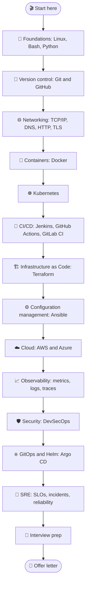
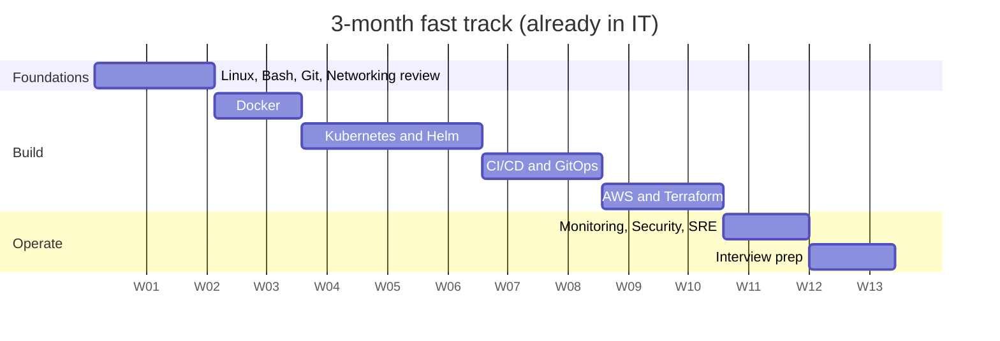
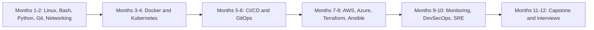
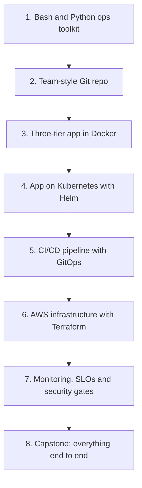
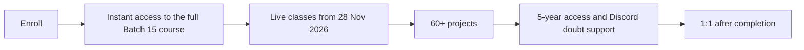

# 🗺️ The Ultimate DevOps Roadmap (2026)

<!-- DEVOPS-SHACK:HEADER -->

  
  
  
  
  

Part of <b><a href="https://github.com/jaiswaladi246/DevOps-Cloud-Interview-Preparation-by-DevOps-Shack">DevOps &amp; Cloud Interview Preparation</a></b> — created by <b><a href="https://www.youtube.com/@devopsshack">DevOps Shack</a></b>. Free to learn from; please credit DevOps Shack when sharing.

<!-- /DEVOPS-SHACK:HEADER -->

**From your first Linux command to your DevOps offer letter, phase by phase.**
Built on top of every topic in this repo, with milestones, timelines and the projects that actually get you hired.

[🏠 Home](../README.md)

---

## 📍 Contents

- [👋 Who this is for](#-who-this-is-for)
- [🧭 How to use this roadmap](#-how-to-use-this-roadmap)
- [🌌 The big picture](#-the-big-picture)
- [🧱 The roadmap, phase by phase](#-the-roadmap-phase-by-phase)
- [🛣️ Pick your track](#%EF%B8%8F-pick-your-track)
- [📅 The weekly study system](#-the-weekly-study-system)
- [🏆 Projects that get you hired](#-projects-that-get-you-hired)
- [🎯 The interview preparation plan](#-the-interview-preparation-plan)
- [⚠️ Common mistakes](#%EF%B8%8F-common-mistakes)
- [🚀 Want to learn all of this live?](#-want-to-learn-all-of-this-live--devops-shack-batch-16)

---

## 👋 Who this is for

DevOps doesn't have one entry door. In our experience, people arrive from four very different places, and each of them needs a slightly different path through the same material.

**🎓 Freshers.** You're in college or just out of it, and you've never touched a production server. That's fine. You have the one thing working engineers don't: time. Your job is to build depth, not collect tool names. Follow every phase in order, do every lab, and treat the portfolio projects as your work experience.

**🔀 Career switchers.** You're in testing, support, networking, data or a non-tech role, and you want in. You already understand how companies ship software and why things break. Your advantage is context; your gap is hands-on depth. The 6-month track is built for you.

**🛠️ Sysadmins and developers.** You already live in Linux, or you already write code every day. A sysadmin can skim Phase 0 and spend that time on pipelines and Kubernetes. A developer can skim Git and spend extra time on networking and Linux internals, which is where developers usually get caught in interviews. The 3-month fast track fits you.

**🚀 Working DevOps engineers preparing to switch.** You do this job already, but your current company uses one cloud, one CI tool and one way of deploying. Interviews will push you outside that bubble. Use the phases as a gap analysis: tick what you've done in production, and spend your time on the unticked boxes, the scenario banks and the [Real-World Interview](../20-real-world-interview/README.md) section.

> **One honest note before we start:** nobody learns all of this in a month. The roadmap is long because the job is broad. What matters is that each week you can do something real that you couldn't do the week before.

---

## 🧭 How to use this roadmap

Read this page once end to end, then come back to it every Monday.

Each phase below follows the same shape, so you always know where you are:

- **Why it matters in the job** tells you what this skill looks like on a real team, so you know what you're aiming for.
- **What to learn** is a checklist of real subtopics. Copy it into your notes and tick boxes as you go.
- **Study in this repo** links the exact folders and files to work through.
- **Milestone project** is the one thing you must build before moving on.
- **You're ready to move on when…** is a self-check. If you can't do every line without looking things up, stay in the phase a little longer.
- **Time** gives an honest range for someone studying 2–3 hours on weekdays and 5–6 hours on weekends.

Phases overlap in real life. You'll keep using Linux in every phase, and you'll keep writing Bash long after Phase 0. That's the point: each phase stacks on the previous one rather than replacing it.

---

## 🌌 The big picture

This is the whole journey on one screen. Every box is a skill area; every arrow means "this builds on that".

You'll notice cloud sits after IaC in this chart. In practice you'll create your first EC2 instance much earlier, around Phase 0 or 1, just to have a Linux box to play with. The chart shows where cloud becomes a **deep** skill: once you can provision it with code and configure it automatically, you start thinking about it the way production teams do.

Here's how those skill areas group into the nine phases of this roadmap:

```mermaid
flowchart LR
    P0["Phase 0 · Foundations"] --> P1["Phase 1 · Git"]
    P1 --> P2["Phase 2 · Networking"]
    P2 --> P3["Phase 3 · Docker"]
    P3 --> P4["Phase 4 · Kubernetes"]
    P4 --> P5["Phase 5 · CI/CD"]
    P5 --> P6["Phase 6 · IaC, Config and Cloud"]
    P6 --> P7["Phase 7 · Observability and Security"]
    P7 --> P8["Phase 8 · GitOps, Helm and SRE"]
    P8 --> IP["🎯 Interview prep"]
```

---

## 🧱 The roadmap, phase by phase

### 🐧 Phase 0 · Foundations: Linux, Bash and Python

⏱️ **Time:** 4–6 weeks (1–2 weeks if you're already a sysadmin)

**Why it matters in the job**

Almost everything we run in production ends up on a Linux machine: the container host, the Kubernetes node, the CI runner, the bastion. When a deploy fails at 2 AM, the first thing you do is SSH in and read logs, check disk, check memory, check which process is holding a port. Bash is how we glue tools together, and Python is what we reach for once a script needs real error handling, an API call or more than about fifty lines.

Interviewers use Linux to filter candidates quickly. If you can't explain what happens when a disk fills up or how to find which process is eating CPU, the conversation rarely reaches Kubernetes.

**What to learn**

- [ ] Filesystem hierarchy: `/etc`, `/var/log`, `/proc`, `/home`, `/opt`, mount points
- [ ] Files and text: `ls`, `find`, `grep`, `sed`, `awk`, `cut`, `sort`, `uniq`, `tail -f`, pipes and redirection
- [ ] Users, groups and permissions: `chmod`, `chown`, octal modes, `sudo`, SUID, umask
- [ ] Processes: `ps`, `top`, `htop`, signals, `kill`, `nice`, zombies, `lsof`
- [ ] Services: `systemd` units, `systemctl`, `journalctl`, enabling a service on boot
- [ ] Disk and memory: `df`, `du`, `free`, inodes, swap, `lsblk`, mounting a volume
- [ ] Package managers: `apt` and `yum`/`dnf`, repositories, pinning versions
- [ ] SSH: key pairs, `~/.ssh/config`, `scp`, `rsync`, agent forwarding, hardening `sshd_config`
- [ ] Scheduling: `cron`, `crontab` syntax, systemd timers
- [ ] Bash scripting: variables, quoting, conditionals, loops, functions, exit codes, `set -euo pipefail`, `trap`
- [ ] Python basics: data types, functions, files, `subprocess`, `os`, `json`, `requests`, virtual environments
- [ ] Python for automation: `boto3` basics, argument parsing, logging, writing a small CLI

**Study in this repo**

- 🐧 [Linux](../01-linux/README.md): [concepts](../01-linux/concepts.md) · [troubleshooting](../01-linux/troubleshooting.md) · [scenarios](../01-linux/scenarios.md) · [production](../01-linux/production.md) · [lab](../01-linux/hands-on-lab.md) · [cheatsheet](../01-linux/cheatsheet.md)
- 🐚 [Shell Scripting](../12-shell-scripting/README.md): [concepts](../12-shell-scripting/concepts.md) · [scenarios](../12-shell-scripting/scenarios.md) · [troubleshooting](../12-shell-scripting/troubleshooting.md) · [lab](../12-shell-scripting/hands-on-lab.md) · [assignments](../12-shell-scripting/assignments.md)
- 🐍 [Python for DevOps](../13-python-for-devops/README.md): [concepts](../13-python-for-devops/concepts.md) · [scenarios](../13-python-for-devops/scenarios.md) · [lab](../13-python-for-devops/hands-on-lab.md) · [assignments](../13-python-for-devops/assignments.md)

**🛠️ Milestone project: the server health toolkit**

Spin up a small Linux VM (local or a free-tier cloud instance). Write a Bash script that reports CPU, memory, disk and top processes, and alerts when disk crosses 80%. Schedule it with cron. Then rewrite the same check in Python, add proper logging and a `--threshold` flag, and run it as a systemd service. Put both versions in a Git repo with a clear README.

**✅ You're ready to move on when…**

- You can find out why a server is slow using only the terminal, and explain each command you ran.
- You can write a 50-line Bash script that fails safely, without copying a template.
- You can create a user, give them SSH key access and sudo rights, and lock down password login.
- You can explain the difference between a process, a service and a cron job.

---

### 🌿 Phase 1 · Version control: Git and GitHub

⏱️ **Time:** 1–2 weeks

**Why it matters in the job**

Git is the front door to every pipeline. In most teams, nothing reaches production unless it went through a pull request, and the branch strategy decides how releases, hotfixes and rollbacks work. You'll also store infrastructure code, Kubernetes manifests and pipeline definitions in Git, so a bad merge can break far more than application code.

**What to learn**

- [ ] How Git stores data: commits, trees, blobs, the staging area, `HEAD`
- [ ] Daily workflow: `clone`, `add`, `commit`, `push`, `pull`, `fetch`, `status`, `log --oneline --graph`
- [ ] Branching and merging: fast-forward vs merge commits, resolving conflicts
- [ ] Rebase vs merge, interactive history cleanup, when **not** to rewrite history
- [ ] Undoing things: `restore`, `reset` (soft, mixed, hard), `revert`, `reflog`
- [ ] `stash`, `cherry-pick`, `tag`, `bisect`
- [ ] Branching strategies: trunk-based development, GitFlow, release branches
- [ ] Pull requests, code review, branch protection rules, CODEOWNERS
- [ ] `.gitignore`, keeping secrets out of history, and cleaning a leaked secret
- [ ] SSH vs HTTPS auth, personal access tokens, signed commits

**Study in this repo**

- 🌿 [Git & GitHub](../02-git/README.md): [concepts](../02-git/concepts.md) · [scenarios](../02-git/scenarios.md) · [troubleshooting](../02-git/troubleshooting.md) · [production](../02-git/production.md) · [lab](../02-git/hands-on-lab.md) · [assignments](../02-git/assignments.md) · [cheatsheet](../02-git/cheatsheet.md)

**🛠️ Milestone project: a team-style repository**

Create a repo for your Phase 0 toolkit and run it like a team would: protected `main`, feature branches, pull requests with a template, a CODEOWNERS file, semantic version tags and a CHANGELOG. Deliberately create a merge conflict and resolve it. Deliberately commit a fake secret, then remove it from history properly.

**✅ You're ready to move on when…**

- You can recover a commit you "lost" with `reset --hard`.
- You can explain when you'd use `revert` instead of `reset` on a shared branch.
- You can describe your team's branching strategy and defend why it fits.

---

### 🌐 Phase 2 · Networking

⏱️ **Time:** 2–3 weeks

**Why it matters in the job**

Most "the app is down" incidents we deal with turn out to be networking: a security group rule, a DNS record that didn't update, a certificate that expired, a load balancer health check pointing at the wrong path. Kubernetes and cloud networking are built on top of the same fundamentals, so this phase pays you back in every phase after it.

**What to learn**

- [ ] OSI and TCP/IP models, and which layer each tool works at
- [ ] IP addressing, subnets, CIDR notation, private vs public ranges
- [ ] TCP vs UDP, the three-way handshake, ports, connection states
- [ ] DNS: record types (A, AAAA, CNAME, MX, TXT), resolution flow, TTL, `/etc/resolv.conf`
- [ ] HTTP and HTTPS: methods, status codes, headers, keep-alive, HTTP/2
- [ ] TLS: certificates, chains, handshake, SNI, renewing with Let's Encrypt
- [ ] Routing, NAT, gateways, and how a packet leaves a private subnet
- [ ] Load balancing: L4 vs L7, health checks, sticky sessions
- [ ] Reverse proxies with Nginx, forward proxies, VPNs
- [ ] Firewalls: `iptables`/`nftables`, `ufw`, cloud security groups vs network ACLs
- [ ] Debugging tools: `ping`, `traceroute`, `dig`, `nslookup`, `curl -v`, `ss`, `netstat`, `tcpdump`, `nc`

**Study in this repo**

- 🌐 [Networking](../03-networking/README.md): [concepts](../03-networking/concepts.md) · [scenarios](../03-networking/scenarios.md) · [troubleshooting](../03-networking/troubleshooting.md) · [production](../03-networking/production.md) · [lab](../03-networking/hands-on-lab.md) · [assignments](../03-networking/assignments.md) · [cheatsheet](../03-networking/cheatsheet.md)

**🛠️ Milestone project: a TLS-terminated reverse proxy**

Run two small backend apps on one VM, put Nginx in front as a reverse proxy, route by path, add a free TLS certificate on a real domain (or a self-signed one if you don't have a domain), and lock the backends down so only Nginx can reach them. Then break it on purpose: wrong DNS, closed port, expired cert. Fix each one with the debugging tools above and write down what you saw.

**✅ You're ready to move on when…**

- You can explain, step by step, what happens when you type a URL in the browser and press Enter.
- You can split a `/16` into subnets without a calculator.
- Given "connection refused" vs "connection timed out", you know which layer to look at first.

---

### 🐳 Phase 3 · Containers: Docker

⏱️ **Time:** 2–3 weeks

**Why it matters in the job**

Containers are how almost every team packages software today. When a build is slow, an image is 2 GB, or "it works on my machine" shows up in a ticket, it lands on the DevOps engineer's desk. Kubernetes, CI pipelines and cloud deployments all assume you understand images and containers deeply.

**What to learn**

- [ ] Images vs containers, layers, the build cache, registries
- [ ] Writing good Dockerfiles: multi-stage builds, small base images, `.dockerignore`, non-root users
- [ ] `docker run` flags you'll use daily: ports, volumes, env vars, restart policies, resource limits
- [ ] Networking: bridge, host, user-defined networks, container DNS
- [ ] Storage: volumes vs bind mounts, data persistence
- [ ] Docker Compose for multi-container apps
- [ ] Image security: scanning with Trivy, pinning versions, secrets that must never be baked in
- [ ] Debugging: `logs`, `exec`, `inspect`, exit codes, health checks

**Study in this repo**

- 🐳 [Docker](../04-docker/README.md): [concepts](../04-docker/concepts.md) · [scenarios](../04-docker/scenarios.md) · [troubleshooting](../04-docker/troubleshooting.md) · [production](../04-docker/production.md) · [lab](../04-docker/hands-on-lab.md) · [assignments](../04-docker/assignments.md) · [cheatsheet](../04-docker/cheatsheet.md)

**🛠️ Milestone project: a three-tier app in containers**

Containerise a frontend, an API and a database. Use multi-stage builds to get the API image under 150 MB, run everything with Docker Compose, add health checks, and push the images to Docker Hub or GitHub Container Registry with version tags. Scan the images and fix every HIGH finding you can.

**✅ You're ready to move on when…**

- You can explain why your image is the size it is, layer by layer.
- You can debug a container that exits immediately on start.
- You can explain the difference between `CMD` and `ENTRYPOINT` without looking it up.

---

### ☸️ Phase 4 · Orchestration: Kubernetes and Helm

⏱️ **Time:** 4–6 weeks

**Why it matters in the job**

Kubernetes is where most DevOps interviews spend the most time, and where most production incidents happen. You'll deploy to it, debug it at 2 AM, scale it, secure it and upgrade it. Helm is how teams package and version what runs on it.

**What to learn**

- [ ] Architecture: API server, etcd, scheduler, controller manager, kubelet, kube-proxy
- [ ] Core objects: Pods, Deployments, ReplicaSets, Services, ConfigMaps, Secrets, Namespaces
- [ ] Networking: Service types, Ingress, DNS inside the cluster, NetworkPolicies
- [ ] Storage: PersistentVolumes, PVCs, StorageClasses, StatefulSets
- [ ] Scheduling: requests and limits, taints and tolerations, affinity, PodDisruptionBudgets
- [ ] Health: liveness, readiness and startup probes; rollouts and rollbacks
- [ ] Scaling: HPA, cluster autoscaler or Karpenter
- [ ] Security: RBAC, service accounts, Pod Security Admission
- [ ] Debugging: `describe`, `logs --previous`, events, `exec`, CrashLoopBackOff and ImagePullBackOff
- [ ] Helm: chart structure, values, templating, releases, upgrades and rollbacks

**Study in this repo**

- ☸️ [Kubernetes](../05-kubernetes/README.md): [concepts](../05-kubernetes/concepts.md) · [scenarios](../05-kubernetes/scenarios.md) · [troubleshooting](../05-kubernetes/troubleshooting.md) · [production](../05-kubernetes/production.md) · [lab](../05-kubernetes/hands-on-lab.md)
- ⎈ [Helm](../16-helm/README.md): [concepts](../16-helm/concepts.md) · [scenarios](../16-helm/scenarios.md) · [troubleshooting](../16-helm/troubleshooting.md) · [lab](../16-helm/hands-on-lab.md)

**🛠️ Milestone project: your three-tier app on Kubernetes**

Deploy the Phase 3 app to a local kind or minikube cluster, then package it as a Helm chart with per-environment values. Add probes, resource limits, an HPA, an Ingress and a NetworkPolicy that only lets the API talk to the database. Upgrade it, break it with a bad image tag, and roll back.

**✅ You're ready to move on when…**

- You can walk through what happens, component by component, when you run `kubectl apply`.
- You can debug a Pod stuck in Pending, CrashLoopBackOff or ImagePullBackOff in under 5 minutes.
- You can explain why a Service has no endpoints.

---

### 🔁 Phase 5 · CI/CD: automate the path to production

⏱️ **Time:** 3–4 weeks

**Why it matters in the job**

CI/CD is the heart of the DevOps role: every commit should be built, tested, scanned and deployed automatically and safely. You'll own pipelines, fix them when they break, and make them faster. Most companies use one of Jenkins, GitHub Actions or GitLab CI/CD, so learn one deeply and know how the others differ.

**What to learn**

- [ ] CI vs continuous delivery vs continuous deployment
- [ ] Pipeline stages: build, unit test, static analysis, image build, scan, deploy, smoke test
- [ ] Artifacts, caching, versioning and promotion between environments
- [ ] Secrets in pipelines and OIDC instead of long-lived keys
- [ ] Deployment strategies: rolling, blue/green, canary, feature flags
- [ ] Jenkins: Jenkinsfile, agents, shared libraries
- [ ] GitHub Actions: workflows, matrix, reusable workflows, environments
- [ ] GitOps with ArgoCD: pull-based deploys, sync, self-heal, app-of-apps

**Study in this repo**

- 🔁 [CI/CD fundamentals](../06-cicd/README.md) · 🤵 [Jenkins](../14-jenkins/README.md) · ⚡ [GitHub Actions](../15-github-actions/README.md) · 🔄 [GitOps & ArgoCD](../17-gitops-argocd/README.md)

**🛠️ Milestone project: commit-to-cluster pipeline**

Build a pipeline that runs tests, builds and scans the image, pushes it to a registry, and updates the Helm values in a config repo. Let ArgoCD deploy it to dev automatically and to prod after a manual approval. Measure the pipeline time, then cut it in half with caching.

**✅ You're ready to move on when…**

- You can draw your pipeline from commit to production and explain every gate.
- You can explain how you'd roll back a bad release in under 5 minutes.
- No long-lived cloud keys live in your CI secrets.

---

### ☁️ Phase 6 · Cloud and Infrastructure as Code

⏱️ **Time:** 5–7 weeks

**Why it matters in the job**

Almost every DevOps job runs on a cloud, usually AWS, often Azure as well. You'll build networks, clusters and databases, and you must do it with code so it's reviewable and repeatable. Terraform creates the infrastructure; Ansible configures the machines.

**What to learn**

- [ ] AWS core: IAM, VPC, EC2, S3, RDS, ELB, Route 53, CloudWatch, EKS, ECR
- [ ] Azure basics: subscriptions, resource groups, VNets, AKS, ACR, Key Vault, Entra ID
- [ ] Terraform: providers, resources, variables, outputs, modules, state, remote backends with locking
- [ ] Terraform workflow in teams: plan in PRs, drift detection, workspaces vs directories
- [ ] Ansible: inventory, playbooks, roles, idempotency, Vault
- [ ] Cost basics: right-sizing, Spot, Savings Plans, the NAT Gateway trap

**Study in this repo**

- ☁️ [AWS](../09-aws/README.md) · 🔷 [Azure](../19-azure/README.md) · 🏗️ [Terraform](../07-terraform/README.md) · ⚙️ [Ansible](../08-ansible/README.md)

**🛠️ Milestone project: production-style infrastructure from code**

Use Terraform to build a VPC with public and private subnets, an EKS cluster and an RDS database, with remote state in S3 and locking. Use Ansible to configure a bastion host. Deploy your app from Phase 5 onto it. Then destroy everything with one command, and check the bill.

**✅ You're ready to move on when…**

- You can explain what's in Terraform state and why losing it hurts.
- You can explain how a packet gets from the internet to a Pod in a private subnet.
- You can recreate your whole environment from an empty account.

---

### 📈 Phase 7 · Observability, Security and SRE

⏱️ **Time:** 4–5 weeks

**Why it matters in the job**

Shipping is only half the job; the other half is knowing when things break, why, and making sure they break less. Monitoring, security scanning and reliability practices are what separate a junior from a senior DevOps engineer in interviews.

**What to learn**

- [ ] Metrics, logs and traces; RED, USE and the four golden signals
- [ ] Prometheus, PromQL, Alertmanager, Grafana dashboards
- [ ] Logs with Loki or ELK; tracing with OpenTelemetry
- [ ] SLIs, SLOs, error budgets and burn-rate alerts
- [ ] Incident response, on-call and blameless postmortems
- [ ] DevSecOps: secret scanning, SAST, dependency and image scanning, SBOMs, image signing
- [ ] Kubernetes security: RBAC, policies with Kyverno or OPA, runtime security

**Study in this repo**

- 📈 [Monitoring](../10-monitoring/README.md) · 🛡️ [DevSecOps](../11-devsecops/README.md) · 🚨 [SRE & Reliability](../18-sre/README.md)

**🛠️ Milestone project: observable, secure and reliable**

Add kube-prometheus-stack and Loki to your cluster, define one SLO for your API with a burn-rate alert, and build a dashboard. Add gitleaks, Trivy and Cosign signing to your pipeline. Then run a chaos test (kill Pods, add latency), handle it like an incident, and write the postmortem.

**✅ You're ready to move on when…**

- You can write a PromQL query for error rate and p95 latency.
- You can explain an error budget to a product manager.
- Your pipeline blocks a build with a critical vulnerability.

---

### 🎯 Phase 8 · Interview readiness

⏱️ **Time:** 3–4 weeks (overlap it with your job search)

**Why it matters**

Knowing the tools and passing the interview are two different skills. Interviews test how you think through scenarios, how you debug under pressure, and how clearly you explain your own projects.

**What to do**

- [ ] Work through every **scenarios** and **troubleshooting** bank for the tools on your target job descriptions
- [ ] Do the [Real-World Interview](../20-real-world-interview/README.md) section: production scenarios, incident troubleshooting, live scripting tasks, rapid-fire, behavioral and projects
- [ ] Build the [capstone project](../20-real-world-interview/hands-on-lab.md)
- [ ] Do the [25 mock interview drills](../20-real-world-interview/assignments.md), out loud and timed
- [ ] Read the [night-before cheatsheet](../20-real-world-interview/cheatsheet.md)

---

## 🛣️ Pick your track

Same phases, different speeds. Pick the one that matches where you're starting from.

**⚡ 3-month fast track** is for sysadmins, developers and testers who already work in IT. Skim what you know, go deep on Kubernetes, CI/CD and cloud, and start interviewing in month three.

**🔀 6-month standard track** is for career switchers. Spend 3–4 weeks on Phases 0–2, then roughly a month each on containers plus Kubernetes, CI/CD, cloud plus IaC, and observability plus security, with the last month on interview prep and the capstone.

**🎓 9–12 month fresher track** follows every phase in order, finishes every 🟢 and 🟡 assignment, builds all 20 labs and adds two extra weeks of Linux and networking at the start. Your projects become your experience.

---

## 📅 The weekly study system

A system beats motivation. This is the routine we recommend for 2–3 hours on weekdays and 5–6 hours on weekends.

| Day | What to do |
|---|---|
| Monday | Read the topic README and its diagrams. Write your own one-page summary. |
| Tuesday | Concepts bank: try every question before opening the answer. |
| Wednesday | Hands-on lab, part 1 |
| Thursday | Hands-on lab, part 2, and break things on purpose |
| Friday | Scenarios bank, answering out loud |
| Saturday | Troubleshooting and production banks, plus 3–5 assignments |
| Sunday | Revise with the cheatsheet, and push your work to GitHub |

**How to use the question banks.** Every answer is hidden behind a click, so read the question, answer it out loud or on paper, and only then open the answer. Every question is tagged by level:

- 🟢 **Beginner**: what every candidate should answer, including freshers
- 🟡 **Intermediate**: what 1–3 years of experience looks like
- 🔴 **Advanced**: what separates senior candidates

Start with the 🟢 questions in each bank, come back for 🟡 after the lab, and leave 🔴 for your second pass.

---

## 🏆 Projects that get you hired

Recruiters and interviewers care about what you built and how well you can explain it. Climb this ladder; each project reuses the one before it.

For each project, keep a README with an architecture diagram, the problems you hit and how you fixed them, and the numbers (image size, pipeline time, cost). Those three things are what you'll talk about in interviews.

---

## 🎯 The interview preparation plan

**The last 30 days before interviews:**

- **Week 1:** Rapid-fire round and concepts banks for your target stack. Fix every gap you find.
- **Week 2:** Scenarios and troubleshooting banks. Answer out loud; record yourself once.
- **Week 3:** Production-scenarios and incident-troubleshooting banks in the Real-World Interview section. Do 10 mock drills.
- **Week 4:** Polish your CV and project stories with the projects and experience bank and behavioral STAR answers. Do the remaining mock drills, timed.

**Talking about your projects.** For every project on your CV, be ready to explain the architecture, why you chose each tool, one thing that broke and how you fixed it, and what you'd improve. Interviewers dig into exactly these.

---

## ⚠️ Common mistakes

- **Collecting tools instead of depth.** Ten tools at a tutorial level lose to five tools you've actually debugged.
- **Skipping Linux and networking.** These are where most candidates get caught, at every level.
- **Watching without building.** If you didn't type it and break it, you don't know it yet.
- **Memorising answers.** Interviewers change the scenario by one detail to see if you understand it.
- **No public proof.** Push every lab and project to GitHub with a clear README.
- **Learning alone.** A community and a mentor shorten the path by months.

---

## 🚀 Want to learn all of this live? — DevOps Shack Batch 16

If you'd rather go through this roadmap with a live instructor, real projects and doubt support, this is exactly what our **DevSecOps + Cloud + AI bootcamp (Batch 16)** covers.

- 📅 **Live classes start 28 November 2026**, 3 months, **300+ hours** of live and recorded content, taught in English
- 🕗 **Weekends:** Saturday and Sunday, 8:00–10:30 PM IST, plus occasional extra Wednesday sessions for heavy topics
- 🛠️ **60+ projects**, including 10 flagship ones: Jenkins CI/CD with SAST and DAST, GitOps app-of-apps, Azure DevOps, IaC with Terraform and Ansible via GitHub Actions, monitoring with Prometheus, Loki, Grafana Alloy and Tempo, GitHub Actions multi-tier deploy to EKS/AKS, secure GitLab CI/CD, Kubernetes network policy, ingress, service mesh and Gateway API with CI/CD, MLOps deploy to Kubernetes, and agentic AI with DevOps
- ☁️ **AWS** for infrastructure; **CI/CD** with Jenkins, GitHub Actions, GitLab CI/CD and Azure DevOps
- 🎁 **Recorded courses included:** Python for DevOps, MLOps Fundamentals, Agentic AI and MCP Servers
- ♾️ **5-year access** with Discord doubt support, and 1:1 after completion
- ⚡ **Start today:** on enrollment you get immediate access to the full Batch 15 course, so you can begin before live classes start

👉 **Enroll at [devopsshack.com](https://devopsshack.com)** · Coupon **BATCH16** (India) · **DEVOPS16** (outside India)

📺 Free lessons on YouTube: [DevOps Shack](https://www.youtube.com/@devopsshack) · Hindi: [@shackverse](https://www.youtube.com/@shackverse)

---

### ⭐ If this roadmap helps you, star the repo

It helps more engineers find it, and it keeps us adding more.

[🏠 Back to Home](../README.md)

<!-- DEVOPS-SHACK:FOOTER -->
---

### 🚀 Made with ❤️ by [DevOps Shack](https://www.youtube.com/@devopsshack)

**Learn DevOps, DevSecOps, Cloud and Kubernetes the practical way.**

[▶️ YouTube — DevOps Shack](https://www.youtube.com/@devopsshack) · [▶️ Hindi — @shackverse](https://www.youtube.com/@shackverse) · [🎓 devopsshack.com](https://devopsshack.com) · [📸 Instagram @devopsshack](https://www.instagram.com/devopsshack)

[🏠 Back to Home](../README.md) · [⭐ Star the original repo](https://github.com/jaiswaladi246/DevOps-Cloud-Interview-Preparation-by-DevOps-Shack)

© DevOps Shack · Licensed CC BY-NC-SA 4.0 · If you found this copy anywhere other than <a href="https://github.com/jaiswaladi246/DevOps-Cloud-Interview-Preparation-by-DevOps-Shack">github.com/jaiswaladi246</a>, the original and latest version is maintained by DevOps Shack.

<!-- /DEVOPS-SHACK:FOOTER -->
