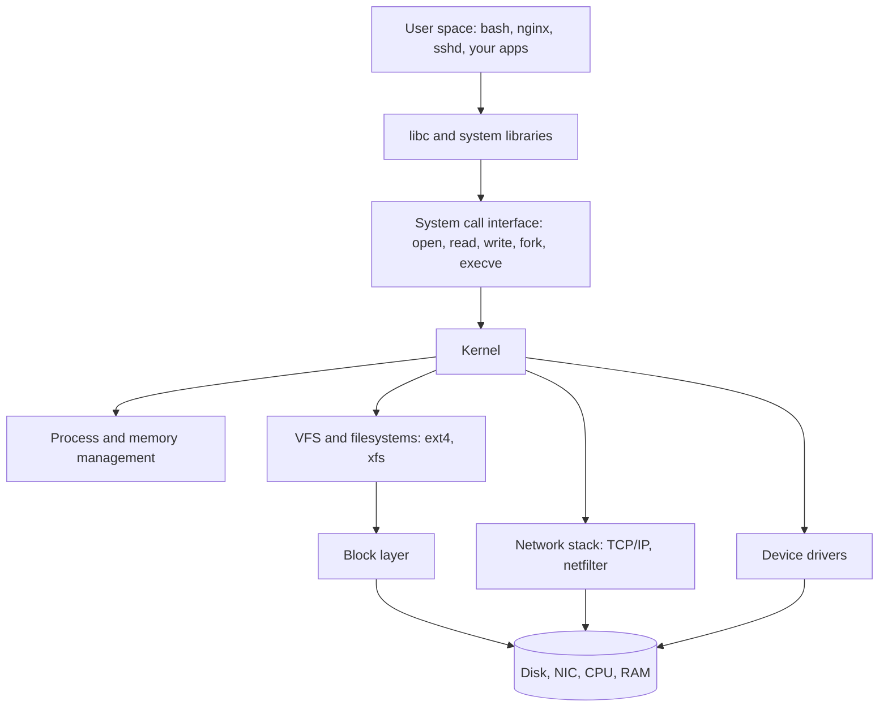
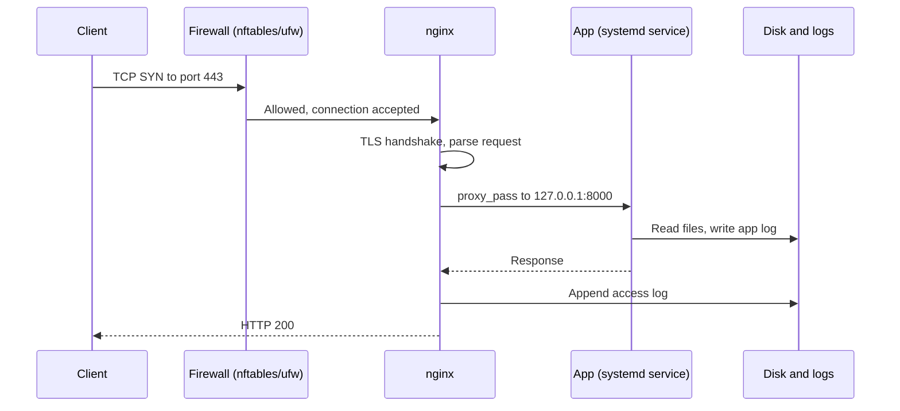
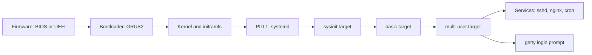
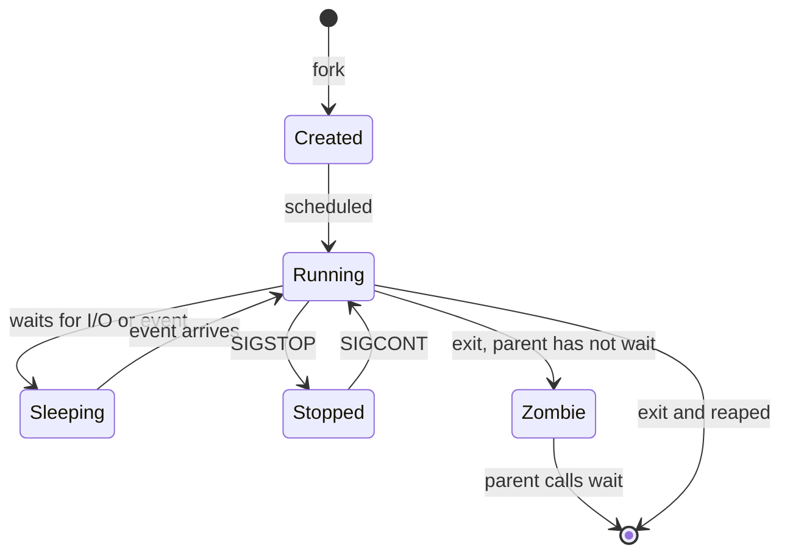
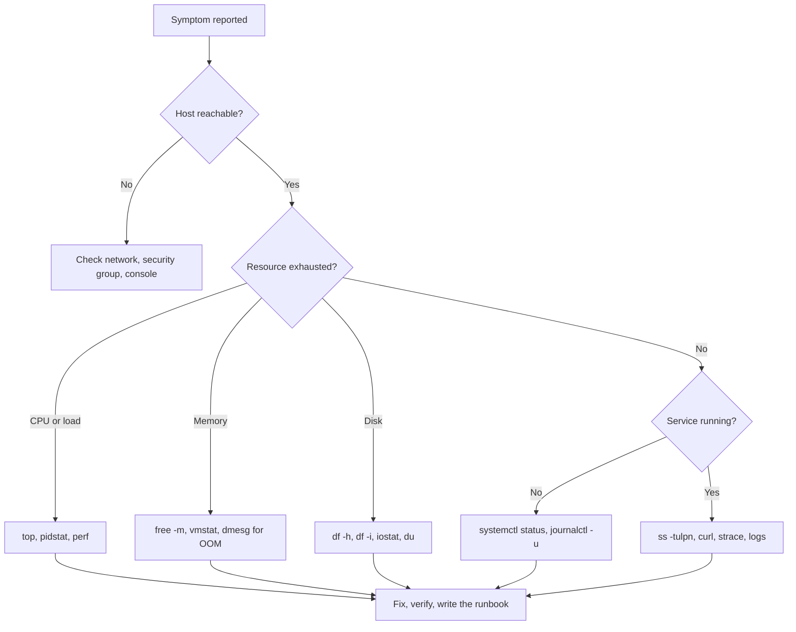

# Linux — DevOps & Cloud Interview Preparation

<!-- DEVOPS-SHACK:HEADER -->

  
  
  
  
  

Part of <b><a href="https://github.com/jaiswaladi246/DevOps-Cloud-Interview-Preparation-by-DevOps-Shack">DevOps &amp; Cloud Interview Preparation</a></b> — created by <b><a href="https://www.youtube.com/@devopsshack">DevOps Shack</a></b>. Free to learn from; please credit DevOps Shack when sharing.

<!-- /DEVOPS-SHACK:HEADER -->

> Everything a DevOps / SRE / Cloud engineer needs to know about Linux, from `ls` to cgroups, with 800 interview questions, a production-grade lab, 25 assignments and a cheatsheet.

[🏠 Home](../README.md)

## What you'll master

- The Linux boot sequence, process lifecycle, signals and the difference between a process, a thread and a container
- Filesystem hierarchy, inodes, hard and soft links, permissions, ACLs, setuid/setgid/sticky bit
- Users, groups, `sudo`, PAM and SSH key-based access with hardened `sshd_config`
- `systemd`: units, targets, timers, dependencies, journald and writing a production service unit
- Storage: partitions, LVM, `ext4` vs `xfs`, `fstab`, inode and disk-full troubleshooting
- Networking: `ip`, `ss`, routing, DNS resolution, `iptables`/`nftables`/`ufw`, and `tcpdump`
- Memory, CPU and I/O performance: `top`, `vmstat`, `iostat`, `sar`, OOM killer, load average
- Bash scripting for automation: exit codes, `set -euo pipefail`, traps, `cron` and `systemd` timers
- Containers' building blocks: namespaces, cgroups v2, capabilities, seccomp
- Troubleshooting method: from symptom to root cause using `strace`, `lsof`, `dmesg` and `journalctl`

## Architecture: how a Linux system fits together

Every command you type crosses from user space into the kernel through system calls. Knowing which layer owns a problem is half of troubleshooting.

User programs never touch hardware directly. When `nginx` serves a file it calls `open()` and `sendfile()`, the VFS resolves the path to an inode, the block layer fetches pages (or the page cache answers), and the network stack pushes bytes out through netfilter and the NIC driver. A slow request can be a slow app, a full page cache miss, a saturated disk or a dropped packet, and each layer has its own tools.

## Request flow: a web request hitting a Linux server

In production the firewall only exposes 22 (from trusted IPs), 80 and 443. The application listens on loopback so it is unreachable except through nginx. Logs go to disk and are rotated by `logrotate`, so a busy server does not fill `/var`.

## Lifecycle: from power-on to a running service

The kernel mounts the initramfs, finds the real root filesystem and starts `systemd` as PID 1. systemd then walks its target dependency graph in parallel. If a unit in `multi-user.target` fails, the box still boots and you debug with `systemctl --failed` and `journalctl -b -p err`. If the root filesystem cannot be mounted you land in the initramfs emergency shell instead.

## Process states and signals

A zombie (`Z` in `ps`) uses no CPU or memory, only a PID table slot, and you cannot kill it. You fix it by fixing or restarting the parent. A process in uninterruptible sleep (`D`) is waiting on I/O, often NFS or a dying disk, and also ignores `kill -9` until the I/O returns.

## Troubleshooting workflow

We always go resources first (CPU, memory, disk, network), then the service, then the application. Eighty percent of incidents are a full disk, a full inode table, an OOM kill, a dead service or a firewall change.

## Core concepts in 10 minutes

### Everything is a file

Regular files, directories, devices (`/dev/sda`), pipes, sockets and even kernel state (`/proc`, `/sys`) are exposed through the file interface. That is why `cat /proc/meminfo` and `echo 1 > /proc/sys/net/ipv4/ip_forward` work. Standard streams are file descriptors 0 (stdin), 1 (stdout) and 2 (stderr), so `cmd > out.log 2>&1` redirects both.

### Filesystem hierarchy

`/etc` holds configuration, `/var` holds changing data (logs in `/var/log`, spool, caches), `/usr` holds installed software, `/home` and `/root` hold user data, `/tmp` is world-writable scratch, `/proc` and `/sys` are virtual, `/dev` is devices and `/opt` is for third-party software. On modern distros `/bin`, `/sbin` and `/lib` are symlinks into `/usr`.

### Permissions

Each file has an owner, a group and mode bits for user, group and other: read (4), write (2), execute (1). `chmod 640 file` means owner rw, group r, others none. Directories need `x` to be entered. Special bits: setuid (`4000`, run as file owner, e.g. `passwd`), setgid (`2000`, new files inherit the group) and sticky (`1000`, only owners delete in `/tmp`). `umask 022` makes new files 644 and new directories 755.

### Processes and signals

Every process has a PID, a parent and a state. `SIGTERM` (15) asks nicely and can be handled, `SIGKILL` (9) cannot be caught, `SIGHUP` (1) usually means reload config, `SIGINT` is Ctrl-C. Always try `kill -15` first so the app can flush and close connections. Load average counts runnable plus uninterruptible tasks, so compare it with the number of cores (`nproc`), not with 1.

### systemd

Services are described by unit files in `/usr/lib/systemd/system` (packages) and `/etc/systemd/system` (yours, takes precedence). Use `systemctl daemon-reload` after editing, `enable --now` to start at boot and immediately, and `journalctl -u name -f` to follow logs. Hardening options such as `NoNewPrivileges=`, `ProtectSystem=` and `PrivateTmp=` cost nothing and shrink the blast radius of a compromised service.

### Storage

A disk is split into partitions, optionally pooled with LVM (PV, VG, LV), then formatted (`mkfs.ext4`, `mkfs.xfs`) and mounted. `df -h` shows blocks used, `df -i` shows inodes used, and a disk can be "full" on either. `xfs` can grow but not shrink, `ext4` can do both offline. Always mount with `UUID=` in `/etc/fstab` and test with `mount -a` before rebooting.

### Networking

`ip a` and `ip r` show addresses and routes, `ss -tulpn` shows listening sockets and their processes, `dig` tests DNS, `curl -v` tests HTTP, `tcpdump -i any port 443` shows packets. Name resolution order is set in `/etc/nsswitch.conf`, and on systemd distros `resolvectl status` shows the real resolver. Firewalls are netfilter underneath, fronted by `iptables`, `nftables`, `ufw` or `firewalld`.

### SSH

Use key pairs (`ssh-keygen -t ed25519`), put the public key in `~/.ssh/authorized_keys` (directory 700, file 600) and in `sshd_config` set `PasswordAuthentication no`, `PermitRootLogin no` and `AllowUsers`. Always validate with `sshd -t` and keep a second session open before reloading.

### Performance triage

CPU: `top`, `mpstat -P ALL 1`, `pidstat 1`. Memory: `free -m` (look at `available`, not `free`), `vmstat 1` (watch `si`/`so` for swapping). Disk: `iostat -xz 1` (`%util`, `await`), `iotop`. The USE method (Utilization, Saturation, Errors) for each resource gives a systematic path.

### Automation

Write scripts with `#!/usr/bin/env bash` and `set -euo pipefail`, quote variables, use `trap` for cleanup and exit non-zero on failure so cron mail, systemd and CI notice. Prefer `systemd` timers when you want logs, dependencies and `Persistent=true` catch-up; use `cron` for simple jobs.

## Question banks

| Bank | Focus | Questions |
|------|-------|-----------|
| [Concepts](./concepts.md) | Internals, comparisons, "what happens when...", commands | 200 |
| [Scenarios](./scenarios.md) | "What would you do if..." situations | 200 |
| [Troubleshooting](./troubleshooting.md) | Real symptoms and exact error messages | 200 |
| [Production](./production.md) | Design, security, performance, trade-offs, rapid-fire | 200 |

## Learning path

**Beginner** 🟢
- [ ] Navigate the filesystem, use `ls`, `cd`, `cp`, `mv`, `rm`, `find`, `grep`
- [ ] Read and set permissions with `chmod`, `chown`, `umask`
- [ ] Create users and groups, use `sudo` safely
- [ ] Use pipes, redirection, `sort`, `uniq`, `cut`, `awk`, `sed`
- [ ] Manage packages with `apt` or `dnf`
- [ ] Start, stop and enable services with `systemctl`
- [ ] Set up SSH key login

**Intermediate** 🟡
- [ ] Write a production-quality systemd unit and a systemd timer
- [ ] Configure nginx as a reverse proxy and read its logs
- [ ] Schedule and monitor backups with cron and bash
- [ ] Extend a volume with LVM and fix `fstab` mistakes
- [ ] Debug with `ss`, `lsof`, `tcpdump`, `journalctl`
- [ ] Configure `ufw` or `nftables` rules and test them
- [ ] Set up `logrotate` and understand log growth

**Advanced** 🔴
- [ ] Explain and demonstrate namespaces and cgroups v2 by hand
- [ ] Trace a hung process with `strace`, `perf` and `/proc/<pid>/`
- [ ] Tune kernel parameters with `sysctl` for a high-traffic server
- [ ] Diagnose OOM kills, swap storms, and I/O saturation
- [ ] Harden a host (CIS-style): auditd, sshd, kernel parameters, minimal packages
- [ ] Recover an unbootable system from rescue mode

## Hands-on and reference

- [Hands-on lab: harden and automate a production Linux web server](./hands-on-lab.md)
- [Assignments: 25 graded exercises](./assignments.md)
- [Cheatsheet: commands and configs](./cheatsheet.md)

[🏠 Home](../README.md)

<!-- DEVOPS-SHACK:FOOTER -->
---

### 🚀 Made with ❤️ by [DevOps Shack](https://www.youtube.com/@devopsshack)

**Learn DevOps, DevSecOps, Cloud and Kubernetes the practical way.**

[▶️ YouTube — DevOps Shack](https://www.youtube.com/@devopsshack) · [▶️ Hindi — @shackverse](https://www.youtube.com/@shackverse) · [🎓 devopsshack.com](https://devopsshack.com) · [📸 Instagram @devopsshack](https://www.instagram.com/devopsshack)

[🏠 Back to Home](../README.md) · [⭐ Star the original repo](https://github.com/jaiswaladi246/DevOps-Cloud-Interview-Preparation-by-DevOps-Shack)

© DevOps Shack · Licensed CC BY-NC-SA 4.0 · If you found this copy anywhere other than <a href="https://github.com/jaiswaladi246/DevOps-Cloud-Interview-Preparation-by-DevOps-Shack">github.com/jaiswaladi246</a>, the original and latest version is maintained by DevOps Shack.

<!-- /DEVOPS-SHACK:FOOTER -->
