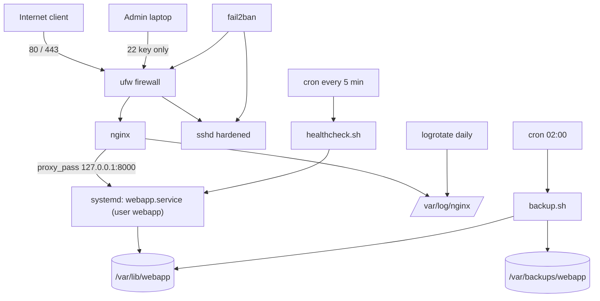

# Linux — Hands-on Lab: Harden and Automate a Production Web Server

<!-- DEVOPS-SHACK:HEADER -->
<p align="center">
  <a href="https://www.youtube.com/@devopsshack"></a>
  <a href="https://www.youtube.com/@shackverse"></a>
  <a href="https://devopsshack.com"></a>
  <a href="https://www.instagram.com/devopsshack"></a>
  <a href="https://github.com/jaiswaladi246/DevOps-Cloud-Interview-Preparation-by-DevOps-Shack"></a>
</p>
<p align="center"><sub>Part of <b><a href="https://github.com/jaiswaladi246/DevOps-Cloud-Interview-Preparation-by-DevOps-Shack">DevOps &amp; Cloud Interview Preparation</a></b> — created by <b><a href="https://www.youtube.com/@devopsshack">DevOps Shack</a></b>. Free to learn from; please credit DevOps Shack when sharing.</sub></p>
<!-- /DEVOPS-SHACK:HEADER -->

> One end-to-end project: take a fresh Ubuntu 24.04 server and turn it into a hardened, monitored, self-backing-up web host.

[⬅ Back to Linux](./README.md) · [🏠 Home](../README.md)

## Goal

By the end you will have a server where:

- Admin access is through a named sudo user with an SSH key; root login and passwords are disabled
- A small Python app runs as an unprivileged user under a hardened `systemd` unit that restarts on failure
- `nginx` terminates HTTP and reverse-proxies to the app on loopback only
- Logs are rotated by `logrotate`
- A bash script backs up the app data nightly via `cron`, with retention and failure logging
- A health-check script and basic tools tell you when disk, memory or the service is in trouble
- `ufw` allows only SSH, HTTP and HTTPS, and `fail2ban` bans brute-force attempts

## Architecture



## Prerequisites

- An Ubuntu 24.04 LTS VM (a cloud instance with a public IP, or a local VM with a bridged network) with at least 1 vCPU and 1 GB RAM
- Initial login as `root` or the default cloud user (`ubuntu`) with sudo
- An SSH key pair on your laptop: `ssh-keygen -t ed25519 -C "you@laptop"` if you do not have one
- Basic comfort with `vim` or `nano`

Everything below runs as root (`sudo -i`) unless noted. Commands target Ubuntu/Debian; the RHEL equivalents are `dnf`, `firewalld` and `/etc/nginx/conf.d`.

> Warning: Steps 2 and 3 can lock you out of the server. Keep one SSH session open and test from a second terminal before closing it.

---

## Step 1. Update the system and install packages

```bash
apt update && apt -y upgrade
apt -y install nginx ufw fail2ban python3 sysstat curl logrotate unattended-upgrades
timedatectl set-timezone UTC
hostnamectl set-hostname web01
```

Verify:

```bash
nginx -v && python3 --version
systemctl is-active nginx
```

Expected: nginx version printed, Python 3.12.x, and `active`.

## Step 2. Create the admin user and SSH key

```bash
adduser --disabled-password --gecos "" deploy
usermod -aG sudo deploy
install -d -m 700 -o deploy -g deploy /home/deploy/.ssh
```

On your **laptop**, copy your public key (or paste it manually):

```bash
ssh-copy-id -i ~/.ssh/id_ed25519.pub deploy@SERVER_IP
```

If `ssh-copy-id` is not available, on the server:

```bash
echo "ssh-ed25519 AAAA...your-public-key... you@laptop" >> /home/deploy/.ssh/authorized_keys
chown deploy:deploy /home/deploy/.ssh/authorized_keys
chmod 600 /home/deploy/.ssh/authorized_keys
```

Allow passwordless sudo only if you must (for automation); otherwise set a password with `passwd deploy`, since sudo needs one when the account has no password-less rule. For this lab:

```bash
echo 'deploy ALL=(ALL) NOPASSWD:ALL' > /etc/sudoers.d/90-deploy
chmod 440 /etc/sudoers.d/90-deploy
visudo -cf /etc/sudoers.d/90-deploy
```

Verify from a **new terminal on your laptop**:

```bash
ssh deploy@SERVER_IP 'sudo whoami'
```

Expected: `root`. Do not continue until this works.

## Step 3. Harden sshd

Use a drop-in file so package upgrades never overwrite your settings:

```bash
cat > /etc/ssh/sshd_config.d/10-hardening.conf <<'CONF'
PermitRootLogin no
PasswordAuthentication no
KbdInteractiveAuthentication no
PubkeyAuthentication yes
AllowUsers deploy
MaxAuthTries 3
LoginGraceTime 20
ClientAliveInterval 300
ClientAliveCountMax 2
X11Forwarding no
CONF
sshd -t && systemctl reload ssh
```

> On Ubuntu 24.04 SSH may be socket-activated and the unit is named `ssh`. On RHEL it is `sshd`. Also check `/etc/ssh/sshd_config.d/` for cloud-init files such as `50-cloud-init.conf` that set `PasswordAuthentication yes`; the first file read wins, and `10-` sorts before `50-`.

Verify effective settings and test from a **second terminal**:

```bash
sshd -T | grep -Ei 'permitrootlogin|passwordauthentication|allowusers|maxauthtries'
ssh root@SERVER_IP          # must be refused
ssh -o PubkeyAuthentication=no deploy@SERVER_IP   # must be refused
```

From now on log in as `deploy` and use `sudo`.

## Step 4. Firewall with ufw

```bash
ufw default deny incoming
ufw default allow outgoing
ufw allow OpenSSH
ufw allow 'Nginx Full'
ufw --force enable
ufw status verbose
```

If you only administer from a fixed IP, tighten SSH: `ufw delete allow OpenSSH` then `ufw allow from 203.0.113.10 to any port 22 proto tcp`.

Verify:

```bash
ufw status numbered
ss -tulpn | grep -E ':22|:80'
```

Expected: rules for 22, 80, 443 and the listeners owned by `sshd` and `nginx`.

## Step 5. Create the application and its service user

The app is a tiny Python HTTP server with a `/health` endpoint and a write counter stored on disk, enough to give the backup something real to protect.

```bash
useradd --system --create-home --home-dir /var/lib/webapp --shell /usr/sbin/nologin webapp
install -d -o root -g root -m 755 /opt/webapp
cat > /opt/webapp/app.py <<'PY'
#!/usr/bin/env python3
import json, os, time
from http.server import BaseHTTPRequestHandler, ThreadingHTTPServer

DATA = os.environ.get("DATA_DIR", "/var/lib/webapp")
COUNTER = os.path.join(DATA, "hits.json")

def bump():
    try:
        with open(COUNTER) as f:
            n = json.load(f)["hits"]
    except (FileNotFoundError, ValueError):
        n = 0
    n += 1
    with open(COUNTER, "w") as f:
        json.dump({"hits": n, "last": time.time()}, f)
    return n

class H(BaseHTTPRequestHandler):
    def do_GET(self):
        if self.path == "/health":
            body, code = b"ok\n", 200
        else:
            body, code = f"hello from web01, hit #{bump()}\n".encode(), 200
        self.send_response(code)
        self.send_header("Content-Length", str(len(body)))
        self.end_headers()
        self.wfile.write(body)
    def log_message(self, fmt, *args):
        print("%s - %s" % (self.client_address[0], fmt % args), flush=True)

if __name__ == "__main__":
    ThreadingHTTPServer(("127.0.0.1", int(os.environ.get("PORT", "8000"))), H).serve_forever()
PY
chmod 755 /opt/webapp/app.py
```

Verify as the service user:

```bash
sudo -u webapp python3 /opt/webapp/app.py &
sleep 1; curl -s localhost:8000/; curl -s localhost:8000/health
kill %1
```

Expected: `hello from web01, hit #1` and `ok`. The code lives in root-owned `/opt/webapp` (the app cannot modify itself) and the data lives in `/var/lib/webapp`, owned by `webapp`.

## Step 6. Write the systemd unit

```bash
cat > /etc/systemd/system/webapp.service <<'UNIT'
[Unit]
Description=Demo web application
After=network.target
Documentation=https://devopsshack.com

[Service]
Type=simple
User=webapp
Group=webapp
WorkingDirectory=/var/lib/webapp
Environment=PORT=8000 DATA_DIR=/var/lib/webapp
ExecStart=/usr/bin/python3 /opt/webapp/app.py
Restart=on-failure
RestartSec=3
StartLimitIntervalSec=60
StartLimitBurst=5

# Hardening
NoNewPrivileges=true
PrivateTmp=true
ProtectSystem=strict
ProtectHome=true
ReadWritePaths=/var/lib/webapp
ProtectKernelTunables=true
ProtectControlGroups=true
RestrictSUIDSGID=true
CapabilityBoundingSet=
LimitNOFILE=4096
MemoryMax=300M

[Install]
WantedBy=multi-user.target
UNIT
systemctl daemon-reload
systemctl enable --now webapp
```

Verify, including that the restart policy works:

```bash
systemctl status webapp --no-pager
curl -s localhost:8000/health
kill -9 "$(systemctl show -p MainPID --value webapp)"
sleep 4; systemctl is-active webapp
journalctl -u webapp -n 20 --no-pager
systemd-analyze security webapp --no-pager | tail -n 3
```

Expected: `active` again after the kill, with the journal showing the restart. `systemd-analyze security` prints an exposure score; lower is better.

## Step 7. Configure nginx as a reverse proxy

```bash
rm -f /etc/nginx/sites-enabled/default
cat > /etc/nginx/sites-available/webapp <<'NGINX'
upstream webapp_backend {
    server 127.0.0.1:8000;
    keepalive 16;
}

server {
    listen 80 default_server;
    server_name _;

    server_tokens off;
    client_max_body_size 1m;

    add_header X-Content-Type-Options nosniff always;
    add_header X-Frame-Options DENY always;

    access_log /var/log/nginx/webapp.access.log;
    error_log  /var/log/nginx/webapp.error.log warn;

    location / {
        proxy_pass http://webapp_backend;
        proxy_http_version 1.1;
        proxy_set_header Connection "";
        proxy_set_header Host $host;
        proxy_set_header X-Real-IP $remote_addr;
        proxy_set_header X-Forwarded-For $proxy_add_x_forwarded_for;
        proxy_set_header X-Forwarded-Proto $scheme;
        proxy_connect_timeout 3s;
        proxy_read_timeout 30s;
    }

    location = /nginx-status {
        stub_status;
        allow 127.0.0.1;
        deny all;
    }
}
NGINX
ln -sf /etc/nginx/sites-available/webapp /etc/nginx/sites-enabled/webapp
nginx -t && systemctl reload nginx
```

Verify from your laptop and the server:

```bash
curl -i http://SERVER_IP/
curl -s http://127.0.0.1/nginx-status
curl -sI http://SERVER_IP/ | grep -i '^server:'
```

Expected: `HTTP/1.1 200 OK`, a response of `hello from web01...`, and a `Server: nginx` header with no version number. Stop the app (`systemctl stop webapp`) and confirm nginx now returns `502 Bad Gateway`; start it again. TLS is the next step in real life (`certbot --nginx`), which needs a domain name and is out of scope for this lab.

## Step 8. Rotate logs with logrotate

nginx already has a rotation policy for `*.log`. Add one for the app's data-adjacent logs and a custom backup log:

```bash
touch /var/log/webapp-backup.log
cat > /etc/logrotate.d/webapp <<'CONF'
/var/log/webapp-backup.log {
    weekly
    rotate 8
    compress
    delaycompress
    missingok
    notifempty
    create 0640 root adm
}
CONF
```

Check the stock nginx policy and dry-run both:

```bash
cat /etc/logrotate.d/nginx
logrotate -d /etc/logrotate.d/webapp
logrotate -f /etc/logrotate.d/nginx && ls -l /var/log/nginx/
```

Expected: the debug run reports it would rotate with no errors, and after the forced run you see `webapp.access.log.1` and a fresh `webapp.access.log`. nginx keeps writing to the new file because the stock policy sends `USR1` (via the `postrotate` script) so nginx reopens its logs.

## Step 9. Backup script

```bash
install -d -m 750 /var/backups/webapp
cat > /usr/local/bin/backup.sh <<'BASH'
#!/usr/bin/env bash
# Nightly backup of /var/lib/webapp with retention and integrity check.
set -euo pipefail

SRC=/var/lib/webapp
DEST=/var/backups/webapp
KEEP_DAYS=7
LOG=/var/log/webapp-backup.log
LOCK=/run/webapp-backup.lock
STAMP=$(date +%Y%m%d-%H%M%S)
ARCHIVE="$DEST/webapp-$STAMP.tar.gz"

log() { printf '%s %s\n' "$(date -Is)" "$*" >> "$LOG"; }

exec 9>"$LOCK"
flock -n 9 || { log "ERROR another backup is running"; exit 1; }

trap 'rc=$?; [ $rc -ne 0 ] && { log "ERROR backup failed rc=$rc"; rm -f "$ARCHIVE"; }; exit $rc' EXIT

log "START $SRC -> $ARCHIVE"
tar --warning=no-file-changed -czf "$ARCHIVE" -C "$(dirname "$SRC")" "$(basename "$SRC")"
gzip -t "$ARCHIVE"
tar -tzf "$ARCHIVE" > /dev/null
sha256sum "$ARCHIVE" > "$ARCHIVE.sha256"
chmod 640 "$ARCHIVE" "$ARCHIVE.sha256"

find "$DEST" -name 'webapp-*.tar.gz*' -type f -mtime +"$KEEP_DAYS" -print -delete \
    | while read -r f; do log "PRUNED $f"; done

SIZE=$(du -h "$ARCHIVE" | cut -f1)
log "OK $ARCHIVE size=$SIZE"
BASH
chmod 750 /usr/local/bin/backup.sh
```

Verify by running it and restoring into a scratch directory:

```bash
curl -s localhost/ >/dev/null
/usr/local/bin/backup.sh; echo "exit=$?"
ls -lh /var/backups/webapp
tail -n 3 /var/log/webapp-backup.log
mkdir /tmp/restore-test && tar -xzf "$(ls -t /var/backups/webapp/*.tar.gz | head -1)" -C /tmp/restore-test
cat /tmp/restore-test/webapp/hits.json; rm -rf /tmp/restore-test
```

Expected: exit `0`, an archive plus `.sha256`, an `OK` log line and a restored `hits.json`. A backup you have never restored is not a backup.

## Step 10. Schedule with cron

```bash
cat > /etc/cron.d/webapp <<'CRON'
SHELL=/bin/bash
PATH=/usr/local/sbin:/usr/local/bin:/usr/sbin:/usr/bin:/sbin:/bin
MAILTO=""

# Nightly backup at 02:00
0 2 * * * root /usr/local/bin/backup.sh

# Health check every 5 minutes
*/5 * * * * root /usr/local/bin/healthcheck.sh
CRON
chmod 644 /etc/cron.d/webapp
```

Note that files in `/etc/cron.d` take a **user field** (`root`), unlike a personal crontab. The file must be owned by root, not writable by others, and have no dots in its name on some systems (`webapp` is fine). We create `healthcheck.sh` in the next step. For a more robust alternative, the same backup as a systemd timer:

```bash
cat > /etc/systemd/system/webapp-backup.service <<'UNIT'
[Unit]
Description=Backup webapp data
[Service]
Type=oneshot
ExecStart=/usr/local/bin/backup.sh
UNIT
cat > /etc/systemd/system/webapp-backup.timer <<'UNIT'
[Unit]
Description=Nightly webapp backup
[Timer]
OnCalendar=*-*-* 02:00:00
Persistent=true
RandomizedDelaySec=300
[Install]
WantedBy=timers.target
UNIT
systemctl daemon-reload
systemd-analyze calendar "*-*-* 02:00:00"
```

Do not enable both the cron job and the timer in production, or the backup runs twice (the `flock` in the script protects against overlap but not duplication). Pick one; this lab uses cron and leaves the timer disabled so you can compare.

## Step 11. Monitoring with basic tools

Enable sysstat collection so you have history when someone asks "what happened at 3 am":

```bash
sed -i 's/^ENABLED=.*/ENABLED="true"/' /etc/default/sysstat
systemctl enable --now sysstat
```

Create the health-check script:

```bash
cat > /usr/local/bin/healthcheck.sh <<'BASH'
#!/usr/bin/env bash
# Logs a WARN/CRIT line to syslog when something is wrong; restarts the app if /health fails.
set -uo pipefail

DISK_WARN=80
MEM_WARN=90
TAG=webapp-health

alert() { logger -t "$TAG" -p user.warning "$*"; }

# Service and endpoint
if ! curl -fsS --max-time 3 http://127.0.0.1:8000/health >/dev/null; then
    alert "CRIT /health failed, restarting webapp"
    systemctl restart webapp
fi
systemctl is-active --quiet nginx || alert "CRIT nginx is not active"

# Disk blocks and inodes
while read -r use mount; do
    [ "${use%\%}" -ge "$DISK_WARN" ] && alert "WARN disk $mount at $use"
done < <(df --output=pcent,target -x tmpfs -x devtmpfs | tail -n +2 | tr -s ' ' | sed 's/^ //')

iuse=$(df --output=ipcent / | tail -n 1 | tr -dc '0-9')
[ "${iuse:-0}" -ge "$DISK_WARN" ] && alert "WARN inodes on / at ${iuse}%"

# Memory
mem=$(free | awk '/^Mem:/ {printf "%d", ($2-$7)/$2*100}')
[ "$mem" -ge "$MEM_WARN" ] && alert "WARN memory used ${mem}% (excluding cache)"

# Backup freshness: newest archive must be under 26h old
if [ -z "$(find /var/backups/webapp -name '*.tar.gz' -mmin -1560 2>/dev/null | head -1)" ]; then
    alert "WARN no backup in the last 26 hours"
fi
exit 0
BASH
chmod 750 /usr/local/bin/healthcheck.sh
/usr/local/bin/healthcheck.sh; echo "exit=$?"
journalctl -t webapp-health --since "5 min ago" --no-pager
```

Daily-driver commands for manual checks:

```bash
uptime                      # load vs nproc
free -m                     # watch "available"
vmstat 1 5                  # si/so = swapping, wa = I/O wait
iostat -xz 1 3              # %util and await per disk
df -hT && df -i /           # blocks and inodes
ss -s                       # socket summary
journalctl -p err -b        # errors since boot
sar -u 1 3                  # CPU, history in /var/log/sysstat
```

Verify the alerting works by simulating a failure: `systemctl stop webapp`, wait for the next run (or run the script) and confirm `/health failed, restarting webapp` appears in the journal and the app comes back.

## Step 12. fail2ban for SSH

```bash
cat > /etc/fail2ban/jail.local <<'CONF'
[DEFAULT]
bantime  = 1h
findtime = 10m
maxretry = 4
banaction = ufw

[sshd]
enabled = true
backend = systemd
CONF
systemctl enable --now fail2ban
fail2ban-client status sshd
```

Verify: `fail2ban-client status sshd` lists the jail with `Currently banned: 0`. Test from a throwaway source IP by failing four logins (`ssh baduser@SERVER_IP`) and watch `fail2ban-client status sshd` show the ban and `ufw status` show a deny rule. Unban yourself with `fail2ban-client set sshd unbanip YOUR_IP`.

## Step 13. Automatic security updates and a final audit

```bash
dpkg-reconfigure -f noninteractive unattended-upgrades
systemctl is-enabled unattended-upgrades

# Final audit
ss -tulpn                                   # only 22, 80 (and 127.0.0.1:8000, 127.0.0.1:323/53 locals)
find / -xdev -perm -4000 -type f 2>/dev/null | head -20   # review setuid binaries
awk -F: '$2=="" {print $1}' /etc/shadow     # accounts with empty passwords: must print nothing
sshd -T | grep -E 'permitrootlogin|passwordauthentication'
systemd-analyze security webapp --no-pager | tail -n 1
```

## Final end-to-end verification checklist

| Check | Command | Expected |
|-------|---------|----------|
| App via nginx | `curl -s http://SERVER_IP/` | `hello from web01, hit #N` |
| App not exposed directly | `curl -m 3 http://SERVER_IP:8000/` | timeout or refused |
| Root SSH denied | `ssh root@SERVER_IP` | `Permission denied (publickey)` |
| Password SSH denied | `ssh -o PubkeyAuthentication=no deploy@SERVER_IP` | `Permission denied (publickey)` |
| Self-healing | `kill -9` the app PID | service active again within 5 s |
| Backup works | `backup.sh` then restore | archive extracts, `OK` log line |
| Logs rotate | `logrotate -f /etc/logrotate.d/nginx` | `.1` file created, nginx still logging |
| Firewall | `ufw status` | only 22, 80, 443 |

## Cleanup

```bash
systemctl disable --now webapp fail2ban
rm -f /etc/systemd/system/webapp.service /etc/systemd/system/webapp-backup.{service,timer}
rm -f /etc/cron.d/webapp /etc/logrotate.d/webapp /etc/nginx/sites-enabled/webapp /etc/nginx/sites-available/webapp
rm -f /usr/local/bin/backup.sh /usr/local/bin/healthcheck.sh /etc/sudoers.d/90-deploy
rm -f /etc/ssh/sshd_config.d/10-hardening.conf /etc/fail2ban/jail.local
rm -rf /opt/webapp /var/backups/webapp /var/lib/webapp /var/log/webapp-backup.log*
userdel webapp; ufw disable
systemctl daemon-reload && systemctl reload ssh && systemctl reload nginx
```

If this was a cloud VM, simply terminate it.

## What to say in an interview about this project

> "I took a fresh Ubuntu server and made it production-ready. Access is by named users with ed25519 keys; root and password SSH are off, configured through an sshd drop-in and validated with `sshd -t` while holding a second session. ufw is default-deny with only SSH, HTTP and HTTPS open, and fail2ban bans brute-force sources. The app runs as a dedicated no-login user under a systemd unit with `Restart=on-failure`, `NoNewPrivileges`, `ProtectSystem=strict` and a memory cap, listening only on loopback behind an nginx reverse proxy. Logs rotate through logrotate with a `postrotate` reopen. A bash backup script uses `set -euo pipefail`, `flock`, a trap for cleanup, integrity checks, checksums and 7-day retention, scheduled from cron, and we proved it by doing a restore. A health-check script watches the endpoint, disk blocks and inodes, memory and backup freshness, and sysstat gives us history. In a real environment I would add TLS via certbot, ship logs and metrics to a central stack, and push backups off-host."

Be ready to discuss trade-offs: cron vs systemd timers, why loopback binding matters, why you restore-test backups, what you would change for multiple servers (configuration management with Ansible), and the next step of moving from health-check scripts to Prometheus node_exporter and Alertmanager.

## Common errors and fixes

| Symptom | Cause | Fix |
|---------|-------|-----|
| `Permission denied (publickey)` after Step 3 | Wrong permissions on `~/.ssh` or `authorized_keys`, or key not added | `chmod 700 ~/.ssh; chmod 600 ~/.ssh/authorized_keys; chown -R deploy:deploy ~/.ssh`; check `journalctl -u ssh` |
| Password login still works | A cloud-init drop-in sets `PasswordAuthentication yes` | `sshd -T \| grep passwordauth`; edit or rename the offending file in `/etc/ssh/sshd_config.d/` |
| Locked out after enabling ufw | SSH was not allowed first | Use the cloud console, run `ufw allow OpenSSH` or `ufw disable` |
| `webapp.service: Failed with result 'exit-code'` | Wrong path, or app cannot write data | `journalctl -u webapp -n 50`; check `ReadWritePaths` and ownership of `/var/lib/webapp` |
| `status=226/NAMESPACE` | A path in `ReadWritePaths` does not exist, or sandbox option unsupported | Create the directory, or remove the offending hardening line |
| `status=203/EXEC` | `ExecStart` path wrong or not executable | `ls -l /opt/webapp/app.py`, use the absolute path of python3 (`which python3`) |
| nginx `502 Bad Gateway` | App down or wrong upstream port | `systemctl status webapp`, `ss -tlnp \| grep 8000`, `tail /var/log/nginx/webapp.error.log` |
| nginx `nginx: [emerg] bind() to 0.0.0.0:80 failed (98: Address already in use)` | Another web server or a second default_server | `ss -tlnp \| grep :80`; stop the other service; ensure only one `default_server` |
| nginx `conflicting server name` or `duplicate default server` | The stock default site is still enabled | `rm /etc/nginx/sites-enabled/default`, then `nginx -t` |
| Cron job never runs | Wrong file permissions, missing user field in `/etc/cron.d`, or script not executable | `grep CRON /var/log/syslog` or `journalctl -u cron`; `chmod 644 /etc/cron.d/webapp`; `chmod +x` the script |
| Backup works by hand, fails in cron | Minimal `PATH` and environment in cron | Set `PATH` in the cron file, use absolute paths in scripts |
| `tar: Removing leading '/' from member names` | Informational warning from absolute paths | Use `-C` with relative paths as in the script |
| `logrotate: error: skipping ... because parent directory has insecure permissions` | Log directory writable by group or others | Add `su root adm` in the config or fix the directory mode |
| nginx logs keep growing after rotation | nginx not told to reopen files | Keep the stock `postrotate` (`kill -USR1`) or use `nginx -s reopen` |
| `fail2ban` does not ban | Wrong backend or log source | On Ubuntu 24.04 use `backend = systemd`; check `fail2ban-client status sshd` and `journalctl -u fail2ban` |
| Healthcheck shows `integer expression expected` | `df` output parsing differs, or value empty | Run the pipeline by hand; the script strips `%` and defaults empty values |

[⬅ Back to Linux](./README.md) · [🏠 Home](../README.md)

<!-- DEVOPS-SHACK:FOOTER -->
---

<div align="center">

### 🚀 Made with ❤️ by [DevOps Shack](https://www.youtube.com/@devopsshack)

**Learn DevOps, DevSecOps, Cloud and Kubernetes the practical way.**

[▶️ YouTube — DevOps Shack](https://www.youtube.com/@devopsshack) · [▶️ Hindi — @shackverse](https://www.youtube.com/@shackverse) · [🎓 devopsshack.com](https://devopsshack.com) · [📸 Instagram @devopsshack](https://www.instagram.com/devopsshack)

[🏠 Back to Home](../README.md) · [⭐ Star the original repo](https://github.com/jaiswaladi246/DevOps-Cloud-Interview-Preparation-by-DevOps-Shack)

<sub>© DevOps Shack · Licensed CC BY-NC-SA 4.0 · If you found this copy anywhere other than <a href="https://github.com/jaiswaladi246/DevOps-Cloud-Interview-Preparation-by-DevOps-Shack">github.com/jaiswaladi246</a>, the original and latest version is maintained by DevOps Shack.</sub>

</div>
<!-- /DEVOPS-SHACK:FOOTER -->
