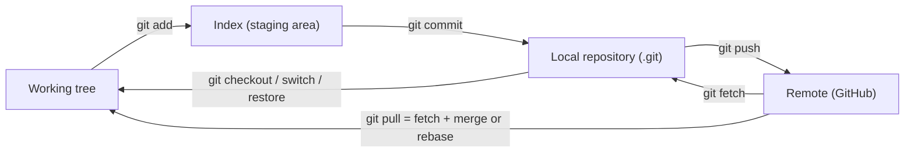
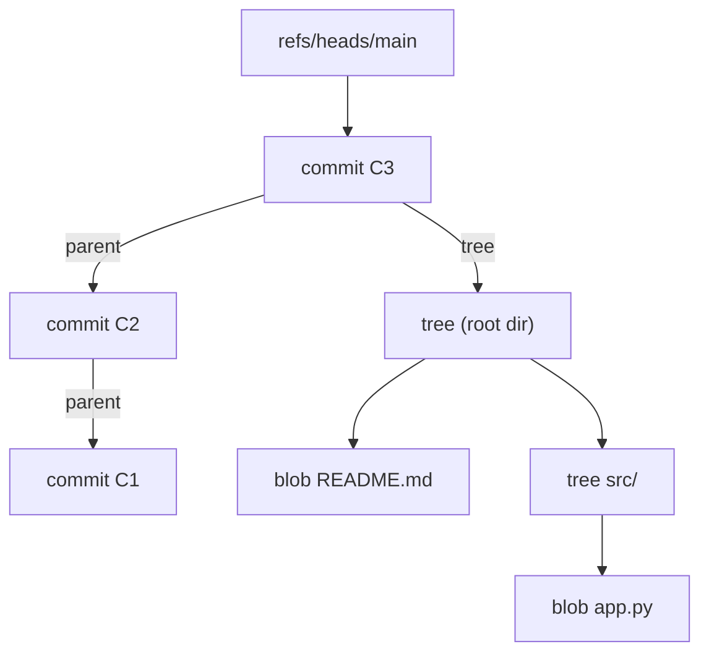
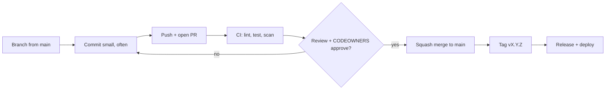
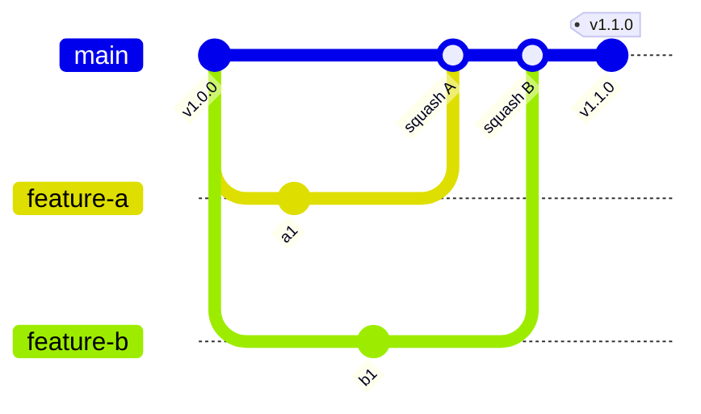
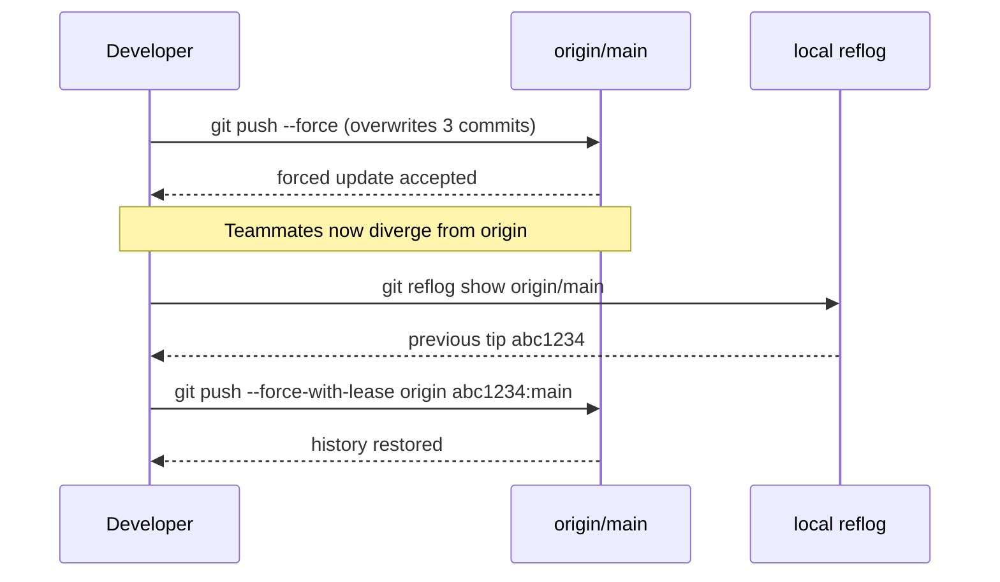

# Git & GitHub

<!-- DEVOPS-SHACK:HEADER -->

  
  
  
  
  

Part of <b><a href="https://github.com/jaiswaladi246/DevOps-Cloud-Interview-Preparation-by-DevOps-Shack">DevOps &amp; Cloud Interview Preparation</a></b> — created by <b><a href="https://www.youtube.com/@devopsshack">DevOps Shack</a></b>. Free to learn from; please credit DevOps Shack when sharing.

<!-- /DEVOPS-SHACK:HEADER -->

> The tool every pipeline starts from. Master the object model, branching strategy, collaboration controls and recovery, and you can answer most Git questions in a DevOps interview from first principles.

[🏠 Home](../README.md)

## What you'll master

- How Git actually stores data: blobs, trees, commits, refs, and why a branch is just a 41-byte file
- The three areas (working tree, index, repository) and what every command does to each of them
- Merge vs rebase vs squash, and when a team should pick which
- Trunk-based development, short-lived branches, feature flags, and release tagging with SemVer
- GitHub controls that make a repo safe: branch protection and rulesets, CODEOWNERS, required reviews, required status checks, signed commits
- Shifting security left: pre-commit hooks, gitleaks, secret scanning and push protection
- Recovery: `reflog`, `reset`, `revert`, `cherry-pick`, `bisect`, and undoing a bad force-push
- GitHub Actions triggers that hang off Git events (push, pull_request, tag)
- Explaining your team's Git workflow in an interview with trade-offs, not slogans

## Architecture: where your code lives

Every Git command moves data between four places. If you can draw this, you can reason about almost any "why is my change missing" question.

The working tree is just files. The index is the snapshot you are about to commit. The local repository holds every commit and ref. The remote is a second repository that you synchronise with explicitly. `git pull` is nothing more than `git fetch` followed by an integration step.

## Data flow: what a commit really is

A commit points to one root tree (the full snapshot) and to its parent commits. Trees point to blobs and sub-trees. Objects are addressed by hash of their content (SHA-1 by default, SHA-256 in newer repos), so identical files are stored once. A branch is a file under `.git/refs/heads/` containing a commit hash. That is why creating a branch is instant, and why a "lost" commit is usually still in the object store until garbage collection.

## Lifecycle: a change from idea to release

In production we keep branches alive for hours or a day or two, not weeks. Main is always releasable, the PR is the unit of review, and a tag is the unit of release.

## Workflow: trunk-based vs GitFlow

Trunk-based development means everyone integrates into `main` at least daily through short-lived branches. Incomplete work hides behind feature flags. GitFlow adds long-lived `develop`, `release/*` and `hotfix/*` branches, which suits versioned, boxed software with multiple supported releases, and hurts teams that deploy continuously because merges get big and painful.

## Recovery: the reflog safety net

Git rarely deletes anything immediately. The reflog records where every ref pointed, per clone, for 90 days by default for reachable entries and 30 days for unreachable ones. If you did not run `git gc --prune=now`, the old tip is recoverable from your own clone or from any teammate's clone.

## Core concepts in 10 minutes

### Objects and refs

Four object types: blob (file contents), tree (directory), commit (snapshot plus metadata), tag (annotated pointer with a message and optional signature). Refs are names for hashes: branches, tags, remote-tracking branches (`origin/main`), and `HEAD`, which normally points at a branch and sometimes directly at a commit (detached HEAD).

### The three areas and the three resets

`git reset --soft` moves the branch only. `--mixed` (default) moves the branch and resets the index. `--hard` also overwrites the working tree, which is the one that destroys uncommitted work. `git restore` and `git switch` are the modern, safer split of the overloaded `git checkout`.

### Merge, rebase, squash

A merge keeps history truthful and adds a merge commit. A rebase replays your commits on a new base, giving linear history but rewriting hashes, so never rebase commits others have pulled. A squash merge collapses a PR into one commit on main, which is what most trunk-based teams use because one PR becomes one revertable unit.

### Rewriting history safely

Rewrite only what is yours and unpublished. If you must force-push a feature branch, use `--force-with-lease`, which refuses if the remote moved since you last fetched. Protected branches should block force-pushes entirely.

### Branch protection and rulesets

On GitHub, protect `main` with required pull requests, required approving reviews, required status checks, required conversation resolution, required signed commits, linear history, and "do not allow bypassing". Repository rulesets are the newer, layered replacement for classic branch protection and can apply to many repos at the organisation level.

### CODEOWNERS and PR templates

`.github/CODEOWNERS` maps paths to users or teams. With "Require review from Code Owners" enabled, a PR touching `/terraform/` cannot merge without the platform team. A `.github/pull_request_template.md` standardises the description, risk and test evidence.

### Hooks and secret scanning

Client-side hooks (`pre-commit`, `commit-msg`, `pre-push`) catch problems before CI, but they are bypassable with `--no-verify`, so CI must re-run the same checks. Gitleaks scans staged changes or history for credentials. GitHub secret scanning with push protection blocks known token patterns server-side.

### Signed commits and tags

A signature proves the commit was made by the holder of a key, not that the author is who the name says. Use GPG, or simpler SSH signing (`gpg.format ssh`), and enforce with a branch rule. GitHub shows a "Verified" badge when the public key is registered on the account.

### Semantic versioning and tags

`MAJOR.MINOR.PATCH`: breaking change, backwards-compatible feature, backwards-compatible fix. Tag releases with annotated tags (`git tag -a v1.4.0 -m "..."`), and let a tag push trigger the release workflow. Never move a published tag; cut a new patch version instead.

### Large repos and performance

`git clone --depth 1` for CI, `--filter=blob:none` for partial clone, sparse-checkout for monorepos, Git LFS for big binaries, and `git maintenance` for background repacking.

## Question banks

| Bank | Focus | Questions |
|------|-------|-----------|
| [concepts.md](./concepts.md) | Internals, commands, comparisons, "what happens when" | 200 |
| [scenarios.md](./scenarios.md) | Situational "what would you do" questions | 200 |
| [troubleshooting.md](./troubleshooting.md) | Real symptoms, exact error messages, fixes | 200 |
| [production.md](./production.md) | Workflow design, security, scale, trade-offs, rapid-fire | 200 |

## Learning path

**Beginner**
- [ ] Explain the working tree, index and repository, and run `git status` knowing which area each line refers to
- [ ] Create a repo, commit, branch, merge, and resolve a conflict by hand
- [ ] Use `git log --oneline --graph --all`, `git diff`, `git diff --staged`, `git show`
- [ ] Undo things correctly: `restore`, `reset`, `revert`, `commit --amend`
- [ ] Push to GitHub over SSH, open a PR, and review one

**Intermediate**
- [ ] Rebase interactively to squash, reorder and reword commits
- [ ] Use `stash`, `cherry-pick`, `bisect`, `blame`, `worktree`
- [ ] Configure branch protection, CODEOWNERS and a PR template
- [ ] Add pre-commit with gitleaks and a commit-msg convention check
- [ ] Tag a release with SemVer and trigger a GitHub Actions release workflow

**Advanced**
- [ ] Recover from a force-push, a deleted branch and a bad rebase using reflog
- [ ] Remove a leaked secret from history with `git filter-repo`, rotate it, and explain why rotation matters more
- [ ] Set up SSH or GPG signing and enforce it with rulesets
- [ ] Design a branching and release strategy for a monorepo with 30 engineers
- [ ] Explain Git internals: packfiles, `gc`, `fsck`, partial clones, commit-graph

## Practice material

- [Hands-on lab: team repo workflow end to end](./hands-on-lab.md)
- [Assignments: 25 graded exercises](./assignments.md)
- [Cheatsheet](./cheatsheet.md)

[🏠 Home](../README.md)

<!-- DEVOPS-SHACK:FOOTER -->
---

### 🚀 Made with ❤️ by [DevOps Shack](https://www.youtube.com/@devopsshack)

**Learn DevOps, DevSecOps, Cloud and Kubernetes the practical way.**

[▶️ YouTube — DevOps Shack](https://www.youtube.com/@devopsshack) · [▶️ Hindi — @shackverse](https://www.youtube.com/@shackverse) · [🎓 devopsshack.com](https://devopsshack.com) · [📸 Instagram @devopsshack](https://www.instagram.com/devopsshack)

[🏠 Back to Home](../README.md) · [⭐ Star the original repo](https://github.com/jaiswaladi246/DevOps-Cloud-Interview-Preparation-by-DevOps-Shack)

© DevOps Shack · Licensed CC BY-NC-SA 4.0 · If you found this copy anywhere other than <a href="https://github.com/jaiswaladi246/DevOps-Cloud-Interview-Preparation-by-DevOps-Shack">github.com/jaiswaladi246</a>, the original and latest version is maintained by DevOps Shack.

<!-- /DEVOPS-SHACK:FOOTER -->
