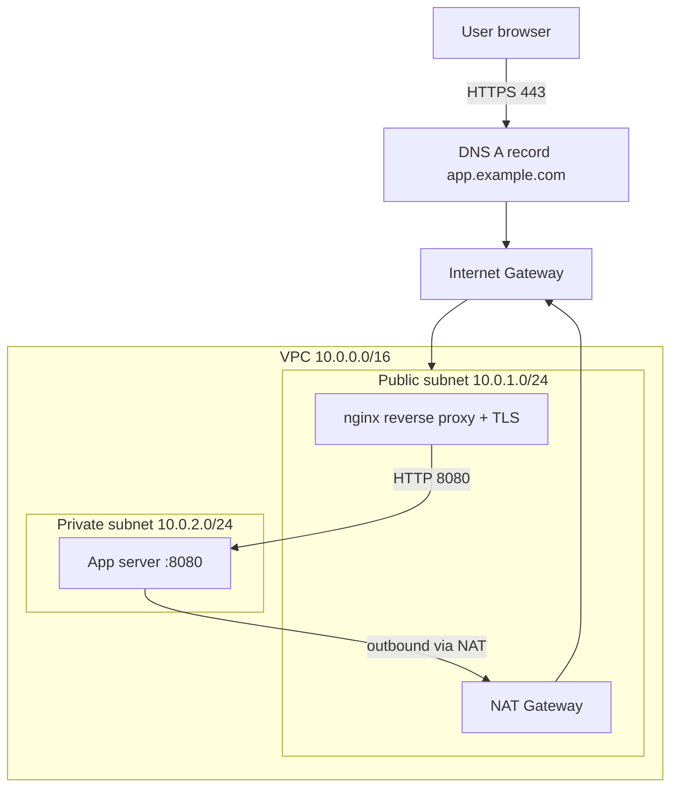
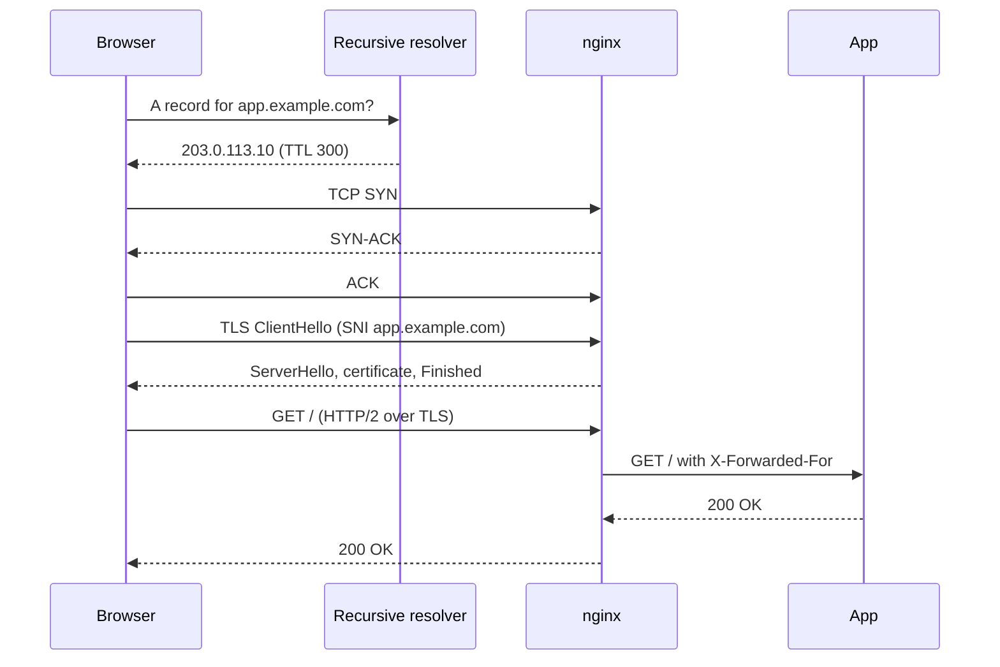
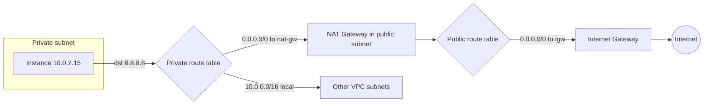
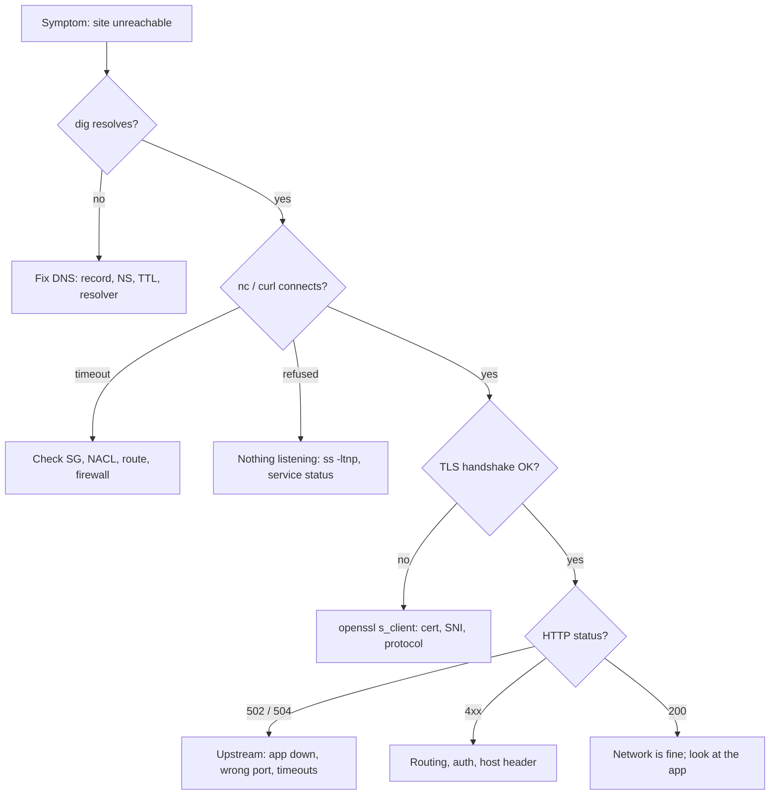

# Networking for DevOps

<!-- DEVOPS-SHACK:HEADER -->

  
  
  
  
  

Part of <b><a href="https://github.com/jaiswaladi246/DevOps-Cloud-Interview-Preparation-by-DevOps-Shack">DevOps &amp; Cloud Interview Preparation</a></b> — created by <b><a href="https://www.youtube.com/@devopsshack">DevOps Shack</a></b>. Free to learn from; please credit DevOps Shack when sharing.

<!-- /DEVOPS-SHACK:HEADER -->

> Everything between a user's browser and your container: DNS, TCP, TLS, load balancers, VPCs, NAT and the debugging tools that prove where a packet died.

[🏠 Home](../README.md) · [Hands-on lab](./hands-on-lab.md) · [Assignments](./assignments.md) · [Cheatsheet](./cheatsheet.md)

## What you'll master

- Explain what happens, hop by hop, from typing a URL to getting a response (DNS, TCP, TLS, HTTP).
- Design a VPC with public and private subnets, route tables, an internet gateway and NAT, and justify the CIDR plan.
- Configure security groups, NACLs and host firewalls, and know which one is blocking you.
- Run nginx as a reverse proxy and TLS terminator, with health checks and sane timeouts.
- Operate DNS: record types, TTLs, delegation, split-horizon, and failover.
- Debug with `dig`, `curl -v`, `ss`, `tcpdump`, `openssl s_client`, `mtr` and `traceroute`, and read their output without guessing.
- Reason about Kubernetes networking: Services, kube-proxy, CNI, CoreDNS, Ingress and NetworkPolicy.
- Answer interview questions on L4 vs L7 load balancing, MTU, conntrack, and latency vs throughput.

## Architecture: what we build in the lab

A two-tier application. The proxy tier sits in a public subnet. The app tier sits in a private subnet and reaches the internet only through NAT.

The user only ever talks to nginx. The app has no public IP, so the only way in is through the proxy, and the only way out is through NAT. That is the same shape as most production web stacks.

## Request flow: URL to response

Each arrow can fail independently, which is why debugging goes layer by layer: resolve, connect, handshake, request. The lab ends with a break-it-and-fix-it section that walks that order.

## Packet path inside a VPC

Routing is most-specific-prefix wins. `10.0.0.0/16 local` always exists and cannot be removed, so subnet-to-subnet traffic never leaves the VPC. A subnet is "public" only because its route table has a route to an internet gateway.

## Debugging workflow

A timeout means something silently dropped packets (firewall, route). A refusal means the host answered with a RST, so the path works and the port is closed. Learn to tell those two apart and half of all network tickets solve themselves.

## Core concepts in 10 minutes

### The layers you actually use

You do not need all seven OSI layers day to day. Think in four: link and IP (addresses, routing), transport (TCP/UDP ports), TLS (identity and encryption), application (HTTP, DNS). "L4 load balancer" means it balances TCP connections without reading HTTP. "L7" means it parses HTTP and can route by host, path or header.

### IP addressing and CIDR

A `/24` has 256 addresses, a `/16` has 65,536. AWS reserves 5 addresses in every subnet (network, router, DNS, future use, broadcast), so a `/24` gives 251 usable. Always use RFC 1918 ranges (`10.0.0.0/8`, `172.16.0.0/12`, `192.168.0.0/16`) and never overlap CIDRs between VPCs you may peer or connect over VPN, because overlapping ranges cannot be routed.

### TCP in one paragraph

A connection starts with a three-way handshake (SYN, SYN-ACK, ACK). Data is acknowledged and retransmitted, so loss shows up as latency. Closing uses FIN, and the side that closes first keeps the socket in `TIME_WAIT` for 60 seconds on Linux. Thousands of `TIME_WAIT` sockets are normal on a busy proxy; thousands of `SYN_RECV` suggest a SYN flood or a full accept queue.

### DNS

A resolver walks root, TLD, then authoritative servers and caches the answer for the TTL. Common records: `A`/`AAAA` (address), `CNAME` (alias, not allowed at the zone apex), `MX`, `TXT`, `NS`, `SRV`. Before a migration, lower the TTL a day ahead so the cutover propagates in minutes. In production we also run a private zone (Route 53 private hosted zone or CoreDNS) so internal names resolve only inside the VPC.

### TLS

TLS gives encryption and server identity. The browser checks that the certificate chain leads to a trusted CA, that the name matches (SAN), and that it has not expired. SNI lets one IP serve many certificates. Terminate TLS at the edge (load balancer or nginx) and use plain HTTP or mTLS inside, depending on your threat model. Automate renewal with certbot or cert-manager, since manual renewals are how outages happen.

### Security groups vs NACLs

Security groups are stateful, attach to network interfaces and only allow rules. NACLs are stateless, attach to subnets, support allow and deny, and are evaluated in rule-number order. In production we rely on security groups and reference other security groups as sources (`sg-app` allows 8080 from `sg-proxy`) instead of IP ranges. NACLs stay near-default unless we need an explicit deny.

### NAT and gateways

An internet gateway gives public IPs two-way access. A NAT gateway lets private instances start outbound connections while blocking inbound ones. NAT gateways bill per hour plus per GB processed, so heavy traffic to S3 or ECR should go through gateway or interface VPC endpoints instead.

### Load balancing and proxying

A reverse proxy such as nginx terminates client connections and opens its own to the backend. It adds headers (`X-Forwarded-For`, `X-Forwarded-Proto`), buffers, retries and health-checks. A 502 means the upstream gave a bad answer or refused; a 504 means it took too long. Passive health checks (nginx open source) eject a backend after failures; active checks need nginx Plus, HAProxy, or a cloud load balancer.

### Kubernetes networking

Every pod gets an IP and can reach every other pod without NAT (the CNI provides this). A Service gives a stable virtual IP, implemented by kube-proxy with iptables or IPVS rules (or eBPF in Cilium). CoreDNS resolves `svc.namespace.svc.cluster.local`. Ingress or Gateway API routes external HTTP into Services. NetworkPolicy is default-allow until you apply one, and it only works if the CNI enforces it.

### Performance and the usual suspects

MTU mismatches (VPN, overlay networks) cause connections that hang on large responses but work for small ones. Conntrack table exhaustion shows up as `nf_conntrack: table full, dropping packet` in `dmesg`. Ephemeral port exhaustion appears on NAT gateways and proxies making many connections to one destination. DNS is the usual hidden latency source, especially with `ndots:5` in Kubernetes.

## Question banks

Each bank has 200 questions with collapsible answers, tagged 🟢 Beginner, 🟡 Intermediate, 🔴 Advanced.

| Bank | Focus | Questions |
|------|-------|-----------|
| [Concepts](./concepts.md) | Core ideas, internals, comparisons, commands | 200 |
| [Scenarios](./scenarios.md) | "What would you do if..." situations | 200 |
| [Troubleshooting](./troubleshooting.md) | Real symptoms with exact errors, and how to fix them | 200 |
| [Production](./production.md) | Design, security, performance, cost, rapid-fire commands | 200 |

## Learning path

**Beginner**
- [ ] Explain the OSI/TCP-IP layers and where HTTP, TCP, IP and Ethernet sit
- [ ] Calculate subnets and usable hosts for any CIDR
- [ ] Run `ip addr`, `ip route`, `ss -tulpn` and say what each shows
- [ ] Resolve a name with `dig` and read the answer, authority and TTL
- [ ] Use `curl -v` to see DNS, connect, TLS and HTTP phases
- [ ] Explain public vs private subnet, IGW and NAT

**Intermediate**
- [ ] Build a VPC with two tiers and test reachability both ways
- [ ] Configure nginx as a reverse proxy with TLS and security headers
- [ ] Issue and renew a Let's Encrypt certificate, and inspect it with `openssl`
- [ ] Capture and read a TCP handshake with `tcpdump`
- [ ] Set up a private DNS zone and a weighted or failover record
- [ ] Troubleshoot 502, 504, `Connection refused` and `Connection timed out` methodically

**Advanced**
- [ ] Explain conntrack, SNAT/DNAT and iptables/nftables chains
- [ ] Diagnose MTU, ephemeral port and conntrack exhaustion
- [ ] Design multi-VPC connectivity: peering vs Transit Gateway vs PrivateLink
- [ ] Debug Kubernetes DNS and Service routing from inside a pod
- [ ] Choose between L4 and L7 balancing and defend it with numbers
- [ ] Present a network design with cost, security and failure-mode trade-offs

## Next steps

1. Do the [hands-on lab](./hands-on-lab.md) end to end.
2. Work through the [assignments](./assignments.md), starting at 🟢.
3. Keep the [cheatsheet](./cheatsheet.md) open during practice.
4. Drill the question banks, one section a day.

[🏠 Home](../README.md)

<!-- DEVOPS-SHACK:FOOTER -->
---

### 🚀 Made with ❤️ by [DevOps Shack](https://www.youtube.com/@devopsshack)

**Learn DevOps, DevSecOps, Cloud and Kubernetes the practical way.**

[▶️ YouTube — DevOps Shack](https://www.youtube.com/@devopsshack) · [▶️ Hindi — @shackverse](https://www.youtube.com/@shackverse) · [🎓 devopsshack.com](https://devopsshack.com) · [📸 Instagram @devopsshack](https://www.instagram.com/devopsshack)

[🏠 Back to Home](../README.md) · [⭐ Star the original repo](https://github.com/jaiswaladi246/DevOps-Cloud-Interview-Preparation-by-DevOps-Shack)

© DevOps Shack · Licensed CC BY-NC-SA 4.0 · If you found this copy anywhere other than <a href="https://github.com/jaiswaladi246/DevOps-Cloud-Interview-Preparation-by-DevOps-Shack">github.com/jaiswaladi246</a>, the original and latest version is maintained by DevOps Shack.

<!-- /DEVOPS-SHACK:FOOTER -->
