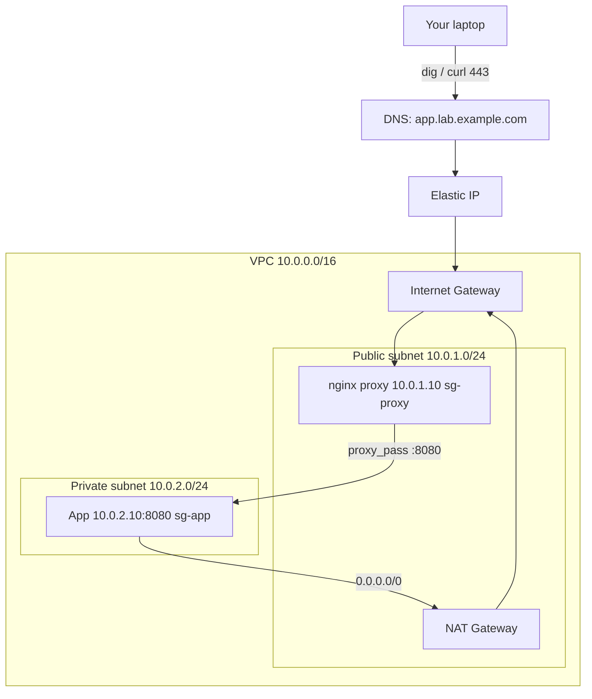

# Networking for DevOps — Hands-on Lab

<!-- DEVOPS-SHACK:HEADER -->
<p align="center">
  <a href="https://www.youtube.com/@devopsshack"></a>
  <a href="https://www.youtube.com/@shackverse"></a>
  <a href="https://devopsshack.com"></a>
  <a href="https://www.instagram.com/devopsshack"></a>
  <a href="https://github.com/jaiswaladi246/DevOps-Cloud-Interview-Preparation-by-DevOps-Shack"></a>
</p>
<p align="center"><sub>Part of <b><a href="https://github.com/jaiswaladi246/DevOps-Cloud-Interview-Preparation-by-DevOps-Shack">DevOps &amp; Cloud Interview Preparation</a></b> — created by <b><a href="https://www.youtube.com/@devopsshack">DevOps Shack</a></b>. Free to learn from; please credit DevOps Shack when sharing.</sub></p>
<!-- /DEVOPS-SHACK:HEADER -->

> Build a two-tier app network on AWS: VPC, public and private subnets, NAT, an nginx reverse proxy with TLS, a DNS record and health checks. Then break it and debug it with `dig`, `curl`, `tcpdump` and `openssl`.

[⬅ Back to Networking](./README.md) · [🏠 Home](../README.md)

## Table of contents
- [Goal](#goal)
- [Architecture](#architecture)
- [Prerequisites](#prerequisites)
- [Part 1: Build the network](#part-1-build-the-network)
- [Part 2: Build the tiers](#part-2-build-the-tiers)
- [Part 3: TLS, DNS and health checks](#part-3-tls-dns-and-health-checks)
- [Part 4: Debug it](#part-4-debug-it)
- [Cleanup](#cleanup)
- [What to say in an interview](#what-to-say-in-an-interview)
- [Common errors and fixes](#common-errors-and-fixes)

---

## Goal

By the end you will have:

- A VPC `10.0.0.0/16` with one public subnet and one private subnet
- An nginx reverse proxy in the public subnet terminating TLS on 443
- An app server in the private subnet with no public IP, reachable only from the proxy
- A NAT gateway giving the private app outbound internet for package installs
- A DNS name pointing to the proxy, and health checks at the proxy and the app
- A debugging log: you will deliberately break DNS, the firewall, the upstream and the certificate, and find each fault with the right tool

Estimated time: 90 minutes. Estimated cost: under 1 USD if you clean up the same day (the NAT gateway is the main charge, about 0.045 USD per hour plus data).

## Architecture



Security rules in plain words: the internet may reach the proxy on 80 and 443 (and SSH from your IP only). The app accepts port 8080 only from the proxy's security group and SSH only from the proxy.

## Prerequisites

- An AWS account and a user or role with EC2, VPC and (optionally) Route 53 permissions
- AWS CLI v2 configured (`aws sts get-caller-identity` works)
- A shell with `dig`, `curl`, `openssl` and `ssh` on your laptop
- A domain you control for the Let's Encrypt and Route 53 parts. Without one, use the self-signed path and an `/etc/hosts` entry. Both are shown.

We use region `ap-south-1`. Change it if you like.

---

## Part 1: Build the network

### Step 1. Set variables and a key pair

```bash
export AWS_REGION=ap-south-1
export AWS_DEFAULT_REGION=$AWS_REGION
export MY_IP=$(curl -s https://checkip.amazonaws.com)/32
export AZ=${AWS_REGION}a

aws ec2 create-key-pair --key-name netlab \
  --query KeyMaterial --output text > netlab.pem
chmod 400 netlab.pem
```

We tag everything `Project=netlab` so cleanup and cost tracking are easy.

### Step 2. Create the VPC

```bash
VPC_ID=$(aws ec2 create-vpc --cidr-block 10.0.0.0/16 \
  --tag-specifications 'ResourceType=vpc,Tags=[{Key=Name,Value=netlab-vpc},{Key=Project,Value=netlab}]' \
  --query Vpc.VpcId --output text)

# Needed so instances get DNS names and Route 53 private zones work
aws ec2 modify-vpc-attribute --vpc-id $VPC_ID --enable-dns-support '{"Value":true}'
aws ec2 modify-vpc-attribute --vpc-id $VPC_ID --enable-dns-hostnames '{"Value":true}'
echo $VPC_ID
```

### Step 3. Create the subnets

```bash
PUB_SUBNET=$(aws ec2 create-subnet --vpc-id $VPC_ID --cidr-block 10.0.1.0/24 \
  --availability-zone $AZ \
  --tag-specifications 'ResourceType=subnet,Tags=[{Key=Name,Value=netlab-public},{Key=Project,Value=netlab}]' \
  --query Subnet.SubnetId --output text)

PRIV_SUBNET=$(aws ec2 create-subnet --vpc-id $VPC_ID --cidr-block 10.0.2.0/24 \
  --availability-zone $AZ \
  --tag-specifications 'ResourceType=subnet,Tags=[{Key=Name,Value=netlab-private},{Key=Project,Value=netlab}]' \
  --query Subnet.SubnetId --output text)
```

Both are still "private" at this point. A subnet becomes public only when its route table points to an internet gateway.

### Step 4. Internet gateway and public route table

```bash
IGW_ID=$(aws ec2 create-internet-gateway \
  --tag-specifications 'ResourceType=internet-gateway,Tags=[{Key=Name,Value=netlab-igw},{Key=Project,Value=netlab}]' \
  --query InternetGateway.InternetGatewayId --output text)
aws ec2 attach-internet-gateway --internet-gateway-id $IGW_ID --vpc-id $VPC_ID

PUB_RT=$(aws ec2 create-route-table --vpc-id $VPC_ID \
  --tag-specifications 'ResourceType=route-table,Tags=[{Key=Name,Value=netlab-public-rt},{Key=Project,Value=netlab}]' \
  --query RouteTable.RouteTableId --output text)
aws ec2 create-route --route-table-id $PUB_RT --destination-cidr-block 0.0.0.0/0 --gateway-id $IGW_ID
aws ec2 associate-route-table --route-table-id $PUB_RT --subnet-id $PUB_SUBNET
```

### Step 5. NAT gateway and private route table

The NAT gateway lives in the public subnet and uses an Elastic IP.

```bash
NAT_EIP=$(aws ec2 allocate-address --domain vpc --query AllocationId --output text)
NAT_ID=$(aws ec2 create-nat-gateway --subnet-id $PUB_SUBNET --allocation-id $NAT_EIP \
  --tag-specifications 'ResourceType=natgateway,Tags=[{Key=Name,Value=netlab-nat},{Key=Project,Value=netlab}]' \
  --query NatGateway.NatGatewayId --output text)
aws ec2 wait nat-gateway-available --nat-gateway-ids $NAT_ID

PRIV_RT=$(aws ec2 create-route-table --vpc-id $VPC_ID \
  --tag-specifications 'ResourceType=route-table,Tags=[{Key=Name,Value=netlab-private-rt},{Key=Project,Value=netlab}]' \
  --query RouteTable.RouteTableId --output text)
aws ec2 create-route --route-table-id $PRIV_RT --destination-cidr-block 0.0.0.0/0 --nat-gateway-id $NAT_ID
aws ec2 associate-route-table --route-table-id $PRIV_RT --subnet-id $PRIV_SUBNET
```

### Step 6. Security groups

We reference the proxy group as the source for the app group, so the rule keeps working even if the proxy's IP changes.

```bash
SG_PROXY=$(aws ec2 create-security-group --group-name netlab-proxy \
  --description "nginx proxy" --vpc-id $VPC_ID --query GroupId --output text)
SG_APP=$(aws ec2 create-security-group --group-name netlab-app \
  --description "app tier" --vpc-id $VPC_ID --query GroupId --output text)

aws ec2 authorize-security-group-ingress --group-id $SG_PROXY --protocol tcp --port 80  --cidr 0.0.0.0/0
aws ec2 authorize-security-group-ingress --group-id $SG_PROXY --protocol tcp --port 443 --cidr 0.0.0.0/0
aws ec2 authorize-security-group-ingress --group-id $SG_PROXY --protocol tcp --port 22  --cidr $MY_IP

aws ec2 authorize-security-group-ingress --group-id $SG_APP --protocol tcp --port 8080 --source-group $SG_PROXY
aws ec2 authorize-security-group-ingress --group-id $SG_APP --protocol tcp --port 22   --source-group $SG_PROXY
```

### Verify Part 1

```bash
aws ec2 describe-route-tables --filters Name=vpc-id,Values=$VPC_ID \
  --query 'RouteTables[].{RT:RouteTableId,Routes:Routes[].[DestinationCidrBlock,GatewayId,NatGatewayId]}' --output json
```

You should see `0.0.0.0/0` via the `igw-` in the public table, via the `nat-` in the private table, and `10.0.0.0/16 local` in both. If either default route says `blackhole`, the gateway was deleted or is not attached.

---

## Part 2: Build the tiers

### Step 7. Launch the app server (private subnet)

User data installs nothing heavy: a tiny Python app with `/` and `/healthz`. It uses the NAT only for `apt`.

```bash
AMI=$(aws ssm get-parameter \
  --name /aws/service/canonical/ubuntu/server/24.04/stable/current/amd64/hvm/ebs-gp3/ami-id \
  --query Parameter.Value --output text)

cat > app-userdata.sh <<'UD'
#!/bin/bash
set -eux
apt-get update -y
apt-get install -y python3 tcpdump dnsutils
cat > /opt/app.py <<'PY'
from http.server import BaseHTTPRequestHandler, HTTPServer
import socket, json

class H(BaseHTTPRequestHandler):
    def do_GET(self):
        if self.path == "/healthz":
            body = b"ok\n"
        else:
            body = json.dumps({
                "host": socket.gethostname(),
                "client": self.client_address[0],
                "xff": self.headers.get("X-Forwarded-For"),
                "proto": self.headers.get("X-Forwarded-Proto"),
            }).encode() + b"\n"
        self.send_response(200)
        self.send_header("Content-Length", str(len(body)))
        self.end_headers()
        self.wfile.write(body)

HTTPServer(("0.0.0.0", 8080), H).serve_forever()
PY
cat > /etc/systemd/system/app.service <<'SVC'
[Unit]
Description=Lab app
After=network.target
[Service]
ExecStart=/usr/bin/python3 /opt/app.py
Restart=always
[Install]
WantedBy=multi-user.target
SVC
systemctl daemon-reload
systemctl enable --now app
UD

APP_INSTANCE=$(aws ec2 run-instances --image-id $AMI --instance-type t3.micro \
  --key-name netlab --subnet-id $PRIV_SUBNET --security-group-ids $SG_APP \
  --private-ip-address 10.0.2.10 --user-data file://app-userdata.sh \
  --tag-specifications 'ResourceType=instance,Tags=[{Key=Name,Value=netlab-app},{Key=Project,Value=netlab}]' \
  --query 'Instances[0].InstanceId' --output text)
```

### Step 8. Launch the proxy (public subnet) with a fixed public IP

```bash
PROXY_INSTANCE=$(aws ec2 run-instances --image-id $AMI --instance-type t3.micro \
  --key-name netlab --subnet-id $PUB_SUBNET --security-group-ids $SG_PROXY \
  --private-ip-address 10.0.1.10 --associate-public-ip-address \
  --tag-specifications 'ResourceType=instance,Tags=[{Key=Name,Value=netlab-proxy},{Key=Project,Value=netlab}]' \
  --query 'Instances[0].InstanceId' --output text)
aws ec2 wait instance-running --instance-ids $PROXY_INSTANCE $APP_INSTANCE

# Elastic IP so DNS does not break on stop/start
PROXY_EIP_ALLOC=$(aws ec2 allocate-address --domain vpc --query AllocationId --output text)
aws ec2 associate-address --instance-id $PROXY_INSTANCE --allocation-id $PROXY_EIP_ALLOC
PROXY_IP=$(aws ec2 describe-addresses --allocation-ids $PROXY_EIP_ALLOC --query 'Addresses[0].PublicIp' --output text)
echo $PROXY_IP
```

### Step 9. Log in through the proxy and check the app

Use the proxy as a jump host. Agent forwarding is not needed with `-J` as long as you pass the key for both hops (`-i` applies to both).

```bash
ssh -i netlab.pem -o StrictHostKeyChecking=accept-new ubuntu@$PROXY_IP 'hostname'
ssh -i netlab.pem -J ubuntu@$PROXY_IP ubuntu@10.0.2.10 'curl -s localhost:8080/healthz; ss -ltnp | grep 8080'
```

If the app answers `ok` and `ss` shows Python listening on `0.0.0.0:8080`, the app tier works. If the SSH hop hangs, wait two minutes for cloud-init, then check `sg-app` allows 22 from `sg-proxy`.

### Step 10. Prove NAT works and inbound is blocked

From the app server (via the jump):

```bash
ssh -i netlab.pem -J ubuntu@$PROXY_IP ubuntu@10.0.2.10 \
  'curl -s https://checkip.amazonaws.com; echo; ip route'
```

The IP printed must equal the NAT gateway's Elastic IP, not the proxy's. Confirm:

```bash
aws ec2 describe-nat-gateways --nat-gateway-ids $NAT_ID \
  --query 'NatGateways[0].NatGatewayAddresses[0].PublicIp' --output text
```

The app has no public IP, so nothing on the internet can start a connection to it. That is the whole point of the private subnet.

### Verify Part 2

From your laptop, `curl -m 5 http://10.0.2.10:8080` must fail (private address). From the proxy, `curl -s http://10.0.2.10:8080/` must return JSON. Both results together prove the segmentation.

---

## Part 3: TLS, DNS and health checks

### Step 11. Install nginx and a self-signed certificate

On the proxy:

```bash
ssh -i netlab.pem ubuntu@$PROXY_IP
sudo apt-get update && sudo apt-get install -y nginx tcpdump dnsutils

sudo mkdir -p /etc/nginx/tls
sudo openssl req -x509 -newkey rsa:2048 -nodes -days 90 \
  -keyout /etc/nginx/tls/app.key -out /etc/nginx/tls/app.crt \
  -subj "/CN=app.lab.example.com" \
  -addext "subjectAltName=DNS:app.lab.example.com,DNS:localhost"
sudo chmod 600 /etc/nginx/tls/app.key
```

The `subjectAltName` matters. Modern clients ignore the CN and check only SANs.

### Step 12. Configure the reverse proxy with health checks

Replace `app.lab.example.com` with your own name if you have a domain.

```bash
sudo tee /etc/nginx/conf.d/app.conf >/dev/null <<'NGINX'
upstream app_backend {
    server 10.0.2.10:8080 max_fails=3 fail_timeout=10s;
    keepalive 16;
}

# Redirect all plain HTTP to HTTPS, except the health probe
server {
    listen 80;
    server_name app.lab.example.com;

    location = /healthz {
        access_log off;
        default_type text/plain;
        return 200 "proxy ok\n";
    }
    location / {
        return 301 https://$host$request_uri;
    }
}

server {
    listen 443 ssl;
    http2 on;
    server_name app.lab.example.com;

    ssl_certificate     /etc/nginx/tls/app.crt;
    ssl_certificate_key /etc/nginx/tls/app.key;
    ssl_protocols       TLSv1.2 TLSv1.3;
    ssl_session_cache   shared:SSL:10m;

    add_header Strict-Transport-Security "max-age=31536000" always;

    location / {
        proxy_pass http://app_backend;
        proxy_http_version 1.1;
        proxy_set_header Connection "";
        proxy_set_header Host $host;
        proxy_set_header X-Real-IP $remote_addr;
        proxy_set_header X-Forwarded-For $proxy_add_x_forwarded_for;
        proxy_set_header X-Forwarded-Proto $scheme;

        proxy_connect_timeout 3s;
        proxy_read_timeout 30s;
        proxy_next_upstream error timeout http_502 http_503;
    }

    # Deep health check: proves the proxy can reach the app
    location = /healthz/app {
        access_log off;
        proxy_pass http://app_backend/healthz;
    }
}
NGINX

sudo rm -f /etc/nginx/sites-enabled/default
sudo nginx -t && sudo systemctl reload nginx
```

We use two probes on purpose. `/healthz` on port 80 answers from nginx itself (is the proxy alive?). `/healthz/app` crosses to the app (is the whole path alive?). A load balancer in front should use the deep one. `max_fails` and `fail_timeout` give passive health checking: after 3 failures nginx stops sending traffic to that backend for 10 seconds.

### Step 13. Create the DNS record

Option A: Route 53 public hosted zone you own.

```bash
ZONE_ID=$(aws route53 list-hosted-zones-by-name --dns-name example.com \
  --query 'HostedZones[0].Id' --output text)   # use your real domain

aws route53 change-resource-record-sets --hosted-zone-id $ZONE_ID --change-batch '{
  "Changes": [{
    "Action": "UPSERT",
    "ResourceRecordSet": {
      "Name": "app.lab.example.com",
      "Type": "A",
      "TTL": 60,
      "ResourceRecords": [{"Value": "'"$PROXY_IP"'"}]
    }
  }]
}'
```

Option B: no domain. Add a hosts entry on your laptop and keep using the same name.

```bash
echo "$PROXY_IP app.lab.example.com" | sudo tee -a /etc/hosts
```

We use a 60 second TTL during the lab so mistakes fix quickly. In production we run 300 or higher for stable records. Note that `dig` ignores `/etc/hosts`; hosts-file users should use `curl` and `getent hosts` and treat the `dig` steps as read-only practice against a public name such as `example.com`.

### Step 14. Optional: swap in a real Let's Encrypt certificate

Needs a real domain pointing at the proxy and port 80 reachable.

```bash
sudo apt-get install -y certbot python3-certbot-nginx
sudo certbot --nginx -d app.lab.example.com -m you@example.com --agree-tos -n
sudo certbot renew --dry-run
systemctl list-timers | grep certbot
```

Certbot edits the nginx config and installs a systemd timer for renewal. The `--dry-run` proves renewal works against the staging CA before it matters.

### Step 15. Verify the full path

```bash
dig +short app.lab.example.com
curl -skI https://app.lab.example.com | head -5
curl -sk https://app.lab.example.com/
curl -sk https://app.lab.example.com/healthz/app
curl -sI http://app.lab.example.com/ | grep -i location
```

Expected: the `dig` answer equals `$PROXY_IP`. The JSON from `/` shows `"client": "10.0.1.10"` (the proxy's private IP, the app's direct peer) and `"xff"` showing your laptop's public IP. `/healthz/app` returns `ok`. The HTTP request returns a `301` to HTTPS. With the self-signed certificate we pass `-k`; with Let's Encrypt drop it.

---

## Part 4: Debug it

Each drill breaks one layer. Find the fault using only the tool named, then fix it. Work in the order of the debugging workflow: resolve, connect, handshake, request.

### Step 16. Drill 1, DNS: wrong record

Break it:

```bash
# Route 53 users: UPSERT the A record to 192.0.2.1 (a documentation address)
# Hosts-file users: edit the line in /etc/hosts to point at 192.0.2.1
```

Diagnose:

```bash
dig app.lab.example.com            # compare ANSWER with $PROXY_IP; note the TTL
dig +trace app.lab.example.com     # walks root -> TLD -> authoritative
dig @8.8.8.8 +short app.lab.example.com
curl -v -m 5 https://app.lab.example.com   # "Trying 192.0.2.1:443..." then timeout
```

The tell: `curl -v` shows `Trying 192.0.2.1:443...` and hangs, and `dig` returns the wrong IP. Compare a public resolver with your local one to spot a stale cache. Fix the record, then wait out the TTL.

### Step 17. Drill 2, firewall: security group closes 443

Break it:

```bash
aws ec2 revoke-security-group-ingress --group-id $SG_PROXY --protocol tcp --port 443 --cidr 0.0.0.0/0
```

Diagnose from your laptop:

```bash
curl -v -m 5 https://app.lab.example.com      # "Connection timed out after 5001 milliseconds"
nc -vz -w 3 $PROXY_IP 443                      # no reply
```

Diagnose on the proxy, while the laptop retries:

```bash
sudo ss -ltnp | grep 443                       # nginx IS listening
sudo tcpdump -ni any 'tcp port 443 and host <your-laptop-ip>'
```

You will see nothing arriving. If `ss` shows the listener and `tcpdump` shows no SYN, the packet never reached the host, so the block is upstream: security group, NACL or route. A timeout with a healthy listener points at the firewall; this is the single most useful rule in network debugging. Restore the rule:

```bash
aws ec2 authorize-security-group-ingress --group-id $SG_PROXY --protocol tcp --port 443 --cidr 0.0.0.0/0
```

### Step 18. Drill 3, upstream: app down gives 502 or 504

Break it by stopping the app:

```bash
ssh -i netlab.pem -J ubuntu@$PROXY_IP ubuntu@10.0.2.10 'sudo systemctl stop app'
```

Diagnose:

```bash
curl -ski https://app.lab.example.com/ | head -3          # HTTP/2 502
# on the proxy:
sudo tail -n 5 /var/log/nginx/error.log
# connect() failed (111: Connection refused) while connecting to upstream
curl -v -m 3 http://10.0.2.10:8080/                         # Connection refused: path works, port closed
```

`Connection refused` means the app host answered with a RST, so routing and security groups are fine and nothing is listening. Now simulate the other failure, a firewall between proxy and app:

```bash
ssh -i netlab.pem -J ubuntu@$PROXY_IP ubuntu@10.0.2.10 'sudo systemctl start app'
aws ec2 revoke-security-group-ingress --group-id $SG_APP --protocol tcp --port 8080 --source-group $SG_PROXY
curl -ski -m 10 https://app.lab.example.com/ | head -3     # 502 or 504 after ~3s (connect timeout)
sudo grep upstream /var/log/nginx/error.log | tail -2      # "upstream timed out (110: Connection timed out) while connecting"
```

Refused is fast, timed out is slow. Restore:

```bash
aws ec2 authorize-security-group-ingress --group-id $SG_APP --protocol tcp --port 8080 --source-group $SG_PROXY
```

### Step 19. Drill 4, packets: read a handshake with tcpdump

On the proxy, capture traffic to the backend while you hit the site:

```bash
sudo tcpdump -ni any -c 20 'host 10.0.2.10 and tcp port 8080'
# in another terminal: curl -sk https://app.lab.example.com/
```

Look for `Flags [S]`, `[S.]`, `[.]` (the three-way handshake), then `[P.]` with the request and response. Save a capture for Wireshark:

```bash
sudo tcpdump -ni any -w /tmp/lab.pcap 'port 443 or port 8080' &
curl -sk https://app.lab.example.com/ >/dev/null; sudo kill %1
sudo tcpdump -nr /tmp/lab.pcap | head
```

You will not see readable HTTP on 443 because it is encrypted. The hop to the app on 8080 is plain HTTP, so you can read it with `-A`. That is also why internal traffic often needs mTLS in stricter environments.

### Step 20. Drill 5, TLS: inspect and break the certificate

Inspect what the server presents:

```bash
openssl s_client -connect app.lab.example.com:443 -servername app.lab.example.com </dev/null 2>/dev/null \
  | openssl x509 -noout -subject -issuer -dates -ext subjectAltName

echo | openssl s_client -connect $PROXY_IP:443 -servername app.lab.example.com -tls1_3 2>/dev/null | grep -E "Protocol|Cipher|Verify return"
```

Break it: regenerate the certificate with the wrong name (on the proxy).

```bash
sudo openssl req -x509 -newkey rsa:2048 -nodes -days 1 \
  -keyout /etc/nginx/tls/app.key -out /etc/nginx/tls/app.crt \
  -subj "/CN=wrong.example.net" -addext "subjectAltName=DNS:wrong.example.net"
sudo systemctl reload nginx
```

Diagnose from the laptop:

```bash
curl -v https://app.lab.example.com/
# curl: (60) SSL certificate problem: self-signed certificate
openssl s_client -connect app.lab.example.com:443 -servername app.lab.example.com \
  -verify_hostname app.lab.example.com </dev/null 2>&1 | grep -i "verif"
# Verify return code: 62 (hostname mismatch)  (or 18/20 for an untrusted self-signed cert)
```

With a Let's Encrypt certificate the curl error becomes `no alternative certificate subject name matches target host name`, which is the exact message to recognise in production. Also check what happens with a missing SNI: `openssl s_client -connect $PROXY_IP:443` (no `-servername`) returns nginx's default certificate. Fix by regenerating with Step 11's command and reloading. For an expiry check in monitoring, use `openssl x509 -checkend 1209600 -noout` (non-zero exit if it expires within 14 days).

### Step 21. Drill 6, name resolution on the box

On the app server, inspect how it resolves names:

```bash
ssh -i netlab.pem -J ubuntu@$PROXY_IP ubuntu@10.0.2.10
resolvectl status | head -15
dig +short example.com                 # works through the VPC resolver at 10.0.0.2
dig @10.0.0.2 +short example.com
curl -sv https://example.com -o /dev/null 2>&1 | grep -E "Resolv|Connected|HTTP/"
```

The VPC resolver is always at the base of the VPC range plus two (`10.0.0.2`). If the app cannot resolve names but can reach IPs (`curl https://1.1.1.1`), look at `/etc/resolv.conf`, VPC `enableDnsSupport`, and any security group or NACL that blocks UDP and TCP 53.

### Verify Part 4

Write one line per drill in a notes file: symptom, the exact command that proved the cause, the fix. If you can do each from memory without the doc, you are ready to answer troubleshooting questions in an interview.

---

## Cleanup

Delete in dependency order. The NAT gateway and Elastic IPs cost money while they exist.

```bash
aws ec2 terminate-instances --instance-ids $PROXY_INSTANCE $APP_INSTANCE
aws ec2 wait instance-terminated --instance-ids $PROXY_INSTANCE $APP_INSTANCE

aws ec2 delete-nat-gateway --nat-gateway-id $NAT_ID
aws ec2 wait nat-gateway-deleted --nat-gateway-ids $NAT_ID 2>/dev/null || sleep 90
aws ec2 release-address --allocation-id $NAT_EIP
aws ec2 release-address --allocation-id $PROXY_EIP_ALLOC

aws ec2 delete-security-group --group-id $SG_APP
aws ec2 delete-security-group --group-id $SG_PROXY
aws ec2 delete-subnet --subnet-id $PUB_SUBNET
aws ec2 delete-subnet --subnet-id $PRIV_SUBNET
aws ec2 delete-route-table --route-table-id $PUB_RT
aws ec2 delete-route-table --route-table-id $PRIV_RT
aws ec2 detach-internet-gateway --internet-gateway-id $IGW_ID --vpc-id $VPC_ID
aws ec2 delete-internet-gateway --internet-gateway-id $IGW_ID
aws ec2 delete-vpc --vpc-id $VPC_ID
aws ec2 delete-key-pair --key-name netlab && rm -f netlab.pem

# Route 53 users: delete the app.lab.example.com record. Hosts-file users: remove the line.
```

Check the console for leftovers: `aws ec2 describe-nat-gateways --filter Name=state,Values=available` and `aws ec2 describe-addresses` should both return nothing from this lab.

## What to say in an interview

"I built a two-tier network on AWS to practice the full path. A VPC with a public subnet for an nginx reverse proxy and a private subnet for the app, a NAT gateway for outbound-only access, and security groups that chain by group reference, so the app only accepts traffic from the proxy. nginx terminated TLS with TLS 1.2 and 1.3 only, redirected HTTP, forwarded the client IP in `X-Forwarded-For`, and used passive health checks plus a deep health endpoint that crosses to the app. DNS was a 60 second A record on an Elastic IP.

Then I broke it on purpose. A timeout with a listening port and no packets in `tcpdump` meant the security group. `Connection refused` in the nginx error log meant the app was down, not the network. A hostname mismatch in `openssl s_client` meant a bad certificate SAN. `dig +trace` found the wrong record. In production I would add a second AZ with a NAT per zone, VPC endpoints to cut NAT cost, an ALB with ACM certificates instead of managing certs on a host, and flow logs for evidence."

Follow-up answers to have ready:

- Why a NAT per AZ? A NAT gateway is zonal. One NAT means an AZ outage breaks outbound for every private subnet, and cross-AZ traffic costs extra.
- Why not put the app in the public subnet? It enlarges the attack surface. Private plus a proxy gives one hardened entry point.
- Where does the client IP go? The app sees the proxy as peer, so we trust `X-Forwarded-For` only from the proxy and set it there.

## Common errors and fixes

| Error or symptom | Cause | Fix |
|------------------|-------|-----|
| `ssh -J` hop hangs or times out | Private instance not ready, or SG missing | Check `sg-app` allows 22 from `sg-proxy`; confirm the instance is in the private subnet; wait for cloud-init |
| App server `apt-get update` hangs forever | NAT route missing or NAT not `available` | Check the private route table has `0.0.0.0/0` to the `nat-` id, no `blackhole`; confirm NAT is in the public subnet |
| NAT route shows `blackhole` | NAT gateway deleted or failed | Recreate the NAT and replace the route with `aws ec2 replace-route` |
| Public instance unreachable from the internet | Subnet's route table lacks the IGW route, or no public IP | Add `0.0.0.0/0` to the IGW; attach the Elastic IP |
| `nginx: [emerg] unknown directive "http2"` | nginx older than 1.25.1 | Use `listen 443 ssl http2;` instead of `http2 on;` |
| `nginx: [emerg] cannot load certificate ... No such file` | Wrong path or permissions | `sudo nginx -t`; check paths in `ssl_certificate` and file ownership |
| `502 Bad Gateway`, log says `Connection refused` | App stopped or listening on 127.0.0.1 only | `ss -ltnp` on the app; bind to `0.0.0.0` |
| `504 Gateway Time-out` | App slow or hung; read timeout hit | Check app logs; tune `proxy_read_timeout` only after finding why it is slow |
| `curl: (60) SSL certificate problem: self-signed certificate` | Expected with self-signed | Use `-k` for the lab or `--cacert app.crt` with the cert copied locally |
| `curl: (35) error:...wrong version number` | Speaking TLS to a plain HTTP port | Use `https` on 443 and `http` on 80 |
| Certbot: `Timeout during connect (likely firewall problem)` | Port 80 blocked or DNS not pointing at the proxy | Open 80 in the SG, confirm `dig` returns the proxy IP |
| `dig` still shows the old IP | Cached by a resolver until TTL expires | Query the authoritative server directly: `dig @ns-xxx.awsdns-xx.org app.lab.example.com` |
| `tcpdump: no suitable device found` or empty capture | Wrong interface name or missing sudo | `ip -br link`; use `-i any`; run with `sudo` |
| `InvalidParameterValue` on `--private-ip-address` | Fixed IP outside the subnet range | Use an address inside the instance's subnet CIDR |
| `DependencyViolation` on VPC delete | A leftover ENI, endpoint, NAT or SG | List with `aws ec2 describe-network-interfaces --filters Name=vpc-id,Values=$VPC_ID` and delete what remains |

[⬅ Back to Networking](./README.md) · [🏠 Home](../README.md)

<!-- DEVOPS-SHACK:FOOTER -->
---

<div align="center">

### 🚀 Made with ❤️ by [DevOps Shack](https://www.youtube.com/@devopsshack)

**Learn DevOps, DevSecOps, Cloud and Kubernetes the practical way.**

[▶️ YouTube — DevOps Shack](https://www.youtube.com/@devopsshack) · [▶️ Hindi — @shackverse](https://www.youtube.com/@shackverse) · [🎓 devopsshack.com](https://devopsshack.com) · [📸 Instagram @devopsshack](https://www.instagram.com/devopsshack)

[🏠 Back to Home](../README.md) · [⭐ Star the original repo](https://github.com/jaiswaladi246/DevOps-Cloud-Interview-Preparation-by-DevOps-Shack)

<sub>© DevOps Shack · Licensed CC BY-NC-SA 4.0 · If you found this copy anywhere other than <a href="https://github.com/jaiswaladi246/DevOps-Cloud-Interview-Preparation-by-DevOps-Shack">github.com/jaiswaladi246</a>, the original and latest version is maintained by DevOps Shack.</sub>

</div>
<!-- /DEVOPS-SHACK:FOOTER -->
