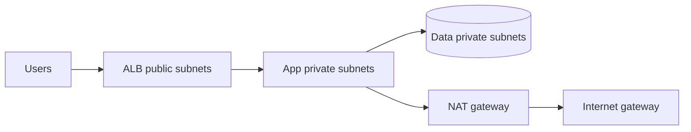
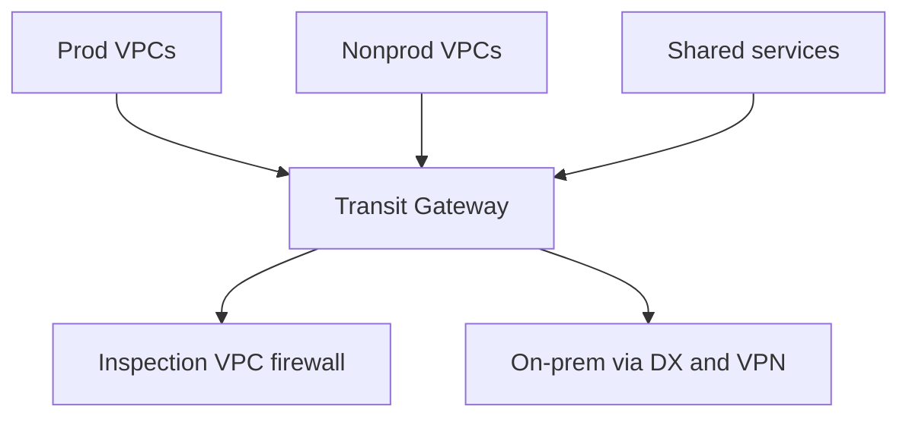

# Networking — Production & Best Practices

<!-- DEVOPS-SHACK:HEADER -->
<p align="center">
  <a href="https://www.youtube.com/@devopsshack"></a>
  <a href="https://www.youtube.com/@shackverse"></a>
  <a href="https://devopsshack.com"></a>
  <a href="https://www.instagram.com/devopsshack"></a>
  <a href="https://github.com/jaiswaladi246/DevOps-Cloud-Interview-Preparation-by-DevOps-Shack"></a>
</p>
<p align="center"><sub>Part of <b><a href="https://github.com/jaiswaladi246/DevOps-Cloud-Interview-Preparation-by-DevOps-Shack">DevOps &amp; Cloud Interview Preparation</a></b> — created by <b><a href="https://www.youtube.com/@devopsshack">DevOps Shack</a></b>. Free to learn from; please credit DevOps Shack when sharing.</sub></p>
<!-- /DEVOPS-SHACK:HEADER -->

> Real-world network design, security, performance and operations, plus rapid-fire commands · 200 questions · 🟢 Beginner 🟡 Intermediate 🔴 Advanced

[⬅ Back to Networking](./README.md) · [🏠 Home](../README.md)

## Table of contents
- [VPC & Network Architecture](#vpc--network-architecture) — Q1–Q30
- [DNS & Traffic Management in Production](#dns--traffic-management-in-production) — Q31–Q53
- [TLS, Certificates & Network Security](#tls-certificates--network-security) — Q54–Q78
- [Load Balancing, Proxies & nginx in Production](#load-balancing-proxies--nginx-in-production) — Q79–Q108
- [Kubernetes & Service Networking in Production](#kubernetes--service-networking-in-production) — Q109–Q131
- [Performance, Cost & Scale](#performance-cost--scale) — Q132–Q151
- [Observability & Incident Patterns](#observability--incident-patterns) — Q152–Q165
- [Rapid-Fire Commands](#rapid-fire-commands) — Q166–Q200

---

## VPC & Network Architecture

<!-- DEVOPS-SHACK:SECTION -->
> 🎥 **Learn this hands-on with DevOps Shack** → [YouTube @devopsshack](https://www.youtube.com/@devopsshack) · [Hindi @shackverse](https://www.youtube.com/@shackverse) · [Courses at devopsshack.com](https://devopsshack.com)

### Q1. How would you design a production VPC for a three-tier web application? 🟡

<details>
<summary><b>Answer</b></summary>

Three subnet tiers in at least three AZs: public (ALB, NAT gateways), private app (compute), private data (RDS, ElastiCache) with no route to the internet. Size the VPC /16 with /20 or /22 subnets so growth does not force a redesign.

Security groups chain by reference: ALB SG to app SG to DB SG. Add gateway endpoints for S3/DynamoDB, interface endpoints for the services you call heavily, VPC flow logs to S3 or CloudWatch, and manage everything in Terraform.


</details>

### Q2. How many AZs and subnets should a production VPC use, and why? 🟢

<details>
<summary><b>Answer</b></summary>

Three AZs where the region has them, so losing one still leaves two thirds of capacity and quorum systems (etcd, Kafka, Consul) keep a majority. Each tier gets one subnet per AZ. Plan N+1 capacity: with 3 AZs, run each at no more than about 65% so two can absorb the third.

Two AZs is acceptable for cost-sensitive workloads but you then need 100% headroom per AZ to survive a failure.

</details>

### Q3. What makes a subnet public versus private? 🟢

<details>
<summary><b>Answer</b></summary>

Only the route table. A public subnet has a route 0.0.0.0/0 to an internet gateway and its instances have public or Elastic IPs. A private subnet has no IGW route; outbound goes via NAT gateway or not at all.

Auto-assign public IP settings and security groups still decide whether an instance is reachable, so being in a public subnet alone is not exposure.

</details>

### Q4. How do you avoid NAT gateway single points of failure and cross-AZ charges? 🟡

<details>
<summary><b>Answer</b></summary>

Deploy one NAT gateway per AZ and give each private subnet's route table a default route to the NAT in its own AZ. A failure of one AZ then affects only that AZ, and traffic does not cross AZ boundaries (cross-AZ data transfer is billed in both directions).

In Terraform, loop over AZs to create `aws_nat_gateway` and `aws_route_table` per AZ. For dev environments a single NAT is a fair cost trade.

</details>

### Q5. When should you use VPC endpoints? 🟡

<details>
<summary><b>Answer</b></summary>

When private workloads call AWS services and you want to avoid NAT cost, internet exposure or compliance issues. Gateway endpoints (S3, DynamoDB) are free and route-table based. Interface endpoints (PrivateLink) create ENIs with private IPs for ECR, STS, SSM, Secrets Manager, CloudWatch and more, at about 0.01 USD per hour per AZ plus data.

Attach endpoint policies and use `aws:SourceVpce` conditions in bucket policies to lock data access to your VPC.

</details>

### Q6. How do you design connectivity for 50+ VPCs across accounts and regions? 🔴

<details>
<summary><b>Answer</b></summary>

Use Transit Gateway per region with route tables per environment (prod, nonprod, shared services, inspection), peer TGWs across regions, and share through AWS RAM. Use centralized egress and inspection VPCs with appliance mode, and AWS IPAM for non-overlapping CIDRs.


Segmentation lives in TGW route tables: nonprod must have no route to prod.

</details>

### Q7. What is PrivateLink and when is it better than peering? 🔴

<details>
<summary><b>Answer</b></summary>

PrivateLink exposes one service (behind an NLB or GWLB) to consumer VPCs through an endpoint ENI. Consumers get no access to the rest of your network, CIDR overlap does not matter, and it is unidirectional.

Use it for SaaS-style internal platforms, shared services across many accounts, and any case where VPC peering would expose too much or CIDRs overlap. The limits are TCP/UDP only, one endpoint per AZ, and per-GB charges.

</details>

### Q8. How do you handle CIDR overlap between VPCs or with on-prem? 🟡

<details>
<summary><b>Answer</b></summary>

Best fix is prevention with central IPAM. If already overlapping: PrivateLink for the specific service, NAT between the networks (a private NAT gateway or an appliance), or renumber by building a new VPC and migrating. Peering and TGW routes cannot carry overlapping prefixes.

For EKS, add a secondary CIDR such as 100.64.0.0/16 with custom networking so pods use non-overlapping space.

</details>

### Q9. How would you run a hybrid link between on-prem and AWS? 🟡

<details>
<summary><b>Answer</b></summary>

Direct Connect at two locations for diversity, terminating on a Direct Connect gateway attached to a TGW, with Site-to-Site VPN as backup over the internet. Use BGP with AS-path prepending or local preference so Direct Connect is preferred, and BFD for fast failover.

Test failover by dropping a link before launch. Keep routes summarized and filter what you accept from on-prem.

</details>

### Q10. What are the security considerations of an inspection VPC with Gateway Load Balancer? 🔴

<details>
<summary><b>Answer</b></summary>

Traffic is routed to GWLB endpoints which wrap packets in GENEVE and forward to firewall appliances. Enable TGW appliance mode on the inspection VPC attachment so both directions of a flow use the same AZ appliance, otherwise stateful firewalls see asymmetric flows.

Capacity and cost: appliances need autoscaling, health checks and cross-zone settings thought through, and every inspected GB costs processing fees.

</details>

### Q11. Why use separate AWS accounts for network boundaries instead of one big VPC? 🟡

<details>
<summary><b>Answer</b></summary>

Accounts are the strongest isolation boundary: IAM, quotas, billing and blast radius. Production, staging and shared networking each get their own account; a central network account owns TGW, Direct Connect and egress, shared with RAM.

Subnet sharing via RAM lets multiple accounts place workloads in a centrally managed VPC while the network team keeps control of routing.

</details>

### Q12. What are VPC flow logs and what do they show? 🟢

<details>
<summary><b>Answer</b></summary>

Metadata records of IP traffic at ENI, subnet or VPC level: source and destination IP and port, protocol, bytes, packets, action ACCEPT or REJECT, and (in v5) additional fields like `pkt-srcaddr`, `flow-direction` and `tcp-flags`. They show no payload.

We ship them to S3 in Parquet and query with Athena, for example "who is hitting REJECT on port 22".
```sql
SELECT srcaddr, count(*) c FROM vpc_flow_logs
WHERE action='REJECT' AND dstport=22 GROUP BY srcaddr ORDER BY c DESC LIMIT 20;
```

</details>

### Q13. How do you restrict egress traffic from private workloads? 🟡

<details>
<summary><b>Answer</b></summary>

Default routes through NAT allow everything. Tighten with: security group egress rules limited to known ports and prefix lists, AWS Network Firewall or a proxy with domain allow-lists (SNI filtering), VPC endpoints instead of internet paths, and DNS Firewall to block known bad domains.

Egress control matters most for data exfiltration and for reverse shells after a compromise, and it is usually what auditors ask about.

</details>

### Q14. What are security group best practices? 🟢

<details>
<summary><b>Answer</b></summary>

One group per role (alb, app, db, bastion), referenced by ID rather than CIDR. No 0.0.0.0/0 on SSH, RDP or databases. Descriptions on every rule, prefix lists for shared CIDRs, and tags for ownership. Avoid giant shared groups that nobody dares to edit.

Remember quotas: 60 inbound and 60 outbound rules per group by default and 5 groups per ENI. Scan continuously with AWS Config rules or Prowler.

</details>

### Q15. How do NACLs fit in when you already have security groups? 🟡

<details>
<summary><b>Answer</b></summary>

Treat NACLs as a coarse, stateless backstop at the subnet boundary: deny known bad CIDRs, block ports that should never be used, isolate the data subnets from the internet. Do not duplicate fine-grained allow lists there.

Because they are stateless you must allow ephemeral ports 1024–65535 for responses, and rules are evaluated by number, lowest first; a deny placed after a broad allow never fires.

</details>

### Q16. How would you build a multi-region active-active network? 🔴

<details>
<summary><b>Answer</b></summary>

Independent regional stacks (VPC, ALB, compute, data), Route 53 latency or weighted routing with health checks (or Global Accelerator for static IPs and fast failover), TGW inter-region peering for internal traffic, and data replication such as DynamoDB global tables or Aurora Global Database.

Hardest parts are data consistency, session handling and testing failover regularly. Keep the control plane (DNS, IAM) failover path independent of the failing region.

</details>

### Q17. What are the networking limits that surprise teams at scale in AWS? 🔴

<details>
<summary><b>Answer</b></summary>

ENI and IP-per-instance limits (restrict pods per node), NAT gateway 55,000 ports per destination, security group rule and ENI quotas, route table limit of 50 routes by default (raise to 1,000), VPC resolver limit of 1,024 packets per second per ENI, TGW bandwidth of 50 Gbps per VPC attachment, and ALB LCU limits.

We track them with Service Quotas alarms and load-test before big launches.

</details>

### Q18. What is IPAM and why would you adopt it? 🟢

<details>
<summary><b>Answer</b></summary>

AWS VPC IP Address Manager (or a tool like NetBox) is the source of truth for CIDR allocation. It enforces non-overlap, automates allocation to new VPCs via Terraform, and audits usage over time.

Spreadsheets drift; the first overlapping CIDR you discover after a peering request is the day IPAM pays for itself.

</details>

### Q19. How do you manage network infrastructure as code safely? 🟡

<details>
<summary><b>Answer</b></summary>

Terraform modules for VPC, subnets, route tables and endpoints, remote state with locking, plan review in pull requests, policy checks (OPA, Checkov, Sentinel) rejecting 0.0.0.0/0 on sensitive ports, and separate state per environment. Make changes in small increments because route and NACL changes affect everything.

For risky edits we add `prevent_destroy` on VPCs and review `terraform plan` output for replacements of route tables or subnets.

</details>

### Q20. How do you migrate workloads between VPCs with minimal downtime? 🔴

<details>
<summary><b>Answer</b></summary>

Set up connectivity first (TGW or peering) so both sides can talk, lower DNS TTLs in advance, use weighted DNS or an ALB with targets in both VPCs to shift traffic gradually, migrate data with replication, then cut over and decommission. Keep a rollback path until the old side is idle.

Check hard-coded IPs, security group references across VPCs (only valid inside a peering within the same region), and resolver rules before starting.

</details>

### Q21. What is the AWS VPC reachability analyzer used for? 🟡

<details>
<summary><b>Answer</b></summary>

It statically analyzes the configuration between a source and destination (security groups, NACLs, route tables, endpoints, TGW) and tells you whether a path exists, or which component blocks it, without sending packets.

```bash
aws ec2 create-network-insights-path --source i-0abc --destination i-0def --protocol tcp --destination-port 443
aws ec2 start-network-insights-analysis --network-insights-path-id nip-0123
```
First tool we use for "A cannot reach B" inside AWS.

</details>

### Q22. Why should databases never sit in public subnets? 🟢

<details>
<summary><b>Answer</b></summary>

A database exposed to the internet is only one weak password or unpatched CVE away from a breach. Put it in private subnets with no IGW route, restrict its security group to the app tier, and require TLS.

For admin access use SSM port forwarding, a VPN or an ephemeral bastion rather than opening the DB port.

</details>

### Q23. How do you provide secure admin access to private instances? 🟢

<details>
<summary><b>Answer</b></summary>

SSM Session Manager (no inbound ports, IAM-controlled, session logging to S3 or CloudWatch) with port forwarding for databases, or EC2 Instance Connect Endpoint. A bastion is the fallback, hardened and behind MFA or short-lived certificates.

```bash
aws ssm start-session --target i-0abc --document-name AWS-StartPortForwardingSession --parameters '{"portNumber":["5432"],"localPortNumber":["5433"]}'
```

</details>

### Q24. How would you design network segmentation for PCI or regulated workloads? 🔴

<details>
<summary><b>Answer</b></summary>

Place the cardholder data environment in dedicated accounts and VPCs, allow flows only through an inspection layer with explicit allow rules, log all flows, use private endpoints, enforce TLS 1.2+ and mTLS between tiers, and block direct internet egress except via a proxy with allow-listed domains.

Evidence matters as much as controls: Config rules, flow logs and change records need to prove the segmentation is enforced.

</details>

### Q25. What are the differences between AWS, Azure and GCP VPC design? 🟡

<details>
<summary><b>Answer</b></summary>

AWS VPCs and subnets are regional and zonal respectively; subnets are AZ-bound. GCP VPCs are global and subnets are regional, so one network spans all regions with built-in internal routing. Azure VNets are regional with subnets spanning zones, and peering is explicit.

Firewalling differs too: AWS security groups plus NACLs, GCP VPC firewall rules by tags or service accounts, Azure NSGs plus Azure Firewall. Know the model before you port a design.

</details>

### Q26. What is the shared-responsibility view of cloud networking security? 🔴

<details>
<summary><b>Answer</b></summary>

The provider secures the underlying network fabric, hypervisor isolation and physical layer; you configure routes, security groups, TLS, WAF, logging and access. Misconfiguration (open security groups, public buckets, permissive routes) is the dominant cause of incidents.

Guardrails: SCPs, Config rules, Security Hub, and preventive IaC policy checks rather than after-the-fact audits.

</details>

### Q27. How do you plan IPv6 adoption in a VPC? 🟡

<details>
<summary><b>Answer</b></summary>

Enable dual-stack on the VPC and subnets (Amazon-provided /56 and /64 subnets), add `::/0` routes (IGW for public, egress-only IGW for private), update security groups and NACLs for IPv6, and verify applications bind on `::`. Dual-stack ALB works well; NAT64 plus DNS64 helps IPv6-only subnets reach IPv4 services.

Benefit: no NAT gateway charges for IPv6 egress and no address exhaustion in EKS. AWS now charges for public IPv4 addresses (0.005 USD per hour), which makes IPv6 financially attractive.

</details>

### Q28. What does the "public IPv4 address charge" mean for design? 🟢

<details>
<summary><b>Answer</b></summary>

Since 2024 AWS bills every public IPv4 address, in use or idle, at about 0.005 USD per hour (roughly 3.6 USD per month). Each NAT gateway EIP, each public ALB node and each public instance counts.

Reduce them with private instances behind one ALB, SSM instead of public bastions, IPv6 where possible, and clean-up of unattached Elastic IPs.

</details>

### Q29. How do you troubleshoot "A cannot reach B" systematically in a VPC? 🟡

<details>
<summary><b>Answer</b></summary>

Walk the path in order: DNS resolves correctly, source security group egress, source subnet route table, NACLs both ways, destination route table (return path), destination security group ingress, the service listening on the right interface, host firewall. Use Reachability Analyzer, flow logs and `nc`.

REJECT in flow logs on the destination ENI points to security group or NACL; no record at all points to routing.

</details>

### Q30. How do you size subnets for EKS and why do clusters run out of IPs? 🔴

<details>
<summary><b>Answer</b></summary>

With VPC CNI, every pod consumes a VPC IP, plus node and ENI warm pools. A /24 holds only 251 IPs, so a few nodes of 30 pods each exhausts it. Use /19 or /20 pod subnets, secondary CIDR with custom networking, or prefix delegation, and tune `WARM_IP_TARGET` and `MINIMUM_IP_TARGET`.

Monitor with the CNI's `awscni_assigned_ip_addresses` metrics and subnet free-IP alarms.

</details>

## DNS & Traffic Management in Production

<!-- DEVOPS-SHACK:SECTION -->
> 🎥 **Learn this hands-on with DevOps Shack** → [YouTube @devopsshack](https://www.youtube.com/@devopsshack) · [Hindi @shackverse](https://www.youtube.com/@shackverse) · [Courses at devopsshack.com](https://devopsshack.com)

### Q31. What TTL values do you choose for production records? 🟢

<details>
<summary><b>Answer</b></summary>

Stable records (MX, NS, rarely changing app endpoints) 1 hour to 1 day. Load balancer alias records 60 seconds (Route 53 alias TTL is fixed at 60). Failover-controlled records 30–60 seconds. Always lower the TTL well before a planned change and restore it after.

Short TTLs raise query volume and cost slightly, but a 5-minute outage with a 24-hour TTL is far more expensive than extra queries.

</details>

### Q32. How would you design DNS for high availability? 🔴

<details>
<summary><b>Answer</b></summary>

Two independent authoritative providers (for example Route 53 and Cloudflare) with the same zone pushed by octoDNS or Terraform, NS records at the registrar listing both, registrar lock enabled, DNSSEC handled carefully across providers, and external monitoring from multiple networks.

Mind features that do not sync across providers (alias records, health-check-based routing). Test by blackholing one provider in a game day.

</details>

### Q33. How do you manage DNS as code? 🟢

<details>
<summary><b>Answer</b></summary>

Terraform or octoDNS repositories with pull-request review, CI validation (`octodns-validate`, `terraform plan`), per-environment zones, and delegated subzones per team so ownership is clear. Drift is detected by scheduled plans, and manual console changes are blocked with IAM.

The same code that creates a service also creates its record, which prevents dangling records and subdomain takeover.

</details>

### Q34. How do you do a zero-downtime DNS cutover? 🟡

<details>
<summary><b>Answer</b></summary>

1. Lower TTL to 60s at least one old-TTL ago. 2. Stand up the new endpoint and test it with `curl --resolve`. 3. Add it with weight 0, then shift weight 1%, 10%, 50%, 100% while watching errors. 4. Keep the old endpoint serving until traffic drains, remembering stale resolver caches. 5. Restore TTL.

```bash
curl --resolve app.example.com:443:203.0.113.20 https://app.example.com/health
```

</details>

### Q35. Why does DNS failover take longer than expected, and how do you make it faster? 🔴

<details>
<summary><b>Answer</b></summary>

Total time = health check detection (interval × threshold, for example 10s × 3) + DNS TTL + client-side caching (JVM, OS, connection pools) + connection retry behavior. Typical real-world failover is 1–5 minutes.

Speed up with fast health checks (10s), TTL 30–60s, clients that re-resolve on connection errors, or anycast and Global Accelerator for sub-minute failover. Verify JVM `networkaddress.cache.ttl` (default can be infinite with a security manager).

</details>

### Q36. How do Route 53 health checks work and what are their pitfalls? 🟡

<details>
<summary><b>Answer</b></summary>

Health checkers in multiple regions probe your endpoint (HTTP, HTTPS, TCP) and the record is healthy if more than 18% of checkers agree. You can also use calculated checks and CloudWatch alarm checks for private resources.

Pitfalls: security groups must allow Route 53 checker IP ranges, checks against private IPs need CloudWatch alarm based checks, and a health check path that depends on a downstream DB can fail every endpoint at once. When all records are unhealthy Route 53 returns all of them (fail open).

</details>

### Q37. How do you run internal service DNS across multiple VPCs and accounts? 🟡

<details>
<summary><b>Answer</b></summary>

Private hosted zones associated with each VPC (cross-account association through CLI or API), or a central shared-services VPC with Route 53 Resolver inbound/outbound endpoints and forwarding rules shared via RAM. Prefer one DNS hub with rules shared out.

Avoid per-team private zones for the same domain; overlapping zones cause unpredictable resolution.

</details>

### Q38. How do you connect on-prem DNS and AWS DNS? 🔴

<details>
<summary><b>Answer</b></summary>

Create a Route 53 Resolver outbound endpoint with forwarding rules for corporate domains pointing at on-prem DNS servers, and an inbound endpoint (ENIs with private IPs) that on-prem DNS forwards cloud zones to. Place endpoints in at least two AZs, share rules with RAM, and open UDP and TCP 53 in security groups.

Watch for forwarding loops, and size for query volume: each endpoint ENI supports about 10,000 queries per second.

</details>

### Q39. How do you reduce DNS load and latency in Kubernetes clusters? 🟡

<details>
<summary><b>Answer</b></summary>

Run NodeLocal DNSCache so pods query a link-local cache on the node (avoiding conntrack and cross-node hops), scale CoreDNS with replicas proportional to nodes (cluster-proportional-autoscaler), tune `ndots`, use FQDNs with trailing dots for external calls, and raise CoreDNS cache TTLs.

Typical symptoms that justify it: `i/o timeout` on lookups under load and conntrack insert failures on UDP 53.

</details>

### Q40. How do you design weighted and latency routing for a global application? 🟡

<details>
<summary><b>Answer</b></summary>

Latency-based records for each region, each pointing to a regional ALB with health checks, so users reach the nearest healthy region. Inside each region use weighted records for canary releases. Combine with alias targets set to evaluate target health.

Latency routing is measured by AWS between users' resolvers and regions, not by your app; confirm with real user monitoring.

</details>

### Q41. How do you protect against DNS-layer attacks? 🔴

<details>
<summary><b>Answer</b></summary>

Use a provider with anycast and DDoS absorption, rate limit and response-rate limiting on self-hosted authoritative servers, disable open recursion, enable DNSSEC where the operational maturity exists, monitor query anomalies, and use Route 53 Resolver DNS Firewall for outbound to block malicious domains and DGA patterns.

Keep an out-of-band path (IP-based access) to critical admin tools in case DNS is down.

</details>

### Q42. What is the impact of DNS on application startup and connection pooling? 🟡

<details>
<summary><b>Answer</b></summary>

Apps resolve once when the pool is created, so a pool opened against an old IP stays on it. Databases behind failover endpoints (RDS, Aurora cluster endpoint) change IP on failover with a 5-second TTL, and apps that cache DNS indefinitely never move.

Set pool max lifetime (for example 5–30 minutes), enable validation queries, and configure JVM `-Dsun.net.inetaddr.ttl=30`.

</details>

### Q43. How do you troubleshoot intermittent DNS failures in production? 🟡

<details>
<summary><b>Answer</b></summary>

Check resolver health (`resolvectl statistics`, CoreDNS metrics), packet drops on UDP 53 (conntrack insert failures, VPC resolver 1,024 pps limit), search-domain amplification, IPv6 AAAA timeouts, and ECMP or security group issues to the resolver.

```bash
dig +tries=1 +time=2 example.com @169.254.169.253
for i in $(seq 100); do dig +short +time=1 +tries=1 api.internal | head -1; done | sort | uniq -c
```
The loop shows how often lookups fail and which answers rotate.

</details>

### Q44. How do you handle certificate and DNS validation for many tenants' custom domains? 🔴

<details>
<summary><b>Answer</b></summary>

Customers CNAME their domain to your edge hostname; you issue certificates per domain via ACME HTTP-01 on first request (Caddy on-demand TLS, CloudFront SaaS Manager, Cloudflare for SaaS, AWS ACM with DNS validation CNAMEs given to the customer). Store certs centrally and renew automatically.

Protect against abuse by verifying domain ownership before issuing and rate limiting issuance.

</details>

### Q45. What is GeoDNS and when does it go wrong? 🟡

<details>
<summary><b>Answer</b></summary>

Authoritative DNS returns different answers by the resolver's (or ECS-provided client's) location. It works for data residency, regional content and steering users to nearby regions.

It goes wrong when users use distant public resolvers without ECS, VPNs, or corporate resolvers: location is guessed from the resolver, not the user. Use it for coarse steering, and combine with anycast or app-level routing for precision.

</details>

### Q46. How do you avoid split-brain between public and private DNS views? 🟡

<details>
<summary><b>Answer</b></summary>

Keep both views generated from the same source of truth, with explicit rules for which names exist internally only. Automate with Terraform modules that create the public and private record together. Test from inside and outside after each change using scripted dig checks.

Document which zone wins inside VPCs: a private hosted zone with the same name hides all public records not duplicated there.

</details>

### Q47. How do you build service discovery in a non-Kubernetes environment? 🔴

<details>
<summary><b>Answer</b></summary>

Options: Route 53 private zones with auto-registered records, AWS Cloud Map (API plus DNS discovery with health), Consul with DNS interface and health checks, or internal load balancers with stable names. Prefer stable names over IPs everywhere.

Consul adds agents and ops overhead but offers KV, mesh and multi-DC; for ECS, Cloud Map and Service Connect are the managed paths.

</details>

### Q48. What is the practical difference between Cloud Map, Consul and CoreDNS for discovery? 🟢

<details>
<summary><b>Answer</b></summary>

Cloud Map is a managed registry with DNS and API lookup, integrated with ECS and EKS. Consul is self-hosted (or HCP), supports health checks, KV, ACLs and multi-datacenter service mesh. CoreDNS is a DNS server with plugins, the cluster DNS in Kubernetes, and not a registry on its own.

Choose based on where workloads run and whether you need a mesh.

</details>

### Q49. How do you monitor DNS externally? 🟡

<details>
<summary><b>Answer</b></summary>

Synthetic checks from multiple regions (Route 53 health checks, Prometheus blackbox exporter, Pingdom, Datadog) that resolve names against each authoritative server directly and via public resolvers, verifying answers, latency and DNSSEC validity. Alert on NXDOMAIN, SERVFAIL, wrong answers and slow responses.

```yaml
modules:
  dns_check:
    prober: dns
    dns: {query_name: app.example.com, query_type: A, valid_rcodes: [NOERROR]}
```

</details>

### Q50. What DNS mistakes cause the most production incidents? 🟢

<details>
<summary><b>Answer</b></summary>

Forgotten domain renewals, deleting a record still in use, wrong TTL during migration, CNAME at apex, missing trailing dot in BIND zone files, copying a record to the wrong zone, stale NS after changing providers, and expired DNSSEC signatures.

Mitigate with registrar auto-renew and lock, DNS in Git with review, alarms on domain expiry, and a documented rollback.

</details>

### Q51. What is an HTTPS (SVCB) DNS record? 🟡

<details>
<summary><b>Answer</b></summary>

A newer record type that tells clients the supported protocols (ALPN such as h3 and h2), port, IP hints and ECH keys for a service name before connecting. It lets browsers go straight to HTTP/3 and removes the need for Alt-Svc discovery on the first visit; it also allows alias-like behavior at the apex.

Cloudflare and Route 53 support creating them. Mostly relevant for edge and CDN setups.

</details>

### Q52. How do you plan DNS for a migration to a new cloud or provider? 🔴

<details>
<summary><b>Answer</b></summary>

Inventory every record, export zones, build the new zone and diff records via API, test every name against the new nameservers with dig, lower the NS TTL at the registrar if possible, then change delegation. Keep the old zone alive for a full TTL cycle and watch query logs on both.

Pay attention to ALIAS/ANAME, wildcard, CAA, TXT verification and DKIM records that are easy to forget.

</details>

### Q53. How do you test a record before DNS has propagated? 🟢

<details>
<summary><b>Answer</b></summary>

Query the authoritative servers directly and force name-to-IP with curl.

```bash
dig +short @ns-123.awsdns-45.org app.example.com
curl --resolve app.example.com:443:203.0.113.20 https://app.example.com/
```
This tests the new target without waiting for caches and without editing hosts files.

</details>

## TLS, Certificates & Network Security

<!-- DEVOPS-SHACK:SECTION -->
> 🎥 **Learn this hands-on with DevOps Shack** → [YouTube @devopsshack](https://www.youtube.com/@devopsshack) · [Hindi @shackverse](https://www.youtube.com/@shackverse) · [Courses at devopsshack.com](https://devopsshack.com)

### Q54. How do you manage certificates at scale without outages? 🟡

<details>
<summary><b>Answer</b></summary>

Automate issuance and renewal (ACM for AWS endpoints, cert-manager in Kubernetes, ACME clients elsewhere), inventory every certificate, and alert at 30, 14 and 7 days on expiry using blackbox exporter or CloudWatch. Never rely on calendar reminders.

Most expiry outages come from certificates nobody knew existed: internal APIs, mTLS client certs, load balancer listeners, SMTP and LDAP. Scan networks for TLS endpoints to build the inventory.
```yaml
- alert: CertExpiringSoon
  expr: probe_ssl_earliest_cert_expiry - time() < 14 * 86400
  for: 1h
```

</details>

### Q55. How does cert-manager work in Kubernetes? 🟡

<details>
<summary><b>Answer</b></summary>

You define an Issuer or ClusterIssuer (ACME, Vault, CA, self-signed) and Certificate resources, or annotate an Ingress. cert-manager creates a CertificateRequest, completes ACME challenges (HTTP-01 through the ingress or DNS-01 through the cloud DNS API), stores the result in a Secret and renews at two thirds of lifetime.

```yaml
apiVersion: cert-manager.io/v1
kind: Certificate
metadata: {name: web-tls}
spec:
  secretName: web-tls
  dnsNames: [app.example.com]
  issuerRef: {name: letsencrypt-prod, kind: ClusterIssuer}
```
Use DNS-01 for wildcard certificates and when port 80 is not reachable.

</details>

### Q56. What is the best way to terminate TLS in AWS? 🟡

<details>
<summary><b>Answer</b></summary>

Terminate at the ALB or CloudFront with ACM certificates: free, auto-renewing, and private keys never leave AWS. Use a security policy such as `ELBSecurityPolicy-TLS13-1-2-2021-06`. If compliance requires encryption to the target, re-encrypt to the instances with an internal CA certificate.

ACM public certificates cannot be exported, so for nginx on EC2 you need Let's Encrypt, ACM Private CA exports or a third party.
#A How do you roll out mTLS between microservices without a mesh?
Operate an internal CA (Vault PKI, ACM Private CA, step-ca, cert-manager with a CA issuer) that issues short-lived certificates (hours to days) per workload. Applications or sidecars reload certs without restart, and servers require and verify client certs against the CA bundle. Authorize on certificate identity (SPIFFE ID in the SAN) in addition to authentication.

Rollout in phases: permissive mode logging missing client certs, then enforce per service. Plan trust bundle rotation, which is harder than leaf rotation.

</details>

### Q57. What is SPIFFE/SPIRE and why do platforms adopt it? 🟡

<details>
<summary><b>Answer</b></summary>

SPIFFE defines workload identities as URIs (`spiffe://prod.example.com/ns/shop/sa/api`) carried in X.509 SVIDs. SPIRE is the implementation: agents attest workloads (by Kubernetes service account, node identity) and issue short-lived SVIDs automatically.

It gives cross-platform workload identity independent of IP addresses, which is the basis for zero-trust service-to-service policy and for federating across clusters and clouds.

</details>

### Q58. How do you handle TLS configuration drift across many servers? 🟡

<details>
<summary><b>Answer</b></summary>

Define one TLS profile in code (Mozilla intermediate, TLS 1.2 and 1.3, strong AEAD ciphers), apply through a shared nginx/HAProxy module or ALB security policy in Terraform, and test continuously with `testssl.sh` or `sslyze` in CI and scheduled scans.

```bash
testssl.sh --quiet --severity HIGH https://app.example.com
```

</details>

### Q59. What are the risks of terminating TLS at the edge and sending plain HTTP internally? 🔴

<details>
<summary><b>Answer</b></summary>

Anyone with network access inside the VPC (compromised host, malicious sidecar, mirror sessions) can read traffic including credentials; compliance frameworks (PCI, HIPAA) often require encryption in transit internally; and `X-Forwarded-Proto` misconfiguration can lead to redirect loops or insecure cookies.

Mitigate with re-encryption to backends, mTLS in a mesh, or at least private subnets plus VPC-level encryption (Nitro instances encrypt traffic between supported instance types automatically).

</details>

### Q60. How should private keys be protected? 🟡

<details>
<summary><b>Answer</b></summary>

Generate on the host or in an HSM/KMS and never commit to Git. Permissions `0600` owned by the service user, stored in a secrets manager (Vault, AWS Secrets Manager) and delivered at runtime, rotate on suspicion of exposure, and use separate keys per environment.

For edge, offload to KMS-backed signers or cloud load balancers to avoid holding keys at all. Scan repositories for leaked keys with gitleaks or trufflehog.

</details>

### Q61. How do you rotate a certificate with zero downtime? 🟡

<details>
<summary><b>Answer</b></summary>

Issue the new certificate before the old one expires, deploy it so servers load it without dropping connections (`nginx -s reload` or `systemctl reload haproxy`, which gracefully restart workers; ALB listeners switch atomically), verify the live endpoint, then revoke or retire the old one.

```bash
nginx -t && nginx -s reload
echo | openssl s_client -connect app.example.com:443 -servername app.example.com 2>/dev/null | openssl x509 -noout -dates -serial
```
For clients that pin or trust specific CAs, overlap both chains first.

</details>

### Q62. How would you implement private CA infrastructure? 🔴

<details>
<summary><b>Answer</b></summary>

Offline root CA (air-gapped, HSM-backed) signing one or more online intermediate CAs; intermediates issue leaf certificates through ACME or API (step-ca, Vault, ACM Private CA). Distribute the root through configuration management, container base images and Kubernetes trust bundles (trust-manager). Keep path length constraints and name constraints, and publish CRLs.

Plan rotation of the intermediate before it expires; most outages happen when an intermediate quietly expires.

</details>

### Q63. How do you defend a public endpoint against DDoS? 🟡

<details>
<summary><b>Answer</b></summary>

Layered: CDN and anycast absorb volumetric attacks (CloudFront with AWS Shield Standard, Cloudflare), WAF rate-based rules for L7, autoscaling behind it, origin lockdown to CDN ranges only, SYN cookies, and a runbook with provider support contacts. Shield Advanced adds cost protection and the response team.

Design for graceful degradation: static fallback pages and caching of expensive endpoints.

</details>

### Q64. What should a WAF rollout look like? 🟡

<details>
<summary><b>Answer</b></summary>

Deploy in count (log) mode with AWS managed rule groups (Core rule set, known bad inputs, SQLi), review logs for false positives for a couple of weeks, add exclusions for legitimate patterns, then switch to block. Add rate-based rules per IP and bot control for login and checkout paths.

Keep WAF rules in Terraform, and alert on block spikes because a bad deploy can look like an attack.

</details>

### Q65. How do you secure east-west traffic in Kubernetes? 🔴

<details>
<summary><b>Answer</b></summary>

Default-deny NetworkPolicies per namespace with explicit allows (including DNS egress to kube-dns), mTLS via mesh, namespace and service-account-based authorization policies, no host networking for workloads, restricted egress through egress gateway, and runtime detection (Falco, Cilium Tetragon).

Test policies with a debug pod (`kubectl run test --rm -it --image=nicolaka/netshoot`) and Hubble to see denied flows.

</details>

### Q66. How do you restrict SSH exposure in production? 🟢

<details>
<summary><b>Answer</b></summary>

No public port 22: use SSM Session Manager or EC2 Instance Connect Endpoint. If SSH is required, use certificate-based auth with short-lived certs (Vault SSH, Teleport, step-ssh), restrict source ranges, disable password auth (`PasswordAuthentication no`), rotate keys, and log sessions.

```
# /etc/ssh/sshd_config
PasswordAuthentication no
PermitRootLogin no
AllowGroups ssh-users
```

</details>

### Q67. What is the zero-trust approach to network access and how do you move toward it? 🟡

<details>
<summary><b>Answer</b></summary>

Never trust a network location; authenticate and authorize every request using identity, device posture and context. Steps: identity provider with MFA and SSO, replace VPN with identity-aware proxies (Cloudflare Access, Teleport, AWS Verified Access), use mTLS and short-lived credentials between services, and log every access.

Migrate app by app; keep the VPN as fallback until usage drops to zero.

</details>

### Q68. What is Network Firewall and how does it compare with security groups and NACLs? 🟢

<details>
<summary><b>Answer</b></summary>

AWS Network Firewall is a managed stateful and stateless L3–L7 firewall with Suricata-compatible rules, domain filtering (SNI/Host) and IPS, deployed in dedicated subnets with route tables steering traffic. Security groups and NACLs only see IPs and ports.

Use it for egress domain allow-lists, IDS/IPS and centralized inspection; the price is about 0.395 USD per hour per endpoint plus per-GB.

</details>

### Q69. How do you protect against SSRF reaching cloud metadata? 🟡

<details>
<summary><b>Answer</b></summary>

Require IMDSv2 with hop limit 1 for containers, block 169.254.169.254 from application pods using NetworkPolicy or iptables unless needed, use IRSA or Pod Identity instead of node credentials, and validate and allow-list outbound URLs in applications.

```bash
aws ec2 modify-instance-metadata-options --instance-id i-0abc --http-tokens required --http-endpoint enabled
```

</details>

### Q70. What is the safe way to expose an internal service to a partner? 🟡

<details>
<summary><b>Answer</b></summary>

Prefer PrivateLink, or a dedicated site-to-site VPN with NAT to avoid CIDR overlap, or an API gateway with mTLS and API keys over the internet. Restrict by source IP allow-lists as an extra layer, scope to a specific port and path, rate limit, and log everything.

Avoid peering or broad routing with partner networks; it expands your trust boundary to their security posture.

</details>

### Q71. How do you detect network intrusions in cloud environments? 🔴

<details>
<summary><b>Answer</b></summary>

VPC flow logs and DNS query logs into a SIEM, GuardDuty (flags crypto-mining, C2 beacons, unusual API calls and port scanning), Network Firewall alert logs, VPC traffic mirroring to Suricata or Zeek for deep inspection on sensitive segments, and anomaly alerts on egress volume.

Baseline normal first; alert on first-seen external destinations from critical subnets.

</details>

### Q72. What is certificate transparency and how do you use it defensively? 🟡

<details>
<summary><b>Answer</b></summary>

CAs publish every issued public certificate to public CT logs. You can monitor logs (crt.sh, Cert Spotter, Facebook CT monitor) for certificates issued for your domains and detect shadow IT, rogue issuance or phishing lookalikes. Publish a CAA record to limit who may issue.

```
example.com. CAA 0 issue "letsencrypt.org"
example.com. CAA 0 iodef "mailto:security@example.com"
```

</details>

### Q73. How do you secure an nginx server's TLS and headers quickly? 🟢

<details>
<summary><b>Answer</b></summary>

```nginx
ssl_protocols TLSv1.2 TLSv1.3;
ssl_prefer_server_ciphers off;
ssl_session_cache shared:SSL:10m;
ssl_session_timeout 1d;
ssl_session_tickets off;
ssl_stapling on; ssl_stapling_verify on;
add_header Strict-Transport-Security "max-age=31536000; includeSubDomains" always;
add_header X-Content-Type-Options nosniff always;
server_tokens off;
```
Validate with SSL Labs or testssl.sh and keep OpenSSL updated.

</details>

### Q74. What changes with post-quantum cryptography for network engineers? 🔴

<details>
<summary><b>Answer</b></summary>

Hybrid key exchange (X25519MLKEM768) is already enabled by default in Chrome, Firefox, Cloudflare and recent OpenSSL 3.5, protecting today's traffic from harvest-now-decrypt-later attacks. The ClientHello grows by about 1 KB, which can break old middleboxes and trigger MTU or fragmentation issues.

Action items: upgrade TLS libraries, test appliances for large ClientHello handling, inventory long-lived confidential data and VPNs, and track certificate signature migration timelines.

</details>

### Q75. How do you audit open ports across your estate? 🟢

<details>
<summary><b>Answer</b></summary>

Combine external scanning (nmap, masscan from outside the network, or cloud provider tools like Inspector network reachability), flow-log analysis, and security-group queries.

```bash
nmap -Pn -sS -p- --min-rate 1000 -oA scan 203.0.113.0/28
aws ec2 describe-security-groups --filters Name=ip-permission.cidr,Values=0.0.0.0/0 --query 'SecurityGroups[].[GroupId,GroupName]'
```
Run it on a schedule and diff results, failing the build on unexpected ports.

</details>

### Q76. Why is an open security group on 0.0.0.0/0 for port 22 a problem? 🟢

<details>
<summary><b>Answer</b></summary>

Internet scanners find it within minutes and brute-force or exploit SSH continuously. One leaked key, weak password or SSH vulnerability becomes a foothold in your VPC.

Close it, use SSM or a VPN, and enable an AWS Config rule (`restricted-ssh`) with auto-remediation to catch regressions.

</details>

### Q77. How do you secure a Kubernetes ingress controller? 🟡

<details>
<summary><b>Answer</b></summary>

Run it in dedicated nodes or namespace, keep it patched (ingress-nginx has had critical CVEs), restrict snippet annotations, enforce TLS 1.2+, put a WAF or cloud LB in front, limit body size and timeouts, rate limit, and give it only the RBAC it needs. Expose it through an NLB with a security group allowing only the CDN or expected ranges.

Move toward the Gateway API where controllers are maintained and the role model is cleaner.

</details>

### Q78. What is the difference between a bastion, SSM and a VPN for access, from a security view? 🟡

<details>
<summary><b>Answer</b></summary>

A bastion is an exposed attack surface that needs patching and key management. SSM uses outbound-only agents authenticated by IAM, with full session logs and no open ports. A VPN grants network-level reach, so compromise of a laptop exposes everything routed.

We default to SSM for engineers, per-app proxies for internal tools, and VPN only when whole-network access is truly necessary.

</details>

## Load Balancing, Proxies & nginx in Production

<!-- DEVOPS-SHACK:SECTION -->
> 🎥 **Learn this hands-on with DevOps Shack** → [YouTube @devopsshack](https://www.youtube.com/@devopsshack) · [Hindi @shackverse](https://www.youtube.com/@shackverse) · [Courses at devopsshack.com](https://devopsshack.com)

### Q79. How do you choose between ALB, NLB and an nginx or Envoy fleet? 🟡

<details>
<summary><b>Answer</b></summary>

ALB when you need HTTP routing, WAF, OIDC, gRPC and managed scaling. NLB for TCP/UDP/TLS, static IPs, extreme throughput, PrivateLink. Self-managed nginx, HAProxy or Envoy when you need custom logic (Lua, advanced retries, custom protocols), cross-cloud portability, or cost control at very high volume.

Managed wins by default: fewer pages at 3 AM. Self-manage only when a requirement forces it.

</details>

### Q80. How do you tune ALB idle timeout and backend keep-alive to avoid 502s? 🟡

<details>
<summary><b>Answer</b></summary>

ALB closes idle connections after 60 seconds by default. If the backend closes first (nginx `keepalive_timeout 75s` is fine, Node default 5s is not), the ALB may send a request on a connection that the backend just closed and returns 502.

Set the backend keep-alive timeout above the ALB idle timeout: Node `server.keepAliveTimeout = 65000`, gunicorn `--keep-alive 75`, nginx `keepalive_timeout 75s`.

</details>

### Q81. Which nginx directives matter most for a production reverse proxy? 🟡

<details>
<summary><b>Answer</b></summary>

`worker_processes auto`, `worker_connections 4096`, `keepalive` in upstream blocks plus `proxy_http_version 1.1` and `proxy_set_header Connection ""`, `proxy_next_upstream` limited to idempotent errors, sane `proxy_*_timeout`, `client_max_body_size`, gzip or brotli, `access_log` with `$request_time` and `$upstream_response_time`, and `limit_req`.

```nginx
log_format main '$remote_addr "$request" $status $body_bytes_sent rt=$request_time urt=$upstream_response_time ua="$http_user_agent"';
```

</details>

### Q82. How do you do rate limiting and abuse protection in nginx? 🟡

<details>
<summary><b>Answer</b></summary>

```nginx
limit_req_zone  $binary_remote_addr zone=perip:10m rate=10r/s;
limit_conn_zone $binary_remote_addr zone=connperip:10m;
server {
  limit_req zone=perip burst=20 nodelay;
  limit_conn connperip 20;
  limit_req_status 429;
}
```
Behind a CDN, key on the real client IP (`set_real_ip_from` plus `real_ip_header`) or you will rate limit the CDN itself.

</details>

### Q83. How do you achieve zero-downtime configuration reloads in nginx and HAProxy? 🟡

<details>
<summary><b>Answer</b></summary>

`nginx -t && nginx -s reload` starts new workers with the new config while old workers finish active requests. HAProxy uses `systemctl reload haproxy` (seamless reload with master-worker mode and socket passing). Envoy hot restarts or, better, dynamic xDS updates.

Always validate first, and keep configs in Git. Long-lived WebSockets keep old workers alive; set `worker_shutdown_timeout`.

</details>

### Q84. How would you design a highly available load-balancing tier on-prem or in a colo? 🔴

<details>
<summary><b>Answer</b></summary>

Two or more HAProxy/nginx nodes with a floating VIP via keepalived (VRRP), or active-active with ECMP/BGP announcing the same VIP from each node (Cilium, MetalLB, Katran). Health scripts withdraw the VIP when a node fails. Add DNS or anycast across sites for site failure.

Test failover with real traffic. VRRP needs L2 adjacency or unicast mode, and does not work as-is in public clouds.

</details>

### Q85. How do you perform a blue/green deployment at the load balancer level? 🟡

<details>
<summary><b>Answer</b></summary>

Two target groups (blue and green) behind one ALB listener. Deploy and validate green with a test listener or header-based rule, then switch the listener's default action to green (or shift weights). Keep blue running until you are sure, then roll back instantly by switching again.

Remember connection draining on blue and database compatibility between versions.

</details>

### Q86. How do you handle long-lived connections (WebSockets, SSE, gRPC streams) during deploys? 🔴

<details>
<summary><b>Answer</b></summary>

Increase idle timeouts, send heartbeat pings so intermediaries do not drop idle flows, drain gracefully by sending a close frame or GOAWAY and letting clients reconnect with jitter to avoid a thundering herd, and use deregistration delay longer than typical session length where tolerable.

Plan capacity for reconnect storms; a deploy that disconnects 200,000 clients at once is an incident.

</details>

### Q87. How do you preserve client IP end to end? 🟡

<details>
<summary><b>Answer</b></summary>

Behind ALB: read `X-Forwarded-For`, trusting only the proxy hop. Behind NLB with instance targets the source IP is preserved; with IP targets enable PROXY protocol v2. With multiple proxy layers, configure the trusted proxy list in the app framework (`trust proxy` in Express, `RemoteIpHeader` in Tomcat).

Do not put `X-Forwarded-For` values into security decisions without trusting only known proxy ranges.

</details>

### Q88. How do you troubleshoot intermittent 502 and 504 errors behind a load balancer? 🟡

<details>
<summary><b>Answer</b></summary>

502: check backend crashes and restarts, keep-alive mismatch, backend closing connections, TLS mismatch to the target, oversized headers. 504: slow responses beyond the timeout, saturated workers, dependency latency, or target group timeouts. Correlate ALB access logs (`target_status_code`, `target_processing_time`, `elb_status_code`) with app logs.

```
# elb_status_code=502 and target_status_code=- means target closed or reset connection
```

</details>

### Q89. How do you capacity-plan a load balancer? 🟡

<details>
<summary><b>Answer</b></summary>

Measure new connections per second, active connections, requests per second, processed bytes and TLS handshakes per second. ALB scales automatically but needs time: for scheduled spikes ask AWS for pre-warming or ramp traffic. NLB scales to millions of connections without warm-up.

For self-managed proxies size CPU for TLS handshakes (ECDSA certs are much cheaper than RSA 4096), file descriptors (`ulimit -n`), conntrack, and ephemeral ports to upstreams.

</details>

### Q90. What is the difference between connection-level and request-level load balancing, and why does it matter for gRPC and HTTP/2? 🟡

<details>
<summary><b>Answer</b></summary>

L4 balancers pick a backend per connection. With HTTP/2 and gRPC, a client sends all requests over one connection, so one backend takes all load. Request-level (L7) balancing distributes each request.

Fix by using an L7 proxy (Envoy, ALB with gRPC), client-side balancing with a headless Service and `round_robin` policy, or a mesh.

</details>

### Q91. How would you build a global edge using anycast and regional load balancers? 🔴

<details>
<summary><b>Answer</b></summary>

Announce the same IPs from multiple PoPs (Global Accelerator or your own BGP), terminate TCP/TLS at the nearest PoP, and route over the private backbone to regional origins using health- and latency-aware logic. Pair with a CDN for cache, and regional databases with replicas.

Failover is automatic via route withdrawal, usually under a minute, without DNS TTL dependence.

</details>

### Q92. How do you make an nginx upstream resilient to a failing backend? 🟡

<details>
<summary><b>Answer</b></summary>

Use `max_fails` and `fail_timeout` for passive checks, `proxy_next_upstream error timeout http_502 http_503` for idempotent requests only, `proxy_connect_timeout 2s` to fail fast, and a backup server. Active checks need nginx Plus, `nginx_upstream_check_module` or an alternative like HAProxy/Envoy.

Be careful: `proxy_next_upstream` retrying POSTs can duplicate side effects, so set `proxy_next_upstream_tries` and exclude non-idempotent methods.

</details>

### Q93. How do you approach retries and timeouts across a chain of services? 🔴

<details>
<summary><b>Answer</b></summary>

Set deadlines that shrink down the chain (client 3s, gateway 2.5s, service 2s, DB 1s) so inner calls never outlive outer ones. Retry only idempotent calls, with exponential backoff and jitter, limit retries at one layer (typically the outermost) and apply retry budgets of about 10%.

Retries at every layer multiply: three layers with three tries each is 27 requests for one user action.

</details>

### Q94. What is HAProxy and when would you pick it over nginx? 🟡

<details>
<summary><b>Answer</b></summary>

A high-performance TCP and HTTP load balancer with advanced health checks, stick tables for rate limiting and session tracking, ACLs, runtime API, and detailed stats. Pick it when load balancing is the whole job: database proxies, TCP services, complex routing and observability needs.

```
frontend fe
  bind :443 ssl crt /etc/haproxy/certs/
  default_backend app
backend app
  balance leastconn
  option httpchk GET /health
  server a 10.0.1.10:8080 check inter 2s fall 3 rise 2
```

</details>

### Q95. How do you terminate TLS efficiently on a busy proxy? 🟡

<details>
<summary><b>Answer</b></summary>

Prefer TLS 1.3, ECDSA certificates, session resumption (session cache and tickets with rotated keys), HTTP/2 or HTTP/3 to amortize handshakes, OCSP stapling, and hardware AES (AES-NI). Keep upstream connections alive so TLS is only paid at the edge.

Measure with `openssl s_time` and watch CPU per handshake.

</details>

### Q96. What is the role of an API gateway versus a load balancer? 🟢

<details>
<summary><b>Answer</b></summary>

A load balancer distributes traffic. An API gateway adds API-level features: authentication, authorization, quotas, request transformation, versioning, caching, developer portals and usage analytics (Kong, Apigee, AWS API Gateway, Envoy Gateway).

Often chained: CDN, WAF, load balancer, gateway, services. Don't use a gateway as a dumping ground for business logic.

</details>

### Q97. How do you prevent a thundering herd when many clients retry or reconnect at once? 🔴

<details>
<summary><b>Answer</b></summary>

Client-side exponential backoff with full jitter, server-side load shedding (return 503 quickly when saturated, queue limits), request coalescing at cache layers (nginx `proxy_cache_lock`), warm caches before cutover, and gradual traffic ramp.

```nginx
proxy_cache_lock on;
proxy_cache_use_stale updating error timeout http_500 http_502 http_503;
```

</details>

### Q98. How do you configure nginx microcaching for dynamic content? 🟡

<details>
<summary><b>Answer</b></summary>

```nginx
proxy_cache_path /var/cache/nginx keys_zone=micro:10m max_size=1g inactive=10m;
location / {
  proxy_cache micro;
  proxy_cache_valid 200 1s;
  proxy_cache_lock on;
  proxy_cache_use_stale updating;
  add_header X-Cache $upstream_cache_status;
  proxy_pass http://app;
}
```
A 1-second cache turns a thousand requests per second for the same URL into one backend hit, only for content safe to share across users.

</details>

### Q99. What is a forward proxy used for in production? 🟢

<details>
<summary><b>Answer</b></summary>

Controlled egress: allow-list domains, log outbound requests, cache packages, inject credentials, and keep workloads off the open internet. Squid or a managed proxy; HTTPS filtering uses CONNECT with SNI allow-lists, or TLS interception if policy demands it.

Set `HTTP_PROXY`, `HTTPS_PROXY`, `NO_PROXY` consistently (and include cluster CIDRs, `.svc`, 169.254.169.254 in NO_PROXY).

</details>

### Q100. How do you handle large file uploads and request limits through a proxy chain? 🟡

<details>
<summary><b>Answer</b></summary>

Align limits at every layer: CDN (CloudFront 30 GB), ALB (no body limit, but timeouts), nginx `client_max_body_size`, app framework limits. Use presigned S3 URLs so large uploads bypass your servers, and set `proxy_request_buffering off` for streaming.

413 errors almost always mean one hop has a lower limit than the others.

</details>

### Q101. What is a service mesh gateway versus an ingress controller? 🔴

<details>
<summary><b>Answer</b></summary>

An ingress controller handles north-south L7 traffic into the cluster. A mesh gateway (Istio ingress gateway, Envoy Gateway) does the same but integrates with the mesh's identity, policy and telemetry and configures through Gateway API or Istio CRDs.

In practice many teams use the Gateway API implementation of their mesh or CNI (Cilium, Istio, Envoy Gateway) to reduce the number of moving parts.

</details>

### Q102. How do you set up health checks for a service that depends on slow downstream systems? 🟡

<details>
<summary><b>Answer</b></summary>

Use a shallow endpoint for LB health checks (process up, can accept requests) and a separate deep readiness check for dependencies. Return 200 for degraded-but-serving. Cache dependency check results for a few seconds so checks do not hammer them.

A deep check wired into the LB can mark the entire fleet unhealthy during a dependency blip, converting a partial failure into a full outage.

</details>

### Q103. How do you migrate from a hardware load balancer or Classic LB to ALB safely? 🟡

<details>
<summary><b>Answer</b></summary>

Build the ALB in parallel with identical routing and certificates, test via its DNS name and `curl --resolve`, lower DNS TTL, then shift using weighted records 5%, 25%, 100% while comparing error rates and latency. Review header behavior differences (ALB normalizes headers, idle timeout, `X-Forwarded-*`).

Keep the old LB for at least a full TTL and traffic cycle for rollback.

</details>

### Q104. How would you implement canary releases with automated analysis? 🔴

<details>
<summary><b>Answer</b></summary>

Argo Rollouts or Flagger shift traffic in steps through an ingress, mesh or ALB, querying Prometheus for success rate and latency at each step, and automatically abort and roll back on failures.

```yaml
strategy:
  canary:
    steps:
    - setWeight: 10
    - pause: {duration: 5m}
    - analysis: {templates: [{templateName: success-rate}]}
    - setWeight: 50
```

</details>

### Q105. Why do we put a reverse proxy in front of an application server like gunicorn or Node? 🟢

<details>
<summary><b>Answer</b></summary>

It terminates TLS, serves static files, buffers slow clients so workers are not tied up, applies rate limits, compression and security headers, and balances across instances. Application servers are not built for slow-client handling or direct internet exposure.

Typical stack: ALB or nginx in front, app server behind, communicating over a Unix socket or private port.

</details>

### Q106. How do you log and measure request latency at the proxy? 🟢

<details>
<summary><b>Answer</b></summary>

Log `$request_time` (total) and `$upstream_response_time` (backend only) in nginx, plus `$upstream_connect_time`. The difference shows client or proxy delay versus backend delay. For ALB, access logs give `request_processing_time`, `target_processing_time` and `response_processing_time`.

Export histograms (not averages) and watch p95 and p99. Averages hide tail problems.

</details>

### Q107. What is Envoy's xDS and why does it matter? 🔴

<details>
<summary><b>Answer</b></summary>

xDS is a set of gRPC APIs (LDS listeners, RDS routes, CDS clusters, EDS endpoints, SDS secrets) that a control plane uses to push configuration to Envoy dynamically with no restarts. Istio, Contour, Envoy Gateway and Consul build on it.

It makes endpoint changes and certificate rotation near-instant, but the control plane becomes critical and must be highly available.

</details>

### Q108. What common mistakes break HTTP behavior behind proxies? 🟡

<details>
<summary><b>Answer</b></summary>

Missing `Host` or `X-Forwarded-Proto` causing redirect loops, buffering that breaks streaming or SSE (`proxy_buffering off`), incorrect upgrade headers for WebSockets, trailing slash behavior in `proxy_pass`, and caching responses with cookies.

Remember: `proxy_pass http://app;` passes the original URI, while `proxy_pass http://app/;` replaces the matched location prefix. This one catches everyone once.

</details>

## Kubernetes & Service Networking in Production

<!-- DEVOPS-SHACK:SECTION -->
> 🎥 **Learn this hands-on with DevOps Shack** → [YouTube @devopsshack](https://www.youtube.com/@devopsshack) · [Hindi @shackverse](https://www.youtube.com/@shackverse) · [Courses at devopsshack.com](https://devopsshack.com)

### Q109. How do you expose an application on Kubernetes to the internet in production? 🟢

<details>
<summary><b>Answer</b></summary>

Run an ingress controller or Gateway API implementation behind a cloud load balancer, define Ingress or HTTPRoute resources with TLS from cert-manager, and keep the Service itself ClusterIP. On EKS the AWS Load Balancer Controller provisions an ALB per Ingress (or shared via group annotation) with IP targets, so traffic goes straight to pods.

Avoid one LoadBalancer Service per app: each one costs a load balancer and a public IP.

</details>

### Q110. ALB IP mode versus instance mode on EKS: which should you use? 🟡

<details>
<summary><b>Answer</b></summary>

IP mode registers pod IPs as targets: one fewer hop, no NodePort SNAT, accurate health checks per pod, and better balancing. It requires the VPC CNI. Instance mode sends to NodePorts and kube-proxy forwards, adding a hop and uneven balancing.

Use `alb.ingress.kubernetes.io/target-type: ip`, and add a pod readiness gate so rollouts wait for targets to be healthy in the ALB.

</details>

### Q111. How do you achieve graceful pod shutdown with no dropped requests? 🔴

<details>
<summary><b>Answer</b></summary>

Kubernetes removes the pod from endpoints and sends SIGTERM concurrently, so load balancers may still send traffic for several seconds. Add a `preStop` sleep of 5–15s, handle SIGTERM by stopping new accepts and finishing in-flight work, and set `terminationGracePeriodSeconds` above both.

```yaml
lifecycle:
  preStop:
    exec: {command: ["sleep", "10"]}
terminationGracePeriodSeconds: 45
```
With ALB IP targets, deregistration delay must also be accounted for.

</details>

### Q112. How do readiness, liveness and startup probes interact with traffic? 🟢

<details>
<summary><b>Answer</b></summary>

Readiness decides whether a pod is in Service endpoints (no readiness means no traffic). Liveness restarts the container if it fails, so keep it shallow and never dependent on downstream services. Startup probe delays the others for slow starters.

A readiness probe that checks the database will remove all pods during a DB blip; use a shallow check or degrade gracefully.

</details>

### Q113. How do you design default-deny NetworkPolicies without breaking DNS? 🟡

<details>
<summary><b>Answer</b></summary>

Apply a default-deny for ingress and egress in each namespace, then allow explicitly: DNS to kube-dns on UDP and TCP 53, traffic from ingress controller namespace, app-to-app flows, and egress to required external CIDRs.

```yaml
egress:
- to:
  - namespaceSelector: {matchLabels: {kubernetes.io/metadata.name: kube-system}}
    podSelector: {matchLabels: {k8s-app: kube-dns}}
  ports: [{protocol: UDP, port: 53}, {protocol: TCP, port: 53}]
```
Roll out in audit mode first (Cilium policy audit, Calico staged policies).

</details>

### Q114. How do you debug "pod cannot reach service" in Kubernetes? 🔴

<details>
<summary><b>Answer</b></summary>

Check in order: pod resolves the Service name, Service has endpoints (`kubectl get endpointslices`), selector labels match pod labels, targetPort is correct, readiness passes, NetworkPolicy permits the flow, kube-proxy or Cilium programmed rules, and the destination app listens on 0.0.0.0.

```bash
kubectl run net --rm -it --image=nicolaka/netshoot -- bash
nslookup web.shop; curl -sv web.shop:80
kubectl get endpoints web -n shop
```
Empty endpoints is the most common cause.

</details>

### Q115. How do you scale CoreDNS and avoid DNS becoming an outage source? 🔴

<details>
<summary><b>Answer</b></summary>

Run at least 2 replicas spread across nodes and zones with a PodDisruptionBudget, autoscale proportional to cluster size (cluster-proportional-autoscaler), enable NodeLocal DNSCache, tune cache and `forward` with multiple upstreams, set resource requests, and monitor `coredns_dns_request_duration_seconds` and `coredns_forward_healthcheck_failures_total`.

DNS storms come from `ndots`, retries and unnecessary lookups; fix at the client with connection reuse and caching.

</details>

### Q116. What are the options for IP address exhaustion in Kubernetes clusters? 🟡

<details>
<summary><b>Answer</b></summary>

Secondary CIDR (100.64.0.0/10) with VPC CNI custom networking, prefix delegation (/28 per slot, up to 16 IPs), IPv6 clusters, bigger subnets, or an overlay CNI (Cilium or Calico VXLAN) where pod IPs are not VPC IPs.

Overlay trades VPC-native visibility and security group integration for effectively unlimited pod IPs; choose based on which limit hurts more.

</details>

### Q117. How do you do multi-cluster networking? 🔴

<details>
<summary><b>Answer</b></summary>

Options: flat network via VPC peering or TGW with non-overlapping pod CIDRs, Cilium Cluster Mesh or Istio multi-cluster for cross-cluster service discovery and mTLS, Submariner, or exposing services through internal load balancers and DNS names. Global traffic distribution via DNS or Global Accelerator.

Decide failure domains first: independent clusters sharing nothing is safer than one mesh coupling control planes.

</details>

### Q118. What happens to traffic during a rolling update and how do you keep it smooth? 🟡

<details>
<summary><b>Answer</b></summary>

New pods start, pass readiness, join endpoints; old pods get SIGTERM after being removed from endpoints. Set `maxUnavailable: 0` and `maxSurge: 25%`, a PodDisruptionBudget, correct probes, preStop delay, and enough capacity so no pods go missing.

Cluster autoscaler and node drains similarly respect PDBs; unlimited eviction causes brief outages.

</details>

### Q119. How do you expose non-HTTP services (TCP, UDP) from Kubernetes? 🟡

<details>
<summary><b>Answer</b></summary>

A Service of type LoadBalancer using an NLB (annotation `service.beta.kubernetes.io/aws-load-balancer-type: external` with the AWS Load Balancer Controller), or TCPRoute/UDPRoute in the Gateway API, or ingress-nginx TCP services ConfigMap.

Mind security groups on nodes and pods, health check settings and source IP preservation. For UDP also consider conntrack and idle timeouts (NLB UDP idle timeout is 120 seconds).

</details>

### Q120. What is Cilium and why do teams replace kube-proxy and iptables with it? 🔴

<details>
<summary><b>Answer</b></summary>

Cilium is an eBPF CNI providing routing, identity-based network policy (L3 to L7), load balancing (replacing kube-proxy), Hubble flow observability, transparent encryption (WireGuard or IPsec), egress gateway and cluster mesh. eBPF maps scale in O(1), whereas iptables is linear and slow to update with thousands of services.

Costs: kernel version requirements, a different debugging toolset (`cilium status`, `hubble observe`), and operational learning curve.

</details>

### Q121. How do you restrict egress from pods to specific external services? 🟡

<details>
<summary><b>Answer</b></summary>

NetworkPolicy with `ipBlock` for fixed CIDRs, FQDN-aware policies (Cilium `toFQDNs`, Calico DNS policy), an egress gateway giving a stable source IP, or a proxy or Network Firewall with domain allow-lists. Standard Kubernetes policy cannot filter by hostname.

Stable egress IPs matter when partners allow-list you: use NAT gateway EIPs, or Cilium egress gateway on dedicated nodes.

</details>

### Q122. How does Pod Identity or IRSA relate to network access to AWS APIs? 🔴

<details>
<summary><b>Answer</b></summary>

They give pods IAM credentials via projected service account tokens, not via the node's instance profile. Block pod access to IMDS (hop limit 1 or NetworkPolicy) so a compromised pod cannot steal node credentials.

Pod traffic to AWS APIs still goes through NAT or VPC endpoints; add interface endpoints for STS, ECR and others to keep it private and cut NAT cost.

</details>

### Q123. How do you troubleshoot slow pod-to-pod latency? 🟡

<details>
<summary><b>Answer</b></summary>

Check whether pods are cross-AZ (add 1–2 ms and billing), CPU throttling of the app, conntrack saturation, DNS lookups on each request, overlay MTU fragmentation, sidecar overhead, and noisy neighbors on the node.

```bash
kubectl exec -it a -- curl -s -o /dev/null -w "%{time_namelookup} %{time_connect} %{time_starttransfer}\n" http://b
```
Use topology-aware routing (`service.kubernetes.io/topology-mode: Auto`) to keep traffic in-zone when possible.

</details>

### Q124. What is topology-aware routing and when does it help? 🟡

<details>
<summary><b>Answer</b></summary>

EndpointSlice hints let kube-proxy or Cilium prefer endpoints in the same zone as the client, lowering latency and cross-AZ transfer charges. It needs pods spread evenly across zones, otherwise hints are disabled or load becomes uneven.

```yaml
metadata:
  annotations:
    service.kubernetes.io/topology-mode: Auto
```

</details>

### Q125. How do you manage ingress at large scale (hundreds of hostnames, many teams)? 🔴

<details>
<summary><b>Answer</b></summary>

Use Gateway API with a platform-owned Gateway and team-owned HTTPRoutes (cross-namespace references controlled by ReferenceGrants), wildcard certificates or cert-manager automation, a shared ALB via `group.name` to avoid per-app load balancers, per-team rate limits, and policy enforcement (Kyverno or OPA) on hostnames and annotations.

Quotas: ALB rules per listener (100 default), certificates per listener (25 default, raise as needed).

</details>

### Q126. Why shouldn't you use `hostNetwork: true` for application pods? 🟢

<details>
<summary><b>Answer</b></summary>

The pod shares the node's network namespace, so ports collide between pods, NetworkPolicy generally cannot isolate it, it can reach node-local services (kubelet, metadata), and it bypasses the pod network's controls.

Reserve it for node agents and CNI or ingress daemons that truly need it.

</details>

### Q127. How do headless Services and StatefulSets provide stable network identities? 🟡

<details>
<summary><b>Answer</b></summary>

A headless Service (`clusterIP: None`) makes DNS return the individual pod IPs; combined with a StatefulSet, each pod gets a stable DNS name `pod-0.svc.ns.svc.cluster.local` that survives restarts, even though its IP changes. Databases and quorum systems use these names for peer discovery.

Clients must re-resolve DNS when a pod moves; cache TTL matters.

</details>

### Q128. What is a PodDisruptionBudget and why does it matter for networking? 🟢

<details>
<summary><b>Answer</b></summary>

It limits voluntary evictions (drains, upgrades) so a minimum number of pods stay available. Without PDBs, a node drain can evict all ingress controller or CoreDNS pods at once and break traffic cluster-wide.

```yaml
spec: {minAvailable: 2, selector: {matchLabels: {app: ingress-nginx}}}
```

</details>

### Q129. How do you encrypt pod-to-pod traffic in a cluster? 🔴

<details>
<summary><b>Answer</b></summary>

Service mesh mTLS (Istio, Linkerd) gives per-workload identity and encryption at L7; Cilium or Calico transparent encryption using WireGuard encrypts node-to-node traffic with no app changes; AWS Nitro instances encrypt inter-instance traffic in the VPC at the hardware layer.

Pick by threat model: mesh gives identity and authorization, WireGuard gives blanket in-transit encryption with minimal overhead.

</details>

### Q130. How do you load-test the network path of a Kubernetes service? 🟡

<details>
<summary><b>Answer</b></summary>

Run a load generator inside and outside the cluster (k6, wrk2, vegeta, fortio) against the Service and the public endpoint, compare latency distributions and error rates, observe conntrack counts, ENI limits and NAT gateway metrics during the test, and test with node and pod failures.

```bash
fortio load -qps 500 -t 120s -c 32 http://web.shop.svc:80/
```

</details>

### Q131. How would you design egress with stable IPs for Kubernetes workloads calling partner APIs? 🔴

<details>
<summary><b>Answer</b></summary>

Route traffic from specific pods or namespaces through dedicated egress nodes in a subnet with a NAT gateway or EIPs, using Cilium Egress Gateway, Calico egress gateway, or a separate node group with taints and a dedicated route table. Share the EIP list with partners and keep spare EIPs to rotate.

Without this, pods egress from whichever node or NAT they happen to use, and IP allow-lists break during scaling.

</details>

## Performance, Cost & Scale

<!-- DEVOPS-SHACK:SECTION -->
> 🎥 **Learn this hands-on with DevOps Shack** → [YouTube @devopsshack](https://www.youtube.com/@devopsshack) · [Hindi @shackverse](https://www.youtube.com/@shackverse) · [Courses at devopsshack.com](https://devopsshack.com)

### Q132. How do you reduce cross-AZ data transfer costs? 🟡

<details>
<summary><b>Answer</b></summary>

Keep chatty tiers in the same AZ where tolerable, enable topology-aware routing in Kubernetes, use zonal DNS endpoints (for RDS read replicas and MSK rack awareness), turn on follower fetching for Kafka consumers, and put NAT gateways per AZ.

Cross-AZ traffic costs 0.01 USD per GB each way. Find the biggest flows with VPC flow logs or Cost Explorer filtered by `DataTransfer-Regional-Bytes`.

</details>

### Q133. What are the main drivers of AWS network cost and how do you control each? 🟡

<details>
<summary><b>Answer</b></summary>

NAT gateway processing (0.045 USD/GB): use endpoints. Data transfer out to internet (about 0.09 USD/GB): use CloudFront (cheaper egress and caching). Cross-AZ and cross-region transfer: locality. Public IPv4 charges: remove or use IPv6. Load balancer LCUs and idle LBs: consolidate, delete unused. TGW attachments and data: fewer hops.

Tag by workload and review Cost Explorer monthly; network cost is invisible until the bill arrives.

</details>

### Q134. How do you find what is driving a surprise NAT gateway bill? 🔴

<details>
<summary><b>Answer</b></summary>

Enable VPC flow logs on the NAT gateway ENI, query top destinations and sources by bytes in Athena, and cross-check CloudWatch `BytesOutToDestination`. Typical culprits: container image pulls from the internet, S3 and DynamoDB without gateway endpoints, large logs or metrics shipped to SaaS, and package updates.

```sql
SELECT srcaddr, dstaddr, sum(bytes)/1e9 AS gb FROM vpc_flow_logs
WHERE interface_id='eni-nat123' GROUP BY 1,2 ORDER BY gb DESC LIMIT 20;
```

</details>

### Q135. How do you tune Linux network settings for a high-traffic server? 🟡

<details>
<summary><b>Answer</b></summary>

Raise `net.core.somaxconn` and `net.ipv4.tcp_max_syn_backlog`, widen `ip_local_port_range`, increase `fs.file-max` and `ulimit -n`, set `net.core.rmem_max`/`wmem_max` and `tcp_rmem`/`tcp_wmem` for high BDP links, enable `tcp_tw_reuse` for outbound-heavy clients, and use BBR where appropriate.

```bash
sysctl -w net.core.somaxconn=4096 net.ipv4.tcp_max_syn_backlog=8192
sysctl -w net.ipv4.ip_local_port_range="10240 65000"
```
Change one thing at a time and measure; copy-pasted sysctl lists often hurt.

</details>

### Q136. How do you reach 100k+ concurrent connections on one proxy? 🔴

<details>
<summary><b>Answer</b></summary>

File descriptor limits (`LimitNOFILE=1048576` in systemd), `worker_connections` sized accordingly, adequate memory (about 10 KB or more per idle TLS connection), conntrack sized or bypassed, RSS and IRQ affinity across cores (`ethtool -L`, irqbalance), keep-alive and event-driven server (epoll), and reuse port with multiple listeners.

Load test with `wrk`, `tcpkali` or `k6` from several machines, since a single client hits ephemeral port limits at 64k connections per destination.

</details>

### Q137. How do you choose instance types for network-heavy workloads on AWS? 🟡

<details>
<summary><b>Answer</b></summary>

Network bandwidth scales with instance size; "up to X Gbps" burstable instances have baseline far below peak. For consistent throughput pick sizes with dedicated bandwidth (`n` variants such as c6in, m6idn), enable ENA Express or Enhanced Networking, use cluster placement groups for low-latency HPC, and EFA for MPI or ML.

Check `ethtool -S` allowance exceeded counters to confirm you are hitting limits.

</details>

### Q138. What is a placement group and when does it matter for networking? 🟡

<details>
<summary><b>Answer</b></summary>

Cluster placement groups pack instances within one AZ on the same network segment for up to 10 Gbps per flow and low latency, suited to HPC and distributed training. Spread groups separate instances across hardware for availability; partition groups isolate sets of instances.

Tradeoff: cluster groups raise capacity-failure risk and reduce AZ resilience.

</details>

### Q139. How does jumbo frames (MTU 9001) help and where does it break? 🟡

<details>
<summary><b>Answer</b></summary>

Larger frames mean fewer packets and lower CPU per byte, improving throughput for bulk transfer inside a VPC and between instances in the same region. It breaks on paths with smaller MTU: internet gateway, VPN (1500 or less), inter-region peering at 1500, and some TGW routes (8500).

Use jumbo for storage and replication traffic between known endpoints; verify with `ping -M do -s 8973`.

</details>

### Q140. How do you reduce latency for global users? 🟡

<details>
<summary><b>Answer</b></summary>

CDN with TLS termination near the user, HTTP/3, DNS latency routing or anycast, regional deployments for APIs, connection reuse and preconnect, compress responses, minimize round trips (server-side aggregation, HTTP/2 multiplexing), and cache aggressively where possible.

Measure real user latency with RUM (not synthetic only) and focus on TTFB percentile by region.

</details>

### Q141. What does Global Accelerator cost and when is it worth it? 🟡

<details>
<summary><b>Answer</b></summary>

About 0.025 USD per hour per accelerator plus data transfer premium per GB. It is worth it for non-HTTP protocols, fixed anycast IPs for customer allow-lists, fast regional failover, and improved performance for users far from the region (traffic enters the AWS backbone at the nearest edge).

For plain cacheable web content a CDN gives more benefit per dollar.

</details>

### Q142. How do you diagnose bandwidth throttling on AWS instances? 🔴

<details>
<summary><b>Answer</b></summary>

Look at `ethtool -S eth0` counters: `bw_in_allowance_exceeded`, `bw_out_allowance_exceeded`, `pps_allowance_exceeded`, `conntrack_allowance_exceeded`, `linklocal_allowance_exceeded` (DNS and metadata). Rising counters mean the instance's allowances are exceeded and packets are queued or dropped.

Fix with larger instance sizes, fewer small packets (batching), conntrack reuse, or spreading across more instances. Export via the ENA CloudWatch agent plugin.

</details>

### Q143. How do you tune TCP keepalives and idle timeouts across layers? 🟡

<details>
<summary><b>Answer</b></summary>

Know each layer's idle timeout: NAT gateway 350s, NLB TCP 350s, ALB 60s default, Azure LB 4 min, many corporate firewalls 1 hour or less. Application keepalives should send before the shortest timeout.

```bash
sysctl -w net.ipv4.tcp_keepalive_time=240 net.ipv4.tcp_keepalive_intvl=30 net.ipv4.tcp_keepalive_probes=5
```
Silent drops of idle database connections after 350 seconds are a classic NAT-gateway symptom.

</details>

### Q144. How do you plan network capacity and avoid saturation? 🔴

<details>
<summary><b>Answer</b></summary>

Establish baselines (p95 bandwidth and pps per instance, per LB, per NAT), alert at 60–70% of limits, use load tests with 2× expected peak, review quotas ahead of launches, and design for horizontal scaling at each tier.

Track the unusual limits: conntrack entries, NAT ports, ephemeral ports, ENIs per instance, IPs per subnet, and packets per second.

</details>

### Q145. Why is packets-per-second often more important than bandwidth? 🟡

<details>
<summary><b>Answer</b></summary>

Small packets (DNS, metrics, RPCs) consume CPU per packet and hit pps allowances long before bandwidth. A node may show only 200 Mbps but be at its pps limit, causing drops and latency.

Mitigate by batching, larger payloads, HTTP/2 multiplexing, keeping connections open, and choosing instances with higher pps capacity.

</details>

### Q146. How do you optimize TLS and HTTP for page-load performance? 🟡

<details>
<summary><b>Answer</b></summary>

HTTP/2 or 3, TLS 1.3, OCSP stapling, session resumption, Brotli compression, immutable caching for hashed assets, preconnect and early hints (103), image CDN with resizing, and fewer third-party origins.

Measure with Lighthouse and WebPageTest; check the `Server-Timing` header for backend contribution.

</details>

### Q147. How do you debug high p99 latency that disappears on retry? 🔴

<details>
<summary><b>Answer</b></summary>

Capture the fingerprint: p99 clustering at 1 s, 3 s or 5 s points to SYN retransmit or DNS timeouts; 200 ms clusters to TCP RTO or delayed ACK and Nagle interaction; periodic spikes to GC or conntrack. Correlate with `nstat` retransmission counters, packet captures on both ends, and DNS query timings.

```bash
tcpdump -nn -i any 'tcp[tcpflags] & tcp-syn != 0 and host 10.0.2.9' -w syn.pcap
```
Duplicate SYNs to the same destination in the capture confirm connect-level loss.

</details>

### Q148. How can you reduce TLS handshake overhead for service-to-service calls? 🟡

<details>
<summary><b>Answer</b></summary>

Use persistent connection pools with a sensible max lifetime, HTTP/2 multiplexing, TLS session resumption, ECDSA certificates, and local proxies (sidecars) that keep upstream connections warm.

Avoid creating a new HTTP client per request, which is the single most common cause of high handshake CPU in application code.

</details>

### Q149. How do you design for graceful degradation when the network is partially failing? 🔴

<details>
<summary><b>Answer</b></summary>

Timeouts and deadlines on every call, circuit breakers, bulkheads to isolate pools per dependency, fallback behavior (cached data, default responses), load shedding, and clear priority for critical traffic. Test with chaos tools: `tc netem` for latency and loss, Toxiproxy, Chaos Mesh, AWS FIS.

```bash
sudo tc qdisc add dev eth0 root netem delay 100ms 20ms loss 1%
sudo tc qdisc del dev eth0 root
```

</details>

### Q150. What is a cheap way to cut egress cost for public downloads? 🟡

<details>
<summary><b>Answer</b></summary>

Put a CDN in front and serve artifacts through it (CloudFront egress is cheaper than direct S3 or EC2 egress, and the first 1 TB per month is free), set long cache TTLs, enable compression, and use S3 Transfer Acceleration only when justified.

For private data sharing within AWS use endpoints and same-region buckets to avoid transfer fees.

</details>

### Q151. What is bufferbloat? 🟢

<details>
<summary><b>Answer</b></summary>

Oversized buffers in routers and NICs fill up under load, so packets queue for hundreds of milliseconds instead of being dropped early. TCP loss-based congestion control keeps filling them, adding latency to everything on the link.

Fix with active queue management (fq_codel or CAKE) and BBR; on Linux `tc qdisc show` reveals the current qdisc.

</details>

## Observability & Incident Patterns

<!-- DEVOPS-SHACK:SECTION -->
> 🎥 **Learn this hands-on with DevOps Shack** → [YouTube @devopsshack](https://www.youtube.com/@devopsshack) · [Hindi @shackverse](https://www.youtube.com/@shackverse) · [Courses at devopsshack.com](https://devopsshack.com)

### Q152. What network metrics do you monitor in production? 🟡

<details>
<summary><b>Answer</b></summary>

Per instance: bandwidth, pps, retransmits, connection counts by state, conntrack usage, ENA allowance counters, DNS latency and failures. Per load balancer: request count, target response time, 4xx and 5xx by source (ELB versus target), healthy host count, rejected connections. Plus NAT port allocation errors, VPN tunnel state and TGW bytes.

Alert on symptoms (error rate, latency SLOs) first, with resource metrics as supporting signals.

</details>

### Q153. Which Prometheus exporters and metrics help with network visibility? 🟡

<details>
<summary><b>Answer</b></summary>

`node_exporter` (`node_network_*`, `node_netstat_Tcp_RetransSegs`, `node_nf_conntrack_entries`), `blackbox_exporter` (HTTP, TCP, ICMP, DNS probes with TLS expiry), `nginx-prometheus-exporter`, `cloudwatch_exporter`, CoreDNS metrics, Cilium and Hubble metrics.

```
rate(node_netstat_Tcp_RetransSegs[5m]) / rate(node_netstat_Tcp_OutSegs[5m]) > 0.02
node_nf_conntrack_entries / node_nf_conntrack_entries_limit > 0.8
```

</details>

### Q154. How do you build SLOs for a network-dependent service? 🔴

<details>
<summary><b>Answer</b></summary>

Define SLIs from the user's perspective: availability (successful requests over total at the load balancer) and latency (share under a threshold such as 300 ms), measured at the edge. Choose targets like 99.9% with error budgets, add multi-window burn-rate alerts, and keep synthetic probes from several regions as an independent signal.

Network faults often show as latency tails before errors, so alert on p99 as well.

</details>

### Q155. What do you use VPC Traffic Mirroring or packet capture in production for? 🟡

<details>
<summary><b>Answer</b></summary>

When logs and metrics are not enough: confirm protocol-level behavior, TLS alerts, retransmission patterns, malformed packets, intrusion forensics. Mirror an ENI to a Suricata/Zeek/tcpdump target with a filter and short retention.

Packet capture has privacy and cost implications; scope by port and host, capture time-limited, and encrypt storage.

</details>

### Q156. How do you analyze ALB access logs quickly? 🟡

<details>
<summary><b>Answer</b></summary>

Enable logs to S3, create an Athena table, and query by status code, target and latency.

```sql
SELECT elb_status_code, target_status_code, count(*) c, avg(target_processing_time) avg_t
FROM alb_logs WHERE time > date_format(now() - interval '1' hour, '%Y-%m-%dT%H')
GROUP BY 1,2 ORDER BY c DESC;
```
`elb_status_code=504` with `target_processing_time=-1` means the target never responded.

</details>

### Q157. Walk me through how you would handle a sudden network-related outage. 🔴

<details>
<summary><b>Answer</b></summary>

1. Confirm impact and scope (what, who, since when) from SLO dashboards. 2. Check recent changes (deploys, route or SG edits, DNS, certs). 3. Isolate the layer: DNS, connect, TLS, app, using `dig` and `curl -w` timing from several vantage points. 4. Mitigate first (roll back, fail over, scale, shed load) before root cause. 5. Communicate, then run a blameless postmortem with action items.

Most outages are changes: ask "what changed?" first.

</details>

### Q158. What are common causes of "everything is slow but nothing is down"? 🟡

<details>
<summary><b>Answer</b></summary>

Packet loss or retransmits on a path, DNS slowness, saturated NAT or conntrack, bandwidth throttling on an instance, noisy neighbors, cross-AZ or cross-region calls introduced in a release, TLS handshake storms due to no connection reuse, MTU issues, or a dependency's tail latency.

Break latency into DNS, connect, TLS, TTFB and transfer with curl timing to find the slow phase.

</details>

### Q159. How do you do a postmortem on an expired certificate outage? 🔴

<details>
<summary><b>Answer</b></summary>

Timeline: when issued, when expired, when alerts should have fired, who knew. Root causes: unowned certificate, missing inventory, failed automation (ACME challenge failing silently), no expiry alert, unsafe rollout. Actions: automate renewal, monitor expiry with blackbox exporter, central certificate inventory, short-lived certs with auto reload, and a runbook for emergency renewal.

Add a test environment that deliberately expires certificates to prove the alerts work.

</details>

### Q160. How do you capture evidence of intermittent packet loss for a provider? 🟡

<details>
<summary><b>Answer</b></summary>

Run `mtr` in report mode from both sides for several hours, capture with timestamps, and keep ICMP and TCP-based probes to rule out ICMP deprioritization.

```bash
mtr -rwzbc 600 -i 0.5 --tcp --port 443 203.0.113.10 > mtr-$(date +%F-%H%M).txt
```
Include source and destination IPs, times in UTC and the first hop where loss persists to the end.

</details>

### Q161. How do you monitor a Site-to-Site VPN or Direct Connect link? 🟡

<details>
<summary><b>Answer</b></summary>

CloudWatch `TunnelState`, `TunnelDataIn/Out` and for Direct Connect `ConnectionState`, `ConnectionBpsEgress`, plus BGP session status. Alert when fewer than two tunnels are up, bandwidth approaches 80%, or the BGP route count changes unexpectedly. Add end-to-end synthetic probes across the link.

Test failover quarterly; a backup tunnel that has never carried traffic is not a backup.

</details>

### Q162. What is a good network change management process? 🔴

<details>
<summary><b>Answer</b></summary>

Changes as code with peer review, automated plan and policy checks, canary scope (one AZ or one account first), a rollback commit ready, change windows for high-blast-radius edits (route tables, NACLs, DNS delegation), and post-change verification via synthetic tests and Reachability Analyzer.

Break-glass access must work without the network you are changing, such as SSM or out-of-band console access.

</details>

### Q163. How do you detect configuration drift in network resources? 🟡

<details>
<summary><b>Answer</b></summary>

Terraform plan on a schedule (and alert on diffs), AWS Config rules and conformance packs, CloudTrail alerts for manual edits to security groups, route tables and NACLs, and SCPs blocking console changes in production.

Treat every unexpected change as an incident signal, not just a hygiene problem.

</details>

### Q164. What dashboards should exist for every internet-facing service? 🟢

<details>
<summary><b>Answer</b></summary>

Request rate, error rate (4xx and 5xx separately), latency percentiles, healthy targets, TLS certificate days left, DNS resolution checks, saturation (CPU, connections), and downstream dependency health. One page, first-glance green or red, linked from the on-call runbook.

RED and USE methods give a simple, consistent structure.

</details>

### Q165. How do you correlate a user's slow request with network-layer data? 🟡

<details>
<summary><b>Answer</b></summary>

Use a request ID propagated through all layers (header logged at the CDN, ALB, proxy and app) plus distributed tracing (OpenTelemetry). Compare edge timestamps with app-side processing time to separate network from processing delay.

```nginx
log_format main '... req_id=$request_id urt=$upstream_response_time';
proxy_set_header X-Request-ID $request_id;
```

</details>

## Rapid-Fire Commands

<!-- DEVOPS-SHACK:SECTION -->
> 🎥 **Learn this hands-on with DevOps Shack** → [YouTube @devopsshack](https://www.youtube.com/@devopsshack) · [Hindi @shackverse](https://www.youtube.com/@shackverse) · [Courses at devopsshack.com](https://devopsshack.com)

### Q166. Rapid-fire: how do you see which process listens on port 443? 🟢

<details>
<summary><b>Answer</b></summary>

```bash
sudo ss -tlnp 'sport = :443'
sudo lsof -iTCP:443 -sTCP:LISTEN
```

</details>

### Q167. Rapid-fire: how do you check DNS resolution against a specific server? 🟢

<details>
<summary><b>Answer</b></summary>

```bash
dig @10.0.0.2 api.internal +short
dig @8.8.8.8 example.com A +noall +answer
```

</details>

### Q168. Rapid-fire: how do you measure where time goes in an HTTPS request? 🟢

<details>
<summary><b>Answer</b></summary>

```bash
curl -o /dev/null -sS -w 'dns=%{time_namelookup} tcp=%{time_connect} tls=%{time_appconnect} ttfb=%{time_starttransfer} total=%{time_total}\n' https://example.com
```
Subtract consecutive values to get each phase's own duration.

</details>

### Q169. Rapid-fire: how do you find the route and source IP used to reach 10.1.2.3? 🟢

<details>
<summary><b>Answer</b></summary>

```bash
ip route get 10.1.2.3
```
Output includes next hop, interface and the source address that will be used.

</details>

### Q170. Rapid-fire: how do you test TCP reachability without telnet? 🟢

<details>
<summary><b>Answer</b></summary>

```bash
nc -zv -w 3 host 443
timeout 3 bash -c '</dev/tcp/host/443' && echo open || echo closed
```

</details>

### Q171. Rapid-fire: how do you show the TLS certificate expiry of a live site? 🟢

<details>
<summary><b>Answer</b></summary>

```bash
echo | openssl s_client -connect example.com:443 -servername example.com 2>/dev/null | openssl x509 -noout -enddate
```

</details>

### Q172. Rapid-fire: how do you send a request to a specific backend IP while keeping the Host header and SNI? 🟢

<details>
<summary><b>Answer</b></summary>

```bash
curl --resolve app.example.com:443:10.0.1.10 https://app.example.com/health
```
Using `-H "Host: ..."` against the IP works for HTTP but sends the wrong SNI over HTTPS, so `--resolve` is the right tool.

</details>

### Q173. Rapid-fire: how do you count connections by TCP state? 🟢

<details>
<summary><b>Answer</b></summary>

```bash
ss -tan | awk 'NR>1{c[$1]++} END{for(s in c) print s, c[s]}'
```

</details>

### Q174. Rapid-fire: how do you find the top talkers on a server's interface? 🟢

<details>
<summary><b>Answer</b></summary>

```bash
sudo iftop -i eth0 -nNP
sudo nethogs eth0
sudo tcpdump -nn -i eth0 -c 1000 | awk '{print $3}' | cut -d. -f1-4 | sort | uniq -c | sort -rn | head
```

</details>

### Q175. Rapid-fire: how do you capture only SYN packets to port 443? 🟢

<details>
<summary><b>Answer</b></summary>

```bash
sudo tcpdump -nn -i any 'tcp dst port 443 and tcp[tcpflags] & tcp-syn != 0 and tcp[tcpflags] & tcp-ack == 0'
```

</details>

### Q176. Rapid-fire: how do you check path MTU to a host? 🟢

<details>
<summary><b>Answer</b></summary>

```bash
tracepath -n host
ping -M do -s 1472 -c 3 host     # fails if path MTU < 1500
```

</details>

### Q177. Rapid-fire: how do you test the whole path with per-hop loss stats? 🟢

<details>
<summary><b>Answer</b></summary>

```bash
mtr -rwzbc 100 host
```

</details>

### Q178. Rapid-fire: how do you reverse-lookup an IP and find its owner? 🟢

<details>
<summary><b>Answer</b></summary>

```bash
dig -x 203.0.113.10 +short
whois 203.0.113.10 | grep -iE 'netname|orgname|country'
```

</details>

### Q179. Rapid-fire: how do you list all routes and neighbors? 🟢

<details>
<summary><b>Answer</b></summary>

```bash
ip route show table all
ip -6 route
ip neigh show
```

</details>

### Q180. Rapid-fire: how do you view and flush the local DNS cache on Linux with systemd-resolved? 🟢

<details>
<summary><b>Answer</b></summary>

```bash
resolvectl statistics
sudo resolvectl flush-caches
```

</details>

### Q181. Rapid-fire: how do you check how many conntrack entries are in use? 🟢

<details>
<summary><b>Answer</b></summary>

```bash
sudo conntrack -C
cat /proc/sys/net/netfilter/nf_conntrack_max
```

</details>

### Q182. Rapid-fire: how do you list iptables NAT rules with counters? 🟢

<details>
<summary><b>Answer</b></summary>

```bash
sudo iptables -t nat -L -n -v --line-numbers
sudo nft list ruleset | head -50
```

</details>

### Q183. Rapid-fire: how do you verify an nginx config and reload without dropping connections? 🟢

<details>
<summary><b>Answer</b></summary>

```bash
sudo nginx -t && sudo nginx -s reload
```

</details>

### Q184. Rapid-fire: how do you dump the effective nginx config including includes? 🟢

<details>
<summary><b>Answer</b></summary>

```bash
sudo nginx -T | less
```

</details>

### Q185. Rapid-fire: how do you test an HTTP/2 or HTTP/3 endpoint with curl? 🟢

<details>
<summary><b>Answer</b></summary>

```bash
curl -sI --http2 https://example.com | head -1
curl -sI --http3 https://example.com | head -1     # needs curl built with HTTP/3
```

</details>

### Q186. Rapid-fire: how do you check a domain's nameservers and SOA serial from the source? 🟢

<details>
<summary><b>Answer</b></summary>

```bash
dig +short NS example.com
dig +short SOA example.com @$(dig +short NS example.com | head -1)
```

</details>

### Q187. Rapid-fire: how do you find which AWS security group allows a given source CIDR? 🟢

<details>
<summary><b>Answer</b></summary>

```bash
aws ec2 describe-security-groups --filters Name=ip-permission.cidr,Values=203.0.113.0/24 \
  --query 'SecurityGroups[].[GroupId,GroupName]' --output table
```

</details>

### Q188. Rapid-fire: how do you look up a subnet's free IP count? 🟢

<details>
<summary><b>Answer</b></summary>

```bash
aws ec2 describe-subnets --subnet-ids subnet-0abc --query 'Subnets[0].AvailableIpAddressCount'
```

</details>

### Q189. Rapid-fire: how do you debug an HTTP service inside a Kubernetes cluster from your laptop? 🟢

<details>
<summary><b>Answer</b></summary>

```bash
kubectl port-forward svc/web 8080:80 -n shop
curl -v localhost:8080/health
```

</details>

### Q190. Rapid-fire: how do you start a throwaway network debugging pod in Kubernetes? 🟢

<details>
<summary><b>Answer</b></summary>

```bash
kubectl run netshoot --rm -it --image=nicolaka/netshoot -- bash
```

</details>

### Q191. Rapid-fire: how do you see which Services lack endpoints? 🟢

<details>
<summary><b>Answer</b></summary>

```bash
kubectl get endpointslices -A -o json | jq -r '.items[] | select((.endpoints // []) | length == 0) | .metadata.namespace + "/" + .metadata.name'
```

</details>

### Q192. Rapid-fire: how do you check CoreDNS logs and resolve a name from a pod? 🟢

<details>
<summary><b>Answer</b></summary>

```bash
kubectl -n kube-system logs -l k8s-app=kube-dns --tail=50
kubectl exec -it deploy/web -- nslookup kubernetes.default
```

</details>

### Q193. Rapid-fire: how do you list which IPs a Service's endpoints point to and compare with pods? 🟡

<details>
<summary><b>Answer</b></summary>

```bash
kubectl get endpointslices -l kubernetes.io/service-name=web -o wide
kubectl get pods -l app=web -o wide
```
If the IPs differ or the list is empty, the selector or readiness is wrong.

</details>

### Q194. Rapid-fire: how do you inspect packets inside a pod without tcpdump in its image? 🟡

<details>
<summary><b>Answer</b></summary>

```bash
kubectl debug -it pod/web-0 --image=nicolaka/netshoot --target=web -- tcpdump -nn -i eth0 port 8080
```

</details>

### Q195. Rapid-fire: how do you simulate latency and loss on an interface for testing? 🟡

<details>
<summary><b>Answer</b></summary>

```bash
sudo tc qdisc add dev eth0 root netem delay 80ms 10ms loss 0.5%
sudo tc qdisc del dev eth0 root
```
Always test in a sandbox; deleting the qdisc restores normal behavior.

</details>

### Q196. Rapid-fire: how do you find retransmits and errors on the NIC and kernel? 🟡

<details>
<summary><b>Answer</b></summary>

```bash
nstat -az | grep -E 'TcpRetransSegs|TcpExtListenDrops|TcpExtTCPTimeouts'
ip -s -s link show eth0
ethtool -S eth0 | grep -iE 'drop|err|exceeded'
```

</details>

### Q197. Rapid-fire: how do you check an ALB target group's health reasons? 🟡

<details>
<summary><b>Answer</b></summary>

```bash
aws elbv2 describe-target-health --target-group-arn $TG \
  --query 'TargetHealthDescriptions[].[Target.Id,TargetHealth.State,TargetHealth.Reason,TargetHealth.Description]' --output table
```
`Target.FailedHealthChecks` and `Target.Timeout` reasons point to port, path or security group problems.

</details>

### Q198. Rapid-fire: how do you query VPC flow logs for rejected traffic to one host? 🟡

<details>
<summary><b>Answer</b></summary>

```sql
SELECT srcaddr, dstport, count(*) c FROM vpc_flow_logs
WHERE dstaddr='10.0.2.15' AND action='REJECT' GROUP BY 1,2 ORDER BY c DESC LIMIT 20;
```

</details>

### Q199. Rapid-fire: how do you scan your own public range for unexpected open ports? 🟡

<details>
<summary><b>Answer</b></summary>

```bash
nmap -Pn -sS -T4 --top-ports 1000 -oA external-scan 203.0.113.0/28
```
Only scan ranges you own or are authorised to test.

</details>

### Q200. Rapid-fire: how do you verify what a cert-manager Certificate is waiting for? 🟡

<details>
<summary><b>Answer</b></summary>

```bash
kubectl describe certificate web-tls -n shop
kubectl get certificaterequest,order,challenge -n shop
```
Challenges stuck in `pending` mean DNS-01 or HTTP-01 validation is failing; the status message gives the reason.

</details>

<!-- DEVOPS-SHACK:FOOTER -->
---

<div align="center">

### 🚀 Made with ❤️ by [DevOps Shack](https://www.youtube.com/@devopsshack)

**Learn DevOps, DevSecOps, Cloud and Kubernetes the practical way.**

[▶️ YouTube — DevOps Shack](https://www.youtube.com/@devopsshack) · [▶️ Hindi — @shackverse](https://www.youtube.com/@shackverse) · [🎓 devopsshack.com](https://devopsshack.com) · [📸 Instagram @devopsshack](https://www.instagram.com/devopsshack)

[🏠 Back to Home](../README.md) · [⭐ Star the original repo](https://github.com/jaiswaladi246/DevOps-Cloud-Interview-Preparation-by-DevOps-Shack)

<sub>© DevOps Shack · Licensed CC BY-NC-SA 4.0 · If you found this copy anywhere other than <a href="https://github.com/jaiswaladi246/DevOps-Cloud-Interview-Preparation-by-DevOps-Shack">github.com/jaiswaladi246</a>, the original and latest version is maintained by DevOps Shack.</sub>

</div>
<!-- /DEVOPS-SHACK:FOOTER -->
