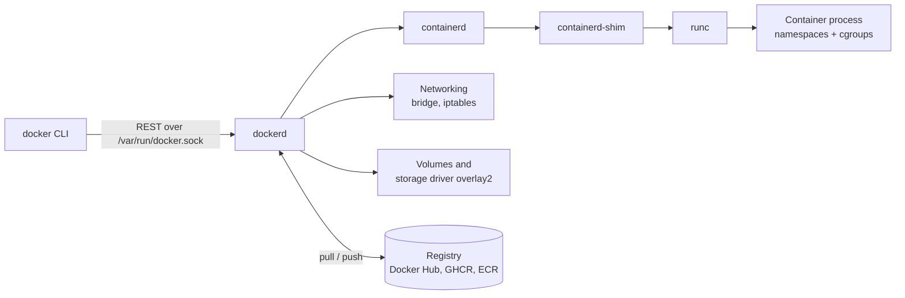
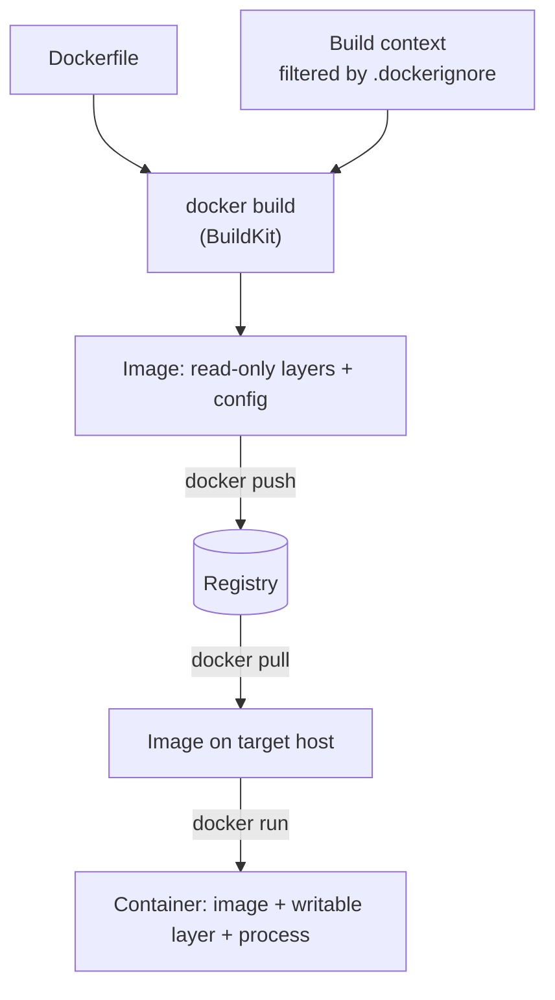
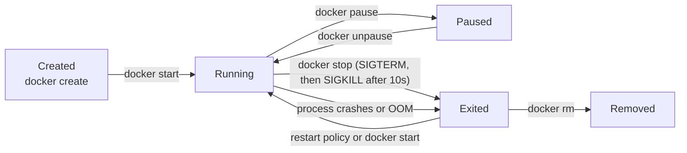
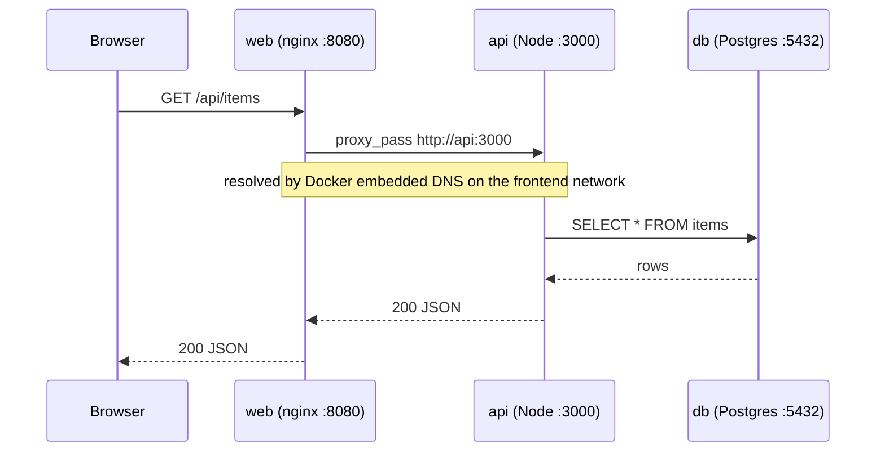
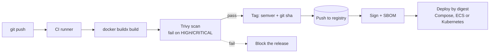

# Docker & Containers

<!-- DEVOPS-SHACK:HEADER -->

  
  
  
  
  

Part of <b><a href="https://github.com/jaiswaladi246/DevOps-Cloud-Interview-Preparation-by-DevOps-Shack">DevOps &amp; Cloud Interview Preparation</a></b> — created by <b><a href="https://www.youtube.com/@devopsshack">DevOps Shack</a></b>. Free to learn from; please credit DevOps Shack when sharing.

<!-- /DEVOPS-SHACK:HEADER -->

> Build, ship and run containers the way production teams do: small images, non-root processes, real healthchecks, sane networking, scanned and tagged artifacts. Everything an interviewer can ask about Docker, from `docker run` to image supply-chain security.

[🏠 Home](../README.md)

## What you'll master

- How a container really works: namespaces, cgroups, union filesystems, and what the daemon, containerd and runc each do
- Writing production Dockerfiles: multi-stage builds, layer caching, BuildKit cache and secret mounts, `.dockerignore`
- Running as non-root, read-only root filesystems, dropped capabilities, `no-new-privileges`, seccomp
- Healthchecks, signal handling, PID 1 behaviour, graceful shutdown, restart policies
- Docker networking (bridge, user-defined networks, host, none, overlay) and DNS-based service discovery
- Volumes vs bind mounts vs tmpfs, data persistence, backup and restore
- Docker Compose for multi-service stacks: networks, volumes, env files, profiles, `depends_on` with health conditions
- Registries, image tagging strategy, digests, multi-arch builds with `buildx`
- Image scanning (Trivy), SBOMs, signing, and shipping a hardened image through CI
- Debugging: exit codes, `OOMKilled`, crash loops, "works on my machine" differences

---

## Architecture of Docker

The `docker` CLI is only a client. It talks over a Unix socket to `dockerd`, which delegates container lifecycle to `containerd`, which in turn launches containers through a shim and the OCI runtime `runc`. Knowing this chain is a favourite interview topic, and it also explains why Kubernetes can skip `dockerd` and talk to containerd directly.

Anything with access to `/var/run/docker.sock` is effectively root on the host. Never mount it into an application container unless you fully understand the consequence.

## From Dockerfile to running container

A Dockerfile is a recipe. BuildKit executes each instruction, producing immutable layers that are cached by content. The result is an image, which is just layers plus a config (entrypoint, env, user, exposed ports). A container is an image plus a thin writable layer plus an isolated process.

If a layer's instruction and inputs did not change, BuildKit reuses it from cache. Order instructions from least to most frequently changing: base image, system packages, dependency manifests, dependency install, then application source.

## Container lifecycle

`docker stop` sends `SIGTERM`, waits (10 seconds by default, tunable with `--stop-timeout`), then sends `SIGKILL`. If your app ignores `SIGTERM`, every deploy takes 10 seconds longer and in-flight requests are cut. Exit code 137 means SIGKILL (often OOM), 143 means SIGTERM handled.

## How a request travels through a typical stack

This is the stack we build in the [hands-on lab](./hands-on-lab.md): only the web tier is published to the host, the API sits on both networks, and the database lives on an internal network with no route to the outside.

## Production workflow

---

## Core concepts in 10 minutes

### 1. Containers are processes, not tiny VMs

A container is a normal Linux process started with a restricted view of the system. **Namespaces** (pid, net, mnt, uts, ipc, user, cgroup) limit what it can see. **cgroups** limit what it can use (CPU, memory, pids, I/O). It shares the host kernel, which is why containers start in milliseconds and also why a kernel vulnerability affects every container on the host.

### 2. Images and layers

An image is an ordered stack of read-only layers stored by content hash, plus a JSON config. `overlay2` merges layers into a single view and adds a copy-on-write layer on top for the container. Deleting a file in a later layer does not shrink the image, because the earlier layer still contains it. This is why you clean up in the same `RUN` instruction, or better, use multi-stage builds.

### 3. The Dockerfile instructions that matter

`FROM` picks the base. `RUN` executes at build time and creates a layer. `COPY` is preferred over `ADD` (which also extracts archives and fetches URLs). `ENV` sets runtime variables, `ARG` is build-time only. `ENTRYPOINT` is the executable and `CMD` supplies default arguments, so `docker run image extra-args` replaces `CMD` but appends to `ENTRYPOINT`. Always use the exec form (`["node", "server.js"]`) so your app is PID 1 and receives signals directly rather than through `/bin/sh -c`.

### 4. Multi-stage builds

Build tools (compilers, `npm` dev dependencies, headers) do not belong in the runtime image. Use one stage to build and a second, minimal stage to run, copying only the artifact with `COPY --from=build`. A Node frontend that is 1.1 GB with its toolchain becomes roughly 50 MB as static files on nginx. Fewer packages also means fewer CVEs and a smaller attack surface.

### 5. Networking

The default `bridge` network gives containers IPs but no name resolution. A **user-defined bridge** adds an embedded DNS server (`127.0.0.11`) so containers reach each other by service name. `-p 8080:80` creates an iptables DNAT rule from host port to container port. `--network host` shares the host's network stack (no isolation, no port mapping). A network created with `internal: true` has no outbound route, which is the right place for a database.

### 6. Storage

Data written inside a container vanishes with the container. **Named volumes** are managed by Docker and are the default for databases. **Bind mounts** map a host path and suit development (live code reload) but depend on host layout and permissions. **tmpfs** lives in memory and suits secrets and scratch space. A read-only root filesystem plus tmpfs for `/tmp` is a strong default for stateless services.

### 7. Docker Compose

Compose describes a multi-container application in `compose.yaml`: services, networks, volumes, configs and secrets. `docker compose up -d` creates everything idempotently. Use `depends_on` with `condition: service_healthy` so the API waits for a database that is actually ready, not merely started. Use `.env` for variable interpolation, `env_file` for container environment, `profiles` for optional services, and override files for dev vs prod differences.

### 8. Registries and tagging

A reference is `registry/namespace/name:tag@digest`. Tags are mutable pointers; digests are immutable. In production we tag every build with the git SHA (traceable) and a semantic version (human friendly), and we deploy by version or digest. We never deploy `:latest`, because nobody can tell what is running or roll back to it.

### 9. Security baseline

Run as a non-root `USER`. Pin base images to a specific version (or digest). Use minimal bases (`alpine`, `-slim`, distroless). Drop all capabilities and add back only what you need (`--cap-drop ALL`). Set `--security-opt no-new-privileges`. Make the filesystem read-only. Never bake secrets into layers: `ENV` and `COPY .env` are visible in `docker history`. Use BuildKit `--mount=type=secret` at build time and runtime secrets at run time. Scan with Trivy in CI.

### 10. Healthchecks, signals and restarts

`HEALTHCHECK` runs a command inside the container and marks it `healthy` or `unhealthy`. Docker alone only reports the status (Compose and Swarm can act on it; Kubernetes ignores it and uses its own probes). Restart policies (`no`, `on-failure[:n]`, `always`, `unless-stopped`) handle crashes. Handle `SIGTERM` in your app, close connections and exit, otherwise Docker kills it after the stop timeout. If your app spawns children or does not reap zombies, use `--init` (tini).

### 11. Resource limits

`--memory 512m` sets a hard limit; exceeding it triggers the kernel OOM killer and the container exits with 137 and `OOMKilled: true` in `docker inspect`. `--cpus 1.5` throttles CPU through the CFS quota. `--pids-limit` stops fork bombs. Set limits explicitly, because a single unbounded container can take down the host.

### 12. Debugging toolbox

Start with `docker ps -a` (status and exit code), `docker logs --tail 100 -f`, `docker inspect` (state, mounts, networks, health log), `docker exec -it <c> sh`, `docker events`, and `docker stats`. For images without a shell, use `docker debug` or `docker run --rm -it --pid container:<c> --net container:<c> nicolaka/netshoot`.

---

## Question banks

Four banks of 200 questions each, with collapsible answers. 800 questions in total, tagged 🟢 Beginner, 🟡 Intermediate, 🔴 Advanced.

| Bank | Questions | What it covers |
|------|-----------|----------------|
| [Concepts](./concepts.md) | 200 | Internals, images and layers, Dockerfile instructions, networking, storage, Compose, registries, comparisons, "what happens when you run..." |
| [Scenarios](./scenarios.md) | 200 | Situational "what would you do" questions: shrinking images, migrating legacy apps, zero-downtime deploys, handling secrets, choosing between options |
| [Troubleshooting](./troubleshooting.md) | 200 | Real symptoms with exact error messages: crash loops, `exec format error`, permission denied, port conflicts, DNS failures, disk full, OOMKilled |
| [Production](./production.md) | 200 | Hardening, scale, performance, cost, registry and supply-chain design, CI/CD, logging, and rapid-fire command questions |

## Learning path

Work through these in order. Tick each one only when you can do it without notes.

**Beginner**
- [ ] Explain the difference between an image and a container, and between a VM and a container
- [ ] Run, list, stop, remove, and `exec` into containers; read logs
- [ ] Write a Dockerfile for a small app and build, tag and run it
- [ ] Publish ports and pass environment variables
- [ ] Persist data with a named volume and with a bind mount
- [ ] Put two containers on a user-defined network and reach one by name
- [ ] Write a Compose file with two services and bring it up and down
- [ ] Do the first 10 [assignments](./assignments.md)

**Intermediate**
- [ ] Convert a single-stage build into a multi-stage build and cut the size by more than half
- [ ] Order Dockerfile instructions for cache efficiency and use `.dockerignore`
- [ ] Run as non-root with a read-only filesystem and dropped capabilities
- [ ] Add healthchecks and use `depends_on: condition: service_healthy`
- [ ] Use env files, profiles and override files in Compose
- [ ] Set memory and CPU limits and recognise an OOM kill
- [ ] Scan an image with Trivy and fix the findings
- [ ] Back up and restore a database volume
- [ ] Complete the [hands-on lab](./hands-on-lab.md) end to end

**Advanced**
- [ ] Explain namespaces, cgroups, overlay2 and the dockerd/containerd/runc chain
- [ ] Build multi-architecture images with `buildx` and manage cache in CI
- [ ] Use BuildKit secret and SSH mounts so credentials never land in a layer
- [ ] Produce distroless or scratch images with static binaries
- [ ] Sign images, generate SBOMs, and deploy by digest
- [ ] Design a registry strategy: promotion between environments, retention, mirrors
- [ ] Debug a crash loop, an OOM kill and a DNS failure from first principles
- [ ] Finish all 25 assignments and answer 150 of the 200 questions in each bank unaided

## Study materials

- [Hands-on lab: containerize a 3-tier app](./hands-on-lab.md) — Node.js API, React frontend, PostgreSQL, Compose, Trivy, GHCR
- [Assignments](./assignments.md) — 25 graded exercises (10 beginner, 10 intermediate, 5 advanced)
- [Cheatsheet](./cheatsheet.md) — commands, Dockerfile and Compose reference, and the top 15 interview one-liners

[🏠 Home](../README.md)

<!-- DEVOPS-SHACK:FOOTER -->
---

### 🚀 Made with ❤️ by [DevOps Shack](https://www.youtube.com/@devopsshack)

**Learn DevOps, DevSecOps, Cloud and Kubernetes the practical way.**

[▶️ YouTube — DevOps Shack](https://www.youtube.com/@devopsshack) · [▶️ Hindi — @shackverse](https://www.youtube.com/@shackverse) · [🎓 devopsshack.com](https://devopsshack.com) · [📸 Instagram @devopsshack](https://www.instagram.com/devopsshack)

[🏠 Back to Home](../README.md) · [⭐ Star the original repo](https://github.com/jaiswaladi246/DevOps-Cloud-Interview-Preparation-by-DevOps-Shack)

© DevOps Shack · Licensed CC BY-NC-SA 4.0 · If you found this copy anywhere other than <a href="https://github.com/jaiswaladi246/DevOps-Cloud-Interview-Preparation-by-DevOps-Shack">github.com/jaiswaladi246</a>, the original and latest version is maintained by DevOps Shack.

<!-- /DEVOPS-SHACK:FOOTER -->
