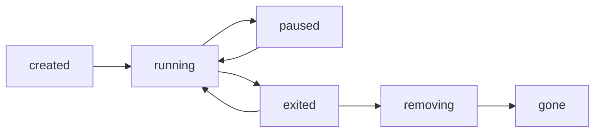
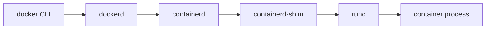

# Docker — Core Concepts

<!-- DEVOPS-SHACK:HEADER -->
<p align="center">
  <a href="https://www.youtube.com/@devopsshack"></a>
  <a href="https://www.youtube.com/@shackverse"></a>
  <a href="https://devopsshack.com"></a>
  <a href="https://www.instagram.com/devopsshack"></a>
  <a href="https://github.com/jaiswaladi246/DevOps-Cloud-Interview-Preparation-by-DevOps-Shack"></a>
</p>
<p align="center"><sub>Part of <b><a href="https://github.com/jaiswaladi246/DevOps-Cloud-Interview-Preparation-by-DevOps-Shack">DevOps &amp; Cloud Interview Preparation</a></b> — created by <b><a href="https://www.youtube.com/@devopsshack">DevOps Shack</a></b>. Free to learn from; please credit DevOps Shack when sharing.</sub></p>
<!-- /DEVOPS-SHACK:HEADER -->

> Core concepts, internals, comparisons and "what happens when…" questions for Docker and containers · 200 questions · 🟢 Beginner 🟡 Intermediate 🔴 Advanced

[⬅ Back to Docker](./README.md) · [🏠 Home](../README.md)

## Table of contents
- [Containers, VMs & Isolation Internals](#containers-vms--isolation-internals) — Q1–Q30
- [Images, Layers & Storage Drivers](#images-layers--storage-drivers) — Q31–Q60
- [Dockerfile Instructions & Builds](#dockerfile-instructions--builds) — Q61–Q100
- [Volumes & Bind Mounts](#volumes--bind-mounts) — Q101–Q120
- [Networking](#networking) — Q121–Q150
- [Docker Compose](#docker-compose) — Q151–Q170
- [Runtime Stack, OCI & Registries](#runtime-stack-oci--registries) — Q171–Q200

---

## Containers, VMs & Isolation Internals

<!-- DEVOPS-SHACK:SECTION -->
> 🎥 **Learn this hands-on with DevOps Shack** → [YouTube @devopsshack](https://www.youtube.com/@devopsshack) · [Hindi @shackverse](https://www.youtube.com/@shackverse) · [Courses at devopsshack.com](https://devopsshack.com)

### Q1. What is a container, in one sentence? 🟢

<details>
<summary><b>Answer</b></summary>

A container is a normal Linux process (or process tree) that the kernel isolates with namespaces, limits with cgroups, and gives its own root filesystem built from an image. There is no "container" object in the kernel; it is a combination of features. That is why containers start in milliseconds and share the host kernel.

</details>

### Q2. How do containers differ from virtual machines? 🟢

<details>
<summary><b>Answer</b></summary>

A VM virtualizes hardware and runs a full guest OS with its own kernel on a hypervisor. A container virtualizes the OS: it shares the host kernel and only isolates processes, filesystem and network.

- VMs: GBs, boot in tens of seconds, strong isolation boundary.
- Containers: MBs, start in milliseconds, weaker isolation (shared kernel), far higher density.

</details>

### Q3. Can a Linux container run a Windows application, or the reverse? 🟡

<details>
<summary><b>Answer</b></summary>

No. Containers share the host kernel, so a Linux image needs a Linux kernel and a Windows image needs a Windows kernel. Docker Desktop on Mac/Windows runs a hidden Linux VM (or WSL2) to host Linux containers. Windows containers need a Windows host with matching build versions (process isolation) or Hyper-V isolation.

</details>

### Q4. What are Linux namespaces? Name the ones Docker uses. 🟢

<details>
<summary><b>Answer</b></summary>

Namespaces partition kernel resources so a process sees only its own view. Docker uses: `pid` (process IDs), `net` (interfaces, routes, iptables), `mnt` (mount table), `uts` (hostname), `ipc` (SysV IPC, POSIX queues), `user` (UID/GID mapping, optional) and `cgroup` (cgroup root view).

```bash
ls -l /proc/$(docker inspect -f '{{.State.Pid}}' web)/ns
```

</details>

### Q5. What are cgroups and what do they do for containers? 🟢

<details>
<summary><b>Answer</b></summary>

Control groups account for and limit resource usage (CPU, memory, I/O, PIDs) of a group of processes. Namespaces control what a process can *see*; cgroups control what it can *use*. `docker run --memory=256m --cpus=1` just writes values into the container's cgroup.

</details>

### Q6. What is PID 1 in a container and why does it matter? 🟡

<details>
<summary><b>Answer</b></summary>

The first process in the PID namespace is PID 1. The kernel treats it specially: signals without a handler installed are ignored for PID 1 (so `SIGTERM` does nothing unless the app handles it), and PID 1 is expected to reap orphaned zombie children. Shell-form `CMD` makes `/bin/sh` PID 1, which does not forward signals. Use exec form or `docker run --init` (tini).

</details>

### Q7. How do you see which namespaces a container uses and enter them from the host? 🟡

<details>
<summary><b>Answer</b></summary>

Find the PID and use `nsenter`, which is essentially what `docker exec` does conceptually.

```bash
PID=$(docker inspect -f '{{.State.Pid}}' web)
sudo nsenter -t $PID -n ip addr      # network namespace only
sudo nsenter -t $PID -m -u -i -n -p sh   # mount, uts, ipc, net, pid
```

Handy when the image has no shell or no `ip` binary.

</details>

### Q8. Explain cgroups v1 vs v2. 🟡

<details>
<summary><b>Answer</b></summary>

v1 has a separate hierarchy per controller (`/sys/fs/cgroup/memory/...`, `/cpu/...`). v2 has a single unified hierarchy with one tree, better memory accounting (includes page cache and kernel memory), PSI pressure metrics and safe delegation to non-root users, which rootless containers need. Check with `stat -fc %T /sys/fs/cgroup` (`cgroup2fs` = v2). Modern distros (RHEL 9, Ubuntu 22.04+, Debian 12) default to v2.

</details>

### Q9. Where do you find a container's memory limit on the host? 🟡

<details>
<summary><b>Answer</b></summary>

In its cgroup directory. With cgroups v2 and the systemd driver:

```bash
ID=$(docker inspect -f '{{.Id}}' web)
cat /sys/fs/cgroup/system.slice/docker-$ID.scope/memory.max
cat /sys/fs/cgroup/system.slice/docker-$ID.scope/memory.current
```

`max` means unlimited. Inside the container, `/sys/fs/cgroup/memory.max` shows the same value.

</details>

### Q10. What is the difference between `docker run`, `docker create` and `docker start`? 🟢

<details>
<summary><b>Answer</b></summary>

`docker create` creates the container (writable layer, config, network) but does not run it. `docker start` starts an existing stopped or created container. `docker run` = pull if missing + `create` + `start` (+ attach unless `-d`). Starting an existing container reuses its writable layer and its original arguments.

</details>

### Q11. What happens, step by step, when you run `docker run -p 8080:80 nginx`? 🟡

<details>
<summary><b>Answer</b></summary>

1. CLI sends the request to `dockerd` over `/var/run/docker.sock`.
2. If `nginx:latest` is not local, dockerd pulls manifest and layers from the registry.
3. Layers are unpacked via containerd snapshotter and an overlay mount is prepared with a new writable layer.
4. dockerd creates the container config, network namespace, veth pair attached to `docker0`, and an iptables DNAT rule for 8080 to the container IP:80.
5. containerd launches `containerd-shim`, which calls `runc` to create namespaces/cgroups and exec the entrypoint.
6. runc exits; the shim stays as the parent and holds stdio.

</details>

### Q12. What is the container's writable layer and what happens to it on `docker rm`? 🟡

<details>
<summary><b>Answer</b></summary>

Each container gets a thin read-write layer on top of the read-only image layers. Anything the process writes to the filesystem (and not to a volume) lands there. `docker stop` keeps it; `docker rm` deletes it permanently. That is why state belongs in volumes.

</details>

### Q13. Why can a container "see" only its own processes with `ps`? 🟡

<details>
<summary><b>Answer</b></summary>

Because of the PID namespace plus its own `/proc` mount. `ps` reads `/proc`, and the container's `/proc` reflects only its PID namespace. `docker run --pid=host` shares the host's PID namespace and makes all host processes visible, which is a security risk but useful for debugging.

</details>

### Q14. What are Linux capabilities and how does Docker use them? 🔴

<details>
<summary><b>Answer</b></summary>

Capabilities split root's power into ~40 units (`CAP_NET_ADMIN`, `CAP_SYS_ADMIN`, ...). Docker starts containers with a reduced default set (about 14, e.g. `CHOWN`, `NET_BIND_SERVICE`, `SETUID`, `KILL`) even for root. You can adjust with flags:

```bash
docker run --cap-drop ALL --cap-add NET_BIND_SERVICE nginx
```

`--privileged` grants all capabilities and device access, which effectively removes isolation.

</details>

### Q15. What does `--privileged` do? 🟡

<details>
<summary><b>Answer</b></summary>

It gives the container all capabilities, disables seccomp and AppArmor confinement, exposes all host devices under `/dev`, and allows mounting filesystems. A root process inside can usually escape to the host. Use specific `--cap-add` or `--device` flags instead; reserve `--privileged` for things like Docker-in-Docker in isolated CI runners.

</details>

### Q16. What is seccomp and what is Docker's default profile? 🔴

<details>
<summary><b>Answer</b></summary>

Seccomp filters which system calls a process may make. Docker ships a default allow-list profile that blocks around 40-50 of 300+ syscalls (`kexec_load`, `mount` without CAP_SYS_ADMIN, `reboot`, `bpf` etc.). Override with `--security-opt seccomp=profile.json`; `seccomp=unconfined` disables it. Kubernetes historically defaulted to unconfined unless `RuntimeDefault` is set.

</details>

### Q17. How are containers different from chroot? 🟢

<details>
<summary><b>Answer</b></summary>

`chroot` only changes the apparent filesystem root of a process. It does not isolate PIDs, network, users, IPC or limit resources, and root can escape it trivially. Containers combine mount namespace (with `pivot_root`), the other namespaces, cgroups, capabilities and seccomp.

</details>

### Q18. What is a user namespace and what is `userns-remap`? 🔴

<details>
<summary><b>Answer</b></summary>

A user namespace maps UIDs inside the container to different UIDs on the host, so container root (0) can be an unprivileged UID like 100000 outside. If it escapes, it has no host privileges. Enable daemon-wide with `"userns-remap": "default"` in `/etc/docker/daemon.json`; Docker creates the `dockremap` user and reads ranges from `/etc/subuid`. Trade-offs: bind-mount ownership gets awkward, and some options (`--privileged`, `--pid=host`) are incompatible.

</details>

### Q19. What is the difference between `docker exec` and `docker attach`? 🟢

<details>
<summary><b>Answer</b></summary>

`exec` starts a new process inside a running container (e.g. `docker exec -it web sh`); exiting it does not affect the container. `attach` connects your terminal to the container's existing PID 1 stdio; Ctrl-C may stop the container unless you use `--sig-proxy=false` and detach with Ctrl-P Ctrl-Q.

</details>

### Q20. What are the container states in Docker? 🟢

<details>
<summary><b>Answer</b></summary>

`created`, `running`, `paused` (cgroup freezer), `restarting`, `exited`, `removing` and `dead`. Inspect with `docker inspect -f '{{.State.Status}}' c` or `docker ps -a --filter status=exited`.



</details>

### Q21. Explain `docker stop` vs `docker kill`. 🟢

<details>
<summary><b>Answer</b></summary>

`docker stop` sends `SIGTERM` (or the image's `STOPSIGNAL`), waits 10 seconds by default (`-t` to change), then sends `SIGKILL`. `docker kill` sends `SIGKILL` immediately (or any signal via `-s`). Graceful shutdown depends on your app handling SIGTERM as PID 1.

</details>

### Q22. What does exit code 137 mean? And 139, 143? 🟡

<details>
<summary><b>Answer</b></summary>

Exit code = 128 + signal number. 137 = SIGKILL (often the OOM killer or `docker kill`/timeout after stop). 143 = SIGTERM handled and exited. 139 = SIGSEGV (segfault). Confirm OOM with `docker inspect -f '{{.State.OOMKilled}}' c`.

</details>

### Q23. What is the difference between `docker pause` and `docker stop`? 🟡

<details>
<summary><b>Answer</b></summary>

`pause` uses the cgroup freezer to suspend all processes without signaling them; memory is retained and processes cannot tell time stopped (TCP connections may time out). `stop` terminates the processes. `unpause` resumes exactly where it left off.

</details>

### Q24. Are containers secure compared to VMs? What is the main risk? 🟡

<details>
<summary><b>Answer</b></summary>

The shared kernel is the attack surface: a kernel vulnerability or misconfiguration (privileged, docker.sock mount, host PID/network, dangerous capabilities) can lead to host escape. VMs have a smaller boundary (hypervisor). Mitigations: non-root, dropped capabilities, seccomp/AppArmor, user namespaces, rootless mode, or sandboxed runtimes (gVisor, Kata, Firecracker).

</details>

### Q25. What are gVisor and Kata Containers, and how do they differ from runc? 🔴

<details>
<summary><b>Answer</b></summary>

Both are OCI runtimes for stronger isolation. gVisor (`runsc`) implements a user-space kernel that intercepts syscalls, so the app never talks directly to the host kernel (some compatibility and I/O overhead). Kata runs each container/pod in a lightweight VM with its own guest kernel (QEMU, Cloud Hypervisor or Firecracker). runc shares the host kernel directly. Use with `docker run --runtime=runsc`.

</details>

### Q26. What does a container's `/proc/1/cgroup` or `/proc/self/cgroup` tell you? 🔴

<details>
<summary><b>Answer</b></summary>

It shows which cgroup the process belongs to. On cgroup v2 with a private cgroup namespace it prints `0::/`, while on the host you would see `0::/system.slice/docker-<id>.scope`. Tools use this to detect containers and to find limits, but apps must read `memory.max` rather than `/proc/meminfo`, which still shows host memory.

</details>

### Q27. Why does `free -m` inside a container show host memory? 🔴

<details>
<summary><b>Answer</b></summary>

`/proc/meminfo` is not namespaced; it reports the host. The limit lives in cgroup files. This causes JVMs, Node and others to size heaps wrongly unless they are cgroup-aware (JDK 10+/8u191+, `GOMEMLIMIT`, `--max-old-space-size`). `lxcfs` can fake `/proc` files but is rarely needed now.

</details>

### Q28. What is a shim (`containerd-shim-runc-v2`) and why is it needed? 🔴

<details>
<summary><b>Answer</b></summary>

The shim is a small per-container (or per-pod) process that becomes the parent of the container after runc exits. It keeps stdio open, reports exit status, and reaps children. Because of it, you can restart containerd or dockerd without killing running containers (live-restore for dockerd), and runc does not need to stay resident.

</details>

### Q29. What is the difference between a container and an image? 🟢

<details>
<summary><b>Answer</b></summary>

An image is an immutable, layered, shareable template (filesystem plus metadata such as ENV, CMD). A container is a running or stopped instance of an image with a writable layer and runtime state. Analogy: image = class/AMI, container = object/EC2 instance. One image can back many containers.

</details>

### Q30. Does a container have its own kernel modules or clock? 🔴

<details>
<summary><b>Answer</b></summary>

No. Kernel modules are loaded in the host kernel and shared (a container needs `CAP_SYS_MODULE` to load them, which should never be given). The system clock is also shared; there is no time namespace for the realtime clock (the `time` namespace only offsets monotonic and boottime clocks, and Docker does not use it by default). Changing time in a container requires `CAP_SYS_TIME` and affects the host.

</details>

## Images, Layers & Storage Drivers

<!-- DEVOPS-SHACK:SECTION -->
> 🎥 **Learn this hands-on with DevOps Shack** → [YouTube @devopsshack](https://www.youtube.com/@devopsshack) · [Hindi @shackverse](https://www.youtube.com/@shackverse) · [Courses at devopsshack.com](https://devopsshack.com)

### Q31. What is a Docker image made of? 🟢

<details>
<summary><b>Answer</b></summary>

An OCI image consists of a manifest (list of layer digests and the config digest), a config JSON (ENV, CMD, ENTRYPOINT, exposed ports, user, history, diff_ids) and an ordered set of layers stored as gzip/zstd tarballs. Everything is content-addressed by SHA-256.

```bash
docker image inspect nginx:1.27 --format '{{json .RootFS.Layers}}'
```

</details>

### Q32. What is a layer and when is one created? 🟢

<details>
<summary><b>Answer</b></summary>

A layer is a tarball of filesystem changes (adds, modifications, deletions) relative to the layer below. In classic Dockerfiles, `RUN`, `COPY` and `ADD` create filesystem layers; `ENV`, `CMD`, `LABEL`, `EXPOSE`, `WORKDIR` and `USER` only add metadata (empty layers in history).

</details>

### Q33. What is a union filesystem / OverlayFS? 🟡

<details>
<summary><b>Answer</b></summary>

A union filesystem presents several directories as one merged view. OverlayFS has `lowerdir` (read-only image layers, colon-separated), `upperdir` (container writable layer), `workdir` and a merged mountpoint. Reads fall through to the first layer that has the file; writes go to upperdir.

```bash
docker inspect -f '{{json .GraphDriver.Data}}' web
```

</details>

### Q34. What is copy-on-write (CoW) in containers? 🟡

<details>
<summary><b>Answer</b></summary>

When a container modifies a file that lives in a lower read-only layer, overlay2 first copies the whole file up to the upperdir, then modifies the copy. The first write to a large file is slow and costs space; later writes are normal. Deleting a lower file creates a whiteout (a char device 0/0) in upperdir. Heavy write workloads should use volumes.

</details>

### Q35. Why does deleting a file in a later `RUN` not shrink the image? 🟡

<details>
<summary><b>Answer</b></summary>

Layers are additive. A deletion in a later layer adds a whiteout marker; the original bytes still exist in the earlier layer and are still downloaded. Clean up in the same `RUN` step:

```dockerfile
RUN apt-get update && apt-get install -y --no-install-recommends curl \
    && rm -rf /var/lib/apt/lists/*
```

Or use multi-stage builds so the junk never reaches the final stage.

</details>

### Q36. What storage drivers does Docker support and which is default? 🟡

<details>
<summary><b>Answer</b></summary>

`overlay2` is the default and recommended on modern kernels. Others: `fuse-overlayfs` (rootless on older kernels), `btrfs`, `zfs`, `vfs` (no CoW, copies everything, slow, used for testing) and the legacy `devicemapper`/`aufs`. Docker 29+ and fresh installs may default to the containerd image store (snapshotters) instead of the classic graph drivers. Check `docker info | grep -i -E 'storage|driver'`.

</details>

### Q37. What is the containerd image store and how does it differ from the classic graph driver store? 🔴

<details>
<summary><b>Answer</b></summary>

With the containerd image store, images and snapshots are managed by containerd (snapshotters such as `overlayfs`) instead of dockerd's own `/var/lib/docker/overlay2` layout. Benefits: multi-platform images stored locally, lazy-pulling snapshotters (stargz, nydus), attestations and OCI-native storage; the same content serves Docker and Kubernetes nodes. Images pulled with the old store are not automatically visible in the new one.

</details>

### Q38. What is an image digest and how is it different from a tag? 🟢

<details>
<summary><b>Answer</b></summary>

A tag is a mutable pointer (`nginx:1.27`); the registry owner can re-push it to different content. A digest (`nginx@sha256:...`) is the SHA-256 of the manifest and is immutable. Pull by digest for reproducibility.

```bash
docker pull nginx@sha256:<digest>
docker buildx imagetools inspect nginx:1.27 | head
```

</details>

### Q39. What is a manifest list / image index? 🔴

<details>
<summary><b>Answer</b></summary>

An index points to several per-platform manifests (`linux/amd64`, `linux/arm64`, ...) under one tag. When you `docker pull nginx`, the client chooses the manifest matching your platform. Build with `docker buildx build --platform linux/amd64,linux/arm64 --push`. Override with `--platform`.

</details>

### Q40. What does `docker history` show and how do you see layer sizes? 🟢

<details>
<summary><b>Answer</b></summary>

It lists each layer's creating instruction, size and age. Use `--no-trunc` for full commands and `--format` for custom output. Tools like `dive` allow interactive layer browsing and wasted-space estimates.

```bash
docker history --no-trunc --format '{{.Size}}\t{{.CreatedBy}}' app:1.0
```

</details>

### Q41. How are layers shared between images? 🔴

<details>
<summary><b>Answer</b></summary>

Layers are identified by content digest (`diff_id`/blob digest). Two images with the same base layers store them once on disk and in the registry, and a pull downloads only missing blobs. That is why putting stable instructions (base, system packages, dependencies) before frequently changing ones (app code) saves bandwidth and disk.

</details>

### Q42. What is `scratch`? 🟢

<details>
<summary><b>Answer</b></summary>

`FROM scratch` is the empty base image: no shell, no libc, no CA certs, nothing. Used for statically compiled binaries (Go, Rust with musl). Add `/etc/ssl/certs/ca-certificates.crt` and a non-root `/etc/passwd` entry by copying them from a builder stage.

</details>

### Q43. Compare Alpine, Debian-slim, Ubuntu, distroless and scratch base images. 🟡

<details>
<summary><b>Answer</b></summary>

- **Ubuntu/Debian**: glibc, apt, large (70-120 MB) but maximum compatibility.
- **Debian-slim**: glibc, ~30-75 MB, fewer packages.
- **Alpine**: musl libc and busybox, ~5-8 MB. Small, but musl can break glibc-compiled binaries and be slower for some workloads (DNS, Python wheels).
- **Distroless**: no shell or package manager, only runtime and CA certs/tzdata; smaller attack surface.
- **scratch**: nothing at all.

</details>

### Q44. What is the difference between image ID, image digest and layer diff ID? 🔴

<details>
<summary><b>Answer</b></summary>

- **Image ID**: SHA-256 of the image config JSON (what `docker images` shows).
- **Digest** (`RepoDigests`): SHA-256 of the manifest, as the registry knows it; differs per registry because compression affects it.
- **diff ID**: SHA-256 of the *uncompressed* layer tar, listed in `RootFS.Layers`. The compressed blob digest in the manifest is different.

</details>

### Q45. What does `docker save`/`load` do vs `docker export`/`import`? 🟡

<details>
<summary><b>Answer</b></summary>

`save` writes an image (all layers, tags, metadata) to a tarball; `load` restores it. `export` dumps a *container's* flattened filesystem (no history, no metadata, no volumes); `import` creates a single-layer image from it. Use save/load for air-gapped transfer, export/import to flatten.

```bash
docker save -o app.tar app:1.0 && docker load -i app.tar
```

</details>

### Q46. How do you reduce an image's size? 🟢

<details>
<summary><b>Answer</b></summary>

Use a smaller base, multi-stage builds, combine `RUN` cleanup in the same layer, `--no-install-recommends`, a good `.dockerignore`, install only runtime dependencies, strip binaries, and avoid copying build tools. Verify with `docker images`, `docker history` and `dive`.

</details>

### Q47. What are dangling images and how do you remove them? 🟡

<details>
<summary><b>Answer</b></summary>

Dangling images have no tag (`<none>:<none>`), typically left behind when a tag is moved to a newer build. `docker images -f dangling=true` lists them; `docker image prune` removes them; `docker image prune -a` removes all images not used by a container.

</details>

### Q48. What does `docker system df` show? 🟡

<details>
<summary><b>Answer</b></summary>

Disk usage by images, containers, local volumes and build cache, plus reclaimable amounts. `docker system df -v` lists items individually. `docker system prune` cleans stopped containers, unused networks, dangling images and build cache; add `--volumes` only if you are sure, because it deletes unused volumes.

</details>

### Q49. What is `/var/lib/docker` and what is inside? 🟡

<details>
<summary><b>Answer</b></summary>

The daemon's data root: `overlay2/` (layers), `image/` (metadata), `containers/` (per-container config and JSON logs), `volumes/`, `network/`, `buildkit/` and `swarm/`. Move it with `"data-root"` in `daemon.json` when `/var` is small. Never edit it by hand while the daemon runs.

</details>

### Q50. Why might `overlay2` fail with "invalid argument" or "d_type" problems? 🔴

<details>
<summary><b>Answer</b></summary>

overlay2 needs the backing filesystem to support `d_type` (XFS must be created with `ftype=1`; ext4 is fine). Without it, dockerd warns "Backing Filesystem is xfs without d_type support" and may refuse to start. Check with `xfs_info /var/lib/docker | grep ftype`. Also overlay cannot sit on top of another overlay, NFS or some encrypted FS, which breaks Docker-in-Docker unless `/var/lib/docker` is a volume.

</details>

### Q51. What are whiteout and opaque directories? 🔴

<details>
<summary><b>Answer</b></summary>

In OCI/overlay layers, deleting a file in an upper layer is recorded as a whiteout: `.wh.<name>` in the tar, or a 0/0 character device in overlayfs. Replacing a directory entirely uses an opaque marker (`.wh..wh..opq` in tar, `trusted.overlay.opaque=y` xattr) so lower contents are hidden. They are why deleted data still sits in lower layers.

</details>

### Q52. How many layers can an image have? 🔴

<details>
<summary><b>Answer</b></summary>

overlay2 supports up to 128 lower layers (a kernel mount limit, with workarounds in newer versions), so very long Dockerfiles can fail with "max depth exceeded". Practically you want fewer than 20-30 layers for faster pulls and mounts. Squashing or multi-stage builds reduce depth.

</details>

### Q53. What is image squashing and when would you use it? 🔴

<details>
<summary><b>Answer</b></summary>

Squashing merges all layers into one, removing deleted data and reducing size for builds with lots of churn. The cost is losing layer sharing and cache reuse. With BuildKit, a multi-stage final stage that copies `/` from the previous stage (`COPY --from=build / /`) achieves the same effect. Generally prefer proper multi-stage builds.

</details>

### Q54. What is `docker commit` and why is it discouraged? 🟢

<details>
<summary><b>Answer</b></summary>

It creates an image from a container's current state. It is non-reproducible, bakes in secrets and logs, and leaves no record of how it was made. Use it only for quick debugging snapshots; production images should come from a Dockerfile in version control.

</details>

### Q55. How does `docker pull` decide which layers to download? 🟡

<details>
<summary><b>Answer</b></summary>

It fetches the manifest by tag, picks the platform manifest from an index, compares layer blob digests with local content, and downloads only missing ones in parallel (default 3 concurrent, `max-concurrent-downloads`). Each blob is verified against its digest after download.

</details>

### Q56. What is `docker image inspect` useful for? 🟢

<details>
<summary><b>Answer</b></summary>

It shows the image config: `Config.Env`, `Cmd`, `Entrypoint`, `ExposedPorts`, `User`, `WorkingDir`, `Labels`, architecture, OS, size and layers. Use `-f` with Go templates.

```bash
docker image inspect -f '{{.Config.User}} {{.Config.Entrypoint}} {{.Config.Cmd}}' app:1.0
```

</details>

### Q57. What is the OCI image spec versus the Docker image format? 🟡

<details>
<summary><b>Answer</b></summary>

OCI image spec (2017, from Docker v2.2 schema) standardizes manifest, index, config and layer media types (`application/vnd.oci.image.manifest.v1+json`). Docker v2 schema 2 media types are near-identical and still widely used. Modern Docker and registries handle both; BuildKit can export OCI via `--output type=oci`.

</details>

### Q58. What is a base image and what does `FROM` do at build time? 🟢

<details>
<summary><b>Answer</b></summary>

`FROM` pulls (or reuses) the specified image and uses its layers and config as the starting point; every later instruction adds on top. Every Dockerfile must start with `FROM` (only `ARG` can precede it). Multi-stage files have several `FROM`s, each beginning a new stage.

</details>

### Q59. What are image labels and the OCI annotations people commonly set? 🟡

<details>
<summary><b>Answer</b></summary>

`LABEL` adds key-value metadata. Convention: `org.opencontainers.image.source`, `.revision`, `.version`, `.created`, `.licenses`, `.title`. Registries like GHCR use `image.source` to link the image to the repo. Filter with `docker images --filter label=team=payments`.

</details>

### Q60. What is lazy pulling (eStargz/Nydus/SOCI) and why do people use it? 🔴

<details>
<summary><b>Answer</b></summary>

Containers typically read only a small fraction of an image at startup. Lazy-pulling snapshotters mount the image remotely and fetch file chunks on demand, cutting start time for multi-GB images from minutes to seconds. Needs a compatible format (eStargz, Nydus, AWS SOCI index) and snapshotter plugin in containerd.

</details>

## Dockerfile Instructions & Builds

<!-- DEVOPS-SHACK:SECTION -->
> 🎥 **Learn this hands-on with DevOps Shack** → [YouTube @devopsshack](https://www.youtube.com/@devopsshack) · [Hindi @shackverse](https://www.youtube.com/@shackverse) · [Courses at devopsshack.com](https://devopsshack.com)

### Q61. What is the difference between `RUN`, `CMD` and `ENTRYPOINT`? 🟢

<details>
<summary><b>Answer</b></summary>

`RUN` executes at build time and commits a layer. `CMD` sets the default command (or default args) at container start and is replaced by arguments to `docker run`. `ENTRYPOINT` defines the executable that always runs; `docker run` arguments are appended to it unless you pass `--entrypoint`.

</details>

### Q62. How do ENTRYPOINT and CMD combine? 🟡

<details>
<summary><b>Answer</b></summary>

In exec form, final command = ENTRYPOINT + CMD. Use ENTRYPOINT for the program and CMD for default flags:

```dockerfile
ENTRYPOINT ["python", "app.py"]
CMD ["--port", "8000"]
# docker run img --port 9000   -> python app.py --port 9000
```

If ENTRYPOINT is in shell form, CMD is ignored. Only the last CMD and last ENTRYPOINT count.

</details>

### Q63. Shell form vs exec form: what is the practical difference? 🔴

<details>
<summary><b>Answer</b></summary>

Shell form (`CMD node app.js`) runs `/bin/sh -c "node app.js"`: variable expansion works but sh is PID 1 and swallows signals. Exec form (`CMD ["node","app.js"]`) runs the binary directly as PID 1, receives SIGTERM, but has no shell features (`$VAR`, `&&`, pipes). If you need expansion, use `["sh","-c","exec node app.js"]`.

</details>

### Q64. `COPY` vs `ADD`? 🟢

<details>
<summary><b>Answer</b></summary>

`COPY` copies files from the build context (or another stage). `ADD` does the same plus auto-extracts local tar archives and can fetch remote URLs (and Git repos). Use `COPY` by default for clarity; use `ADD` for local tar extraction, or `ADD --checksum=sha256:... URL` when you need a verified download.

</details>

### Q65. What is the build context and why does it matter? 🟢

<details>
<summary><b>Answer</b></summary>

It is the directory (or URL/tar) sent to the builder, the `.` in `docker build .`. Only files inside it can be `COPY`d. A big context slows every build and can leak secrets; control it with `.dockerignore`. BuildKit sends only the files actually referenced, incrementally.

</details>

### Q66. What does `.dockerignore` do? 🟢

<details>
<summary><b>Answer</b></summary>

It excludes files from the build context using gitignore-like patterns, speeding up builds, preventing cache invalidation from irrelevant changes, and keeping secrets out.

```text
.git
node_modules
**/*.log
.env
Dockerfile*
!Dockerfile
```

Patterns are relative to the context root and `!` re-includes a path.

</details>

### Q67. How does the build cache work? 🟡

<details>
<summary><b>Answer</b></summary>

For each instruction the builder computes a cache key from the parent layer plus the instruction text; for `COPY`/`ADD` it also includes a checksum of the copied files. A match reuses the layer. When one layer misses, all later layers rebuild. `RUN apt-get update` is cached by its text, not by the state of the apt repos, so it can go stale.

</details>

### Q68. Why do we copy `package.json` before the rest of the source? 🟢

<details>
<summary><b>Answer</b></summary>

To keep the dependency-install layer cacheable. Code changes often, dependencies rarely:

```dockerfile
COPY package.json package-lock.json ./
RUN npm ci
COPY . .
```

Editing a source file only invalidates layers from `COPY . .` onward.

</details>

### Q69. What is a multi-stage build? 🟢

<details>
<summary><b>Answer</b></summary>

A Dockerfile with several `FROM` stages where later stages copy artifacts from earlier ones with `COPY --from=<stage>`. Compilers and build tools stay in the builder stage and only the runtime output ships, producing much smaller, safer images.

```dockerfile
FROM golang:1.23 AS build
WORKDIR /src
COPY . .
RUN CGO_ENABLED=0 go build -o /app ./cmd/api
FROM gcr.io/distroless/static-debian12
COPY --from=build /app /app
ENTRYPOINT ["/app"]
```

</details>

### Q70. How do you build only one stage, or use a stage as a test target? 🟡

<details>
<summary><b>Answer</b></summary>

Use `--target`. Typical pattern: `base`, `dev`, `test`, `prod` stages in one file.

```bash
docker build --target test -t app:test .
docker build --target prod -t app:1.0 .
```

BuildKit only builds stages the target depends on, skipping unrelated ones.

</details>

### Q71. What is BuildKit and how is it better than the legacy builder? 🟡

<details>
<summary><b>Answer</b></summary>

BuildKit is the modern build engine (default since Docker 23). It builds a dependency graph (LLB), runs independent stages in parallel, skips unused stages, has better caching with cache mounts and remote cache export, secret and SSH mounts, multi-platform builds and richer output. Legacy builder is deprecated.

</details>

### Q72. What is `docker buildx`? 🔴

<details>
<summary><b>Answer</b></summary>

The CLI plugin exposing full BuildKit features: multiple builder instances (drivers: `docker`, `docker-container`, `kubernetes`, `remote`), multi-platform builds, cache import/export, `bake` files, SBOM/provenance attestations.

```bash
docker buildx create --use --name multi
docker buildx build --platform linux/amd64,linux/arm64 -t me/app:1 --push .
```

</details>

### Q73. What are BuildKit cache mounts? 🟡

<details>
<summary><b>Answer</b></summary>

`RUN --mount=type=cache,target=...` gives a persistent directory across builds that is not part of any layer. Great for package manager caches.

```dockerfile
RUN --mount=type=cache,target=/root/.cache/pip pip install -r requirements.txt
```

The cache is local to the builder; in CI you need cache export or a persistent builder.

</details>

### Q74. How do you pass secrets at build time safely? 🟡

<details>
<summary><b>Answer</b></summary>

Use BuildKit secret mounts. The secret is mounted as a tmpfs file only during that `RUN` and never stored in a layer or history.

```dockerfile
RUN --mount=type=secret,id=npmrc,target=/root/.npmrc npm ci
```
```bash
docker build --secret id=npmrc,src=$HOME/.npmrc .
```

`ARG` and `ENV` values are visible in `docker history`; never use them for secrets.

</details>

### Q75. `ARG` vs `ENV`? 🟢

<details>
<summary><b>Answer</b></summary>

`ARG` exists only at build time (set with `--build-arg`) and is not in the running container's environment. `ENV` persists into the image and every container. An `ARG` before `FROM` is only available in `FROM` lines unless redeclared inside the stage. Both are visible in image metadata.

</details>

### Q76. What does `WORKDIR` do and why prefer it over `RUN cd`? 🟡

<details>
<summary><b>Answer</b></summary>

`WORKDIR` sets the working directory for subsequent `RUN`, `CMD`, `ENTRYPOINT`, `COPY`, `ADD` and creates it if missing. `RUN cd /x` only affects that one `RUN` shell. Use absolute paths.

</details>

### Q77. What does `EXPOSE` actually do? 🟡

<details>
<summary><b>Answer</b></summary>

It is documentation metadata only; it does not publish the port. `-p host:container` publishes. `-P` publishes all `EXPOSE`d ports to random high host ports. Tools and Compose can use the metadata, but traffic from other containers on the same network works without it.

</details>

### Q78. What is the `USER` instruction and when does it take effect? 🟢

<details>
<summary><b>Answer</b></summary>

It sets the user (and optionally group) for later `RUN`, `CMD` and `ENTRYPOINT` and for `docker exec` by default. Create the user first:

```dockerfile
RUN groupadd -r app && useradd -r -g app -u 10001 app
USER 10001:10001
```

Use a numeric UID so Kubernetes `runAsNonRoot` can verify it.

</details>

### Q79. What does `HEALTHCHECK` do in a Dockerfile? 🟡

<details>
<summary><b>Answer</b></summary>

It defines a command Docker runs periodically inside the container; exit 0 = healthy, 1 = unhealthy. State shows in `docker ps` (`healthy`/`unhealthy`/`starting`). Options: `--interval`, `--timeout`, `--start-period`, `--retries`. Docker does not restart on unhealthy by itself (Swarm does); Compose `depends_on: condition: service_healthy` uses it.

```dockerfile
HEALTHCHECK --interval=30s --timeout=3s CMD curl -fsS http://localhost:8080/health || exit 1
```

</details>

### Q80. What does `STOPSIGNAL` do? 🟡

<details>
<summary><b>Answer</b></summary>

It sets the signal sent by `docker stop` instead of `SIGTERM`. Example: nginx wants `SIGQUIT` for graceful shutdown, so the official image sets `STOPSIGNAL SIGQUIT`. Can also be set per container with `--stop-signal`.

</details>

### Q81. What is `ONBUILD`? 🔴

<details>
<summary><b>Answer</b></summary>

It registers a trigger instruction that runs when this image is used as a `FROM` for a downstream build. It makes behavior implicit and surprising, and is mostly discouraged today. Check for triggers with `docker inspect -f '{{.Config.OnBuild}}' img`.

</details>

### Q82. What does `SHELL` do? 🔴

<details>
<summary><b>Answer</b></summary>

It changes the default shell used for shell-form instructions (default `["/bin/sh","-c"]`). A common use is enabling pipefail so a failing `curl | tar` breaks the build:

```dockerfile
SHELL ["/bin/bash", "-o", "pipefail", "-c"]
```

</details>

### Q83. How does `VOLUME` in a Dockerfile behave? 🟡

<details>
<summary><b>Answer</b></summary>

It declares a mount point; at run time Docker creates an anonymous volume there if you do not mount something. Any changes to that path in later Dockerfile steps are discarded (the path is frozen once declared), and the pile of anonymous volumes is a classic disk leak. Many teams avoid `VOLUME` and define mounts at run time.

</details>

### Q84. How do you build for a different CPU architecture? 🟡

<details>
<summary><b>Answer</b></summary>

Use buildx with `--platform`. Foreign architectures run via QEMU user-mode emulation (slow) or native builder nodes; best is cross-compiling in the build stage using `BUILDPLATFORM`/`TARGETARCH`.

```dockerfile
FROM --platform=$BUILDPLATFORM golang:1.23 AS build
ARG TARGETOS TARGETARCH
RUN GOOS=$TARGETOS GOARCH=$TARGETARCH go build -o /app .
```

```bash
docker run --privileged --rm tonistiigi/binfmt --install all
```

</details>

### Q85. What is a heredoc in a Dockerfile? 🟡

<details>
<summary><b>Answer</b></summary>

BuildKit (Dockerfile syntax 1.4+) supports multi-line scripts and inline files, avoiding long `&&` chains.

```dockerfile
# syntax=docker/dockerfile:1
RUN <<EOF
set -eux
apt-get update
apt-get install -y --no-install-recommends curl
rm -rf /var/lib/apt/lists/*
EOF
```

</details>

### Q86. What does `# syntax=docker/dockerfile:1` do? 🔴

<details>
<summary><b>Answer</b></summary>

It tells BuildKit to fetch that frontend image and parse the Dockerfile with it, so you get new Dockerfile features (heredocs, `--mount`, `COPY --link`, `--chmod`) independent of the installed Docker version. The `1` tag tracks the latest stable 1.x.

</details>

### Q87. What does `COPY --link` do? 🔴

<details>
<summary><b>Answer</b></summary>

It creates the copied layer independently of the previous layers, so changing a base layer does not invalidate and re-copy it, and layers can be rebased cheaply during pull/push. Useful with `COPY --link --from=build /app /app`. Trade-off: ownership/permission defaults apply from scratch, so specify `--chown`.

</details>

### Q88. How do `--chown` and `--chmod` on `COPY` help? 🔴

<details>
<summary><b>Answer</b></summary>

They set ownership and mode at copy time in the same layer, avoiding a separate `RUN chown -R` which duplicates the data into a new layer (doubling size).

```dockerfile
COPY --chown=10001:10001 --chmod=0555 ./dist /app
```

</details>

### Q89. What is the difference between `docker build -t app .` and `docker buildx build --load`? 🟡

<details>
<summary><b>Answer</b></summary>

With the default `docker` driver, `docker build` is already BuildKit and loads the image to the local store. With a `docker-container` builder, results stay in the builder cache unless you use `--load` (single platform only on classic store) or `--push`. Multi-platform results cannot be loaded into the classic image store; the containerd image store can hold them.

</details>

### Q90. How do you exclude dev dependencies from the final image? 🟢

<details>
<summary><b>Answer</b></summary>

Use a multi-stage build: install everything and compile in a builder stage, then in the runtime stage install production deps only (`npm ci --omit=dev`, `pip install --no-cache-dir`, `mvn package` and copy the jar) or copy only the built output.

</details>

### Q91. Why should you pin base image versions in `FROM`? 🟢

<details>
<summary><b>Answer</b></summary>

`FROM node:latest` changes under you, breaking reproducibility and builds. Pin a version (`node:22.11-bookworm-slim`) and ideally a digest (`node:22.11-bookworm-slim@sha256:...`); update through Renovate or Dependabot so upgrades are deliberate and reviewed.

</details>

### Q92. What does the `--no-cache` and `--pull` build flags do? 🟡

<details>
<summary><b>Answer</b></summary>

`--no-cache` ignores the build cache for all steps. `--pull` always checks the registry for a newer version of the base image (otherwise a local copy is reused). For reproducible CI patching, use `--pull` rather than `--no-cache` to avoid rebuilding everything needlessly.

</details>

### Q93. How can you see the Dockerfile commands that produced an existing image? 🟡

<details>
<summary><b>Answer</b></summary>

`docker history --no-trunc image` shows each `CreatedBy` instruction. It does not reveal build contexts, and `ARG`/`ENV` values appear in plain text, which is how leaked secrets are commonly found. BuildKit attestations (provenance) can store the full build metadata.

</details>

### Q94. What is `docker buildx bake`? 🔴

<details>
<summary><b>Answer</b></summary>

A declarative way to define multiple build targets (HCL, JSON or Compose files), with variables, inheritance, matrix, and parallel execution.

```hcl
target "app" {
  context = "."
  tags = ["registry.example.com/app:1.0"]
  platforms = ["linux/amd64","linux/arm64"]
}
```
`docker buildx bake app --push`. Handy for monorepos building many images with shared settings.

</details>

### Q95. What happens with `RUN apt-get update` on a separate line from `apt-get install`? 🟡

<details>
<summary><b>Answer</b></summary>

The `update` layer is cached, so a later `install` line change uses stale package indexes and may fail with 404 on package URLs. Always chain them in one `RUN`: `apt-get update && apt-get install -y ...`.

</details>

### Q96. What does `--mount=type=bind` do in `RUN`? 🔴

<details>
<summary><b>Answer</b></summary>

It mounts files from the build context or another stage read-only into a `RUN` step without copying them into a layer. Good for using a lockfile or source only during a build step.

```dockerfile
RUN --mount=type=bind,source=go.mod,target=go.mod \
    --mount=type=bind,source=go.sum,target=go.sum \
    go mod download
```

</details>

### Q97. How do you use SSH keys to clone a private repo during build? 🟡

<details>
<summary><b>Answer</b></summary>

Forward the agent via BuildKit's SSH mount; the key never lands in the image.

```dockerfile
RUN --mount=type=ssh git clone git@github.com:org/private.git
```
```bash
docker build --ssh default .
```

</details>

### Q98. How do Dockerfile variables and `${VAR:-default}` expansion work? 🔴

<details>
<summary><b>Answer</b></summary>

`ARG` and `ENV` can be referenced as `$VAR` or `${VAR}` in `ADD`, `COPY`, `ENV`, `EXPOSE`, `FROM`, `LABEL`, `USER`, `VOLUME`, `WORKDIR`. Modifiers: `${VAR:-default}` and `${VAR:+alt}`. In `RUN`, `CMD` and `ENTRYPOINT`, expansion is done by the shell (shell form) or not at all (exec form).

</details>

### Q99. What is the ordering mistake that breaks caching most often? 🟢

<details>
<summary><b>Answer</b></summary>

Doing `COPY . .` before installing dependencies, so any source edit reinstalls everything. Also putting volatile `ARG`s (like `BUILD_DATE` or git SHA) near the top invalidates all subsequent layers. Put volatile values as late as possible.

</details>

### Q100. How does Docker decide a `COPY` cache hit? 🔴

<details>
<summary><b>Answer</b></summary>

It hashes the contents and relevant metadata (path, mode, ownership; not mtime in BuildKit) of the files being copied, combined with the instruction and parent. Any change in the matched files misses. `RUN` has no file awareness, so `RUN curl ... | sh` stays cached forever unless the text changes or you use `--no-cache` or `ARG CACHE_BUST`.

</details>

## Volumes & Bind Mounts

<!-- DEVOPS-SHACK:SECTION -->
> 🎥 **Learn this hands-on with DevOps Shack** → [YouTube @devopsshack](https://www.youtube.com/@devopsshack) · [Hindi @shackverse](https://www.youtube.com/@shackverse) · [Courses at devopsshack.com](https://devopsshack.com)

### Q101. What are the three ways to persist or share data with a container? 🟢

<details>
<summary><b>Answer</b></summary>

- **Volume**: managed by Docker under `/var/lib/docker/volumes`, portable, driver-pluggable. Preferred for persistent data.
- **Bind mount**: maps a host path into the container; depends on host layout. Good for dev and config.
- **tmpfs**: in-memory, never written to disk, gone when the container stops.

</details>

### Q102. Volume vs bind mount: when do you pick which? 🟢

<details>
<summary><b>Answer</b></summary>

Volumes for databases and any data Docker should own (backups via `docker volume`, works the same on Linux/Mac/Windows, copies image content on first mount). Bind mounts for source code hot-reload, host config files and sockets. Bind mounts expose host paths and permissions to the container, so use `:ro` whenever possible.

</details>

### Q103. What is the difference between `-v` and `--mount`? 🟢

<details>
<summary><b>Answer</b></summary>

`--mount` is explicit key=value and clearer; `-v src:dst:opts` is terse. The key behavioral difference: with `-v` a missing host path for a bind mount is auto-created as a root-owned directory; with `--mount type=bind` Docker errors out.

```bash
docker run --mount type=volume,src=pgdata,dst=/var/lib/postgresql/data postgres:16
docker run -v pgdata:/var/lib/postgresql/data postgres:16
```

</details>

### Q104. What is an anonymous volume and how do you find leftovers? 🟡

<details>
<summary><b>Answer</b></summary>

A volume with a random 64-hex name, created by `VOLUME` in a Dockerfile or `-v /path` without a source. They are not removed by `docker rm` unless you use `-v`/`--volumes`. List unused ones with `docker volume ls -f dangling=true`; remove with `docker volume prune`.

</details>

### Q105. How does a new named volume get populated? 🟡

<details>
<summary><b>Answer</b></summary>

If the volume is empty and the mount target in the image has files, Docker copies those files into the volume on first mount (named volumes only, not bind mounts). A non-empty volume always hides the image's content at that path. A bind mount to an empty host directory hides the image files, which surprises many people.

</details>

### Q106. How do you back up and restore a named volume? 🟡

<details>
<summary><b>Answer</b></summary>

Use a throwaway container that mounts the volume and a host directory.

```bash
docker run --rm -v pgdata:/data -v $PWD:/backup alpine \
  tar czf /backup/pgdata.tgz -C /data .
docker run --rm -v pgdata2:/data -v $PWD:/backup alpine \
  tar xzf /backup/pgdata.tgz -C /data
```

For databases, prefer logical backups (`pg_dump`) or stop the DB first for consistency.

</details>

### Q107. Where is a named volume physically stored and can you edit it directly? 🟡

<details>
<summary><b>Answer</b></summary>

`docker volume inspect pgdata` shows `Mountpoint` like `/var/lib/docker/volumes/pgdata/_data` (inside the VM on Docker Desktop). Root on a Linux host can read it, but treat it as Docker-managed; use containers to modify data to keep ownership and SELinux labels correct.

</details>

### Q108. What is `tmpfs` mount used for? 🟢

<details>
<summary><b>Answer</b></summary>

Ephemeral, memory-backed storage for secrets or scratch space, with optional size and mode.

```bash
docker run --tmpfs /run:rw,noexec,nosuid,size=64m myapp
docker run --mount type=tmpfs,dst=/tmp,tmpfs-size=100m myapp
```

Combined with `--read-only`, it gives a read-only root with only specific writable paths.

</details>

### Q109. What does `--read-only` do? 🟡

<details>
<summary><b>Answer</b></summary>

It mounts the container's root filesystem read-only, so writes fail with "Read-only file system". Apps that need scratch space must use volumes or `--tmpfs` for `/tmp`, `/run`, caches. It blocks many persistence techniques after a compromise.

</details>

### Q110. Why do I get "permission denied" writing to a bind mount? 🟡

<details>
<summary><b>Answer</b></summary>

UIDs are numeric and not translated by default: a container user with UID 1000 writes to a host directory owned by UID 1001 or root. Fix by matching UID/GID (`--user $(id -u):$(id -g)`), `chown` the host dir, or use `userns-remap`. On SELinux hosts add `:z` or `:Z` to relabel; on rootless Podman use `:U` or `--userns=keep-id`.

</details>

### Q111. What do the `:z` and `:Z` mount options do? 🔴

<details>
<summary><b>Answer</b></summary>

On SELinux-enforcing hosts (RHEL, Fedora) a container process cannot access arbitrary host files. `:z` relabels the content with a shared label (`svirt_sandbox_file_t`) usable by multiple containers; `:Z` applies a private label unique to this container. Never relabel `/home` or `/etc` wholesale.

</details>

### Q112. What are volume drivers and give examples? 🔴

<details>
<summary><b>Answer</b></summary>

Volume plugins let volumes live on other storage: `local` (default, can mount NFS/CIFS via options), REX-Ray, Portworx, `rclone`, AWS EFS via NFS options. Example NFS-backed local volume:

```bash
docker volume create --driver local \
  --opt type=nfs --opt o=addr=10.0.0.5,rw,nfsvers=4 --opt device=:/exports/data nfsdata
```

</details>

### Q113. What is a volume's lifecycle relative to a container? 🟡

<details>
<summary><b>Answer</b></summary>

Independent. Named volumes survive `docker rm` and are only deleted by `docker volume rm` or `prune`. Compose `down` keeps volumes unless you add `-v`. That separation lets you replace the container (new image) while keeping data.

</details>

### Q114. How do you share data between two containers? 🟡

<details>
<summary><b>Answer</b></summary>

Mount the same named volume in both (`-v shared:/data`), or use `--volumes-from other` to inherit all its mounts. Ensure only one writer at a time for non-clustered data, otherwise you corrupt state (e.g., two Postgres instances on one volume).

</details>

### Q115. Why are bind mounts slow on Docker Desktop for Mac/Windows and what helps? 🟡

<details>
<summary><b>Answer</b></summary>

File access crosses the VM boundary (virtiofs, gRPC-FUSE, or the WSL2 9P bridge), which is slow for many small files like `node_modules`. Keep source on the Linux filesystem in WSL2, use named volumes for dependency directories, enable VirtioFS on Mac, and use Compose `watch` (sync) instead of full bind mounts.

</details>

### Q116. What is Compose `develop.watch`? 🟡

<details>
<summary><b>Answer</b></summary>

A dev feature (`docker compose watch`) with actions `sync`, `rebuild` and `sync+restart` that reacts to file changes without bind mounting the whole tree.

```yaml
services:
  web:
    build: .
    develop:
      watch:
        - action: sync
          path: ./src
          target: /app/src
        - action: rebuild
          path: package.json
```

</details>

### Q117. How can you mount a single file and what pitfall exists? 🔴

<details>
<summary><b>Answer</b></summary>

`-v ./nginx.conf:/etc/nginx/nginx.conf:ro` works, but file bind mounts bind to the *inode*. Editors that replace the file (write to temp then rename) create a new inode and the container keeps seeing the old one. Mount the parent directory instead, or restart the container after edits.

</details>

### Q118. What does mounting `/var/run/docker.sock` into a container mean? 🟡

<details>
<summary><b>Answer</b></summary>

The container can talk to the host's Docker daemon, which equals root on the host (it can start privileged containers mounting `/`). It is used by CI agents, Traefik, Portainer. Safer alternatives: socket proxy with limited API verbs, rootless Docker, or daemonless builders (BuildKit, Kaniko, Buildah).

</details>

### Q119. How do you inspect which mounts a container has? 🟢

<details>
<summary><b>Answer</b></summary>

```bash
docker inspect -f '{{json .Mounts}}' web | jq
```

It lists each mount's `Type`, `Source`, `Destination`, `RW` and propagation. Inside the container, `findmnt` or `cat /proc/self/mountinfo` shows the same.

</details>

### Q120. What is mount propagation (`rprivate`, `rshared`) on bind mounts? 🔴

<details>
<summary><b>Answer</b></summary>

It controls whether mounts created under a bind-mounted directory propagate between host and container. Docker defaults to `rprivate` (none). `rslave` lets host mounts appear in the container; `rshared` is two-way and needs the host mount to be shared. Needed by tools like CSI node drivers or `rclone mount` containers.

```bash
docker run -v /mnt/data:/data:rshared ...
```

</details>

## Networking

<!-- DEVOPS-SHACK:SECTION -->
> 🎥 **Learn this hands-on with DevOps Shack** → [YouTube @devopsshack](https://www.youtube.com/@devopsshack) · [Hindi @shackverse](https://www.youtube.com/@shackverse) · [Courses at devopsshack.com](https://devopsshack.com)

### Q121. What network drivers does Docker have? 🟢

<details>
<summary><b>Answer</b></summary>

`bridge` (default on a single host), `host` (shares host network stack), `none` (loopback only), `overlay` (multi-host, Swarm/VXLAN), `macvlan` (container gets its own MAC and LAN IP), `ipvlan`. Plus third-party plugins. List with `docker network ls`.

</details>

### Q122. How does the default bridge network work? 🔴

<details>
<summary><b>Answer</b></summary>

Docker creates the Linux bridge `docker0` (172.17.0.0/16). For each container it creates a veth pair: one end in the container as `eth0`, the other attached to the bridge. Outbound traffic is NATed (iptables MASQUERADE); published ports use DNAT rules. Containers on default bridge communicate by IP only (legacy `--link` aside).

```bash
ip addr show docker0
bridge link
```

</details>

### Q123. Default bridge vs user-defined bridge: what is the difference? 🟡

<details>
<summary><b>Answer</b></summary>

User-defined bridges give automatic DNS resolution by container name (via the embedded DNS at 127.0.0.11), better isolation (only attached containers talk), on-the-fly connect/disconnect, and configurable subnets. The default bridge lacks name resolution and puts all containers together. Always create your own network.

```bash
docker network create appnet
docker run -d --network appnet --name db postgres:16
```

</details>

### Q124. How does container DNS work? 🟡

<details>
<summary><b>Answer</b></summary>

On user-defined networks, `/etc/resolv.conf` points to `127.0.0.11`, Docker's embedded DNS, which resolves container names and network aliases and forwards everything else to the host's resolvers. On the default bridge, containers copy the host's `resolv.conf`. Override with `--dns`, `--dns-search`, or daemon `dns` setting.

</details>

### Q125. How does `-p 8080:80` work under the hood? 🔴

<details>
<summary><b>Answer</b></summary>

Docker adds an iptables DNAT rule in the `DOCKER` chain of the `nat` table (host:8080 to container IP:80) plus filter rules to accept it, and by default runs a `docker-proxy` userland process for localhost/hairpin cases. Inspect with `iptables -t nat -L DOCKER -n`. Published ports bypass UFW/firewalld input rules, a frequent security surprise.

</details>

### Q126. What is the difference between `-p 80:80` and `-p 127.0.0.1:80:80`? 🟢

<details>
<summary><b>Answer</b></summary>

The first binds on all host interfaces (0.0.0.0, and often :: too), exposing the service to the network. The second binds only to loopback, reachable just from the host (or via a reverse proxy/SSH tunnel). For databases and admin UIs always bind to 127.0.0.1.

</details>

### Q127. How does `--network host` work and what are the trade-offs? 🟡

<details>
<summary><b>Answer</b></summary>

The container shares the host's network namespace: no veth, no NAT, no port mapping (`-p` is ignored). Lowest latency and handy for performance or tools needing host interfaces. Costs: port conflicts, no network isolation, and on Docker Desktop it applies to the VM (recent versions added opt-in host networking support). Not usable with Compose service name DNS across networks.

</details>

### Q128. What is `--network none` used for? 🟢

<details>
<summary><b>Answer</b></summary>

The container gets only a loopback interface. Use it for batch jobs that must not talk to the network, for sandboxing untrusted processing, or to build custom networking by hand (e.g., attach with `ip link` and `nsenter`).

</details>

### Q129. How do containers on the same user-defined network find each other? 🟢

<details>
<summary><b>Answer</b></summary>

By container name or network alias, resolved through embedded DNS. `curl http://db:5432` works from any container on the same network. Add aliases with `--network-alias`. Names do not resolve across different networks unless a container is attached to both.

</details>

### Q130. How do you connect a running container to another network? 🟢

<details>
<summary><b>Answer</b></summary>

```bash
docker network connect backend web
docker network disconnect bridge web
```

A container can have multiple networks and one IP on each. This is the pattern for a reverse proxy attached to both a public and an internal network.

</details>

### Q131. What does `docker network create --internal` do? 🟡

<details>
<summary><b>Answer</b></summary>

It creates a network with no route to the outside world (no external gateway, no NAT). Containers on it can talk to each other but not to the internet, and ports cannot be published from it. Common for databases in a backend tier: `docker network create --internal backend`.

</details>

### Q132. What is macvlan and when would you use it? 🔴

<details>
<summary><b>Answer</b></summary>

macvlan gives each container its own MAC address and an IP on your physical LAN, so it looks like a separate host. Use it for legacy apps needing LAN presence or specific IPs. Caveats: the host cannot reach its own macvlan containers without a macvlan sub-interface, switches may limit MACs per port, and Wi-Fi/cloud (AWS ENI) usually blocks it.

```bash
docker network create -d macvlan --subnet=192.168.1.0/24 --gateway=192.168.1.1 -o parent=eth0 lan
```

</details>

### Q133. How does an overlay network work? 🔴

<details>
<summary><b>Answer</b></summary>

Overlay spans multiple Docker hosts, encapsulating container traffic in VXLAN (UDP 4789) between nodes. It requires Swarm mode (control plane via gossip on 7946 and cluster management on 2377) or a key-value store. `--opt encrypted` adds IPsec ESP encryption. In Kubernetes, CNI plugins fill this role instead.

</details>

### Q134. What are the container-to-container communication rules between networks? 🟢

<details>
<summary><b>Answer</b></summary>

Containers on different user-defined networks cannot communicate unless one is attached to both. Docker enforces this with iptables isolation chains (`DOCKER-ISOLATION-STAGE-1/2`). Default bridge containers can all reach each other unless `icc=false` is set.

</details>

### Q135. How do you find a container's IP address? 🟢

<details>
<summary><b>Answer</b></summary>

```bash
docker inspect -f '{{range .NetworkSettings.Networks}}{{.IPAddress}} {{end}}' web
docker exec web hostname -i
```

You generally should not hardcode IPs; use names. IPs change on restart unless set with `--ip` on a user-defined network with a configured subnet.

</details>

### Q136. What does `host.docker.internal` do? 🟡

<details>
<summary><b>Answer</b></summary>

It resolves to the host machine from inside a container on Docker Desktop. On Linux Docker Engine you add it explicitly: `--add-host=host.docker.internal:host-gateway` (or `extra_hosts` in Compose). Use it for a container to reach a service running on the host.

</details>

### Q137. How do you troubleshoot networking in a container without `ping`/`curl`? 🟡

<details>
<summary><b>Answer</b></summary>

Attach a debug container to the target's network namespace:

```bash
docker run --rm -it --network container:web nicolaka/netshoot
docker run --rm -it --network container:web --pid container:web busybox sh
```

Or use `nsenter -t <pid> -n` from the host with host tools like `ss`, `tcpdump`.

</details>

### Q138. What is `--network container:<name>`? 🟡

<details>
<summary><b>Answer</b></summary>

It joins a new container to another container's network namespace so they share the same IP, ports and localhost. This is exactly how Kubernetes pods work (a pause container holds the namespace) and how sidecars and debug containers attach.

</details>

### Q139. What happens to published ports when the container restarts? 🟢

<details>
<summary><b>Answer</b></summary>

Fixed host ports (`-p 8080:80`) are rebound to the new container IP automatically since iptables rules are rewritten. With `-P` or `-p 80` (random host port) the host port may change; query with `docker port web`.

</details>

### Q140. What is the ingress network and routing mesh in Swarm? 🔴

<details>
<summary><b>Answer</b></summary>

For a service with a published port, Swarm opens that port on every node and uses IPVS-based load balancing via the `ingress` overlay to route to any healthy task, even on other nodes. Use `mode=host` publishing to bind only on nodes running the task and skip the mesh, which preserves client IPs.

</details>

### Q141. How can an application see the real client IP behind Docker's NAT? 🔴

<details>
<summary><b>Answer</b></summary>

With the userland proxy, connections from localhost or hairpin can appear as the bridge gateway IP. Remote clients keep their source IP with plain iptables DNAT. In Swarm ingress the IP is SNATed unless you use host-mode publishing. Behind a proxy, rely on `X-Forwarded-For` or PROXY protocol, and trust only your proxy.

</details>

### Q142. How do you set a custom subnet to avoid conflicts with the corporate VPN? 🟡

<details>
<summary><b>Answer</b></summary>

Docker's default 172.17.0.0/16 and Compose networks pulled from 172.x/192.168.x pools can overlap with VPN routes. Set daemon defaults:

```json
{ "bip": "10.200.0.1/24",
  "default-address-pools": [{"base":"10.201.0.0/16","size":24}] }
```

Or define `ipam` per network in Compose.

</details>

### Q143. What is IPv6 support in Docker like? 🔴

<details>
<summary><b>Answer</b></summary>

Historically opt-in: set `"ipv6": true` and `"fixed-cidr-v6"` in `daemon.json` for the default bridge, or `docker network create --ipv6 --subnet fd00::/64`. Since Docker 27 IPv6 on user-defined bridges needs less configuration, and Docker 28 adds `ip6tables` as default. Published ports bind to both v4 and v6 unless you specify the host IP.

</details>

### Q144. How does `docker run -p` interact with `ufw`? 🔴

<details>
<summary><b>Answer</b></summary>

Docker inserts its own iptables rules ahead of UFW's, so `ufw deny 8080` does not block published ports. Fix by binding to 127.0.0.1, adding rules to the `DOCKER-USER` chain (which Docker never overwrites), or setting `"iptables": false` (then you manage NAT yourself).

```bash
iptables -I DOCKER-USER -i eth0 ! -s 10.0.0.0/8 -p tcp --dport 8080 -j DROP
```

</details>

### Q145. What does `docker port` show? 🟡

<details>
<summary><b>Answer</b></summary>

The published port mappings of a container, e.g. `80/tcp -> 0.0.0.0:8080`. `docker ps` shows the same under PORTS. Use `docker port web 80` for a specific port.

</details>

### Q146. How does Docker handle outbound traffic from a container to the internet? 🔴

<details>
<summary><b>Answer</b></summary>

Packets leave via eth0 to the bridge, the host forwards them (needs `net.ipv4.ip_forward=1`, which Docker enables), and an iptables `MASQUERADE` rule rewrites the source to the host IP. If forwarding is disabled or a firewall drops FORWARD, containers cannot reach out and DNS lookups time out.

</details>

### Q147. What is the difference between `EXPOSE`, `-p` and `-P`? 🟢

<details>
<summary><b>Answer</b></summary>

`EXPOSE` documents ports in the image. `-p host:container` publishes a specific mapping. `-P` publishes every exposed port to a random ephemeral host port. Only publishing makes the service reachable from outside the Docker network.

</details>

### Q148. How can two containers on the default bridge talk via legacy `--link`? 🟡

<details>
<summary><b>Answer</b></summary>

`--link db:database` adds a hosts entry and environment variables to the source container on the default bridge. It is deprecated; user-defined networks provide DNS-based discovery without links. Compose handles service discovery by service name automatically.

</details>

### Q149. What are MTU problems in Docker networking and how do you fix them? 🔴

<details>
<summary><b>Answer</b></summary>

If the host path MTU is below 1500 (VPN, cloud overlay, GRE), containers using 1500 can hang on large packets (TLS handshakes stall, `git clone` freezes). Set the bridge MTU: `"mtu": 1400` in `daemon.json` or `docker network create -o com.docker.network.driver.mtu=1400 net`. Diagnose with `ping -M do -s 1400 host`.

</details>

### Q150. How do you capture traffic for a single container? 🔴

<details>
<summary><b>Answer</b></summary>

Run tcpdump inside its network namespace from the host, so the image needs no tools:

```bash
PID=$(docker inspect -f '{{.State.Pid}}' web)
sudo nsenter -t $PID -n tcpdump -i eth0 -nn port 5432
```

Or run `nicolaka/netshoot` with `--network container:web`.

</details>

## Docker Compose

<!-- DEVOPS-SHACK:SECTION -->
> 🎥 **Learn this hands-on with DevOps Shack** → [YouTube @devopsshack](https://www.youtube.com/@devopsshack) · [Hindi @shackverse](https://www.youtube.com/@shackverse) · [Courses at devopsshack.com](https://devopsshack.com)

### Q151. What is Docker Compose and what problem does it solve? 🟢

<details>
<summary><b>Answer</b></summary>

Compose defines and runs multi-container applications from one YAML file (services, networks, volumes), so `docker compose up` replaces long chains of `docker run` commands. It is mostly used for local development, CI test stacks and small single-host deployments.

</details>

### Q152. `docker-compose` vs `docker compose`? 🟢

<details>
<summary><b>Answer</b></summary>

`docker-compose` (v1, Python) is end-of-life. `docker compose` (v2+, Go) is a Docker CLI plugin and follows the Compose Specification. The top-level `version:` key is obsolete and ignored (it prints a warning), so omit it.

</details>

### Q153. Show a minimal Compose file with a web app and a database. 🟢

<details>
<summary><b>Answer</b></summary>

```yaml
services:
  web:
    build: .
    ports: ["8080:8000"]
    environment:
      DATABASE_URL: postgres://app:secret@db:5432/app
    depends_on:
      db:
        condition: service_healthy
  db:
    image: postgres:16
    environment:
      POSTGRES_PASSWORD: secret
      POSTGRES_USER: app
    volumes: [pgdata:/var/lib/postgresql/data]
    healthcheck:
      test: ["CMD-SHELL", "pg_isready -U app"]
      interval: 5s
      retries: 10
volumes:
  pgdata:
```

</details>

### Q154. What does `depends_on` guarantee? 🟡

<details>
<summary><b>Answer</b></summary>

By default only start order, not readiness: the dependent container starts when the dependency container has been *started*. With `condition: service_healthy` it waits for a passing healthcheck, and `service_completed_successfully` waits for a one-shot job like a migration. Apps should still retry connections.

</details>

### Q155. How do containers in Compose reach each other? 🟢

<details>
<summary><b>Answer</b></summary>

Compose creates a project network (`<project>_default`) and every service joins it; services resolve each other by service name (and aliases). Use the container port, not the published host port: `db:5432`, not `localhost:5433`.

</details>

### Q156. How does Compose choose the project name and why does it matter? 🟡

<details>
<summary><b>Answer</b></summary>

Default is the directory name; override with `-p`, `COMPOSE_PROJECT_NAME` or `name:` in the file. Resource names (`myproj_default`, `myproj_pgdata`, `myproj-web-1`) are prefixed with it, so two checkouts with the same directory name collide.

</details>

### Q157. What is the difference between `ports` and `expose` in Compose? 🟢

<details>
<summary><b>Answer</b></summary>

`ports` publishes to the host (`"8080:80"`). `expose` only documents a port for linked services; the container is reachable by other containers on the network anyway. For internal-only services, publish nothing.

</details>

### Q158. How do you manage environment variables in Compose? 🟡

<details>
<summary><b>Answer</b></summary>

Precedence (high to low): `docker compose run -e`, `environment:` in file, `--env-file`/`env_file:` entries, image `ENV`. Separately, a `.env` file next to the compose file feeds `${VAR}` interpolation in the YAML (not the container environment automatically). Use `${VAR:?error}` to fail if unset and `${VAR:-default}` for defaults.

</details>

### Q159. What are Compose profiles? 🟡

<details>
<summary><b>Answer</b></summary>

They let you tag services so they only start when requested, e.g. debug tools or seed jobs.

```yaml
services:
  adminer:
    image: adminer
    profiles: ["debug"]
```
```bash
docker compose --profile debug up -d
```

Services without a profile always start.

</details>

### Q160. How do override files work (`compose.override.yaml`)? 🟡

<details>
<summary><b>Answer</b></summary>

`compose.yaml` plus `compose.override.yaml` are merged automatically; specify others with `-f a.yaml -f b.yaml`. Maps merge key by key, lists like `ports` are appended, and `!reset`/`!override` tags change this. Typical: base file for shared config, override for dev bind mounts, `compose.prod.yaml` for production.

```bash
docker compose -f compose.yaml -f compose.prod.yaml config
```

</details>

### Q161. What does `docker compose config` do? 🟢

<details>
<summary><b>Answer</b></summary>

It validates and prints the fully resolved configuration after merging files, interpolating variables and applying profiles. Use it in CI to catch YAML errors and to see the final result of overrides.

</details>

### Q162. `up`, `down`, `stop`, `start`, `restart`: what is the difference? 🟢

<details>
<summary><b>Answer</b></summary>

`up` creates and starts (and recreates changed services); `down` stops and removes containers and networks (and volumes with `-v`, images with `--rmi`); `stop` stops but keeps containers; `start` starts existing stopped containers; `restart` stops and starts without re-reading changed config.

</details>

### Q163. When does Compose recreate a container? 🟡

<details>
<summary><b>Answer</b></summary>

On `up`, when the service's config hash changed (image, env, command, volumes, etc.) or its image ID changed after a pull/build. Force with `--force-recreate`; avoid with `--no-recreate`. Editing an env file without changing the resolved config does nothing.

</details>

### Q164. How do you scale a service? 🟡

<details>
<summary><b>Answer</b></summary>

`docker compose up -d --scale worker=3` or `deploy.replicas: 3`. Scaled services cannot have a fixed `container_name` or a single fixed host port (conflicts); use a port range or a reverse proxy in front. Compose DNS round-robins across replicas by service name.

</details>

### Q165. What are Compose `secrets` and `configs`? 🔴

<details>
<summary><b>Answer</b></summary>

They mount files read-only into containers at `/run/secrets/<name>` or a given path, sourced from a file or env var, avoiding secrets in `environment`. Many official images support `*_FILE` variables (e.g., `POSTGRES_PASSWORD_FILE`).

```yaml
services:
  db:
    image: postgres:16
    environment: { POSTGRES_PASSWORD_FILE: /run/secrets/dbpw }
    secrets: [dbpw]
secrets:
  dbpw:
    file: ./dbpw.txt
```

</details>

### Q166. How do you view logs and exec into Compose services? 🟢

<details>
<summary><b>Answer</b></summary>

```bash
docker compose logs -f --tail=100 web
docker compose exec web sh          # running service
docker compose run --rm web pytest  # one-off container
docker compose ps
```

`run` starts a new container with the service config; `exec` uses an existing one.

</details>

### Q167. What does `extends` and YAML anchors give you for DRY config? 🟡

<details>
<summary><b>Answer</b></summary>

Use `x-` extension fields with anchors for shared blocks; `include:` to pull in other Compose files; and `extends` to reuse a service definition.

```yaml
x-common: &common
  restart: unless-stopped
  logging: { driver: json-file, options: { max-size: "10m", max-file: "3" } }
services:
  api: { <<: *common, image: api:1 }
  worker: { <<: *common, image: worker:1 }
```

</details>

### Q168. How does Compose handle build configuration? 🟡

<details>
<summary><b>Answer</b></summary>

`build:` accepts a context path or a map with `dockerfile`, `target`, `args`, `cache_from`, `cache_to`, `platforms`, `secrets`, `ssh`. With both `build` and `image`, the built image is tagged with the `image` name. `docker compose build --no-cache` and `up --build` rebuild.

</details>

### Q169. What is `docker compose up --wait` and `--abort-on-container-exit`? 🔴

<details>
<summary><b>Answer</b></summary>

`--wait` implies `-d` and blocks until services are running/healthy, perfect for CI before running tests. `--abort-on-container-exit` stops everything when any container exits, with `--exit-code-from test` returning that service's exit code, a typical integration-test pattern.

```bash
docker compose up --abort-on-container-exit --exit-code-from tests
```

</details>

### Q170. Can Compose be used in production? 🟡

<details>
<summary><b>Answer</b></summary>

Yes for single-host workloads (internal tools, small SaaS) with pinned images, restart policies, healthchecks and logging limits. It has no multi-host scheduling, rolling updates or self-healing across nodes; for that use Swarm, Kubernetes, ECS or Nomad. `deploy` keys like `resources.limits` are honored by Compose v2.

</details>

## Runtime Stack, OCI & Registries

<!-- DEVOPS-SHACK:SECTION -->
> 🎥 **Learn this hands-on with DevOps Shack** → [YouTube @devopsshack](https://www.youtube.com/@devopsshack) · [Hindi @shackverse](https://www.youtube.com/@shackverse) · [Courses at devopsshack.com](https://devopsshack.com)

### Q171. What is the architecture of Docker Engine? 🟡

<details>
<summary><b>Answer</b></summary>

The `docker` CLI talks REST to `dockerd`, which manages images, networks, volumes and builds. `dockerd` delegates container lifecycle to `containerd`, which uses a `containerd-shim` per container and an OCI runtime (`runc`) to create it.



</details>

### Q172. What is the OCI and what specs does it define? 🟡

<details>
<summary><b>Answer</b></summary>

The Open Container Initiative (Linux Foundation) defines three specs: the **Runtime Spec** (a `config.json` and rootfs bundle plus lifecycle operations), the **Image Spec** (manifest, config, layers) and the **Distribution Spec** (registry HTTP API). Docker, Podman, containerd, CRI-O, runc and crun all implement them, which is why images are portable.

</details>

### Q173. What does `runc` do? 🟡

<details>
<summary><b>Answer</b></summary>

It is the reference OCI runtime: given a bundle (rootfs + `config.json`), it sets up namespaces, cgroups, mounts, capabilities, seccomp and `execve`s the process, then exits. Alternatives: `crun` (C, faster, less memory), `youki` (Rust), `runsc` (gVisor), `kata-runtime`.

</details>

### Q174. What is containerd and how does it relate to Docker and Kubernetes? 🟡

<details>
<summary><b>Answer</b></summary>

containerd is a CNCF-graduated daemon managing the full container lifecycle: image pull/push, snapshots, container execution. Docker Engine uses it internally. Kubernetes dropped dockershim in 1.24 and now talks to containerd (or CRI-O) via CRI. So images built with Docker still run on Kubernetes nodes; only the `docker` CLI is absent there (use `crictl` or `nerdctl`).

</details>

### Q175. What are `ctr`, `crictl` and `nerdctl`? 🟡

<details>
<summary><b>Answer</b></summary>

`ctr` is containerd's low-level debug client (not user-friendly). `crictl` talks to any CRI runtime for Kubernetes node debugging (`crictl ps`, `crictl logs`). `nerdctl` is a Docker-compatible CLI for containerd with Compose support, rootless mode and lazy pulling.

</details>

### Q176. What is CRI-O? 🟡

<details>
<summary><b>Answer</b></summary>

A lightweight CRI implementation built for Kubernetes only (default in OpenShift). It pulls OCI images, uses runc/crun and conmon, and has no build or general-purpose CLI features. Pods behave the same as with containerd.

</details>

### Q177. What is Docker Hub and what are its rate limits? 🟢

<details>
<summary><b>Answer</b></summary>

The default public registry (`docker.io`) hosting Official Images, Verified Publisher and community images. Anonymous and free-tier pulls are rate-limited (anonymous ~100 pulls per 6 hours per IP, authenticated free ~200), and exceeded limits return `toomanyrequests`. CI should authenticate, use a pull-through cache or mirror images into ECR/GHCR.

</details>

### Q178. What is a registry vs repository vs tag? 🟢

<details>
<summary><b>Answer</b></summary>

A registry is the server (`registry.example.com`), a repository is a named collection of image versions (`team/app`), a tag labels one version (`1.4.2`). Full reference: `registry.example.com:5000/team/app:1.4.2` or `...@sha256:digest`.

</details>

### Q179. How do `docker login` credentials get stored? 🟡

<details>
<summary><b>Answer</b></summary>

In `~/.docker/config.json`: base64 auth (not encrypted!) by default, or delegated to a credential helper (`osxkeychain`, `pass`, `ecr-login`) via `credsStore`/`credHelpers`. In CI use `--password-stdin` and short-lived tokens.

```bash
echo "$TOKEN" | docker login ghcr.io -u USER --password-stdin
```

</details>

### Q180. How do you push an image to Amazon ECR? 🟡

<details>
<summary><b>Answer</b></summary>

```bash
aws ecr get-login-password --region ap-south-1 | \
  docker login --username AWS --password-stdin 123456789012.dkr.ecr.ap-south-1.amazonaws.com
docker tag app:1.0 123456789012.dkr.ecr.ap-south-1.amazonaws.com/app:1.0
docker push 123456789012.dkr.ecr.ap-south-1.amazonaws.com/app:1.0
```

The token lasts 12 hours. The repository must exist first (`aws ecr create-repository`).

</details>

### Q181. What is Harbor? 🟡

<details>
<summary><b>Answer</b></summary>

A CNCF-graduated, self-hosted enterprise registry with projects, RBAC, LDAP/OIDC, vulnerability scanning (Trivy), image signing (cosign/Notation), replication between registries, proxy cache for Docker Hub, retention and immutability rules, and robot accounts for CI.

</details>

### Q182. How do you run your own private registry quickly? 🟢

<details>
<summary><b>Answer</b></summary>

```bash
docker run -d -p 5000:5000 --restart=always --name registry registry:2
docker tag app localhost:5000/app && docker push localhost:5000/app
```

For remote use you need TLS and authentication (htpasswd or token); otherwise clients must list it under `insecure-registries`, which is only for labs.

</details>

### Q183. What is the Distribution Spec flow when pushing an image? 🔴

<details>
<summary><b>Answer</b></summary>

Client checks blobs with `HEAD /v2/<name>/blobs/<digest>`; uploads missing blobs with `POST` then `PUT` on `/blobs/uploads/` (monolithic or chunked); finally `PUT /v2/<name>/manifests/<tag>` referencing the config and layer digests. Existing blobs are skipped ("Layer already exists"), and cross-repo blob mounts avoid re-upload within a registry.

</details>

### Q184. What are image signing and cosign? 🔴

<details>
<summary><b>Answer</b></summary>

Signing proves that an image digest came from a trusted publisher. `cosign` (Sigstore) signs with a key or keyless via OIDC identity and stores the signature as an OCI artifact in the registry next to the image. Verify before deploy (admission controller such as Kyverno or Sigstore policy-controller).

```bash
cosign sign --yes registry.example.com/app@sha256:<digest>
cosign verify --certificate-identity-regexp '...' --certificate-oidc-issuer https://token.actions.githubusercontent.com registry.example.com/app@sha256:<digest>
```

</details>

### Q185. What is an SBOM and an OCI attestation? 🔴

<details>
<summary><b>Answer</b></summary>

An SBOM (SPDX or CycloneDX) lists the packages inside an image. An attestation is a signed statement (in-toto format) about the image, e.g. SLSA build provenance or an SBOM. BuildKit can attach them: `docker buildx build --sbom=true --provenance=mode=max --push .`; they are stored as referrers or extra manifests.

</details>

### Q186. What is the difference between Docker and Podman? 🟡

<details>
<summary><b>Answer</b></summary>

Podman is daemonless (fork/exec model, each container is a child with `conmon`), rootless by default, supports pods natively and generates Kubernetes YAML (`podman generate kube`, `podman kube play`), and integrates with systemd (Quadlet). The CLI is Docker-compatible (`alias docker=podman`). Docker has a central daemon with a larger ecosystem, Desktop and BuildKit-native workflows.

</details>

### Q187. What is Buildah and Kaniko? 🟡

<details>
<summary><b>Answer</b></summary>

Both build OCI images without a Docker daemon. Buildah (Red Hat) builds from Dockerfiles or scripts and works rootless. Kaniko (Google) executes a Dockerfile in user space inside a container, popular in Kubernetes CI; the upstream project was archived in 2025, with community forks and BuildKit rootless as alternatives.

</details>

### Q188. What is rootless Docker? 🟡

<details>
<summary><b>Answer</b></summary>

The daemon and containers run as an unprivileged user using user namespaces, so even a container breakout yields no host root. Install with `dockerd-rootless-setuptool.sh install`. Limits: ports below 1024 need `sysctl net.ipv4.ip_unprivileged_port_start`, slower networking (slirp4netns or pasta), no `--privileged` semantics for host, limited storage driver choices.

</details>

### Q189. What is `docker context`? 🟢

<details>
<summary><b>Answer</b></summary>

Named connection settings for different Docker endpoints (local, SSH, TLS). Lets one CLI manage remote engines.

```bash
docker context create prod --docker "host=ssh://deploy@10.0.0.9"
docker --context prod ps
docker context use prod
```

</details>

### Q190. How does the Docker daemon get configured? 🟢

<details>
<summary><b>Answer</b></summary>

By `/etc/docker/daemon.json` (Linux; `~/.config/docker/daemon.json` for rootless) and systemd unit flags. Common keys: `data-root`, `log-driver`, `log-opts`, `registry-mirrors`, `insecure-registries`, `live-restore`, `default-address-pools`, `storage-driver`. Restart with `systemctl restart docker` (use `live-restore` to keep containers running).

</details>

### Q191. What is `live-restore`? 🟡

<details>
<summary><b>Answer</b></summary>

With `"live-restore": true`, containers keep running while `dockerd` is stopped or upgraded, and the daemon reattaches on start. It is not supported in Swarm mode and some config changes still require a full restart. Without it, stopping dockerd stops all containers.

</details>

### Q192. How do you secure the Docker daemon's remote API? 🔴

<details>
<summary><b>Answer</b></summary>

Never expose `tcp://0.0.0.0:2375` unauthenticated; it is root on the host. Use `tcp://:2376` with mutual TLS (`--tlsverify --tlscacert --tlscert --tlskey`) or, simpler, SSH (`ssh://user@host`) with `docker context`. Restrict with firewall rules.

</details>

### Q193. What is Docker Swarm in brief and how does it compare with Kubernetes? 🟡

<details>
<summary><b>Answer</b></summary>

Swarm is Docker's built-in orchestrator (`docker swarm init`, `docker service create`, `docker stack deploy`) with Raft-based managers, overlay networking and rolling updates. It is simpler but has a far smaller ecosystem, no CRDs/operators, and limited autoscaling. Kubernetes is the de facto standard; Swarm remains maintained but niche.

</details>

### Q194. What is Docker Desktop and how is it different from Docker Engine? 🟢

<details>
<summary><b>Answer</b></summary>

Docker Desktop is a GUI application for Mac/Windows/Linux that bundles Engine in a Linux VM, CLI, Compose, buildx, a Kubernetes option, Extensions and Scout. Engine is the open-source daemon for servers. Desktop requires a paid subscription for larger companies (250+ employees or $10M+ revenue); alternatives are Colima, Rancher Desktop, Podman Desktop and OrbStack.

</details>

### Q195. What is Docker Scout? 🟡

<details>
<summary><b>Answer</b></summary>

Docker's image analysis and supply-chain service: SBOM generation, CVE detection with policy evaluation, base image update recommendations. Commands: `docker scout quickview`, `docker scout cves app:1.0`, `docker scout recommendations`. Alternatives: Trivy, Grype, Snyk.

</details>

### Q196. How do `docker run` flags map to the OCI `config.json`? 🔴

<details>
<summary><b>Answer</b></summary>

dockerd translates flags into an OCI runtime spec: `--user` becomes `process.user`, `--cap-add` becomes `process.capabilities`, `-v` becomes `mounts`, `--memory` becomes `linux.resources.memory.limit`, `--read-only` becomes `root.readonly`. You can see the bundle for a running container under `/run/containerd/io.containerd.runtime.v2.task/moby/<id>/config.json`.

</details>

### Q197. What is the Docker Engine API and how can you use it without the CLI? 🟡

<details>
<summary><b>Answer</b></summary>

A versioned REST API served on the Unix socket. You can call it with curl:

```bash
curl --unix-socket /var/run/docker.sock http://localhost/v1.45/containers/json
```

SDKs exist for Go, Python (`docker` package) and others. `docker events` streams the same event feed.

</details>

### Q198. What are `docker events` and how are they useful? 🟡

<details>
<summary><b>Answer</b></summary>

A real-time stream of daemon events (container create/start/die/oom, image pull, network connect). Filter by type or container: `docker events --filter event=die --filter container=web --since 1h`. It is the basis for tools that react to container lifecycle, like service discovery and alerting on OOM.

</details>

### Q199. What does `docker inspect` return and how do you extract fields? 🟢

<details>
<summary><b>Answer</b></summary>

A JSON document with the object's full config and state. Use Go templates with `-f`, or pipe to `jq`.

```bash
docker inspect -f '{{.State.Health.Status}}' web
docker inspect web | jq '.[0].HostConfig.RestartPolicy'
```

</details>

### Q200. What is the difference between `docker stats`, `docker top` and `docker logs`? 🟢

<details>
<summary><b>Answer</b></summary>

`docker stats` streams live CPU, memory, network and block I/O per container. `docker top` lists processes running inside a container (as seen from the host). `docker logs` shows the container's stdout/stderr (`-f` follow, `--since`, `--tail`). For quick triage use all three together.

</details>

<!-- DEVOPS-SHACK:FOOTER -->
---

<div align="center">

### 🚀 Made with ❤️ by [DevOps Shack](https://www.youtube.com/@devopsshack)

**Learn DevOps, DevSecOps, Cloud and Kubernetes the practical way.**

[▶️ YouTube — DevOps Shack](https://www.youtube.com/@devopsshack) · [▶️ Hindi — @shackverse](https://www.youtube.com/@shackverse) · [🎓 devopsshack.com](https://devopsshack.com) · [📸 Instagram @devopsshack](https://www.instagram.com/devopsshack)

[🏠 Back to Home](../README.md) · [⭐ Star the original repo](https://github.com/jaiswaladi246/DevOps-Cloud-Interview-Preparation-by-DevOps-Shack)

<sub>© DevOps Shack · Licensed CC BY-NC-SA 4.0 · If you found this copy anywhere other than <a href="https://github.com/jaiswaladi246/DevOps-Cloud-Interview-Preparation-by-DevOps-Shack">github.com/jaiswaladi246</a>, the original and latest version is maintained by DevOps Shack.</sub>

</div>
<!-- /DEVOPS-SHACK:FOOTER -->
