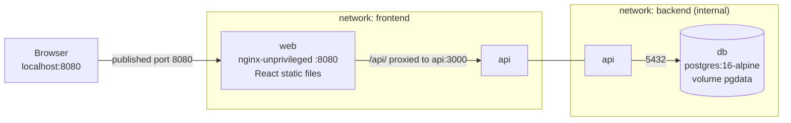
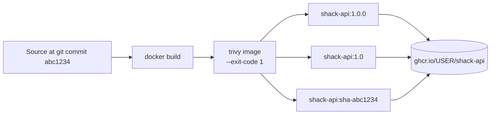

# Hands-on Lab: Containerize a 3-Tier App

<!-- DEVOPS-SHACK:HEADER -->
<p align="center">
  <a href="https://www.youtube.com/@devopsshack"></a>
  <a href="https://www.youtube.com/@shackverse"></a>
  <a href="https://devopsshack.com"></a>
  <a href="https://www.instagram.com/devopsshack"></a>
  <a href="https://github.com/jaiswaladi246/DevOps-Cloud-Interview-Preparation-by-DevOps-Shack"></a>
</p>
<p align="center"><sub>Part of <b><a href="https://github.com/jaiswaladi246/DevOps-Cloud-Interview-Preparation-by-DevOps-Shack">DevOps &amp; Cloud Interview Preparation</a></b> — created by <b><a href="https://www.youtube.com/@devopsshack">DevOps Shack</a></b>. Free to learn from; please credit DevOps Shack when sharing.</sub></p>
<!-- /DEVOPS-SHACK:HEADER -->

> Take a Node.js API, a React frontend and PostgreSQL from source code to a hardened, scanned, tagged and registry-published stack running under Docker Compose.

[⬅ Back to Docker & Containers](./README.md) · [🏠 Home](../README.md)

## Goal

By the end you will have:

- Two multi-stage Dockerfiles (API and web) that run as non-root and carry real healthchecks
- A `compose.yaml` with two networks (one internal), a named volume, env files and health-gated startup
- A Trivy scan gate for images and configuration
- Images pushed to GitHub Container Registry (GHCR) with semver, minor, and git SHA tags, and a pull-and-run test from the registry

Time: about 2 to 3 hours. Cost: free.

## Architecture

Only the web tier is published to the host. The API joins both networks so nginx can reach it and it can reach the database. The `backend` network is `internal: true`, so Postgres has no route to the internet and nothing outside can reach it.



The `api` box appears twice only because it is attached to both networks; it is one container.

The release path we build in steps 13 to 16:



## Prerequisites

- Docker Engine 26+ or Docker Desktop with Compose v2 (`docker compose version`) and BuildKit (default)
- Node.js 20+ and npm on your machine, only to generate lockfiles in step 2 and 5
- A GitHub account and a Personal Access Token (classic) with `write:packages` scope (for step 15)
- Trivy installed: `brew install trivy`, or `sudo apt-get install trivy` after adding the Aqua repo, or run it as a container (shown in step 13)
- Ports 8080 free on your machine

Check your tools:

```bash
docker version --format '{{.Server.Version}}'
docker compose version
node --version
```

Set your variables once. Replace `your-github-user` with your lowercase GitHub username (GHCR requires lowercase).

```bash
export GH_USER=your-github-user
export IMAGE_API=ghcr.io/$GH_USER/shack-api
export IMAGE_WEB=ghcr.io/$GH_USER/shack-web
```

---

## Step 1. Create the project layout

```bash
mkdir -p shack-shop/{api,web/src,db,env} && cd shack-shop
git init
```

Final layout:

```text
shack-shop/
├── api/
│   ├── Dockerfile
│   ├── .dockerignore
│   ├── package.json
│   └── server.js
├── web/
│   ├── Dockerfile
│   ├── .dockerignore
│   ├── nginx.conf
│   ├── package.json
│   ├── vite.config.js
│   ├── index.html
│   └── src/{main.jsx,App.jsx}
├── db/init.sql
├── env/api.env
├── .env                # secrets, never committed
├── .env.example        # committed template
├── .gitignore
└── compose.yaml
```

```bash
cat > .gitignore <<'EOF'
.env
node_modules/
dist/
EOF
```

## Step 2. Write the API (Node.js + Express + pg)

The API exposes `/healthz` (liveness, no dependencies), `/readyz` (checks the database), and `/api/items`. It handles `SIGTERM` so `docker stop` is fast and clean.

`api/package.json`:

```json
{
  "name": "shack-api",
  "version": "1.0.0",
  "private": true,
  "type": "module",
  "main": "server.js",
  "scripts": { "start": "node server.js" },
  "dependencies": {
    "express": "^4.21.2",
    "pg": "^8.13.1"
  }
}
```

`api/server.js`:

```js
import express from 'express';
import pg from 'pg';

const app = express();
app.use(express.json());

const pool = new pg.Pool({
  host: process.env.DB_HOST || 'db',
  port: Number(process.env.DB_PORT || 5432),
  user: process.env.DB_USER,
  password: process.env.DB_PASSWORD,
  database: process.env.DB_NAME,
  max: 10,
  connectionTimeoutMillis: 3000,
});

// Liveness: process is up and event loop is responsive
app.get('/healthz', (_req, res) => res.status(200).send('ok'));

// Readiness: can we actually serve traffic (database reachable)?
app.get('/readyz', async (_req, res) => {
  try {
    await pool.query('SELECT 1');
    res.status(200).send('ready');
  } catch (err) {
    console.error('readyz failed:', err.message);
    res.status(503).send('db unavailable');
  }
});

app.get('/api/items', async (_req, res) => {
  try {
    const { rows } = await pool.query('SELECT id, name, created_at FROM items ORDER BY id DESC LIMIT 50');
    res.json(rows);
  } catch (err) {
    console.error(err);
    res.status(500).json({ error: 'query failed' });
  }
});

app.post('/api/items', async (req, res) => {
  const name = (req.body?.name || '').toString().trim();
  if (!name) return res.status(400).json({ error: 'name is required' });
  try {
    const { rows } = await pool.query(
      'INSERT INTO items (name) VALUES ($1) RETURNING id, name, created_at',
      [name]
    );
    res.status(201).json(rows[0]);
  } catch (err) {
    console.error(err);
    res.status(500).json({ error: 'insert failed' });
  }
});

const port = Number(process.env.PORT || 3000);
const server = app.listen(port, '0.0.0.0', () => console.log(`api listening on ${port}`));

// Graceful shutdown: Docker sends SIGTERM on `docker stop`
const shutdown = (signal) => {
  console.log(`${signal} received, shutting down`);
  server.close(async () => {
    await pool.end();
    process.exit(0);
  });
  setTimeout(() => process.exit(1), 8000).unref();
};
process.on('SIGTERM', () => shutdown('SIGTERM'));
process.on('SIGINT', () => shutdown('SIGINT'));
```

Generate the lockfile so `npm ci` works inside the build (reproducible installs):

```bash
cd api && npm install --package-lock-only && cd ..
ls api/package-lock.json
```

## Step 3. Write the API Dockerfile

Two stages: `deps` installs production dependencies using a BuildKit cache mount, and `runtime` copies only what it needs and drops to the built-in unprivileged `node` user (uid 1000).

`api/.dockerignore`:

```text
node_modules
npm-debug.log
Dockerfile
.dockerignore
.git
.env
*.md
```

`api/Dockerfile`:

```dockerfile
# syntax=docker/dockerfile:1.7

# ---------- Stage 1: production dependencies ----------
FROM node:22-alpine AS deps
WORKDIR /app
COPY package.json package-lock.json ./
RUN --mount=type=cache,target=/root/.npm \
    npm ci --omit=dev

# ---------- Stage 2: runtime ----------
FROM node:22-alpine AS runtime
ENV NODE_ENV=production
WORKDIR /app

COPY --from=deps --chown=node:node /app/node_modules ./node_modules
COPY --chown=node:node package.json server.js ./

USER node
EXPOSE 3000

HEALTHCHECK --interval=15s --timeout=3s --start-period=10s --retries=3 \
  CMD node -e "fetch('http://127.0.0.1:3000/healthz').then(r=>process.exit(r.ok?0:1)).catch(()=>process.exit(1))"

CMD ["node", "server.js"]
```

Why this shape: `package*.json` is copied before the source, so editing `server.js` does not re-run `npm ci`. The exec-form `CMD` makes `node` PID 1, so it receives `SIGTERM` directly. The healthcheck uses Node's built-in `fetch`, so we do not install `curl` just for probing.

## Step 4. Build the API image and verify it standalone

```bash
docker build -t shack-api:dev ./api

# Who does it run as? Expect uid=1000(node)
docker run --rm shack-api:dev id

# Size and layers
docker images shack-api:dev
docker history shack-api:dev
```

**Verify:** `id` prints `uid=1000(node) gid=1000(node)`. The image should be around 150 to 200 MB. Confirm no dev tooling or source of the build stage leaked:

```bash
docker run --rm shack-api:dev ls /app
# node_modules  package.json  server.js
```

## Step 5. Write the React frontend

A minimal Vite + React app that lists and adds items.

`web/package.json`:

```json
{
  "name": "shack-web",
  "version": "1.0.0",
  "private": true,
  "type": "module",
  "scripts": {
    "dev": "vite",
    "build": "vite build"
  },
  "dependencies": {
    "react": "^18.3.1",
    "react-dom": "^18.3.1"
  },
  "devDependencies": {
    "@vitejs/plugin-react": "^4.3.4",
    "vite": "^5.4.11"
  }
}
```

`web/vite.config.js`:

```js
import { defineConfig } from 'vite';
import react from '@vitejs/plugin-react';

export default defineConfig({ plugins: [react()] });
```

`web/index.html`:

```html
<!doctype html>
<html lang="en">
  <head>
    <meta charset="UTF-8" />
    <meta name="viewport" content="width=device-width, initial-scale=1.0" />
    <title>Shack Shop</title>
  </head>
  <body>
    <div id="root"></div>
    <script type="module" src="/src/main.jsx"></script>
  </body>
</html>
```

`web/src/main.jsx`:

```jsx
import React from 'react';
import { createRoot } from 'react-dom/client';
import App from './App.jsx';

createRoot(document.getElementById('root')).render(<App />);
```

`web/src/App.jsx`:

```jsx
import React, { useEffect, useState } from 'react';

export default function App() {
  const [items, setItems] = useState([]);
  const [name, setName] = useState('');
  const [error, setError] = useState('');

  const load = async () => {
    try {
      const res = await fetch('/api/items');
      if (!res.ok) throw new Error(`HTTP ${res.status}`);
      setItems(await res.json());
      setError('');
    } catch (e) {
      setError(`Could not load items: ${e.message}`);
    }
  };

  useEffect(() => { load(); }, []);

  const add = async (e) => {
    e.preventDefault();
    await fetch('/api/items', {
      method: 'POST',
      headers: { 'Content-Type': 'application/json' },
      body: JSON.stringify({ name }),
    });
    setName('');
    load();
  };

  return (
    <main style={{ fontFamily: 'sans-serif', maxWidth: 480, margin: '2rem auto' }}>
      <h1>Shack Shop</h1>
      <form onSubmit={add}>
        <input value={name} onChange={(e) => setName(e.target.value)} placeholder="New item" />
        <button type="submit">Add</button>
      </form>
      {error && <p style={{ color: 'crimson' }}>{error}</p>}
      <ul>{items.map((i) => <li key={i.id}>{i.name}</li>)}</ul>
    </main>
  );
}
```

```bash
cd web && npm install --package-lock-only && cd ..
```

## Step 6. Write the web Dockerfile and nginx config

The build stage compiles static files. The runtime stage is `nginxinc/nginx-unprivileged`, which runs as uid 101 and listens on **8080** (non-root processes cannot bind ports below 1024 by default).

`web/nginx.conf`:

```nginx
server {
    listen 8080;
    server_name _;
    root /usr/share/nginx/html;
    index index.html;

    # Lightweight healthcheck endpoint, no upstream dependency
    location = /healthz {
        access_log off;
        default_type text/plain;
        return 200 "ok\n";
    }

    # Proxy API calls to the api service via Docker DNS
    location /api/ {
        proxy_pass http://api:3000;
        proxy_http_version 1.1;
        proxy_set_header Host $host;
        proxy_set_header X-Real-IP $remote_addr;
        proxy_set_header X-Forwarded-For $proxy_add_x_forwarded_for;
        proxy_set_header X-Forwarded-Proto $scheme;
        proxy_connect_timeout 3s;
        proxy_read_timeout 30s;
    }

    # React single-page app fallback
    location / {
        try_files $uri /index.html;
    }

    # Hashed build assets can be cached aggressively
    location /assets/ {
        expires 1y;
        add_header Cache-Control "public, immutable";
    }

    server_tokens off;
}
```

`web/.dockerignore`:

```text
node_modules
dist
Dockerfile
.dockerignore
.git
.env
```

`web/Dockerfile`:

```dockerfile
# syntax=docker/dockerfile:1.7

# ---------- Stage 1: build static assets ----------
FROM node:22-alpine AS build
WORKDIR /src
COPY package.json package-lock.json ./
RUN --mount=type=cache,target=/root/.npm \
    npm ci
COPY . .
RUN npm run build

# ---------- Stage 2: serve with unprivileged nginx ----------
FROM nginxinc/nginx-unprivileged:1.27-alpine AS runtime
COPY nginx.conf /etc/nginx/conf.d/default.conf
COPY --from=build /src/dist /usr/share/nginx/html

EXPOSE 8080
HEALTHCHECK --interval=15s --timeout=3s --start-period=5s --retries=3 \
  CMD wget -qO- http://127.0.0.1:8080/healthz || exit 1
```

```bash
docker build -t shack-web:dev ./web
docker run --rm shack-web:dev id
docker images shack-web:dev
```

**Verify:** `id` shows `uid=101(nginx)`. The image is roughly 50 to 60 MB, compared with more than 1 GB if you had shipped the Node build stage.

## Step 7. Database schema

`db/init.sql` runs once, the first time Postgres initializes an empty data directory (files in `/docker-entrypoint-initdb.d/` are skipped if the volume already has data).

```sql
CREATE TABLE IF NOT EXISTS items (
  id         SERIAL PRIMARY KEY,
  name       TEXT NOT NULL,
  created_at TIMESTAMPTZ NOT NULL DEFAULT now()
);

INSERT INTO items (name) VALUES ('first item'), ('second item');
```

## Step 8. Environment files

We separate two concerns: `.env` holds secrets and is used by Compose for interpolation (and never committed), while `env/api.env` holds non-secret app configuration passed with `env_file`.

`.env`:

```bash
POSTGRES_USER=shack
POSTGRES_PASSWORD=change-me-to-a-long-random-string
POSTGRES_DB=shackdb
REGISTRY=ghcr.io/your-github-user
TAG=dev
```

`.env.example` (committed, same keys, no real values):

```bash
POSTGRES_USER=shack
POSTGRES_PASSWORD=
POSTGRES_DB=shackdb
REGISTRY=ghcr.io/your-github-user
TAG=dev
```

`env/api.env`:

```bash
PORT=3000
DB_HOST=db
DB_PORT=5432
NODE_ENV=production
```

Generate a real password instead of the placeholder:

```bash
sed -i.bak "s/^POSTGRES_PASSWORD=.*/POSTGRES_PASSWORD=$(openssl rand -hex 24)/" .env && rm .env.bak
```

## Step 9. Write the Compose file

`compose.yaml` (no `version:` key, it is obsolete in Compose v2):

```yaml
name: shack-shop

services:
  db:
    image: postgres:16-alpine
    restart: unless-stopped
    environment:
      POSTGRES_USER: ${POSTGRES_USER}
      POSTGRES_PASSWORD: ${POSTGRES_PASSWORD:?POSTGRES_PASSWORD must be set in .env}
      POSTGRES_DB: ${POSTGRES_DB}
    volumes:
      - pgdata:/var/lib/postgresql/data
      - ./db/init.sql:/docker-entrypoint-initdb.d/01-init.sql:ro
    healthcheck:
      test: ["CMD-SHELL", "pg_isready -U $${POSTGRES_USER} -d $${POSTGRES_DB}"]
      interval: 5s
      timeout: 3s
      retries: 10
      start_period: 10s
    security_opt:
      - no-new-privileges:true
    networks:
      - backend

  api:
    image: ${REGISTRY}/shack-api:${TAG}
    build:
      context: ./api
    restart: unless-stopped
    env_file:
      - ./env/api.env
    environment:
      DB_USER: ${POSTGRES_USER}
      DB_PASSWORD: ${POSTGRES_PASSWORD}
      DB_NAME: ${POSTGRES_DB}
    depends_on:
      db:
        condition: service_healthy
    read_only: true
    tmpfs:
      - /tmp
    cap_drop:
      - ALL
    security_opt:
      - no-new-privileges:true
    deploy:
      resources:
        limits:
          cpus: "0.50"
          memory: 256M
    networks:
      - frontend
      - backend

  web:
    image: ${REGISTRY}/shack-web:${TAG}
    build:
      context: ./web
    restart: unless-stopped
    ports:
      - "8080:8080"
    depends_on:
      api:
        condition: service_healthy
    read_only: true
    tmpfs:
      - /tmp
    cap_drop:
      - ALL
    security_opt:
      - no-new-privileges:true
    deploy:
      resources:
        limits:
          cpus: "0.25"
          memory: 128M
    networks:
      - frontend

networks:
  frontend:
  backend:
    internal: true

volumes:
  pgdata:
```

Notes: the `$$` escapes `$` so the container's shell expands the variable instead of Compose. `read_only: true` with `tmpfs: /tmp` works for both Node and nginx-unprivileged because they only write to `/tmp`. The `image:` plus `build:` pair means `docker compose build` tags the result with the registry name, so the same name is later used for push and pull.

Validate the file and see the fully resolved configuration:

```bash
docker compose config --quiet && echo "compose file valid"
docker compose config | head -40
```

## Step 10. Start the stack and verify

```bash
docker compose up -d --build
docker compose ps
```

**Verify:** After 20 to 30 seconds all three services show `healthy` (and `db` started first):

```text
NAME                IMAGE                           STATUS
shack-shop-db-1     postgres:16-alpine              Up 30 seconds (healthy)
shack-shop-api-1    ghcr.io/you/shack-api:dev       Up 20 seconds (healthy)
shack-shop-web-1    ghcr.io/you/shack-web:dev       Up 10 seconds (healthy)
```

Test the full path through nginx, the API and the database:

```bash
curl -s localhost:8080/healthz
curl -s localhost:8080/api/items
curl -s -X POST localhost:8080/api/items -H 'Content-Type: application/json' -d '{"name":"from curl"}'
curl -s localhost:8080/api/items | head -c 300
```

Open `http://localhost:8080` in a browser, add an item and refresh.

## Step 11. Verify isolation, hardening and persistence

Network isolation. The database must not be reachable from the host or from the web container:

```bash
# Nothing published for the db or api
docker compose ps --format 'table {{.Service}}\t{{.Ports}}'

# web is on frontend only, so it cannot see db at all
docker compose exec web sh -c 'nslookup db 2>&1 | tail -2'
# expect: can't resolve 'db'

# api can reach db by service name
docker compose exec api node -e "fetch('http://127.0.0.1:3000/readyz').then(r=>r.text()).then(console.log)"
# expect: ready

# internal network has no route out
docker compose exec api node -e "fetch('https://example.com').then(()=>console.log('LEAK')).catch(e=>console.log('blocked:',e.cause?.code||e.message))"
```

Hardening checks:

```bash
docker compose exec api id                      # uid=1000(node)
docker compose exec web id                      # uid=101(nginx)
docker compose exec api touch /app/x            # touch: /app/x: Read-only file system
docker inspect shack-shop-api-1 --format '{{.HostConfig.CapDrop}} {{.HostConfig.ReadonlyRootfs}}'
docker stats --no-stream
```

Persistence. Data must survive container deletion but not volume deletion:

```bash
docker compose down              # removes containers and networks, keeps volumes
docker compose up -d
curl -s localhost:8080/api/items | head -c 200      # "from curl" is still there

docker compose exec db psql -U shack -d shackdb -c 'SELECT count(*) FROM items;'
```

## Step 12. Prove the healthchecks work

Break the database on purpose and watch readiness respond:

```bash
docker compose stop db
sleep 2
curl -s -o /dev/null -w '%{http_code}\n' localhost:8080/api/items   # 500
docker compose exec api node -e "fetch('http://127.0.0.1:3000/readyz').then(r=>console.log(r.status))"   # 503
docker compose start db
```

The API container itself stays `healthy` because the Docker healthcheck calls `/healthz` (liveness), which does not depend on Postgres. That is deliberate: if liveness depended on the database, every database blip would mark the API unhealthy and an orchestrator could restart a perfectly good process. Inspect the health history:

```bash
docker inspect shack-shop-api-1 --format '{{json .State.Health}}' | head -c 600
```

Now see `depends_on` in action: bring everything down and back up and watch order.

```bash
docker compose down
docker compose up -d
docker compose events --json | head -5   # Ctrl+C after a moment; or just run `docker compose ps` repeatedly
```

## Step 13. Scan with Trivy

Scan the built images for OS and library vulnerabilities, and the project for misconfiguration. Fail on fixable HIGH and CRITICAL findings, which is the gate we use in CI.

```bash
# Images (installed binary)
trivy image --severity HIGH,CRITICAL --ignore-unfixed --exit-code 1 shack-api:dev
trivy image --severity HIGH,CRITICAL --ignore-unfixed --exit-code 1 shack-web:dev

# Or without installing Trivy
docker run --rm -v /var/run/docker.sock:/var/run/docker.sock \
  -v trivy-cache:/root/.cache aquasec/trivy:latest \
  image --severity HIGH,CRITICAL --ignore-unfixed --exit-code 1 shack-api:dev

# Dockerfiles and compose.yaml
trivy config .

# Source dependencies and secrets
trivy fs --scanners vuln,secret --severity HIGH,CRITICAL api web
```

**Reading the result:** Trivy prints a table per target (OS packages such as `alpine 3.21`, and `node-pkg` for npm). Exit code 1 means findings at or above the threshold. To fix them, in order of preference: rebuild to pick up a patched base (`docker build --pull --no-cache`), bump the vulnerable npm dependency, pin to a newer base tag, and only as a last resort add an expiry-dated entry to `.trivyignore`:

```bash
# .trivyignore (every line needs a reason and a review date)
# CVE-2025-XXXXX  no fix available, not reachable from our code, review 2026-03-01
```

Generate an SBOM and a JSON report for audit:

```bash
trivy image --format cyclonedx --output shack-api.sbom.json shack-api:dev
trivy image --format json --output shack-api.report.json shack-api:dev
```

## Step 14. Tag images properly

A good tag scheme gives traceability (git SHA), human-friendly version pins (semver), and a moving minor tag for consumers who want patches. No `:latest` in deployments.

```bash
export VERSION=1.0.0
git add -A && git commit -qm "shack-shop: containerized 3-tier app"
export GIT_SHA=$(git rev-parse --short=7 HEAD)

for svc in api web; do
  docker build --pull \
    --label org.opencontainers.image.source=https://github.com/$GH_USER/shack-shop \
    --label org.opencontainers.image.version=$VERSION \
    --label org.opencontainers.image.revision=$GIT_SHA \
    -t ghcr.io/$GH_USER/shack-$svc:$VERSION \
    -t ghcr.io/$GH_USER/shack-$svc:${VERSION%.*} \
    -t ghcr.io/$GH_USER/shack-$svc:sha-$GIT_SHA \
    ./$svc
done

docker images "ghcr.io/$GH_USER/shack-*"
```

**Verify:** each service has three tags with the same IMAGE ID. The `--label` values are OCI standard annotations; GHCR uses `org.opencontainers.image.source` to link the package to your repository.

## Step 15. Push to GHCR

Create a token at GitHub, Settings, Developer settings, Personal access tokens (classic) with `write:packages`. Log in without leaving the token in shell history:

```bash
read -s GHCR_TOKEN && export GHCR_TOKEN
echo "$GHCR_TOKEN" | docker login ghcr.io -u "$GH_USER" --password-stdin

for svc in api web; do
  docker push --all-tags ghcr.io/$GH_USER/shack-$svc
done
```

Capture the immutable digest of what you pushed:

```bash
docker buildx imagetools inspect ghcr.io/$GH_USER/shack-api:$VERSION | head -8
docker inspect --format '{{index .RepoDigests 0}}' ghcr.io/$GH_USER/shack-api:$VERSION
```

New GHCR packages are private by default. Make them public from the package settings page if you want others to pull them without logging in. To publish a multi-architecture image instead (recommended when your laptop is Apple Silicon and servers are amd64):

```bash
docker buildx create --use --name shackbuilder 2>/dev/null || docker buildx use shackbuilder
docker buildx build --platform linux/amd64,linux/arm64 \
  -t ghcr.io/$GH_USER/shack-api:$VERSION -t ghcr.io/$GH_USER/shack-api:sha-$GIT_SHA \
  --push ./api
```

## Step 16. Pull from the registry and run exactly what you shipped

Simulate a fresh server: remove local images, then start the stack from registry tags only.

```bash
docker compose down
docker rmi $(docker images "ghcr.io/$GH_USER/shack-*" -q) 2>/dev/null

sed -i.bak "s#^REGISTRY=.*#REGISTRY=ghcr.io/$GH_USER#; s#^TAG=.*#TAG=$VERSION#" .env && rm .env.bak

docker compose pull
docker compose up -d --no-build
docker compose ps
curl -s localhost:8080/api/items
```

**Verify:** `docker compose pull` downloads layers from GHCR, no build occurs, and the app behaves identically. To pin to the exact bytes, replace `TAG` with a digest in the image reference (`image: ghcr.io/you/shack-api@sha256:...`).

## Step 17. Inspect and tune

Compare what you built against a naive single-stage image to quantify the win.

```bash
cat > /tmp/Dockerfile.naive <<'EOF'
FROM node:22
WORKDIR /app
COPY . .
RUN npm install
CMD ["node", "server.js"]
EOF
docker build -f /tmp/Dockerfile.naive -t shack-api:naive ./api
docker images --format 'table {{.Repository}}:{{.Tag}}\t{{.Size}}' | grep shack-api
trivy image --severity HIGH,CRITICAL --quiet shack-api:naive | tail -5
```

Expect `shack-api:naive` near 1.1 GB, root user, and many more findings than the alpine multi-stage build. Explore layers interactively if you have `dive`: `dive shack-api:dev`.

## Step 18. Cleanup

```bash
# Stop the stack, delete containers, networks AND the database volume
docker compose down -v

# Remove the images created in this lab
docker rmi $(docker images -q "shack-*") $(docker images -q "ghcr.io/$GH_USER/shack-*") 2>/dev/null

# Remove build cache and dangling data (be careful on shared machines)
docker builder prune -f
docker image prune -f

# Log out of the registry and delete the token from your environment
docker logout ghcr.io
unset GHCR_TOKEN
```

Delete the GHCR packages from your GitHub profile, Packages tab, if you no longer need them, and revoke the personal access token.

---

## What to say in an interview about this project

Keep it to a 90-second story, then let them dig in.

> "I containerized a three-tier app: a Node.js API, a React frontend served by unprivileged nginx, and PostgreSQL. Each image uses a multi-stage build, so the runtime has no compilers or dev dependencies. The API image dropped from about 1.1 GB to under 200 MB and the web image is around 50 MB. Both run as non-root, with read-only root filesystems, all capabilities dropped and `no-new-privileges`.
>
> In Compose I used two networks: the database is on an `internal` network with no published port and no outbound route, and only nginx is exposed. Startup is ordered with healthchecks and `depends_on: service_healthy`, so the API never starts against a database that is not ready. I separated liveness from readiness, so a database outage does not cause the API to be killed.
>
> Secrets live in an uncommitted `.env`, never in the image or Git history. In CI-style fashion I scan with Trivy, failing on fixable HIGH and CRITICAL, tag each build with semver plus the git SHA, push to GHCR, and deploy by version or digest rather than `latest`."

Follow-up questions to be ready for:

- Why `nginx-unprivileged` and port 8080 rather than the standard nginx on port 80? (Non-root cannot bind low ports without extra capabilities; the unprivileged image also works with a read-only filesystem.)
- Why separate `/healthz` and `/readyz`? (Liveness must not depend on downstreams; readiness gates traffic.)
- What happens to the data if you run `docker compose down -v`? (The named volume is deleted; Postgres re-runs `init.sql` on next start.)
- How would you move this to Kubernetes? (Same images; probes map to `/healthz` and `/readyz`; secrets become Kubernetes Secrets; the database becomes a managed service.)
- How do you prevent a vulnerable base image from drifting in? (Pin versions, rebuild on a schedule with `--pull`, scan in CI and nightly, automated base-image update PRs.)

## Common errors and fixes

| Symptom | Cause | Fix |
|---------|-------|-----|
| `npm ci` fails: `The npm ci command can only install with an existing package-lock.json` | Lockfile missing or excluded by `.dockerignore` | Run `npm install --package-lock-only` in the folder and commit the lockfile |
| `error: required variable POSTGRES_PASSWORD is missing a value: POSTGRES_PASSWORD must be set in .env` | `.env` absent or empty value | Create `.env` from `.env.example` and fill in the password |
| API logs `password authentication failed for user "shack"` after you changed the password | The Postgres volume was initialized with the old password; `POSTGRES_PASSWORD` is only read on first init | `docker compose down -v` (deletes data) or `ALTER USER` inside the running database |
| `init.sql` changes have no effect | Init scripts run only when the data directory is empty | `docker compose down -v` and start again |
| nginx container exits: `host not found in upstream "api" in /etc/nginx/conf.d/default.conf` | nginx resolves `api` at startup and the api container is missing or on a different network | Keep `depends_on: api` healthy, ensure both are on `frontend`; for runtime resolution use `resolver 127.0.0.11;` and a variable in `proxy_pass` |
| `502 Bad Gateway` from `/api/` | API crashed or is not listening on `0.0.0.0:3000` | `docker compose logs api`; confirm `listen(port, '0.0.0.0')` |
| `EROFS: read-only file system` or `touch: Read-only file system` | App writes outside `/tmp` while `read_only: true` | Add a `tmpfs` or a volume for that exact path |
| `nginx: [emerg] mkdir() "/var/cache/nginx/client_temp" failed (13: Permission denied)` | Using the regular `nginx` image as non-root | Use `nginxinc/nginx-unprivileged` |
| Container stays `unhealthy` | Healthcheck command fails inside the container (wrong port, missing binary) | `docker inspect --format '{{json .State.Health}}' <container>` and run the same command with `docker exec` |
| `exec format error` when running on a server | Image built on Apple Silicon (arm64) for an amd64 host | Build with `--platform linux/amd64` or publish multi-arch with `buildx` |
| `denied: permission_denied: write_package` on push | Token lacks `write:packages` or wrong username | Recreate the PAT with the right scope; username must match the token owner |
| `unauthorized: unauthenticated` on `compose pull` | GHCR package is private and you are not logged in | `docker login ghcr.io` or make the package public |
| `Bind for 0.0.0.0:8080 failed: port is already allocated` | Another process or container uses 8080 | `ss -ltnp \| grep 8080`, stop it, or change the left side of `"8080:8080"` |
| `manifest unknown` when pulling a tag | Tag was never pushed (typo in `VERSION`, or you pushed only one tag) | `docker push --all-tags` and check the package page |
| Trivy `FATAL ... failed to download vulnerability DB` | No internet, rate limit, or proxy | Retry, set `--db-repository ghcr.io/aquasecurity/trivy-db`, or configure `HTTPS_PROXY` |

## Extension ideas

- Add a GitHub Actions workflow that builds, scans, and pushes on every tag
- Add an `adminer` service behind a Compose profile (`profiles: ["debug"]`) for database inspection
- Replace the Alpine runtime of the API with a distroless Node image and compare the Trivy results
- Add resource-based logging limits: `logging: { driver: json-file, options: { max-size: "10m", max-file: "3" } }`
- Sign the pushed images with `cosign` and verify the signature before `compose up`

[⬅ Back to Docker & Containers](./README.md) · [🏠 Home](../README.md)

<!-- DEVOPS-SHACK:FOOTER -->
---

<div align="center">

### 🚀 Made with ❤️ by [DevOps Shack](https://www.youtube.com/@devopsshack)

**Learn DevOps, DevSecOps, Cloud and Kubernetes the practical way.**

[▶️ YouTube — DevOps Shack](https://www.youtube.com/@devopsshack) · [▶️ Hindi — @shackverse](https://www.youtube.com/@shackverse) · [🎓 devopsshack.com](https://devopsshack.com) · [📸 Instagram @devopsshack](https://www.instagram.com/devopsshack)

[🏠 Back to Home](../README.md) · [⭐ Star the original repo](https://github.com/jaiswaladi246/DevOps-Cloud-Interview-Preparation-by-DevOps-Shack)

<sub>© DevOps Shack · Licensed CC BY-NC-SA 4.0 · If you found this copy anywhere other than <a href="https://github.com/jaiswaladi246/DevOps-Cloud-Interview-Preparation-by-DevOps-Shack">github.com/jaiswaladi246</a>, the original and latest version is maintained by DevOps Shack.</sub>

</div>
<!-- /DEVOPS-SHACK:FOOTER -->
