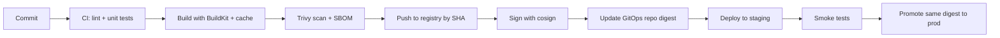

# Docker — Production & Best Practices

<!-- DEVOPS-SHACK:HEADER -->
<p align="center">
  <a href="https://www.youtube.com/@devopsshack"></a>
  <a href="https://www.youtube.com/@shackverse"></a>
  <a href="https://devopsshack.com"></a>
  <a href="https://www.instagram.com/devopsshack"></a>
  <a href="https://github.com/jaiswaladi246/DevOps-Cloud-Interview-Preparation-by-DevOps-Shack"></a>
</p>
<p align="center"><sub>Part of <b><a href="https://github.com/jaiswaladi246/DevOps-Cloud-Interview-Preparation-by-DevOps-Shack">DevOps &amp; Cloud Interview Preparation</a></b> — created by <b><a href="https://www.youtube.com/@devopsshack">DevOps Shack</a></b>. Free to learn from; please credit DevOps Shack when sharing.</sub></p>
<!-- /DEVOPS-SHACK:HEADER -->

> Real-world Docker: security hardening, build performance, supply chain, reliability, design trade-offs and rapid-fire commands · 200 questions · 🟢 Beginner 🟡 Intermediate 🔴 Advanced

[⬅ Back to Docker](./README.md) · [🏠 Home](../README.md)

## Table of contents
- [Image Security & Hardening](#image-security--hardening) — Q1–Q35
- [Build Performance & CI](#build-performance--ci) — Q36–Q65
- [Registries, Tagging & Supply Chain](#registries-tagging--supply-chain) — Q66–Q95
- [Resource Limits, Health & Reliability](#resource-limits-health--reliability) — Q96–Q135
- [Architecture & Design Decisions](#architecture--design-decisions) — Q136–Q160
- [Operations, Rootless & Podman](#operations-rootless--podman) — Q161–Q180
- [Rapid-Fire Commands](#rapid-fire-commands) — Q181–Q200

---

## Image Security & Hardening

<!-- DEVOPS-SHACK:SECTION -->
> 🎥 **Learn this hands-on with DevOps Shack** → [YouTube @devopsshack](https://www.youtube.com/@devopsshack) · [Hindi @shackverse](https://www.youtube.com/@shackverse) · [Courses at devopsshack.com](https://devopsshack.com)

### Q1. Why should containers not run as root, and how do you enforce it? 🟢

<details>
<summary><b>Answer</b></summary>

Root in a container is still UID 0 against the shared kernel; any escape bug or writable host mount turns into host-level damage. In production we create a numeric non-root user in the Dockerfile and also enforce it at runtime.

```dockerfile
RUN groupadd -g 10001 app && useradd -u 10001 -g app -s /usr/sbin/nologin app
USER 10001:10001
```

On Kubernetes add `runAsNonRoot: true`; with plain Docker use `--user 10001:10001`.

</details>

### Q2. What is a distroless image and what are the trade-offs? 🟢

<details>
<summary><b>Answer</b></summary>

Distroless images (`gcr.io/distroless/*`, Chainguard images) contain only your app's runtime plus CA certs and tzdata: no shell, no package manager. Fewer CVEs and nothing for an attacker to live off. The cost is debugging: no `docker exec sh`. Use the `:debug` variant (busybox shell) in non-prod or `docker debug` / ephemeral containers in Kubernetes.

</details>

### Q3. How do you scan an image with Trivy and fail a CI build on serious findings? 🟢

<details>
<summary><b>Answer</b></summary>

```bash
trivy image --severity HIGH,CRITICAL --exit-code 1 --ignore-unfixed registry.example.com/app:1.4.2
```

`--exit-code 1` fails the pipeline, `--ignore-unfixed` avoids blocking on CVEs with no patch. Scan the image you will deploy (by digest), not just the Dockerfile, and also run `trivy config .` for Dockerfile/IaC misconfigurations.

</details>

### Q4. How do you manage Trivy false positives and accepted risks? 🟡

<details>
<summary><b>Answer</b></summary>

Use a `.trivyignore` file with CVE IDs, each with an expiry and justification comment, or VEX documents stating "not affected". Keep it in the repo so exceptions are reviewed in PRs.

```text
# CVE-2024-XXXX  not reachable, no network parsing, review 2026-03-01 exp:2026-03-01
CVE-2024-XXXX
```

Rescan on a schedule since the DB changes daily.

</details>

### Q5. Which `docker run` flags make up a hardened runtime baseline? 🟢

<details>
<summary><b>Answer</b></summary>

```bash
docker run -d \
  --user 10001:10001 \
  --read-only --tmpfs /tmp \
  --cap-drop ALL \
  --security-opt no-new-privileges:true \
  --pids-limit 200 --memory 512m \
  app:1.4.2
```

Add back only specific capabilities needed (`--cap-add NET_BIND_SERVICE` if binding below 1024).

</details>

### Q6. What does `no-new-privileges` protect against? 🟢

<details>
<summary><b>Answer</b></summary>

It sets the kernel `no_new_privs` bit so a process and its children cannot gain privileges through setuid binaries or file capabilities (`sudo`, `su`, `ping` with caps). It blocks local privilege escalation inside the container, even if a setuid binary exists in the image. Kubernetes equivalent: `allowPrivilegeEscalation: false`.

</details>

### Q7. How should secrets be handled in container workloads? 🟢

<details>
<summary><b>Answer</b></summary>

Never bake them into images, `ENV`, or `ARG`; they leak via `docker history`/`inspect`. At build time use BuildKit secret mounts. At runtime inject from a secret manager (AWS Secrets Manager, Vault, Kubernetes Secrets with KMS), as mounted files (`/run/secrets/...`) rather than env vars, since env vars leak in crash dumps, `inspect`, and child processes.

</details>

### Q8. How do you find leaked secrets in images? 🟡

<details>
<summary><b>Answer</b></summary>

```bash
trivy image --scanners secret app:1.4.2
docker history --no-trunc app:1.4.2 | grep -iE 'password|token|key'
```

Also run gitleaks/trufflehog on the repo and context. If one leaked, rotating the secret is mandatory; deleting the layer or tag does not help because registries and caches may keep the blob.

</details>

### Q9. What is the risk of mounting `/var/run/docker.sock`, and what do you do instead? 🟡

<details>
<summary><b>Answer</b></summary>

Access to the socket is equivalent to root on the host: the container can launch a privileged container that mounts `/`. For CI builds use rootless BuildKit, Buildah, Kaniko-style builders, or Kubernetes-native builders. If something genuinely needs API access (Traefik), put a socket proxy like `tecnativa/docker-socket-proxy` in front that allows only `GET /containers`.

</details>

### Q10. How do you pick a base image for production? 🟢

<details>
<summary><b>Answer</b></summary>

Criteria we use: minimal and maintained (official, Chainguard, Distroless, Red Hat UBI), glibc compatibility with our binaries (avoid Alpine for Python/ML wheels), frequent patching cadence, long-term support tag, and signed images. We standardize on two or three approved bases in a platform team's "golden image" repo so patching is centralized.

</details>

### Q11. What is a "golden image" strategy? 🟡

<details>
<summary><b>Answer</b></summary>

A platform team builds and publishes hardened base images (OS patches, CA bundle, non-root user, scanner baked in, labels), rebuilt nightly and signed. App teams `FROM` those images by digest. Renovate/Dependabot opens PRs when the digest changes. A CVE fix then rolls out by rebuilding all apps rather than patching hosts.

</details>

### Q12. How do you handle Linux capabilities for a service binding to port 80? 🟡

<details>
<summary><b>Answer</b></summary>

Best: bind to a high port (8080) in the container and map externally. Otherwise drop all and add back only `NET_BIND_SERVICE`, or set `net.ipv4.ip_unprivileged_port_start=0` for the container namespace:

```bash
docker run --sysctl net.ipv4.ip_unprivileged_port_start=80 --user 10001 app
```

</details>

### Q13. What does a custom seccomp profile give you, and how do you create one? 🔴

<details>
<summary><b>Answer</b></summary>

It narrows the syscall surface below Docker's default allow-list. Record syscalls an app uses (strace, `oci-seccomp-bpf-hook`, Inspektor Gadget `advise seccomp-profile`), generate an allow-list with `defaultAction: SCMP_ACT_ERRNO`, test under load, then apply with `--security-opt seccomp=profile.json`. Always test paths like startup, shutdown, and error handling to avoid a production `EPERM`.

</details>

### Q14. How do AppArmor and SELinux fit into container hardening? 🟡

<details>
<summary><b>Answer</b></summary>

They are mandatory access control layers on top of namespaces and capabilities. Docker applies the `docker-default` AppArmor profile on Debian/Ubuntu and `container_t` SELinux labels on RHEL/Fedora. Leave them on; do not use `--security-opt apparmor=unconfined` or `label=disable` to "fix" permission errors. Write custom profiles for sensitive workloads.

</details>

### Q15. How do you stop a compromised container from phoning home? 🟡

<details>
<summary><b>Answer</b></summary>

Put backend services on `--internal` networks, route outbound traffic through an egress proxy with an allow-list, use host or cloud firewalls on `DOCKER-USER` chain, and for Kubernetes apply NetworkPolicy or Cilium egress rules. Combine with read-only root and no shell so attackers cannot stage tools.

</details>

### Q16. How do you remove the package manager and shell from a final image built on Debian? 🟡

<details>
<summary><b>Answer</b></summary>

Prefer distroless. If you must keep Debian slim, remove tooling in a final layer sequence carefully:

```dockerfile
RUN rm -f /bin/sh /bin/bash /usr/bin/apt* /usr/bin/dpkg* 2>/dev/null || true
```

This is brittle (entrypoints often need `sh`), so we usually copy the app into a distroless runtime stage instead.

</details>

### Q17. What is the difference between vulnerability scanning at build time, registry time and runtime? 🟢

<details>
<summary><b>Answer</b></summary>

Build-time (CI) stops new issues before publish. Registry scanning (ECR Enhanced scanning with Inspector, Harbor+Trivy) catches CVEs published *after* the image was built. Runtime tools (Falco, Tetragon, Wazuh) detect behavior like unexpected shells or outbound connections. You need all three, since a clean build can become vulnerable next week.

</details>

### Q18. How do you prevent a `latest` or unscanned image from reaching the cluster? 🔴

<details>
<summary><b>Answer</b></summary>

Admission control: Kyverno or OPA Gatekeeper policies that require images from approved registries, pinned by digest, signed by cosign, with a recent scan attestation. Example Kyverno `verifyImages` rule with the CI's OIDC identity. Pair with ECR repository policies that block pushes without required tags.

</details>

### Q19. What are the dangers of `--pid=host`, `--net=host`, `--ipc=host`, `--uts=host`? 🟢

<details>
<summary><b>Answer</b></summary>

Each removes a namespace boundary: host PID lets a process signal or `ptrace` host processes (with caps) and read `/proc/*/environ`; host net exposes all host sockets and localhost services (including cloud metadata at 169.254.169.254); host IPC exposes shared memory. Allow only for vetted monitoring agents.

</details>

### Q20. How do you block containers from reaching the AWS instance metadata service? 🔴

<details>
<summary><b>Answer</b></summary>

Enforce IMDSv2 with hop limit 1 so a container (one extra hop) cannot get tokens:

```bash
aws ec2 modify-instance-metadata-options --instance-id i-0abc --http-tokens required --http-put-response-hop-limit 1
```

Or add an iptables DROP for 169.254.169.254 in `DOCKER-USER`. On EKS use IRSA/Pod Identity instead of node roles.

</details>

### Q21. What does `--security-opt=no-new-privileges` NOT stop? 🟡

<details>
<summary><b>Answer</b></summary>

It does not stop kernel exploits, access via mounted sockets or host paths, abuse of capabilities already granted, or attacks from root with `CAP_SYS_ADMIN`. It is one layer; combine with dropped caps, seccomp, read-only FS and user namespaces.

</details>

### Q22. How do you make sure an image runs on OpenShift or other random-UID platforms? 🟡

<details>
<summary><b>Answer</b></summary>

OpenShift runs containers with a random UID in group 0. Make writable directories group-writable and owned by root group: `chgrp -R 0 /app/data && chmod -R g=u /app/data`, avoid writing to the home directory, don't depend on a specific UID in `/etc/passwd`, and listen on ports above 1024.

</details>

### Q23. How would you audit a Docker host against the CIS benchmark? 🟢

<details>
<summary><b>Answer</b></summary>

Run `docker-bench-security` (`./docker-bench-security.sh`) which checks host config, daemon settings, file permissions, images and runtime flags. Follow with Ansible/InSpec to remediate: auditd rules for docker files, TLS on the API, `userns-remap` or rootless, `live-restore`, log limits, no `--privileged`, and content trust where applicable.

</details>

### Q24. What is the safe way to use `ADD` or `curl | sh` in a Dockerfile? 🟢

<details>
<summary><b>Answer</b></summary>

Verify checksums or signatures of anything downloaded. Prefer `ADD --checksum=sha256:... https://...` or `curl` followed by `sha256sum -c`. Never `curl | sh` without pinning a version and hash. Pin versions via `ARG TOOL_VERSION` and fetch from official releases.

```dockerfile
ADD --checksum=sha256:ab12... https://example.com/tool-1.2.3-linux-amd64.tar.gz /tmp/
```

</details>

### Q25. How do you handle timezone data and CA certificates in minimal images? 🟢

<details>
<summary><b>Answer</b></summary>

`scratch` and some slim images lack `/etc/ssl/certs` and `/usr/share/zoneinfo`, causing `x509: certificate signed by unknown authority` or `unknown time zone`. Copy them from a builder stage:

```dockerfile
COPY --from=build /etc/ssl/certs/ca-certificates.crt /etc/ssl/certs/
COPY --from=build /usr/share/zoneinfo /usr/share/zoneinfo
```

Distroless includes both. For Go also `import _ "time/tzdata"`.

</details>

### Q26. What should we do about shells and debugging tools if production images are minimal? 🟢

<details>
<summary><b>Answer</b></summary>

Use ephemeral debug containers: `kubectl debug -it pod --image=nicolaka/netshoot --target=app` or `docker debug <container>` (Docker Desktop/Pro), or run a sidecar with `--pid container:app --network container:app`. Keep a `:debug` tag built from the same Dockerfile for staging.

</details>

### Q27. How do you restrict which registries a host may pull from? 🔴

<details>
<summary><b>Answer</b></summary>

Docker Engine has no allow-list natively; use Docker Desktop Registry Access Management, containerd/CRI-O `registries.conf` mirroring and blocking, a network egress firewall that allows only your registry, and Kubernetes admission policies. In Podman, `registries.conf` (`unqualified-search-registries`, `[[registry]] blocked = true`).

</details>

### Q28. What is user-namespace remapping's effect on volumes in production? 🟡

<details>
<summary><b>Answer</b></summary>

Files created by container root appear on the host owned by the remapped range (e.g., 165536). Existing volumes and bind mounts owned by real root are unreadable. We migrate by `chown -R 165536:165536` on data dirs, and Docker uses a separate `/var/lib/docker/165536.165536` data root, so previous images/volumes are not visible after enabling it.

</details>

### Q29. How do you verify that an image has a non-root user before deploying? 🟢

<details>
<summary><b>Answer</b></summary>

```bash
docker image inspect -f '{{.Config.User}}' app:1.4.2     # empty = root
docker run --rm --entrypoint id app:1.4.2
```

Automate with Trivy config scan (rule DS002 "image should not run as root"), Hadolint, or a Kyverno policy.

</details>

### Q30. How does Hadolint help and what are examples of its rules? 🟢

<details>
<summary><b>Answer</b></summary>

Hadolint lints Dockerfiles (with ShellCheck on `RUN` scripts) and enforces best practice. Examples: DL3006 tag the base image, DL3008 pin apt versions, DL3009 delete apt lists, DL3025 use JSON for CMD, DL3002 last user should not be root.

```bash
hadolint Dockerfile
docker run --rm -i hadolint/hadolint < Dockerfile
```

</details>

### Q31. What are Chainguard/Wolfi images and why are teams adopting them? 🟡

<details>
<summary><b>Answer</b></summary>

Chainguard images are minimal, rebuilt daily from Wolfi (a glibc "undistro" built for containers), ship with SBOMs and cosign signatures, and often carry zero known CVEs at publication. Trade-offs: the free tier offers only `latest`-style tags, pinned versions need a paid plan, and package names differ from Debian, so Dockerfiles need rework.

</details>

### Q32. How do you ship an image that survives `--read-only` and still logs? 🟡

<details>
<summary><b>Answer</b></summary>

Log to stdout/stderr (never files), mount `tmpfs` at `/tmp` and `/run`, and put caches or pid files in tmpfs. Identify writes with `docker diff <container>` during tests; every path listed under `C`/`A` either needs a volume/tmpfs or an app config change.

```bash
docker diff web
```

</details>

### Q33. What is image provenance and what does SLSA level mean for Docker builds? 🔴

<details>
<summary><b>Answer</b></summary>

Provenance is a signed record of how an image was built: source repo, commit, builder, build args. SLSA levels grade integrity: L1 documented, L2 hosted builder signing provenance, L3 hardened isolated builds. Generate with BuildKit `--provenance=mode=max` or GitHub's `actions/attest-build-provenance`, then verify at admission.

</details>

### Q34. How do you rotate the base image for 200 services when a critical CVE lands? 🔴

<details>
<summary><b>Answer</b></summary>

1. Platform rebuilds and publishes the golden base (new digest, scanned, signed).
2. Renovate/Dependabot raises PRs to every repo bumping the digest; CI rebuilds and tests.
3. Query the registry/SBOM inventory (Dependency-Track, `trivy sbom`) to see who is still affected.
4. Enforce a deadline with an admission policy that rejects images older than N days.

</details>

### Q35. What are common Docker-related findings in a security audit? 🟢

<details>
<summary><b>Answer</b></summary>

Containers as root, `--privileged`, docker.sock mounts, exposed 2375, secrets in ENV, `latest` tags, unpinned bases, no resource limits, no image scanning, ports bound to 0.0.0.0, outdated engine, missing log rotation, and images with shells plus curl/wget. A short checklist in CI catches most of them.

</details>

## Build Performance & CI

<!-- DEVOPS-SHACK:SECTION -->
> 🎥 **Learn this hands-on with DevOps Shack** → [YouTube @devopsshack](https://www.youtube.com/@devopsshack) · [Hindi @shackverse](https://www.youtube.com/@shackverse) · [Courses at devopsshack.com](https://devopsshack.com)

### Q36. How do you make Docker builds fast in CI where runners are ephemeral? 🟢

<details>
<summary><b>Answer</b></summary>

Export and import the BuildKit cache from a registry or CI cache backend.

```bash
docker buildx build \
  --cache-from type=registry,ref=reg.example.com/app:buildcache \
  --cache-to   type=registry,ref=reg.example.com/app:buildcache,mode=max \
  -t reg.example.com/app:$GIT_SHA --push .
```

`mode=max` also caches intermediate stages. On GitHub Actions use `type=gha`.

</details>

### Q37. What are the cache backends in buildx? 🟢

<details>
<summary><b>Answer</b></summary>

`inline` (cache metadata inside the image, min mode only), `registry` (separate cache image), `local` (directory), `gha` (GitHub Actions cache API), `s3` and `azblob`. Registry cache supports `mode=max` and works anywhere; `gha` is the easiest on GitHub but limited by its 10 GB repo cache quota.

</details>

### Q38. Why does `inline` cache often disappoint? 🔴

<details>
<summary><b>Answer</b></summary>

It only embeds metadata for the final image's layers (`mode=min`), so intermediate multi-stage layers (where dependencies are installed) are not cached. Switch to `type=registry ... mode=max` for multi-stage builds. Use a separate cache tag so cache blobs do not pollute your release tags.

</details>

### Q39. How do you structure a Python Dockerfile for the best caching and size? 🟡

<details>
<summary><b>Answer</b></summary>

```dockerfile
# syntax=docker/dockerfile:1
FROM python:3.12-slim AS base
ENV PYTHONDONTWRITEBYTECODE=1 PYTHONUNBUFFERED=1
WORKDIR /app
COPY requirements.txt .
RUN --mount=type=cache,target=/root/.cache/pip pip install -r requirements.txt
COPY . .
USER 10001
CMD ["gunicorn", "-b", "0.0.0.0:8000", "app:app"]
```

Heavy compiled deps: build wheels in a builder stage and copy `/wheels`, or use `uv` with `--mount=type=cache,target=/root/.cache/uv`.

</details>

### Q40. How do you structure a Node.js production image? 🟡

<details>
<summary><b>Answer</b></summary>

```dockerfile
FROM node:22-bookworm-slim AS deps
WORKDIR /app
COPY package*.json ./
RUN --mount=type=cache,target=/root/.npm npm ci
FROM deps AS build
COPY . .
RUN npm run build && npm prune --omit=dev
FROM gcr.io/distroless/nodejs22-debian12
WORKDIR /app
COPY --from=build /app/node_modules ./node_modules
COPY --from=build /app/dist ./dist
USER nonroot
CMD ["dist/server.js"]
```

Set `NODE_ENV=production` and handle SIGTERM in the app.

</details>

### Q41. How do you build a small Java image? 🟢

<details>
<summary><b>Answer</b></summary>

Build the jar with Maven/Gradle in a JDK stage (cache `~/.m2` with a cache mount), then run on a JRE-only base such as `eclipse-temurin:21-jre-alpine` or distroless `java21`. Use Spring Boot layered jars (`java -Djarmode=tools extract --layers`) so dependency layers cache separately from app classes, and set `-XX:MaxRAMPercentage=75`.

</details>

### Q42. How do you build a Go image under 15 MB? 🟢

<details>
<summary><b>Answer</b></summary>

Compile a static binary and ship on distroless/static or scratch.

```dockerfile
FROM golang:1.23 AS build
WORKDIR /src
COPY go.mod go.sum ./
RUN go mod download
COPY . .
RUN CGO_ENABLED=0 go build -trimpath -ldflags="-s -w" -o /out/app ./cmd/app
FROM gcr.io/distroless/static-debian12:nonroot
COPY --from=build /out/app /app
ENTRYPOINT ["/app"]
```

</details>

### Q43. How do you cut cold-start for huge ML images (10+ GB)? 🟡

<details>
<summary><b>Answer</b></summary>

Separate model weights from the image (download from S3 at start into a volume, or mount via FSx/EFS), keep CUDA base layers first so they are shared, use lazy-pulling snapshotters (SOCI, stargz) or pre-pull on nodes (image caching, Karpenter AMIs with baked images), and use `zstd` compressed layers for faster decompression.

</details>

### Q44. What is `zstd` compression for images and how do you enable it? 🟡

<details>
<summary><b>Answer</b></summary>

zstd decompresses much faster than gzip at similar ratios, speeding up pulls. Build with `--output type=image,name=reg/app:1,push=true,compression=zstd,force-compression=true`. Registries and runtimes (containerd 1.5+, recent Docker) support it; very old nodes or registries may not.

</details>

### Q45. How do you run Docker builds in Kubernetes-based CI without privileged DinD? 🔴

<details>
<summary><b>Answer</b></summary>

Options: rootless BuildKit (`moby/buildkit:rootless`) as a Deployment with `buildctl`, Buildah in an unprivileged pod, Kaniko forks, or remote builders (`docker buildx create --driver kubernetes`). Avoid mounting the node's docker.sock. For cache, give the builder a persistent volume or registry cache.

</details>

### Q46. What are the problems with Docker-in-Docker (DinD) for CI and how do you mitigate them? 🟡

<details>
<summary><b>Answer</b></summary>

`docker:dind` needs `--privileged`, has an empty layer cache per run, uses overlay-on-overlay (needs `/var/lib/docker` on a volume), and TLS cert setup. Mitigate with registry cache, ephemeral isolated runners (Firecracker VMs), and `DOCKER_TLS_CERTDIR`. Alternatives: remote buildx builders or daemonless builds.

</details>

### Q47. How do you tag images in CI so builds are traceable? 🟢

<details>
<summary><b>Answer</b></summary>

Tag every build with the immutable git SHA (`app:3f9c2ab`), add semantic version tags on release (`1.4.2`, `1.4`), and avoid reusing `latest` for deploys. Add OCI labels `org.opencontainers.image.revision` and `.source`. Deploy by digest recorded in the GitOps repo.

</details>

### Q48. What does `docker/metadata-action` do in GitHub Actions? 🟡

<details>
<summary><b>Answer</b></summary>

It generates tags and labels from the git context (branch, PR, semver tag, SHA) for `docker/build-push-action`.

```yaml
- uses: docker/metadata-action@v5
  id: meta
  with:
    images: ghcr.io/org/app
    tags: |
      type=sha
      type=semver,pattern={{version}}
- uses: docker/build-push-action@v6
  with: { push: true, tags: "${{ steps.meta.outputs.tags }}", labels: "${{ steps.meta.outputs.labels }}" }
```

</details>

### Q49. How do you speed up multi-arch builds? 🟡

<details>
<summary><b>Answer</b></summary>

QEMU emulation is 5-20x slower. Prefer cross-compilation with `BUILDPLATFORM` in the build stage, or use native builders per architecture (ARM runners such as GitHub `ubuntu-24.04-arm`, Graviton) joined with `buildx create --append`, then merge manifests with `docker buildx imagetools create`. Docker Build Cloud offers managed native builders.

</details>

### Q50. How do you keep the `.git` directory out of the context but still stamp the commit? 🟡

<details>
<summary><b>Answer</b></summary>

Ignore `.git` in `.dockerignore` and pass metadata as late `ARG`s.

```dockerfile
ARG GIT_SHA=unknown
LABEL org.opencontainers.image.revision=$GIT_SHA
```
```bash
docker build --build-arg GIT_SHA=$(git rev-parse --short HEAD) .
```

Place it after expensive layers so cache is preserved.

</details>

### Q51. A build is slow because of a 2 GB context. How do you diagnose and fix it? 🟢

<details>
<summary><b>Answer</b></summary>

The output line `transferring context: 2.1GB` gives it away. Find large dirs with `du -sh * | sort -h`, add them to `.dockerignore` (`node_modules`, `.git`, `dist`, datasets, `*.tar`), or use a whitelist style (`*` then `!src`, `!package.json`). With BuildKit, `--progress=plain` shows each step's timing.

</details>

### Q52. How do you share cache between developers and CI? 🟡

<details>
<summary><b>Answer</b></summary>

Have CI push `type=registry,mode=max` cache to a dedicated tag; developers use `--cache-from` with the same ref (read-only). Alternatively, Docker Build Cloud gives a shared remote cache. Keep cache keys per branch with fallback to `main` so PR builds start warm.

</details>

### Q53. How do you handle monorepo builds so one change does not rebuild everything? 🟡

<details>
<summary><b>Answer</b></summary>

Use path filters in CI to build only affected services, `buildx bake` with a shared base target, per-service `.dockerignore` (`Dockerfile.dockerignore` beside each Dockerfile), and `COPY` only that service's directory plus shared libs. Remote cache keyed per service prevents cross-invalidation.

</details>

### Q54. How do you test an image in CI before pushing it? 🟢

<details>
<summary><b>Answer</b></summary>

Build with `--load`, run a smoke test (start, wait for healthcheck, curl `/health`), run `container-structure-test` for file/metadata assertions, scan with Trivy, then push. In Compose-based tests use `up --wait` and `--exit-code-from`. Promote the *same digest* to prod rather than rebuilding.

</details>

### Q55. What is `container-structure-test`? 🟡

<details>
<summary><b>Answer</b></summary>

A Google tool that asserts image contents declaratively in YAML: command output, file existence/permissions, metadata (user, entrypoint, env).

```yaml
schemaVersion: 2.0.0
metadataTest:
  user: "10001"
fileExistenceTests:
  - name: no shell
    path: /bin/sh
    shouldExist: false
```
`container-structure-test test --image app:1 --config test.yaml`

</details>

### Q56. How do you reduce `apt` layer bloat and improve reproducibility? 🟡

<details>
<summary><b>Answer</b></summary>

```dockerfile
RUN --mount=type=cache,target=/var/cache/apt,sharing=locked \
    --mount=type=cache,target=/var/lib/apt,sharing=locked \
    apt-get update && apt-get install -y --no-install-recommends ca-certificates=20230311 curl
```

(When using cache mounts, disable the Debian `docker-clean` hook.) Pin or snapshot repos (snapshot.debian.org) if you need byte-reproducible builds.

</details>

### Q57. How do you make builds reproducible? 🟡

<details>
<summary><b>Answer</b></summary>

Pin base digests, lock dependency versions with hashes, use snapshot package mirrors, set `SOURCE_DATE_EPOCH` and `--output type=image,rewrite-timestamp=true` for stable layer timestamps, avoid `curl latest`, and strip build dates. Verify by building twice and comparing digests. Perfect reproducibility is hard; aim for deterministic dependencies first.

</details>

### Q58. What does `docker build --progress=plain` give you? 🟢

<details>
<summary><b>Answer</b></summary>

Full, unfolded output for every step including command output and cache hits (`CACHED`), instead of the collapsed TTY view. Essential for CI logs and for seeing why a step reran. Combine with `--no-cache-filter=stage` to bust one stage.

</details>

### Q59. How do you debug a failing build step interactively? 🟡

<details>
<summary><b>Answer</b></summary>

Build up to the previous stage with `--target` and run it, or in BuildKit use `docker buildx debug build` (experimental), or temporarily add a copy of the failing command in a shell. Using the legacy builder, the last successful intermediate image ID was runnable; BuildKit does not print those, so target stages instead.

</details>

### Q60. What are good Dockerfile ordering rules for cache efficiency? 🟢

<details>
<summary><b>Answer</b></summary>

Order from least to most frequently changing: base, OS packages, tool installs, dependency manifests plus install, source copy, build, metadata (`LABEL`, `ARG GIT_SHA`), `USER`, `CMD`. Use multi-stage to isolate noisy steps, and keep each `RUN` focused so a failure shows exactly which step broke.

</details>

### Q61. How do you decide between one big `RUN` and several small ones? 🟢

<details>
<summary><b>Answer</b></summary>

Group commands that must be atomic for size reasons (install + cleanup). Split steps with different change frequencies (system deps vs app deps). The layer count itself rarely matters; wasted bytes and cache invalidation do. With heredocs the multi-line form stays readable.

</details>

### Q62. How do you cache Maven/Gradle/Go modules without bloating the image? 🟡

<details>
<summary><b>Answer</b></summary>

Use cache mounts, not layers:

```dockerfile
RUN --mount=type=cache,target=/root/.m2 mvn -B -DskipTests package
RUN --mount=type=cache,target=/go/pkg/mod --mount=type=cache,target=/root/.cache/go-build go build ./...
```

Because the cache lives outside layers, nothing is added to the image and it survives builder restarts as long as the builder volume does.

</details>

### Q63. What is `docker buildx imagetools create` used for? 🟡

<details>
<summary><b>Answer</b></summary>

It composes or retags manifests in the registry without pulling layers. Common use: merge per-arch images built on native runners into a multi-arch tag, or promote a tag between environments.

```bash
docker buildx imagetools create -t reg/app:1.4.2 reg/app:1.4.2-amd64 reg/app:1.4.2-arm64
docker buildx imagetools create -t reg/app:prod reg/app@sha256:<digest>
```

</details>

### Q64. How do you keep CI Docker disk usage under control? 🟢

<details>
<summary><b>Answer</b></summary>

Use ephemeral runners or schedule `docker system prune -af --filter "until=72h"`, `docker builder prune --keep-storage 20GB`, and put `/var/lib/docker` on a dedicated volume with alerts at 80%. Self-hosted runners that run for weeks without pruning are the number one cause of "no space left on device".

</details>

### Q65. How do you handle Docker Hub rate limits in CI? 🟢

<details>
<summary><b>Answer</b></summary>

Authenticate pulls with an org token, mirror frequently used base images into your own registry (ECR pull-through cache rules, Harbor proxy cache, `registry-mirrors` in daemon.json), and cache layers with registry cache. Reference bases through your mirror (`FROM 123.dkr.ecr.../docker-hub/library/node:22`).

</details>

## Registries, Tagging & Supply Chain

<!-- DEVOPS-SHACK:SECTION -->
> 🎥 **Learn this hands-on with DevOps Shack** → [YouTube @devopsshack](https://www.youtube.com/@devopsshack) · [Hindi @shackverse](https://www.youtube.com/@shackverse) · [Courses at devopsshack.com](https://devopsshack.com)

### Q66. What is a good image tagging strategy for production? 🟢

<details>
<summary><b>Answer</b></summary>

Immutable tags per build (`git-<sha>` or build number) as the source of truth, semver tags on release (`1.4.2`, `1.4`, `1`), environment tags only as pointers if at all, and never deploy `latest`. In GitOps, record the digest. Enable tag immutability in the registry for release tags.

</details>

### Q67. Why is deploying by digest better than by tag? 🟡

<details>
<summary><b>Answer</b></summary>

A tag can be re-pushed (accidentally or maliciously), so two nodes may run different code under the same name. A digest identifies exact content, making rollbacks, audits and caching deterministic. Use `image: app@sha256:...` (optionally `app:1.4.2@sha256:...` for readability; the digest wins).

</details>

### Q68. How do you enable immutable tags and lifecycle rules in ECR? 🟡

<details>
<summary><b>Answer</b></summary>

```bash
aws ecr put-image-tag-mutability --repository-name app --image-tag-mutability IMMUTABLE
aws ecr put-lifecycle-policy --repository-name app --lifecycle-policy-text file://policy.json
```

A lifecycle policy example: keep last 30 images tagged `v*`, expire untagged images after 7 days. This controls storage cost and prevents accidental overwrites. Newer ECR supports exclusion patterns to keep some tags mutable.

</details>

### Q69. How does ECR handle scanning and replication? 🟡

<details>
<summary><b>Answer</b></summary>

Basic scanning (Clair-based, on push) is being superseded by Enhanced scanning via Amazon Inspector (continuous, OS and language packages). Cross-region and cross-account replication is configured at registry level with filters. Pull-through cache rules proxy Docker Hub, GHCR, Quay, and ECR Public with authentication stored in Secrets Manager.

</details>

### Q70. How do you give an EKS node or CI job access to ECR with least privilege? 🟡

<details>
<summary><b>Answer</b></summary>

Pull: node role with `AmazonEC2ContainerRegistryReadOnly` (or scoped `ecr:GetAuthorizationToken` plus `BatchGetImage`, `GetDownloadUrlForLayer` on the specific repos). Push: CI role via GitHub OIDC (no static keys) with `ecr:PutImage`, `InitiateLayerUpload`, `UploadLayerPart`, `CompleteLayerUpload`, `BatchCheckLayerAvailability` on one repository.

</details>

### Q71. Docker Hub vs ECR vs GHCR vs Harbor: how do you choose? 🟡

<details>
<summary><b>Answer</b></summary>

- **Docker Hub**: public distribution; rate limits.
- **ECR**: best on AWS (IAM, VPC endpoints, no egress cost inside region).
- **GHCR**: tight GitHub Actions integration, good for open source.
- **Harbor**: self-hosted, multi-cloud, policy/replication/proxy cache, on-prem and air-gapped.
- Also GAR (GCP), ACR (Azure), Quay (Red Hat).

Choose by where workloads run, compliance and egress cost.

</details>

### Q72. How do you set up a pull-through cache for Docker Hub? 🟡

<details>
<summary><b>Answer</b></summary>

Run `registry:2` with `proxy.remoteurl: https://registry-1.docker.io` (plus credentials), or use ECR/Harbor proxy features, then point daemons at it:

```json
{ "registry-mirrors": ["https://mirror.internal.example.com"] }
```

The `registry-mirrors` setting only applies to Docker Hub pulls; other registries need explicit prefixed names or containerd `hosts.toml` mirrors.

</details>

### Q73. How does Docker Content Trust differ from cosign? 🔴

<details>
<summary><b>Answer</b></summary>

DCT (Notary v1, `DOCKER_CONTENT_TRUST=1`) signs tags with TUF keys and is awkward to operate; usage is declining. cosign/Sigstore signs digests, supports keyless OIDC signing, stores signatures as OCI artifacts, and integrates with Kubernetes admission. Notation (Notary v2) is the other CNCF option favored in AWS Signer and Azure.

</details>

### Q74. How do you do keyless signing with cosign in GitHub Actions? 🔴

<details>
<summary><b>Answer</b></summary>

Grant the job `id-token: write`, install cosign, and sign the digest produced by the build.

```yaml
permissions: { id-token: write, packages: write, contents: read }
steps:
  - uses: sigstore/cosign-installer@v3
  - run: cosign sign --yes ghcr.io/org/app@${{ steps.build.outputs.digest }}
```

The certificate records the workflow identity, which verifiers pin with `--certificate-identity`.

</details>

### Q75. How do you generate and use SBOMs in a pipeline? 🟡

<details>
<summary><b>Answer</b></summary>

```bash
syft app:1.4.2 -o spdx-json > sbom.spdx.json     # or trivy image --format cyclonedx
grype sbom:sbom.spdx.json --fail-on high
```

Attach to the image with `cosign attest --type spdxjson` or buildx `--sbom=true`, and ingest into Dependency-Track so a new CVE can be matched against everything deployed without rescanning images.

</details>

### Q76. What is the OCI Referrers API? 🔴

<details>
<summary><b>Answer</b></summary>

A Distribution Spec 1.1 endpoint (`GET /v2/<name>/referrers/<digest>`) listing artifacts (signatures, SBOMs, attestations) that reference an image through the manifest `subject` field. It replaces tag-schema hacks like `sha256-<digest>.sig`. Check with `oras discover reg/app@sha256:...`. ECR, Harbor, GHCR and Docker Hub support it.

</details>

### Q77. How do you promote images across environments safely? 🟡

<details>
<summary><b>Answer</b></summary>

Build once, test, and promote the same digest: copy between registries with `crane copy` or `skopeo copy --all` (preserves multi-arch), or add environment pointers/tags. Never rebuild for prod; rebuilding can pull different dependencies and invalidates test evidence. Record promotion in Git for audit.

```bash
crane copy dev.reg/app@sha256:abc prod.reg/app:1.4.2
```

</details>

### Q78. What are `skopeo` and `crane` used for? 🟡

<details>
<summary><b>Answer</b></summary>

Daemonless registry tools. `skopeo inspect docker://reg/app:1` reads metadata without pulling; `skopeo copy` moves images between registries or to `dir:`/`oci:` formats. `crane` (go-containerregistry) offers `ls`, `digest`, `manifest`, `copy`, `mutate`. Both are scriptable in CI where no Docker daemon exists.

</details>

### Q79. How do you list tags and find an image digest from a registry? 🟢

<details>
<summary><b>Answer</b></summary>

```bash
crane ls reg.example.com/team/app
crane digest reg.example.com/team/app:1.4.2
docker buildx imagetools inspect reg.example.com/team/app:1.4.2
aws ecr describe-images --repository-name app --query 'imageDetails[].[imageTags,imageDigest]'
```

</details>

### Q80. How do you deal with a registry outage in production? 🔴

<details>
<summary><b>Answer</b></summary>

Running containers keep running; the issue hits scheduling, scale-ups and restarts. Mitigations: pull-through cache or mirror inside the VPC, pre-pulled images on nodes (AMI baking, DaemonSet pre-puller), cross-region replication with failover pull config, `imagePullPolicy: IfNotPresent` with digests, and avoiding dependency on Docker Hub at runtime.

</details>

### Q81. How would you clean up stale images in a registry safely? 🟡

<details>
<summary><b>Answer</b></summary>

Use registry-native retention (ECR lifecycle, Harbor retention, GHCR cleanup actions) with rules like "keep last N per repo", "keep anything deployed" (cross-check with cluster images from `kubectl get pods -A -o jsonpath`), and expire untagged manifests after a grace period. Dry-run first. Self-hosted `registry:2` needs `registry garbage-collect` with the registry in read-only mode.

</details>

### Q82. What is a multi-arch manifest pitfall in production? 🟡

<details>
<summary><b>Answer</b></summary>

Pushing an `amd64`-only image and then scheduling onto Graviton/ARM nodes yields `exec format error`. Build both platforms or pin node selectors/affinity by architecture. Verify with `docker buildx imagetools inspect` that every expected platform is listed, and use `--platform` when running locally on Apple Silicon.

</details>

### Q83. How do you handle licensing and Docker Hub image provenance risks? 🟡

<details>
<summary><b>Answer</b></summary>

Prefer Docker Official Images, Verified Publisher and Docker-Sponsored OSS; avoid random community images (typosquatting and cryptominers have been found). Mirror approved images into your registry after scanning and signature verification, and check licenses in the SBOM (e.g., GPL packages for redistributed images).

</details>

### Q84. What does `crane flatten` or `docker buildx build --squash` do for supply chain? 🔴

<details>
<summary><b>Answer</b></summary>

Flattening collapses layers into one, removing deleted-but-present data (a leaked-then-deleted secret would be gone from the new image, though not from the old tag in the registry). It breaks layer reuse and caching, so only do it for special artifacts. The real fix for leaks is rotation plus preventing them with secret mounts.

</details>

### Q85. How do you protect a registry from being polluted by developers' pushes? 🟡

<details>
<summary><b>Answer</b></summary>

Give humans pull-only access; let only CI roles push (OIDC federation), set tag immutability on release tags, use separate repos or namespaces per environment (`dev/`, `prod/`), and require signatures/attestations for the prod namespace. Audit with CloudTrail (`PutImage` events) or Harbor audit logs.

</details>

### Q86. What is OCI artifact storage beyond container images? 🔴

<details>
<summary><b>Answer</b></summary>

Registries can store Helm charts (`helm push chart.tgz oci://reg/charts`), WASM modules, Terraform modules, SBOMs and policy bundles using generic OCI artifact manifests with custom `artifactType`. Tools: `oras push`, `helm`, `flux push artifact`. It consolidates delivery on one auth and replication system.

</details>

### Q87. How do you verify that the image you tested is the image running in prod? 🔴

<details>
<summary><b>Answer</b></summary>

Compare digests end-to-end: CI outputs the digest, GitOps manifest pins it, cluster reports `imageID` in `status.containerStatuses`. On Docker hosts `docker inspect -f '{{.Image}}' c` gives the image ID and `RepoDigests` the manifest digest. An admission controller can reject anything unsigned or not matching a promoted digest.

</details>

### Q88. What is Docker Hub's `docker scout` or registry-side policy used for? 🟡

<details>
<summary><b>Answer</b></summary>

Policy evaluation on images: no critical CVEs with fix available, base image up to date, no root user, supply-chain attestations present. Scout policies and Harbor "prevent vulnerable images from running" block pulls when the severity threshold is exceeded. We run them as gates in CI and as registry deploy blocks.

</details>

### Q89. How do you secure `docker login` on CI runners? 🟡

<details>
<summary><b>Answer</b></summary>

Use OIDC-issued short-lived credentials (`aws-actions/amazon-ecr-login`, GitHub's `GITHUB_TOKEN` for GHCR), `--password-stdin`, a per-job `DOCKER_CONFIG` temp directory, and `docker logout` in a cleanup step on shared runners. Avoid long-lived tokens in repo secrets and never echo them. Credential helpers beat plaintext `config.json`.

</details>

### Q90. How do you mirror public images into a private registry in bulk? 🟡

<details>
<summary><b>Answer</b></summary>

Define a list in Git and run a scheduled job with `skopeo sync` or `crane copy` (or Harbor replication rules), scanning and signing before marking approved.

```bash
skopeo sync --src docker --dest docker docker.io/library/nginx reg.example.com/mirror/
```

Then policy-restrict clusters to `reg.example.com/mirror/*`.

</details>

### Q91. How do you handle license-restricted or private base images in builds? 🟡

<details>
<summary><b>Answer</b></summary>

Pull from a private registry using CI-scoped credentials; in buildx pass registry auth through the builder's `~/.docker/config.json`. For private packages (npm, pip, Maven) use secret mounts for tokens, never `ARG`. Run those builds on trusted runners, not forks.

</details>

### Q92. What are common mistakes with `latest`? 🟢

<details>
<summary><b>Answer</b></summary>

`latest` is just the default tag name, not "newest", and it is mutable. Pulling it can silently change versions between nodes and restarts, and Kubernetes defaults `imagePullPolicy: Always` for it. It breaks rollbacks because you cannot return to "the previous latest". Pin explicit tags and digests.

</details>

### Q93. How do you detect that a base image tag you depend on was changed upstream? 🔴

<details>
<summary><b>Answer</b></summary>

Record the digest at build time and compare nightly: `crane digest node:22-bookworm-slim` vs the pinned value, or let Renovate with `pinDigests` open a PR when it changes. Upstream rebuilds tags regularly for security patches, so pinned digests need automated refresh, otherwise you freeze vulnerabilities in.

</details>

### Q94. What belongs in OCI labels on every production image? 🟢

<details>
<summary><b>Answer</b></summary>

`org.opencontainers.image.source` (repo URL), `.revision` (commit SHA), `.version`, `.created`, `.title`, `.licenses`, plus ownership: `team`, `oncall`. These let responders go from a running container to its source and owner in one `docker inspect` during an incident.

</details>

### Q95. How do you verify image integrity after a pull in a locked-down cluster? 🔴

<details>
<summary><b>Answer</b></summary>

containerd verifies blob digests on pull automatically. For authenticity, enforce signature verification with an admission controller (Kyverno `verifyImages`, Sigstore policy-controller, Ratify with Notation) and/or containerd `image verifier` plugins. Block pulls from outside allowed registries and require digests.

</details>

## Resource Limits, Health & Reliability

<!-- DEVOPS-SHACK:SECTION -->
> 🎥 **Learn this hands-on with DevOps Shack** → [YouTube @devopsshack](https://www.youtube.com/@devopsshack) · [Hindi @shackverse](https://www.youtube.com/@shackverse) · [Courses at devopsshack.com](https://devopsshack.com)

### Q96. How do you set memory and CPU limits, and what happens when they are exceeded? 🟢

<details>
<summary><b>Answer</b></summary>

```bash
docker run -d --memory=512m --memory-swap=512m --cpus=1.5 app
```

Exceeding memory triggers the kernel OOM killer for that cgroup (exit 137, `OOMKilled: true`). Exceeding CPU only throttles the container (CFS quota), causing latency, not a crash. `--memory-swap` equal to `--memory` disables swap.

</details>

### Q97. What is the difference between `--cpus`, `--cpu-shares` and `--cpuset-cpus`? 🟢

<details>
<summary><b>Answer</b></summary>

`--cpus=2` is a hard quota (CFS bandwidth: 200ms per 100ms period). `--cpu-shares` is a relative weight (default 1024) used only under contention, with no cap. `--cpuset-cpus=0,1` pins to specific cores, useful for NUMA/latency-sensitive workloads. Shares are the "soft" option, cpus the "hard" one.

</details>

### Q98. What does `--memory-reservation` do? 🔴

<details>
<summary><b>Answer</b></summary>

A soft limit: under host memory pressure the kernel reclaims containers back toward their reservation first, but they can burst up to `--memory`. It maps to cgroup v2 `memory.low`/`memory.high` semantics. Use to bin-pack bursty workloads, while hard limit still prevents runaway usage.

</details>

### Q99. How do you diagnose an OOM-killed container? 🟡

<details>
<summary><b>Answer</b></summary>

```bash
docker inspect -f '{{.State.OOMKilled}} {{.State.ExitCode}}' web
dmesg -T | grep -i 'killed process'
docker stats --no-stream web
```

Check whether the app's heap exceeds the limit (JVM `MaxRAMPercentage`, Node `--max-old-space-size`, Go `GOMEMLIMIT`), then raise the limit or fix the leak. Note that page cache counts toward cgroup memory but is reclaimable.

</details>

### Q100. Why do JVM and Node services in containers need explicit memory flags? 🟡

<details>
<summary><b>Answer</b></summary>

Older runtimes read host memory. Modern JVMs honor cgroup limits (`-XX:MaxRAMPercentage=75`), but heap is only part of the footprint (metaspace, threads, direct buffers), so 100% of the limit gets OOM-killed. Node needs `--max-old-space-size` below the limit; Go 1.19+ uses `GOMEMLIMIT` at ~90% of the limit.

</details>

### Q101. What is CPU throttling, and how do you detect it? 🔴

<details>
<summary><b>Answer</b></summary>

When a container uses its full CFS quota within a 100ms period it is paused until the next period, causing p99 latency spikes even at low average CPU. Check `nr_throttled` and `throttled_usec` in `cpu.stat`:

```bash
cat /sys/fs/cgroup/system.slice/docker-$ID.scope/cpu.stat
```

Fix by raising/removing CPU limits (keep requests in Kubernetes) or reducing thread counts to match the quota.

</details>

### Q102. How do you limit PIDs and open files in a container? 🟢

<details>
<summary><b>Answer</b></summary>

`--pids-limit 200` caps the number of processes/threads (fork-bomb defense). `--ulimit nofile=65536:65536` sets file descriptors, `--ulimit nproc=...`. Daemon-wide defaults come from `default-ulimits` in `daemon.json`. Databases and proxies usually need a higher `nofile`.

</details>

### Q103. How do you limit block I/O? 🔴

<details>
<summary><b>Answer</b></summary>

```bash
docker run --device-read-bps /dev/nvme0n1:50mb --device-write-iops /dev/nvme0n1:500 app
```

Works at the block device level via cgroup `io.max`; it does not apply to writes absorbed by the page cache on cgroup v1 (v2 handles buffered writes properly). `--blkio-weight` gives proportional shares. Useful to stop noisy-neighbor batch jobs.

</details>

### Q104. What logging drivers does Docker offer, and which is the default? 🟢

<details>
<summary><b>Answer</b></summary>

Default `json-file` (or `local`). Others: `local`, `journald`, `syslog`, `fluentd`, `gelf`, `awslogs`, `splunk`, `gcplogs`, `none`. Check with `docker info --format '{{.LoggingDriver}}'`. `docker logs` works with `json-file`, `local` and `journald` (and via dual logging with most remote drivers).

</details>

### Q105. How do you stop logs from filling the disk? 🟢

<details>
<summary><b>Answer</b></summary>

`json-file` has no rotation by default. Set limits globally:

```json
{ "log-driver": "local", "log-opts": { "max-size": "10m", "max-file": "5" } }
```

Existing containers need recreating to pick up changes. Disk-full from `/var/lib/docker/containers/*/*-json.log` is one of the most common production incidents.

</details>

### Q106. `json-file` vs `local` logging driver? 🟢

<details>
<summary><b>Answer</b></summary>

`local` uses an optimized binary format with compression and rotation by default (100 MB x 5 files), lower overhead and less disk, but its files are not meant to be parsed by external agents. `json-file` is plain JSON lines that Filebeat/Fluent Bit tail directly. If a collector reads files from disk, keep `json-file` with rotation.

</details>

### Q107. How do you ship container logs to a central system? 🟡

<details>
<summary><b>Answer</b></summary>

Options: (1) node agent (Fluent Bit, Vector, Promtail, Filebeat) tailing `json-file` logs, the most robust; (2) logging driver (`awslogs`, `fluentd`, `gelf`) sending directly; (3) app-level shipping. We prefer agents because drivers can block the app when the endpoint is down unless `mode: non-blocking` is set.

</details>

### Q108. What is `mode: non-blocking` for log drivers? 🔴

<details>
<summary><b>Answer</b></summary>

By default log writes are blocking: if the driver (e.g., `awslogs`, `syslog` over TCP) stalls, the app's stdout write blocks and the service hangs. `non-blocking` uses an in-memory ring buffer (`max-buffer-size`, default 1m) and drops messages when it fills.

```bash
docker run --log-driver=awslogs --log-opt awslogs-group=app --log-opt mode=non-blocking --log-opt max-buffer-size=4m app
```

</details>

### Q109. What should applications log to when containerized? 🟢

<details>
<summary><b>Answer</b></summary>

Stdout/stderr, as structured JSON (timestamp, level, trace ID, service), one event per line. Not files inside the container: they need rotation, vanish with the container, and cannot be read by `docker logs`. For legacy apps that write files, symlink them to `/dev/stdout` and `/dev/stderr` as the official nginx image does.

</details>

### Q110. How do you configure a good `HEALTHCHECK` for production? 🟡

<details>
<summary><b>Answer</b></summary>

Check app-level readiness (dependencies reachable) without being expensive, with timeouts shorter than interval, and a `start-period` for slow starters.

```dockerfile
HEALTHCHECK --interval=15s --timeout=3s --start-period=30s --retries=3 \
  CMD ["wget","-qO-","http://127.0.0.1:8080/healthz"]
```

Use binaries present in the image (distroless has no curl; ship a tiny `healthcheck` binary or use the app's own `--health` flag).

</details>

### Q111. What does Docker do when a container is unhealthy? 🟡

<details>
<summary><b>Answer</b></summary>

On plain Docker, nothing: it only marks the status and emits a `health_status` event. A restart policy does not react to health. Swarm replaces unhealthy tasks. Kubernetes ignores Docker `HEALTHCHECK` and uses its own probes. To auto-heal on a single host use a watcher like `willfarrell/autoheal` or systemd with `Restart=`.

</details>

### Q112. What are the Docker restart policies? 🟢

<details>
<summary><b>Answer</b></summary>

`no` (default), `on-failure[:max]` (non-zero exit only), `always` (even after manual stop once daemon restarts), `unless-stopped` (like always but respects manual stop). Docker applies exponential backoff starting at 100ms, capped at 1 minute, and resets after 10 seconds of running.

```bash
docker run -d --restart unless-stopped app
docker update --restart on-failure:5 app
```

</details>

### Q113. `always` vs `unless-stopped`: which do you use? 🟢

<details>
<summary><b>Answer</b></summary>

`unless-stopped` for services: if you stopped a container deliberately, it stays down after a host reboot or daemon restart. `always` brings it back regardless. `on-failure` suits batch jobs and workers where a clean exit (0) means done. Combine with `live-restore` so daemon upgrades do not bounce containers.

</details>

### Q114. How do you do graceful shutdown correctly? 🟡

<details>
<summary><b>Answer</b></summary>

App as PID 1 in exec form (or `--init`), handle SIGTERM: stop accepting new connections, finish in-flight requests, close DB pools, exit 0. Set `--stop-timeout` (or Compose `stop_grace_period`) longer than the drain time. Verify with `time docker stop app`: ~0s means handled, exactly 10s means it got SIGKILLed.

</details>

### Q115. What is `--init` and when do you need it? 🟡

<details>
<summary><b>Answer</b></summary>

It runs `tini` as PID 1 to forward signals and reap zombies. Needed when your app spawns child processes (shell scripts, workers, Chromium) and cannot reap them, or a shell wrapper sits in front. Compose: `init: true`. Verify zombies with `docker top app` showing `<defunct>`.

</details>

### Q116. How do entrypoint scripts commonly break signal handling and how do you fix it? 🟡

<details>
<summary><b>Answer</b></summary>

A script that ends with `python app.py` leaves bash as PID 1; SIGTERM never reaches Python. Use `exec` so the app replaces the shell:

```bash
#!/bin/sh
set -e
envsubst < /app/config.tmpl > /app/config.yml
exec "$@"
```

Keep `ENTRYPOINT ["/entrypoint.sh"]` and `CMD ["app"]`.

</details>

### Q117. How do you handle database migrations when containers start? 🔴

<details>
<summary><b>Answer</b></summary>

Run migrations as a separate one-shot job (Compose `service_completed_successfully`, Kubernetes Job/initContainer, ECS task) rather than in every app replica's entrypoint, to avoid races and long boot times. Make migrations backward compatible (expand/contract) so old and new versions overlap during rolling deploys.

</details>

### Q118. What causes a container in a crash loop with a growing delay, and how do you triage? 🟡

<details>
<summary><b>Answer</b></summary>

`docker ps` shows `Restarting (1) 5 seconds ago`. Triage:

```bash
docker logs --tail 100 app
docker inspect -f '{{.State.ExitCode}} {{.State.Error}} {{.State.OOMKilled}}' app
docker run --rm -it --entrypoint sh app:1.4.2     # reproduce
```

Typical causes: bad config/env, missing secret, unreachable dependency, permission denied on a volume, OOM.

</details>

### Q119. How do you set per-container ulimits and sysctls safely? 🔴

<details>
<summary><b>Answer</b></summary>

Only namespaced sysctls are allowed (`net.*` mostly, `kernel.shm*`, `kernel.msg*`): `--sysctl net.core.somaxconn=4096`. Non-namespaced ones (`vm.max_map_count` for Elasticsearch) must be set on the host. Never use `--privileged` just to set a sysctl.

</details>

### Q120. What are good defaults for a production `daemon.json`? 🟡

<details>
<summary><b>Answer</b></summary>

```json
{
  "log-driver": "local",
  "log-opts": { "max-size": "20m", "max-file": "5" },
  "live-restore": true,
  "userland-proxy": false,
  "default-ulimits": { "nofile": { "Name": "nofile", "Soft": 65536, "Hard": 65536 } },
  "default-address-pools": [{ "base": "10.200.0.0/16", "size": 24 }],
  "registry-mirrors": ["https://mirror.internal.example.com"],
  "no-new-privileges": true
}
```

</details>

### Q121. What does `userland-proxy: false` change? 🔴

<details>
<summary><b>Answer</b></summary>

Docker stops spawning a `docker-proxy` process per published port and relies on iptables (hairpin NAT) instead, saving memory and avoiding proxy bugs with thousands of ports. Connections from the host to `localhost:port` still work through DNAT with route_localnet. It is recommended for hosts running many containers.

</details>

### Q122. How do you monitor containers in production? 🟡

<details>
<summary><b>Answer</b></summary>

cAdvisor or the Docker metrics endpoint (`"metrics-addr": "127.0.0.1:9323"`) scraped by Prometheus, node-exporter for host metrics, Grafana dashboards, and alerts on restarts, OOM kills, CPU throttling, disk usage of `/var/lib/docker`, and healthcheck failures. Add traces/logs via OpenTelemetry collector or Fluent Bit.

</details>

### Q123. Which container metrics matter most for alerting? 🟡

<details>
<summary><b>Answer</b></summary>

Container restarts and OOM events (`container_oom_events_total`), memory working set vs limit, CPU throttled periods ratio, filesystem usage of writable layers and volumes, network errors/drops, healthcheck state, and image pull failures. Alert on symptoms (latency/errors) first and use these for diagnosis.

</details>

### Q124. How do you deal with the "noisy neighbor" problem on a shared Docker host? 🔴

<details>
<summary><b>Answer</b></summary>

Always set memory limits and `pids-limit`, CPU quotas for batch, `--cpuset-cpus` for latency-critical, I/O throttles on shared disks, separate hosts or node pools for stateful or heavy workloads, and put `/var/lib/docker` and logs on separate filesystems so disk-full does not take the host down.

</details>

### Q125. How do you handle time and clock issues in containers? 🟢

<details>
<summary><b>Answer</b></summary>

Containers use the host clock; sync the host with chrony/NTP. For local time set `TZ=Asia/Kolkata` and ensure `tzdata` exists in the image (or mount `/etc/localtime:ro`). Keep logs and databases in UTC; do not rely on container timezone for business logic.

</details>

### Q126. What is the impact of swap on containers? 🔴

<details>
<summary><b>Answer</b></summary>

With `--memory=512m` and default `--memory-swap`, a container may use up to 2x in swap on hosts with swap enabled, causing latency-killing swapping instead of a clean OOM. Set `--memory-swap` equal to `--memory` for deterministic behavior; most orchestrators disable swap on nodes. Requires cgroup swap accounting enabled.

</details>

### Q127. How do you make Docker survive a host reboot cleanly? 🟢

<details>
<summary><b>Answer</b></summary>

Enable the daemon (`systemctl enable docker containerd`), set `--restart unless-stopped` on services (or Compose `restart:`), keep data in named volumes on durable disks, and ensure dependencies start in order via health-based `depends_on` or retry logic. Test with an actual reboot, not just `systemctl restart docker`.

</details>

### Q128. How do you deploy updates with zero downtime on a single Docker host? 🔴

<details>
<summary><b>Answer</b></summary>

Run behind a reverse proxy (Traefik/nginx/Caddy) with two replicas: start the new version alongside, wait for health, shift traffic, then drain and stop the old one. Tools: `docker rollout` plugin for Compose, blue/green with two Compose projects and a proxy upstream swap, or Docker Swarm `update_config`. Apps need graceful shutdown and backward-compatible schema.

</details>

### Q129. What are `stop_grace_period`, `stop_signal` and `init` in Compose? 🟡

<details>
<summary><b>Answer</b></summary>

```yaml
services:
  api:
    image: api:1.4.2
    init: true
    stop_signal: SIGTERM
    stop_grace_period: 45s
    restart: unless-stopped
    deploy:
      resources:
        limits: { cpus: "1.0", memory: 512M }
```

These map to `--init`, `--stop-signal`, `--stop-timeout`, `--restart` and cgroup limits.

</details>

### Q130. How do you limit disk usage of a container's writable layer? 🔴

<details>
<summary><b>Answer</b></summary>

`--storage-opt size=10G` works only with overlay2 on XFS mounted with `pquota`, or with certain drivers (devicemapper, zfs). Otherwise use tmpfs with `size=`, volumes on quota-enabled filesystems, and alert on `docker system df -v` / `docker ps -s`. Kubernetes uses `ephemeral-storage` limits enforced by the kubelet.

</details>

### Q131. What do `docker ps -s` SIZE values mean? 🟢

<details>
<summary><b>Answer</b></summary>

`SIZE` shows the writable layer size plus, in parentheses, "virtual" size (writable + image layers). Large writable layers indicate logs, temp files or data written outside volumes, a signal that something should be a volume or tmpfs. Inspect changes with `docker diff`.

</details>

### Q132. How do you handle a "no space left on device" on a Docker host? 🟡

<details>
<summary><b>Answer</b></summary>

```bash
df -h /var/lib/docker; docker system df
du -sh /var/lib/docker/containers/*/*-json.log | sort -h | tail
docker builder prune -af && docker image prune -af --filter until=168h
truncate -s 0 /var/lib/docker/containers/<id>/<id>-json.log   # emergency
```

Also check inodes (`df -i`). Prevent with log rotation, scheduled pruning, and monitoring.

</details>

### Q133. How should stateful workloads (databases) be run in Docker? 🔴

<details>
<summary><b>Answer</b></summary>

Possible (named volumes on fast durable storage, resource limits, backups, tuned `shm_size`, stop timeout long enough for clean shutdown), but for production we usually prefer managed services (RDS, Cloud SQL) because backups, failover and patching are solved. Containerized DBs are great for dev/CI. If on Kubernetes use operators (CloudNativePG, etc.) and not hand-run volumes.

</details>

### Q134. What is `shm_size` and when is it needed? 🔴

<details>
<summary><b>Answer</b></summary>

`/dev/shm` defaults to 64 MB in containers. Chrome/Playwright and PostgreSQL parallel queries crash or fail ("could not resize shared memory segment", "Aw, Snap!") with that. Set `--shm-size=1g` or Compose `shm_size: 1gb`, or `--ipc=host` for Chrome (less isolated).

</details>

### Q135. How do you pass GPUs to containers? 🔴

<details>
<summary><b>Answer</b></summary>

Install the NVIDIA driver and NVIDIA Container Toolkit, configure the runtime (`nvidia-ctk runtime configure --runtime=docker`), then:

```bash
docker run --rm --gpus all nvidia/cuda:12.4.1-base-ubuntu22.04 nvidia-smi
docker run --gpus '"device=0,1"' ...
```

Compose uses `deploy.resources.reservations.devices` with `driver: nvidia`. The CUDA image version must be compatible with the host driver.

</details>

## Architecture & Design Decisions

<!-- DEVOPS-SHACK:SECTION -->
> 🎥 **Learn this hands-on with DevOps Shack** → [YouTube @devopsshack](https://www.youtube.com/@devopsshack) · [Hindi @shackverse](https://www.youtube.com/@shackverse) · [Courses at devopsshack.com](https://devopsshack.com)

### Q136. How would you design a container build-and-deploy pipeline from commit to production? 🔴

<details>
<summary><b>Answer</b></summary>



Key principles: build once, promote the digest, gate on scan and tests, sign and verify at admission, and keep deploy state in Git so rollback is a revert.

</details>

### Q137. When should you use Docker Compose, Swarm, ECS, or Kubernetes? 🟡

<details>
<summary><b>Answer</b></summary>

- **Compose on one VM**: small apps, internal tools, CI stacks; cheapest and simplest.
- **Swarm**: small multi-node clusters when the team refuses Kubernetes complexity.
- **ECS/Fargate**: AWS-native, no control plane to run, great for teams already on AWS.
- **Kubernetes**: multi-team platforms, autoscaling, ecosystem (operators, service mesh, GitOps).

Choose on team skills, scale, and need for portability, not hype.

</details>

### Q138. How do you decide how many processes belong in one container? 🟢

<details>
<summary><b>Answer</b></summary>

One concern per container: the app, a proxy, a log shipper each in their own container. It gives independent scaling, restarts, logs and updates. Exceptions are tightly coupled helpers handled as sidecars sharing a network namespace. Supervisord-style multi-process containers hide failures from the orchestrator.

</details>

### Q139. How do you design the config strategy for containerized apps (12-factor)? 🟡

<details>
<summary><b>Answer</b></summary>

Same image in every environment; behavior comes from config injected at runtime: environment variables for simple values, mounted files for structured config and secrets, a config service or parameter store for dynamic values. No environment-specific builds. Validate config at startup and fail fast with a clear error.

</details>

### Q140. How would you containerize a legacy app that writes to local disk and holds sessions in memory? 🔴

<details>
<summary><b>Answer</b></summary>

First step: lift and shift into one container with a volume for its data and a single replica, to get repeatable deployments. Then externalize state: sessions to Redis, uploads to S3, DB to a managed service, logs to stdout. Only after that can you scale horizontally and use rolling deploys. Resist forcing it onto Kubernetes before it is stateless.

</details>

### Q141. Alpine or Debian-slim for a Python service? 🟡

<details>
<summary><b>Answer</b></summary>

Debian-slim in most cases. Alpine uses musl, so many manylinux wheels (numpy, pandas, cryptography) are unavailable and compile from source, making builds slow and sometimes subtly different at runtime (DNS resolution, locale, performance). Alpine saves ~30 MB but costs build time and debugging. For Go/static binaries Alpine or distroless is fine.

</details>

### Q142. How do you structure a reverse proxy in front of containers? 🟡

<details>
<summary><b>Answer</b></summary>

Only the proxy (Traefik, nginx, Caddy, ALB) publishes 80/443; apps join an internal network and are reached by service name. The proxy terminates TLS (Let's Encrypt or ACM), handles routing by host/path, and adds timeouts, rate limits and security headers. Traefik discovers services from Docker labels so new containers get routes automatically.

</details>

### Q143. How do you handle TLS certificates for Docker-hosted services? 🟡

<details>
<summary><b>Answer</b></summary>

Terminate at a managed load balancer (ACM on ALB) or at Caddy/Traefik with automatic ACME. Keep certs in a persistent volume (`acme.json` with mode 600) so restarts do not re-issue and hit rate limits. For service-to-service mTLS use a service mesh or SPIFFE/SPIRE, not hand-copied certificates.

</details>

### Q144. How do you do blue/green or canary deployments with plain Docker? 🔴

<details>
<summary><b>Answer</b></summary>

Run `app-blue` and `app-green` as separate Compose projects on the same proxy network. Deploy to the idle color, health check it, then flip the proxy's upstream (Traefik label/weight or nginx upstream reload). For canary, weight 5% to the new color and watch error rates before shifting fully. Rollback is flipping back, since the old containers still run.

</details>

### Q145. What are the trade-offs of using host networking in production? 🟡

<details>
<summary><b>Answer</b></summary>

Pros: no NAT overhead, lower latency for high packet-rate workloads (DNS servers, VoIP, load balancers), simple access to host interfaces. Cons: port collisions, no isolation, harder to run several replicas, and access to localhost-bound host services. We use it only for network-heavy single-instance agents and measure the actual gain first.

</details>

### Q146. How do you give containers stable identity and discovery without Kubernetes? 🔴

<details>
<summary><b>Answer</b></summary>

Within a host: user-defined network DNS and aliases. Across hosts: Swarm overlay with VIPs, Consul + registrator/Traefik file provider, or a cloud load balancer in front of each service. Avoid hardcoding IPs. Add healthchecks so the discovery layer removes dead instances.

</details>

### Q147. How would you design a multi-tenant CI build farm for Docker images securely? 🔴

<details>
<summary><b>Answer</b></summary>

Ephemeral isolated runners (VM per job via Firecracker/Actions Runner Controller on separate node pool), rootless BuildKit, no docker.sock sharing, per-job short-lived registry credentials via OIDC, egress filtering, shared remote cache segregated per team (cache poisoning is a risk), and scanning plus signing at the end. Untrusted fork PRs build without secrets.

</details>

### Q148. What is cache poisoning in a shared build cache, and how do you mitigate it? 🔴

<details>
<summary><b>Answer</b></summary>

If untrusted builds can write to a shared registry or remote cache, an attacker can plant malicious layers that trusted builds later import by matching cache keys. Mitigate: PR/fork builds are read-only or use a separate cache namespace, only protected branches write the main cache, and final artifacts are rebuilt/verified with signed provenance.

</details>

### Q149. How do you keep dev and prod parity with Docker? 🟡

<details>
<summary><b>Answer</b></summary>

Same Dockerfile with multi-stage targets (`dev` adds hot reload tools, `prod` is minimal), same base images, same services in Compose as in prod (real Postgres, not SQLite), and config via environment. Run the production image in CI integration tests so what ships is what was tested. Compose `watch` gives fast dev loops without diverging images.

</details>

### Q150. How do you structure Dockerfiles in a monorepo with shared libraries? 🔴

<details>
<summary><b>Answer</b></summary>

Use the repo root as context with per-service Dockerfiles (`docker build -f services/api/Dockerfile .`), a `Dockerfile.dockerignore` per service that whitelists needed paths, a common `base` stage, and `buildx bake` to orchestrate. With BuildKit named contexts (`--build-context shared=../libs`) you can pull shared directories without making the context huge.

</details>

### Q151. What is the cost impact of image size and how do you control it? 🟡

<details>
<summary><b>Answer</b></summary>

Large images mean slower scale-out (pull time), higher registry storage and cross-AZ/NAT egress charges, and larger blast radius. Control with minimal bases, multi-stage builds, ECR lifecycle policies, same-region registries with VPC endpoints (avoid NAT gateway data fees), and pull-through caches. In autoscaling clusters, pull time directly adds to scale-up latency.

</details>

### Q152. How do you reduce ECR/NAT data transfer costs? 🔴

<details>
<summary><b>Answer</b></summary>

Create VPC interface endpoints for `ecr.api` and `ecr.dkr` plus the S3 gateway endpoint (ECR layers are served from S3), so pulls skip the NAT gateway. Replicate images to each region you run in, and keep images small. This often removes a surprising line item from the monthly bill.

</details>

### Q153. When should you build images in CI versus on the production host? 🟢

<details>
<summary><b>Answer</b></summary>

Always build in CI and pull the immutable image on hosts. Building on prod hosts needs compilers and source code there, is unrepeatable, consumes production CPU/disk, and bypasses scanning/signing. The exception is a hobby single-VM project, and even then a registry pull is a small step up.

</details>

### Q154. How do you design healthchecks for liveness vs readiness when not on Kubernetes? 🟡

<details>
<summary><b>Answer</b></summary>

Docker has one healthcheck, so separate meaning in the endpoint: `/livez` (process alive, no dependency checks) for restarts by a watcher, and `/readyz` (dependencies OK) for the load balancer to route traffic. Do not make liveness depend on the database; a DB blip would restart every app instance and make the outage worse.

</details>

### Q155. How do you handle file permissions for shared volumes across containers with different UIDs? 🔴

<details>
<summary><b>Answer</b></summary>

Pick a fixed UID/GID for the data (e.g., 10001) across images, use a shared group with `chmod g+rwX` and `fsGroup` on Kubernetes, or an init container/entrypoint that `chown`s the volume once. Avoid recursive `chown` on huge volumes at every start; guard with a marker file or compare ownership first.

</details>

### Q156. What is your approach to patching and upgrading the Docker Engine itself? 🟡

<details>
<summary><b>Answer</b></summary>

Use Docker's apt/yum repo with pinned major versions, test on staging, enable `live-restore` so containers survive daemon restarts, drain and replace nodes in clustered setups, and track security advisories (runc, containerd and BuildKit CVEs have forced emergency upgrades). Immutable infrastructure (bake AMIs) beats in-place upgrades.

</details>

### Q157. How do you migrate from Docker to containerd/Podman on servers? 🔴

<details>
<summary><b>Answer</b></summary>

For Kubernetes nodes, it is already containerd; images are unchanged. For standalone hosts, convert Compose files with `podman compose`/`nerdctl compose`, replace the docker.sock consumers (Traefik, CI agents) with the Podman socket (`podman system service`), turn restart policies into systemd Quadlet units, and test volume permissions under rootless. Move service by service.

</details>

### Q158. How do you decide between rootless and rootful Docker for CI runners? 🔴

<details>
<summary><b>Answer</b></summary>

Rootless gives strong host protection against runner compromise but has limits: no ports under 1024 by default, slower network (slirp4netns/pasta), some storage and cgroup restrictions, and no privileged operations such as DinD without extra setup. For untrusted code prefer rootless or microVM isolation; for trusted internal builds rootful ephemeral VMs are simpler.

</details>

### Q159. How would you handle a Docker image that must run as root (a legacy vendor image)? 🔴

<details>
<summary><b>Answer</b></summary>

Contain the blast radius: user-namespace remap or rootless runtime so "root" is unprivileged on the host, drop all capabilities except needed ones, read-only root with tmpfs, `no-new-privileges`, seccomp default, isolated network with egress limits, no host mounts, and resource limits. Ask the vendor for a non-root build and document the exception with a review date.

</details>

### Q160. What are signs that you have outgrown a single Docker host? 🟡

<details>
<summary><b>Answer</b></summary>

Need for zero-downtime deploys across hosts, autoscaling, scheduling around failures, more than a few dozen containers, multiple teams needing isolation and quotas, or compliance requiring RBAC and audit. Before migrating, make apps stateless with health endpoints and externalized config; that work transfers to any orchestrator.

</details>

## Operations, Rootless & Podman

<!-- DEVOPS-SHACK:SECTION -->
> 🎥 **Learn this hands-on with DevOps Shack** → [YouTube @devopsshack](https://www.youtube.com/@devopsshack) · [Hindi @shackverse](https://www.youtube.com/@shackverse) · [Courses at devopsshack.com](https://devopsshack.com)

### Q161. How do you set up rootless Docker on Ubuntu? 🟡

<details>
<summary><b>Answer</b></summary>

```bash
sudo apt-get install -y uidmap dbus-user-session
dockerd-rootless-setuptool.sh install
systemctl --user enable --now docker
sudo loginctl enable-linger $USER
export DOCKER_HOST=unix://$XDG_RUNTIME_DIR/docker.sock
```

`enable-linger` keeps the daemon alive after logout. Requires `/etc/subuid` and `/etc/subgid` entries for the user.

</details>

### Q162. How do rootless containers handle privileged ports and networking? 🔴

<details>
<summary><b>Answer</b></summary>

Ports below 1024 need `sudo sysctl net.ipv4.ip_unprivileged_port_start=80` or a reverse proxy/forward from higher ports. Networking goes through a user-space stack (slirp4netns; RootlessKit port driver, or `pasta` in Podman 5+), which costs throughput and hides source IPs unless the builtin port driver is configured. `ping` may need `net.ipv4.ping_group_range`.

</details>

### Q163. What is Podman Quadlet? 🔴

<details>
<summary><b>Answer</b></summary>

Quadlet lets you declare containers as systemd units in `.container` files, and systemd generates the service. It replaced `podman generate systemd`.

```ini
# ~/.config/containers/systemd/web.container
[Container]
Image=docker.io/library/nginx:1.27
PublishPort=8080:80
[Service]
Restart=always
[Install]
WantedBy=default.target
```
`systemctl --user daemon-reload && systemctl --user start web`

</details>

### Q164. Can Podman run Docker Compose files? 🟡

<details>
<summary><b>Answer</b></summary>

Yes: `podman compose` delegates to `docker-compose` or `podman-compose`, and the Docker-compatible socket (`systemctl --user enable --now podman.socket`) lets the real Compose CLI work with `DOCKER_HOST`. Differences to watch: rootless networking, `depends_on` conditions, SELinux volume labels, and unsupported `deploy` features.

</details>

### Q165. What is a Podman pod? 🟡

<details>
<summary><b>Answer</b></summary>

A group of containers sharing network (and optionally IPC/PID) namespaces, with an infra container, like a Kubernetes pod. `podman pod create --name app -p 8080:80`, then `podman run --pod app ...`. Export with `podman generate kube app > app.yaml` and run it elsewhere with `kubectl` or `podman kube play`.

</details>

### Q166. How do you remove all Docker containers, images and volumes safely in a dev environment? 🟢

<details>
<summary><b>Answer</b></summary>

```bash
docker rm -f $(docker ps -aq)
docker system prune -a --volumes
```

The second command removes every unused image and volume, which is destructive; run `docker system df` first and never do it on a production host. Prefer filters like `--filter until=24h` or `label!=keep`.

</details>

### Q167. How do you update a single Compose service without touching others? 🟢

<details>
<summary><b>Answer</b></summary>

```bash
docker compose pull api
docker compose up -d --no-deps api
```

`--no-deps` avoids recreating linked services. Compose recreates only the container whose config or image changed. Check with `docker compose ps` and `docker compose logs -f api`.

</details>

### Q168. How do you debug a container that exits immediately? 🟢

<details>
<summary><b>Answer</b></summary>

```bash
docker logs app
docker inspect -f '{{.State.ExitCode}} {{.State.Error}}' app
docker run --rm -it --entrypoint sh app:1.4.2
docker events --since 10m --filter container=app
```

Common causes: wrong CMD/ENTRYPOINT path (exit 127 "not found", 126 "permission denied"), missing env, a foreground process that daemonizes and exits, or architecture mismatch (`exec format error`).

</details>

### Q169. What do exit codes 126 and 127 mean for a container? 🟡

<details>
<summary><b>Answer</b></summary>

127 = command not found (bad path, missing interpreter, or CRLF line endings turning `#!/bin/sh\r` into a nonexistent interpreter). 126 = found but not executable (missing `chmod +x` or noexec mount). Fix with `COPY --chmod=755` and ensure LF endings (`.gitattributes: *.sh text eol=lf`).

</details>

### Q170. How do you troubleshoot DNS failures inside containers? 🟡

<details>
<summary><b>Answer</b></summary>

```bash
docker exec app cat /etc/resolv.conf
docker run --rm --network container:app nicolaka/netshoot dig api.internal
docker exec app getent hosts db
```

Check for embedded DNS 127.0.0.11 on user networks, corporate DNS rejecting container source IPs, `systemd-resolved` stub (127.0.0.53) copied into containers (Docker handles this, but old versions broke), and Alpine/musl search-domain behavior. Fix with `--dns` or daemon `dns`.

</details>

### Q171. How do you troubleshoot "cannot connect to the Docker daemon" errors? 🟢

<details>
<summary><b>Answer</b></summary>

`Cannot connect to the Docker daemon at unix:///var/run/docker.sock` means the daemon is down (`systemctl status docker`, `journalctl -u docker`), the socket permission is wrong (add user to `docker` group, relogin), or `DOCKER_HOST`/context points elsewhere (`docker context ls`, `env | grep DOCKER`).

</details>

### Q172. What causes `denied: requested access to the resource is denied` on push? 🟢

<details>
<summary><b>Answer</b></summary>

Not logged in, wrong repository namespace (tag must start with your registry/org path), no push permission, or repo does not exist (ECR). Fix: `docker login`, retag `docker tag app reg/org/app:1`, create the repository, and check IAM/robot-account scopes.

</details>

### Q173. How do you investigate high CPU or memory use of a specific container? 🟡

<details>
<summary><b>Answer</b></summary>

```bash
docker stats --no-stream
docker top app -eo pid,ppid,pcpu,pmem,cmd
PID=$(docker inspect -f '{{.State.Pid}}' app); sudo nsenter -t $PID -p -m top
sudo perf top -p $PID
```

Then use language profilers (async-profiler, `py-spy dump --pid`, `pprof`). Check throttling in `cpu.stat` too.

</details>

### Q174. How do you copy files in and out of containers and handle large exports? 🟢

<details>
<summary><b>Answer</b></summary>

```bash
docker cp web:/var/log/app.log ./app.log
docker cp ./config.yml web:/etc/app/config.yml
docker exec db pg_dump -U app app | gzip > backup.sql.gz
```

`docker cp` works on stopped containers too. For big or frequent transfers use volumes or object storage rather than `cp`.

</details>

### Q175. How do you run a one-off admin task in production safely? 🟡

<details>
<summary><b>Answer</b></summary>

Prefer a fresh container from the exact deployed image (`docker run --rm --network appnet --env-file prod.env app@sha256:... python manage.py task`) instead of `exec` into a live replica: it does not consume the serving container's resources, is auditable, and cannot be left running. Log who ran what, and set a timeout.

</details>

### Q176. What is `docker system events` auditing and how do you audit Docker host access? 🔴

<details>
<summary><b>Answer</b></summary>

Use `auditd` rules on `/usr/bin/dockerd`, `/var/lib/docker`, `/etc/docker`, and `/run/containerd`, ship `docker events` and journald to a SIEM, and restrict the `docker` group (membership is root-equivalent). Use SSH bastions, Teleport or Boundary with session recording for host access, and runtime detection with Falco for container-level activity.

</details>

### Q177. How do you run Falco or similar runtime security tooling with Docker? 🔴

<details>
<summary><b>Answer</b></summary>

Falco runs as a privileged container (or host service) with eBPF/kernel module access, loading rules like "shell spawned in container" or "write below /etc". Enrich with container metadata from the Docker/containerd socket and send alerts to Slack/SIEM via Falcosidekick. Tune rules to cut noise; treat it as detection, not prevention.

</details>

### Q178. What problems does `COPY . .` cause in production images? 🟢

<details>
<summary><b>Answer</b></summary>

It can ship `.git`, `.env`, test data, IDE files and credentials, bloats the image, and breaks cache on any file change. Copy specific paths, rely on a strict `.dockerignore`, and in multi-stage builds copy only the build output into the final stage.

</details>

### Q179. How do you handle upgrading a database container image version (e.g., Postgres 15 to 16)? 🔴

<details>
<summary><b>Answer</b></summary>

Changing the tag against an existing data directory fails: `database files are incompatible with server`. Take a backup (`pg_dumpall`), start the new version on a fresh volume and restore, or use `pg_upgrade` with both binaries (`tianon/postgres-upgrade` image). Test on a copy, and plan downtime or logical replication for large datasets.

</details>

### Q180. What documentation or runbooks should accompany a Docker-based service? 🟢

<details>
<summary><b>Answer</b></summary>

How to build and run locally, image/registry location and tagging scheme, required env vars and secrets (names, not values), ports, healthcheck endpoints, resource limits and why, log locations and format, deploy and rollback steps, backup/restore for volumes, and common failure modes with fixes. Keep it next to the Dockerfile in the repo.

</details>

## Rapid-Fire Commands

<!-- DEVOPS-SHACK:SECTION -->
> 🎥 **Learn this hands-on with DevOps Shack** → [YouTube @devopsshack](https://www.youtube.com/@devopsshack) · [Hindi @shackverse](https://www.youtube.com/@shackverse) · [Courses at devopsshack.com](https://devopsshack.com)

### Q181. Run a container in the background with a name, a port mapping and an env var. 🟢

<details>
<summary><b>Answer</b></summary>

```bash
docker run -d --name web -p 8080:80 -e APP_ENV=prod nginx:1.27
```

</details>

### Q182. Show only running container names and their images. 🟢

<details>
<summary><b>Answer</b></summary>

```bash
docker ps --format 'table {{.Names}}\t{{.Image}}\t{{.Status}}'
```

</details>

### Q183. Follow the last 50 lines of logs with timestamps. 🟢

<details>
<summary><b>Answer</b></summary>

```bash
docker logs -f --tail 50 -t web
```

Add `--since 10m` to bound the window.

</details>

### Q184. Get a shell in a running container, as root, even if the image sets USER. 🟢

<details>
<summary><b>Answer</b></summary>

```bash
docker exec -it -u 0 web sh
```

</details>

### Q185. Stop and remove every exited container. 🟢

<details>
<summary><b>Answer</b></summary>

```bash
docker container prune -f
# or filter: docker rm $(docker ps -aq -f status=exited)
```

</details>

### Q186. Show which files a container changed relative to its image. 🟢

<details>
<summary><b>Answer</b></summary>

```bash
docker diff web
```

`A` added, `C` changed, `D` deleted. Great for finding paths that need a tmpfs or volume under `--read-only`.

</details>

### Q187. Print a container's IP, exit code and restart count in one command. 🟡

<details>
<summary><b>Answer</b></summary>

```bash
docker inspect -f '{{range .NetworkSettings.Networks}}{{.IPAddress}}{{end}} {{.State.ExitCode}} {{.RestartCount}}' web
```

</details>

### Q188. Build with a specific Dockerfile, target, build arg and no cache for one stage. 🟡

<details>
<summary><b>Answer</b></summary>

```bash
docker build -f deploy/Dockerfile --target prod --build-arg VERSION=1.4.2 \
  --no-cache-filter build -t app:1.4.2 .
```

</details>

### Q189. Live-update limits on a running container. 🟡

<details>
<summary><b>Answer</b></summary>

```bash
docker update --memory 1g --memory-swap 1g --cpus 2 --restart unless-stopped web
```

Memory/CPU change immediately without a restart; other settings (ports, env) require recreation.

</details>

### Q190. Find the 10 largest images and the space each uses. 🟡

<details>
<summary><b>Answer</b></summary>

```bash
docker images --format '{{.Size}}\t{{.Repository}}:{{.Tag}}' | sort -hr | head -10
docker system df -v | sed -n '/Images space usage/,/Containers space/p'
```

</details>

### Q191. Remove build cache older than a week while keeping 10 GB. 🟡

<details>
<summary><b>Answer</b></summary>

```bash
docker builder prune --filter until=168h --keep-storage 10GB -f
```

</details>

### Q192. Tag and push an image to ECR in one go, building multi-arch. 🟡

<details>
<summary><b>Answer</b></summary>

```bash
docker buildx build --platform linux/amd64,linux/arm64 \
  -t 123456789012.dkr.ecr.ap-south-1.amazonaws.com/app:1.4.2 --push .
```

</details>

### Q193. Run a throwaway container that mounts the current directory read-only and runs a command as your user. 🟡

<details>
<summary><b>Answer</b></summary>

```bash
docker run --rm -v "$PWD":/work:ro -w /work -u "$(id -u):$(id -g)" python:3.12-slim python -m compileall .
```

</details>

### Q194. Check the effective seccomp, capabilities and user of a running container. 🔴

<details>
<summary><b>Answer</b></summary>

```bash
docker inspect -f '{{.HostConfig.SecurityOpt}} {{.HostConfig.CapAdd}} {{.HostConfig.CapDrop}} {{.Config.User}}' web
docker exec web sh -c 'grep Cap /proc/1/status'
capsh --decode=00000000a80425fb
```

</details>

### Q195. Export an image, load it on an air-gapped host, and verify the digest. 🟡

<details>
<summary><b>Answer</b></summary>

```bash
docker save app:1.4.2 | gzip > app.tgz
scp app.tgz host:/tmp/ && ssh host 'gunzip -c /tmp/app.tgz | docker load'
docker image inspect app:1.4.2 -f '{{.Id}}'
```

The image ID (config digest) must match on both sides.

</details>

### Q196. Run Trivy against an image, a Dockerfile and a running filesystem. 🟡

<details>
<summary><b>Answer</b></summary>

```bash
trivy image --severity HIGH,CRITICAL app:1.4.2
trivy config --severity HIGH,CRITICAL .
trivy fs --scanners vuln,secret,misconfig .
```

</details>

### Q197. Inspect a remote multi-arch image without pulling it. 🟡

<details>
<summary><b>Answer</b></summary>

```bash
docker buildx imagetools inspect nginx:1.27
skopeo inspect --raw docker://docker.io/library/nginx:1.27 | jq '.manifests[].platform'
crane manifest nginx:1.27 | jq
```

</details>

### Q198. Stream resource usage for all containers with a custom format. 🟡

<details>
<summary><b>Answer</b></summary>

```bash
docker stats --format 'table {{.Name}}\t{{.CPUPerc}}\t{{.MemUsage}}\t{{.MemPerc}}\t{{.PIDs}}'
```

</details>

### Q199. Create an internal network, a volume with a label, and run a DB attached to both. 🟡

<details>
<summary><b>Answer</b></summary>

```bash
docker network create --internal backend
docker volume create --label team=payments pgdata
docker run -d --name db --network backend -v pgdata:/var/lib/postgresql/data \
  -e POSTGRES_PASSWORD_FILE=/run/secrets/pw postgres:16
```

(Mount the secret file or use an env value in a lab.)

</details>

### Q200. What is your go-to sequence to harden and verify a container before shipping? 🔴

<details>
<summary><b>Answer</b></summary>

```bash
hadolint Dockerfile
docker build -t app:test .
trivy image --exit-code 1 --severity HIGH,CRITICAL app:test
docker run -d --name t --read-only --tmpfs /tmp --cap-drop ALL \
  --security-opt no-new-privileges --user 10001 --pids-limit 200 --memory 512m -p 8080:8080 app:test
sleep 5; curl -fsS localhost:8080/healthz; docker inspect -f '{{.State.Status}} {{.State.OOMKilled}}' t
docker rm -f t
```

If it runs healthy under those constraints, it will run under any sane production policy.

</details>

<!-- DEVOPS-SHACK:FOOTER -->
---

<div align="center">

### 🚀 Made with ❤️ by [DevOps Shack](https://www.youtube.com/@devopsshack)

**Learn DevOps, DevSecOps, Cloud and Kubernetes the practical way.**

[▶️ YouTube — DevOps Shack](https://www.youtube.com/@devopsshack) · [▶️ Hindi — @shackverse](https://www.youtube.com/@shackverse) · [🎓 devopsshack.com](https://devopsshack.com) · [📸 Instagram @devopsshack](https://www.instagram.com/devopsshack)

[🏠 Back to Home](../README.md) · [⭐ Star the original repo](https://github.com/jaiswaladi246/DevOps-Cloud-Interview-Preparation-by-DevOps-Shack)

<sub>© DevOps Shack · Licensed CC BY-NC-SA 4.0 · If you found this copy anywhere other than <a href="https://github.com/jaiswaladi246/DevOps-Cloud-Interview-Preparation-by-DevOps-Shack">github.com/jaiswaladi246</a>, the original and latest version is maintained by DevOps Shack.</sub>

</div>
<!-- /DEVOPS-SHACK:FOOTER -->
