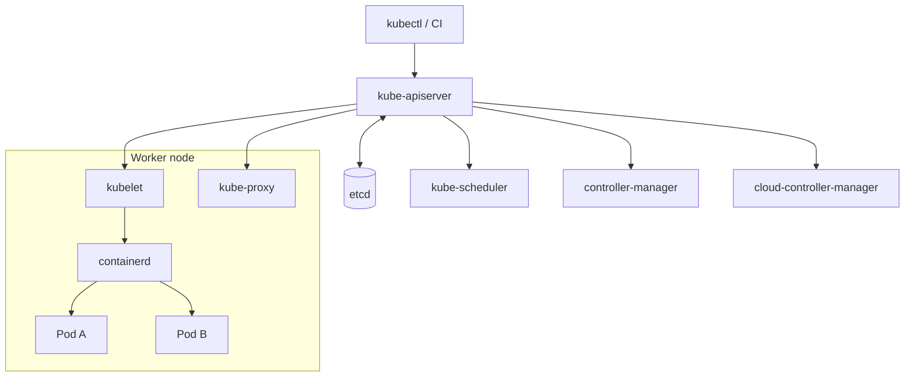
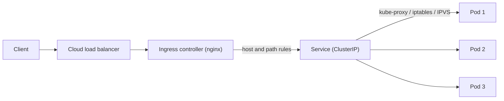
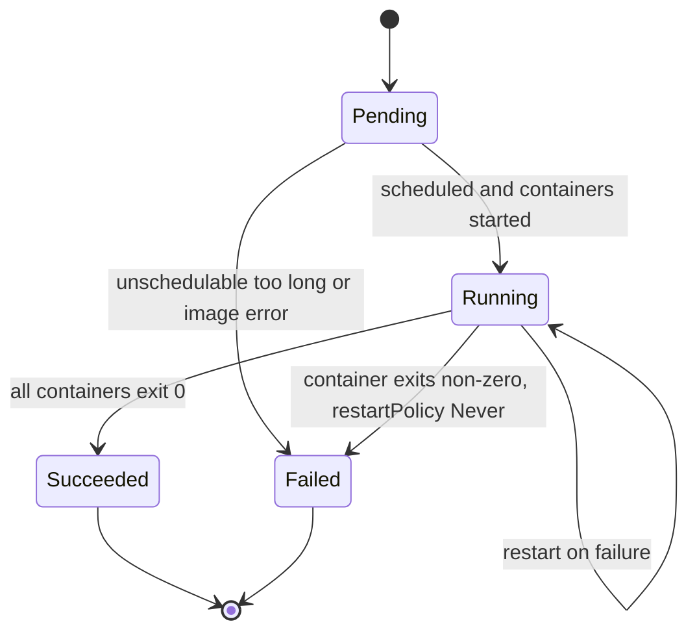
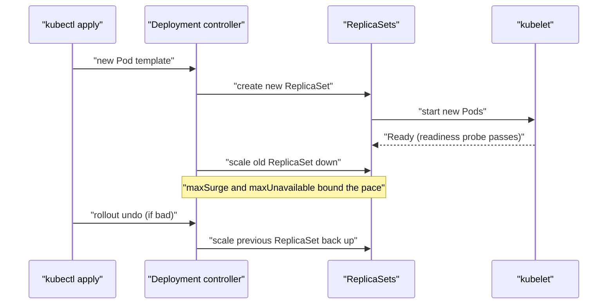
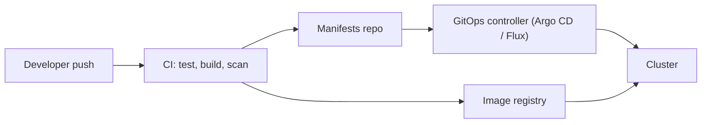

# Kubernetes

<!-- DEVOPS-SHACK:HEADER -->

  
  
  
  
  

Part of <b><a href="https://github.com/jaiswaladi246/DevOps-Cloud-Interview-Preparation-by-DevOps-Shack">DevOps &amp; Cloud Interview Preparation</a></b> — created by <b><a href="https://www.youtube.com/@devopsshack">DevOps Shack</a></b>. Free to learn from; please credit DevOps Shack when sharing.

<!-- /DEVOPS-SHACK:HEADER -->

Kubernetes is the control plane most production workloads run on. This module takes you from "what is a Pod" to designing, securing and debugging clusters, the way interviewers actually probe it.

[🏠 Home](../README.md)

## What you'll master

- The control plane and node components, and what each does when you run `kubectl apply`
- Workloads: Pods, Deployments, StatefulSets, DaemonSets, Jobs and CronJobs
- Services, Ingress, DNS and how traffic reaches a Pod
- Configuration and secrets: ConfigMaps, Secrets, projected volumes, external secret managers
- Storage: PV, PVC, StorageClass, volume expansion, StatefulSet identity
- Scheduling: requests and limits, QoS classes, taints, tolerations, affinity, topology spread
- Autoscaling: HPA, VPA, Cluster Autoscaler, Karpenter
- Security: RBAC, ServiceAccounts, NetworkPolicy, Pod Security Admission
- Rollouts, rollbacks, probes, PodDisruptionBudgets and zero-downtime deploys
- Debugging: `CrashLoopBackOff`, `ImagePullBackOff`, `Pending`, `OOMKilled`, DNS and networking failures

## Architecture at a glance

Every component talks only to the API server, and only the API server talks to etcd. The scheduler and controllers watch for changes and write back decisions. The kubelet on each node watches for Pods assigned to it and drives the container runtime through CRI. If etcd is unhealthy, the cluster cannot accept changes, but running Pods keep running.

## Request flow: from the internet to a Pod

The load balancer sends traffic to the ingress controller Pods. The controller reads Ingress objects, matches host and path, and proxies to the Service. The Service is a stable virtual IP backed by EndpointSlices that list only Pods passing their readiness probe. That last part is why a bad readiness probe causes either dropped traffic or traffic to broken Pods.

## Pod lifecycle

`Pending` covers scheduling, image pull and volume attach. `CrashLoopBackOff` and `ImagePullBackOff` are not phases; they are container waiting reasons you see in `kubectl get pods`. Knowing that distinction, and where to look for each, is a common interview filter.

## Deployment rollout workflow

A rollout is just two ReplicaSets trading replicas. Rollback is scaling the old ReplicaSet back up, which is why `revisionHistoryLimit` matters.

## CI/CD to cluster workflow

In production we keep the cluster credentials out of CI where possible and let a GitOps controller pull changes. The lab uses a namespaced ServiceAccount to show the push model with least privilege.

## Core concepts in 10 minutes

### Pods and controllers
A Pod is one or more containers sharing a network namespace and volumes. You almost never create bare Pods. A Deployment manages stateless replicas through ReplicaSets, a StatefulSet gives stable names and per-replica storage, a DaemonSet runs one Pod per node, and Jobs run to completion.

### Services and Ingress
A Service gives Pods a stable virtual IP and DNS name (`svc.namespace.svc.cluster.local`). Types are ClusterIP, NodePort, LoadBalancer and ExternalName. Ingress adds HTTP routing and TLS on top, implemented by a controller such as ingress-nginx. Gateway API is the newer, more expressive successor.

### Configuration
ConfigMaps hold non-sensitive config; Secrets hold sensitive values, base64-encoded (not encrypted) unless you enable encryption at rest. Mount them as files or inject as env vars. File mounts update in place; env vars need a restart.

### Resources and scheduling
Requests drive scheduling, limits drive throttling and OOM kills. Requests equal to limits gives the `Guaranteed` QoS class. CPU over limit is throttled, memory over limit is killed. Taints repel Pods, tolerations allow them, affinity and topology spread shape placement.

### Probes
Liveness restarts a stuck container, readiness removes it from Service endpoints, startup protects slow starters. Never make liveness depend on a downstream database; one outage then restarts every Pod.

### Storage
A PVC claims storage, a StorageClass provisions it dynamically, a PV is the resulting volume. StatefulSet `volumeClaimTemplates` create one PVC per replica, and those PVCs survive Pod deletion.

### Security
RBAC is deny by default: Roles grant verbs on resources, bindings attach them to subjects. NetworkPolicy is allow-only once any policy selects a Pod, and needs a CNI that enforces it (Calico, Cilium). Pod Security Admission enforces `restricted`, `baseline` or `privileged` per namespace.

### Autoscaling
HPA scales replicas on metrics (CPU needs `metrics-server` and CPU requests set). VPA right-sizes requests. Cluster Autoscaler or Karpenter adds nodes when Pods are unschedulable.

## Question banks

| Bank | Focus | Questions |
|------|-------|-----------|
| [Concepts](./concepts.md) | Internals, comparisons, "what happens when" | 200 |
| [Scenarios](./scenarios.md) | Situation-based decisions | 200 |
| [Troubleshooting](./troubleshooting.md) | Symptoms, errors, diagnosis | 200 |
| [Production](./production.md) | Design, security, scale, cost, rapid-fire commands | 200 |

## Practice material

- [Hands-on lab](./hands-on-lab.md): deploy a 3-tier app with TLS, HPA, NetworkPolicy, RBAC, rolling update and rollback
- [Assignments](./assignments.md): 25 graded exercises
- [Cheatsheet](./cheatsheet.md): commands and manifests on one page

## Learning path

**Beginner**
- [ ] Run a local cluster with kind or minikube
- [ ] Create Pods, Deployments and Services from YAML
- [ ] Read logs, exec into a Pod, use `describe` and events
- [ ] Use ConfigMaps and Secrets
- [ ] Explain the control plane components

**Intermediate**
- [ ] Add probes, requests and limits to every workload
- [ ] Run a StatefulSet with a PVC
- [ ] Expose apps through Ingress with TLS
- [ ] Configure HPA and watch it scale
- [ ] Write RBAC for a ServiceAccount
- [ ] Do rolling updates and rollbacks

**Advanced**
- [ ] Write NetworkPolicies with default deny
- [ ] Use taints, affinity, topology spread and PodDisruptionBudgets
- [ ] Debug node pressure, evictions and DNS failures
- [ ] Upgrade a cluster version safely
- [ ] Design multi-tenant and multi-cluster setups
- [ ] Write an operator or admission policy

[🏠 Home](../README.md)

<!-- DEVOPS-SHACK:FOOTER -->
---

### 🚀 Made with ❤️ by [DevOps Shack](https://www.youtube.com/@devopsshack)

**Learn DevOps, DevSecOps, Cloud and Kubernetes the practical way.**

[▶️ YouTube — DevOps Shack](https://www.youtube.com/@devopsshack) · [▶️ Hindi — @shackverse](https://www.youtube.com/@shackverse) · [🎓 devopsshack.com](https://devopsshack.com) · [📸 Instagram @devopsshack](https://www.instagram.com/devopsshack)

[🏠 Back to Home](../README.md) · [⭐ Star the original repo](https://github.com/jaiswaladi246/DevOps-Cloud-Interview-Preparation-by-DevOps-Shack)

© DevOps Shack · Licensed CC BY-NC-SA 4.0 · If you found this copy anywhere other than <a href="https://github.com/jaiswaladi246/DevOps-Cloud-Interview-Preparation-by-DevOps-Shack">github.com/jaiswaladi246</a>, the original and latest version is maintained by DevOps Shack.

<!-- /DEVOPS-SHACK:FOOTER -->
