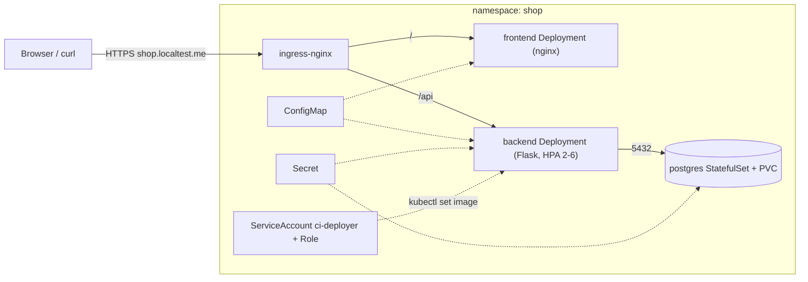

# Kubernetes — Hands-on Lab: Production-style 3-Tier App on kind

<!-- DEVOPS-SHACK:HEADER -->
<p align="center">
  <a href="https://www.youtube.com/@devopsshack"></a>
  <a href="https://www.youtube.com/@shackverse"></a>
  <a href="https://devopsshack.com"></a>
  <a href="https://www.instagram.com/devopsshack"></a>
  <a href="https://github.com/jaiswaladi246/DevOps-Cloud-Interview-Preparation-by-DevOps-Shack"></a>
</p>
<p align="center"><sub>Part of <b><a href="https://github.com/jaiswaladi246/DevOps-Cloud-Interview-Preparation-by-DevOps-Shack">DevOps &amp; Cloud Interview Preparation</a></b> — created by <b><a href="https://www.youtube.com/@devopsshack">DevOps Shack</a></b>. Free to learn from; please credit DevOps Shack when sharing.</sub></p>
<!-- /DEVOPS-SHACK:HEADER -->

[⬅ Back to Kubernetes](./README.md) · [🏠 Home](../README.md)

## Goal

Deploy a 3-tier application (static frontend, Flask API, PostgreSQL) onto a local kind cluster the way we would ship it to a real cluster: dedicated namespace, probes and resource limits, a StatefulSet with persistent storage, Ingress with TLS, ConfigMap and Secret, autoscaling under load, default-deny NetworkPolicies, a least-privilege ServiceAccount for CI, then a rolling update, a deliberately broken release and a rollback.

Everything runs on your laptop. The same manifests work on EKS with three changes, listed in the notes at the end of Step 2.

## Architecture



`localtest.me` and all its subdomains resolve to 127.0.0.1, so no `/etc/hosts` editing is needed.

## Prerequisites

- Docker 24+, `kind` 0.24+, `kubectl` 1.30+, `openssl`, `curl`, `hey` (or any load tool; a fallback with `kubectl run` is given)
- About 4 GB of free RAM
- Basic knowledge of Pods, Deployments and Services

```bash
docker version --format '{{.Server.Version}}'
kind version
kubectl version --client
```

## Project layout

```bash
mkdir -p ~/k8s-lab/{app,k8s} && cd ~/k8s-lab
```

---

## Step 1. Create the cluster (with a CNI that enforces NetworkPolicy)

The default kind CNI may not enforce NetworkPolicy, so we disable it and install Calico. The `ingress-ready` label and port mappings let ingress-nginx bind to host ports 80 and 443.

```yaml
# k8s/kind-config.yaml
kind: Cluster
apiVersion: kind.x-k8s.io/v1alpha4
networking:
  disableDefaultCNI: true
  podSubnet: "192.168.0.0/16"
nodes:
  - role: control-plane
    kubeadmConfigPatches:
      - |
        kind: InitConfiguration
        nodeRegistration:
          kubeletExtraArgs:
            node-labels: "ingress-ready=true"
    extraPortMappings:
      - containerPort: 80
        hostPort: 80
        protocol: TCP
      - containerPort: 443
        hostPort: 443
        protocol: TCP
  - role: worker
  - role: worker
```

```bash
kind create cluster --name shop --config k8s/kind-config.yaml
kubectl apply -f https://raw.githubusercontent.com/projectcalico/calico/v3.29.1/manifests/calico.yaml
kubectl -n kube-system rollout status ds/calico-node --timeout=180s
```

**Verify**

```bash
kubectl get nodes
```

All three nodes should be `Ready`. They stay `NotReady` until Calico is up.

## Step 2. Install ingress-nginx and metrics-server

```bash
kubectl apply -f https://kind.sigs.k8s.io/examples/ingress/deploy-ingress-nginx.yaml
kubectl -n ingress-nginx wait --for=condition=ready pod \
  -l app.kubernetes.io/component=controller --timeout=180s

kubectl apply -f https://github.com/kubernetes-sigs/metrics-server/releases/latest/download/components.yaml
# kind kubelets use self-signed certs
kubectl -n kube-system patch deployment metrics-server --type=json \
  -p='[{"op":"add","path":"/spec/template/spec/containers/0/args/-","value":"--kubelet-insecure-tls"}]'
kubectl -n kube-system rollout status deploy/metrics-server
```

**Verify**

```bash
kubectl top nodes     # may take about a minute to return data
```

**Moving to EKS:** (1) install ingress-nginx with its Helm chart so it gets a cloud LoadBalancer instead of host ports, (2) use a real DNS name and cert-manager instead of the self-signed cert, (3) drop `--kubelet-insecure-tls`. The default `gp2`/`gp3` StorageClass in Step 6 works as is once the EBS CSI driver add-on is installed.

## Step 3. Build and load the backend image

```python
# app/app.py
import os
import psycopg2
from flask import Flask, jsonify

app = Flask(__name__)

def conn():
    return psycopg2.connect(
        host=os.environ["DB_HOST"],
        dbname=os.environ["DB_NAME"],
        user=os.environ["DB_USER"],
        password=os.environ["DB_PASSWORD"],
        connect_timeout=2,
    )

@app.get("/api/healthz")
def healthz():
    return "ok"            # liveness: never touches the database

@app.get("/api/readyz")
def readyz():
    try:
        with conn() as c, c.cursor() as cur:
            cur.execute("SELECT 1")
        return "ready"
    except Exception as e:
        return str(e), 503

@app.get("/api/visits")
def visits():
    with conn() as c, c.cursor() as cur:
        cur.execute("CREATE TABLE IF NOT EXISTS visits (n bigint)")
        cur.execute("INSERT INTO visits VALUES (1)")
        cur.execute("SELECT count(*) FROM visits")
        return jsonify(visits=cur.fetchone()[0], version=os.environ.get("APP_VERSION", "v1"))

@app.get("/api/burn")
def burn():
    x = 0
    for i in range(3_000_000):
        x += i * i
    return jsonify(done=True)
```

```text
# app/requirements.txt
flask==3.0.3
gunicorn==22.0.0
psycopg2-binary==2.9.9
```

```dockerfile
# app/Dockerfile
FROM python:3.12-slim
WORKDIR /app
COPY requirements.txt .
RUN pip install --no-cache-dir -r requirements.txt
COPY app.py .
RUN useradd -u 10001 appuser
USER 10001
EXPOSE 8080
CMD ["gunicorn", "-b", "0.0.0.0:8080", "-w", "2", "app:app"]
```

```bash
docker build -t shop-api:1.0 app/
kind load docker-image shop-api:1.0 --name shop
```

We use an explicit tag and never `latest`, so `imagePullPolicy` defaults to `IfNotPresent` and the kind-loaded image is used.

**Verify**

```bash
docker exec shop-worker crictl images | grep shop-api
```

## Step 4. Namespace, ConfigMap and Secret

```yaml
# k8s/00-namespace.yaml
apiVersion: v1
kind: Namespace
metadata:
  name: shop
  labels:
    pod-security.kubernetes.io/enforce: baseline
    pod-security.kubernetes.io/warn: restricted
```

```yaml
# k8s/01-config.yaml
apiVersion: v1
kind: ConfigMap
metadata:
  name: shop-config
  namespace: shop
data:
  DB_HOST: postgres
  DB_NAME: shop
  DB_USER: shop
  index.html: |
    <!doctype html>
    <title>Shop</title>
    <h1>Shop frontend</h1>
    <p>Visits so far: <span id="v">...</span></p>
    <script>
      fetch('/api/visits').then(r => r.json()).then(j => {
        document.getElementById('v').textContent = j.visits + ' (' + j.version + ')';
      });
    </script>
---
apiVersion: v1
kind: Secret
metadata:
  name: shop-db
  namespace: shop
type: Opaque
stringData:
  POSTGRES_PASSWORD: "change-me-lab-only"
```

```bash
kubectl apply -f k8s/00-namespace.yaml -f k8s/01-config.yaml
```

In production the Secret would come from External Secrets Operator, Sealed Secrets or a CSI secrets driver, never from a file in Git.

**Verify**

```bash
kubectl -n shop get cm,secret
kubectl -n shop get secret shop-db -o jsonpath='{.data.POSTGRES_PASSWORD}' | base64 -d; echo
```

The decoded output proves the point: base64 is encoding, not encryption.

## Step 5. PostgreSQL StatefulSet with a PVC

A headless Service gives the StatefulSet stable DNS. A normal ClusterIP Service named `postgres` is what the backend uses.

```yaml
# k8s/02-postgres.yaml
apiVersion: v1
kind: Service
metadata:
  name: postgres
  namespace: shop
spec:
  clusterIP: None
  selector:
    app: postgres
  ports:
    - port: 5432
      name: pg
---
apiVersion: apps/v1
kind: StatefulSet
metadata:
  name: postgres
  namespace: shop
spec:
  serviceName: postgres
  replicas: 1
  selector:
    matchLabels:
      app: postgres
  template:
    metadata:
      labels:
        app: postgres
        tier: db
    spec:
      terminationGracePeriodSeconds: 60
      containers:
        - name: postgres
          image: postgres:16-alpine
          ports:
            - containerPort: 5432
              name: pg
          env:
            - name: POSTGRES_DB
              valueFrom: { configMapKeyRef: { name: shop-config, key: DB_NAME } }
            - name: POSTGRES_USER
              valueFrom: { configMapKeyRef: { name: shop-config, key: DB_USER } }
            - name: POSTGRES_PASSWORD
              valueFrom: { secretKeyRef: { name: shop-db, key: POSTGRES_PASSWORD } }
            - name: PGDATA
              value: /var/lib/postgresql/data/pgdata
          resources:
            requests: { cpu: 100m, memory: 256Mi }
            limits: { memory: 512Mi }
          readinessProbe:
            exec:
              command: ["pg_isready", "-U", "shop", "-d", "shop"]
            initialDelaySeconds: 5
            periodSeconds: 5
          livenessProbe:
            exec:
              command: ["pg_isready", "-U", "shop", "-d", "shop"]
            initialDelaySeconds: 30
            periodSeconds: 10
            failureThreshold: 6
          volumeMounts:
            - name: data
              mountPath: /var/lib/postgresql/data
  volumeClaimTemplates:
    - metadata:
        name: data
      spec:
        accessModes: ["ReadWriteOnce"]
        resources:
          requests:
            storage: 1Gi
```

`PGDATA` points to a subdirectory because the volume root contains `lost+found` on some provisioners, and `initdb` refuses a non-empty directory.

```bash
kubectl apply -f k8s/02-postgres.yaml
kubectl -n shop rollout status sts/postgres --timeout=180s
```

**Verify**

```bash
kubectl -n shop get sts,pod,pvc
kubectl -n shop exec postgres-0 -- psql -U shop -d shop -c '\conninfo'
```

Persistence test: write a row, delete the Pod, confirm the row survives.

```bash
kubectl -n shop exec postgres-0 -- psql -U shop -d shop -c "CREATE TABLE t(x int); INSERT INTO t VALUES (42);"
kubectl -n shop delete pod postgres-0
kubectl -n shop wait --for=condition=ready pod/postgres-0 --timeout=120s
kubectl -n shop exec postgres-0 -- psql -U shop -d shop -c "SELECT * FROM t;"
```

You should get `42` back, because `data-postgres-0` outlives the Pod.

## Step 6. Backend Deployment with probes and resources

```yaml
# k8s/03-backend.yaml
apiVersion: apps/v1
kind: Deployment
metadata:
  name: backend
  namespace: shop
spec:
  replicas: 2
  revisionHistoryLimit: 5
  strategy:
    type: RollingUpdate
    rollingUpdate:
      maxSurge: 1
      maxUnavailable: 0
  selector:
    matchLabels:
      app: backend
  template:
    metadata:
      labels:
        app: backend
        tier: api
    spec:
      containers:
        - name: api
          image: shop-api:1.0
          ports:
            - containerPort: 8080
              name: http
          env:
            - name: APP_VERSION
              value: v1
            - name: DB_HOST
              valueFrom: { configMapKeyRef: { name: shop-config, key: DB_HOST } }
            - name: DB_NAME
              valueFrom: { configMapKeyRef: { name: shop-config, key: DB_NAME } }
            - name: DB_USER
              valueFrom: { configMapKeyRef: { name: shop-config, key: DB_USER } }
            - name: DB_PASSWORD
              valueFrom: { secretKeyRef: { name: shop-db, key: POSTGRES_PASSWORD } }
          resources:
            requests: { cpu: 100m, memory: 128Mi }
            limits: { cpu: 500m, memory: 256Mi }
          startupProbe:
            httpGet: { path: /api/healthz, port: http }
            periodSeconds: 2
            failureThreshold: 15
          livenessProbe:
            httpGet: { path: /api/healthz, port: http }
            periodSeconds: 10
            failureThreshold: 3
          readinessProbe:
            httpGet: { path: /api/readyz, port: http }
            periodSeconds: 5
            failureThreshold: 2
          securityContext:
            allowPrivilegeEscalation: false
            runAsNonRoot: true
            capabilities: { drop: ["ALL"] }
---
apiVersion: v1
kind: Service
metadata:
  name: backend
  namespace: shop
spec:
  selector:
    app: backend
  ports:
    - port: 80
      targetPort: http
      name: http
```

`maxUnavailable: 0` with `maxSurge: 1` means a new Pod must be Ready before an old one is removed, so capacity never dips.

```bash
kubectl apply -f k8s/03-backend.yaml
kubectl -n shop rollout status deploy/backend
```

**Verify**

```bash
kubectl -n shop get pods -l app=backend -o wide
kubectl -n shop get endpointslices -l kubernetes.io/service-name=backend
kubectl -n shop run curl --rm -it --restart=Never --image=curlimages/curl -- \
  curl -s backend/api/visits
```

The response is `{"version":"v1","visits":1}`. Note: later in Step 10 default-deny blocks this ad hoc client; that is expected.

## Step 7. Frontend Deployment

nginx serves `index.html` from the ConfigMap. We mount it as a volume without `subPath`, because `subPath` mounts never receive ConfigMap updates.

```yaml
# k8s/04-frontend.yaml
apiVersion: apps/v1
kind: Deployment
metadata:
  name: frontend
  namespace: shop
spec:
  replicas: 2
  selector:
    matchLabels:
      app: frontend
  template:
    metadata:
      labels:
        app: frontend
        tier: web
    spec:
      containers:
        - name: nginx
          image: nginxinc/nginx-unprivileged:1.27-alpine
          ports:
            - containerPort: 8080
              name: http
          resources:
            requests: { cpu: 50m, memory: 32Mi }
            limits: { cpu: 200m, memory: 64Mi }
          readinessProbe:
            httpGet: { path: /, port: http }
            periodSeconds: 5
          livenessProbe:
            httpGet: { path: /, port: http }
            periodSeconds: 10
          volumeMounts:
            - name: html
              mountPath: /usr/share/nginx/html
              readOnly: true
      volumes:
        - name: html
          configMap:
            name: shop-config
            items:
              - key: index.html
                path: index.html
---
apiVersion: v1
kind: Service
metadata:
  name: frontend
  namespace: shop
spec:
  selector:
    app: frontend
  ports:
    - port: 80
      targetPort: http
      name: http
```

```bash
kubectl apply -f k8s/04-frontend.yaml
kubectl -n shop rollout status deploy/frontend
```

**Verify**

```bash
kubectl -n shop get deploy,svc
kubectl -n shop port-forward svc/frontend 8081:80 &
curl -s localhost:8081 | head -3; kill %1
```

## Step 8. Ingress with TLS

Create a self-signed certificate and store it as a TLS Secret.

```bash
openssl req -x509 -nodes -newkey rsa:2048 -days 30 \
  -keyout tls.key -out tls.crt \
  -subj "/CN=shop.localtest.me" -addext "subjectAltName=DNS:shop.localtest.me"
kubectl -n shop create secret tls shop-tls --cert=tls.crt --key=tls.key
```

```yaml
# k8s/05-ingress.yaml
apiVersion: networking.k8s.io/v1
kind: Ingress
metadata:
  name: shop
  namespace: shop
  annotations:
    nginx.ingress.kubernetes.io/ssl-redirect: "true"
spec:
  ingressClassName: nginx
  tls:
    - hosts: ["shop.localtest.me"]
      secretName: shop-tls
  rules:
    - host: shop.localtest.me
      http:
        paths:
          - path: /api
            pathType: Prefix
            backend:
              service: { name: backend, port: { number: 80 } }
          - path: /
            pathType: Prefix
            backend:
              service: { name: frontend, port: { number: 80 } }
```

```bash
kubectl apply -f k8s/05-ingress.yaml
```

**Verify**

```bash
kubectl -n shop get ingress
curl -k -s https://shop.localtest.me/api/visits
curl -k -s https://shop.localtest.me/ | head -3
curl -sI http://shop.localtest.me/ | head -2      # expect a 308 redirect to https
openssl s_client -connect shop.localtest.me:443 -servername shop.localtest.me </dev/null 2>/dev/null | openssl x509 -noout -subject
```

On EKS replace the self-signed secret with a cert-manager `Certificate` and a `ClusterIssuer` for Let's Encrypt.

## Step 9. HPA and load test

```yaml
# k8s/06-hpa.yaml
apiVersion: autoscaling/v2
kind: HorizontalPodAutoscaler
metadata:
  name: backend
  namespace: shop
spec:
  scaleTargetRef:
    apiVersion: apps/v1
    kind: Deployment
    name: backend
  minReplicas: 2
  maxReplicas: 6
  metrics:
    - type: Resource
      resource:
        name: cpu
        target:
          type: Utilization
          averageUtilization: 50
  behavior:
    scaleDown:
      stabilizationWindowSeconds: 60
```

```bash
kubectl apply -f k8s/06-hpa.yaml
kubectl -n shop get hpa backend
```

`TARGETS` must show a percentage, not `<unknown>`. If it is `<unknown>`, metrics-server is not ready or the Pods have no CPU request.

Generate load against the CPU-heavy endpoint and watch from a second terminal.

```bash
# terminal 1
kubectl -n shop get hpa backend -w

# terminal 2
hey -z 120s -c 20 https://shop.localtest.me/api/burn
```

If you do not have `hey`, use an in-cluster generator (do this before Step 10, or allow it in the policy):

```bash
kubectl -n shop run load --rm -it --restart=Never --image=busybox:1.36 -- \
  /bin/sh -c 'while true; do wget -q -O- http://backend/api/burn >/dev/null; done'
```

**Verify**

```bash
kubectl -n shop get hpa backend
kubectl -n shop get pods -l app=backend
kubectl -n shop describe hpa backend | sed -n '/Events/,$p'
```

Replicas climb toward 6 while CPU is above 50% of the request, then fall back to 2 after the load stops and the stabilization window passes.

## Step 10. NetworkPolicy: default deny, then allow what is needed

Rules we want: ingress-nginx reaches frontend and backend, backend reaches Postgres, nothing else reaches Postgres, and all Pods can resolve DNS.

```yaml
# k8s/07-netpol.yaml
apiVersion: networking.k8s.io/v1
kind: NetworkPolicy
metadata:
  name: default-deny
  namespace: shop
spec:
  podSelector: {}
  policyTypes: ["Ingress", "Egress"]
---
apiVersion: networking.k8s.io/v1
kind: NetworkPolicy
metadata:
  name: allow-dns
  namespace: shop
spec:
  podSelector: {}
  policyTypes: ["Egress"]
  egress:
    - to:
        - namespaceSelector:
            matchLabels:
              kubernetes.io/metadata.name: kube-system
          podSelector:
            matchLabels:
              k8s-app: kube-dns
      ports:
        - { protocol: UDP, port: 53 }
        - { protocol: TCP, port: 53 }
---
apiVersion: networking.k8s.io/v1
kind: NetworkPolicy
metadata:
  name: allow-from-ingress
  namespace: shop
spec:
  podSelector:
    matchExpressions:
      - { key: tier, operator: In, values: ["web", "api"] }
  policyTypes: ["Ingress"]
  ingress:
    - from:
        - namespaceSelector:
            matchLabels:
              kubernetes.io/metadata.name: ingress-nginx
---
apiVersion: networking.k8s.io/v1
kind: NetworkPolicy
metadata:
  name: backend-to-db
  namespace: shop
spec:
  podSelector:
    matchLabels:
      tier: api
  policyTypes: ["Egress"]
  egress:
    - to:
        - podSelector:
            matchLabels:
              tier: db
      ports:
        - { protocol: TCP, port: 5432 }
---
apiVersion: networking.k8s.io/v1
kind: NetworkPolicy
metadata:
  name: db-from-backend
  namespace: shop
spec:
  podSelector:
    matchLabels:
      tier: db
  policyTypes: ["Ingress"]
  ingress:
    - from:
        - podSelector:
            matchLabels:
              tier: api
      ports:
        - { protocol: TCP, port: 5432 }
```

```bash
kubectl apply -f k8s/07-netpol.yaml
```

**Verify** the app still works and everything else is blocked.

```bash
curl -k -s https://shop.localtest.me/api/visits          # still works

# an unlabeled Pod must NOT reach the database
kubectl -n shop run probe --rm -it --restart=Never --image=busybox:1.36 -- \
  nc -zv -w 3 postgres 5432                               # expect timeout

# a Pod labeled tier=api in another namespace is also blocked (podSelector is namespace-local)
kubectl create ns intruder
kubectl -n intruder run probe --rm -it --restart=Never --labels=tier=api --image=busybox:1.36 -- \
  nc -zv -w 3 postgres.shop.svc.cluster.local 5432        # expect timeout
kubectl delete ns intruder
```

The first probe times out because the default-deny Egress also blocks it from leaving, and DNS is the only exception. That is the point: a policy test must show both the allowed path and the denied path.

## Step 11. RBAC for a CI service account

CI should be able to update the backend image and watch the rollout, and nothing else.

```yaml
# k8s/08-rbac.yaml
apiVersion: v1
kind: ServiceAccount
metadata:
  name: ci-deployer
  namespace: shop
---
apiVersion: rbac.authorization.k8s.io/v1
kind: Role
metadata:
  name: deployer
  namespace: shop
rules:
  - apiGroups: ["apps"]
    resources: ["deployments"]
    verbs: ["get", "list", "watch", "patch", "update"]
  - apiGroups: ["apps"]
    resources: ["replicasets"]
    verbs: ["get", "list", "watch"]
  - apiGroups: [""]
    resources: ["pods"]
    verbs: ["get", "list", "watch"]
---
apiVersion: rbac.authorization.k8s.io/v1
kind: RoleBinding
metadata:
  name: ci-deployer
  namespace: shop
subjects:
  - kind: ServiceAccount
    name: ci-deployer
    namespace: shop
roleRef:
  kind: Role
  name: deployer
  apiGroup: rbac.authorization.k8s.io
```

```bash
kubectl apply -f k8s/08-rbac.yaml
```

**Verify** with impersonation:

```bash
SA=system:serviceaccount:shop:ci-deployer
kubectl auth can-i patch deployments -n shop --as=$SA          # yes
kubectl auth can-i delete deployments -n shop --as=$SA         # no
kubectl auth can-i get secrets -n shop --as=$SA                # no
kubectl auth can-i patch deployments -n default --as=$SA       # no
kubectl auth can-i --list -n shop --as=$SA
```

Mint a short-lived token the way a CI job would, rather than using a long-lived Secret token:

```bash
TOKEN=$(kubectl -n shop create token ci-deployer --duration=1h)
kubectl --token="$TOKEN" -n shop get pods
kubectl --token="$TOKEN" -n shop get secrets      # Forbidden
```

On EKS, CI would instead assume an IAM role mapped through EKS access entries, or use OIDC federation from GitHub Actions.

## Step 12. Rolling update

Build v2 (the only change is the version string) and let CI's identity deploy it.

```bash
docker build -t shop-api:2.0 app/
kind load docker-image shop-api:2.0 --name shop

kubectl --token="$TOKEN" -n shop patch deploy/backend --type=strategic -p \
  '{"spec":{"template":{"spec":{"containers":[{"name":"api","image":"shop-api:2.0","env":[{"name":"APP_VERSION","value":"v2"}]}]}}}}'
kubectl -n shop rollout status deploy/backend
```

Run a request loop in another terminal while it rolls. There should be no failures.

```bash
while true; do curl -k -s -o /dev/null -w "%{http_code} " https://shop.localtest.me/api/readyz; sleep 0.3; done
```

**Verify**

```bash
kubectl -n shop rollout history deploy/backend
curl -k -s https://shop.localtest.me/api/visits       # version v2
kubectl -n shop get rs -l app=backend
```

Two ReplicaSets exist: the new one with all replicas and the old one scaled to 0 and kept for rollback. The CI account only needed `patch` on Deployments for this; a real pipeline would change the image through a manifest and annotate the cause with `kubectl annotate deploy/backend kubernetes.io/change-cause="release 2.0"`.

## Step 13. Broken release and rollback

Ship an image that does not exist, simulating a bad tag.

```bash
kubectl -n shop set image deploy/backend api=shop-api:3.0-typo
kubectl -n shop rollout status deploy/backend --timeout=60s
```

The rollout stalls and the command exits with `error: timed out waiting for the condition`. Because `maxUnavailable: 0`, the two v2 Pods keep serving.

```bash
kubectl -n shop get pods -l app=backend
# one Pod shows ErrImagePull then ImagePullBackOff
kubectl -n shop describe pod -l app=backend | grep -A3 -i "failed to pull"
curl -k -s https://shop.localtest.me/api/visits      # still answering from v2
```

Roll back:

```bash
kubectl -n shop rollout undo deploy/backend
kubectl -n shop rollout status deploy/backend
kubectl -n shop rollout history deploy/backend
```

**Verify**

```bash
kubectl -n shop get deploy backend -o jsonpath='{.spec.template.spec.containers[0].image}{"\n"}'
```

It prints `shop-api:2.0`. To go to a specific revision use `kubectl rollout undo deploy/backend --to-revision=1`.

## Step 14. Final check

```bash
kubectl -n shop get all,ingress,pvc,hpa,netpol
kubectl -n shop get events --sort-by=.lastTimestamp | tail -15
```

## Cleanup

```bash
kind delete cluster --name shop
rm -f tls.key tls.crt
```

On EKS, delete the namespace first (`kubectl delete ns shop`) so the load balancer and EBS volumes are released, then delete the cluster, otherwise you keep paying for orphaned volumes.

## What to say in an interview about this project

"I deployed a three-tier app on Kubernetes with the same controls we use in production. Each tier had requests and limits, and the backend had separate startup, liveness and readiness probes. Liveness never touched the database, so a database blip would not restart every Pod. Readiness did check it, so traffic only reached Pods that could serve it.

Postgres ran as a StatefulSet with a PVC, and I proved persistence by deleting the Pod and reading the row back. Traffic came in through ingress-nginx with TLS and an HTTP to HTTPS redirect. I locked the namespace down with default-deny NetworkPolicies and allowed only ingress to web and API, API to the database, and DNS, and I tested both the allowed and denied paths.

CI used a ServiceAccount with a Role limited to patching Deployments in one namespace, verified with `kubectl auth can-i`, using short-lived tokens. I load tested the backend, watched the HPA scale from 2 to 6 replicas and back, then did a rolling update with `maxUnavailable: 0` and zero failed requests. A bad image tag stalled the rollout without taking the service down, and `rollout undo` fixed it. If I had more time I would move Postgres to a managed database, add PodDisruptionBudgets, and use Argo CD instead of push-based CI."

## Common errors and fixes

| Symptom | Cause | Fix |
|---|---|---|
| Nodes stay `NotReady` after `kind create` | CNI disabled and Calico not applied yet | Apply the Calico manifest and wait for `calico-node` |
| `ErrImageNeverPull` or `ImagePullBackOff` on `shop-api:1.0` | Image not loaded into kind nodes | `kind load docker-image shop-api:1.0 --name shop`, and do not tag it `latest` |
| HPA `TARGETS` shows `<unknown>/50%` | metrics-server not ready or no CPU request | Check `kubectl top pods`; add `--kubelet-insecure-tls` on kind; set `resources.requests.cpu` |
| Postgres `initdb: error: directory ... exists but is not empty` | Volume root has `lost+found` | Set `PGDATA` to a subdirectory as in Step 5 |
| Pod `Pending` with `pod has unbound immediate PersistentVolumeClaims` | No default StorageClass | `kubectl get sc`; kind ships `standard`. On EKS install the EBS CSI driver |
| Ingress returns 404 | Wrong `ingressClassName` or host mismatch | `kubectl get ingressclass`; use `-H "Host: shop.localtest.me"` |
| Ingress returns 503 | Service has no ready endpoints | `kubectl -n shop get endpointslices`; fix readiness; check selector labels |
| `curl: (60) SSL certificate problem` | Self-signed cert | Use `-k` locally, cert-manager in real clusters |
| Backend `readyz` returns 503 after applying policies | Missing egress to DB or DNS | Check `backend-to-db`, `allow-dns`; verify label `tier=db` on Postgres Pods |
| Policies have no effect | CNI does not enforce NetworkPolicy | Use Calico or Cilium as in Step 1 |
| `Error from server (Forbidden): deployments.apps "backend" is forbidden` | RBAC missing verb or wrong namespace | `kubectl auth can-i --list --as=system:serviceaccount:shop:ci-deployer -n shop` |
| `rollout status` hangs | New Pods never become Ready | `kubectl describe pod`, `kubectl logs`; then `rollout undo` |
| Host ports 80 or 443 already in use | Another process is bound | Stop it, or map different `hostPort` values in the kind config |

[⬅ Back to Kubernetes](./README.md) · [🏠 Home](../README.md)

<!-- DEVOPS-SHACK:FOOTER -->
---

<div align="center">

### 🚀 Made with ❤️ by [DevOps Shack](https://www.youtube.com/@devopsshack)

**Learn DevOps, DevSecOps, Cloud and Kubernetes the practical way.**

[▶️ YouTube — DevOps Shack](https://www.youtube.com/@devopsshack) · [▶️ Hindi — @shackverse](https://www.youtube.com/@shackverse) · [🎓 devopsshack.com](https://devopsshack.com) · [📸 Instagram @devopsshack](https://www.instagram.com/devopsshack)

[🏠 Back to Home](../README.md) · [⭐ Star the original repo](https://github.com/jaiswaladi246/DevOps-Cloud-Interview-Preparation-by-DevOps-Shack)

<sub>© DevOps Shack · Licensed CC BY-NC-SA 4.0 · If you found this copy anywhere other than <a href="https://github.com/jaiswaladi246/DevOps-Cloud-Interview-Preparation-by-DevOps-Shack">github.com/jaiswaladi246</a>, the original and latest version is maintained by DevOps Shack.</sub>

</div>
<!-- /DEVOPS-SHACK:FOOTER -->
