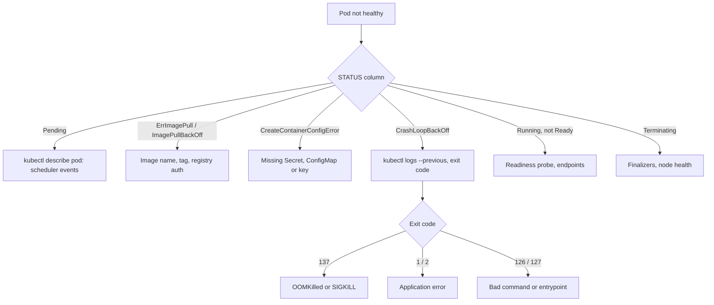
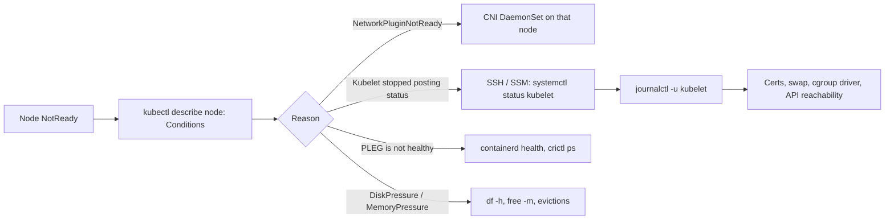
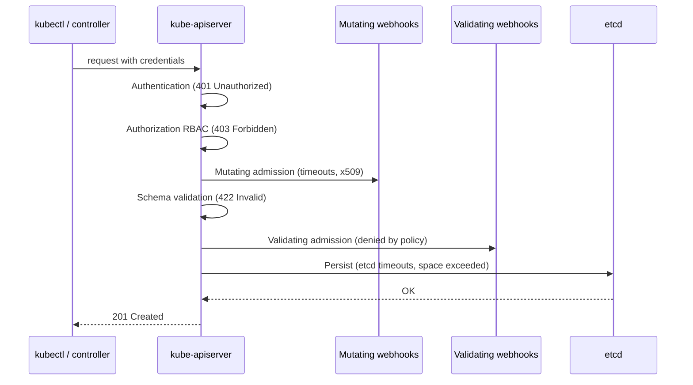

# Kubernetes — Troubleshooting Drills

<!-- DEVOPS-SHACK:HEADER -->
<p align="center">
  <a href="https://www.youtube.com/@devopsshack"></a>
  <a href="https://www.youtube.com/@shackverse"></a>
  <a href="https://devopsshack.com"></a>
  <a href="https://www.instagram.com/devopsshack"></a>
  <a href="https://github.com/jaiswaladi246/DevOps-Cloud-Interview-Preparation-by-DevOps-Shack"></a>
</p>
<p align="center"><sub>Part of <b><a href="https://github.com/jaiswaladi246/DevOps-Cloud-Interview-Preparation-by-DevOps-Shack">DevOps &amp; Cloud Interview Preparation</a></b> — created by <b><a href="https://www.youtube.com/@devopsshack">DevOps Shack</a></b>. Free to learn from; please credit DevOps Shack when sharing.</sub></p>
<!-- /DEVOPS-SHACK:HEADER -->

> Realistic Kubernetes symptoms with exact error text, the commands to diagnose them, the fix and how to stop them coming back · 200 questions · 🟢 Beginner 🟡 Intermediate 🔴 Advanced

[⬅ Back to Kubernetes](./README.md) · [🏠 Home](../README.md)

## Table of contents
- [Pod startup failures](#pod-startup-failures) — Q1–Q28
- [Scheduling and Pending Pods](#scheduling-and-pending-pods) — Q29–Q50
- [Resources, OOM, probes and termination](#resources-oom-probes-and-termination) — Q51–Q75
- [Nodes, kubelet and container runtime](#nodes-kubelet-and-container-runtime) — Q76–Q98
- [Services, DNS, Ingress and NetworkPolicy](#services-dns-ingress-and-networkpolicy) — Q99–Q127
- [Storage and volumes](#storage-and-volumes) — Q128–Q147
- [Control plane, RBAC, webhooks and autoscaling](#control-plane-rbac-webhooks-and-autoscaling) — Q148–Q172
- [Cluster operations: certs, drains, rollouts and quotas](#cluster-operations-certs-drains-rollouts-and-quotas) — Q173–Q188
- [EKS-specific issues](#eks-specific-issues) — Q189–Q200

The drill we follow in production for almost every Pod problem:



---

## Pod startup failures

<!-- DEVOPS-SHACK:SECTION -->
> 🎥 **Learn this hands-on with DevOps Shack** → [YouTube @devopsshack](https://www.youtube.com/@devopsshack) · [Hindi @shackverse](https://www.youtube.com/@shackverse) · [Courses at devopsshack.com](https://devopsshack.com)

### Q1. A Pod shows `CrashLoopBackOff` with `RESTARTS 7` and events say `Back-off restarting failed container app`. Where do you start? 🟢

<details>
<summary><b>Answer</b></summary>

**Likely causes →** The container starts and exits: application error, missing env var or config, failed DB connection at boot, wrong command, or an OOM kill. CrashLoopBackOff is a symptom, not a cause; kubelet just backs off restarts (10s, 20s, 40s … capped at 5 minutes).

**Diagnose →**
```bash
kubectl describe pod web-7d9f8c-x2k4q        # Last State, Reason, Exit Code
kubectl logs web-7d9f8c-x2k4q --previous     # logs of the crashed instance
kubectl get pod web-7d9f8c-x2k4q -o jsonpath='{.status.containerStatuses[0].lastState}'
```

**Fix →** Act on the exit code and the last log lines: fix the config, the Secret, the command, or raise the memory limit if `Reason: OOMKilled`.

**Prevent →** Fail fast with a clear log line on bad config, validate manifests in CI, and alert on `kube_pod_container_status_restarts_total` increasing.

</details>

### Q2. `kubectl logs web-0 --previous` returns nothing useful and the container dies in under a second. How do you get inside it? 🟡

<details>
<summary><b>Answer</b></summary>

**Likely causes →** The process exits before it writes logs (bad entrypoint, missing binary, crash in a wrapper script), so there is nothing to read.

**Diagnose →**
```bash
# Copy the Pod, override the command so it stays alive
kubectl debug web-0 -it --copy-to=web-0-debug --container=app -- sh
# Or attach an ephemeral debug container sharing the process namespace
kubectl debug -it web-0 --image=busybox:1.36 --target=app
# Check what the image would run
crane config registry.example.com/web:1.4 | jq '.config.Entrypoint, .config.Cmd'
```

**Fix →** Inside the copy, run the real entrypoint by hand and read the error. Typical findings: wrong path, missing shared library, script with CRLF line endings.

**Prevent →** Run the image locally in CI (`docker run --rm image --version`) as a smoke test before pushing.

</details>

### Q3. Pod status is `ImagePullBackOff` and events show `Failed to pull image "registry.example.com/web:1.4.2": rpc error: code = NotFound desc = failed to pull and unpack image ... not found`. 🟢

<details>
<summary><b>Answer</b></summary>

**Likely causes →** The tag does not exist (typo, CI never pushed it, tag pushed to a different repo or region), or the image was deleted by a registry lifecycle policy.

**Diagnose →**
```bash
kubectl describe pod web-6c9d-abcde | sed -n '/Events/,$p'
crane ls registry.example.com/web | grep 1.4.2
aws ecr describe-images --repository-name web --image-ids imageTag=1.4.2
```

**Fix →** Correct the tag in the manifest or push the missing image; the kubelet retries automatically, or delete the Pod to retry now.

**Prevent →** Deploy by immutable digest produced by the pipeline, and exclude deployed tags from registry cleanup rules.

</details>

### Q4. Events show `pull access denied for registry.example.com/web, repository does not exist or may require authorization: server message: insufficient_scope: authorization failed`. 🟢

<details>
<summary><b>Answer</b></summary>

**Likely causes →** Private registry with no `imagePullSecrets`, the Secret is in another namespace, wrong secret type, expired token, or the repository name is wrong (registries often answer "denied" instead of "not found").

**Diagnose →**
```bash
kubectl get pod web-x -o jsonpath='{.spec.imagePullSecrets}'
kubectl get sa default -o yaml | grep -A2 imagePullSecrets
kubectl get secret regcred -o jsonpath='{.data.\.dockerconfigjson}' | base64 -d | jq '.auths | keys'
```

**Fix →**
```bash
kubectl create secret docker-registry regcred \
  --docker-server=registry.example.com --docker-username=ci --docker-password="$TOKEN" -n payments
kubectl patch sa default -n payments -p '{"imagePullSecrets":[{"name":"regcred"}]}'
```
The registry hostname in the Secret must match the image host exactly.

**Prevent →** Attach pull secrets to ServiceAccounts through namespace templates, or use node-level credentials (ECR via node IAM role, kubelet credential provider).

</details>

### Q5. Pulls from Docker Hub randomly fail with `toomanyrequests: You have reached your pull rate limit`. 🟡

<details>
<summary><b>Answer</b></summary>

**Likely causes →** Anonymous Docker Hub pulls are rate-limited per source IP. All nodes behind one NAT gateway share the quota, and autoscaling events cause pull bursts.

**Diagnose →**
```bash
kubectl get events -A --field-selector reason=Failed | grep toomanyrequests
kubectl get pods -A -o jsonpath='{..image}' | tr ' ' '\n' | grep -v '\.' | sort -u   # images with no registry host = docker.io
```

**Fix →** Authenticate pulls with a Docker Hub account secret, or mirror images into your own registry (ECR pull-through cache, Harbor proxy cache) and rewrite image references.

**Prevent →** Policy (Kyverno/Gatekeeper) that only allows images from your registry; `imagePullPolicy: IfNotPresent` with pinned tags so nodes reuse cached layers.

</details>

### Q6. A private registry with an internal CA fails with `x509: certificate signed by unknown authority` during image pull. 🟡

<details>
<summary><b>Answer</b></summary>

**Likely causes →** The pull is done by containerd on the node, not by the Pod, so the node OS or containerd does not trust the internal CA.

**Diagnose →**
```bash
# On the node
sudo crictl pull registry.internal.corp/web:1.0
openssl s_client -connect registry.internal.corp:443 -showcerts </dev/null | head -20
```

**Fix →** Install the CA on every node (`/usr/local/share/ca-certificates/` + `update-ca-certificates`), or configure containerd per registry:
```toml
# /etc/containerd/certs.d/registry.internal.corp/hosts.toml
server = "https://registry.internal.corp"
[host."https://registry.internal.corp"]
  ca = "/etc/containerd/certs.d/registry.internal.corp/ca.crt"
```
Make sure `config_path = "/etc/containerd/certs.d"` is set for the CRI registry plugin, then restart containerd.

**Prevent →** Bake the CA into the node image (AMI / launch template user data) so new nodes get it.

</details>

### Q7. A new image works on laptops but on nodes the Pod crash-loops and logs show only `exec /app/server: exec format error`. 🟡

<details>
<summary><b>Answer</b></summary>

**Likely causes →** CPU architecture mismatch: an `arm64` image (built on an Apple Silicon Mac) running on `amd64` nodes, or the reverse on Graviton nodes. A script without a shebang gives the same error.

**Diagnose →**
```bash
kubectl get node -L kubernetes.io/arch
docker buildx imagetools inspect registry.example.com/web:1.4
```

**Fix →** Build a multi-arch image:
```bash
docker buildx build --platform linux/amd64,linux/arm64 -t registry.example.com/web:1.4 --push .
```
Or pin the workload with `nodeSelector: kubernetes.io/arch: amd64`. For scripts, add `#!/bin/sh` as line one.

**Prevent →** Build images only in CI with explicit `--platform`, never push from laptops.

</details>

### Q8. Pod status is `CreateContainerConfigError` and describe shows `Error: secret "db-creds" not found`. 🟢

<details>
<summary><b>Answer</b></summary>

**Likely causes →** The Secret referenced by `envFrom`, `valueFrom.secretKeyRef` or a volume does not exist in the Pod's namespace (created in another namespace, not yet synced by External Secrets, name typo).

**Diagnose →**
```bash
kubectl get secret db-creds -n payments
kubectl get externalsecret -n payments          # if ESO is used
kubectl describe externalsecret db-creds -n payments
```

**Fix →** Create the Secret in the same namespace, or fix the ExternalSecret (store reference, IAM permission, remote key). The kubelet retries and the container starts once the Secret appears.

**Prevent →** Apply Secrets before workloads (Argo CD sync waves, Helm ordering), and alert on ExternalSecret `SecretSyncedError`.

</details>

### Q9. `CreateContainerConfigError` with `Error: couldn't find key DB_PASSWORD in Secret payments/db-creds`. 🟢

<details>
<summary><b>Answer</b></summary>

**Likely causes →** The Secret exists but the key name differs (`db_password` vs `DB_PASSWORD`, trailing newline in a filename-derived key, or `--from-file` used so the key is the filename).

**Diagnose →**
```bash
kubectl get secret db-creds -n payments -o jsonpath='{.data}' | jq 'keys'
```

**Fix →** Rename the key in the Secret or the reference in the Pod spec. If the key is genuinely optional, mark it:
```yaml
valueFrom:
  secretKeyRef: {name: db-creds, key: DB_PASSWORD, optional: true}
```

**Prevent →** Keep a schema of required keys per app and validate it in CI, or generate Secrets from the same template the app reads.

</details>

### Q10. `CreateContainerConfigError: Error: container has runAsNonRoot and image will run as root`. 🟡

<details>
<summary><b>Answer</b></summary>

**Likely causes →** `securityContext.runAsNonRoot: true` (often enforced by the restricted Pod Security profile) but the image has no `USER`, or uses a named user (`USER app`) that the kubelet cannot verify is non-root.

**Diagnose →**
```bash
kubectl get pod web-x -o jsonpath='{.spec.securityContext}{"\n"}{.spec.containers[0].securityContext}'
docker inspect --format '{{.Config.User}}' registry.example.com/web:1.4
```

**Fix →** Set a numeric user in the Dockerfile (`USER 10001`) or in the Pod spec:
```yaml
securityContext:
  runAsNonRoot: true
  runAsUser: 10001
```
Make sure files the app writes are owned by or writable for that UID.

**Prevent →** Standard base images with a numeric non-root user and a CI check (Trivy/Conftest) that fails images running as root.

</details>

### Q11. Pod goes to `RunContainerError` with `exec: "gunicorn": executable file not found in $PATH: unknown`. 🟢

<details>
<summary><b>Answer</b></summary>

**Likely causes →** The `command`/`args` in the manifest overrides the image entrypoint with a binary that does not exist in this image (multi-stage build dropped it, virtualenv not on PATH, distroless image without a shell).

**Diagnose →**
```bash
kubectl get pod web-x -o jsonpath='{.spec.containers[0].command} {.spec.containers[0].args}'
docker run --rm --entrypoint sh registry.example.com/web:1.4 -c 'echo $PATH; which gunicorn'
```

**Fix →** Use the absolute path (`/opt/venv/bin/gunicorn`), fix PATH in the image, or remove the `command` override and let the image entrypoint run. Exit code 127 means not found; 126 means found but not executable (`chmod +x` in the Dockerfile).

**Prevent →** Keep the start command in the image, not in the manifest, so it is tested with the build.

</details>

### Q12. The container exits with `exec /docker-entrypoint.sh: no such file or directory`, but the file is clearly in the image. 🟡

<details>
<summary><b>Answer</b></summary>

**Likely causes →** The file exists but its interpreter does not: Windows CRLF line endings make the shebang `/bin/sh\r`, or the shebang points to `/bin/bash` on an Alpine or distroless image, or a binary is dynamically linked against glibc on musl.

**Diagnose →**
```bash
docker run --rm --entrypoint sh registry.example.com/web:1.4 -c 'head -1 /docker-entrypoint.sh | od -c | head -2'
docker run --rm --entrypoint sh registry.example.com/web:1.4 -c 'ls /bin/bash; ldd /app/server'
```

**Fix →** Convert line endings (`dos2unix`, `.gitattributes` with `*.sh text eol=lf`), use `#!/bin/sh`, or build static binaries (`CGO_ENABLED=0`) for distroless/Alpine.

**Prevent →** `.gitattributes` in every repo and an image smoke test in CI.

</details>

### Q13. A Deployment shows `READY 0/3` but `kubectl get pods` shows no Pods at all. 🟡

<details>
<summary><b>Answer</b></summary>

**Likely causes →** Pods are being rejected at admission, so the ReplicaSet cannot create them: Pod Security Admission, a Kyverno/Gatekeeper policy, ResourceQuota, a missing ServiceAccount, or a failing webhook.

**Diagnose →**
```bash
kubectl describe deploy web | sed -n '/Conditions/,$p'
kubectl describe rs -l app=web | sed -n '/Events/,$p'
# e.g. Error creating: pods "web-5f..." is forbidden: violates PodSecurity "restricted:latest":
#      allowPrivilegeEscalation != false (container "app" must set securityContext.allowPrivilegeEscalation=false)
```

**Fix →** Fix whatever the ReplicaSet event says: add the required securityContext fields, create the ServiceAccount, raise quota, or fix the webhook. The ReplicaSet controller retries on its own.

**Prevent →** Run `kubectl apply --dry-run=server` in CI so admission rejections fail the pipeline instead of the rollout. Use PSA `warn`/`audit` labels before switching a namespace to `enforce`.

</details>

### Q14. Pods are stuck in `Init:0/2` for 20 minutes. 🟢

<details>
<summary><b>Answer</b></summary>

**Likely causes →** The first init container is still running, usually a "wait-for" loop (waiting for DB, a Service, a migration) that never succeeds because the dependency is down or the hostname is wrong.

**Diagnose →**
```bash
kubectl describe pod api-x | sed -n '/Init Containers/,/Containers:/p'
kubectl logs api-x -c wait-for-db
kubectl run tmp --rm -it --image=busybox:1.36 -- nc -zv postgres.data.svc.cluster.local 5432
```

**Fix →** Fix the dependency or the address. If the init container is only a crutch, remove it and let the app retry connections itself.

**Prevent →** Give wait loops a timeout so they fail visibly (`Init:CrashLoopBackOff`) instead of hanging forever, and prefer app-level retries with backoff.

</details>

### Q15. Pods show `Init:CrashLoopBackOff` after a release that added a migration init container. 🟡

<details>
<summary><b>Answer</b></summary>

**Likely causes →** The init container exits non-zero: migration fails (lock held, schema conflict, bad credentials), so the main container never starts. With several replicas, each Pod runs the migration concurrently and they fight over the lock.

**Diagnose →**
```bash
kubectl logs api-x -c migrate --previous
kubectl get pod api-x -o jsonpath='{.status.initContainerStatuses[*].lastState.terminated}'
```

**Fix →** Fix the migration. Move it out of the Pod into a single Job (Helm `pre-upgrade` hook or Argo CD `PreSync`) so it runs once, not once per replica.

**Prevent →** Migrations as Jobs with `backoffLimit` and a clear failure signal; backward-compatible schema changes so old and new code run side by side.

</details>

### Q16. Pod is stuck in `ContainerCreating` and events say `MountVolume.SetUp failed for volume "app-config" : configmap "app-config" not found`. 🟢

<details>
<summary><b>Answer</b></summary>

**Likely causes →** A ConfigMap or Secret mounted as a volume does not exist in the namespace. Unlike env references (which give CreateContainerConfigError), volume references block in `ContainerCreating`.

**Diagnose →**
```bash
kubectl describe pod web-x | grep -A3 FailedMount
kubectl get cm -n web
```

**Fix →** Create the ConfigMap, or fix the name. If the volume is optional, set `configMap.optional: true`. Kustomize `configMapGenerator` adds a hash suffix, so a hard-coded name in a non-Kustomize manifest will not match.

**Prevent →** Ship ConfigMaps in the same release/sync as the Deployment so they are applied together.

</details>

### Q17. Pods stay in `ContainerCreating` with `Failed to create pod sandbox: rpc error: code = Unknown desc = failed to setup network for sandbox "...": plugin type="aws-cni" ... failed to assign an IP address to container`. 🟡

<details>
<summary><b>Answer</b></summary>

**Likely causes →** The CNI plugin cannot give the Pod an IP: subnet or node IP pool exhausted, CNI DaemonSet unhealthy on that node, or IPAM state corruption after a crash.

**Diagnose →**
```bash
kubectl get pods -n kube-system -o wide | grep -E 'aws-node|calico|cilium' | grep <node>
kubectl logs -n kube-system <cni-pod-on-node> --tail=100
kubectl describe node <node> | grep -A5 Allocatable
```

**Fix →** Restart the CNI Pod on that node, free or add IP capacity (bigger subnet, prefix delegation on EKS), and cordon/replace the node if IPAM is corrupt.

**Prevent →** Alert on CNI Pod restarts and subnet free IPs; size Pod CIDRs for peak plus surge during rollouts.

</details>

### Q18. A Deployment's Pods keep going `Completed` then `CrashLoopBackOff`, with exit code 0 and no errors in logs. 🟢

<details>
<summary><b>Answer</b></summary>

**Likely causes →** The process exits successfully. A Deployment requires `restartPolicy: Always`, so a container that finishes (a script, a one-shot task, a server that daemonises into the background) is restarted forever.

**Diagnose →**
```bash
kubectl get pod worker-x -o jsonpath='{.status.containerStatuses[0].lastState.terminated}'
kubectl logs worker-x --previous | tail
```

**Fix →** If it is a batch task, use a Job or CronJob. If it is a server, run it in the foreground (`nginx -g 'daemon off;'`, `exec java ...` instead of `java ... &`).

**Prevent →** Long-running processes must be PID 1 in the foreground; review Dockerfile `CMD` in code review.

</details>

### Q19. The app crashes with `open /tmp/cache/x: read-only file system` after the security team enforced a new policy. 🟢

<details>
<summary><b>Answer</b></summary>

**Likely causes →** `readOnlyRootFilesystem: true` is now set (by policy mutation or the restricted baseline), and the app writes to `/tmp`, a cache dir or its own install dir.

**Diagnose →**
```bash
kubectl get pod web-x -o jsonpath='{.spec.containers[0].securityContext.readOnlyRootFilesystem}'
kubectl logs web-x --previous | grep -i 'read-only'
```

**Fix →** Keep the root filesystem read-only and mount writable `emptyDir` volumes only where needed:
```yaml
volumeMounts:
  - {name: tmp, mountPath: /tmp}
volumes:
  - name: tmp
    emptyDir: {sizeLimit: 256Mi}
```

**Prevent →** Develop and test with read-only root from day one; document writable paths per app.

</details>

### Q20. You pushed a fix to `web:latest`, restarted the Deployment, and the old buggy code is still running. 🟢

<details>
<summary><b>Answer</b></summary>

**Likely causes →** The Pod spec did not change, so nodes reuse the cached image. With a `:latest` tag the default pull policy is `Always`, but if someone set `imagePullPolicy: IfNotPresent` the node never re-pulls. Different nodes may even run different "latest" builds.

**Diagnose →**
```bash
kubectl get pods -l app=web -o jsonpath='{range .items[*]}{.spec.nodeName}{"\t"}{.status.containerStatuses[0].imageID}{"\n"}{end}'
```
Different `imageID` digests across Pods confirm the problem.

**Fix →** Deploy an immutable tag or digest (`web@sha256:...`) and update the manifest; that triggers a real rollout.

**Prevent →** Ban `:latest` with an admission policy; CI writes the digest into the GitOps repo.

</details>

### Q21. `kubectl logs api-7f9b` fails with `error: a container name must be specified for pod api-7f9b, choose one of: [app istio-proxy] or one of the init containers: [istio-init]`. 🟢

<details>
<summary><b>Answer</b></summary>

**Likely causes →** Not an outage, just a multi-container Pod (service mesh sidecar, log shipper). kubectl needs to know which container you want.

**Diagnose →**
```bash
kubectl get pod api-7f9b -o jsonpath='{.spec.containers[*].name}'
```

**Fix →**
```bash
kubectl logs api-7f9b -c app
kubectl logs api-7f9b --all-containers --prefix
kubectl logs -l app=api -c app --max-log-requests=10 -f
```
Add the annotation `kubectl.kubernetes.io/default-container: app` on the Pod template so `-c` is not needed.

**Prevent →** Set the default-container annotation in your base Helm chart.

</details>

### Q22. Pod status shows `InvalidImageName`. 🟢

<details>
<summary><b>Answer</b></summary>

**Likely causes →** The image reference cannot be parsed: uppercase letters in the repository, a stray space or newline from a templated value, an empty tag (`web:`), or a full URL with `https://`.

**Diagnose →**
```bash
kubectl get pod web-x -o jsonpath='{.spec.containers[0].image}' | od -c | tail -3
helm template . -f values-prod.yaml | grep 'image:'
```

**Fix →** Fix the value: lowercase repository, no scheme, quote and `trim` templated tags (`{{ .Values.image.tag | trim }}`).

**Prevent →** Validate rendered manifests in CI with `kubeconform` and a regex check on image fields.

</details>

### Q23. A Pod restarts with `exit code 139` and no stack trace. 🔴

<details>
<summary><b>Answer</b></summary>

**Likely causes →** 139 = 128 + 11 = SIGSEGV. A native crash: buggy C extension, incompatible native library (musl vs glibc), JIT bug, or stack overflow in native code. Not a Kubernetes problem but Kubernetes makes it look like CrashLoopBackOff.

**Diagnose →**
```bash
kubectl get pod app-x -o jsonpath='{.status.containerStatuses[0].lastState.terminated.exitCode}'
kubectl debug -it app-x --image=ubuntu:24.04 --target=app   # shares PID namespace
# On the node: dmesg | grep -i segfault
```

**Fix →** Reproduce with the same image locally; enable core dumps or language crash handlers (`PYTHONFAULTHANDLER=1`, `-XX:+ShowCodeDetailsInExceptionMessages`, Go `GOTRACEBACK=crash`). Usually fixed by aligning native libraries with the base image.

**Prevent →** Pin base images and native dependency versions; run integration tests on the exact production image.

</details>

### Q24. Exit code `143` on Pods that restart every few minutes, with no OOM. 🟡

<details>
<summary><b>Answer</b></summary>

**Likely causes →** 143 = 128 + 15 = SIGTERM. Something asked the container to stop: a failing liveness probe, a node drain, eviction, a rollout, or the app's own supervisor. If restarts are regular, the liveness probe is the usual suspect.

**Diagnose →**
```bash
kubectl describe pod web-x | grep -E 'Liveness|Killing|Unhealthy'
kubectl get events --field-selector involvedObject.name=web-x --sort-by=.lastTimestamp
```

**Fix →** If events show `Liveness probe failed ... Container app failed liveness probe, will be restarted`, fix the probe (see probe questions). If drains or evictions, check node events.

**Prevent →** Correlate restarts with the `reason` in events, not just the exit code, and alert separately on liveness kills.

</details>

### Q25. A sidecar-injected Pod never becomes Ready: `2/3 Running` and the app container logs `connection refused` to everything at startup. 🔴

<details>
<summary><b>Answer</b></summary>

**Likely causes →** Startup ordering: the app starts before the proxy sidecar (Istio, Linkerd) is ready, and iptables already redirects its traffic to the proxy. It fails the first calls and exits or wedges.

**Diagnose →**
```bash
kubectl logs app-x -c app --previous | head
kubectl logs app-x -c istio-proxy | grep -i ready
kubectl get pod app-x -o jsonpath='{.spec.initContainers[*].name} | {.spec.containers[*].name}'
```

**Fix →** Use native sidecars (init container with `restartPolicy: Always`, stable since Kubernetes 1.33 and on by default from 1.29), which start and become ready before regular containers. For Istio set `holdApplicationUntilProxyStarts: true`. Also make the app retry outbound connections at startup.

**Prevent →** Standardise on native sidecars in the mesh config; never let an app die on its first failed dependency call.

</details>

### Q26. `kubectl exec -it web-x -- sh` fails with `OCI runtime exec failed: exec failed: unable to start container process: exec: "sh": executable file not found in $PATH`. 🟢

<details>
<summary><b>Answer</b></summary>

**Likely causes →** Distroless or scratch image: there is no shell to exec into. This is by design.

**Diagnose →**
```bash
kubectl get pod web-x -o jsonpath='{.spec.containers[0].image}'
```

**Fix →** Use an ephemeral debug container that shares the process namespace:
```bash
kubectl debug -it web-x --image=nicolaka/netshoot --target=app
# Then look at the app filesystem through /proc
ls /proc/1/root/app
```

**Prevent →** Keep distroless in production and give the team a known debug image and RBAC for `pods/ephemeralcontainers`.

</details>

### Q27. Env vars in the Pod show the literal text `$(DB_HOST):5432` instead of the value. 🟡

<details>
<summary><b>Answer</b></summary>

**Likely causes →** Kubernetes `$(VAR)` expansion only works for variables defined earlier in the same container's `env` list. If `DB_HOST` comes from `envFrom` defined after, or is defined later in the list, or does not exist, the literal string is kept.

**Diagnose →**
```bash
kubectl exec web-x -- printenv | grep DB_
kubectl get pod web-x -o jsonpath='{.spec.containers[0].env}' | jq
```

**Fix →** Define `DB_HOST` before the variable that uses it:
```yaml
env:
  - name: DB_HOST
    valueFrom: {configMapKeyRef: {name: app, key: db_host}}
  - name: DB_URL
    value: "postgres://$(DB_HOST):5432/app"
```

**Prevent →** Build composite values in the app or in templating, not with runtime expansion chains.

</details>

### Q28. Pod is `Pending` forever with no events, but it was created by a Deployment that has `schedulerName: custom-scheduler`. 🔴

<details>
<summary><b>Answer</b></summary>

**Likely causes →** No scheduler with that name is running, so nobody ever picks up the Pod. The default scheduler ignores Pods with a different `schedulerName`, so you see no `FailedScheduling` events at all. The same "no events" symptom appears when the default kube-scheduler itself is down.

**Diagnose →**
```bash
kubectl get pod web-x -o jsonpath='{.spec.schedulerName}{"\n"}'
kubectl get pods -n kube-system -l component=kube-scheduler
kubectl get lease -n kube-system kube-scheduler -o jsonpath='{.spec.holderIdentity}'
```

**Fix →** Remove the `schedulerName` or deploy the custom scheduler. If kube-scheduler is down, check its static Pod logs on the control plane (`crictl logs`).

**Prevent →** Alert on Pods Pending longer than N minutes with zero scheduling events, and on scheduler leader lease not renewing.

</details>

---

## Scheduling and Pending Pods

<!-- DEVOPS-SHACK:SECTION -->
> 🎥 **Learn this hands-on with DevOps Shack** → [YouTube @devopsshack](https://www.youtube.com/@devopsshack) · [Hindi @shackverse](https://www.youtube.com/@shackverse) · [Courses at devopsshack.com](https://devopsshack.com)

### Q29. Pods are Pending with `0/5 nodes are available: 5 Insufficient cpu. preemption: 0/5 nodes are available: 5 No preemption victims found for incoming pod.` 🟢

<details>
<summary><b>Answer</b></summary>

**Likely causes →** The sum of CPU **requests** on every node plus this Pod's request exceeds node allocatable. Actual usage does not matter; the scheduler only counts requests. Often the request is simply too large (`cpu: 4` on 4-vCPU nodes, which have under 4 allocatable).

**Diagnose →**
```bash
kubectl get pod web-x -o jsonpath='{.spec.containers[*].resources.requests}'
kubectl describe nodes | grep -A8 'Allocated resources'
kubectl get nodes -o custom-columns=NAME:.metadata.name,CPU:.status.allocatable.cpu
```

**Fix →** Right-size the request, add nodes (or let the autoscaler add them), or remove over-requesting workloads. A Pod requesting more than any single node's allocatable will never schedule.

**Prevent →** Base requests on observed P95 usage (VPA recommender, Goldilocks) and keep node pools large enough for the biggest Pod.

</details>

### Q30. `kubectl top nodes` shows nodes at 20% CPU, yet new Pods fail with `Insufficient cpu`. Explain it to a developer. 🟢

<details>
<summary><b>Answer</b></summary>

**Likely causes →** Requests are reservations. Teams requested far more than they use, so nodes are "full" on paper but idle in reality.

**Diagnose →**
```bash
kubectl describe node ip-10-0-1-23 | grep -A6 'Allocated resources'
#   cpu   3800m (97%)   <- requested
kubectl top node ip-10-0-1-23
#   CPU(cores) 780m (20%)  <- used
kubectl top pods -A --sort-by=cpu | head
```

**Fix →** Lower requests for over-provisioned Deployments to match real usage plus headroom; reclaim the slack.

**Prevent →** Track the requested-vs-used ratio per namespace on a dashboard; LimitRange defaults so Pods without requests do not get oversized ones.

</details>

### Q31. `0/4 nodes are available: 1 node(s) had untolerated taint {node-role.kubernetes.io/control-plane: }, 3 node(s) had untolerated taint {dedicated: gpu}`. 🟢

<details>
<summary><b>Answer</b></summary>

**Likely causes →** Every worker is tainted (a GPU pool with `dedicated=gpu:NoSchedule`) and the Pod has no matching toleration. In a fresh kubeadm cluster with one node, the control-plane taint blocks everything.

**Diagnose →**
```bash
kubectl get nodes -o custom-columns=NAME:.metadata.name,TAINTS:.spec.taints
kubectl get pod web-x -o jsonpath='{.spec.tolerations}'
```

**Fix →** Add a general-purpose node pool without taints, or add the toleration if the Pod really belongs there:
```yaml
tolerations:
  - {key: dedicated, operator: Equal, value: gpu, effect: NoSchedule}
nodeSelector:
  dedicated: gpu
```
A toleration only allows; pair it with a nodeSelector or affinity to actually target the pool. For a lab single-node cluster: `kubectl taint nodes --all node-role.kubernetes.io/control-plane-`.

**Prevent →** Always keep an untainted default pool; document taints per pool.

</details>

### Q32. A StatefulSet Pod is Pending with `pod has unbound immediate PersistentVolumeClaims`. 🟢

<details>
<summary><b>Answer</b></summary>

**Likely causes →** The PVC is not bound yet: no default StorageClass, the named StorageClass does not exist, the CSI provisioner is failing, or static PVs do not match size/accessMode/class.

**Diagnose →**
```bash
kubectl get pvc -n data
kubectl describe pvc data-db-0 -n data | sed -n '/Events/,$p'
kubectl get storageclass
```

**Fix →** Set a default StorageClass (`storageclass.kubernetes.io/is-default-class: "true"`), fix `storageClassName`, or fix the provisioner (see Storage section). Once the PVC binds, the Pod schedules.

**Prevent →** Use `volumeBindingMode: WaitForFirstConsumer` classes and verify the CSI driver as part of cluster bootstrap tests.

</details>

### Q33. `0/3 nodes are available: 3 node(s) didn't match Pod's node affinity/selector.` 🟢

<details>
<summary><b>Answer</b></summary>

**Likely causes →** The Pod's `nodeSelector` or required node affinity references a label no node has: typo, label removed after a node pool was replaced, or a deprecated label (`beta.kubernetes.io/arch`, `failure-domain.beta.kubernetes.io/zone`).

**Diagnose →**
```bash
kubectl get pod web-x -o jsonpath='{.spec.nodeSelector}{"\n"}{.spec.affinity.nodeAffinity}'
kubectl get nodes --show-labels | tr ',' '\n' | grep -E 'pool|zone|arch'
```

**Fix →** Correct the selector, or label nodes: `kubectl label node ip-10-0-1-5 pool=general`. Better, set labels in the node group / Karpenter NodePool definition so new nodes get them.

**Prevent →** Use well-known labels (`topology.kubernetes.io/zone`, `kubernetes.io/arch`) and define pool labels in IaC, never by hand.

</details>

### Q34. A 6-replica Deployment has 3 Pods Running and 3 Pending: `0/3 nodes are available: 3 node(s) didn't match pod anti-affinity rules`. 🟡

<details>
<summary><b>Answer</b></summary>

**Likely causes →** Required pod anti-affinity on `kubernetes.io/hostname` means one replica per node. Six replicas on three nodes cannot fit. The Cluster Autoscaler can help, but only if it can add nodes.

**Diagnose →**
```bash
kubectl get deploy web -o jsonpath='{.spec.template.spec.affinity.podAntiAffinity}' | jq
kubectl get pods -l app=web -o wide
```

**Fix →** Switch to `preferredDuringSchedulingIgnoredDuringExecution`, or better, topology spread constraints:
```yaml
topologySpreadConstraints:
  - maxSkew: 1
    topologyKey: kubernetes.io/hostname
    whenUnsatisfiable: ScheduleAnyway
    labelSelector: {matchLabels: {app: web}}
```

**Prevent →** Reserve required anti-affinity for things that truly cannot share a node (quorum members); use spread constraints for everything else.

</details>

### Q35. Pods are Pending with `node(s) didn't match pod topology spread constraints` even though one zone has lots of free capacity. 🟡

<details>
<summary><b>Answer</b></summary>

**Likely causes →** `whenUnsatisfiable: DoNotSchedule` with `maxSkew: 1` across zones. If one zone has no room (or no nodes for this pool), placing more Pods in the other zones would exceed the skew, so they stay Pending.

**Diagnose →**
```bash
kubectl get pods -l app=web -o wide --no-headers | awk '{print $7}' | xargs -I{} kubectl get node {} -L topology.kubernetes.io/zone --no-headers | awk '{print $NF}' | sort | uniq -c
kubectl get nodes -L topology.kubernetes.io/zone
```

**Fix →** Add capacity in the starved zone (node group per AZ for Cluster Autoscaler), or relax to `ScheduleAnyway`, or raise `maxSkew`. Note that `minDomains` can force the scheduler to treat missing zones as having zero Pods.

**Prevent →** One autoscaling group per AZ (or Karpenter) so capacity can be added where the constraint needs it.

</details>

### Q36. Pending with `0/10 nodes are available: 10 Too many pods.` while CPU and memory are free. 🟡

<details>
<summary><b>Answer</b></summary>

**Likely causes →** Nodes hit their `maxPods` limit (default 110 on kubelet; on EKS with the VPC CNI it is derived from ENI/IP limits, e.g. 17 on `t3.medium`, 29 on `m5.large`).

**Diagnose →**
```bash
kubectl get nodes -o custom-columns=NAME:.metadata.name,PODS:.status.allocatable.pods
kubectl get pods -A --field-selector spec.nodeName=ip-10-0-1-5.ec2.internal --no-headers | wc -l
```

**Fix →** Use bigger instance types, enable prefix delegation on EKS and raise `maxPods`, or clean up leftover completed/evicted Pods that still count.

**Prevent →** Pick instance types by Pod density, not only CPU/RAM; include `pods` in capacity dashboards.

</details>

### Q37. A Pod using `hostPort: 8080` is Pending with `node(s) didn't have free ports for the requested pod ports`. 🟡

<details>
<summary><b>Answer</b></summary>

**Likely causes →** `hostPort` makes a port exclusive per node. During a rolling update the new Pod needs the same host port on a node where the old one still runs, or another DaemonSet already uses it.

**Diagnose →**
```bash
kubectl get pods -A -o json | jq -r '.items[] | select(.spec.containers[].ports[]?.hostPort==8080) | "\(.metadata.namespace)/\(.metadata.name) \(.spec.nodeName)"'
```

**Fix →** Drop `hostPort` and use a Service. If it is genuinely required (node-local agents), set the rollout to `maxSurge: 0, maxUnavailable: 1` so the old Pod frees the port first.

**Prevent →** Treat `hostPort`/`hostNetwork` as exceptions approved by the platform team; block them by policy elsewhere.

</details>

### Q38. Pending with `0/3 nodes are available: 3 node(s) were unschedulable.` 🟢

<details>
<summary><b>Answer</b></summary>

**Likely causes →** All nodes are cordoned (`spec.unschedulable: true`), commonly left behind after a maintenance or a failed upgrade script.

**Diagnose →**
```bash
kubectl get nodes      # STATUS shows Ready,SchedulingDisabled
```

**Fix →**
```bash
kubectl uncordon ip-10-0-1-5.ec2.internal
```
If the node was cordoned on purpose (being replaced), add capacity instead.

**Prevent →** Maintenance scripts uncordon in a `trap`/finally block; alert when a node stays cordoned for more than an hour.

</details>

### Q39. ML Pods are Pending with `Insufficient nvidia.com/gpu` on brand-new GPU nodes. 🟡

<details>
<summary><b>Answer</b></summary>

**Likely causes →** The node does not advertise the extended resource because the NVIDIA device plugin (or GPU Operator) is not running on it, drivers are not installed, or the device plugin DaemonSet does not tolerate the GPU taint.

**Diagnose →**
```bash
kubectl get node gpu-node-1 -o jsonpath='{.status.allocatable}' | jq
kubectl get ds -n kube-system | grep -i nvidia
kubectl logs -n gpu-operator -l app=nvidia-device-plugin-daemonset --tail=50
```

**Fix →** Install the device plugin / GPU Operator with tolerations for your GPU taint, and use a GPU AMI with drivers (EKS accelerated AMI). Once `nvidia.com/gpu` appears in allocatable, Pods schedule.

**Prevent →** Make the device plugin part of the GPU node pool bootstrap and test GPU allocation in the pool's smoke test.

</details>

### Q40. Pods are Pending and the Cluster Autoscaler log says `pod didn't trigger scale-up: 2 max node group size reached, 1 node(s) didn't match Pod's node affinity`. 🟡

<details>
<summary><b>Answer</b></summary>

**Likely causes →** The node groups that could fit the Pod are at their maximum, and the others cannot satisfy its constraints (affinity, taints, zone, instance size).

**Diagnose →**
```bash
kubectl describe pod web-x | grep -A3 TriggeredScaleUp\|NotTriggerScaleUp
kubectl -n kube-system logs deploy/cluster-autoscaler | grep -i 'web-x'
kubectl -n kube-system get cm cluster-autoscaler-status -o yaml
```

**Fix →** Raise the max size of the matching ASG, or add a node group whose labels/taints/instance size fit the Pod.

**Prevent →** Alert on node groups at max; keep node group templates (labels/taints) in sync with workload selectors.

</details>

### Q41. Karpenter does not launch nodes and logs `could not schedule pod, incompatible with nodepool "default", ... no instance type satisfied resources {"cpu":"12","memory":"64Gi"} and requirements`. 🔴

<details>
<summary><b>Answer</b></summary>

**Likely causes →** The NodePool `requirements` (instance families, sizes, capacity type, zones, arch) exclude every instance type that fits the Pod, or NodePool `limits` are already reached.

**Diagnose →**
```bash
kubectl get nodepool default -o yaml | yq '.spec.template.spec.requirements, .spec.limits'
kubectl get nodeclaims
kubectl logs -n kube-system -l app.kubernetes.io/name=karpenter --tail=200 | grep -i incompatible
```

**Fix →** Widen requirements (e.g. allow `karpenter.k8s.aws/instance-size` up to `4xlarge`, add instance families), raise `limits.cpu`, or reduce the Pod's requests. Check that the EC2NodeClass subnets cover the zone the Pod needs (PV zone affinity).

**Prevent →** Keep NodePools broad (many families, both arches if images are multi-arch) and alert on Karpenter `incompatible` events.

</details>

### Q42. A DaemonSet reports `DESIRED 8, CURRENT 6`. Two nodes have no agent Pod. 🟡

<details>
<summary><b>Answer</b></summary>

**Likely causes →** Those nodes have taints the DaemonSet does not tolerate (GPU pool, dedicated pool), or the DaemonSet has a nodeSelector/affinity they do not match. DaemonSet Pods only tolerate the built-in `not-ready`/`unreachable`/pressure taints automatically.

**Diagnose →**
```bash
kubectl get nodes -o custom-columns=NAME:.metadata.name,TAINTS:.spec.taints
kubectl get ds fluent-bit -n logging -o jsonpath='{.spec.template.spec.tolerations}'
```

**Fix →** For agents that must run everywhere (logging, monitoring, CNI), tolerate everything:
```yaml
tolerations:
  - operator: Exists
```

**Prevent →** Compare DaemonSet `desiredNumberScheduled` with node count in monitoring.

</details>

### Q43. A high-priority Pod preempted a batch Pod but is still Pending with `nominatedNodeName` set. 🔴

<details>
<summary><b>Answer</b></summary>

**Likely causes →** Preemption is not instant: victims get their full `terminationGracePeriodSeconds` to exit. If a victim has a long grace period, a stuck preStop hook or a PDB the scheduler had to violate on a best-effort basis, the preemptor waits. Another Pod may also take the freed space if it fits first.

**Diagnose →**
```bash
kubectl get pod critical-x -o jsonpath='{.status.nominatedNodeName}'
kubectl get pods --field-selector spec.nodeName=<node> | grep Terminating
kubectl get pod <victim> -o jsonpath='{.spec.terminationGracePeriodSeconds}'
```

**Fix →** Lower grace periods on preemptible batch workloads, fix hanging preStop hooks, and keep enough headroom so critical Pods do not depend on preemption.

**Prevent →** Use a low PriorityClass with `preemptionPolicy: Never` for nice-to-have workloads, and set sane grace periods.

</details>

### Q44. Pods show `SchedulingGated` status and never get scheduled. 🔴

<details>
<summary><b>Answer</b></summary>

**Likely causes →** The Pod has `spec.schedulingGates`. The scheduler ignores it until every gate is removed. A controller (Kueue, a quota manager, a custom admission tool) was supposed to remove the gate and did not, often because it is down or the Pod does not fit its queue.

**Diagnose →**
```bash
kubectl get pod job-x -o jsonpath='{.spec.schedulingGates}'
kubectl get workloads -A           # Kueue
kubectl logs -n kueue-system deploy/kueue-controller-manager --tail=100
```

**Fix →** Fix or restart the controller that owns the gate, or check that the queue has quota. As a last resort remove the gate manually with a patch on `spec.schedulingGates` (only removal is allowed).

**Prevent →** Monitor Pods in `SchedulingGated` for longer than expected; treat the gating controller as critical.

</details>

### Q45. New Pods are Pending with `1 node(s) had untolerated taint {node.kubernetes.io/disk-pressure: }` on the only node with free CPU. 🟡

<details>
<summary><b>Answer</b></summary>

**Likely causes →** The kubelet set the `DiskPressure` condition and the node lifecycle controller added the `node.kubernetes.io/disk-pressure:NoSchedule` taint. The node's root or image filesystem is above the eviction threshold.

**Diagnose →**
```bash
kubectl describe node ip-10-0-1-9 | grep -E 'DiskPressure|Taints'
kubectl debug node/ip-10-0-1-9 -it --image=busybox:1.36 -- df -h /host /host/var/lib/containerd
```

**Fix →** Free disk (see the DiskPressure question in the Nodes section): clean unused images, rotate logs, remove the Pod writing huge `emptyDir` data. The taint is removed automatically once pressure clears.

**Prevent →** Larger root volumes, ephemeral-storage requests/limits on Pods, and alerts at 75% disk.

</details>

### Q46. Pods requesting `memory: 7Gi` stay Pending on 8 GiB nodes even though the nodes are empty. 🟢

<details>
<summary><b>Answer</b></summary>

**Likely causes →** Allocatable is not capacity. kube-reserved, system-reserved and the eviction threshold are subtracted. An 8 GiB EKS node typically has around 6.9–7.1 GiB allocatable, minus DaemonSet requests.

**Diagnose →**
```bash
kubectl get node ip-10-0-1-5 -o jsonpath='{.status.capacity.memory}{" capacity / "}{.status.allocatable.memory}{" allocatable\n"}'
kubectl describe node ip-10-0-1-5 | grep -A8 'Allocated resources'
```

**Fix →** Lower the request or move to a larger instance type.

**Prevent →** Size Pods against allocatable minus DaemonSet overhead; pick nodes where the largest Pod uses at most half the node.

</details>

### Q47. Pod creation fails immediately with `Error from server (Forbidden): pods "batch-x" is forbidden: no PriorityClass with name batch-low was found`. 🟢

<details>
<summary><b>Answer</b></summary>

**Likely causes →** The Priority admission plugin resolves `priorityClassName` at creation time. The PriorityClass was never created in this cluster (they are cluster-scoped, so it may exist only in staging), or the name has a typo.

**Diagnose →**
```bash
kubectl get priorityclass
```

**Fix →**
```yaml
apiVersion: scheduling.k8s.io/v1
kind: PriorityClass
metadata: {name: batch-low}
value: 1000
preemptionPolicy: Never
globalDefault: false
```

**Prevent →** Manage PriorityClasses in the cluster bootstrap layer applied before any app, and keep the list identical across environments.

</details>

### Q48. A StatefulSet Pod `db-2` is Pending with `1 node(s) had volume node affinity conflict` after a node replacement. 🟡

<details>
<summary><b>Answer</b></summary>

**Likely causes →** Its PV is a zonal disk (EBS, PD) pinned to `us-east-1a` through PV `nodeAffinity`, and there is no schedulable node in that zone (node group shrank, zone has no capacity, or the Pod's own constraints exclude that zone's nodes).

**Diagnose →**
```bash
kubectl get pv $(kubectl get pvc data-db-2 -o jsonpath='{.spec.volumeName}') -o jsonpath='{.spec.nodeAffinity}' | jq
kubectl get nodes -L topology.kubernetes.io/zone
```

**Fix →** Add capacity in that zone (per-AZ node groups, or Karpenter with subnets in all zones). Do not delete the PVC unless you accept data loss; restore from a snapshot into another zone if the zone is gone.

**Prevent →** Per-AZ node groups for stateful pools, `WaitForFirstConsumer` binding, and replication at the application layer across zones.

</details>

### Q49. Pods land on nodes with `NoSchedule` taints that were added after the Pods started, and they are still there. Why were they not removed? 🟢

<details>
<summary><b>Answer</b></summary>

**Likely causes →** Expected behaviour. `NoSchedule` only affects new scheduling. Only `NoExecute` evicts running Pods that do not tolerate it.

**Diagnose →**
```bash
kubectl get node ip-10-0-1-5 -o jsonpath='{.spec.taints}'
```

**Fix →** To move the Pods, use `NoExecute` or drain the node:
```bash
kubectl taint node ip-10-0-1-5 dedicated=batch:NoExecute
kubectl drain ip-10-0-1-5 --ignore-daemonsets --delete-emptydir-data
```

**Prevent →** Know the three effects: `NoSchedule`, `PreferNoSchedule`, `NoExecute`. Use drain for maintenance so PDBs are respected; `NoExecute` taints do not respect PDBs.

</details>

### Q50. Some Pods are Pending in only one namespace while identical Pods schedule fine elsewhere. 🔴

<details>
<summary><b>Answer</b></summary>

**Likely causes →** Something namespace-scoped changes the Pod spec: a LimitRange injecting large default requests, a mutating webhook adding a nodeSelector or toleration, a Kyverno mutate rule, or a PodNodeSelector-style namespace annotation (`scheduler.alpha.kubernetes.io/node-selector`).

**Diagnose →**
```bash
kubectl get limitrange -n team-a -o yaml
kubectl get ns team-a -o jsonpath='{.metadata.annotations}'
# Compare the stored Pod spec with the template
kubectl get pod web-x -n team-a -o yaml | yq '.spec.nodeSelector, .spec.containers[].resources, .spec.tolerations'
kubectl get mutatingwebhookconfigurations
```

**Fix →** Fix the LimitRange defaults or the mutation rule so it produces schedulable Pods.

**Prevent →** Always compare the **running** Pod spec with the template when debugging; mutations are invisible in Git.

</details>

---

## Resources, OOM, probes and termination

<!-- DEVOPS-SHACK:SECTION -->
> 🎥 **Learn this hands-on with DevOps Shack** → [YouTube @devopsshack](https://www.youtube.com/@devopsshack) · [Hindi @shackverse](https://www.youtube.com/@shackverse) · [Courses at devopsshack.com](https://devopsshack.com)

### Q51. `kubectl describe pod` shows `Last State: Terminated, Reason: OOMKilled, Exit Code: 137`. 🟢

<details>
<summary><b>Answer</b></summary>

**Likely causes →** The container exceeded its memory **limit** and the kernel cgroup OOM killer ended it. Causes: limit too low for normal load, a memory leak, a traffic spike, or a runtime that sizes itself from host memory instead of the cgroup.

**Diagnose →**
```bash
kubectl get pod api-x -o jsonpath='{.spec.containers[0].resources}'
kubectl top pod api-x --containers
# Prometheus: container_memory_working_set_bytes{pod="api-x"} vs the limit over 24h
```

**Fix →** If usage grows steadily until the kill, it is a leak: take a heap dump and fix the code. If it plateaus just above the limit, raise the limit (and the request) to observed peak plus 20–30%.

**Prevent →** Alert when working set exceeds 85% of the limit; set requests equal to limits for memory on critical services so the scheduler reserves what they really use.

</details>

### Q52. A Java service is OOMKilled at 2 GiB limit but the heap is only `-Xmx1800m`. 🟡

<details>
<summary><b>Answer</b></summary>

**Likely causes →** The JVM uses much more than the heap: metaspace, thread stacks, code cache, direct buffers (Netty), GC structures. Heap 1.8 GiB plus 400+ MiB of native memory exceeds 2 GiB.

**Diagnose →**
```bash
kubectl exec api-x -- jcmd 1 VM.native_memory summary   # needs -XX:NativeMemoryTracking=summary
kubectl exec api-x -- jcmd 1 GC.heap_info
```

**Fix →** Size the heap as a percentage of the cgroup limit instead of a fixed value:
```yaml
env:
  - name: JAVA_TOOL_OPTIONS
    value: "-XX:MaxRAMPercentage=70 -XX:MaxDirectMemorySize=256m"
```
Leave 25–30% of the limit for non-heap memory.

**Prevent →** Use container-aware JVMs (JDK 17+), percentage-based sizing, and load-test at the production limit.

</details>

### Q53. Many Pods on one node were killed at once and the node shows a `SystemOOM` event. Container limits were not reached. 🔴

<details>
<summary><b>Answer</b></summary>

**Likely causes →** The node itself ran out of memory. Pods with limits much higher than requests (Burstable) overcommitted the node; the kernel OOM killer picked victims by `oom_score_adj` (BestEffort first, then Burstable) before the kubelet could evict gracefully. Also: system daemons with no reservation.

**Diagnose →**
```bash
kubectl get events --field-selector reason=SystemOOM -A
kubectl debug node/ip-10-0-1-9 -it --image=ubuntu:24.04 -- chroot /host dmesg -T | grep -i 'killed process'
kubectl describe node ip-10-0-1-9 | grep -A8 'Allocated resources'   # memory limits % >> 100%
```

**Fix →** Bring memory limits closer to requests, set `kubeReserved`/`systemReserved` and a hard eviction threshold (`memory.available<500Mi`) so the kubelet evicts before the kernel kills.

**Prevent →** Monitor memory limit overcommit per node; keep requests realistic so the scheduler does not pack nodes beyond physical RAM.

</details>

### Q54. Pods show `Evicted` with `The node was low on resource: memory. Threshold quantity: 100Mi, available: 87Mi. Container app was using 1.4Gi, request is 256Mi`. 🟡

<details>
<summary><b>Answer</b></summary>

**Likely causes →** Node-pressure eviction. The kubelet evicts Pods whose usage exceeds their request the most, so a Burstable Pod using 1.4 GiB against a 256 MiB request is first in line.

**Diagnose →**
```bash
kubectl get pods -A --field-selector status.phase=Failed | grep Evicted
kubectl get pod api-x -o jsonpath='{.status.message}'
kubectl describe node ip-10-0-1-9 | grep -i pressure
```

**Fix →** Raise the request to real usage so the scheduler places it correctly. Clean up evicted Pod objects: `kubectl delete pods -A --field-selector status.phase=Failed`.

**Prevent →** Requests close to real usage, Guaranteed QoS for critical services, and alerts on `MemoryPressure`.

</details>

### Q55. A Pod is evicted with `Pod ephemeral local storage usage exceeds the total limit of containers 1Gi`. 🟡

<details>
<summary><b>Answer</b></summary>

**Likely causes →** The Pod's writable layer + `emptyDir` + container logs exceeded its `ephemeral-storage` limit: a debug log level, temp files never cleaned, or a cache written to local disk.

**Diagnose →**
```bash
kubectl get pod worker-x -o jsonpath='{.spec.containers[0].resources}'
kubectl exec worker-x -- du -sh /tmp /var/cache 2>/dev/null
```

**Fix →** Clean up temp files, lower the log level, set `emptyDir.sizeLimit`, or raise the ephemeral-storage limit if the usage is legitimate. Large data belongs on a PVC.

**Prevent →** Set ephemeral-storage requests/limits on all workloads so one Pod cannot fill a node's disk.

</details>

### Q56. p99 latency spikes every few seconds, CPU usage graph shows only 40% of the limit. 🔴

<details>
<summary><b>Answer</b></summary>

**Likely causes →** CFS throttling. The CPU limit is enforced per 100 ms period. A multi-threaded app can burn its whole quota in 20 ms and then be paused for 80 ms, even though the average is low.

**Diagnose →**
```promql
rate(container_cpu_cfs_throttled_periods_total{pod=~"api-.*"}[5m])
  / rate(container_cpu_cfs_periods_total{pod=~"api-.*"}[5m])
```
Over 10–20% throttled periods on a latency-sensitive service is a problem.

**Fix →** Raise or remove the CPU limit (keep an accurate CPU request for scheduling and fair share). Make runtimes respect the quota: Go `GOMAXPROCS` via `automaxprocs`, JVM `-XX:ActiveProcessorCount`.

**Prevent →** Alert on throttling ratio; many teams run latency-critical services without CPU limits and rely on requests.

</details>

### Q57. Pods restart every few minutes with `Liveness probe failed: Get "http://10.0.3.17:8080/healthz": context deadline exceeded (Client.Timeout exceeded while awaiting headers)`. 🟡

<details>
<summary><b>Answer</b></summary>

**Likely causes →** The health endpoint is slower than `timeoutSeconds` (default 1s) under load or during GC pauses, or it checks dependencies (DB, Redis) so a slow dependency kills every Pod. Liveness kills turn a slowdown into an outage.

**Diagnose →**
```bash
kubectl get deploy api -o jsonpath='{.spec.template.spec.containers[0].livenessProbe}' | jq
kubectl exec api-x -- sh -c 'time wget -qO- localhost:8080/healthz'
kubectl get events --field-selector reason=Unhealthy -n api
```

**Fix →** Make liveness a cheap in-process check with no dependency calls, and give it room:
```yaml
livenessProbe:
  httpGet: {path: /livez, port: 8080}
  periodSeconds: 10
  timeoutSeconds: 3
  failureThreshold: 6
```

**Prevent →** Liveness answers "is the process wedged?", readiness answers "can I take traffic?". Never put dependency checks in liveness.

</details>

### Q58. Pods are `Running` but `0/1 READY`, and events show `Readiness probe failed: HTTP probe failed with statuscode: 503`. 🟢

<details>
<summary><b>Answer</b></summary>

**Likely causes →** The app's readiness endpoint returns 503: a dependency is unavailable, warm-up not finished, or the endpoint deliberately reports not ready. The Pod is removed from Service endpoints, so it gets no traffic but is not restarted.

**Diagnose →**
```bash
kubectl exec api-x -- wget -qSO- localhost:8080/readyz
kubectl logs api-x | tail -50
kubectl get endpointslices -l kubernetes.io/service-name=api -o wide
```

**Fix →** Fix the dependency the endpoint reports, or the endpoint logic. If all replicas depend on one shared dependency, consider whether being unready helps at all; failing open may be better than taking the whole service out.

**Prevent →** Readiness responses that include the failing check in the body, and alerts on Deployments with unavailable replicas.

</details>

### Q59. Probes fail with `dial tcp 10.0.3.17:8080: connect: connection refused`, but `curl localhost:8080` inside the container works. 🟡

<details>
<summary><b>Answer</b></summary>

**Likely causes →** The app listens on `127.0.0.1` only. The kubelet probes the Pod IP, so a loopback-only listener refuses it. Also common: probe port differs from the actual listen port.

**Diagnose →**
```bash
kubectl debug -it api-x --image=nicolaka/netshoot --target=app -- ss -lntp
# 127.0.0.1:8080 -> wrong, 0.0.0.0:8080 or *:8080 -> right
```

**Fix →** Bind to `0.0.0.0` (e.g. `--host 0.0.0.0`, `server.address=0.0.0.0`, Flask `app.run(host="0.0.0.0")`), or fix the probe port. Using a named port (`port: http`) keeps probe and container port in sync.

**Prevent →** Container ports and probes reference named ports; base images configured to bind all interfaces.

</details>

### Q60. A JVM app is killed during startup with `Liveness probe failed` before it ever becomes ready; startup takes about 90 seconds. 🟡

<details>
<summary><b>Answer</b></summary>

**Likely causes →** Liveness starts checking after `initialDelaySeconds` and kills the container before the app finishes booting. The container restarts and boots again forever.

**Diagnose →**
```bash
kubectl describe pod api-x | grep -E 'Liveness|Started|Killing'
kubectl logs api-x --previous | grep -i 'started in'
```

**Fix →** Use a startup probe. Liveness and readiness are disabled until it succeeds:
```yaml
startupProbe:
  httpGet: {path: /livez, port: http}
  periodSeconds: 5
  failureThreshold: 36      # up to 180s to start
```

**Prevent →** Every slow-starting service gets a startup probe sized to its worst-case boot time, not a large `initialDelaySeconds`.

</details>

### Q61. The probe is configured for an HTTPS endpoint and fails with `http: server gave HTTP response to HTTPS client`. 🟢

<details>
<summary><b>Answer</b></summary>

**Likely causes →** Scheme mismatch. The probe uses `scheme: HTTPS` but the port serves plain HTTP (or the reverse gives `400 Bad Request` / `malformed HTTP response`).

**Diagnose →**
```bash
kubectl get pod api-x -o jsonpath='{.spec.containers[0].readinessProbe.httpGet}'
kubectl exec api-x -- wget -qSO- http://localhost:8443/healthz
```

**Fix →** Match the scheme to the port. Note the kubelet does not verify TLS certificates for HTTPS probes, so a self-signed cert is fine.

**Prevent →** Serve health endpoints on a dedicated plain-HTTP management port.

</details>

### Q62. A Pod is stuck in `Terminating` for 30 minutes after `kubectl delete pod`. 🟡

<details>
<summary><b>Answer</b></summary>

**Likely causes →** (1) The node is down or the kubelet is unreachable, so nobody confirms the containers stopped. (2) A finalizer in `metadata.finalizers` that a controller never removes. (3) A volume that cannot be unmounted.

**Diagnose →**
```bash
kubectl get pod web-x -o jsonpath='{.metadata.finalizers}{"\n"}{.spec.nodeName}{"\n"}'
kubectl get node $(kubectl get pod web-x -o jsonpath='{.spec.nodeName}')
kubectl describe pod web-x | sed -n '/Events/,$p'
```

**Fix →** Node dead: delete or recover the Node object; the Pod is then garbage collected. Stale finalizer: fix the owning controller, or as a last resort remove it:
```bash
kubectl patch pod web-x -p '{"metadata":{"finalizers":null}}' --type=merge
```
`kubectl delete pod web-x --grace-period=0 --force` only removes the API object; the container may still run on the node.

**Prevent →** Monitor node health and controllers that own finalizers; avoid force deletes for StatefulSets.

</details>

### Q63. Why is force-deleting a stuck StatefulSet Pod (`--force --grace-period=0`) on an unreachable node dangerous? 🔴

<details>
<summary><b>Answer</b></summary>

**Likely causes →** The node is partitioned, not necessarily dead. Force delete removes the API object, the StatefulSet immediately creates `db-0` elsewhere, and now two `db-0` processes may write to the same data (split brain), breaking StatefulSet at-most-one semantics.

**Diagnose →**
```bash
kubectl get node ip-10-0-2-7 -o jsonpath='{.status.conditions[?(@.type=="Ready")]}'
# Confirm in the cloud console that the instance is actually stopped/terminated
aws ec2 describe-instances --instance-ids i-0abc --query 'Reservations[].Instances[].State.Name'
```

**Fix →** First confirm the node is really gone (or stop the instance), then delete the Node object or force delete the Pod. On 1.28+ you can apply the `node.kubernetes.io/out-of-service=nodeshutdown:NoExecute` taint after confirming shutdown, which lets volumes detach and Pods move safely.

**Prevent →** Runbook: fence first, then force. Use databases with their own leader election and fencing.

</details>

### Q64. During every rollout, the old Pods take exactly 30 seconds to die and logs show the app never received `SIGTERM`. 🟡

<details>
<summary><b>Answer</b></summary>

**Likely causes →** PID 1 in the container is a shell (`CMD npm start` or `sh -c "java ..."`) that does not forward signals. The app never sees SIGTERM and gets SIGKILL after `terminationGracePeriodSeconds` (30s default), dropping in-flight requests.

**Diagnose →**
```bash
kubectl exec web-x -- ps -o pid,args | head -3
```

**Fix →** Use exec-form CMD and `exec` in wrapper scripts:
```dockerfile
CMD ["node", "server.js"]
# or in entrypoint.sh: exec java -jar /app.jar
```
Or add `tini` as init (`ENTRYPOINT ["tini", "--"]`).

**Prevent →** Graceful shutdown test in CI: send SIGTERM and assert the process exits cleanly within a few seconds.

</details>

### Q65. A Job shows `BackoffLimitExceeded` and no Pods are left to inspect. 🟢

<details>
<summary><b>Answer</b></summary>

**Likely causes →** Containers failed `backoffLimit` + 1 times (default 6 retries). With `restartPolicy: Never` failed Pods are kept unless `ttlSecondsAfterFinished` or cleanup removed them; with `OnFailure` the same Pod restarts and is deleted when the Job fails.

**Diagnose →**
```bash
kubectl describe job db-backup | sed -n '/Events/,$p'
kubectl get pods -l job-name=db-backup
kubectl logs -l job-name=db-backup --tail=50
```

**Fix →** Use `restartPolicy: Never` while debugging so failed Pods stay; read their logs; fix the script. Re-run with `kubectl create job db-backup-manual --from=cronjob/db-backup`.

**Prevent →** Ship Job logs to central logging, and alert on `kube_job_status_failed`.

</details>

### Q66. A CronJob stopped running and its status shows `Cannot determine if job needs to be started: too many missed start time (> 100). Set or decrease .spec.startingDeadlineSeconds or check clock skew`. 🔴

<details>
<summary><b>Answer</b></summary>

**Likely causes →** The CronJob controller found more than 100 missed schedules since the last run (it was suspended, controller-manager was down, or the schedule is every minute and something blocked it) and gave up.

**Diagnose →**
```bash
kubectl get cronjob report -o jsonpath='{.spec.schedule} {.spec.suspend} {.status.lastScheduleTime}{"\n"}'
kubectl get events --field-selector involvedObject.name=report
```

**Fix →** Set `startingDeadlineSeconds` (e.g. 300) so only misses within that window are counted, then the controller resumes. Unsuspend if needed.

**Prevent →** Always set `startingDeadlineSeconds` and `concurrencyPolicy: Forbid` for jobs that must not pile up; alert on `time() - kube_cronjob_status_last_schedule_time` too large.

</details>

### Q67. A Job's main container finished successfully, but the Job never completes because the Pod stays `1/2 Running`. 🟡

<details>
<summary><b>Answer</b></summary>

**Likely causes →** A classic sidecar (Istio proxy, Cloud SQL proxy, log shipper) as a regular container keeps running, so the Pod never terminates and the Job never succeeds.

**Diagnose →**
```bash
kubectl get pod migrate-x -o jsonpath='{range .status.containerStatuses[*]}{.name}{" "}{.state}{"\n"}{end}'
```

**Fix →** Declare the sidecar as a native sidecar (init container with `restartPolicy: Always`); the kubelet stops it after the main container exits. For Istio, enable native sidecars or call `curl -X POST localhost:15020/quitquitquit` at the end of the job script.

**Prevent →** Use native sidecars for all Jobs on Kubernetes 1.29+.

</details>

### Q68. `kubectl top pods` returns `error: Metrics API not available`. 🟢

<details>
<summary><b>Answer</b></summary>

**Likely causes →** metrics-server is not installed, is crash-looping, or its APIService `v1beta1.metrics.k8s.io` is unavailable (often TLS to kubelets or network from the API server to the metrics-server Pod).

**Diagnose →**
```bash
kubectl get apiservice v1beta1.metrics.k8s.io
kubectl -n kube-system get pods -l k8s-app=metrics-server
kubectl -n kube-system logs deploy/metrics-server --tail=50
```

**Fix →** Install metrics-server (`kubectl apply -f https://github.com/kubernetes-sigs/metrics-server/releases/latest/download/components.yaml`) or the EKS add-on. If logs show kubelet certificate errors, fix kubelet serving certs (or in labs only, `--kubelet-insecure-tls`).

**Prevent →** Treat metrics-server as a core add-on: HPA and VPA depend on it.

</details>

### Q69. Every Pod in a namespace gets `limits.memory: 512Mi` that nobody configured, and big services are OOMKilled. 🟡

<details>
<summary><b>Answer</b></summary>

**Likely causes →** A LimitRange in the namespace injects `default` limits and `defaultRequest` into containers that do not set them.

**Diagnose →**
```bash
kubectl get limitrange -n shop -o yaml
kubectl get pod api-x -n shop -o jsonpath='{.metadata.annotations}' | grep -i limitrange
```

**Fix →** Set explicit resources on the workload, or adjust the LimitRange defaults to something sensible for that team.

**Prevent →** Document namespace defaults, and require explicit resources on production Deployments with a policy so defaults are a safety net, not the plan.

</details>

### Q70. During a traffic spike the BestEffort batch Pods all disappeared while web Pods survived. Was that a bug? 🟢

<details>
<summary><b>Answer</b></summary>

**Likely causes →** Working as designed. Under node memory pressure the kubelet evicts BestEffort Pods (no requests/limits) first, then Burstable Pods over their requests, and Guaranteed Pods last.

**Diagnose →**
```bash
kubectl get pod batch-x -o jsonpath='{.status.qosClass}'
kubectl get events -A --field-selector reason=Evicted
```

**Fix →** If batch work must survive, give it requests (Burstable or Guaranteed) and capacity; otherwise let Jobs retry.

**Prevent →** Every workload sets requests; batch runs on its own node pool or with lower PriorityClass and is designed to be retried.

</details>

### Q71. A `preStop` hook with `sleep 20` makes Pods take 50 seconds to terminate and sometimes they get SIGKILL mid-request. 🟡

<details>
<summary><b>Answer</b></summary>

**Likely causes →** `terminationGracePeriodSeconds` covers **both** the preStop hook and the app's shutdown. With the default 30s, a 20s sleep leaves only 10s for draining. If the app needs more, it is killed. Events may show `FailedPreStopHook` or `Exceeded grace period`.

**Diagnose →**
```bash
kubectl get deploy web -o jsonpath='{.spec.template.spec.terminationGracePeriodSeconds} {.spec.template.spec.containers[0].lifecycle}'
```

**Fix →** Make the grace period larger than preStop plus shutdown:
```yaml
terminationGracePeriodSeconds: 60
containers:
  - name: app
    lifecycle:
      preStop:
        sleep: {seconds: 15}     # native sleep action, no shell needed (1.30+ beta, GA 1.34)
```

**Prevent →** Measure real drain time per service and budget the grace period from it.

</details>

### Q72. A container restarts with `Reason: Error, Exit Code: 137` but not `OOMKilled`. 🔴

<details>
<summary><b>Answer</b></summary>

**Likely causes →** 137 is SIGKILL from something other than the cgroup OOM killer: the kubelet killing after the grace period expired (liveness failure or deletion with a hung shutdown), a node-level OOM that killed a child process, or an external `kill -9`.

**Diagnose →**
```bash
kubectl get events --field-selector involvedObject.name=api-x --sort-by=.lastTimestamp
kubectl debug node/<node> -it --image=ubuntu:24.04 -- chroot /host journalctl -u kubelet --since "30 min ago" | grep api-x
```

**Fix →** If preceded by `Killing ... failed liveness probe`, fix the probe and shutdown handling. If node `dmesg` shows OOM for a child process (worker processes under a supervisor), raise the limit or reduce workers.

**Prevent →** Do not assume 137 means memory; read events and kubelet logs together.

</details>

### Q73. A Pod was OOMKilled, but `container_memory_usage_bytes` was well below the limit. 🔴

<details>
<summary><b>Answer</b></summary>

**Likely causes →** You watched the wrong metric or the wrong resolution. `usage_bytes` includes reclaimable page cache; the OOM decision follows the working set and spikes faster than a 30s scrape. Also, memory used by `emptyDir` with `medium: Memory` (tmpfs) counts against the container limit.

**Diagnose →**
```promql
max_over_time(container_memory_working_set_bytes{pod="api-x",container="app"}[10m])
```
```bash
kubectl get pod api-x -o jsonpath='{.spec.volumes}' | jq '.[] | select(.emptyDir.medium=="Memory")'
```

**Fix →** Size limits from `working_set` maximums, set `sizeLimit` on memory-backed emptyDirs, and use shorter scrape intervals for bursty services.

**Prevent →** Standardise memory dashboards on working set and `kube_pod_container_status_last_terminated_reason`.

</details>

### Q74. After enabling VPA in `Auto` mode, Pods are evicted and recreated repeatedly. 🔴

<details>
<summary><b>Answer</b></summary>

**Likely causes →** VPA updater evicts Pods to apply new recommendations. With bursty usage the recommendation changes often, and an HPA scaling on the same CPU/memory metric fights it.

**Diagnose →**
```bash
kubectl describe vpa api | sed -n '/Recommendation/,$p'
kubectl get events --field-selector reason=EvictedByVPA -A
kubectl get hpa api -o yaml | yq '.spec.metrics'
```

**Fix →** Switch VPA to `updateMode: "Off"` (recommendations only) or `Initial`, set `minAllowed`/`maxAllowed`, and never combine VPA with an HPA on the same resource metric.

**Prevent →** Use VPA as a recommender feeding manifest changes in Git; let HPA handle replica count.

</details>

### Q75. A Pod shows `RESTARTS 0` but users report it "restarted". Logs start fresh every few hours. 🟡

<details>
<summary><b>Answer</b></summary>

**Likely causes →** The Pod was replaced, not restarted. A new Pod name means rollout, eviction, node scale-down by the autoscaler, spot interruption or VPA eviction. Restart count is per Pod, so it resets.

**Diagnose →**
```bash
kubectl get pods -l app=api -o custom-columns=NAME:.metadata.name,AGE:.metadata.creationTimestamp,NODE:.spec.nodeName
kubectl get events -A --field-selector reason=ScaleDown
kubectl get events -A | grep -Ei 'evict|preempt|spot|interrupt'
```

**Fix →** Find the actor: annotate safe-to-evict for autoscaler-sensitive Pods, add PDBs, or handle spot interruptions with graceful shutdown.

**Prevent →** Ship events to long-term storage (event exporter); they expire after one hour by default.

</details>

---

## Nodes, kubelet and container runtime

<!-- DEVOPS-SHACK:SECTION -->
> 🎥 **Learn this hands-on with DevOps Shack** → [YouTube @devopsshack](https://www.youtube.com/@devopsshack) · [Hindi @shackverse](https://www.youtube.com/@shackverse) · [Courses at devopsshack.com](https://devopsshack.com)

How we triage a NotReady node:



### Q76. A node is `NotReady` and `kubectl describe node` shows `container runtime network not ready: NetworkReady=false reason:NetworkPluginNotReady message:Network plugin returns error: cni plugin not initialized`. 🟢

<details>
<summary><b>Answer</b></summary>

**Likely causes →** No working CNI on the node: the CNI DaemonSet Pod (Calico, Cilium, aws-node) is not running there, crashed, or the CNI config in `/etc/cni/net.d/` is missing. On a fresh kubeadm cluster, no CNI was installed at all.

**Diagnose →**
```bash
kubectl get pods -n kube-system -o wide --field-selector spec.nodeName=ip-10-0-1-5.ec2.internal
kubectl logs -n kube-system <cni-pod> --all-containers --tail=100
# On the node
ls /etc/cni/net.d/ /opt/cni/bin/
```

**Fix →** Install the CNI (fresh cluster) or fix the failing CNI Pod: missing tolerations, IAM permissions (aws-node needs `AmazonEKS_CNI_Policy`), wrong Pod CIDR. Once the CNI writes its config, the node turns Ready.

**Prevent →** CNI as a managed add-on with pinned versions; alert on CNI Pods not running on every node.

</details>

### Q77. A node flips to `NotReady` with `Kubelet stopped posting node status`. 🟢

<details>
<summary><b>Answer</b></summary>

**Likely causes →** The kubelet is dead, hung, or cannot reach the API server: kubelet crash, instance out of memory or CPU, network partition, security group change, expired kubelet client certificate, or the instance was terminated.

**Diagnose →**
```bash
kubectl get node ip-10-0-1-5 -o jsonpath='{.status.conditions}' | jq '.[] | {type,status,reason,lastHeartbeatTime}'
# On the node (SSH or SSM)
systemctl status kubelet
journalctl -u kubelet --since "15 min ago" --no-pager | tail -50
curl -k https://<api-endpoint>/healthz
```

**Fix →** Restart the kubelet if hung, fix connectivity or certificates, or replace the node. After ~5 minutes unreachable, Pods get the `node.kubernetes.io/unreachable` taint and are evicted (default `tolerationSeconds: 300`).

**Prevent →** Node auto-repair (EKS node monitoring agent, managed node group health checks), system/kube reservations so the kubelet is not starved.

</details>

### Q78. Node condition shows `PLEG is not healthy: pleg was last seen active 3m10s ago; threshold is 3m0s`. 🔴

<details>
<summary><b>Answer</b></summary>

**Likely causes →** The kubelet's Pod Lifecycle Event Generator cannot list containers from the runtime in time: containerd is hung or overloaded, too many containers on the node, a stuck container (D-state process, hung NFS mount), or disk I/O saturation.

**Diagnose →**
```bash
# On the node
time crictl ps -a | wc -l
systemctl status containerd
journalctl -u containerd --since "30 min ago" | tail -50
ps -eo pid,stat,cmd | awk '$2 ~ /D/'
iostat -x 2 3
```

**Fix →** Restart containerd (then kubelet) to recover; clear stuck mounts; reduce Pod density. Persistent cases mean replacing the node.

**Prevent →** Keep `maxPods` reasonable, avoid hard NFS mounts without timeouts, monitor runtime operation latency (`kubelet_runtime_operations_duration_seconds`).

</details>

### Q79. After a reboot the kubelet will not start: `failed to run Kubelet: running with swap on is not supported, please disable swap!`. 🟢

<details>
<summary><b>Answer</b></summary>

**Likely causes →** Swap was re-enabled on boot (`/etc/fstab` entry) and the kubelet is configured with the default `failSwapOn: true`.

**Diagnose →**
```bash
swapon --show
grep swap /etc/fstab
journalctl -u kubelet -n 20 --no-pager
```

**Fix →**
```bash
sudo swapoff -a
sudo sed -i '/ swap / s/^/#/' /etc/fstab
sudo systemctl restart kubelet
```
Swap support (`NodeSwap`, `swapBehavior: LimitedSwap`) exists on cgroup v2 in newer versions, but it must be configured deliberately.

**Prevent →** Disable swap in the node image build.

</details>

### Q80. On a new kubeadm node, static control-plane Pods and other Pods restart randomly every few minutes. Containerd is installed from the distro. 🔴

<details>
<summary><b>Answer</b></summary>

**Likely causes →** cgroup driver mismatch. The kubelet uses `systemd` (kubeadm default since 1.22) while containerd uses `cgroupfs` (`SystemdCgroup = false`). Two cgroup managers fight and containers get killed.

**Diagnose →**
```bash
grep -i cgroupDriver /var/lib/kubelet/config.yaml
grep -n SystemdCgroup /etc/containerd/config.toml
stat -fc %T /sys/fs/cgroup     # cgroup2fs = cgroup v2
```

**Fix →**
```bash
containerd config default | sudo tee /etc/containerd/config.toml
sudo sed -i 's/SystemdCgroup = false/SystemdCgroup = true/' /etc/containerd/config.toml
sudo systemctl restart containerd kubelet
```

**Prevent →** Use a tested node image or bootstrap script that sets the systemd driver for both.

</details>

### Q81. Pods are evicted from a node with `The node was low on resource: ephemeral-storage. Threshold quantity: 10%, available: 8%` and the node shows `DiskPressure`. 🟡

<details>
<summary><b>Answer</b></summary>

**Likely causes →** The node filesystem (or image filesystem `/var/lib/containerd`) crossed `nodefs.available<10%` or `imagefs.available<15%`. Usual culprits: many large unused images, huge container logs, Pods writing to `emptyDir` or their writable layer, core dumps.

**Diagnose →**
```bash
kubectl describe node ip-10-0-1-9 | grep -A2 -i pressure
# On the node
df -h / /var/lib/containerd /var/log
sudo du -xsh /var/log/pods/* | sort -h | tail
sudo crictl images | wc -l
sudo crictl rmi --prune     # remove unused images
```

**Fix →** Prune unused images, delete the offending Pod's huge logs/data, then evicted Pods reschedule. If the node keeps hitting it, increase disk size.

**Prevent →** Root volumes sized for images (50–100 GiB), `containerLogMaxSize`/`containerLogMaxFiles` in kubelet config, ephemeral-storage limits, and disk alerts at 75%.

</details>

### Q82. kubelet logs say `failed to garbage collect required amount of images. Attempted to free 4.2GB, but only found 0 bytes eligible to free`. 🔴

<details>
<summary><b>Answer</b></summary>

**Likely causes →** Image GC cannot help because the disk is filled by something that is not an unused image: images in use by running Pods, logs, emptyDirs, or files outside containerd (journals, old kernels, data written by a hostPath Pod).

**Diagnose →**
```bash
sudo du -xh --max-depth=2 / 2>/dev/null | sort -h | tail -20
sudo du -sh /var/lib/kubelet/pods/*/volumes/kubernetes.io~empty-dir/* 2>/dev/null | sort -h | tail
journalctl --disk-usage
```

**Fix →** Remove the actual space hog: vacuum journals (`journalctl --vacuum-size=500M`), clean the hostPath data, evict the Pod with the huge emptyDir. Only then can the node recover.

**Prevent →** Separate data volumes from the root disk, limit journald size, block hostPath writes via policy.

</details>

### Q83. A node is `NotReady` and the kubelet log shows `x509: certificate has expired or is not yet valid` when talking to the API server. 🟡

<details>
<summary><b>Answer</b></summary>

**Likely causes →** The kubelet client certificate expired because rotation was disabled or failed, or the node clock is wrong (not yet valid), common after long power-off or broken NTP.

**Diagnose →**
```bash
# On the node
sudo openssl x509 -in /var/lib/kubelet/pki/kubelet-client-current.pem -noout -dates
timedatectl status
grep -i rotateCertificates /var/lib/kubelet/config.yaml
kubectl get csr      # pending kubelet CSRs
```

**Fix →** Fix time sync (`chronyc makestep`). For an expired cert on kubeadm, re-bootstrap the kubelet: create a new join token, rejoin the node, or regenerate `kubelet.conf` with `kubeadm kubeconfig user` on the control plane. Approve pending CSRs if they are legitimate: `kubectl certificate approve <csr>`.

**Prevent →** `rotateCertificates: true`, working NTP, and monitoring of certificate expiry on nodes.

</details>

### Q84. `kubectl logs` and `kubectl exec` fail for Pods on one node with `Error from server: Get "https://10.0.1.12:10250/containerLogs/...": dial tcp 10.0.1.12:10250: i/o timeout`. 🟡

<details>
<summary><b>Answer</b></summary>

**Likely causes →** The API server cannot reach the kubelet port 10250 on that node: security group or firewall rule, node in a subnet without a route from the control plane, or the kubelet is down. The Pods themselves may be perfectly healthy.

**Diagnose →**
```bash
kubectl get node ip-10-0-1-12 -o wide
# From another node or a debug pod on the same network
nc -zv 10.0.1.12 10250
# On the node
sudo ss -lntp | grep 10250
```

**Fix →** Open TCP 10250 from the control plane security group / CIDR to the nodes. On EKS, the cluster security group must allow it. While investigating, use `crictl logs` on the node directly.

**Prevent →** Manage node security groups in IaC with the required control-plane rules.

</details>

### Q85. You SSH into a node to debug and need container logs and state without kubectl. What do you use? 🟢

<details>
<summary><b>Answer</b></summary>

**Likely causes →** API server is unreachable, or you are debugging the kubelet or a control-plane static Pod.

**Diagnose →**
```bash
sudo crictl pods --name web                 # Pod sandboxes
sudo crictl ps -a | grep web                # containers, including exited
sudo crictl logs --tail 100 <container-id>
sudo crictl inspect <container-id> | jq '.status.reason, .status.exitCode'
sudo journalctl -u kubelet -f
ls /var/log/pods/                           # raw log files: <ns>_<pod>_<uid>/<container>/
```

**Fix →** Use what you find to fix the root cause. `crictl` needs `/etc/crictl.yaml` with `runtime-endpoint: unix:///run/containerd/containerd.sock`.

**Prevent →** Make SSM/SSH or `kubectl debug node/...` access part of the on-call setup before you need it.

</details>

### Q86. All Pods on a node fail with `rpc error: code = Unavailable desc = connection error: desc = "transport: Error while dialing: dial unix /run/containerd/containerd.sock: connect: no such file or directory"`. 🟡

<details>
<summary><b>Answer</b></summary>

**Likely causes →** containerd is not running: crashed, failed to start after an upgrade or a bad `config.toml`, or was OOM killed.

**Diagnose →**
```bash
systemctl status containerd
journalctl -u containerd -n 100 --no-pager
containerd config dump >/dev/null    # validates the config
```

**Fix →** Fix the config error and `systemctl restart containerd`, then `systemctl restart kubelet`. Running containers usually survive a containerd restart because shims keep them alive.

**Prevent →** Pin containerd versions in the node image, test config changes on a canary node, and reserve memory for system daemons.

</details>

### Q87. Pods on one node intermittently drop new connections, and the node's `dmesg` shows `nf_conntrack: table full, dropping packet`. 🔴

<details>
<summary><b>Answer</b></summary>

**Likely causes →** The conntrack table is full: a service making huge numbers of short connections (no keep-alive), DNS over UDP floods, or a small `nf_conntrack_max` on large nodes.

**Diagnose →**
```bash
sudo sysctl net.netfilter.nf_conntrack_count net.netfilter.nf_conntrack_max
sudo conntrack -S | head
sudo conntrack -L 2>/dev/null | awk '{print $3}' | sort | uniq -c | sort -rn | head
```

**Fix →** Raise the limit (kube-proxy sets it from `conntrack.maxPerCore`; adjust via kube-proxy config or sysctl), and fix the client: enable HTTP keep-alive and connection pooling, deploy NodeLocal DNSCache.

**Prevent →** Alert on conntrack usage above 75%; connection pooling in shared client libraries.

</details>

### Q88. Writes fail with `no space left on device` but `df -h` shows 40% free. 🟡

<details>
<summary><b>Answer</b></summary>

**Likely causes →** Inode exhaustion: millions of tiny files (session files, a cache, unrotated small logs, a runaway image layer with many files).

**Diagnose →**
```bash
df -i /
sudo find /var -xdev -type f | cut -d/ -f2-4 | sort | uniq -c | sort -rn | head
```

**Fix →** Delete the small-file hoard and fix the app creating it. If it is in a container writable layer, restart the Pod to reset it.

**Prevent →** Monitor inode usage (`node_filesystem_files_free`) alongside space.

</details>

### Q89. Containers on a node fail with `fork: Resource temporarily unavailable` and the node shows `PIDPressure`. 🔴

<details>
<summary><b>Answer</b></summary>

**Likely causes →** PID exhaustion: a fork bomb, a leaking process spawner, or zombie processes because PID 1 in a container does not reap children.

**Diagnose →**
```bash
kubectl describe node ip-10-0-1-9 | grep PIDPressure
# On the node
ps -eo ppid,stat | awk '$2 ~ /Z/' | wc -l
ps -eo pid,comm --sort=-pid | head
cat /proc/sys/kernel/pid_max
```

**Fix →** Kill or restart the offending Pod. Add a proper init (`tini`, `shareProcessNamespace` or `--init`) so zombies are reaped.

**Prevent →** Set `podPidsLimit` in the kubelet config (e.g. 4096) so one Pod cannot exhaust the node.

</details>

### Q90. A node is `Ready` but every Pod on it cannot reach Services, while Pod-to-Pod by IP works. 🟡

<details>
<summary><b>Answer</b></summary>

**Likely causes →** kube-proxy on that node is not running or its rules are stale, so ClusterIP translation is missing. (Cilium kube-proxy replacement: the Cilium agent on that node.)

**Diagnose →**
```bash
kubectl get pods -n kube-system -l k8s-app=kube-proxy -o wide | grep <node>
kubectl logs -n kube-system <kube-proxy-pod> --tail=50
# On the node
sudo iptables -t nat -L KUBE-SERVICES | head
```

**Fix →** Restart the kube-proxy Pod on that node; fix its config or kubeconfig if it cannot reach the API server.

**Prevent →** Alert on DaemonSet Pods missing per node; synthetic checks that call a Service from every node.

</details>

### Q91. In an air-gapped cluster, every new Pod fails with `failed to get sandbox image "registry.k8s.io/pause:3.10"`. 🟡

<details>
<summary><b>Answer</b></summary>

**Likely causes →** The sandbox ("pause") image is pulled by containerd, which cannot reach `registry.k8s.io`. Your mirror may have it, but containerd's `sandbox_image` still points upstream.

**Diagnose →**
```bash
grep -n sandbox /etc/containerd/config.toml
sudo crictl images | grep pause
```

**Fix →** Mirror the pause image and point containerd at it:
```toml
[plugins."io.containerd.grpc.v1.cri"]
  sandbox_image = "registry.internal.corp/pause:3.10"
```
Restart containerd. Keep it matching what kubeadm expects (`kubeadm config images list`).

**Prevent →** Pre-pull pause and all control-plane images into the node image for air-gapped builds.

</details>

### Q92. `kubeadm join` fails with `couldn't validate the identity of the API Server: could not find a JWS signature in the cluster-info ConfigMap for token ID "abcdef"`. 🟢

<details>
<summary><b>Answer</b></summary>

**Likely causes →** The bootstrap token expired (default TTL 24 hours) or was deleted.

**Diagnose →**
```bash
kubeadm token list
```

**Fix →** Create a fresh join command on a control-plane node:
```bash
kubeadm token create --print-join-command
```
For an extra control-plane node also upload certs: `kubeadm init phase upload-certs --upload-certs` and add `--control-plane --certificate-key <key>`.

**Prevent →** Generate join tokens on demand in automation rather than storing old ones.

</details>

### Q93. A node shows `MemoryPressure` constantly even though Pods use little memory. 🔴

<details>
<summary><b>Answer</b></summary>

**Likely causes →** Something outside Pods uses the memory: a leaking system daemon (old log agent installed on the host, security agent), kernel slab growth, or page cache not counted as available on cgroup v1 in some cases.

**Diagnose →**
```bash
# On the node
free -m
ps -eo rss,comm --sort=-rss | head
sudo slabtop -o | head -15
cat /sys/fs/cgroup/kubepods.slice/memory.current 2>/dev/null
```

**Fix →** Fix or restart the leaking host process; reserve memory for system daemons with `systemReserved` so the kubelet accounts for them.

**Prevent →** Minimal immutable node images (Bottlerocket, AL2023) without extra host agents; agents run as DaemonSets with limits.

</details>

### Q94. After three control-plane upgrades in a row, old nodes start failing in odd ways and `kubectl get nodes` shows kubelets far behind the API server. 🟡

<details>
<summary><b>Answer</b></summary>

**Likely causes →** Version skew outside policy. The kubelet must not be newer than the API server, and may be at most three minor versions older (from 1.28 onward). Upgrading the control plane several times without upgrading nodes breaks this.

**Diagnose →**
```bash
kubectl version
kubectl get nodes -o custom-columns=NAME:.metadata.name,KUBELET:.status.nodeInfo.kubeletVersion
```

**Fix →** Upgrade or replace node groups to the control plane's version (or within allowed skew), one pool at a time with drains.

**Prevent →** Upgrade nodes right after each control-plane minor upgrade; never skip minor versions on the control plane.

</details>

### Q95. PyTorch training and headless-Chrome Pods crash with `Bus error (core dumped)` although memory limits are generous. 🔴

<details>
<summary><b>Answer</b></summary>

**Likely causes →** Containers get a 64 MiB `/dev/shm` by default. PyTorch DataLoader workers, Chrome/Puppeteer and Postgres parallel queries need more and fail with `Bus error` (SIGBUS) when it fills.

**Diagnose →**
```bash
kubectl exec train-x -- df -h /dev/shm
```

**Fix →** Mount a memory-backed emptyDir at `/dev/shm`:
```yaml
volumes:
  - name: dshm
    emptyDir: {medium: Memory, sizeLimit: 2Gi}
volumeMounts:
  - {name: dshm, mountPath: /dev/shm}
```
This memory counts toward the container's memory limit, so raise it accordingly.

**Prevent →** Include the shm volume in your ML and browser-testing base charts.

</details>

### Q96. Nodes are `Ready` but `kubectl get nodes` shows `Ready,SchedulingDisabled` on a node nobody cordoned, and Pods are slowly leaving it. 🟡

<details>
<summary><b>Answer</b></summary>

**Likely causes →** An automated actor is draining it: Cluster Autoscaler scale-down, Karpenter consolidation or disruption (drift, expiry), a managed node group update, AWS Node Termination Handler reacting to a spot interruption or scheduled event, or kured rebooting for patches.

**Diagnose →**
```bash
kubectl get node ip-10-0-1-5 -o jsonpath='{.metadata.annotations}{"\n"}{.spec.taints}' | tr ',' '\n'
kubectl get events -A --field-selector involvedObject.name=ip-10-0-1-5 --sort-by=.lastTimestamp | tail
kubectl get nodeclaims 2>/dev/null
```

**Fix →** Usually nothing; let it finish. If it is unwanted, adjust the actor (Karpenter `disruption` budgets, `karpenter.sh/do-not-disrupt` annotation, autoscaler `scale-down-utilization-threshold`).

**Prevent →** PDBs on every service so automated drains stay safe, and a dashboard of node disruption events.

</details>

### Q97. Node time on a few nodes is drifting and you see token errors like `Unable to authenticate the request ... token is not valid yet` and TLS failures. 🟡

<details>
<summary><b>Answer</b></summary>

**Likely causes →** Clock skew. JWT ServiceAccount tokens and TLS certificates have `nbf`/`exp` times; nodes minutes off from the API server cause authentication failures, and etcd members with skew log warnings.

**Diagnose →**
```bash
# On each node
timedatectl status
chronyc tracking
```

**Fix →** Enable and fix NTP (`systemctl enable --now chronyd`, point to the cloud time service like `169.254.169.123` on AWS), then restart the kubelet.

**Prevent →** NTP configured in the base image and an alert on `node_timex_offset_seconds`.

</details>

### Q98. Pods on a node fail DNS and outbound calls only for large responses; small requests work. 🔴

<details>
<summary><b>Answer</b></summary>

**Likely causes →** MTU mismatch. An overlay (VXLAN adds 50 bytes, WireGuard/IPsec more) with the Pod interface MTU equal to the host MTU means large packets are dropped, and PMTU discovery is blocked by security groups or firewalls dropping ICMP.

**Diagnose →**
```bash
kubectl exec net-test -- ip link show eth0 | grep mtu
kubectl exec net-test -- ping -M do -s 1472 10.0.2.15    # adjust size until it passes
```

**Fix →** Set the CNI MTU to host MTU minus encapsulation overhead (Calico `veth_mtu`, Cilium `--mtu`), then restart Pods so new interfaces get it. Allow ICMP "fragmentation needed".

**Prevent →** Set MTU explicitly at CNI install; test large-payload transfers in cluster acceptance tests.

</details>

---

## Services, DNS, Ingress and NetworkPolicy

<!-- DEVOPS-SHACK:SECTION -->
> 🎥 **Learn this hands-on with DevOps Shack** → [YouTube @devopsshack](https://www.youtube.com/@devopsshack) · [Hindi @shackverse](https://www.youtube.com/@shackverse) · [Courses at devopsshack.com](https://devopsshack.com)

The request path we walk hop by hop when a URL fails:


### Q99. `curl http://orders.shop.svc.cluster.local` hangs, and `kubectl get endpointslices -l kubernetes.io/service-name=orders` shows `ENDPOINTS <unset>`. 🟢

<details>
<summary><b>Answer</b></summary>

**Likely causes →** The Service selector matches no **Ready** Pods: label typo (`app: order` vs `app: orders`), Pods in another namespace, or all matching Pods failing readiness.

**Diagnose →**
```bash
kubectl get svc orders -n shop -o jsonpath='{.spec.selector}{"\n"}'
kubectl get pods -n shop --show-labels | grep orders
kubectl get pods -n shop -l app=orders     # use the exact selector
```

**Fix →** Align the Service selector with the Pod template labels, or fix readiness. Endpoints appear within seconds.

**Prevent →** Generate Service selectors and Pod labels from the same Helm helper; alert on Services with zero ready endpoints.

</details>

### Q100. Endpoints exist, but `curl orders:80` returns `Connection refused`. 🟢

<details>
<summary><b>Answer</b></summary>

**Likely causes →** The Service `targetPort` does not match the port the container listens on (e.g. `targetPort: 80` while the app listens on 8080), or a named targetPort refers to a port name the container does not define.

**Diagnose →**
```bash
kubectl get svc orders -o jsonpath='{.spec.ports}'
kubectl get endpointslices -l kubernetes.io/service-name=orders -o jsonpath='{.items[*].ports}'
kubectl exec orders-x -- ss -lnt 2>/dev/null || kubectl debug -it orders-x --image=nicolaka/netshoot --target=app -- ss -lnt
```

**Fix →** Set `targetPort` to the real listen port, or better, to a named port defined on the container (`name: http`).

**Prevent →** Named ports everywhere, and a smoke test that curls the Service after deploy.

</details>

### Q101. A Service works when you curl the Pod IP but times out on the ClusterIP from every node. 🟡

<details>
<summary><b>Answer</b></summary>

**Likely causes →** Service translation is broken cluster-wide: kube-proxy DaemonSet not running or crash-looping (bad config after upgrade), or the CNI's kube-proxy replacement misconfigured. Also check that you are using the right port (ClusterIP `port`, not `targetPort`).

**Diagnose →**
```bash
kubectl get ds kube-proxy -n kube-system
kubectl logs -n kube-system ds/kube-proxy --tail=50
# On a node, iptables mode
sudo iptables-save -t nat | grep orders
# IPVS mode
sudo ipvsadm -Ln | grep -A3 <cluster-ip>
```

**Fix →** Fix kube-proxy (version must match the cluster, config map valid). On EKS, update the kube-proxy add-on to the version for your Kubernetes release.

**Prevent →** Upgrade kube-proxy, CoreDNS and the CNI together with the control plane.

</details>

### Q102. Inside a Pod, `nslookup orders` returns `;; connection timed out; no servers could be reached`. 🟢

<details>
<summary><b>Answer</b></summary>

**Likely causes →** Pods cannot reach CoreDNS: CoreDNS Pods down, the `kube-dns` Service has no endpoints, a NetworkPolicy blocks UDP/TCP 53, or security groups block traffic between nodes.

**Diagnose →**
```bash
kubectl get pods -n kube-system -l k8s-app=kube-dns
kubectl get endpointslices -n kube-system -l kubernetes.io/service-name=kube-dns
kubectl exec web-x -- cat /etc/resolv.conf
kubectl run dnstest --rm -it --image=busybox:1.36 --restart=Never -- nslookup kubernetes.default
```

**Fix →** Restore CoreDNS (scale up, fix crash), add a NetworkPolicy egress rule for DNS, or open node-to-node UDP/TCP 53.

**Prevent →** At least 2 CoreDNS replicas with anti-affinity and a PDB, plus a DNS probe in synthetic monitoring.

</details>

### Q103. CoreDNS Pods are in CrashLoopBackOff with `[FATAL] plugin/loop: Loop (127.0.0.1:41823 -> :53) detected for zone "."`. 🟡

<details>
<summary><b>Answer</b></summary>

**Likely causes →** CoreDNS forwards to the node's `/etc/resolv.conf`, which points at a local stub resolver (`127.0.0.53` from systemd-resolved). Inside the CoreDNS Pod that address is CoreDNS itself, creating a loop.

**Diagnose →**
```bash
kubectl logs -n kube-system -l k8s-app=kube-dns --previous
# On the node
cat /etc/resolv.conf
grep resolvConf /var/lib/kubelet/config.yaml
```

**Fix →** Point the kubelet at the real upstream file: `resolvConf: /run/systemd/resolve/resolv.conf`, restart kubelet and CoreDNS. Or set `forward . 10.0.0.2` (your VPC/upstream resolver) in the Corefile instead of `/etc/resolv.conf`.

**Prevent →** Set `resolvConf` correctly in the node bootstrap for Ubuntu/systemd-resolved hosts.

</details>

### Q104. Calls to `api.stripe.com` from Pods are slow, and CoreDNS logs show `api.stripe.com.payments.svc.cluster.local`, `api.stripe.com.svc.cluster.local` … all `NXDOMAIN`. 🟡

<details>
<summary><b>Answer</b></summary>

**Likely causes →** The default `ndots:5`. Any name with fewer than 5 dots is first tried with every search domain, so one external lookup becomes 4–5 failed queries (times two for A and AAAA) before the real one.

**Diagnose →**
```bash
kubectl exec pay-x -- cat /etc/resolv.conf
# search payments.svc.cluster.local svc.cluster.local cluster.local ec2.internal
# options ndots:5
```

**Fix →** Lower ndots for Pods that mostly call external names, or use a fully qualified name with a trailing dot (`api.stripe.com.`):
```yaml
dnsConfig:
  options:
    - {name: ndots, value: "2"}
```

**Prevent →** Deploy NodeLocal DNSCache and enable CoreDNS `autopath` or caching; set ndots in base charts for egress-heavy services.

</details>

### Q105. DNS lookups occasionally take exactly 5 seconds, then succeed. 🔴

<details>
<summary><b>Answer</b></summary>

**Likely causes →** The Linux conntrack race on parallel UDP A and AAAA queries sent from the same socket: one packet is dropped and glibc waits the full 5s timeout before retrying. Also seen when one CoreDNS replica is unhealthy but still in endpoints.

**Diagnose →**
```bash
kubectl exec web-x -- sh -c 'for i in $(seq 1 50); do /usr/bin/time -f %e getent hosts orders >/dev/null; done' 2>&1 | sort -n | tail
# On the node
sudo conntrack -S | grep insert_failed
```

**Fix →** Deploy NodeLocal DNSCache (Pods talk to a node-local IP and upstream uses TCP), or add `single-request-reopen` to `dnsConfig.options` for glibc-based images.

**Prevent →** NodeLocal DNSCache as a cluster default; monitor CoreDNS latency (`coredns_dns_request_duration_seconds`).

</details>

### Q106. A Pod in namespace `web` cannot resolve `redis`, which runs in namespace `cache`. 🟢

<details>
<summary><b>Answer</b></summary>

**Likely causes →** Short names resolve only within the Pod's own namespace through the search list. `redis` becomes `redis.web.svc.cluster.local`, which does not exist.

**Diagnose →**
```bash
kubectl exec web-x -n web -- nslookup redis.cache.svc.cluster.local
```

**Fix →** Use `redis.cache` or the full `redis.cache.svc.cluster.local` in the app configuration.

**Prevent →** Always configure cross-namespace dependencies with `<svc>.<namespace>.svc.cluster.local`; it also avoids extra search-domain lookups.

</details>

### Q107. A StatefulSet's Pods cannot resolve each other: `nslookup kafka-1.kafka-headless` returns `NXDOMAIN`. 🟡

<details>
<summary><b>Answer</b></summary>

**Likely causes →** Per-Pod DNS records exist only when the StatefulSet `serviceName` matches an existing **headless** Service (`clusterIP: None`) whose selector matches the Pods. Also, by default only Ready Pods get records, which breaks cluster bootstrap where peers must find each other before ready.

**Diagnose →**
```bash
kubectl get sts kafka -o jsonpath='{.spec.serviceName}{"\n"}'
kubectl get svc kafka-headless -o jsonpath='{.spec.clusterIP} {.spec.selector}{"\n"}'
```

**Fix →** Create the headless Service with the same name as `serviceName`, and for peer discovery during startup set:
```yaml
spec:
  clusterIP: None
  publishNotReadyAddresses: true
```

**Prevent →** Template the StatefulSet and its headless Service together.

</details>

### Q108. ingress-nginx returns `404 Not Found` (nginx default backend) for `https://shop.example.com`, but the Ingress object exists. 🟢

<details>
<summary><b>Answer</b></summary>

**Likely causes →** The controller did not pick up the Ingress or no rule matches: missing or wrong `ingressClassName`, `host` differs from the requested host (`www.` vs apex), path or `pathType` does not match, or the request reaches a different controller.

**Diagnose →**
```bash
kubectl get ingress shop -n shop -o yaml | yq '.spec'
kubectl get ingressclass
kubectl logs -n ingress-nginx deploy/ingress-nginx-controller | grep shop
curl -sv -H 'Host: shop.example.com' http://<lb-address>/
```

**Fix →** Set `spec.ingressClassName: nginx`, fix host and path (`pathType: Prefix` with `/`). Check the controller log for `Ignoring ingress because of error`.

**Prevent →** Mark one IngressClass as default (`ingressclass.kubernetes.io/is-default-class: "true"`) and lint Ingresses in CI.

</details>

### Q109. ingress-nginx returns `502 Bad Gateway`, and its log shows `upstream prematurely closed connection while reading response header from upstream` or `connect() failed (111: Connection refused) while connecting to upstream`. 🟡

<details>
<summary><b>Answer</b></summary>

**Likely causes →** nginx reaches the Pod but the backend fails: wrong target port, app listening only on localhost, app expects TLS but nginx speaks HTTP, Pods restarting, or the app closes idle keep-alive connections earlier than nginx reuses them.

**Diagnose →**
```bash
kubectl logs -n ingress-nginx deploy/ingress-nginx-controller --tail=200 | grep -E '502|upstream'
kubectl get endpointslices -l kubernetes.io/service-name=shop -n shop
kubectl exec -n ingress-nginx deploy/ingress-nginx-controller -- curl -sv http://<pod-ip>:8080/
```

**Fix →** Fix the port or bind address. If the backend speaks HTTPS, add `nginx.ingress.kubernetes.io/backend-protocol: "HTTPS"`. For keep-alive races, make the app's idle timeout longer than nginx's `upstream-keepalive-timeout` (60s default).

**Prevent →** Ready checks that reflect real serving ability and graceful shutdown (preStop sleep) so Pods leave endpoints before they stop listening.

</details>

### Q110. ingress-nginx returns `503 Service Temporarily Unavailable` and the controller log says `Service "shop/web" does not have any active Endpoint`. 🟢

<details>
<summary><b>Answer</b></summary>

**Likely causes →** The backend Service has no ready Pods: all replicas failing readiness, scaled to zero, selector mismatch, or the Ingress points at the wrong Service name or port.

**Diagnose →**
```bash
kubectl get ingress -n shop -o jsonpath='{.items[*].spec.rules[*].http.paths[*].backend.service}'
kubectl get endpointslices -n shop -l kubernetes.io/service-name=web
kubectl get pods -n shop -l app=web
```

**Fix →** Fix the backend Pods or the Service reference; 503s stop as soon as endpoints are ready.

**Prevent →** `minReplicas >= 2`, PDBs, and alert on Ingress backends with zero endpoints.

</details>

### Q111. File uploads through the Ingress fail with `413 Request Entity Too Large`. 🟢

<details>
<summary><b>Answer</b></summary>

**Likely causes →** ingress-nginx defaults `proxy-body-size` to 1m.

**Diagnose →**
```bash
kubectl logs -n ingress-nginx deploy/ingress-nginx-controller | grep 'client intended to send too large body'
```

**Fix →**
```yaml
metadata:
  annotations:
    nginx.ingress.kubernetes.io/proxy-body-size: "50m"
```
Also check any limit in front (ALB, CloudFront, WAF) and in the app itself.

**Prevent →** Set per-route limits explicitly for upload endpoints in the chart.

</details>

### Q112. A report endpoint returns `504 Gateway Time-out` from the Ingress after exactly 60 seconds. 🟡

<details>
<summary><b>Answer</b></summary>

**Likely causes →** ingress-nginx `proxy-read-timeout` defaults to 60s; the backend takes longer. A cloud LB in front (ALB idle timeout 60s) gives the same symptom.

**Diagnose →**
```bash
kubectl logs -n ingress-nginx deploy/ingress-nginx-controller | grep 'upstream timed out'
```

**Fix →** Raise timeouts only for that route:
```yaml
nginx.ingress.kubernetes.io/proxy-read-timeout: "300"
nginx.ingress.kubernetes.io/proxy-send-timeout: "300"
```
and the ALB idle timeout if present. Better: make long reports asynchronous (job + polling).

**Prevent →** Keep synchronous requests short and budget timeouts end to end: each inner hop should time out before the outer one (app < ingress < load balancer < client), so the caller gets a clean error instead of a cut connection.

</details>

### Q113. The Ingress shows an empty `ADDRESS` column and DNS automation never creates the record. 🟡

<details>
<summary><b>Answer</b></summary>

**Likely causes →** No controller has reconciled the Ingress: wrong IngressClass, controller not installed, or the controller's own LoadBalancer Service is stuck Pending, so it has no address to publish.

**Diagnose →**
```bash
kubectl get ingress -A
kubectl get svc -n ingress-nginx ingress-nginx-controller
kubectl describe ingress shop -n shop | sed -n '/Events/,$p'
```

**Fix →** Install or fix the controller and its LoadBalancer Service; set the correct `ingressClassName`. external-dns creates the record once the status address is set.

**Prevent →** Cluster bootstrap test that creates a dummy Ingress and waits for an address.

</details>

### Q114. After adding `rewrite-target: /`, the app home page loads but CSS and JS return 404. 🟡

<details>
<summary><b>Answer</b></summary>

**Likely causes →** A path `/shop` with `rewrite-target: /` rewrites every request to `/`, so `/shop/static/app.css` also becomes `/`. Or the app emits absolute links (`/static/...`) that skip the `/shop` prefix.

**Diagnose →**
```bash
kubectl get ingress shop -o yaml | yq '.metadata.annotations, .spec.rules'
curl -s https://example.com/shop/ | grep -Eo '(src|href)="[^"]+"' | head
```

**Fix →** Use capture groups so the remainder of the path is kept:
```yaml
annotations:
  nginx.ingress.kubernetes.io/use-regex: "true"
  nginx.ingress.kubernetes.io/rewrite-target: /$2
spec:
  rules:
    - http:
        paths:
          - path: /shop(/|$)(.*)
            pathType: ImplementationSpecific
            backend: {service: {name: shop, port: {number: 80}}}
```
And configure the app's base path so it emits `/shop/static/...`.

**Prevent →** Prefer host-based routing per app over path prefixes when apps are not prefix-aware.

</details>

### Q115. After applying a default-deny NetworkPolicy in a namespace, every call fails, including to Pods in the same namespace and DNS. 🟢

<details>
<summary><b>Answer</b></summary>

**Likely causes →** Default deny for `Ingress` and `Egress` blocks everything, including DNS to CoreDNS in `kube-system`. You need explicit allow rules for each flow.

**Diagnose →**
```bash
kubectl get networkpolicy -n shop
kubectl exec web-x -n shop -- nslookup orders     # fails = DNS egress blocked
```

**Fix →** Add a DNS egress allow, then app-specific rules:
```yaml
apiVersion: networking.k8s.io/v1
kind: NetworkPolicy
metadata: {name: allow-dns, namespace: shop}
spec:
  podSelector: {}
  policyTypes: [Egress]
  egress:
    - to:
        - namespaceSelector: {matchLabels: {kubernetes.io/metadata.name: kube-system}}
          podSelector: {matchLabels: {k8s-app: kube-dns}}
      ports:
        - {protocol: UDP, port: 53}
        - {protocol: TCP, port: 53}
```

**Prevent →** Ship default-deny together with a DNS-allow policy in the namespace template.

</details>

### Q116. A NetworkPolicy that should block traffic has no effect at all. 🟢

<details>
<summary><b>Answer</b></summary>

**Likely causes →** The CNI does not enforce NetworkPolicy (Flannel alone, older kubenet, VPC CNI without network policy enabled), so the objects are accepted by the API server but ignored. Or the `podSelector` matches no Pods.

**Diagnose →**
```bash
kubectl get pods -n kube-system | grep -Ei 'calico|cilium|aws-node|flannel'
kubectl get networkpolicy deny-all -n shop -o yaml | yq '.spec.podSelector'
kubectl get pods -n shop -l <selector>
```

**Fix →** Use a policy-capable CNI (Calico, Cilium) or, on EKS, enable the VPC CNI network policy agent (`enableNetworkPolicy: "true"` in the add-on config).

**Prevent →** Cluster acceptance test: apply deny-all and assert a connection fails.

</details>

### Q117. A NetworkPolicy allows traffic from namespace `monitoring` with `namespaceSelector: {matchLabels: {name: monitoring}}`, but Prometheus scrapes are still blocked. 🟡

<details>
<summary><b>Answer</b></summary>

**Likely causes →** The namespace has no `name: monitoring` label. Namespaces automatically get `kubernetes.io/metadata.name: <name>`, not `name`.

**Diagnose →**
```bash
kubectl get ns monitoring --show-labels
```

**Fix →** Use the automatic label:
```yaml
- namespaceSelector:
    matchLabels: {kubernetes.io/metadata.name: monitoring}
```
Also allow the metrics port in `ports`.

**Prevent →** Always use `kubernetes.io/metadata.name` for namespace selection; it cannot be forgotten or spoofed by tenants editing labels.

</details>

### Q118. A NetworkPolicy meant to allow "frontend Pods in namespace web" accidentally allows every Pod in namespace web, or blocks everything. What's wrong with the YAML? 🔴

<details>
<summary><b>Answer</b></summary>

**Likely causes →** The difference between one list item with two selectors (AND) and two list items (OR):
```yaml
# AND: Pods labelled app=frontend IN namespace web
- namespaceSelector: {matchLabels: {kubernetes.io/metadata.name: web}}
  podSelector: {matchLabels: {app: frontend}}

# OR: any Pod in namespace web, OR app=frontend Pods in the policy's own namespace
- namespaceSelector: {matchLabels: {kubernetes.io/metadata.name: web}}
- podSelector: {matchLabels: {app: frontend}}
```
One extra `-` changes the meaning.

**Diagnose →**
```bash
kubectl describe networkpolicy allow-frontend -n api    # describe prints the parsed rules
```

**Fix →** Remove the extra dash to combine selectors in one peer.

**Prevent →** Use the Cilium/Calico policy editor or `kubectl describe` in review, and add connectivity tests that assert both allowed and denied paths.

</details>

### Q119. With `externalTrafficPolicy: Local`, a LoadBalancer Service drops some requests and the cloud LB marks half the nodes unhealthy. 🟡

<details>
<summary><b>Answer</b></summary>

**Likely causes →** With `Local`, only nodes that run a ready Pod of the Service answer the `healthCheckNodePort`. Nodes without a Pod fail health checks by design. Drops happen when a node's last Pod is terminating while the LB still sends traffic.

**Diagnose →**
```bash
kubectl get svc web -o jsonpath='{.spec.externalTrafficPolicy} {.spec.healthCheckNodePort}{"\n"}'
kubectl get pods -l app=web -o wide
curl http://<node-ip>:<healthCheckNodePort>/healthz
```

**Fix →** That unhealthy status is expected. To avoid drops, spread Pods across nodes, add a preStop sleep longer than the LB health-check interval, or use IP targets (AWS LB Controller `target-type: ip`) so the LB sends traffic straight to Pods.

**Prevent →** Prefer IP-mode load balancing on EKS for client IP preservation without node-level health games.

</details>

### Q120. Pods cannot reach anything on the internet (`curl https://github.com` times out), while in-cluster traffic works. 🟡

<details>
<summary><b>Answer</b></summary>

**Likely causes →** No egress path: private subnets with no NAT gateway or a broken route table, an egress NetworkPolicy, a corporate proxy required, or on EKS the VPC CNI's SNAT disabled (`AWS_VPC_K8S_CNI_EXTERNALSNAT=true`) without a NAT.

**Diagnose →**
```bash
kubectl run nettest --rm -it --image=nicolaka/netshoot --restart=Never -- bash -c 'nslookup github.com; curl -sv --max-time 5 https://github.com -o /dev/null'
kubectl debug node/<node> -it --image=nicolaka/netshoot -- curl -s --max-time 5 https://github.com -o /dev/null -w '%{http_code}\n'
aws ec2 describe-route-tables --filters Name=association.subnet-id,Values=<subnet>
```
If the node works but the Pod does not, it is SNAT or NetworkPolicy; if both fail, it is routing/NAT.

**Fix →** Add the NAT route or fix SNAT settings; allow egress in NetworkPolicy; set `HTTPS_PROXY`/`NO_PROXY` (include `.svc,.cluster.local,10.0.0.0/8`) if a proxy is mandatory.

**Prevent →** VPC endpoints for AWS services, egress tests in cluster bootstrap.

</details>

### Q121. `kubectl port-forward svc/web 8080:80` fails with `error: unable to forward port because pod is not running. Current status=Pending`. 🟢

<details>
<summary><b>Answer</b></summary>

**Likely causes →** port-forward to a Service actually picks one backing Pod; if the chosen Pod is not Running, it fails. It does not load balance and does not use the Service's endpoints readiness.

**Diagnose →**
```bash
kubectl get pods -l app=web
```

**Fix →** Fix the Pending Pod, or forward to a specific running Pod: `kubectl port-forward pod/web-abc 8080:8080`. Remember the right side is the Service port when targeting `svc/`, mapped to the targetPort.

**Prevent →** Use port-forward for debugging only, not as an access path.

</details>

### Q122. Requests to a Service sometimes hit a Pod that was deleted seconds ago, causing errors during every rollout. 🔴

<details>
<summary><b>Answer</b></summary>

**Likely causes →** Endpoint removal is asynchronous. When a Pod gets deletion, kubelet sends SIGTERM while kube-proxy on every node, ingress controllers and cloud LBs are still removing it from their backends. An app that stops listening immediately receives traffic for a few more seconds.

**Diagnose →**
```bash
kubectl get events --field-selector reason=Killing -n web --watch &
kubectl logs -n ingress-nginx deploy/ingress-nginx-controller -f | grep -E ' 50[23] '
```

**Fix →** Delay shutdown so endpoint removal propagates first, then drain:
```yaml
lifecycle:
  preStop:
    sleep: {seconds: 10}
terminationGracePeriodSeconds: 45
```
The app should keep serving in-flight requests after SIGTERM and stop accepting new ones gracefully.

**Prevent →** Standard preStop in base charts; with AWS LB Controller, also tune target group `deregistration_delay` and use Pod readiness gates.

</details>

### Q123. A Pod can reach a Service in another namespace by ClusterIP but `curl https://orders.shop.svc` fails with a TLS error `x509: certificate is valid for orders.example.com, not orders.shop.svc`. 🟡

<details>
<summary><b>Answer</b></summary>

**Likely causes →** The backend serves a certificate issued for its external name. The internal Service DNS name is not in the certificate SANs.

**Diagnose →**
```bash
kubectl run tls --rm -it --image=nicolaka/netshoot --restart=Never -- \
  openssl s_client -connect orders.shop.svc:443 -servername orders.shop.svc </dev/null 2>/dev/null | openssl x509 -noout -ext subjectAltName
```

**Fix →** Issue a certificate (cert-manager) that includes `orders.shop.svc` and `orders.shop.svc.cluster.local`, or call the internal endpoint over plain HTTP inside a mesh with mTLS.

**Prevent →** cert-manager Certificates with both external and internal DNS names for services that must use TLS in-cluster.

</details>

### Q124. Traffic to a new Service of `type: ExternalName` pointing to an RDS hostname fails with "connection refused" on the expected port. 🟡

<details>
<summary><b>Answer</b></summary>

**Likely causes →** `ExternalName` only creates a DNS CNAME. It does no port mapping and no proxying, so the `ports` in the Service are ignored; the client must use the real port. HTTP clients also send the Service name as `Host`, which some backends reject.

**Diagnose →**
```bash
kubectl get svc db -o jsonpath='{.spec.externalName}{"\n"}'
kubectl run dns --rm -it --image=busybox:1.36 --restart=Never -- nslookup db.data.svc.cluster.local
```

**Fix →** Connect to `db.data.svc.cluster.local:5432` (the real RDS port). If you need port remapping, use a selector-less Service with a manual EndpointSlice pointing at IPs (not ideal for RDS whose IPs change).

**Prevent →** Use ExternalName only as a DNS alias, and document the real port.

</details>

### Q125. One replica receives almost all requests from an Ingress, while the other replicas sit idle. 🔴

<details>
<summary><b>Answer</b></summary>

**Likely causes →** Session affinity is enabled (`nginx.ingress.kubernetes.io/affinity: cookie` or `sessionAffinity: ClientIP` on the Service), all clients come through one proxy IP, or long-lived HTTP/2/WebSocket connections stick to the first Pod they hit.

**Diagnose →**
```bash
kubectl get ingress web -o jsonpath='{.metadata.annotations}' | tr ',' '\n' | grep -i affin
kubectl get svc web -o jsonpath='{.spec.sessionAffinity}{"\n"}'
kubectl top pods -l app=web
```

**Fix →** Remove affinity unless the app really needs it; for long-lived connections set max connection age on the server so clients reconnect and rebalance.

**Prevent →** Stateless apps; load-distribution panels per Pod in dashboards.

</details>

### Q126. You need to prove whether a NetworkPolicy is dropping a connection, not the app. How? 🔴

<details>
<summary><b>Answer</b></summary>

**Likely causes →** Policy drops look like timeouts (no RST), which are easy to confuse with app hangs or security groups.

**Diagnose →**
```bash
# Cilium
kubectl -n kube-system exec ds/cilium -- cilium-dbg monitor --type drop
hubble observe --namespace shop --verdict DROPPED
# Calico
kubectl get networkpolicies.projectcalico.org,globalnetworkpolicies -A
# Generic: compare from an allowed vs a blocked source
kubectl run probe -n web --rm -it --image=nicolaka/netshoot --restart=Never -- nc -zv -w3 orders.shop 8080
```

**Fix →** If drops show your source and port, add the matching allow rule. If no drops are recorded, look elsewhere (security groups, app).

**Prevent →** Use a CNI with flow visibility (Hubble, Calico flow logs) and keep a policy-test suite.

</details>

### Q127. The cluster DNS works, but CoreDNS CPU is pegged and logs show thousands of queries per second for names like `metadata.google.internal.svc.cluster.local`. 🟡

<details>
<summary><b>Answer</b></summary>

**Likely causes →** A chatty client (SDK probing a metadata endpoint, a service resolving on every request without caching) multiplied by `ndots:5` search expansion; CoreDNS has too few replicas and `cache` is small.

**Diagnose →**
```bash
kubectl -n kube-system edit configmap coredns     # add 'log' temporarily
kubectl logs -n kube-system -l k8s-app=kube-dns | awk '{print $NF}' | sort | uniq -c | sort -rn | head
kubectl top pods -n kube-system -l k8s-app=kube-dns
```

**Fix →** Find the client and fix its caching or name; scale CoreDNS (cluster-proportional-autoscaler), raise `cache 30`, deploy NodeLocal DNSCache. Remove the `log` plugin afterwards.

**Prevent →** Monitor `coredns_dns_requests_total` by type and response code; NXDOMAIN rates reveal ndots abuse.

</details>

---

## Storage and volumes

<!-- DEVOPS-SHACK:SECTION -->
> 🎥 **Learn this hands-on with DevOps Shack** → [YouTube @devopsshack](https://www.youtube.com/@devopsshack) · [Hindi @shackverse](https://www.youtube.com/@shackverse) · [Courses at devopsshack.com](https://devopsshack.com)

### Q128. A PVC is `Pending` with `no persistent volumes available for this claim and no storage class is set`. 🟢

<details>
<summary><b>Answer</b></summary>

**Likely causes →** The PVC has no `storageClassName` and the cluster has no default StorageClass, so it waits for a manually created PV that never comes.

**Diagnose →**
```bash
kubectl get storageclass          # look for "(default)"
kubectl get pvc data -o jsonpath='{.spec.storageClassName}{"\n"}'
```

**Fix →** Mark a class as default, or set `storageClassName` on the PVC:
```bash
kubectl patch storageclass gp3 -p '{"metadata":{"annotations":{"storageclass.kubernetes.io/is-default-class":"true"}}}'
```
Existing Pending PVCs without a class get the default retroactively on recent versions; otherwise recreate them.

**Prevent →** Exactly one default StorageClass, created at cluster bootstrap.

</details>

### Q129. A PVC sits `Pending` with event `waiting for first consumer to be created before binding`. Is something broken? 🟢

<details>
<summary><b>Answer</b></summary>

**Likely causes →** No. The StorageClass uses `volumeBindingMode: WaitForFirstConsumer`, so the volume is provisioned only when a Pod using the PVC is scheduled, in that Pod's zone.

**Diagnose →**
```bash
kubectl get sc gp3 -o jsonpath='{.volumeBindingMode}{"\n"}'
kubectl get pods -A -o json | jq -r '.items[] | select(.spec.volumes[]?.persistentVolumeClaim.claimName=="data") | .metadata.name'
```

**Fix →** Create the Pod that uses it. If the Pod exists but is Pending, debug the Pod's scheduling instead; the PVC waits on it.

**Prevent →** Know this is normal and do not "fix" it by switching to `Immediate`, which causes zone mismatches.

</details>

### Q130. A PVC is stuck with `waiting for a volume to be created, either by external provisioner "ebs.csi.aws.com" or manually created by system administrator`. 🟡

<details>
<summary><b>Answer</b></summary>

**Likely causes →** The CSI provisioner is not working: driver not installed, controller Pods crash-looping, or missing cloud permissions (EBS CSI without an IAM role via IRSA/Pod Identity).

**Diagnose →**
```bash
kubectl get pods -n kube-system -l app.kubernetes.io/name=aws-ebs-csi-driver
kubectl logs -n kube-system deploy/ebs-csi-controller -c csi-provisioner --tail=50
kubectl logs -n kube-system deploy/ebs-csi-controller -c ebs-plugin --tail=50 | grep -i -E 'denied|unauthorized'
```

**Fix →** Install the EBS CSI add-on with an IAM role that has `AmazonEBSCSIDriverPolicy` (and KMS permissions if volumes are encrypted with a CMK). Provisioning resumes automatically.

**Prevent →** Manage CSI drivers as EKS add-ons with their IAM roles in IaC; test PVC creation in the cluster smoke test.

</details>

### Q131. A Pod is stuck `ContainerCreating` with `Multi-Attach error for volume "pvc-3f1c..." Volume is already exclusively attached to one node and can't be attached to another`. 🟡

<details>
<summary><b>Answer</b></summary>

**Likely causes →** A ReadWriteOnce block volume (EBS, Azure Disk, PD) is still attached to the old node: the old Pod is still running or terminating there, or the old node died and the attach-detach controller has not detached it yet (it waits up to 6 minutes for an unreachable node).

**Diagnose →**
```bash
kubectl get pods -A -o wide | grep -E 'db-0|<pvc-consumers>'
kubectl get volumeattachments | grep pvc-3f1c
kubectl describe pod db-0 | sed -n '/Events/,$p'
```

**Fix →** If the old Pod is terminating, wait. If the old node is gone, delete the Node object or apply the `node.kubernetes.io/out-of-service` taint after confirming shutdown, so the volume is force-detached. Only delete a stuck VolumeAttachment after confirming the instance is down.

**Prevent →** Use node-shutdown handling (graceful node shutdown, out-of-service taint automation) and do not run two Pods that need the same RWO volume.

</details>

### Q132. A Deployment with one replica and an RWO PVC gets `Multi-Attach error` on every rollout. 🟢

<details>
<summary><b>Answer</b></summary>

**Likely causes →** RollingUpdate starts the new Pod before the old one stops. If the new Pod lands on a different node, the volume is still attached to the old node.

**Diagnose →**
```bash
kubectl get deploy app -o jsonpath='{.spec.strategy}{"\n"}'
```

**Fix →** Use `strategy: {type: Recreate}` for single-writer volumes, or move the workload to a StatefulSet. If the app supports it, use shared storage (EFS, `ReadWriteMany`) instead.

**Prevent →** Rule of thumb: RWO PVC means Recreate or StatefulSet, never a rolling Deployment.

</details>

### Q133. Volume attach fails with `AttachVolume.Attach failed for volume "pvc-..." : rpc error: code = Internal desc = Could not attach volume ... UnauthorizedOperation: You are not authorized to perform this operation`. 🟡

<details>
<summary><b>Answer</b></summary>

**Likely causes →** The CSI controller's IAM role lacks `ec2:AttachVolume`, the volume is encrypted with a KMS key the role cannot use (`kms:CreateGrant`), or an SCP denies the call.

**Diagnose →**
```bash
kubectl get sa ebs-csi-controller-sa -n kube-system -o jsonpath='{.metadata.annotations}'
aws sts decode-authorization-message --encoded-message <msg-from-error> | jq -r .DecodedMessage | jq
```

**Fix →** Attach `AmazonEBSCSIDriverPolicy`, plus a KMS policy statement allowing `kms:CreateGrant`, `kms:Decrypt`, `kms:GenerateDataKeyWithoutPlaintext` on the CMK for the role.

**Prevent →** Keep the CSI role policy in IaC next to the KMS key definition.

</details>

### Q134. A Pod fails with `MountVolume.MountDevice failed for volume "pvc-..." : rpc error: code = Internal desc = ... mount failed: exit status 32 ... wrong fs type, bad option, bad superblock`. 🔴

<details>
<summary><b>Answer</b></summary>

**Likely causes →** Filesystem problem on the volume: it was restored from a snapshot of an unclean filesystem, created with a different `fsType` than the StorageClass declares, or the device is corrupt. Sometimes an XFS volume formatted with features the node kernel does not support.

**Diagnose →**
```bash
kubectl get pv pvc-... -o jsonpath='{.spec.csi.fsType}{"\n"}'
# On the node the volume is attached to
lsblk -f
sudo dmesg | tail -30
```

**Fix →** Run `fsck`/`xfs_repair` on the device from a debug node (with the volume unmounted), or restore from a known-good snapshot. Make the StorageClass `csi.storage.k8s.io/fstype` match the data.

**Prevent →** Take application-consistent snapshots (freeze or pre-backup hooks) and test restores regularly.

</details>

### Q135. Pods hang for minutes in ContainerCreating with `Unable to attach or mount volumes: unmounted volumes=[data], unattached volumes=[kube-api-access-x data]: timed out waiting for the condition`. 🟡

<details>
<summary><b>Answer</b></summary>

**Likely causes →** A generic timeout that hides the real error. Usual reasons: volume still attached elsewhere, CSI node plugin not running on that node, cloud API throttling, or the node hit its maximum attachable volumes.

**Diagnose →**
```bash
kubectl describe pod db-0 | sed -n '/Events/,$p'      # look for the first specific error
kubectl get pods -n kube-system -o wide | grep ebs-csi-node | grep <node>
kubectl get csinode <node> -o jsonpath='{.spec.drivers[*].allocatable}'
kubectl get volumeattachments -o wide | grep <pv>
```

**Fix →** Fix the specific cause: restart the CSI node Pod on that node, wait for detach, or move the Pod to a node with free attachment slots.

**Prevent →** Alert on CSI node DaemonSet health and on VolumeAttachment objects stuck with `attachError`.

</details>

### Q136. Postgres in a Pod fails with `initdb: error: could not change permissions of directory "/var/lib/postgresql/data/pgdata": Operation not permitted` on a new PVC. 🟡

<details>
<summary><b>Answer</b></summary>

**Likely causes →** The volume root is owned by root, and the container runs as a non-root UID that cannot write or chown it.

**Diagnose →**
```bash
kubectl exec db-0 -- id
kubectl exec db-0 -- ls -ld /var/lib/postgresql/data
```

**Fix →** Let the kubelet set group ownership with `fsGroup`, and avoid slow recursive chown on large volumes:
```yaml
securityContext:
  runAsUser: 999
  fsGroup: 999
  fsGroupChangePolicy: OnRootMismatch
```
Point `PGDATA` at a subdirectory, not the mount root (which contains `lost+found`).

**Prevent →** Standard securityContext for stateful charts; test on an empty PVC.

</details>

### Q137. A PVC deletion hangs with status `Terminating`. 🟢

<details>
<summary><b>Answer</b></summary>

**Likely causes →** The `kubernetes.io/pvc-protection` finalizer: a Pod (even a Completed or Failed one) still references the PVC.

**Diagnose →**
```bash
kubectl get pvc data -o jsonpath='{.metadata.finalizers}{"\n"}'
kubectl get pods -A -o json | jq -r '.items[] | select(any(.spec.volumes[]?; .persistentVolumeClaim.claimName=="data")) | "\(.metadata.namespace)/\(.metadata.name) \(.status.phase)"'
```

**Fix →** Delete or scale down the Pods using it; the finalizer is removed automatically and the PVC goes. Do not strip the finalizer while a Pod is using the volume.

**Prevent →** Scale workloads to zero before deleting their PVCs in runbooks.

</details>

### Q138. A PV shows `Released` after its PVC was deleted, and a new PVC cannot bind to it even though you want the old data. 🟡

<details>
<summary><b>Answer</b></summary>

**Likely causes →** With `persistentVolumeReclaimPolicy: Retain`, the PV keeps a `claimRef` to the deleted PVC's UID and will not bind to anything else.

**Diagnose →**
```bash
kubectl get pv pvc-7a2b -o jsonpath='{.status.phase} {.spec.claimRef}{"\n"}'
```

**Fix →** Clear the stale claim reference, then create a PVC that requests this PV explicitly:
```bash
kubectl patch pv pvc-7a2b --type=json -p '[{"op":"remove","path":"/spec/claimRef"}]'
```
```yaml
spec:
  volumeName: pvc-7a2b
  storageClassName: gp3
  resources: {requests: {storage: 100Gi}}
```

**Prevent →** `Retain` on production data classes, and a documented re-bind procedure.

</details>

### Q139. Someone deleted a namespace and the database PVs and their EBS volumes were deleted with it. 🔴

<details>
<summary><b>Answer</b></summary>

**Likely causes →** The StorageClass had `reclaimPolicy: Delete` (the default for dynamically provisioned volumes), so deleting the PVC deleted the PV and the cloud disk.

**Diagnose →**
```bash
kubectl get sc -o custom-columns=NAME:.metadata.name,RECLAIM:.reclaimPolicy
aws ec2 describe-snapshots --owner-ids self --filters Name=tag:kubernetes.io/created-for/pvc/name,Values=data-db-0
```

**Fix →** Restore from the latest snapshot or Velero backup into new PVCs. For surviving volumes, switch reclaim policy now:
```bash
kubectl patch pv <pv> -p '{"spec":{"persistentVolumeReclaimPolicy":"Retain"}}'
```

**Prevent →** `Retain` StorageClass for stateful data, scheduled snapshots, RBAC that limits namespace deletion, and an admission policy blocking deletes of protected namespaces.

</details>

### Q140. `kubectl edit pvc data` to grow from 50Gi to 100Gi fails with `persistentvolumeclaims "data" is forbidden: only dynamically provisioned pvc can be resized and the storageclass that provisions the pvc must support resize`. 🟢

<details>
<summary><b>Answer</b></summary>

**Likely causes →** The StorageClass does not have `allowVolumeExpansion: true`, or the PV was statically created.

**Diagnose →**
```bash
kubectl get sc gp3 -o jsonpath='{.allowVolumeExpansion}{"\n"}'
```

**Fix →** Enable expansion on the class (that field is mutable), then patch the PVC:
```bash
kubectl patch sc gp3 -p '{"allowVolumeExpansion": true}'
kubectl patch pvc data -p '{"spec":{"resources":{"requests":{"storage":"100Gi"}}}}'
```
Watch for the `FileSystemResizePending` condition; modern CSI drivers grow the filesystem online.

**Prevent →** Create every StorageClass with `allowVolumeExpansion: true`.

</details>

### Q141. A StatefulSet update to increase `volumeClaimTemplates` storage fails with `Forbidden: updates to statefulset spec for fields other than 'replicas', 'ordinals', 'template', 'updateStrategy', 'persistentVolumeClaimRetentionPolicy' and 'minReadySeconds' are forbidden`. 🔴

<details>
<summary><b>Answer</b></summary>

**Likely causes →** `volumeClaimTemplates` is immutable on an existing StatefulSet.

**Diagnose →**
```bash
kubectl get pvc -l app=db
```

**Fix →** Resize each PVC directly, then recreate the StatefulSet object without deleting its Pods so the template matches:
```bash
for i in 0 1 2; do kubectl patch pvc data-db-$i -p '{"spec":{"resources":{"requests":{"storage":"200Gi"}}}}'; done
kubectl delete sts db --cascade=orphan
kubectl apply -f db-statefulset.yaml      # with the new size in volumeClaimTemplates
```

**Prevent →** Document this procedure; Helm upgrades that change the template will fail the same way.

</details>

### Q142. A database Pod logs `could not write to file "pg_wal/xlogtemp.123": No space left on device`. 🟢

<details>
<summary><b>Answer</b></summary>

**Likely causes →** The PVC is full: data growth, WAL piling up because replication or archiving is stuck, or old backups written to the same volume.

**Diagnose →**
```bash
kubectl exec db-0 -- df -h /var/lib/postgresql/data
kubectl exec db-0 -- du -sh /var/lib/postgresql/data/pgdata/pg_wal
```

**Fix →** Expand the PVC (Q140) for immediate relief, then fix the root cause (stuck replication slot, archive command failing, retention).

**Prevent →** Alert on `kubelet_volume_stats_available_bytes / kubelet_volume_stats_capacity_bytes < 0.2`.

</details>

### Q143. A ConfigMap mounted with `subPath` was updated, but the file in the running container never changes. 🟡

<details>
<summary><b>Answer</b></summary>

**Likely causes →** `subPath` mounts are bind mounts of a single file captured at container start; they never receive ConfigMap updates. Environment variables from ConfigMaps never update either.

**Diagnose →**
```bash
kubectl get pod web-x -o jsonpath='{.spec.containers[0].volumeMounts}' | jq '.[] | select(.subPath)'
```

**Fix →** Mount the whole ConfigMap as a directory (updates arrive within the kubelet sync period, about a minute), or roll the Pods when config changes (`kubectl rollout restart`, or a checksum annotation in the Helm template).

**Prevent →** Use a config hash annotation (`checksum/config`) or Kustomize generator hashes so config changes trigger rollouts.

</details>

### Q144. An EFS-backed Pod hangs in `ContainerCreating` and the CSI node logs show `mount.nfs4: Connection timed out`. 🟡

<details>
<summary><b>Answer</b></summary>

**Likely causes →** The node cannot reach the EFS mount target on TCP 2049: mount target security group does not allow the node security group, no mount target in that AZ, or DNS for the file system ID does not resolve in the VPC.

**Diagnose →**
```bash
kubectl logs -n kube-system -l app=efs-csi-node -c efs-plugin --tail=50
aws efs describe-mount-targets --file-system-id fs-0abc --query 'MountTargets[].[AvailabilityZoneName,IpAddress]'
kubectl debug node/<node> -it --image=nicolaka/netshoot -- nc -zv <mount-target-ip> 2049
```

**Fix →** Add an inbound rule on the mount target security group for TCP 2049 from the node (or Pod) security group, and create mount targets in every AZ with nodes.

**Prevent →** Provision EFS mount targets and security groups with the cluster in IaC.

</details>

### Q145. Pods with EBS volumes stay Pending with `0/6 nodes are available: 6 node(s) exceed max volume count`. 🔴

<details>
<summary><b>Answer</b></summary>

**Likely causes →** Each instance type has a limit on attached EBS volumes (shared with ENIs on Nitro instances, often 25–28 in total). Dense stateful Pods per node hit it.

**Diagnose →**
```bash
kubectl get csinode -o custom-columns=NAME:.metadata.name,MAX:.spec.drivers[0].allocatable.count
kubectl get volumeattachments -o json | jq -r '.items[].spec.nodeName' | sort | uniq -c
```

**Fix →** Add nodes or use instance types with more attachment slots; spread stateful Pods with topology spread constraints.

**Prevent →** Plan stateful node pools for volume count, not just CPU and memory; let Karpenter/autoscaler see volume limits.

</details>

### Q146. After restoring a VolumeSnapshot into a new PVC, the PVC stays Pending with `error getting handle for DataSource Type VolumeSnapshot by Name snap-1: snapshot snap-1 not bound`. 🔴

<details>
<summary><b>Answer</b></summary>

**Likely causes →** The VolumeSnapshot is not `readyToUse`: the snapshot controller is not installed, the VolumeSnapshotClass driver is wrong, or the cloud snapshot is still in progress. Snapshots are namespaced, so it must be in the same namespace as the PVC.

**Diagnose →**
```bash
kubectl get volumesnapshot snap-1 -n data -o jsonpath='{.status}' | jq
kubectl get volumesnapshotclass
kubectl get pods -A | grep snapshot-controller
```

**Fix →** Install the snapshot CRDs and snapshot-controller (EKS add-on), use the right VolumeSnapshotClass, and wait for `readyToUse: true` before creating the PVC.

**Prevent →** Restore drills on a schedule, not only during incidents.

</details>

### Q147. A Pod that mounts a large PVC takes 10 minutes to start, stuck in ContainerCreating with no errors. 🟡

<details>
<summary><b>Answer</b></summary>

**Likely causes →** `fsGroup` is set and the kubelet recursively changes ownership and permissions of every file on the volume at each mount. Millions of files means minutes.

**Diagnose →**
```bash
kubectl get pod data-x -o jsonpath='{.spec.securityContext}{"\n"}'
# On the node, look for kubelet logging the volume ownership change
journalctl -u kubelet | grep -i 'SetVolumeOwnership'
```

**Fix →** Set `fsGroupChangePolicy: OnRootMismatch` so the chown only runs when the root directory ownership is wrong.

**Prevent →** Default `OnRootMismatch` in all stateful charts.

</details>

---

## Control plane, RBAC, webhooks and autoscaling

<!-- DEVOPS-SHACK:SECTION -->
> 🎥 **Learn this hands-on with DevOps Shack** → [YouTube @devopsshack](https://www.youtube.com/@devopsshack) · [Hindi @shackverse](https://www.youtube.com/@shackverse) · [Courses at devopsshack.com](https://devopsshack.com)

Where a write request can fail before it ever reaches etcd:



### Q148. A developer gets `Error from server (Forbidden): pods is forbidden: User "jane@corp.com" cannot list resource "pods" in API group "" in the namespace "payments"`. 🟢

<details>
<summary><b>Answer</b></summary>

**Likely causes →** Authentication worked (we know it is Jane), but no Role/ClusterRole bound to her or her groups allows `list pods` in `payments`. Often the RoleBinding is in another namespace, or binds a group name that does not match what the identity provider sends.

**Diagnose →**
```bash
kubectl auth can-i list pods -n payments --as jane@corp.com
kubectl auth whoami                         # run as Jane: shows username and groups
kubectl get rolebindings,clusterrolebindings -A -o wide | grep -E 'jane|dev-team'
```

**Fix →** Bind the right role in the right namespace:
```bash
kubectl create rolebinding dev-view --clusterrole=view --group=dev-team -n payments
```

**Prevent →** Bind groups from your IdP, never individual users; keep bindings in Git.

</details>

### Q149. A CI pipeline fails with `deployments.apps "api" is forbidden: User "system:serviceaccount:ci:deployer" cannot patch resource "deployments" in API group "apps" in the namespace "prod"`. 🟢

<details>
<summary><b>Answer</b></summary>

**Likely causes →** The ServiceAccount has a Role in `ci` or `staging` but not in `prod`; or the binding's `subjects[].namespace` is wrong (a ServiceAccount subject must name the SA's own namespace, here `ci`).

**Diagnose →**
```bash
kubectl auth can-i patch deployments.apps -n prod --as system:serviceaccount:ci:deployer
kubectl get rolebinding -n prod -o yaml | yq '.items[] | select(.subjects[]?.name=="deployer")'
```

**Fix →**
```yaml
apiVersion: rbac.authorization.k8s.io/v1
kind: RoleBinding
metadata: {name: deployer, namespace: prod}
subjects:
  - {kind: ServiceAccount, name: deployer, namespace: ci}
roleRef: {kind: ClusterRole, name: app-deployer, apiGroup: rbac.authorization.k8s.io}
```

**Prevent →** Test pipeline permissions with `kubectl auth can-i --list --as ...` in a pre-flight step.

</details>

### Q150. A user can `get pods` but `kubectl logs` fails with `cannot get resource "pods/log"` and `kubectl exec` fails with `cannot create resource "pods/exec"`. 🟢

<details>
<summary><b>Answer</b></summary>

**Likely causes →** Subresources need their own RBAC rules. `pods/log` needs `get`; `pods/exec`, `pods/attach` and `pods/portforward` need `create`.

**Diagnose →**
```bash
kubectl auth can-i get pods --subresource=log -n app --as jane@corp.com
kubectl auth can-i create pods --subresource=exec -n app --as jane@corp.com
```

**Fix →**
```yaml
rules:
  - apiGroups: [""]
    resources: ["pods", "pods/log"]
    verbs: ["get", "list", "watch"]
  - apiGroups: [""]
    resources: ["pods/exec"]
    verbs: ["create"]
```

**Prevent →** Separate "read" and "debug" roles; exec in production only through a break-glass group with audit logging.

</details>

### Q151. Creating a RoleBinding fails with `is attempting to grant RBAC permissions not currently held`. 🟡

<details>
<summary><b>Answer</b></summary>

**Likely causes →** RBAC escalation prevention. You can only create or update a Role/binding that grants permissions you already hold, unless you have the `escalate` or `bind` verb on roles.

**Diagnose →**
```bash
kubectl auth can-i --list -n team-a
```

**Fix →** Have a cluster admin (or GitOps controller with the right permissions) create the binding, or grant the team-admin role the `bind` verb restricted to specific roles via `resourceNames`.

**Prevent →** Delegate RBAC management deliberately with `bind` on named ClusterRoles, not with cluster-admin.

</details>

### Q152. Every `kubectl apply` fails with `Internal error occurred: failed calling webhook "validate.kyverno.svc-fail": failed to call webhook: Post "https://kyverno-svc.kyverno.svc:443/validate/fail?timeout=10s": context deadline exceeded`. 🔴

<details>
<summary><b>Answer</b></summary>

**Likely causes →** The webhook backend is down or unreachable and the webhook has `failurePolicy: Fail`, so the API server rejects requests it cannot validate. Causes: webhook Pods crashed or were evicted, NetworkPolicy blocks the API server, or on private clusters the control plane cannot reach the webhook port on nodes.

**Diagnose →**
```bash
kubectl get validatingwebhookconfigurations
kubectl get pods -n kyverno
kubectl get endpointslices -n kyverno -l kubernetes.io/service-name=kyverno-svc
kubectl get validatingwebhookconfiguration kyverno-resource-validating-webhook-cfg -o yaml | yq '.webhooks[] | {name, failurePolicy, timeoutSeconds, namespaceSelector}'
```

**Fix →** Restore the webhook Pods. If they cannot start because their own Pods are blocked by the webhook (deadlock), temporarily delete the webhook configuration or set `failurePolicy: Ignore`, recover, then reapply.

**Prevent →** Run webhooks with 3 replicas, PDBs and high PriorityClass; exclude `kube-system` and the webhook's own namespace with `namespaceSelector`; keep `timeoutSeconds` low (5s).

</details>

### Q153. Creating a Certificate fails with `failed calling webhook "webhook.cert-manager.io": ... no endpoints available for service "cert-manager-webhook"`. 🟡

<details>
<summary><b>Answer</b></summary>

**Likely causes →** The webhook Service has no ready Pods: cert-manager just installed and still starting, webhook Pod crashing, or a selector mismatch after a partial upgrade.

**Diagnose →**
```bash
kubectl get pods -n cert-manager
kubectl logs -n cert-manager deploy/cert-manager-webhook --tail=50
kubectl get endpointslices -n cert-manager -l kubernetes.io/service-name=cert-manager-webhook
```

**Fix →** Wait for or fix the webhook Pod. In pipelines, wait before creating resources:
```bash
kubectl wait --for=condition=Available deploy/cert-manager-webhook -n cert-manager --timeout=120s
```

**Prevent →** Ordering in GitOps (sync waves) so CRs are applied after the operator and its webhook are healthy.

</details>

### Q154. A webhook fails with `failed calling webhook ... tls: failed to verify certificate: x509: certificate signed by unknown authority`. 🟡

<details>
<summary><b>Answer</b></summary>

**Likely causes →** The `caBundle` in the webhook configuration does not match the CA that signed the webhook server's certificate: cert rotated but caBundle not updated, cert-manager CA injector not running, or the configuration was applied from a stale manifest that overwrote the injected bundle.

**Diagnose →**
```bash
kubectl get validatingwebhookconfiguration my-webhook -o jsonpath='{.webhooks[0].clientConfig.caBundle}' | base64 -d | openssl x509 -noout -subject -enddate
kubectl get secret my-webhook-tls -n my-ns -o jsonpath='{.data.ca\.crt}' | base64 -d | openssl x509 -noout -subject -enddate
kubectl get pods -n cert-manager -l app.kubernetes.io/component=cainjector
```

**Fix →** Let cainjector manage the bundle (`cert-manager.io/inject-ca-from: my-ns/my-webhook-cert` annotation) and make GitOps ignore the `caBundle` field.

**Prevent →** Never hard-code `caBundle` in Git; add ignoreDifferences in Argo CD for injected fields.

</details>

### Q155. HPA shows `TARGETS <unknown>/70%` and events say `failed to get cpu utilization: missing request for cpu in container "app" of Pod "api-7d..."`. 🟢

<details>
<summary><b>Answer</b></summary>

**Likely causes →** CPU utilisation targets are a percentage of the **request**. A container without a CPU request (including sidecars injected by a mesh) makes the calculation impossible.

**Diagnose →**
```bash
kubectl describe hpa api | sed -n '/Conditions/,$p'
kubectl get pod api-x -o jsonpath='{range .spec.containers[*]}{.name}{" "}{.resources.requests.cpu}{"\n"}{end}'
```

**Fix →** Set CPU requests on every container in the Pod, including sidecars (mesh injection annotations allow setting proxy requests). Or use a `ContainerResource` metric to scale on the app container only.

**Prevent →** Admission policy requiring CPU requests; LimitRange `defaultRequest` as a backstop.

</details>

### Q156. HPA reports `unable to get metrics for resource cpu: unable to fetch metrics from resource metrics API: the server could not find the requested resource (get pods.metrics.k8s.io)`. 🟡

<details>
<summary><b>Answer</b></summary>

**Likely causes →** metrics-server is missing or its APIService is not `Available`, so the HPA has no data.

**Diagnose →**
```bash
kubectl get apiservice v1beta1.metrics.k8s.io -o jsonpath='{.status.conditions}' | jq
kubectl -n kube-system logs deploy/metrics-server --tail=30
```

**Fix →** Install or repair metrics-server. A typical log error `x509: cannot validate certificate for 10.0.1.5 because it doesn't contain any IP SANs` means kubelet serving certificates lack IP SANs: enable `serverTLSBootstrap: true` on kubelets and approve the CSRs (or use `--kubelet-insecure-tls` only in labs).

**Prevent →** Alert on the APIService being unavailable; HPA silently stops scaling otherwise.

</details>

### Q157. An HPA on a custom metric shows `<unknown>` and `unable to get metric http_requests_per_second: unable to fetch metrics from custom metrics API: the server could not find the descriptor for metric pods/http_requests_per_second`. 🔴

<details>
<summary><b>Answer</b></summary>

**Likely causes →** The custom metrics adapter (prometheus-adapter, KEDA) does not expose that metric: the adapter rule's `seriesQuery` does not match, the metric lacks `namespace`/`pod` labels, or the name translation differs (`_total` stripped, `_per_second` added).

**Diagnose →**
```bash
kubectl get --raw /apis/custom.metrics.k8s.io/v1beta1 | jq -r '.resources[].name' | grep http
kubectl get --raw "/apis/custom.metrics.k8s.io/v1beta1/namespaces/shop/pods/*/http_requests_per_second" | jq
kubectl logs -n monitoring deploy/prometheus-adapter --tail=50
```

**Fix →** Fix the adapter rule so the series has `namespace` and `pod` labels and the name matches; or switch to KEDA's Prometheus scaler, which queries PromQL directly.

**Prevent →** Version adapter rules with the app's metrics; test with `kubectl get --raw` before wiring the HPA.

</details>

### Q158. HPA is at `maxReplicas` and still shows high CPU, but the service is slow. What do you check? 🟡

<details>
<summary><b>Answer</b></summary>

**Likely causes →** The ceiling was reached; or the bottleneck is downstream (database, external API), so more Pods do not help; or new Pods are Pending for capacity.

**Diagnose →**
```bash
kubectl get hpa api
kubectl describe hpa api | grep -E 'ScalingLimited|AbleToScale'
kubectl get pods -l app=api | grep -c Pending
```

**Fix →** If Pods are Pending, fix cluster capacity. If downstream is the limit, scaling more will make it worse; add caching, connection limits or scale the dependency. Raise `maxReplicas` only when the app truly scales horizontally.

**Prevent →** Alert on `ScalingLimited=True` for long periods and load-test to find the real bottleneck.

</details>

### Q159. `kubectl get pods` fails with `The connection to the server 10.0.0.10:6443 was refused - did you specify the right host or port?`. 🟢

<details>
<summary><b>Answer</b></summary>

**Likely causes →** The API server is not listening: its static Pod crashed (bad flag, expired cert, etcd unreachable), the control-plane node is down, or your kubeconfig points to the wrong address. On a laptop, often a stale context to a deleted cluster.

**Diagnose →**
```bash
kubectl config current-context
# On the control-plane node
sudo crictl ps -a | grep kube-apiserver
sudo crictl logs $(sudo crictl ps -a --name kube-apiserver -q | head -1) 2>&1 | tail -30
sudo ss -lntp | grep 6443
```

**Fix →** Fix what the logs show: revert a bad edit in `/etc/kubernetes/manifests/kube-apiserver.yaml`, renew certificates, or restore etcd connectivity. The kubelet restarts the static Pod automatically.

**Prevent →** HA control plane behind a load balancer; back up manifests before editing; test flag changes on a non-prod cluster.

</details>

### Q160. You edited `/etc/kubernetes/manifests/kube-apiserver.yaml` to add an audit flag and now the API server is gone and does not come back. 🟡

<details>
<summary><b>Answer</b></summary>

**Likely causes →** The new flag points at a file that is not mounted into the static Pod (audit policy path), or the YAML is invalid, so the kubelet cannot start the Pod or the container exits immediately.

**Diagnose →**
```bash
sudo journalctl -u kubelet --since "10 min ago" | grep -i apiserver
sudo crictl ps -a --name kube-apiserver
sudo crictl logs <id>    # e.g. "open /etc/kubernetes/audit-policy.yaml: no such file or directory"
```

**Fix →** Add the matching `volumes` and `volumeMounts` (hostPath) for the policy file and log directory, or restore the backup. Keep backups **outside** the manifests directory; the kubelet runs every file in it.

**Prevent →** Change control-plane flags through kubeadm `ClusterConfiguration` `extraArgs`/`extraVolumes` and apply with `kubeadm upgrade` workflows.

</details>

### Q161. API calls are slow and the API server logs show `etcdserver: request timed out` and etcd logs show `apply request took too long` and `slow fdatasync`. 🔴

<details>
<summary><b>Answer</b></summary>

**Likely causes →** etcd disk latency is too high: shared or burst-credit disks, noisy neighbours, or a large database (too many objects, huge Events, big Secrets). etcd needs fsync latency under ~10 ms.

**Diagnose →**
```bash
ETCDCTL_API=3 etcdctl --endpoints=https://127.0.0.1:2379 \
  --cacert=/etc/kubernetes/pki/etcd/ca.crt --cert=/etc/kubernetes/pki/etcd/server.crt --key=/etc/kubernetes/pki/etcd/server.key \
  endpoint status --write-out=table
# Prometheus
histogram_quantile(0.99, rate(etcd_disk_wal_fsync_duration_seconds_bucket[5m]))
histogram_quantile(0.99, rate(etcd_disk_backend_commit_duration_seconds_bucket[5m]))
```

**Fix →** Move etcd to dedicated low-latency SSD (provisioned IOPS / local NVMe), reduce object churn (event TTL, delete stale objects), defragment if the DB is fragmented.

**Prevent →** Dedicated etcd disks, alerts on WAL fsync p99 > 10 ms and DB size, and regular defrag in maintenance windows.

</details>

### Q162. On a 3-member etcd cluster after losing two control-plane nodes, the API server returns `etcdserver: no leader` for everything. 🔴

<details>
<summary><b>Answer</b></summary>

**Likely causes →** Quorum is lost. With 3 members, 2 must be healthy. One survivor cannot elect a leader, so all reads and writes fail. Running workloads keep running, but nothing can change.

**Diagnose →**
```bash
etcdctl --endpoints=https://10.0.0.11:2379,https://10.0.0.12:2379,https://10.0.0.13:2379 \
  --cacert=... --cert=... --key=... endpoint health
etcdctl ... member list -w table
```

**Fix →** Bring a lost member back if its disk survived. Otherwise restore: take a snapshot from the survivor (or use the latest backup), `etcdutl snapshot restore` into a new data dir, start a single-member cluster with `--force-new-cluster`, then add members back one by one.

**Prevent →** Members spread across zones, odd member counts (3 or 5), and tested snapshot backups every few hours.

</details>

### Q163. `kubectl` commands intermittently fail with `the server has received too many requests and has temporarily limited your access`. 🔴

<details>
<summary><b>Answer</b></summary>

**Likely causes →** API Priority and Fairness is rejecting requests (HTTP 429) because a flow schema's priority level is saturated. A misbehaving controller, operator or script listing all Pods in a loop usually floods it.

**Diagnose →**
```bash
kubectl get flowschemas
kubectl get prioritylevelconfigurations
kubectl get --raw /metrics | grep apiserver_flowcontrol_rejected_requests_total | sort -t' ' -k2 -n | tail
# Top clients by user agent from the audit log or apiserver_request_total{...} by client
```

**Fix →** Find and fix the noisy client (add informers/caching, backoff, smaller list pages). If a critical controller is being starved, give it a dedicated FlowSchema and priority level.

**Prevent →** Monitor APF rejections and per-client request rates; require operators to use watch/informers, not polling.

</details>

### Q164. `kubectl apply` fails with `error: resource mapping not found for name: "web" namespace: "" from "ingress.yaml": no matches for kind "Ingress" in version "extensions/v1beta1" ensure CRDs are installed first`. 🟢

<details>
<summary><b>Answer</b></summary>

**Likely causes →** The manifest uses an API version that was removed (Ingress `extensions/v1beta1` was removed in 1.22) or a CRD that is not installed in this cluster.

**Diagnose →**
```bash
kubectl api-resources | grep -i ingress
kubectl api-versions | grep networking
kubectl explain ingress --api-version=networking.k8s.io/v1 | head
```

**Fix →** Migrate the manifest to `networking.k8s.io/v1` (note the new `pathType` and `backend.service` structure). For CRDs, install the operator/CRDs first. `kubectl convert` (plugin) helps with migrations.

**Prevent →** Run `pluto` or `kubent` in CI against manifests and Helm charts before every upgrade.

</details>

### Q165. A namespace is stuck `Terminating` and its status shows `NamespaceDeletionDiscoveryFailure: Discovery failed for some groups, 1 failing: unable to retrieve the complete list of server APIs: metrics.k8s.io/v1beta1: the server is currently unable to handle the request`. 🔴

<details>
<summary><b>Answer</b></summary>

**Likely causes →** An aggregated APIService is unavailable (metrics-server or prometheus-adapter uninstalled or broken). The namespace controller must enumerate every API group to delete all contents, and it refuses to finish while discovery fails.

**Diagnose →**
```bash
kubectl get ns old-team -o jsonpath='{.status.conditions}' | jq
kubectl get apiservices | grep -v True
```

**Fix →** Repair the backend of the failing APIService, or delete the stale APIService if the component was removed on purpose:
```bash
kubectl delete apiservice v1beta1.metrics.k8s.io
```
The namespace then finishes deleting on its own. Do not strip the namespace finalizer by hand; that leaves orphaned objects in etcd.

**Prevent →** Uninstall aggregated API components cleanly (remove the APIService too) and alert on unavailable APIServices.

</details>

### Q166. A controller logs `Operation cannot be fulfilled on deployments.apps "web": the object has been modified; please apply your changes to the latest version and try again`. 🟡

<details>
<summary><b>Answer</b></summary>

**Likely causes →** Optimistic concurrency conflict: the client sent an update based on an older `resourceVersion` while someone else (HPA, another controller, a human) changed the object.

**Diagnose →**
```bash
kubectl get deploy web -o jsonpath='{.metadata.resourceVersion} {.metadata.managedFields[*].manager}{"\n"}'
```

**Fix →** Occasional conflicts are normal; clients should re-read and retry (`retry.RetryOnConflict` in client-go). Constant conflicts mean two actors fight over the same field: e.g. a pipeline setting `replicas` while an HPA manages it. Remove `replicas` from the manifest.

**Prevent →** One owner per field; use server-side apply so ownership is explicit.

</details>

### Q167. `kubectl apply --server-side` fails with `Apply failed with 1 conflict: conflict with "kube-controller-manager" using apps/v1: .spec.replicas`. 🔴

<details>
<summary><b>Answer</b></summary>

**Likely causes →** Server-side apply tracks field ownership. Another manager (HPA through the controller manager, or another tool) owns `.spec.replicas`, and your manifest also sets it.

**Diagnose →**
```bash
kubectl get deploy web --show-managed-fields -o yaml | yq '.metadata.managedFields[] | {manager, operation}'
```

**Fix →** Remove the field from your manifest so the HPA keeps ownership. Only use `--force-conflicts` when you intentionally take ownership.

**Prevent →** Do not set `replicas` in manifests of HPA-managed workloads; in Argo CD use `ignoreDifferences` for that field if needed.

</details>

### Q168. `kubectl apply` of a large CRD or ConfigMap fails with `metadata.annotations: Too long: must have at most 262144 bytes`. 🟡

<details>
<summary><b>Answer</b></summary>

**Likely causes →** Client-side apply stores the full object in the `kubectl.kubernetes.io/last-applied-configuration` annotation, which is limited to 256 KiB. Big CRDs (Prometheus Operator, Argo) exceed it.

**Diagnose →**
```bash
wc -c crd.yaml
```

**Fix →**
```bash
kubectl apply --server-side -f crd.yaml
```
Server-side apply uses managed fields, not the annotation. Objects themselves are still limited to about 1.5 MiB by etcd request size.

**Prevent →** Use server-side apply for CRDs in pipelines (Argo CD `ServerSideApply=true` sync option).

</details>

### Q169. Deployments are created, but no ReplicaSets or Pods appear, and nothing scales. 🔴

<details>
<summary><b>Answer</b></summary>

**Likely causes →** kube-controller-manager is down or not holding the leader lease, so no controllers reconcile. The API server still accepts objects, which makes it look like everything works.

**Diagnose →**
```bash
kubectl get lease -n kube-system kube-controller-manager -o jsonpath='{.spec.holderIdentity} {.spec.renewTime}{"\n"}'
kubectl get pods -n kube-system -l component=kube-controller-manager
sudo crictl logs $(sudo crictl ps -a --name kube-controller-manager -q | head -1) 2>&1 | tail -30
```

**Fix →** Fix the controller-manager (often expired client certificate in `controller-manager.conf`, wrong flag, or cannot reach the API server). On managed clusters, open a support case and check the provider's control plane health.

**Prevent →** Alert when the controller-manager or scheduler leader lease is not renewed for more than a minute.

</details>

### Q170. `kubectl apply` of a changed Deployment fails with `The Deployment "web" is invalid: spec.selector: Invalid value: v1.LabelSelector{...}: field is immutable`. 🟢

<details>
<summary><b>Answer</b></summary>

**Likely causes →** `spec.selector` cannot change after creation in `apps/v1`. A chart upgrade or refactor changed labels used in the selector.

**Diagnose →**
```bash
kubectl get deploy web -o jsonpath='{.spec.selector}{"\n"}'
kubectl diff -f web.yaml
```

**Fix →** Revert the selector and only add new labels to the template. If it must change, create a new Deployment with a new name, shift traffic, then delete the old one (or delete with `--cascade=orphan` and recreate, accepting a brief adoption window).

**Prevent →** Keep selectors minimal and stable (`app.kubernetes.io/name`, `app.kubernetes.io/instance`) and never include version labels in them.

</details>

### Q171. Your requests get `error: You must be logged in to the server (Unauthorized)` on a kubeadm cluster that worked yesterday. 🟡

<details>
<summary><b>Answer</b></summary>

**Likely causes →** HTTP 401: the credential is invalid. The client certificate in your kubeconfig expired (kubeadm admin certs last 1 year), an OIDC token expired and refresh failed, or the cluster CA changed.

**Diagnose →**
```bash
kubectl config view --raw -o jsonpath='{.users[0].user.client-certificate-data}' | base64 -d | openssl x509 -noout -enddate
kubectl config view --minify | grep -E 'server|user'
```

**Fix →** Regenerate credentials: `kubeadm kubeconfig user --client-name=jane` or copy the renewed `/etc/kubernetes/admin.conf` after `kubeadm certs renew`. For OIDC, re-login with your plugin (`kubectl oidc-login`).

**Prevent →** Short-lived OIDC credentials for humans instead of long-lived certs; certificate expiry alerts.

</details>

### Q172. An aggregated API (`kubectl get --raw /apis/metrics.k8s.io/v1beta1`) returns `Error from server (ServiceUnavailable): the server is currently unable to handle the request`, and many tools print discovery warnings. 🟡

<details>
<summary><b>Answer</b></summary>

**Likely causes →** The API server cannot reach the backing Service of the APIService: Pods down, NetworkPolicy blocking the control plane, or on EKS/private clusters the cluster security group does not allow the control plane to reach the Pod port.

**Diagnose →**
```bash
kubectl get apiservice v1beta1.metrics.k8s.io -o yaml | yq '.spec.service, .status.conditions'
kubectl get pods -n kube-system -l k8s-app=metrics-server -o wide
```

**Fix →** Bring the backend up, allow ingress from the control plane to the Pod port (e.g. 10250 or 4443 for metrics-server) in security groups and NetworkPolicies.

**Prevent →** Include aggregated APIs in health dashboards; broken discovery breaks namespace deletion, `kubectl` and GitOps tools.

</details>

---

## Cluster operations: certs, drains, rollouts and quotas

<!-- DEVOPS-SHACK:SECTION -->
> 🎥 **Learn this hands-on with DevOps Shack** → [YouTube @devopsshack](https://www.youtube.com/@devopsshack) · [Hindi @shackverse](https://www.youtube.com/@shackverse) · [Courses at devopsshack.com](https://devopsshack.com)

### Q173. Every `kubectl` command on a kubeadm cluster fails with `Unable to connect to the server: x509: certificate has expired or is not yet valid: current time 2026-03-14T09:12:44Z is after 2026-03-13T08:01:10Z`. 🔴

<details>
<summary><b>Answer</b></summary>

**Likely causes →** The kubeadm-generated certificates (API server, front-proxy, etcd clients, admin.conf) expired after one year because the cluster was never upgraded (kubeadm renews certs on `kubeadm upgrade apply`) and nobody renewed them.

**Diagnose →**
```bash
sudo kubeadm certs check-expiration
sudo openssl x509 -in /etc/kubernetes/pki/apiserver.crt -noout -enddate
```

**Fix →** On each control-plane node:
```bash
sudo kubeadm certs renew all
# Restart static Pods so they load new certs
sudo mkdir -p /tmp/manifests && sudo mv /etc/kubernetes/manifests/*.yaml /tmp/manifests/
sleep 20 && sudo mv /tmp/manifests/*.yaml /etc/kubernetes/manifests/
sudo cp /etc/kubernetes/admin.conf ~/.kube/config
```
Check that kubelet client certs are rotating (`/var/lib/kubelet/pki/kubelet-client-current.pem`) and redistribute any kubeconfigs built from the old admin cert.

**Prevent →** Upgrade at least yearly, alert on certificate expiry (30 days), and keep the renewal runbook tested.

</details>

### Q174. `kubectl drain` loops on `error when evicting pods/"web-6d8f-k2x9q" -n "prod" (will retry after 5s): Cannot evict pod as it would violate the pod's disruption budget.` 🟡

<details>
<summary><b>Answer</b></summary>

**Likely causes →** The PDB allows zero disruptions right now: `minAvailable` equals the replica count (or `maxUnavailable: 0`), a single-replica Deployment with `minAvailable: 1`, or some replicas are already unhealthy so the budget is used up.

**Diagnose →**
```bash
kubectl get pdb -n prod
# NAME  MIN AVAILABLE  MAX UNAVAILABLE  ALLOWED DISRUPTIONS
# web   3              N/A              0
kubectl get deploy web -n prod
kubectl get pods -n prod -l app=web -o wide
```

**Fix →** Scale the Deployment up by one so a Pod can move, or fix the unhealthy replicas. If the PDB is simply wrong, change it to `maxUnavailable: 1`. Avoid `--disable-eviction` except in emergencies; it bypasses PDBs entirely.

**Prevent →** Policy: PDBs must allow at least one disruption, and workloads with PDBs must have 2+ replicas. Set `unhealthyPodEvictionPolicy: AlwaysAllow` so broken Pods do not block drains.

</details>

### Q175. `kubectl drain` stops with `cannot delete DaemonSet-managed Pods (use --ignore-daemonsets to ignore)` and `cannot delete Pods with local storage (use --delete-emptydir-data to override)`. 🟢

<details>
<summary><b>Answer</b></summary>

**Likely causes →** Drain safety checks. DaemonSet Pods would be recreated on the same node anyway, and emptyDir data is lost when the Pod moves. Bare Pods with no controller (`cannot delete Pods that declare no controller`) would not be recreated at all.

**Diagnose →**
```bash
kubectl get pods -A --field-selector spec.nodeName=ip-10-0-1-5 -o wide
```

**Fix →**
```bash
kubectl drain ip-10-0-1-5 --ignore-daemonsets --delete-emptydir-data --timeout=10m
```
Use `--force` for bare Pods only after confirming nobody needs them.

**Prevent →** No bare Pods in production; treat emptyDir as scratch only.

</details>

### Q176. The CD pipeline fails with `error: deployment "api" exceeded its progress deadline` from `kubectl rollout status`. 🟡

<details>
<summary><b>Answer</b></summary>

**Likely causes →** New Pods did not become Ready within `progressDeadlineSeconds` (600s default): image pull failures, crash loops, failing readiness, Pending for capacity or quota. The Deployment condition becomes `Progressing=False, reason ProgressDeadlineExceeded`. Kubernetes does **not** roll back automatically.

**Diagnose →**
```bash
kubectl rollout status deploy/api --timeout=0s
kubectl get rs -l app=api                          # new RS with 0 ready
kubectl describe deploy api | sed -n '/Conditions/,/Events/p'
kubectl get pods -l app=api,pod-template-hash=<new-hash>
```

**Fix →** Roll back to stop the bleeding, then debug the new Pods:
```bash
kubectl rollout undo deploy/api
```

**Prevent →** Pipelines run `kubectl rollout status --timeout` and undo on failure, or use Argo Rollouts / Helm `--atomic` for automatic rollback.

</details>

### Q177. A rollout is stuck at 1 new Pod Pending, and with `maxUnavailable: 0` no old Pod is removed. 🟡

<details>
<summary><b>Answer</b></summary>

**Likely causes →** With `maxSurge: 1, maxUnavailable: 0`, the rollout needs room for one extra Pod. The cluster or the namespace quota has no room for it, so the surge Pod stays Pending and the rollout never progresses.

**Diagnose →**
```bash
kubectl get deploy api -o jsonpath='{.spec.strategy.rollingUpdate}{"\n"}'
kubectl describe pod <pending-new-pod> | grep -A3 FailedScheduling
kubectl describe resourcequota -n api
```

**Fix →** Add capacity or quota headroom; or allow `maxUnavailable: 1` if the service tolerates one fewer replica briefly.

**Prevent →** Quotas and cluster capacity sized with surge headroom (at least one Pod per Deployment, or 25%).

</details>

### Q178. Pods are not created and the ReplicaSet events show `Error creating: pods "web-5f9c-" is forbidden: exceeded quota: compute-quota, requested: requests.cpu=500m, used: requests.cpu=3800m, limited: requests.cpu=4`. 🟢

<details>
<summary><b>Answer</b></summary>

**Likely causes →** The namespace ResourceQuota is used up. The new Pod would push total CPU requests over the limit.

**Diagnose →**
```bash
kubectl describe resourcequota compute-quota -n web
kubectl get pods -n web -o custom-columns=NAME:.metadata.name,CPU:.spec.containers[*].resources.requests.cpu
```

**Fix →** Free quota (scale down or delete unused workloads, completed Pods with requests do not count but stuck ones do), right-size requests, or raise the quota after approval.

**Prevent →** Alert at 80% quota usage per namespace; review requests regularly.

</details>

### Q179. Pod creation fails with `failed quota: compute-quota: must specify limits.cpu for: app; requests.memory for: app`. 🟢

<details>
<summary><b>Answer</b></summary>

**Likely causes →** When a ResourceQuota constrains `limits.cpu` or `requests.memory`, every new Pod in the namespace must declare those values. Init containers and injected sidecars count too.

**Diagnose →**
```bash
kubectl get resourcequota -n web -o yaml | yq '.items[].spec.hard'
kubectl get limitrange -n web
```

**Fix →** Add resources to every container, or add a LimitRange with `default` and `defaultRequest` so missing values are filled in.

**Prevent →** Pair every ResourceQuota with a LimitRange.

</details>

### Q180. Creating a LoadBalancer Service fails with `exceeded quota: object-counts, requested: services.loadbalancers=1, used: services.loadbalancers=2, limited: services.loadbalancers=2`. 🟢

<details>
<summary><b>Answer</b></summary>

**Likely causes →** An object-count quota limits how many cloud load balancers a team may create (they cost money).

**Diagnose →**
```bash
kubectl get svc -n web --field-selector spec.type=LoadBalancer
kubectl describe resourcequota object-counts -n web
```

**Fix →** Expose the service through the shared Ingress or Gateway instead, or delete an unused LoadBalancer Service, or request a quota increase.

**Prevent →** Default to shared ingress; reserve dedicated LBs for non-HTTP protocols.

</details>

### Q181. Pod creation is rejected with `Invalid value: "2Gi": must be less than or equal to memory limit of 1Gi` or `maximum memory usage per Container is 1Gi, but limit is 2Gi`. 🟢

<details>
<summary><b>Answer</b></summary>

**Likely causes →** A LimitRange in the namespace sets a `max` per container (or the request is higher than the limit after defaults are applied).

**Diagnose →**
```bash
kubectl describe limitrange -n web
```

**Fix →** Fit the container within the max, split the workload, or have the platform team raise the LimitRange max for that namespace.

**Prevent →** Publish namespace limits to teams; validate manifests against them in CI with a server-side dry run.

</details>

### Q182. `kubectl rollout undo deploy/api` says `error: no rollout history found for deployment "api"` or rolls back to the wrong version. 🟡

<details>
<summary><b>Answer</b></summary>

**Likely causes →** `revisionHistoryLimit: 0` (or very low) deleted old ReplicaSets, so there is nothing to roll back to. Wrong version: undo goes to the previous revision, which may itself be a bad one, or revisions created by a config-only change.

**Diagnose →**
```bash
kubectl rollout history deploy/api
kubectl rollout history deploy/api --revision=7
kubectl get deploy api -o jsonpath='{.spec.revisionHistoryLimit}{"\n"}'
```

**Fix →** Roll back to a specific revision (`kubectl rollout undo deploy/api --to-revision=7`), or redeploy the known-good image tag from Git, which is the real source of truth.

**Prevent →** Keep `revisionHistoryLimit` at the default 10; in GitOps roll back by reverting the commit.

</details>

### Q183. During a kubeadm upgrade, `kubeadm upgrade plan` fails with `[ERROR CoreDNSUnsupportedPlugins]` or preflight errors about etcd health. 🔴

<details>
<summary><b>Answer</b></summary>

**Likely causes →** kubeadm checks that CoreDNS configuration can be migrated automatically and that the cluster is healthy before upgrading. Custom Corefile plugins or an unhealthy etcd member block it.

**Diagnose →**
```bash
sudo kubeadm upgrade plan
kubectl -n kube-system get cm coredns -o yaml
etcdctl ... endpoint health --cluster
```

**Fix →** Fix etcd health first. For CoreDNS, review the Corefile against the target CoreDNS version, then either update the plugins or (knowing the risk) skip that check with `--ignore-preflight-errors=CoreDNSUnsupportedPlugins` and migrate the Corefile manually.

**Prevent →** Keep CoreDNS config close to upstream defaults, and rehearse upgrades in a staging cluster built the same way.

</details>

### Q184. A teammate asks why `kubectl get events` shows nothing for a crash that happened three hours ago. 🟢

<details>
<summary><b>Answer</b></summary>

**Likely causes →** Events are stored with a TTL, by default one hour (`--event-ttl=1h` on the API server). Old events are gone.

**Diagnose →**
```bash
kubectl get events -A --sort-by=.lastTimestamp | tail
kubectl events -n api --for pod/api-x        # newer kubectl events subcommand
```

**Fix →** For the past incident, rely on logs, metrics (`kube_pod_container_status_last_terminated_reason`) and audit logs.

**Prevent →** Ship events to your log platform with an event exporter (kubernetes-event-exporter, Fluent Bit kubernetes_events input) so they are kept for weeks.

</details>

### Q185. `kubectl logs` shows nothing, but the app is clearly running and handling traffic. 🟢

<details>
<summary><b>Answer</b></summary>

**Likely causes →** The app writes logs to a file inside the container instead of stdout/stderr, so the container runtime never sees them.

**Diagnose →**
```bash
kubectl exec web-x -- ls -l /var/log/app/ /app/logs 2>/dev/null
kubectl exec web-x -- ls -l /proc/1/fd/1
```

**Fix →** Configure the app to log to stdout (or symlink the log file to `/dev/stdout`, as the official nginx image does). If it truly cannot, add a sidecar that tails the file to its own stdout.

**Prevent →** Twelve-factor logging in all services, structured JSON to stdout.

</details>

### Q186. After restoring a cluster from a Velero backup, Deployments exist but Pods fail and PVCs are empty. 🔴

<details>
<summary><b>Answer</b></summary>

**Likely causes →** Velero restored Kubernetes objects but not volume data: snapshots were not taken (no VolumeSnapshotLocation or CSI snapshot support), file-system backup was not enabled for those volumes, or the snapshots are in a region the new cluster cannot use.

**Diagnose →**
```bash
velero backup describe nightly-2026-11-08 --details | sed -n '/Persistent Volumes/,$p'
velero restore describe restore-1 --details
velero restore logs restore-1 | grep -i -E 'error|warn'
```

**Fix →** Restore from a backup that includes volume data, or recover data from the cloud snapshots directly into PVs. Recreate external dependencies (secrets in a vault, DNS, IAM roles) that Velero does not back up.

**Prevent →** Back up volumes explicitly (`--snapshot-volumes` or `defaultVolumesToFsBackup`), and run quarterly restore drills that verify the data, not just the objects.

</details>

### Q187. A CronJob runs at the wrong hour after you moved to a new cluster. 🟢

<details>
<summary><b>Answer</b></summary>

**Likely causes →** Schedules are interpreted in the kube-controller-manager's time zone (UTC on almost all managed clusters) unless `spec.timeZone` is set.

**Diagnose →**
```bash
kubectl get cronjob report -o jsonpath='{.spec.schedule} {.spec.timeZone}{"\n"}'
```

**Fix →**
```yaml
spec:
  schedule: "0 9 * * 1-5"
  timeZone: "Asia/Kolkata"
```
`timeZone` is GA since 1.27. Do not use `CRON_TZ=` in the schedule string; it is rejected.

**Prevent →** Always set `timeZone` explicitly on business-hours jobs.

</details>

### Q188. `kubectl` against the right cluster suddenly shows resources from the wrong environment, and a teammate nearly deleted production. 🟢

<details>
<summary><b>Answer</b></summary>

**Likely causes →** The current context or namespace in kubeconfig changed (merged kubeconfigs, `KUBECONFIG` env var pointing to several files, a script that ran `kubectl config use-context`).

**Diagnose →**
```bash
kubectl config current-context
kubectl config get-contexts
echo $KUBECONFIG
```

**Fix →** Switch to the intended context explicitly and always pass `--context` in scripts:
```bash
kubectl --context prod-eks -n payments get pods
```

**Prevent →** Prompt indicators (kube-ps1), separate kubeconfig files per environment, read-only default roles for humans in production, and admission policies that block deletion of protected namespaces.

</details>

---

## EKS-specific issues

<!-- DEVOPS-SHACK:SECTION -->
> 🎥 **Learn this hands-on with DevOps Shack** → [YouTube @devopsshack](https://www.youtube.com/@devopsshack) · [Hindi @shackverse](https://www.youtube.com/@shackverse) · [Courses at devopsshack.com](https://devopsshack.com)

### Q189. A new engineer gets `error: You must be logged in to the server (Unauthorized)` on EKS even though their IAM role is in `aws-auth`. 🟡

<details>
<summary><b>Answer</b></summary>

**Likely causes →** The ARN in `aws-auth` does not match what EKS sees: a role ARN with a path (`arn:aws:iam::111122223333:role/team/devops`) must be written without the path in `aws-auth`; the user is actually using an SSO session or a different role; or `mapUsers` used when they assume a role.

**Diagnose →**
```bash
aws sts get-caller-identity
kubectl get configmap aws-auth -n kube-system -o yaml
aws eks list-access-entries --cluster-name prod
```

**Fix →** Map the role ARN without the path, or move to EKS access entries, which are API-managed and validated:
```bash
aws eks create-access-entry --cluster-name prod --principal-arn arn:aws:iam::111122223333:role/devops
aws eks associate-access-policy --cluster-name prod --principal-arn arn:aws:iam::111122223333:role/devops \
  --policy-arn arn:aws:eks::aws:cluster-access-policy/AmazonEKSClusterAdminPolicy --access-scope type=cluster
```

**Prevent →** Use access entries (authentication mode `API`) managed in IaC, and give access to roles, not users.

</details>

### Q190. After someone edited `aws-auth`, all nodes went `NotReady` and nobody except the cluster creator can use kubectl. 🔴

<details>
<summary><b>Answer</b></summary>

**Likely causes →** The ConfigMap was broken: invalid YAML, the node role mapping (`system:bootstrappers`, `system:nodes`) removed or overwritten by a tool that rewrote the whole map. Nodes can no longer authenticate.

**Diagnose →**
```bash
kubectl get cm aws-auth -n kube-system -o yaml      # as the cluster creator or via access entry admin
kubectl get nodes
```

**Fix →** Restore the node role mapping:
```yaml
mapRoles: |
  - rolearn: arn:aws:iam::111122223333:role/eks-node-role
    username: system:node:{{EC2PrivateDNSName}}
    groups: [system:bootstrappers, system:nodes]
```
If no one can authenticate, use the cluster creator identity or create an access entry through the EKS API (works independently of `aws-auth` when the auth mode is `API_AND_CONFIG_MAP`).

**Prevent →** Migrate to access entries; managed node groups get their access entries automatically. Never edit `aws-auth` by hand.

</details>

### Q191. A managed node group fails with `NodeCreationFailure: Instances failed to join the kubernetes cluster`. 🟡

<details>
<summary><b>Answer</b></summary>

**Likely causes →** Nodes boot but cannot register: no route to the cluster endpoint (private subnets without NAT and no VPC endpoints for ECR/S3/STS/EC2), security groups blocking 443 to the control plane, the node IAM role missing policies (`AmazonEKSWorkerNodePolicy`, `AmazonEC2ContainerRegistryReadOnly`, CNI policy), a missing access entry, or broken custom user data/AMI.

**Diagnose →**
```bash
aws eks describe-nodegroup --cluster-name prod --nodegroup-name ng-1 --query 'nodegroup.health'
# On an instance via SSM
sudo journalctl -u kubelet --no-pager | tail -50
sudo cat /var/log/cloud-init-output.log | tail -50
```

**Fix →** Fix networking (NAT or interface endpoints for `ecr.api`, `ecr.dkr`, `sts`, `ec2`, plus S3 gateway endpoint), attach the node policies, or fix the launch template user data.

**Prevent →** Use the EKS-optimized AMI and managed node groups; run the AWS `AWSSupport-TroubleshootEKSWorkerNode` runbook in pipelines for new node configs.

</details>

### Q192. Pods are stuck in ContainerCreating and the aws-node logs show `InsufficientFreeAddressesInSubnet` / `failed to assign an IP address to container`. 🔴

<details>
<summary><b>Answer</b></summary>

**Likely causes →** VPC CNI IP exhaustion. Every Pod gets a real VPC IP, and the CNI pre-allocates warm IPs per node. Small subnets (/24) run out quickly as the cluster grows.

**Diagnose →**
```bash
aws ec2 describe-subnets --subnet-ids subnet-0a subnet-0b --query 'Subnets[].[SubnetId,AvailableIpAddressCount]'
kubectl get ds aws-node -n kube-system -o yaml | yq '.spec.template.spec.containers[0].env'
kubectl logs -n kube-system -l k8s-app=aws-node -c aws-node --tail=50 | grep -i -E 'insufficient|failed to assign'
```

**Fix →** Short term: lower warm pool settings (`WARM_IP_TARGET`, `MINIMUM_IP_TARGET`) so nodes do not hoard IPs. Structural: add a secondary CIDR (`100.64.0.0/16`) with custom networking (`ENIConfig` per AZ) for Pods, or enable prefix delegation in subnets with contiguous /28 space.

**Prevent →** Plan large Pod subnets up front, monitor `AvailableIpAddressCount`, and consider IPv6 clusters for very large scale.

</details>

### Q193. After enabling prefix delegation (`ENABLE_PREFIX_DELEGATION=true`), nodes still cap at 29 Pods. 🟡

<details>
<summary><b>Answer</b></summary>

**Likely causes →** `maxPods` on the kubelet is still the old ENI-based value. Prefix delegation gives IPs, but the kubelet still advertises the old allocatable pods. Existing nodes also do not change; only new nodes pick it up. Nitro instances only.

**Diagnose →**
```bash
kubectl get nodes -o custom-columns=NAME:.metadata.name,PODS:.status.allocatable.pods,TYPE:.metadata.labels.node\\.kubernetes\\.io/instance-type
kubectl get ds aws-node -n kube-system -o jsonpath='{.spec.template.spec.containers[0].env}' | jq '.[] | select(.name|test("PREFIX"))'
```

**Fix →** Set max pods for new nodes (managed node groups compute it when using the EKS AMI with the right settings, Karpenter `kubelet.maxPods` in the EC2NodeClass/NodePool, or `max-pods-calculator.sh --cni-prefix-delegation-enabled`), then roll the nodes.

**Prevent →** Treat CNI mode and maxPods as one change; roll node groups after CNI config changes.

</details>

### Q194. Pods on EKS fail to pull from ECR with `failed to resolve reference ... 401 Unauthorized` or `no basic auth credentials`. 🟡

<details>
<summary><b>Answer</b></summary>

**Likely causes →** The kubelet uses the **node** IAM role (through the ECR credential provider) to pull, not the Pod's IRSA role. The node role lacks `AmazonEC2ContainerRegistryReadOnly`, the repo is in another account without a repository policy, or in private subnets the ECR VPC endpoints are missing (`i/o timeout` rather than 401).

**Diagnose →**
```bash
aws iam list-attached-role-policies --role-name eks-node-role
aws ecr get-repository-policy --repository-name web   # cross-account
# On the node
sudo crictl pull 111122223333.dkr.ecr.ap-south-1.amazonaws.com/web:1.4
```

**Fix →** Attach the ECR read policy to the node role; for cross-account, add a repository policy allowing the node role's account; add `ecr.api`, `ecr.dkr` interface endpoints and the S3 gateway endpoint for private subnets.

**Prevent →** Node role policies in IaC; ECR replication to each account/region that pulls.

</details>

### Q195. An app using IRSA fails with `AccessDenied: Not authorized to perform sts:AssumeRoleWithWebIdentity`. 🔴

<details>
<summary><b>Answer</b></summary>

**Likely causes →** The role's trust policy does not match the token: wrong OIDC provider ID (cluster recreated), the IAM OIDC provider is missing, or the `sub` condition names a different namespace or ServiceAccount (`system:serviceaccount:payments:api`).

**Diagnose →**
```bash
aws eks describe-cluster --name prod --query 'cluster.identity.oidc.issuer' --output text
aws iam list-open-id-connect-providers
aws iam get-role --role-name payments-api --query 'Role.AssumeRolePolicyDocument'
kubectl get sa api -n payments -o jsonpath='{.metadata.annotations.eks\.amazonaws\.com/role-arn}{"\n"}'
```

**Fix →** Create the IAM OIDC provider for the cluster and correct the trust policy:
```json
"Condition": {"StringEquals": {
  "oidc.eks.ap-south-1.amazonaws.com/id/ABC123:sub": "system:serviceaccount:payments:api",
  "oidc.eks.ap-south-1.amazonaws.com/id/ABC123:aud": "sts.amazonaws.com"}}
```

**Prevent →** Generate IRSA roles with the cluster in IaC, or switch to EKS Pod Identity, which has no per-cluster OIDC trust to maintain.

</details>

### Q196. An app's AWS calls succeed but use the node's role instead of the IRSA role, and fail with `AccessDenied` on the S3 bucket. 🟡

<details>
<summary><b>Answer</b></summary>

**Likely causes →** The Pod did not get the web-identity env vars: the ServiceAccount annotation was added after the Pod started (the mutating webhook injects only at creation), the Pod uses a different ServiceAccount, or the AWS SDK is too old to support web identity and falls back to IMDS (the node role).

**Diagnose →**
```bash
kubectl exec api-x -n payments -- env | grep -E 'AWS_ROLE_ARN|AWS_WEB_IDENTITY_TOKEN_FILE'
kubectl exec api-x -n payments -- aws sts get-caller-identity
kubectl get pod api-x -n payments -o jsonpath='{.spec.serviceAccountName}{"\n"}'
```

**Fix →** Restart the Pods after annotating the SA, use the right SA, upgrade the SDK. Block IMDS from Pods (hop limit 1 on IMDSv2) so they cannot silently fall back to the node role.

**Prevent →** `httpPutResponseHopLimit: 1` and IMDSv2 required in launch templates; a minimal node role.

</details>

### Q197. The AWS Load Balancer Controller never creates an ALB and logs `Failed build model due to couldn't auto-discover subnets: unable to resolve at least one subnet (0 match VPC and tags: [kubernetes.io/role/elb])`. 🟡

<details>
<summary><b>Answer</b></summary>

**Likely causes →** Subnet auto-discovery relies on tags. Public subnets need `kubernetes.io/role/elb=1`, private ones `kubernetes.io/role/internal-elb=1`; at least two AZs are required for an ALB.

**Diagnose →**
```bash
kubectl logs -n kube-system deploy/aws-load-balancer-controller --tail=100 | grep -i subnet
aws ec2 describe-subnets --filters Name=vpc-id,Values=vpc-0abc --query 'Subnets[].[SubnetId,AvailabilityZone,Tags]'
```

**Fix →** Tag the subnets, or list them explicitly on the Ingress with `alb.ingress.kubernetes.io/subnets: subnet-0a,subnet-0b`.

**Prevent →** Subnet tags in the VPC Terraform module; a controller smoke test after cluster creation.

</details>

### Q198. On a new EKS cluster with only Fargate profiles, CoreDNS Pods are Pending forever. 🟡

<details>
<summary><b>Answer</b></summary>

**Likely causes →** No Fargate profile selects the `kube-system` namespace, or the CoreDNS Deployment has the `eks.amazonaws.com/compute-type: ec2` annotation from the default install, so it waits for EC2 nodes that do not exist.

**Diagnose →**
```bash
aws eks list-fargate-profiles --cluster-name prod
kubectl get deploy coredns -n kube-system -o jsonpath='{.spec.template.metadata.annotations}'
kubectl describe pod -n kube-system -l k8s-app=kube-dns | grep -A3 Events
```

**Fix →** Create a Fargate profile for `kube-system` (selector `k8s-app=kube-dns`), configure the CoreDNS add-on with `computeType: Fargate` (or remove the annotation), then restart CoreDNS.

**Prevent →** Use the EKS add-on configuration for CoreDNS in IaC when building Fargate-only clusters.

</details>

### Q199. New EBS-backed PVCs fail with `could not create volume in EC2: UnauthorizedOperation` only after the security team enabled default EBS encryption with a customer-managed KMS key. 🔴

<details>
<summary><b>Answer</b></summary>

**Likely causes →** Account-level default encryption now uses a CMK, and the EBS CSI controller role is not allowed to use it (`kms:CreateGrant`, `kms:GenerateDataKeyWithoutPlaintext`, `kms:Decrypt`). The key policy may also not delegate to IAM.

**Diagnose →**
```bash
aws ec2 get-ebs-default-kms-key-id
aws kms get-key-policy --key-id <key-id> --policy-name default
kubectl logs -n kube-system deploy/ebs-csi-controller -c ebs-plugin | grep -i kms
```

**Fix →** Allow the CSI role in the KMS key policy or IAM policy (with `kms:GrantIsForAWSResource` condition on CreateGrant), and set `kmsKeyId` in the StorageClass if a specific key is required. Nodes launched from encrypted AMIs or with encrypted root volumes need the same for the Auto Scaling service-linked role.

**Prevent →** Coordinate KMS changes with the platform team and test PVC creation in staging first.

</details>

### Q200. After upgrading EKS from 1.31 to 1.32, some Pods cannot resolve DNS and others cannot reach Services, while new nodes look healthy. 🔴

<details>
<summary><b>Answer</b></summary>

**Likely causes →** The control plane was upgraded but the core add-ons (VPC CNI, CoreDNS, kube-proxy) and older node groups were not. A kube-proxy or CoreDNS version too old for the new control plane, or self-managed add-ons with custom config that an add-on update overwrote, gives partial breakage.

**Diagnose →**
```bash
aws eks describe-addon-versions --kubernetes-version 1.32 --addon-name kube-proxy --query 'addons[].addonVersions[0].addonVersion'
aws eks list-addons --cluster-name prod
aws eks describe-addon --cluster-name prod --addon-name coredns --query 'addon.[addonVersion,status]'
kubectl get ds kube-proxy aws-node -n kube-system -o jsonpath='{range .items[*]}{.metadata.name}{" "}{.spec.template.spec.containers[0].image}{"\n"}{end}'
kubectl get nodes -o custom-columns=NAME:.metadata.name,VER:.status.nodeInfo.kubeletVersion
```

**Fix →** Update the add-ons to the recommended versions for 1.32 (`aws eks update-addon ... --resolve-conflicts PRESERVE` to keep custom config), then roll node groups to the new AMI.

**Prevent →** Upgrade checklist: EKS upgrade insights, control plane, add-ons, then nodes; all in one change window, tested in staging.

</details>

<!-- DEVOPS-SHACK:FOOTER -->
---

<div align="center">

### 🚀 Made with ❤️ by [DevOps Shack](https://www.youtube.com/@devopsshack)

**Learn DevOps, DevSecOps, Cloud and Kubernetes the practical way.**

[▶️ YouTube — DevOps Shack](https://www.youtube.com/@devopsshack) · [▶️ Hindi — @shackverse](https://www.youtube.com/@shackverse) · [🎓 devopsshack.com](https://devopsshack.com) · [📸 Instagram @devopsshack](https://www.instagram.com/devopsshack)

[🏠 Back to Home](../README.md) · [⭐ Star the original repo](https://github.com/jaiswaladi246/DevOps-Cloud-Interview-Preparation-by-DevOps-Shack)

<sub>© DevOps Shack · Licensed CC BY-NC-SA 4.0 · If you found this copy anywhere other than <a href="https://github.com/jaiswaladi246/DevOps-Cloud-Interview-Preparation-by-DevOps-Shack">github.com/jaiswaladi246</a>, the original and latest version is maintained by DevOps Shack.</sub>

</div>
<!-- /DEVOPS-SHACK:FOOTER -->
