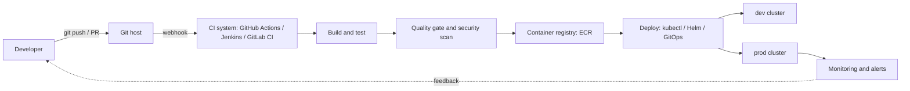
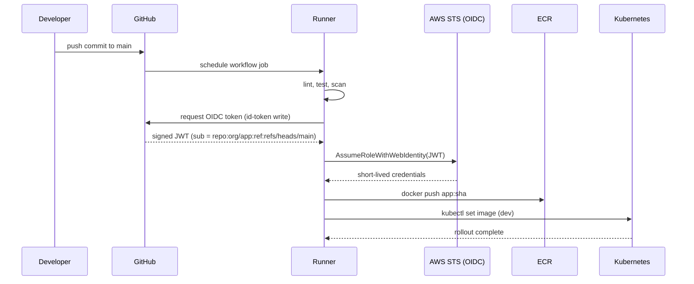
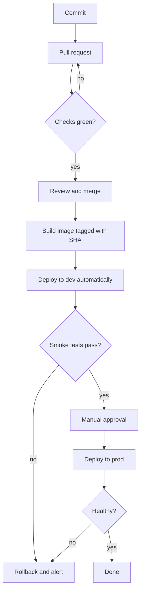
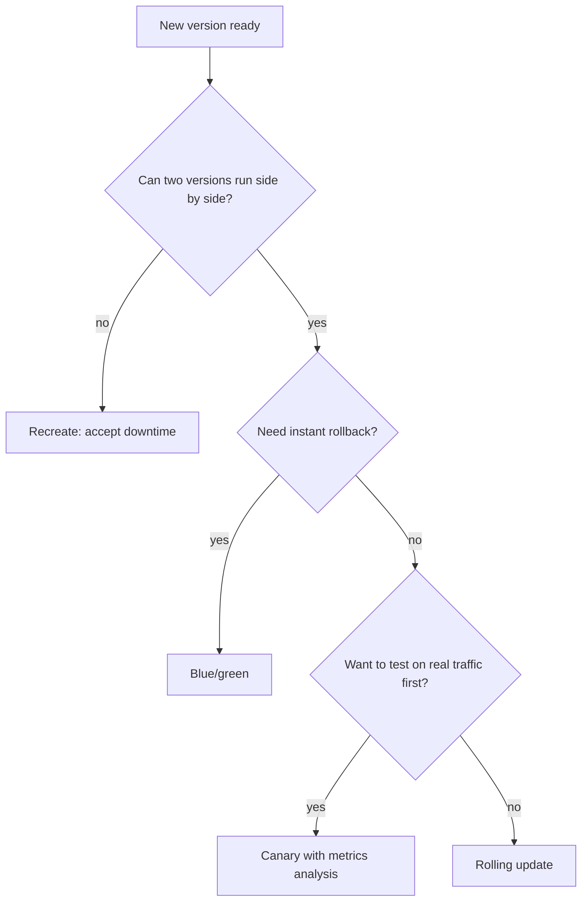

# CI/CD — Jenkins, GitHub Actions, GitLab CI

<!-- DEVOPS-SHACK:HEADER -->

  
  
  
  
  

Part of <b><a href="https://github.com/jaiswaladi246/DevOps-Cloud-Interview-Preparation-by-DevOps-Shack">DevOps &amp; Cloud Interview Preparation</a></b> — created by <b><a href="https://www.youtube.com/@devopsshack">DevOps Shack</a></b>. Free to learn from; please credit DevOps Shack when sharing.

<!-- /DEVOPS-SHACK:HEADER -->

> Ship code to production safely, repeatedly and without heroics: pipelines, quality gates, image security, OIDC, approvals and rollbacks, across the three CI/CD systems you will meet in interviews.

[🏠 Home](../README.md)

## What you'll master

- The anatomy of a pipeline: triggers, stages, jobs, runners/agents, artifacts, caches, environments
- GitHub Actions: workflows, reusable workflows, matrix builds, concurrency, environments with required reviewers, OIDC to AWS
- Jenkins: declarative `Jenkinsfile`, agents (including Kubernetes pods), shared libraries, credentials, `input` approvals
- GitLab CI: `.gitlab-ci.yml`, `rules`, `needs`, `include`, protected environments, runners
- Quality gates: linting, unit tests with coverage, SonarQube and CodeQL, dependency and image scanning with Trivy
- Container builds with layer caching, tagging by commit SHA, pushing to Amazon ECR without long-lived keys
- Delivery strategies: rolling, blue/green, canary, progressive delivery, and how rollbacks really work
- Supply chain basics: pinning actions by SHA, least-privilege tokens, SBOMs, image signing
- Debugging pipelines: flaky tests, cache misses, stuck agents, expired credentials, "it works locally"

## Architecture: where CI/CD sits

The CI system is triggered by a webhook from the Git host, runs the build on an ephemeral runner, and publishes an immutable artifact (a container image). CD then promotes that same artifact through environments. The key idea: build once, deploy the same image everywhere, and let configuration differ per environment.

## Request and data flow of a single pipeline run

No AWS secret is stored in GitHub. The runner proves its identity with a signed token, AWS validates the token against the trust policy, and returns credentials that expire in about an hour. This is the pattern we use in production.

## Lifecycle of a change

Every change flows through the same path. Pull requests run fast checks only (lint, unit tests, scans). Merges to `main` produce the artifact and deploy. Production waits for a human or an automated policy.

## Workflow: choosing a deployment strategy

Rolling is the default in Kubernetes and fine for most stateless services. Blue/green costs double capacity but rolls back by flipping a selector or load balancer target. Canary shifts a small percentage of traffic and watches error rate and latency before continuing.

## Core concepts in 10 minutes

### CI vs continuous delivery vs continuous deployment
Continuous integration means every change is merged often and verified automatically by a build and tests. Continuous delivery means every merged change is always releasable, with a manual gate before production. Continuous deployment removes the gate: every green change goes to production. Most regulated teams do continuous delivery.

### Pipeline building blocks
A trigger starts a run (push, pull request, tag, schedule, manual dispatch). A run contains stages or jobs. Jobs execute on runners (GitHub, GitLab) or agents (Jenkins). Jobs pass data through artifacts and speed up repeated work with caches. Environments represent targets such as dev and prod, and can hold secrets and protection rules.

### Tool comparison

| Concern | GitHub Actions | Jenkins | GitLab CI |
|---|---|---|---|
| Config file | `.github/workflows/*.yml` | `Jenkinsfile` (Groovy) | `.gitlab-ci.yml` |
| Hosting | SaaS plus self-hosted runners | Self-hosted only | SaaS or self-managed |
| Reuse | Reusable workflows, composite actions | Shared libraries | `include`, `extends`, components |
| Approvals | Environments with required reviewers | `input` step | Protected environments, `when: manual` |
| Cloud auth | OIDC via `id-token: write` | Plugins, IAM role on agent, OIDC plugin | `id_tokens:` with OIDC |
| Operational burden | Low | High (plugins, upgrades, controller sizing) | Low to medium |

### Caching and speed
Cache dependencies by lockfile hash, use Docker layer caching (`cache-from`/`cache-to` with `type=gha` or a registry), run independent jobs in parallel, and cancel superseded runs with `concurrency`. Order Dockerfile layers so dependency installation comes before copying source.

### Artifacts and immutability
Tag images with the Git SHA, not `latest`. A tag you can trace to a commit makes rollbacks and audits trivial. Enable ECR tag immutability so a tag can never be overwritten.

### Secrets and identity
Prefer short-lived credentials (OIDC) over stored keys. Scope tokens narrowly: set `permissions:` explicitly in GitHub Actions, restrict the IAM trust policy to a repository and branch or environment, and never echo secrets. Masking is a safety net, not a control.

### Quality gates
A gate blocks promotion when a measurable condition fails: tests, coverage threshold, SonarQube quality gate status, critical CVEs from Trivy, policy violations. Gates must be fast, deterministic and owned by the team, otherwise people learn to bypass them.

### Deployment and rollback
Deploy by changing the image reference and waiting for the rollout to finish (`kubectl rollout status`). Roll back by redeploying the previous known-good SHA, or with `kubectl rollout undo` in an emergency. In GitOps, rollback is a Git revert.

### Pipeline as code and reuse
Keep pipeline definitions in the repository, review them like application code, and extract shared logic into reusable workflows, shared libraries or includes once three or more repositories need it.

### Observability of the pipeline itself
Track lead time for changes, deployment frequency, change failure rate, time to restore and queue time. A slow or flaky pipeline is a product problem for every developer in the company.

## Question banks

| Bank | Focus | Questions |
|---|---|---|
| [Concepts](./concepts.md) | Core ideas, internals, comparisons | 200 |
| [Scenarios](./scenarios.md) | "What would you do if..." situations | 200 |
| [Troubleshooting](./troubleshooting.md) | Symptoms, error messages, diagnosis | 200 |
| [Production](./production.md) | Design, security, scale, rapid-fire commands | 200 |

## Learning path

**Beginner**
- [ ] Explain CI vs CD and write a first workflow that runs on push
- [ ] Run unit tests and lint in a pipeline and fail on errors
- [ ] Build a Docker image in CI and push it to a registry
- [ ] Use secrets and variables correctly
- [ ] Write a basic `Jenkinsfile` and a basic `.gitlab-ci.yml`

**Intermediate**
- [ ] Add caching, matrix builds and concurrency control
- [ ] Add SonarQube or CodeQL and enforce a quality gate
- [ ] Scan images with Trivy and fail on HIGH and CRITICAL
- [ ] Authenticate to AWS with OIDC instead of access keys
- [ ] Deploy to Kubernetes and gate production behind an environment approval
- [ ] Build a reusable workflow and a Jenkins shared library

**Advanced**
- [ ] Design a monorepo pipeline with path filters and affected-only builds
- [ ] Implement canary or blue/green delivery with automated rollback
- [ ] Sign images and generate SBOMs; verify at admission
- [ ] Harden the pipeline: pinned actions, minimal permissions, ephemeral runners
- [ ] Run self-hosted autoscaling runners on Kubernetes
- [ ] Measure DORA metrics and improve them

## Practice material

- [Hands-on lab: full CI/CD for a containerized app](./hands-on-lab.md)
- [Assignments (25)](./assignments.md)
- [Cheatsheet](./cheatsheet.md)

[🏠 Home](../README.md)

<!-- DEVOPS-SHACK:FOOTER -->
---

### 🚀 Made with ❤️ by [DevOps Shack](https://www.youtube.com/@devopsshack)

**Learn DevOps, DevSecOps, Cloud and Kubernetes the practical way.**

[▶️ YouTube — DevOps Shack](https://www.youtube.com/@devopsshack) · [▶️ Hindi — @shackverse](https://www.youtube.com/@shackverse) · [🎓 devopsshack.com](https://devopsshack.com) · [📸 Instagram @devopsshack](https://www.instagram.com/devopsshack)

[🏠 Back to Home](../README.md) · [⭐ Star the original repo](https://github.com/jaiswaladi246/DevOps-Cloud-Interview-Preparation-by-DevOps-Shack)

© DevOps Shack · Licensed CC BY-NC-SA 4.0 · If you found this copy anywhere other than <a href="https://github.com/jaiswaladi246/DevOps-Cloud-Interview-Preparation-by-DevOps-Shack">github.com/jaiswaladi246</a>, the original and latest version is maintained by DevOps Shack.

<!-- /DEVOPS-SHACK:FOOTER -->
