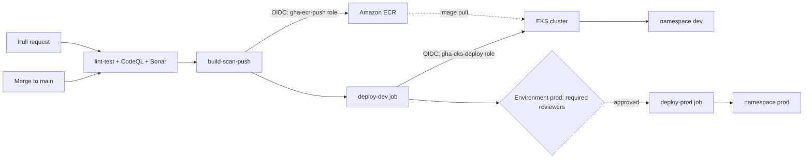

# CI/CD — Hands-on Lab: Full Pipeline for a Containerized App

<!-- DEVOPS-SHACK:HEADER -->
<p align="center">
  <a href="https://www.youtube.com/@devopsshack"></a>
  <a href="https://www.youtube.com/@shackverse"></a>
  <a href="https://devopsshack.com"></a>
  <a href="https://www.instagram.com/devopsshack"></a>
  <a href="https://github.com/jaiswaladi246/DevOps-Cloud-Interview-Preparation-by-DevOps-Shack"></a>
</p>
<p align="center"><sub>Part of <b><a href="https://github.com/jaiswaladi246/DevOps-Cloud-Interview-Preparation-by-DevOps-Shack">DevOps &amp; Cloud Interview Preparation</a></b> — created by <b><a href="https://www.youtube.com/@devopsshack">DevOps Shack</a></b>. Free to learn from; please credit DevOps Shack when sharing.</sub></p>
<!-- /DEVOPS-SHACK:HEADER -->

> Build a production-style CI/CD pipeline with GitHub Actions: lint and test, CodeQL and SonarQube quality gates, cached Docker build, Trivy scan, push to Amazon ECR using OIDC (no stored AWS keys), automatic deploy to a Kubernetes dev namespace and a manually approved deploy to prod.

[⬅ Back to CI/CD](./README.md) · [🏠 Home](../README.md)

## Goal

By the end you will have a repository where:

1. Every pull request runs lint, unit tests with coverage, CodeQL and a SonarQube quality gate.
2. Every merge to `main` builds a Docker image (with layer cache), scans it with Trivy, and pushes it to ECR tagged with the commit SHA.
3. The same image is deployed to the `dev` namespace automatically, smoke-tested, and then waits for a human approval before deploying to `prod`.
4. AWS access is granted through OIDC federation. There are no `AWS_ACCESS_KEY_ID` secrets anywhere.
5. The equivalent `Jenkinsfile` exists in the appendix so you can discuss both tools.

## Architecture



## Prerequisites

- A GitHub account and a new empty repository (we call it `ORG/cicd-lab`; replace `ORG` everywhere)
- An AWS account, AWS CLI v2 configured with admin rights for the setup steps only
- An EKS cluster with a node group. If you do not have one:

```bash
eksctl create cluster --name cicd-lab --region ap-south-1 \
  --nodegroup-name ng-1 --node-type t3.medium --nodes 2
```

- `kubectl`, `docker`, `node` 22 and `git` installed locally
- A SonarQube server, or a free SonarCloud organization (step 8 shows both variables)
- About 90 minutes. EKS and nodes cost money, so run the cleanup section when done

Set these shell variables once. We reuse them throughout:

```bash
export AWS_REGION=ap-south-1
export ACCOUNT_ID=$(aws sts get-caller-identity --query Account --output text)
export GH_ORG=ORG
export GH_REPO=cicd-lab
export CLUSTER=cicd-lab
export ECR_REPO=cicd-lab
```

## Step 1. Create the application

A tiny Express service with a health endpoint, one test and ESLint.

```bash
mkdir cicd-lab && cd cicd-lab && git init -b main
mkdir -p src test k8s .github/workflows
```

`package.json`:

```json
{
  "name": "cicd-lab",
  "version": "1.0.0",
  "private": true,
  "scripts": {
    "start": "node src/server.js",
    "lint": "eslint .",
    "test": "jest --coverage"
  },
  "dependencies": {
    "express": "^4.21.0"
  },
  "devDependencies": {
    "@eslint/js": "^9.0.0",
    "eslint": "^9.0.0",
    "globals": "^15.0.0",
    "jest": "^29.7.0",
    "supertest": "^7.0.0"
  },
  "jest": {
    "testEnvironment": "node",
    "coverageReporters": ["text", "lcov"]
  }
}
```

`src/app.js`:

```javascript
const express = require('express');

const app = express();

app.get('/healthz', (req, res) => res.status(200).json({ status: 'ok' }));

app.get('/', (req, res) =>
  res.json({ service: 'cicd-lab', version: process.env.APP_VERSION || 'dev' })
);

module.exports = app;
```

`src/server.js`:

```javascript
const app = require('./app');

const port = process.env.PORT || 3000;
app.listen(port, () => console.log(`listening on ${port}`));
```

`test/app.test.js`:

```javascript
const request = require('supertest');
const app = require('../src/app');

describe('cicd-lab', () => {
  it('reports healthy', async () => {
    const res = await request(app).get('/healthz');
    expect(res.status).toBe(200);
    expect(res.body.status).toBe('ok');
  });

  it('reports its version', async () => {
    const res = await request(app).get('/');
    expect(res.body.service).toBe('cicd-lab');
  });
});
```

`eslint.config.js`:

```javascript
const js = require('@eslint/js');
const globals = require('globals');

module.exports = [
  { ignores: ['coverage/**', 'node_modules/**'] },
  js.configs.recommended,
  {
    languageOptions: {
      ecmaVersion: 2022,
      sourceType: 'commonjs',
      globals: { ...globals.node, ...globals.jest },
    },
  },
];
```

`.gitignore` and `.dockerignore`:

```bash
printf 'node_modules\ncoverage\n' > .gitignore
printf 'node_modules\ncoverage\n.git\n.github\nk8s\n*.md\n' > .dockerignore
```

Verify locally before touching any pipeline:

```bash
npm install
npm run lint
npm test
```

Expected: lint prints nothing, Jest reports 2 passed tests and a coverage table. A pipeline should never be the first place your code runs.

## Step 2. Write the Dockerfile

A multi-stage build, non-root user, dependency layer first so Docker caches it.

```dockerfile
# syntax=docker/dockerfile:1
FROM node:22-alpine AS deps
WORKDIR /app
COPY package.json package-lock.json ./
RUN npm ci --omit=dev

FROM node:22-alpine
ENV NODE_ENV=production
WORKDIR /app
COPY --from=deps /app/node_modules ./node_modules
COPY src ./src
COPY package.json ./
USER node
EXPOSE 3000
CMD ["node", "src/server.js"]
```

Verify:

```bash
docker build -t cicd-lab:local .
docker run --rm -d -p 3000:3000 --name lab cicd-lab:local
curl -s localhost:3000/healthz
docker rm -f lab
```

Expected output: `{"status":"ok"}`.

## Step 3. Kubernetes manifests

We use plain manifests with two placeholders, `${IMAGE}` and `${REPLICAS}`, filled by `envsubst` in the pipeline. For larger systems you would use Kustomize or Helm; the pipeline shape stays the same.

`k8s/app.yaml`:

```yaml
apiVersion: apps/v1
kind: Deployment
metadata:
  name: cicd-lab
  labels:
    app: cicd-lab
spec:
  replicas: ${REPLICAS}
  revisionHistoryLimit: 5
  strategy:
    type: RollingUpdate
    rollingUpdate:
      maxUnavailable: 0
      maxSurge: 1
  selector:
    matchLabels:
      app: cicd-lab
  template:
    metadata:
      labels:
        app: cicd-lab
    spec:
      containers:
        - name: app
          image: ${IMAGE}
          ports:
            - containerPort: 3000
          env:
            - name: APP_VERSION
              value: "${VERSION}"
          readinessProbe:
            httpGet:
              path: /healthz
              port: 3000
            initialDelaySeconds: 3
            periodSeconds: 5
          livenessProbe:
            httpGet:
              path: /healthz
              port: 3000
            initialDelaySeconds: 10
            periodSeconds: 10
          resources:
            requests:
              cpu: 50m
              memory: 64Mi
            limits:
              memory: 128Mi
          securityContext:
            runAsNonRoot: true
            allowPrivilegeEscalation: false
---
apiVersion: v1
kind: Service
metadata:
  name: cicd-lab
spec:
  selector:
    app: cicd-lab
  ports:
    - port: 80
      targetPort: 3000
```

Create the namespaces (admin task, done once, never by the pipeline):

```bash
aws eks update-kubeconfig --name $CLUSTER --region $AWS_REGION
kubectl create namespace dev
kubectl create namespace prod
```

## Step 4. Create the ECR repository

Immutable tags make it impossible to overwrite a released SHA. Scan-on-push adds a second opinion next to Trivy.

```bash
aws ecr create-repository \
  --repository-name $ECR_REPO \
  --image-tag-mutability IMMUTABLE \
  --image-scanning-configuration scanOnPush=true \
  --region $AWS_REGION
```

Add a lifecycle policy so the registry does not grow forever. Save as `ecr-lifecycle.json`:

```json
{
  "rules": [
    {
      "rulePriority": 1,
      "description": "Keep last 30 images",
      "selection": {
        "tagStatus": "any",
        "countType": "imageCountMoreThan",
        "countNumber": 30
      },
      "action": { "type": "expire" }
    }
  ]
}
```

```bash
aws ecr put-lifecycle-policy --repository-name $ECR_REPO \
  --lifecycle-policy-text file://ecr-lifecycle.json --region $AWS_REGION
```

Verify: `aws ecr describe-repositories --repository-names $ECR_REPO` shows `"imageTagMutability": "IMMUTABLE"`.

## Step 5. Configure OIDC trust between GitHub and AWS

Create the identity provider once per AWS account:

```bash
aws iam create-open-id-connect-provider \
  --url https://token.actions.githubusercontent.com \
  --client-id-list sts.amazonaws.com
```

If the provider already exists the command returns `EntityAlreadyExists`; that is fine, reuse it.

Now two roles, following least privilege. The token's `sub` claim differs by job type. A job without an `environment:` has `repo:ORG/REPO:ref:refs/heads/main`. A job that declares an environment has `repo:ORG/REPO:environment:NAME`. This difference is the number one OIDC surprise, so we encode both.

Role 1, `gha-ecr-push`, only the `main` branch can assume it. Save `trust-ecr.json`:

```bash
cat > trust-ecr.json <<JSON
{
  "Version": "2012-10-17",
  "Statement": [{
    "Effect": "Allow",
    "Principal": {
      "Federated": "arn:aws:iam::${ACCOUNT_ID}:oidc-provider/token.actions.githubusercontent.com"
    },
    "Action": "sts:AssumeRoleWithWebIdentity",
    "Condition": {
      "StringEquals": {
        "token.actions.githubusercontent.com:aud": "sts.amazonaws.com",
        "token.actions.githubusercontent.com:sub": "repo:${GH_ORG}/${GH_REPO}:ref:refs/heads/main"
      }
    }
  }]
}
JSON

aws iam create-role --role-name gha-ecr-push \
  --assume-role-policy-document file://trust-ecr.json
```

Permissions for pushing to this one repository only:

```bash
cat > policy-ecr.json <<JSON
{
  "Version": "2012-10-17",
  "Statement": [
    {
      "Effect": "Allow",
      "Action": "ecr:GetAuthorizationToken",
      "Resource": "*"
    },
    {
      "Effect": "Allow",
      "Action": [
        "ecr:BatchCheckLayerAvailability",
        "ecr:InitiateLayerUpload",
        "ecr:UploadLayerPart",
        "ecr:CompleteLayerUpload",
        "ecr:PutImage",
        "ecr:BatchGetImage",
        "ecr:GetDownloadUrlForLayer"
      ],
      "Resource": "arn:aws:ecr:${AWS_REGION}:${ACCOUNT_ID}:repository/${ECR_REPO}"
    }
  ]
}
JSON

aws iam put-role-policy --role-name gha-ecr-push \
  --policy-name ecr-push --policy-document file://policy-ecr.json
```

Role 2, `gha-eks-deploy`, assumable only from the `dev` and `prod` environments:

```bash
cat > trust-deploy.json <<JSON
{
  "Version": "2012-10-17",
  "Statement": [{
    "Effect": "Allow",
    "Principal": {
      "Federated": "arn:aws:iam::${ACCOUNT_ID}:oidc-provider/token.actions.githubusercontent.com"
    },
    "Action": "sts:AssumeRoleWithWebIdentity",
    "Condition": {
      "StringEquals": {
        "token.actions.githubusercontent.com:aud": "sts.amazonaws.com",
        "token.actions.githubusercontent.com:sub": [
          "repo:${GH_ORG}/${GH_REPO}:environment:dev",
          "repo:${GH_ORG}/${GH_REPO}:environment:prod"
        ]
      }
    }
  }]
}
JSON

aws iam create-role --role-name gha-eks-deploy \
  --assume-role-policy-document file://trust-deploy.json

cat > policy-eks.json <<JSON
{
  "Version": "2012-10-17",
  "Statement": [{
    "Effect": "Allow",
    "Action": "eks:DescribeCluster",
    "Resource": "arn:aws:eks:${AWS_REGION}:${ACCOUNT_ID}:cluster/${CLUSTER}"
  }]
}
JSON

aws iam put-role-policy --role-name gha-eks-deploy \
  --policy-name eks-describe --policy-document file://policy-eks.json
```

The IAM role only lets the pipeline find the cluster. What it may do inside the cluster is controlled by Kubernetes authorization, configured next.

## Step 6. Grant the deploy role access inside the cluster

EKS access entries map an IAM principal to Kubernetes permissions without editing `aws-auth`. We scope the built-in edit policy to the two namespaces.

```bash
DEPLOY_ROLE_ARN=arn:aws:iam::${ACCOUNT_ID}:role/gha-eks-deploy

aws eks create-access-entry --cluster-name $CLUSTER \
  --principal-arn $DEPLOY_ROLE_ARN --type STANDARD --region $AWS_REGION

aws eks associate-access-policy --cluster-name $CLUSTER \
  --principal-arn $DEPLOY_ROLE_ARN \
  --policy-arn arn:aws:eks::aws:cluster-access-policy/AmazonEKSEditPolicy \
  --access-scope type=namespace,namespaces=dev,prod \
  --region $AWS_REGION
```

If your cluster still uses only the `aws-auth` ConfigMap, set `accessConfig.authenticationMode` to `API_AND_CONFIG_MAP` first with `aws eks update-cluster-config`.

Verify:

```bash
aws eks list-associated-access-policies --cluster-name $CLUSTER \
  --principal-arn $DEPLOY_ROLE_ARN --region $AWS_REGION
```

## Step 7. Configure GitHub: variables, environments, secrets

Use repository variables for non-secret values. Nothing here is a credential.

```bash
gh repo create $GH_ORG/$GH_REPO --private --source=. --remote=origin
gh variable set AWS_REGION --body "$AWS_REGION"
gh variable set AWS_ACCOUNT_ID --body "$ACCOUNT_ID"
gh variable set ECR_REPOSITORY --body "$ECR_REPO"
gh variable set EKS_CLUSTER --body "$CLUSTER"
```

Create the environments from the UI (Settings, Environments) or the API:

- `dev`: no protection rules
- `prod`: tick Required reviewers and add yourself or your team; tick "Prevent self-review" if you have a second person; restrict deployment branches to `main`

CLI approach:

```bash
gh api -X PUT repos/$GH_ORG/$GH_REPO/environments/dev
gh api -X PUT repos/$GH_ORG/$GH_REPO/environments/prod \
  -f 'deployment_branch_policy[protected_branches]=false' \
  -f 'deployment_branch_policy[custom_branch_policies]=true'
```

Add required reviewers in the UI, since the API needs numeric user or team IDs. Note that environment protection rules on private repositories require GitHub Team or Enterprise plans. On a free private repo the approval gate is unavailable, so use a public repository for this lab.

## Step 8. Set up the quality gate

We use two complementary tools. CodeQL finds security bugs in code and is free for public repositories. SonarQube enforces a quality gate on coverage, duplication, and new issues.

For SonarQube (or SonarCloud):

1. Create a project with key `cicd-lab`
2. Generate a token and store it: `gh secret set SONAR_TOKEN`
3. Store the server address: `gh variable set SONAR_HOST_URL --body "https://sonar.example.com"`. For SonarCloud use `https://sonarcloud.io` and add `sonar.organization` to the properties file
4. Set the quality gate to fail on new code with coverage below 80 percent or any new bug or vulnerability

`sonar-project.properties`:

```properties
sonar.projectKey=cicd-lab
sonar.sources=src
sonar.tests=test
sonar.javascript.lcov.reportPaths=coverage/lcov.info
sonar.qualitygate.wait=true
```

`sonar.qualitygate.wait=true` makes the scanner block until the server computes the gate result and fail the step if the gate is red. That is what turns analysis into a real gate.

## Step 9. Write the workflow: checks

Create `.github/workflows/ci-cd.yml`. We build it in pieces; the complete file is the concatenation of steps 9 to 12.

```yaml
name: ci-cd

on:
  push:
    branches: [main]
  pull_request:
    branches: [main]
  workflow_dispatch:

concurrency:
  group: ci-cd-${{ github.ref }}
  cancel-in-progress: ${{ github.event_name == 'pull_request' }}

permissions:
  contents: read

env:
  IMAGE_NAME: ${{ vars.AWS_ACCOUNT_ID }}.dkr.ecr.${{ vars.AWS_REGION }}.amazonaws.com/${{ vars.ECR_REPOSITORY }}

jobs:
  lint-test:
    runs-on: ubuntu-latest
    timeout-minutes: 10
    steps:
      - uses: actions/checkout@v4
        with:
          fetch-depth: 0
      - uses: actions/setup-node@v4
        with:
          node-version: 22
          cache: npm
      - run: npm ci
      - run: npm run lint
      - run: npm test
      - uses: actions/upload-artifact@v4
        with:
          name: coverage
          path: coverage/lcov.info

  sonar:
    needs: lint-test
    runs-on: ubuntu-latest
    timeout-minutes: 15
    steps:
      - uses: actions/checkout@v4
        with:
          fetch-depth: 0
      - uses: actions/download-artifact@v4
        with:
          name: coverage
          path: coverage
      - uses: SonarSource/sonarqube-scan-action@v5
        env:
          SONAR_TOKEN: ${{ secrets.SONAR_TOKEN }}
          SONAR_HOST_URL: ${{ vars.SONAR_HOST_URL }}

  codeql:
    runs-on: ubuntu-latest
    timeout-minutes: 20
    permissions:
      contents: read
      security-events: write
    steps:
      - uses: actions/checkout@v4
      - uses: github/codeql-action/init@v3
        with:
          languages: javascript-typescript
      - uses: github/codeql-action/analyze@v3
```

Points worth noticing: `concurrency` cancels superseded PR runs but never cancels a run on `main` mid-deploy; `permissions` defaults to read-only and jobs that need more ask for it explicitly; `fetch-depth: 0` gives Sonar the history it needs for new-code detection. Pull requests from forks cannot read `SONAR_TOKEN`, so expect the Sonar job to fail for forks (see Common errors).

## Step 10. Write the workflow: build, scan, push

Append to the `jobs:` section. The build job needs an `id-token: write` permission to request the OIDC token.

```yaml
  build-scan-push:
    needs: [lint-test, sonar, codeql]
    if: github.event_name != 'pull_request'
    runs-on: ubuntu-latest
    timeout-minutes: 20
    permissions:
      contents: read
      id-token: write
    outputs:
      image: ${{ steps.meta.outputs.image }}
    steps:
      - uses: actions/checkout@v4

      - uses: docker/setup-buildx-action@v3

      - name: Build image (local, for scanning)
        uses: docker/build-push-action@v6
        with:
          context: .
          load: true
          tags: ${{ env.IMAGE_NAME }}:${{ github.sha }}
          cache-from: type=gha
          cache-to: type=gha,mode=max

      - name: Trivy scan (fail on HIGH/CRITICAL)
        uses: aquasecurity/trivy-action@0.28.0
        with:
          image-ref: ${{ env.IMAGE_NAME }}:${{ github.sha }}
          severity: HIGH,CRITICAL
          ignore-unfixed: true
          exit-code: "1"
          format: table

      - name: Configure AWS credentials (OIDC)
        uses: aws-actions/configure-aws-credentials@v4
        with:
          role-to-assume: arn:aws:iam::${{ vars.AWS_ACCOUNT_ID }}:role/gha-ecr-push
          aws-region: ${{ vars.AWS_REGION }}

      - uses: aws-actions/amazon-ecr-login@v2

      - name: Push image (cache hit, nothing rebuilt)
        uses: docker/build-push-action@v6
        with:
          context: .
          push: true
          tags: ${{ env.IMAGE_NAME }}:${{ github.sha }}
          cache-from: type=gha

      - id: meta
        run: echo "image=${IMAGE_NAME}:${GITHUB_SHA}" >> "$GITHUB_OUTPUT"
```

The order matters. We scan before we have even authenticated to AWS, so a vulnerable image never reaches the registry. The second `build-push-action` call reuses the cache from the first, so it only adds the push. `ignore-unfixed` keeps the gate actionable by skipping CVEs that have no patch yet; track those separately with a time-boxed exception file (`.trivyignore`).

## Step 11. Write the workflow: deploy to dev and prod

```yaml
  deploy-dev:
    needs: build-scan-push
    runs-on: ubuntu-latest
    timeout-minutes: 10
    environment: dev
    permissions:
      contents: read
      id-token: write
    env:
      IMAGE: ${{ needs.build-scan-push.outputs.image }}
      REPLICAS: "1"
      VERSION: ${{ github.sha }}
    steps:
      - uses: actions/checkout@v4
      - uses: aws-actions/configure-aws-credentials@v4
        with:
          role-to-assume: arn:aws:iam::${{ vars.AWS_ACCOUNT_ID }}:role/gha-eks-deploy
          aws-region: ${{ vars.AWS_REGION }}
      - run: aws eks update-kubeconfig --name "${{ vars.EKS_CLUSTER }}" --region "${{ vars.AWS_REGION }}"
      - name: Deploy
        run: |
          envsubst < k8s/app.yaml | kubectl -n dev apply -f -
          kubectl -n dev rollout status deployment/cicd-lab --timeout=120s
      - name: Smoke test
        run: |
          kubectl -n dev run smoke-${{ github.run_id }} --rm -i --restart=Never \
            --image=curlimages/curl:8.10.1 -- \
            curl -fsS http://cicd-lab.dev.svc.cluster.local/healthz
      - name: Roll back on failure
        if: failure()
        run: kubectl -n dev rollout undo deployment/cicd-lab || true

  deploy-prod:
    needs: [build-scan-push, deploy-dev]
    runs-on: ubuntu-latest
    timeout-minutes: 15
    environment:
      name: prod
      url: https://cicd-lab.example.com
    permissions:
      contents: read
      id-token: write
    env:
      IMAGE: ${{ needs.build-scan-push.outputs.image }}
      REPLICAS: "3"
      VERSION: ${{ github.sha }}
    steps:
      - uses: actions/checkout@v4
      - uses: aws-actions/configure-aws-credentials@v4
        with:
          role-to-assume: arn:aws:iam::${{ vars.AWS_ACCOUNT_ID }}:role/gha-eks-deploy
          aws-region: ${{ vars.AWS_REGION }}
      - run: aws eks update-kubeconfig --name "${{ vars.EKS_CLUSTER }}" --region "${{ vars.AWS_REGION }}"
      - name: Deploy
        run: |
          envsubst < k8s/app.yaml | kubectl -n prod apply -f -
          kubectl -n prod rollout status deployment/cicd-lab --timeout=180s
      - name: Roll back on failure
        if: failure()
        run: kubectl -n prod rollout undo deployment/cicd-lab || true
```

The `deploy-prod` job pauses in "Waiting" status until a required reviewer approves, and only then does the runner start and the `prod` environment's OIDC subject get minted. Note that the prod job redeploys the exact image built earlier; it never rebuilds. `rollout undo` is the emergency parachute, but note it reverts the pod template only; the Git history remains the source of truth, so follow a failed deploy with a revert commit.

Commit and push everything:

```bash
git add -A
git commit -m "feat: app, k8s manifests and CI/CD pipeline"
git push -u origin main
```

## Step 12. Protect main and require the checks

Branch protection ensures the gate cannot be bypassed by pushing straight to `main`.

```bash
gh api -X PUT repos/$GH_ORG/$GH_REPO/branches/main/protection \
  --input - <<'JSON'
{
  "required_status_checks": {
    "strict": true,
    "contexts": ["lint-test", "sonar", "codeql"]
  },
  "enforce_admins": true,
  "required_pull_request_reviews": { "required_approving_review_count": 1 },
  "restrictions": null
}
JSON
```

On a solo repo you may need to lower the review count to 0 to merge your own pull requests.

## Step 13. Run it and verify each stage

Open a pull request first so you see the PR path:

```bash
git switch -c feature/change-message
sed -i "s/cicd-lab/cicd-lab v2/" src/app.js
git commit -am "feat: tweak message" && git push -u origin feature/change-message
gh pr create --fill
gh pr checks --watch
```

Expect `lint-test`, `sonar` and `codeql` green and the build, deploy jobs skipped. Merge the PR, then watch the main run:

```bash
gh run watch
```

Verification checklist, one per stage:

| Stage | How to verify | Expected |
|---|---|---|
| Lint and test | Job log, "Run npm test" | 2 passed, coverage printed |
| Quality gate | Sonar dashboard, or job log | "QUALITY GATE STATUS: PASSED" |
| CodeQL | Security tab, Code scanning | Analysis present, no new alerts |
| Trivy | "Trivy scan" step | Table with no HIGH/CRITICAL, step green |
| ECR push | `aws ecr describe-images --repository-name $ECR_REPO` | Image tagged with the commit SHA |
| OIDC | "Configure AWS credentials" log | "Assuming role with OIDC", no key secrets used |
| Dev deploy | `kubectl -n dev get deploy,pods` | 1/1 available, image is the new SHA |
| Approval gate | Actions UI | `deploy-prod` waiting for review |
| Prod deploy | Approve, then `kubectl -n prod get deploy` | 3/3 available |

Confirm the same image runs in both environments:

```bash
kubectl -n dev  get deploy cicd-lab -o jsonpath='{.spec.template.spec.containers[0].image}{"\n"}'
kubectl -n prod get deploy cicd-lab -o jsonpath='{.spec.template.spec.containers[0].image}{"\n"}'
```

Both lines must print an identical `...cicd-lab:<sha>`.

## Step 14. Prove the gates work (negative tests)

A gate you have never seen fail is an assumption. Break things on purpose in a throwaway branch:

1. Add an unused variable: lint must fail
2. Delete the test file: coverage drops and the Sonar gate must fail
3. Change the base image to an old one (`FROM node:16-alpine`): Trivy must fail with HIGH/CRITICAL CVEs
4. Push from a branch other than `main` while calling the push role: `configure-aws-credentials` must fail with `Not authorized to perform sts:AssumeRoleWithWebIdentity`
5. Make the pod crash (`CMD ["false"]`): `rollout status` times out, the rollback step runs, and dev returns to the previous revision

Capture a screenshot or log excerpt of each failure for your portfolio.

## Cleanup

```bash
kubectl delete namespace dev prod
aws ecr delete-repository --repository-name $ECR_REPO --force --region $AWS_REGION
aws iam delete-role-policy --role-name gha-ecr-push --policy-name ecr-push
aws iam delete-role --role-name gha-ecr-push
aws iam delete-role-policy --role-name gha-eks-deploy --policy-name eks-describe
aws iam delete-role --role-name gha-eks-deploy
eksctl delete cluster --name $CLUSTER --region $AWS_REGION
gh repo delete $GH_ORG/$GH_REPO --yes
```

Leave the OIDC provider if other projects use it. Check the EKS console afterwards; load balancers and volumes created by workloads can linger and bill.

## What to say in an interview about this project

> "I built a complete delivery pipeline for a containerized service on GitHub Actions. Pull requests run lint, unit tests with coverage, CodeQL and a SonarQube quality gate with `sonar.qualitygate.wait`, so a red gate blocks the merge through branch protection. On merge we build the image with BuildKit's GitHub cache, scan it with Trivy and fail on fixed HIGH and CRITICAL vulnerabilities before anything is pushed. The push to ECR uses OIDC federation: the trust policy is pinned to the repository and the `main` branch, so there are no long-lived AWS keys to leak or rotate. Images are tagged with the commit SHA and ECR tags are immutable. Deployment to the dev namespace is automatic with a rollout check and in-cluster smoke test; production uses a GitHub environment with required reviewers and deploys the exact same image digest-by-tag, never a rebuild. Cluster access is namespace-scoped through EKS access entries. If a rollout fails the job runs `kubectl rollout undo`, and I deliberately broke every gate to verify it fails correctly."

Follow-ups to be ready for: why the `sub` claim differs for environment jobs, why we scan before pushing, why `latest` is banned, how you would add canary with Argo Rollouts, how you would move to GitOps (pipeline commits the new tag to a config repo and Argo CD syncs), and how you would pin actions by commit SHA and add Dependabot for them.

## Common errors and fixes

| Error | Cause | Fix |
|---|---|---|
| `Error: Could not assume role with OIDC: Not authorized to perform sts:AssumeRoleWithWebIdentity` | Trust policy `sub` does not match the token. Environment jobs use `repo:ORG/REPO:environment:NAME`, not the branch form | Compare the real `sub` (print it with a debug step or check CloudTrail) and fix the trust policy condition |
| `Credentials could not be loaded` or `Could not load credentials from any providers` | Job lacks `permissions: id-token: write` | Add `id-token: write` to that job (job-level permissions override workflow-level) |
| `Error: Incorrect token audience` | `aud` is not `sts.amazonaws.com` | Create the provider with `--client-id-list sts.amazonaws.com` and keep the default audience in the action |
| `error: You must be logged in to the server (Unauthorized)` | No EKS access entry for the role, or cluster auth mode is `CONFIG_MAP` only | Create the access entry (step 6) or enable `API_AND_CONFIG_MAP` |
| `Error from server (Forbidden): deployments.apps is forbidden` | Access policy scoped to the wrong namespace | Re-run `associate-access-policy` with the right `namespaces=` |
| `tag invalid: The image tag 'abc' already exists in the repository and cannot be overwritten` | Immutable tags and a re-run of the push for the same SHA | Expected behavior on re-runs; skip the push if the image exists (`aws ecr describe-images`) or re-run only failed jobs against a new commit |
| Trivy step fails with `HIGH`/`CRITICAL` on base image packages | Outdated base image | Bump the base tag, rebuild, or add a justified, dated entry to `.trivyignore` |
| Trivy `TOOMANYREQUESTS` pulling its vulnerability DB | Registry rate limits | Cache the DB with `actions/cache` or set `TRIVY_DB_REPOSITORY` to a mirror |
| Sonar job: `Not authorized. Please check the properties sonar.login and sonar.password` | Missing or expired `SONAR_TOKEN`, or the PR comes from a fork | Rotate the token; for forks use `pull_request_target` carefully or skip Sonar on forks |
| Sonar gate fails on coverage though tests pass | `lcov.info` path wrong, or artifact not downloaded | Check `sonar.javascript.lcov.reportPaths` and the `download-artifact` path |
| `Resource not accessible by integration` in CodeQL | Missing `security-events: write` | Add it to the CodeQL job permissions |
| Deploy job never starts | Waiting for environment approval, or reviewer list is empty | Check the Actions UI for "Waiting"; add reviewers |
| Prod job runs without waiting for approval | Required reviewers are not enforced on a private repo on a free plan | Use a public repo or a paid plan |
| `error validating data: unknown field` or `envsubst` leaves `${...}` | A variable was not exported in `env:` | Export every placeholder; run `envsubst < k8s/app.yaml` locally to review |
| `error: timed out waiting for the condition` on rollout | Image pull failure or failing readiness probe | `kubectl -n dev describe pod` and `kubectl -n dev logs`; nodes need ECR pull permission via the node role |
| `ImagePullBackOff` with `no basic auth credentials` | Node role lacks `AmazonEC2ContainerRegistryReadOnly` | Attach that managed policy to the node group role |
| Cache never hits | Different `scope`, or cache evicted at 10 GB repo limit | Keep `type=gha` consistent; check the Actions cache page |

## Appendix: the equivalent Jenkinsfile

The same pipeline in Jenkins declarative syntax. Assumptions: Jenkins runs on Kubernetes with the Kubernetes plugin, the SonarQube Scanner plugin is configured with a server named `sonar`, and the agent's service account (IRSA) has the ECR push and EKS access permissions, which is Jenkins' equivalent of OIDC. No static AWS keys are used.

```groovy
pipeline {
  agent {
    kubernetes {
      yaml '''
        apiVersion: v1
        kind: Pod
        spec:
          serviceAccountName: jenkins-agent
          containers:
            - name: node
              image: node:22-alpine
              command: ["sleep"]
              args: ["infinity"]
            - name: tools
              image: public.ecr.aws/aws-cli/aws-cli:latest
              command: ["sleep"]
              args: ["infinity"]
            - name: kaniko
              image: gcr.io/kaniko-project/executor:debug
              command: ["sleep"]
              args: ["infinity"]
            - name: kubectl
              image: bitnami/kubectl:latest
              command: ["sleep"]
              args: ["infinity"]
              securityContext:
                runAsUser: 0
      '''
    }
  }

  options {
    timeout(time: 45, unit: 'MINUTES')
    disableConcurrentBuilds(abortPrevious: true)
    buildDiscarder(logRotator(numToKeepStr: '30'))
  }

  environment {
    AWS_REGION = 'ap-south-1'
    ACCOUNT_ID = '123456789012'
    ECR_REPO   = 'cicd-lab'
    CLUSTER    = 'cicd-lab'
    IMAGE      = "${ACCOUNT_ID}.dkr.ecr.${AWS_REGION}.amazonaws.com/${ECR_REPO}:${GIT_COMMIT}"
  }

  stages {
    stage('Lint and test') {
      steps {
        container('node') {
          sh 'npm ci'
          sh 'npm run lint'
          sh 'npm test'
        }
      }
    }

    stage('SonarQube analysis') {
      steps {
        container('node') {
          withSonarQubeEnv('sonar') {
            sh 'npx --yes sonar-scanner'
          }
        }
      }
    }

    stage('Quality gate') {
      steps {
        timeout(time: 10, unit: 'MINUTES') {
          waitForQualityGate abortPipeline: true
        }
      }
    }

    stage('Build, scan, push') {
      when { branch 'main' }
      steps {
        container('kaniko') {
          sh '''
            /kaniko/executor --context "$WORKSPACE" --dockerfile Dockerfile \
              --no-push --tar-path image.tar --destination "$IMAGE"
          '''
        }
        container('tools') {
          sh '''
            curl -sfL https://raw.githubusercontent.com/aquasecurity/trivy/main/contrib/install.sh | sh -s -- -b /usr/local/bin
            trivy image --input image.tar --severity HIGH,CRITICAL --ignore-unfixed --exit-code 1
          '''
        }
        container('kaniko') {
          sh '''
            /kaniko/executor --context "$WORKSPACE" --dockerfile Dockerfile \
              --destination "$IMAGE" --cache=true \
              --cache-repo "${ACCOUNT_ID}.dkr.ecr.${AWS_REGION}.amazonaws.com/${ECR_REPO}-cache"
          '''
        }
      }
    }

    stage('Deploy dev') {
      when { branch 'main' }
      steps {
        container('tools') {
          sh 'aws eks update-kubeconfig --name $CLUSTER --region $AWS_REGION --kubeconfig $WORKSPACE/kubeconfig'
        }
        container('kubectl') {
          withEnv(['KUBECONFIG=' + env.WORKSPACE + '/kubeconfig', 'REPLICAS=1', 'VERSION=' + env.GIT_COMMIT]) {
            sh '''
              apt-get update -qq && apt-get install -y -qq gettext-base >/dev/null
              envsubst < k8s/app.yaml | kubectl -n dev apply -f -
              kubectl -n dev rollout status deployment/cicd-lab --timeout=120s
            '''
          }
        }
      }
    }

    stage('Approve production') {
      when { branch 'main' }
      steps {
        timeout(time: 1, unit: 'DAYS') {
          input message: "Deploy ${GIT_COMMIT.take(7)} to prod?",
                ok: 'Deploy',
                submitter: 'release-managers'
        }
      }
    }

    stage('Deploy prod') {
      when { branch 'main' }
      steps {
        container('kubectl') {
          withEnv(['KUBECONFIG=' + env.WORKSPACE + '/kubeconfig', 'REPLICAS=3', 'VERSION=' + env.GIT_COMMIT]) {
            sh '''
              envsubst < k8s/app.yaml | kubectl -n prod apply -f -
              kubectl -n prod rollout status deployment/cicd-lab --timeout=180s
            '''
          }
        }
      }
    }
  }

  post {
    failure {
      container('kubectl') {
        sh 'kubectl -n dev rollout undo deployment/cicd-lab || true'
      }
    }
    always {
      archiveArtifacts artifacts: 'coverage/lcov.info', allowEmptyArchive: true
    }
  }
}
```

How the two map to each other:

| Concept | GitHub Actions | Jenkins |
|---|---|---|
| Job isolation | Fresh hosted runner per job | Kubernetes pod agent per build |
| AWS auth | OIDC and `configure-aws-credentials` | IRSA on the agent service account |
| Docker build | BuildKit with `type=gha` cache | Kaniko with registry cache (no Docker daemon needed) |
| Quality gate | `sonar.qualitygate.wait=true` | `waitForQualityGate` after `withSonarQubeEnv` |
| Prod approval | Environment required reviewers | `input` step with `submitter` |
| Parallel cancel | `concurrency` | `disableConcurrentBuilds(abortPrevious: true)` |
| Rollback | `if: failure()` step | `post { failure { ... } }` |

Production notes for Jenkins: pin image tags instead of `latest`, run the controller with no executors, keep plugins updated, store the Sonar token as a credential bound with `withCredentials`, and keep the `Jenkinsfile` in the repository so pull requests can review pipeline changes. The `bitnami/kubectl` image path and the `apt-get` step can differ by image version; if `envsubst` is missing in your kubectl image, run the substitution in a container that has `gettext`.

[⬅ Back to CI/CD](./README.md) · [🏠 Home](../README.md)

<!-- DEVOPS-SHACK:FOOTER -->
---

<div align="center">

### 🚀 Made with ❤️ by [DevOps Shack](https://www.youtube.com/@devopsshack)

**Learn DevOps, DevSecOps, Cloud and Kubernetes the practical way.**

[▶️ YouTube — DevOps Shack](https://www.youtube.com/@devopsshack) · [▶️ Hindi — @shackverse](https://www.youtube.com/@shackverse) · [🎓 devopsshack.com](https://devopsshack.com) · [📸 Instagram @devopsshack](https://www.instagram.com/devopsshack)

[🏠 Back to Home](../README.md) · [⭐ Star the original repo](https://github.com/jaiswaladi246/DevOps-Cloud-Interview-Preparation-by-DevOps-Shack)

<sub>© DevOps Shack · Licensed CC BY-NC-SA 4.0 · If you found this copy anywhere other than <a href="https://github.com/jaiswaladi246/DevOps-Cloud-Interview-Preparation-by-DevOps-Shack">github.com/jaiswaladi246</a>, the original and latest version is maintained by DevOps Shack.</sub>

</div>
<!-- /DEVOPS-SHACK:FOOTER -->
