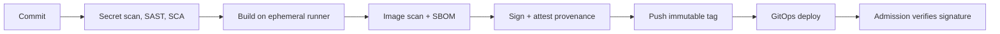

# CI/CD — Production & Best Practices

<!-- DEVOPS-SHACK:HEADER -->
<p align="center">
  <a href="https://www.youtube.com/@devopsshack"></a>
  <a href="https://www.youtube.com/@shackverse"></a>
  <a href="https://devopsshack.com"></a>
  <a href="https://www.instagram.com/devopsshack"></a>
  <a href="https://github.com/jaiswaladi246/DevOps-Cloud-Interview-Preparation-by-DevOps-Shack"></a>
</p>
<p align="center"><sub>Part of <b><a href="https://github.com/jaiswaladi246/DevOps-Cloud-Interview-Preparation-by-DevOps-Shack">DevOps &amp; Cloud Interview Preparation</a></b> — created by <b><a href="https://www.youtube.com/@devopsshack">DevOps Shack</a></b>. Free to learn from; please credit DevOps Shack when sharing.</sub></p>
<!-- /DEVOPS-SHACK:HEADER -->

> Real-world pipeline design, hardening, scaling, security, release engineering, metrics and rapid-fire commands · 200 questions · 🟢 Beginner 🟡 Intermediate 🔴 Advanced

[⬅ Back to CI/CD](./README.md) · [🏠 Home](../README.md)

## Table of contents
- [Pipeline Design and Architecture](#pipeline-design-and-architecture) — Q1–Q30
- [Jenkins in Production](#jenkins-in-production) — Q31–Q55
- [GitHub Actions and GitLab CI in Production](#github-actions-and-gitlab-ci-in-production) — Q56–Q90
- [Secrets and Credentials](#secrets-and-credentials) — Q91–Q110
- [Supply Chain and Pipeline Security](#supply-chain-and-pipeline-security) — Q111–Q135
- [Release Engineering and Progressive Delivery](#release-engineering-and-progressive-delivery) — Q136–Q155
- [Metrics, Performance and Cost](#metrics-performance-and-cost) — Q156–Q175
- [Rapid-Fire Commands](#rapid-fire-commands) — Q176–Q200

---

## Pipeline Design and Architecture

<!-- DEVOPS-SHACK:SECTION -->
> 🎥 **Learn this hands-on with DevOps Shack** → [YouTube @devopsshack](https://www.youtube.com/@devopsshack) · [Hindi @shackverse](https://www.youtube.com/@shackverse) · [Courses at devopsshack.com](https://devopsshack.com)

### Q1. What does a good production CI/CD pipeline look like end to end? 🟢

<details>
<summary><b>Answer</b></summary>

In production we aim for one pipeline per service with these properties: triggered by PR and merge, runs in under 10 minutes for PR feedback, builds one immutable artifact, scans it, deploys to staging automatically, runs smoke and integration tests, then promotes the same artifact to production with a gate (automated or approval). Every step is code, every environment is created from code, and every deployment is traceable to a commit.


</details>

### Q2. What is your target feedback time for CI and how do you hit it? 🟡

<details>
<summary><b>Answer</b></summary>

For PR validation we target under 10 minutes (ideally 5), because longer waits make developers context switch and batch bigger changes. Levers: run lint, unit tests and scans in parallel; cache dependencies and Docker layers; shard tests; use `needs`/DAG instead of strict stages; run only affected projects in monorepos; push slow E2E and soak tests to post-merge or nightly; and size runners properly (4 vCPU runners often cost less overall than 2 vCPU because they finish in half the time).

</details>

### Q3. How do you structure repositories: app repo, config repo, pipeline library? 🟡

<details>
<summary><b>Answer</b></summary>

We separate concerns:

- **App repo**: code, Dockerfile, a thin pipeline that calls shared logic.
- **Deployment/config repo** (GitOps): Helm values or Kustomize overlays per environment; separate permissions and review rules, so a code push cannot change production config.
- **Platform repo**: reusable workflows, Jenkins shared libraries, GitLab components, pinned and versioned.

The thin-pipeline-plus-shared-logic approach means a security fix to the build template rolls out to 200 services by bumping a version.

</details>

### Q4. How do you design a pipeline for a monorepo with 50 services? 🔴

<details>
<summary><b>Answer</b></summary>

Compute **affected** services per change and only build, test and deploy those. Options: path filters for simple layouts, or a build graph (Nx, Turborepo, Bazel, Pants) with a remote cache so unchanged targets are never rebuilt. A planning job outputs a JSON list of changed services; a matrix fans out over it; a single gate job aggregates results for branch protection.

Other must-haves: shared libraries trigger rebuilds of all dependents; a full build on a schedule to catch graph mistakes; per-service deployment so one team's failure does not block others; CODEOWNERS per directory. Without these, the monorepo pipeline becomes the bottleneck for the whole company.

</details>

### Q5. Should every merge to main deploy to production automatically? 🟡

<details>
<summary><b>Answer</b></summary>

For stateless services with good test coverage, observability and automated rollback, yes, and it is the safest way to deploy because changes are small. Preconditions we require first: feature flags for incomplete work, backward-compatible migrations, a canary or progressive rollout, SLO-based automated rollback, and an on-call team that owns the service.

For regulated systems, shared databases or services lacking tests, we keep a manual approval but still automate everything else, so the human decision is a button click, not a runbook.

</details>

### Q6. How do you keep pipeline definitions DRY across hundreds of repos? 🟡

<details>
<summary><b>Answer</b></summary>

Centralise into versioned building blocks: GitHub reusable workflows and composite actions, GitLab CI/CD components, Jenkins shared libraries. Each service's pipeline becomes ~15 lines declaring inputs (language, deploy target). Version with SemVer tags, publish a changelog, use Dependabot/Renovate to bump versions, and keep a deprecation policy. Avoid mega-templates with 40 inputs; offer a few opinionated "golden paths" instead and let teams opt out with justification.

```yaml
jobs:
  ci:
    uses: acme/platform-workflows/.github/workflows/java-service.yml@v4.2.0
    with: { java-version: '21', deploy-target: eks-prod }
    secrets: inherit
```

</details>

### Q7. How do you make a pipeline idempotent and safe to re-run? 🟡

<details>
<summary><b>Answer</b></summary>

Every step should produce the same end state if run twice: use `helm upgrade --install`, `kubectl apply`, `terraform apply` with state locking, and `aws s3 sync` rather than append operations; make tag pushes tolerant of existing tags with the same digest; use unique deployment IDs; and avoid steps that send emails or create tickets without deduplication. Re-running a failed deployment job must not require manual cleanup, otherwise people stop trusting the "retry" button.

</details>

### Q8. What do you put in a pull request pipeline versus a main branch pipeline? 🟢

<details>
<summary><b>Answer</b></summary>

**PR pipeline** (fast, no production access): lint, unit tests, SAST, secret scan, dependency scan, build image (not pushed to prod registry, or pushed with a PR tag), Terraform plan, preview environment. **Main pipeline** (trusted): everything from PR, plus publishing the artifact, signing, SBOM, deploy to staging, integration/E2E tests, promotion to production. Secrets for deployment exist only in the main pipeline context.

</details>

### Q9. How would you design CI/CD for 200 microservices in 30 teams? 🔴

<details>
<summary><b>Answer</b></summary>

1. **Golden path templates**: shared workflows/components per language, owned by a platform team, versioned.
2. **Self-service**: a repo scaffold (Backstage template) creates the app, pipeline, and GitOps entries together.
3. **Ephemeral runners** on Kubernetes (ARC / GitLab Kubernetes executor), autoscaled, with separate pools for untrusted and deploy jobs.
4. **GitOps** for deployment: CI updates a config repo, Argo CD/Flux deploys, so CI has no cluster credentials.
5. **Policy gates** enforced centrally: required scans via rulesets or policy, image signing, admission control (Kyverno/Gatekeeper) verifying signatures.
6. **Observability**: DORA metrics per team from deployment events, pipeline duration/failure dashboards.
7. **Governance**: deprecation windows for template versions, platform office hours.

The trade-off is standardisation versus autonomy; we keep the paved road easy and allow escape hatches that are visible and audited.

</details>

### Q10. How do you handle environment-specific configuration without rebuilding? 🟢

<details>
<summary><b>Answer</b></summary>

Follow the twelve-factor rule: config in the environment. The image is identical everywhere; environment differences come from Helm values files, Kustomize overlays, ConfigMaps, and secrets from a secret manager (External Secrets Operator, SSM/Parameter Store). Never bake URLs or credentials into the image. Keep per-environment values in the config repo, reviewed like code.

</details>

### Q11. How do you prevent two pipelines from deploying to the same environment at once? 🟡

<details>
<summary><b>Answer</b></summary>

Serialise per environment: GitHub `concurrency: { group: deploy-prod, cancel-in-progress: false }`, GitLab `resource_group: production`, Jenkins `lock` plus `milestone`. For Terraform, state locking (DynamoDB or S3 native locking) is a second line of defence. Also guard against **out-of-order** deploys: a slow older pipeline must not overwrite a newer release, so check that the commit being deployed is still the head of `main` or newer than what is running.

```yaml
deploy:
  resource_group: production
  script: ./deploy.sh
```

</details>

### Q12. What is your strategy for pipeline failures that are not code related (infra flakiness)? 🟡

<details>
<summary><b>Answer</b></summary>

Classify failures. Infrastructure failures (runner lost, registry 503, network timeouts) get **targeted** automatic retries: GitLab `retry: when: runner_system_failure`, retry wrappers on `docker pull` and package downloads, mirrors/caches for registries. Test failures do not auto-retry blindly. We tag the cause of each failure in metrics, so we can see that "40% of red builds are Docker Hub rate limits" and fix that with a pull-through cache rather than more retries.

</details>

### Q13. How do you design a pipeline that works for both Kubernetes and VM-based deployments? 🔴

<details>
<summary><b>Answer</b></summary>

Keep the artifact stage identical (immutable, versioned, signed) and make the deploy stage pluggable behind a small contract: `deploy(env, version)` and `verify(env, version)`. Kubernetes: Helm/Argo CD. VMs: Ansible or SSM Run Command pulling the versioned package, or baked AMIs with an ASG instance refresh. Both report to the same deployment record (for DORA metrics and audit). Common gates (tests, approvals, policy) sit before the deploy step and do not care about target type.

</details>

### Q14. What should be logged and retained from every pipeline run for audit? 🟡

<details>
<summary><b>Answer</b></summary>

Who triggered it and which commit/PR; the exact artifact digest produced; test and scan reports; approvals (who, when, what they approved); deployment target and result; and the pipeline definition version used. Keep logs and reports for the retention period your compliance regime requires (often 1 to 7 years) in immutable storage, and export from CI to a log system or object store, because CI built-in retention is usually short.

</details>

### Q15. What are the most common pipeline anti-patterns you have fixed? 🟡

<details>
<summary><b>Answer</b></summary>

- Rebuilding the artifact per environment.
- `latest` tags in deployments.
- Secrets stored as plain environment variables in UI configs shared by every job.
- A single 45-minute sequential pipeline with no caching.
- Tests that depend on shared, mutable environments.
- Manual steps hidden in runbooks.
- Pipelines edited in the UI (no history).
- Retry on everything, hiding flaky tests.
- No timeouts, so hung jobs consume runners for hours.

Each has a straightforward fix, but the cultural part is making the pipeline owned by the team that uses it.

</details>

### Q16. How do you decide between a single pipeline and separate CI and CD pipelines? 🔴

<details>
<summary><b>Answer</b></summary>

One pipeline per commit through all stages is easiest to reason about (single run = single story). We split when the lifecycle differs: with GitOps, CI (build and publish) lives in the app repo and CD is the controller reconciling a config repo; for multi-region or multi-tenant releases, a separate promotion pipeline takes an already-built release and rolls it across regions with waves and bake times. Splitting lets CD be re-run, rolled back, and promoted without re-running CI, and gives CD stricter permissions.

</details>

### Q17. What documentation and ownership model keeps a pipeline healthy? 🟢

<details>
<summary><b>Answer</b></summary>

Each pipeline has a named owning team, a README explaining stages and how to run locally, an on-call or Slack channel for CI problems, and SLOs for the platform (queue time, availability). CODEOWNERS on pipeline files requires platform or security review for changes to deploy logic. Treat pipelines as production software: reviewed, tested, versioned.

</details>

### Q18. How do you test pipeline changes safely before they hit all repos? 🔴

<details>
<summary><b>Answer</b></summary>

For shared templates: unit-test logic where possible (JenkinsPipelineUnit, `actionlint`, `act`, GitLab `glab ci lint`), run the template against a set of canary repositories on a branch ref (`@next` tag), and only then cut a release tag. Roll out by bumping a few repos first (Renovate PRs per team), watch failure rates, then the rest. Provide a dry-run mode that executes everything except the deploy step. Keep older template versions available so a bad release can be pinned back immediately.

</details>

### Q19. What is the role of ephemeral preview environments and how do you keep their cost under control? 🟡

<details>
<summary><b>Answer</b></summary>

Per-PR environments (namespace per PR via Argo CD ApplicationSet pull-request generator, or Helm releases) let reviewers and QA test a change in isolation. Cost control: smaller resource requests, shared dependencies like one dev database with per-PR schema, TTL-based auto cleanup (delete on PR close plus a nightly reaper for anything older than 3 days), scheduled scale-down at night, and spot or low-cost node pools.

</details>

### Q20. How do you manage dependency updates in a way that CI keeps trusting them? 🟡

<details>
<summary><b>Answer</b></summary>

Use Renovate or Dependabot to open PRs, grouped by ecosystem and schedule (weekly for minors, immediate for security). The PR runs the full CI. Auto-merge only patch/minor updates when required checks pass and the repository has good test coverage. Pin GitHub Actions by SHA and let the bot update them. Lockfiles, `npm ci`, and renovate's `minimumReleaseAge` (a cooling-off period of a few days) reduce exposure to freshly published malicious versions.

</details>

### Q21. What is trunk-based CI/CD hygiene for a team new to it? 🟢

<details>
<summary><b>Answer</b></summary>

Short-lived branches (under a day), small PRs, feature flags for unfinished work, a fast required CI, and a rule that a broken main is fixed or reverted within minutes. A merge queue prevents breakage. Everyone commits to the same pipeline contract, and releases are cut from main by tag, not long-lived release branches (unless you support multiple versions).

</details>

### Q22. How do you handle pipeline-as-code for non-engineers who just need to trigger a deploy? 🟢

<details>
<summary><b>Answer</b></summary>

Keep the logic in the pipeline and expose a narrow interface: a `workflow_dispatch` form with a choice of environment and version, a Jenkins parameterised job, or a ChatOps command that triggers it. Permissions limit who can run production deploys, and the pipeline validates inputs (version must exist in the registry, environment must be allowed). Nobody needs shell access to production.

</details>

### Q23. How do you design a pipeline for a mobile app (iOS/Android)? 🔴

<details>
<summary><b>Answer</b></summary>

Differences from backend: macOS runners for iOS builds (expensive, often self-hosted Mac minis or hosted macOS), code signing with certificates and provisioning profiles stored in a secret store (fastlane match), distribution through TestFlight / Google Play tracks instead of deploys, and a store review step that makes "continuous deployment" impossible. So: PR builds run unit and UI tests on emulators; main builds produce signed beta builds uploaded automatically; production release is a staged rollout (1%, 10%, 100%) with remote feature flags and kill switches because you cannot roll back an installed app.

</details>

### Q24. What is a pipeline "golden path" and what are the risks? 🟡

<details>
<summary><b>Answer</b></summary>

A golden path is the platform team's opinionated, supported way to build and ship a service: templates, runners, scanning, observability and deployment all pre-wired. Benefits: fast onboarding, consistent security, one place to fix things. Risks: becoming a rigid bottleneck, or being ignored if it is harder than DIY. Mitigate by treating the platform as a product (user research, docs, versioning), allowing exceptions with review, and measuring adoption and developer satisfaction.

</details>

### Q25. How do you plan CI/CD for a regulated environment (SOX, PCI, HIPAA)? 🔴

<details>
<summary><b>Answer</b></summary>

Controls to implement in the pipeline: segregation of duties (the author of a change cannot approve its production deployment), mandatory peer review via branch protection, change records linked automatically (ticket ID in the commit or PR), immutable audit logs of approvals and deploys, evidence retention (test reports, scan results, SBOM, provenance), restricted production credentials that only the deploy job can assume via OIDC, and scheduled access reviews. Automation helps compliance: auditors prefer an automated pipeline that cannot be bypassed over a manual change board.

</details>

### Q26. How do you size and choose runners for different workloads? 🟡

<details>
<summary><b>Answer</b></summary>

Profile jobs: compile-heavy builds benefit from more CPU, test jobs with databases need RAM, image builds need fast disk and network. Create runner pools by label (`small`, `large`, `gpu`, `arm64`, `deploy`) and let jobs request the smallest pool that fits. Look at queue time and utilisation: if jobs wait more than a minute or two at p95, scale up; if utilisation is below 30%, consolidate. Pin sensitive deploy jobs to an isolated pool.

</details>

### Q27. What is the impact of Docker Hub rate limits on CI and how do you avoid it? 🟢

<details>
<summary><b>Answer</b></summary>

Anonymous pulls are limited per IP, and shared NAT egress for a fleet of runners hits the limit quickly, producing `toomanyrequests: You have reached your pull rate limit`. Fixes: authenticate pulls with a Docker Hub account, configure a pull-through cache (Nexus, Artifactory, Harbor proxy, ECR pull-through cache) as the registry mirror on runners, and mirror critical base images into your own registry so builds do not depend on an external service.

</details>

### Q28. How do you design disaster recovery for your CI/CD system? 🔴

<details>
<summary><b>Answer</b></summary>

Assume the CI system will be down when you need to ship a hotfix. Steps: keep pipeline definitions in Git (so the system is rebuildable); manage the CI controller with IaC (JCasC plus Terraform/Helm) and back up its state (`JENKINS_HOME` snapshots, GitLab backups, database dumps); store artifacts in replicated registries; document and rehearse a **break-glass** deployment path that can deploy a known artifact without CI (a scripted `helm upgrade` with a dedicated, audited credential); and define RTO for the CI platform, since it is on the critical path for incident fixes.

</details>

### Q29. How do you choose between Jenkins, GitHub Actions and GitLab CI for a company? 🟡

<details>
<summary><b>Answer</b></summary>

Pick the tool that fits where the code lives and the team's skills. GitHub Actions: best if on GitHub, huge action marketplace, low ops burden with hosted runners. GitLab CI: best when you want one integrated platform (SCM, registry, security scanning, environments) and need self-managed. Jenkins: maximum flexibility and plugin ecosystem, on-prem and air-gapped support, but you operate it (upgrades, plugins, security), so it needs a platform owner. Avoid running three systems unless a migration is under way; consolidation reduces cost and cognitive load.

</details>

### Q30. How would you migrate from Jenkins to GitHub Actions without stopping delivery? 🔴

<details>
<summary><b>Answer</b></summary>

1. Inventory jobs and classify by usage; retire dead ones (typically a third).
2. Build reusable workflows for the common patterns (Maven build, Docker publish, deploy).
3. Migrate the lowest-risk repos first, running both systems in parallel and comparing artifacts and results; GitHub Actions Importer (`gh actions-importer`) can bootstrap conversions.
4. Move credentials to OIDC-based access rather than copying secrets.
5. Cut over repo by repo, switch required checks, then disable the Jenkins job (keep it read-only for history).
6. Migrate shared libraries last, since they are the hardest to translate.

The trap is converting Groovy 1:1; re-design around native concepts instead.

</details>

## Jenkins in Production

<!-- DEVOPS-SHACK:SECTION -->
> 🎥 **Learn this hands-on with DevOps Shack** → [YouTube @devopsshack](https://www.youtube.com/@devopsshack) · [Hindi @shackverse](https://www.youtube.com/@shackverse) · [Courses at devopsshack.com](https://devopsshack.com)

### Q31. How do you run Jenkins for high availability and scale? 🔴

<details>
<summary><b>Answer</b></summary>

Open-source Jenkins has one active controller, so scale and resilience come from design: keep the controller small and stateless-ish (JCasC for config, plugins pinned), push all work to ephemeral agents (Kubernetes plugin, EC2 Fleet), store `JENKINS_HOME` on durable storage with frequent snapshots, and split by team onto multiple controllers rather than one giant instance. Restart recovery on Kubernetes is a StatefulSet with a persistent volume. True active-active HA requires CloudBees CI. Monitor queue length, executor utilisation, and controller JVM heap.

</details>

### Q32. How do you tune the Jenkins controller JVM and avoid out-of-memory crashes? 🔴

<details>
<summary><b>Answer</b></summary>

Set heap explicitly (`-Xms` equal to `-Xmx`, typically 4–16 GB, leaving OS headroom), use G1GC, and enable heap dump on OOM. The usual memory hogs: thousands of builds retained, giant build logs, plugins leaking, and too many concurrent Pipeline runs. Limit retention with `buildDiscarder`, avoid printing megabytes to the console, and use the Metrics/Prometheus plugin to track heap and GC.

```bash
JAVA_OPTS="-Xms4g -Xmx4g -XX:+UseG1GC -XX:+HeapDumpOnOutOfMemoryError -XX:HeapDumpPath=/var/jenkins_home/dumps -Djenkins.install.runSetupWizard=false"
```

</details>

### Q33. How do you back up and restore Jenkins? 🟡

<details>
<summary><b>Answer</b></summary>

Everything important is under `JENKINS_HOME`: `config.xml`, `jobs/`, `credentials.xml`, `secrets/` (encryption keys, **required** to decrypt credentials), `plugins/`, `users/`. Back up with volume snapshots (EBS, CSI snapshots) or a file-level backup excluding `workspace/` and build caches. With JCasC and pipeline-as-code, much of this is reproducible from Git, but credentials, build history and keys are not, so protect the `secrets/` directory like a root key. Test restores periodically on a scratch instance.

</details>

### Q34. How do you upgrade Jenkins and its plugins safely? 🟡

<details>
<summary><b>Answer</b></summary>

Follow a routine: read LTS release notes and plugin changelogs, upgrade a staging controller restored from production backup, run representative pipelines, then upgrade production in a window with a fresh backup. Update LTS line monthly and security advisories promptly. Bake the controller image with `jenkins-plugin-cli` and a locked `plugins.txt` so upgrades are a Git change. Avoid in-place upgrades via UI on production, and use the Plugin Manager's compatibility warnings and the Plugin Installation Manager's `--list` to inspect dependencies.

</details>

### Q35. How do you harden a Jenkins controller? 🔴

<details>
<summary><b>Answer</b></summary>

- SSO (SAML/OIDC) plus role-based authorization; no anonymous read.
- Zero executors on the controller; agents-to-controller access control enabled.
- TLS at the ingress, and not exposed publicly unless needed.
- CSRF protection on; API tokens instead of passwords.
- Minimal plugins, patched quickly.
- Script Security: restrict approvals; only admins edit global libraries.
- Credentials folder-scoped, with secrets in an external vault where possible.
- Audit Trail plugin, log shipping, and regular review of users and tokens.
- Disable the script console for non-admins and monitor use of it.

</details>

### Q36. How do you configure dynamic Kubernetes agents in Jenkins for production use? 🟡

<details>
<summary><b>Answer</b></summary>

Define the cloud in JCasC with the controller's internal URL, a namespace for agents, and the WebSocket or JNLP port. Create pod templates with resource requests/limits (builds without limits starve nodes), a service account with minimal RBAC, node selectors/tolerations for build node pools (spot instances), and `idleMinutes` or `activeDeadlineSeconds` to prevent stuck pods. Use caching via persistent volumes or a remote cache, not pod-local state.

```yaml
jenkins:
  clouds:
    - kubernetes:
        name: k8s
        namespace: jenkins-agents
        jenkinsUrl: http://jenkins.jenkins.svc:8080
        webSocket: true
        templates:
          - name: maven
            label: maven
            containers:
              - name: maven
                image: maven:3.9-eclipse-temurin-21
                command: sleep
                args: infinity
                resourceRequestCpu: "1"
                resourceLimitMemory: 3Gi
```

</details>

### Q37. What are the pitfalls of Docker socket mounting in Jenkins agents, and what are alternatives? 🔴

<details>
<summary><b>Answer</b></summary>

Mounting `/var/run/docker.sock` gives any job root-equivalent control of the host, since it can start privileged containers and read other builds' data. Alternatives: rootless builders (Buildah, BuildKit rootless, Kaniko forks) in pod containers, a remote BuildKit service shared across jobs, or Docker-in-Docker on isolated, short-lived nodes dedicated to image builds. Separate image-build nodes from deploy nodes and never run untrusted PR builds on a node that can reach production.

</details>

### Q38. How do you use shared libraries in production without breaking everyone? 🟡

<details>
<summary><b>Answer</b></summary>

Version the library with Git tags and have Jenkinsfiles pin them (`@Library('platform-lib@v3.4.0') _`), moving `main` only for the platform team's canary jobs. Keep `vars/` steps small with documented parameters, unit-test them with JenkinsPipelineUnit, write a changelog, and deprecate with warnings (`echo 'DEPRECATED: use buildImage v2'`) before removal. Restrict who can push to the library repo since it runs trusted on the controller.

</details>

### Q39. A Jenkins queue is growing and builds wait 30 minutes. How do you investigate? 🟡

<details>
<summary><b>Answer</b></summary>

Check the queue page for the reason ("Waiting for next available executor", "All nodes of label X are offline"). Then: are agents connected and healthy; is label routing too narrow; is one job hogging all executors (parallel stages with no limit); is the Kubernetes cloud hitting its container cap or failing to schedule pods (`kubectl describe pod` shows Pending reasons like insufficient CPU); is the controller itself overloaded (GC pauses, disk IO)? Fixes include raising the cloud limit, adding node capacity, limiting parallelism with `throttle` or `lock`, and adding builds-per-label metrics.

</details>

### Q40. How do you avoid disk space exhaustion on Jenkins? 🟢

<details>
<summary><b>Answer</b></summary>

On the controller: `buildDiscarder` on every job (keep N builds, fewer artifacts), the Disk Usage or Prometheus metrics for monitoring, and externalise artifacts to Nexus/S3. On agents: `cleanWs()` after builds, a periodic `docker system prune -af --filter "until=72h"` cron, and ephemeral agents that vanish with their disks. Alert at 80% disk, since a full `JENKINS_HOME` can corrupt build records.

</details>

### Q41. How do you monitor Jenkins itself? 🟡

<details>
<summary><b>Answer</b></summary>

Install the Prometheus metrics plugin (`/prometheus` endpoint) and scrape queue size, executor counts, build durations and result counts, plus JVM heap/GC. Dashboards in Grafana, alerts on queue length, controller unavailable, agents offline, and failure-rate spikes. Ship logs to Loki/ELK. Use a synthetic canary job that runs every 5 minutes and alerts if it does not start within a threshold, which catches scheduler problems that metrics miss.

</details>

### Q42. How do you manage credentials for multiple teams on one Jenkins? 🔴

<details>
<summary><b>Answer</b></summary>

Use one folder per team with folder-scoped credentials, and Role-Based Authorization so each team administers only its folder. Keep global credentials limited to system use. Better still, use an external secret provider (HashiCorp Vault plugin, AWS Secrets Manager credentials provider) so credentials are fetched just in time and never stored in `credentials.xml`. Rotate regularly and audit which jobs use which credential (Credentials Binding with fingerprinting). Review pipelines that echo or archive environment variables.

</details>

### Q43. How do you build a safe Jenkins deployment pipeline for Kubernetes? 🟡

<details>
<summary><b>Answer</b></summary>

Build the image with a rootless builder, scan with Trivy, push by SHA, then deploy using `helm upgrade --install --atomic --timeout 5m` so a failed rollout auto-rolls back. Credentials come from a restricted service account (short-lived token or IRSA via the agent's pod identity), deploy happens on a dedicated agent label, and a post-deploy `kubectl rollout status` plus smoke test verifies. Lock the environment, and notify on completion.

```groovy
sh '''
helm upgrade --install shop-api ./chart \
  --namespace shop --create-namespace \
  --set image.tag=$GIT_COMMIT \
  --atomic --timeout 5m
'''
```

</details>

### Q44. What is your approach to Jenkins job configuration drift? 🟡

<details>
<summary><b>Answer</b></summary>

Ban manual UI changes to production jobs: create jobs through Organization Folders/Multibranch (pipeline defined in repo) or Job DSL / JCasC `jobs:` seed definitions in Git. Restrict "Configure" permission to admins. Periodically diff the live configuration (`jenkins-cli get-job` or JCasC export) against Git, and rebuild the controller from code in a test environment to prove reproducibility.

</details>

### Q45. How do you speed up Jenkins pipelines that take 40 minutes? 🟡

<details>
<summary><b>Answer</b></summary>

Profile stage durations (Pipeline Graph View, timestamps). Common wins: parallelise independent stages, cache Maven/npm/Gradle (persistent volume or remote cache), use a Docker layer cache, stop doing full clones (`shallow` checkout, reference repo), shard tests, drop pointless `sleep`/polling, move long scans out of the PR path, and use `PERFORMANCE_OPTIMIZED` durability for short jobs. Check controller load too; slow controllers delay every step.

</details>

### Q46. How do you handle Jenkins agent secrets and authentication at scale? 🔴

<details>
<summary><b>Answer</b></summary>

Dynamic Kubernetes agents get a per-pod secret generated by the controller when the pod is created, so nothing is shared. For static inbound agents, each node has its own secret (rotate when staff leave), and agent-to-controller security is enabled (default) so a compromised agent cannot read the controller's filesystem. Run agents with a non-root user, minimal network egress, and no cloud credentials beyond what the job needs (workload identity bound to the pod's service account).

</details>

### Q47. What does a production Jenkinsfile for a Java service look like? 🟡

<details>
<summary><b>Answer</b></summary>

```groovy
@Library('platform-lib@v3.4.0') _
pipeline {
  agent { kubernetes { inheritFrom 'maven-build' } }
  options {
    timeout(time: 30, unit: 'MINUTES')
    buildDiscarder(logRotator(numToKeepStr: '25'))
    disableConcurrentBuilds(abortPrevious: true)
  }
  stages {
    stage('Build & Test') {
      steps { container('maven') { sh 'mvn -B -ntp verify' } }
      post { always { junit 'target/surefire-reports/*.xml' } }
    }
    stage('Quality Gate') {
      steps {
        withSonarQubeEnv('sonar') { container('maven') { sh 'mvn -B sonar:sonar' } }
        timeout(time: 10, unit: 'MINUTES') { waitForQualityGate abortPipeline: true }
      }
    }
    stage('Image') {
      when { branch 'main' }
      steps { buildAndScanImage(name: 'shop/api', tag: env.GIT_COMMIT.take(8)) }
    }
    stage('Deploy staging') {
      when { branch 'main' }
      steps { deployHelm(env: 'staging', tag: env.GIT_COMMIT.take(8)) }
    }
  }
}
```

The business logic of scanning and deploying lives in the shared library, so this file stays short.

</details>

### Q48. How do you restrict who can run production deploy jobs in Jenkins? 🟡

<details>
<summary><b>Answer</b></summary>

Put production jobs in a folder with Role-Based permissions allowing `Build` only for the release group. Use `input` with `submitter` for approvals, require a different person than the committer (verify in code using `currentBuild.getBuildCauses()` and the commit author), and route production deploys to a dedicated agent label with network access to production. Log every run to an audit sink.

</details>

### Q49. How do you handle a Jenkins plugin security advisory with an unauthenticated vulnerability? 🔴

<details>
<summary><b>Answer</b></summary>

Treat it as an incident. Check whether the plugin is installed and exposed (`/pluginManager/api/json?depth=1`), restrict access immediately if the controller is internet-facing (block at the ingress/WAF), upgrade the plugin through staging-fast-tracked tests, and if no fix exists, uninstall or disable it. Afterwards review logs and credentials for compromise: rotate secrets that were stored in Jenkins if exploitation is suspected. Subscribe to the Jenkins security mailing list and automate advisory checks (`jenkins-plugin-cli --list` against the advisory feed or a scanner).

</details>

### Q50. What are the trade-offs of Jenkins Multibranch versus a single parameterised job? 🟢

<details>
<summary><b>Answer</b></summary>

Multibranch creates a job per branch and PR automatically, uses each branch's Jenkinsfile, and cleans up when branches are deleted, which is ideal for CI. A single parameterised job is simpler for operational tasks (run a one-off deploy, rotate a key) where there is no branch concept. We use Multibranch for builds and parameterised jobs (still defined by Jenkinsfile in a repo) for ops.

</details>

### Q51. How do you pass build metadata (version, commit) reliably between Jenkins stages? 🟢

<details>
<summary><b>Answer</b></summary>

Compute once in an early stage and store in `env.VAR` (visible across stages and agents), or write a small `build.properties` file and `stash` it. Avoid Groovy global variables for values needed after an agent change, and avoid recomputing the version in each stage, which can produce different values.

```groovy
script { env.APP_VERSION = "1.4.${env.BUILD_NUMBER}-${env.GIT_COMMIT.take(7)}" }
```

</details>

### Q52. How do you reduce the blast radius of a compromised pipeline in Jenkins? 🔴

<details>
<summary><b>Answer</b></summary>

Segment: separate controllers (or folders with strict ACLs) for untrusted PR builds versus trusted release builds; ephemeral agents with no persistent credentials; deploy credentials only on a locked-down agent pool; short-lived tokens via workload identity; no cloud-admin credentials in Jenkins at all; and network policies limiting agents' egress. For fork PRs set the multibranch trust strategy to "from users with Admin or Write permission" so outside contributors do not get to run arbitrary Jenkinsfiles with secrets.

</details>

### Q53. A build passes on one agent and fails on another. What do you check? 🟢

<details>
<summary><b>Answer</b></summary>

Environment drift: tool versions (`java -version`, `node -v`), OS packages, environment variables, leftover workspace files, different cached dependencies in `~/.m2` or `~/.npm`, differing proxy/DNS config. Reproduce with `cleanWs()`, print versions at the start of the job, and then eliminate the drift by running steps in pinned containers on ephemeral agents rather than patching agents by hand.

</details>

### Q54. How do you integrate Jenkins with Slack or Teams for useful notifications? 🟢

<details>
<summary><b>Answer</b></summary>

Notify on state changes (failure, and fixed after failure) rather than every build, include the job, branch, commit author, link and the failing stage, and post to a team channel, not a global one. In declarative `post { failure {...} fixed {...} }`. Avoid spamming for PR builds: PR authors get status checks and comments in the SCM instead.

</details>

### Q55. What do you do when Jenkins itself will not start after an upgrade? 🔴

<details>
<summary><b>Answer</b></summary>

Read the logs first (`journalctl -u jenkins` or the container log), where a plugin dependency error or a `ClassNotFoundException` usually names the culprit. Typical recovery: move the offending plugin's `.jpi` out of `plugins/` (or roll back plugin versions in `plugins.txt`), start in safe mode if needed, or restore from the pre-upgrade snapshot. This is why every upgrade starts with a backup and a staging rehearsal, and why the controller is deployable from a known-good image tag.

```bash
journalctl -u jenkins -n 200 --no-pager
ls $JENKINS_HOME/plugins | grep -i <plugin>
```

</details>

## GitHub Actions and GitLab CI in Production

<!-- DEVOPS-SHACK:SECTION -->
> 🎥 **Learn this hands-on with DevOps Shack** → [YouTube @devopsshack](https://www.youtube.com/@devopsshack) · [Hindi @shackverse](https://www.youtube.com/@shackverse) · [Courses at devopsshack.com](https://devopsshack.com)

### Q56. How do you organise reusable workflows for an organisation on GitHub? 🟡

<details>
<summary><b>Answer</b></summary>

Create a central repo (for example `acme/platform-workflows`) with workflows like `java-service.yml`, `docker-publish.yml` and `terraform-plan.yml`, each with typed inputs and clear outputs. Make the repo internal so org repositories can call it, tag releases (`v4`, `v4.2.1`) and let teams reference the major tag or SHA. Enforce usage with repository rulesets that require the central workflow, and keep `CODEOWNERS` on it with the platform and security teams.

</details>

### Q57. How do you reduce GitHub Actions minutes cost on private repos? 🟡

<details>
<summary><b>Answer</b></summary>

Cancel redundant runs with `concurrency`, set `timeout-minutes`, use path filters, cache dependencies, skip CI for docs-only changes, avoid large matrices on every PR (run the full matrix on main/nightly), and prefer Linux runners (Windows costs 2x and macOS 10x per minute). Consider larger runners if they shorten duration enough to cost less in total, or self-hosted runners on spot instances through ARC for heavy workloads. Check the usage report in billing and find the top ten workflows by minutes.

</details>

### Q58. How do you secure self-hosted runners? 🔴

<details>
<summary><b>Answer</b></summary>

- Never attach self-hosted runners to public repos, since a fork PR can run arbitrary code on them.
- Use ephemeral runners (`--ephemeral`, ARC scale sets) so each job starts clean.
- Put them in a network segment without access to internal systems beyond what builds need.
- Use runner groups and restrict which repos and workflows may use them.
- Avoid mounting the Docker socket; run as non-root with rootless builders.
- Grant cloud access via OIDC role bound to repo/environment, not instance profiles broad enough for every job.
- Patch the runner image regularly; the runner application auto-updates, but the OS does not.

</details>

### Q59. How do you design the GitHub Actions OIDC trust policy for AWS safely? 🔴

<details>
<summary><b>Answer</b></summary>

Create the IAM OIDC provider for `token.actions.githubusercontent.com`, then a role per purpose (plan, deploy-staging, deploy-prod) with a trust policy that pins the audience and a specific `sub`. For production, bind to a GitHub **environment** so only approved jobs can assume it.

```json
{
  "Effect": "Allow",
  "Principal": { "Federated": "arn:aws:iam::123456789012:oidc-provider/token.actions.githubusercontent.com" },
  "Action": "sts:AssumeRoleWithWebIdentity",
  "Condition": {
    "StringEquals": {
      "token.actions.githubusercontent.com:aud": "sts.amazonaws.com",
      "token.actions.githubusercontent.com:sub": "repo:acme/shop-api:environment:production"
    }
  }
}
```

Never use wildcards like `repo:acme/*` for production roles, and give each role least-privilege permissions.

</details>

### Q60. How do you handle approvals and deployments across environments in GitHub Actions? 🟡

<details>
<summary><b>Answer</b></summary>

Define environments `staging` and `production`. Staging has no reviewers and deploys on merge; production requires reviewers from a team (and prevents self-review), is limited to `main`, and has its own secrets/OIDC role. Chain jobs with `needs` so the same artifact digest flows through. Add a wait timer for a cooling-off period if needed.

```yaml
jobs:
  deploy-staging:
    environment: staging
    # ...
  deploy-prod:
    needs: deploy-staging
    environment: production
    # ...
```

</details>

### Q61. How do you handle required checks when workflows use path filters or matrices? 🔴

<details>
<summary><b>Answer</b></summary>

A required check from a workflow that did not run (because of `paths:`) stays "Expected" and blocks merging. Solutions: avoid path filters on required workflows and use a change-detection job inside; or add a single always-running **gate job** (`ci-ok`) that `needs` all other jobs with `if: always()` and fails when any dependency failed or was cancelled, and make only that job required. This also decouples branch protection from matrix job names that change when you add a version.

</details>

### Q62. How do you keep GitHub Actions workflow files themselves safe from unauthorised changes? 🟡

<details>
<summary><b>Answer</b></summary>

CODEOWNERS entry `/.github/workflows/ @acme/platform-security` with required code owner review; restrict `permissions:` to least privilege per workflow; limit which actions may run in organisation settings (allow GitHub-owned and an approved list, with SHA pinning required); require approval for workflows from outside collaborators; and scan workflows in CI with `zizmor` and `actionlint`.

</details>

### Q63. How do you optimise Docker builds in GitHub Actions for a large monorepo image? 🟡

<details>
<summary><b>Answer</b></summary>

Use BuildKit with a registry cache (`type=registry,mode=max`) or the GHA cache, structure the Dockerfile for layer reuse (dependency manifests first), use `--mount=type=cache` for package manager caches, build only changed services, and build multi-arch with QEMU only when needed (or use native ARM runners instead of emulation, which is dramatically faster). Check where time goes with `docker buildx build --progress=plain`.

```dockerfile
RUN --mount=type=cache,target=/root/.cache/pip pip install -r requirements.txt
```

</details>

### Q64. How do you deploy to AWS EKS from GitHub Actions securely? 🟡

<details>
<summary><b>Answer</b></summary>

Assume an IAM role via OIDC, update kubeconfig, and deploy with Helm, or better, commit the new image tag to a GitOps repo so Argo CD deploys it and the workflow never needs cluster access. If you do push directly, map the IAM role to a Kubernetes RBAC role with access to only the target namespace via EKS access entries.

```yaml
- uses: aws-actions/configure-aws-credentials@v4
  with:
    role-to-assume: arn:aws:iam::123456789012:role/gha-eks-deploy
    aws-region: ap-south-1
- run: |
    aws eks update-kubeconfig --name prod-cluster --region ap-south-1
    helm upgrade --install shop-api ./chart -n shop --atomic --set image.tag=${{ github.sha }}
```

</details>

### Q65. How do you roll out a new version of a reusable workflow to 300 repos safely? 🔴

<details>
<summary><b>Answer</b></summary>

Cut a new tag (`v5.0.0`) and keep the old major available. Let Renovate or Dependabot open PRs bumping callers, starting with canary repos, with the changelog in the PR. Monitor success-rate dashboards per workflow version, pause if failures spike, and only then enable auto-merge for the rest. For breaking changes, provide a migration guide and a compatibility period, never move an existing tag that others depend on, except for the rolling major alias (`v4`) for non-breaking updates.

</details>

### Q66. How do you debug a GitHub Actions job that works locally but fails in CI? 🟢

<details>
<summary><b>Answer</b></summary>

Compare environments: runner image versions (the runner image's tool versions are listed in the job's "Set up job" log), shell defaults, environment variables, working directory, shallow checkout, file permissions, and case-sensitive file systems (macOS dev machines versus Linux runners). Enable step debug logging, print `env`, `pwd` and tool versions, and reproduce in the same container image locally. Pin tool versions with setup actions instead of relying on the runner defaults.

</details>

### Q67. How do you share a cache safely between workflows without cache poisoning? 🔴

<details>
<summary><b>Answer</b></summary>

Caches are readable by workflows on the same branch and by child branches/PRs from the default branch, so a PR can read but not overwrite `main`'s cache entries. The risk is a trusted workflow restoring a cache that an untrusted workflow created (for example via `pull_request_target`, or a `workflow_run` that restores from a cache written by an untrusted run). Do not restore caches in privileged workflows that executed untrusted code, include the lockfile hash in keys, avoid caching executables you will run, and don't cache in release/publish jobs at all.

</details>

### Q68. How do you structure a GitLab CI pipeline for a large organisation? 🟡

<details>
<summary><b>Answer</b></summary>

A central `ci-templates` project with versioned CI/CD components (build, test, scan, deploy), consumed through `include: component:`. Instance or group runners on Kubernetes with tags per pool. Pipeline execution policies (Ultimate) or compliance frameworks ensure security scans run regardless of the project's own `.gitlab-ci.yml`. Protected environments with approval rules for production, `resource_group` for serialising deploys, and merge request pipelines with merge trains for busy repos.

</details>

### Q69. How do you manage GitLab Runner autoscaling on Kubernetes or cloud VMs? 🔴

<details>
<summary><b>Answer</b></summary>

For Kubernetes, install the runner with the official Helm chart: each job becomes a pod, and the cluster autoscaler (or Karpenter) adds nodes. Set `concurrent`, `poll_timeout`, pod resource requests/limits, and node selectors for build pools (spot nodes). For VM-based autoscaling, the `docker-autoscaler` or `instance` executor with the fleeting plugin (AWS ASG, GCP MIG) replaces the deprecated Docker Machine executor. Watch job queue duration, and cap `concurrent` to protect shared services like registries.

```toml
concurrent = 40
[[runners]]
  executor = "kubernetes"
  [runners.kubernetes]
    namespace = "gitlab-runners"
    cpu_request = "1"
    memory_limit = "4Gi"
```

</details>

### Q70. How do you secure secrets and variables in GitLab CI projects? 🟡

<details>
<summary><b>Answer</b></summary>

Mark production variables **protected** and scope them to the `production` environment so only protected branches/tags can use them. Mask them, prefer ID-token based retrieval from Vault or cloud secret managers, restrict who has Maintainer access (they can read variable values), disable `CI_DEBUG_TRACE` in production projects (it prints secrets), and avoid `echo $VAR` or `env` in scripts. Audit events show variable changes.

</details>

### Q71. How do you set up OIDC from GitLab CI to AWS? 🟡

<details>
<summary><b>Answer</b></summary>

Create an IAM OIDC provider for your GitLab instance (`https://gitlab.com` or your self-managed URL), a role trusting it with a condition on `sub` (such as `project_path:acme/shop-api:ref_type:branch:ref:main`), then request an ID token in the job and exchange it.

```yaml
deploy:
  id_tokens:
    GITLAB_OIDC_TOKEN:
      aud: sts.amazonaws.com
  script:
    - >
      export $(printf "AWS_ACCESS_KEY_ID=%s AWS_SECRET_ACCESS_KEY=%s AWS_SESSION_TOKEN=%s"
      $(aws sts assume-role-with-web-identity
      --role-arn $ROLE_ARN --role-session-name gitlab-$CI_JOB_ID
      --web-identity-token $GITLAB_OIDC_TOKEN --duration-seconds 3600
      --query 'Credentials.[AccessKeyId,SecretAccessKey,SessionToken]' --output text))
    - aws sts get-caller-identity
```

</details>

### Q72. How do you reduce GitLab pipeline duration and runner cost? 🟡

<details>
<summary><b>Answer</b></summary>

Use `needs` for DAG execution, `rules:changes` to skip unaffected jobs, `interruptible: true` with auto-cancel, shared cache with `cache:key:files`, `GIT_DEPTH: 20` for shallow clones, `GIT_STRATEGY: fetch`, a registry pull-through cache, smaller job images (Alpine/slim), and sharding via `parallel`. Use the pipeline analytics (CI/CD analytics, job durations) to find the longest jobs.

</details>

### Q73. How do you do a safe production deploy with approval in GitLab? 🟢

<details>
<summary><b>Answer</b></summary>

Make the production job manual, tied to a **protected environment** with an approval rule (for example two approvers from the release group, with committer approval prevented), and restrict it to protected branches or tags. Add `resource_group: production`, then run a smoke test job that triggers a rollback job on failure.

```yaml
deploy-prod:
  stage: deploy
  script: ./deploy.sh production $CI_COMMIT_SHA
  environment: production
  resource_group: production
  rules:
    - if: $CI_COMMIT_BRANCH == $CI_DEFAULT_BRANCH
      when: manual
```

</details>

### Q74. How do you handle monorepo pipelines in GitLab efficiently? 🟡

<details>
<summary><b>Answer</b></summary>

A root `.gitlab-ci.yml` with trigger jobs per service using `rules:changes` and `trigger:include` pointing at each service's own CI file (child pipelines), with `strategy: depend` so the parent reflects the result. Shared code changes trigger all dependents explicitly. Use `changes: compare_to: refs/heads/main` for accurate change detection in MR pipelines and keep each child pipeline small and independently cacheable.

</details>

### Q75. How would you enforce that every repo runs security scans, no matter what the team puts in its pipeline? 🔴

<details>
<summary><b>Answer</b></summary>

On GitHub: organisation rulesets requiring a central security workflow (CodeQL, Trivy, gitleaks) to pass, plus CODEOWNERS on workflow files. On GitLab: scan/pipeline execution policies (security policy projects) that inject jobs into every pipeline, and compliance frameworks. On Jenkins: shared library `standardPipeline()` that wraps team stages, plus Organization Folder templates. Back it up with admission control in the cluster that rejects images lacking a signature or attestation, so skipping the scan means the image cannot run.

</details>

### Q76. How do you decide between GitHub-hosted, larger hosted, and self-hosted runners? 🟡

<details>
<summary><b>Answer</b></summary>

GitHub-hosted: zero maintenance, clean VMs, fine for most builds. Larger hosted runners: more CPU/RAM, static IPs and private networking options when builds are slow or need allow-listed egress. Self-hosted/ARC: when you need access to private networks, special hardware (GPU, ARM, macOS), very high volume where per-minute pricing is more expensive, or compliance requiring your own infrastructure. The hidden cost of self-hosted is operations and security, so include it in the comparison.

</details>

### Q77. How do you handle matrix builds that must all pass but produce a single required check? 🟡

<details>
<summary><b>Answer</b></summary>

Add an aggregator job. Make it the only required status check so changes to the matrix never require editing branch protection.

```yaml
ci-ok:
  if: always()
  needs: [test, lint, build]
  runs-on: ubuntu-latest
  steps:
    - name: Verify all jobs succeeded
      run: |
        echo '${{ toJSON(needs) }}' | jq -e 'to_entries | all(.value.result == "success")'
```

</details>

### Q78. How do you deploy only when images pass vulnerability scanning in GitHub Actions? 🟡

<details>
<summary><b>Answer</b></summary>

Scan the built image before pushing it to the trusted registry or promote it only after the scan: Trivy fails the job on findings above the threshold, and the deploy job `needs` the scan job.

```yaml
- uses: aquasecurity/trivy-action@0.28.0
  with:
    image-ref: ghcr.io/acme/shop-api:${{ github.sha }}
    severity: CRITICAL,HIGH
    ignore-unfixed: true
    exit-code: '1'
```

Maintain an expiring exceptions file (`.trivyignore` with justification and date) rather than lowering the threshold globally.

</details>

### Q79. How do you notify the right people on pipeline failures without alert fatigue? 🟢

<details>
<summary><b>Answer</b></summary>

Notify only on failures of main/release pipelines to the owning team's channel (route by CODEOWNERS or service catalog), mention the commit author, include a link to the failed step, and send a "recovered" message when it goes green. PR failures need no chat message because the PR check already shows. Tune out flaky test noise by fixing or quarantining, and measure mean time to fix a broken main.

</details>

### Q80. How do you handle long-running or manual-wait pipelines on hosted runners? 🟡

<details>
<summary><b>Answer</b></summary>

Do not hold a runner while waiting. In GitHub, environment approvals pause the run without consuming runner minutes (the job has not started until approved). In Jenkins, use `input` with `agent none`. In GitLab, manual jobs wait without a running runner. For waiting on external systems (a long deployment or a certification), use callbacks (webhook/`repository_dispatch`) to trigger the next workflow instead of polling in a loop.

</details>

### Q81. How do you run integration tests against real cloud resources in CI safely? 🔴

<details>
<summary><b>Answer</b></summary>

Use a dedicated sandbox account or project with budget alarms and SCP guardrails, create resources with unique prefixes per run (`ci-${RUN_ID}`), tag them with TTL and owner, tear down in an `if: always()` step, and run a scheduled reaper that deletes anything older than N hours. Credentials via OIDC with a role limited to the sandbox. Prefer LocalStack/Testcontainers for most tests and reserve the real cloud for a small contract-level suite.

</details>

### Q82. How do you version and publish a Docker image and Helm chart together? 🟡

<details>
<summary><b>Answer</b></summary>

Use the same release tag for both: the pipeline builds `api:1.7.0` (plus SHA tag), packages the chart with `--version 1.7.0 --app-version 1.7.0`, and pushes both to the OCI registry. The chart's default `image.tag` uses `appVersion`. For GitOps, the config repo pins both chart version and image tag per environment, and promotion is a PR updating those pins.

</details>

### Q83. How do you avoid workflow sprawl and duplicated YAML in large GitHub repos? 🟢

<details>
<summary><b>Answer</b></summary>

Extract repeated step sequences into composite actions and whole pipelines into reusable workflows, use matrices instead of copy-paste jobs, set `defaults.run` once, and keep YAML anchors in mind: GitHub Actions now supports YAML anchors in workflow files. Name workflows clearly, keep one purpose per workflow (ci, release, nightly, security), and delete workflows no one uses.

</details>

### Q84. How do you handle a leaked secret in GitHub Actions logs? 🔴

<details>
<summary><b>Answer</b></summary>

Assume compromise. **Rotate the secret first**, then delete the affected workflow run logs (deletion hides the exposure, but does not undo it), review where the secret was used and check provider audit logs for misuse, and find the root cause (an `echo`, a debug flag, a tool printing its config, base64-encoded values that evade masking). Enable secret scanning and push protection, mask derived values with `::add-mask::`, and migrate to OIDC so no long-lived secret remains.

</details>

### Q85. How do you build and publish a multi-arch image (amd64 and arm64) efficiently? 🟡

<details>
<summary><b>Answer</b></summary>

Use `docker buildx` with `--platform linux/amd64,linux/arm64`. QEMU emulation works but can be 5–10x slower for compile-heavy images; faster is native builders: run the arm64 build on an ARM runner, push per-arch tags, then combine into a manifest list with `docker buildx imagetools create`.

```bash
docker buildx imagetools create -t ghcr.io/acme/api:1.7.0 \
  ghcr.io/acme/api:1.7.0-amd64 ghcr.io/acme/api:1.7.0-arm64
```

</details>

### Q86. How do you test a GitHub Actions workflow change before merging? 🟢

<details>
<summary><b>Answer</b></summary>

Lint with `actionlint`, run on a branch (a push to a branch containing the workflow changes triggers it, and `workflow_dispatch` allows manual runs from that branch), use `act` for quick local runs of simple jobs, and for reusable workflows reference the branch ref (`@my-branch`) from a test repo. For deploy workflows, first point them at a sandbox environment.

</details>

### Q87. How do you manage concurrency and ordering of deployments across multiple regions? 🔴

<details>
<summary><b>Answer</b></summary>

Deploy in waves: one low-traffic region first, bake for a defined period while checking SLO metrics, then proceed to others in batches, never all at once. Pipeline stages per wave have gates with automated analysis (error rate, latency); a failing gate halts promotion and triggers rollback of that wave. Serialise per region with a concurrency group. Use the same artifact digest everywhere and keep config differences in per-region values.

</details>

### Q88. How do you keep GitLab CI configuration valid across many projects? 🟢

<details>
<summary><b>Answer</b></summary>

Use the CI Lint tool (`glab ci lint`, or the editor's lint tab), include components with versions so template updates are explicit, add a lint job or pre-commit hook for `.gitlab-ci.yml`, and test template changes in a sandbox project first. The pipeline editor shows the merged result, which is useful for debugging `include` and `extends` merging.

</details>

### Q89. How do you restrict which branches can deploy to production in GitHub and GitLab? 🟢

<details>
<summary><b>Answer</b></summary>

GitHub: environment `production` with "Deployment branches and tags" limited to `main` and `v*` tags. GitLab: protected environments with allowed deployers, and the job rules restricted to protected refs. Combine with branch protection so only reviewed code reaches the protected branch, and with protected tags so only release managers can create release tags.

</details>

### Q90. How do you handle rate limits and outages of the SCM or CI provider? 🔴

<details>
<summary><b>Answer</b></summary>

Cache what you can (dependencies, base images in a pull-through registry), avoid polling the API in loops (use webhooks and events), authenticate API calls to get higher limits (a GitHub App token has higher limits than a PAT), add retries with exponential backoff and jitter for API calls, and have the break-glass path: the ability to build and deploy a hotfix from a laptop or a secondary CI with a documented, audited process, because SaaS outages happen exactly when you least want them.

</details>

## Secrets and Credentials

<!-- DEVOPS-SHACK:SECTION -->
> 🎥 **Learn this hands-on with DevOps Shack** → [YouTube @devopsshack](https://www.youtube.com/@devopsshack) · [Hindi @shackverse](https://www.youtube.com/@shackverse) · [Courses at devopsshack.com](https://devopsshack.com)

### Q91. Why are long-lived credentials in CI a problem, and what is the modern alternative? 🟢

<details>
<summary><b>Answer</b></summary>

Static cloud keys stored as CI secrets never expire, get copied to laptops and logs, are shared across repos, and are the usual root cause of pipeline-originated breaches. The alternative is **workload identity federation (OIDC)**: the CI system issues a short-lived signed token per job, the cloud validates it against a trust policy tied to repo, branch or environment, and returns credentials valid for about an hour. No stored secret exists to steal.

</details>

### Q92. How do you manage application secrets from build to runtime? 🟡

<details>
<summary><b>Answer</b></summary>

Keep secrets out of the image and out of Git. Build-time secrets (private registry token) are passed with BuildKit `--secret` so they never land in a layer. Runtime secrets are fetched by the platform: External Secrets Operator or the Secrets Store CSI driver syncing from AWS Secrets Manager/Vault into Kubernetes, or IRSA/Workload Identity so the app reads the secret manager directly. The pipeline only references secret names, never values.

```bash
docker build --secret id=npmrc,src=$HOME/.npmrc -t api:$GIT_SHA .
# Dockerfile: RUN --mount=type=secret,id=npmrc,target=/root/.npmrc npm ci
```

</details>

### Q93. How do you store secrets in Git safely for GitOps? 🟡

<details>
<summary><b>Answer</b></summary>

Never commit plaintext. Options: **External Secrets Operator** (Git holds only an `ExternalSecret` that references a path in Vault or AWS Secrets Manager), **Sealed Secrets** (encrypt with a cluster public key; only the cluster controller can decrypt), or **SOPS** with KMS/age keys (encrypted values in YAML, decrypted by Flux or an Argo CD plugin). We prefer External Secrets because rotation happens in the secret manager with no Git change.

```yaml
apiVersion: external-secrets.io/v1beta1
kind: ExternalSecret
metadata: { name: db-creds }
spec:
  secretStoreRef: { name: aws-sm, kind: ClusterSecretStore }
  target: { name: db-creds }
  data:
    - secretKey: password
      remoteRef: { key: prod/shop/db, property: password }
```

</details>

### Q94. How do you detect secrets committed to a repo? 🟢

<details>
<summary><b>Answer</b></summary>

Run a secret scanner in pre-commit (to stop it locally) and in CI (to enforce), plus platform push protection. Tools: gitleaks, TruffleHog, detect-secrets, GitHub secret scanning and push protection, GitLab secret detection.

```bash
gitleaks detect --source . --redact --verbose
gitleaks protect --staged            # as a pre-commit hook
trufflehog git file://. --only-verified
```

If something is found: rotate first, then clean history (`git filter-repo`) only as a secondary measure, since the secret has to be considered burned.

</details>

### Q95. What do you do after a secret is committed to Git? 🟡

<details>
<summary><b>Answer</b></summary>

1. Revoke or rotate the secret immediately; this is the only real fix.
2. Check provider audit logs (CloudTrail, GitHub audit log) for use during the exposure window.
3. Optionally rewrite history with `git filter-repo` and force-push, then have everyone re-clone; forks and caches may still hold it.
4. Add a scanner rule and push protection to prevent recurrence.
5. Write a short post-incident note: how it got there, how long it was exposed.

</details>

### Q96. How do you use HashiCorp Vault with CI/CD? 🔴

<details>
<summary><b>Answer</b></summary>

Authenticate the pipeline to Vault with its identity instead of a stored token: GitHub OIDC (`hashicorp/vault-action` with `method: jwt`), GitLab `id_tokens`, or Kubernetes auth for in-cluster agents. A Vault role binds the JWT claims (repo, branch/environment) to a policy granting read access to only that application's path, with a short token TTL. Use dynamic secrets (database or cloud credentials generated per job and revoked after) where possible, so even a leaked value expires in minutes.

```yaml
- uses: hashicorp/vault-action@v3
  with:
    url: https://vault.example.com
    method: jwt
    role: shop-api-ci
    secrets: |
      secret/data/ci/shop-api registry_token | REGISTRY_TOKEN
```

</details>

### Q97. How do you rotate a credential used by dozens of pipelines without downtime? 🔴

<details>
<summary><b>Answer</b></summary>

Use a two-phase or dual-credential approach: create the new credential, add it alongside the old (or keep both valid), update the secret store that pipelines read from, wait until all pipelines have run with the new value (monitor use of the old one in audit logs), then revoke the old. Centralising the secret in one store (instead of copied into 40 repos) makes this a single change. Better, remove the need: switch to OIDC or dynamic secrets.

</details>

### Q98. How do you prevent secrets from leaking into build logs? 🟡

<details>
<summary><b>Answer</b></summary>

Use the platform's masking (GitHub `::add-mask::`, GitLab masked variables, Jenkins credentials binding), never `set -x` around secret use, avoid passing secrets on command lines (visible in process lists; use stdin or env vars), disable verbose/debug flags in production pipelines, don't `cat` config files that contain tokens, and scan logs and artifacts for secrets. Masking works by exact match, so transformed values (base64, URL-encoded, split) are not masked.

```bash
echo "$REGISTRY_TOKEN" | docker login ghcr.io -u "$USER" --password-stdin
```

</details>

### Q99. How should deploy credentials be scoped for a staging versus production pipeline? 🟢

<details>
<summary><b>Answer</b></summary>

Separate identities per environment with least privilege: a staging role can only touch staging, and the production role is only assumable by jobs running on protected refs/environments with approval. Production credentials never exist in PR pipelines or on shared agents. Separate AWS accounts per environment add a hard boundary.

</details>

### Q100. How do Kubernetes workloads authenticate to cloud APIs without static keys? 🟡

<details>
<summary><b>Answer</b></summary>

Use workload identity: IRSA or EKS Pod Identity on AWS, Workload Identity on GKE, Azure Workload Identity on AKS. The pod's service account token is exchanged for short-lived cloud credentials scoped to an IAM role bound to that service account. CI agents running in Kubernetes should use the same mechanism rather than static keys in secrets.

</details>

### Q101. What are the risks of passing secrets as environment variables in containers and CI jobs? 🟡

<details>
<summary><b>Answer</b></summary>

Env vars leak through crash dumps, `docker inspect`, `/proc/<pid>/environ`, child processes, debug endpoints, and verbose error output. They are acceptable for short-lived pipeline jobs with masking, but for long-running apps prefer mounted files (tmpfs-backed volume from a secrets driver) or direct secret manager reads, and rotate more frequently.

</details>

### Q102. How do you handle secrets for pull requests from forks? 🔴

<details>
<summary><b>Answer</b></summary>

Do not expose them. GitHub already withholds secrets from fork `pull_request` runs; GitLab protects variables by default for unprotected refs; Jenkins multibranch uses trust strategies. Fork PRs run only unprivileged checks (build, unit tests). If you need privileged follow-up (deploy preview, comment), split into a second workflow triggered after approval or via `workflow_run`, which treats PR artifacts as untrusted data and never executes them with secrets.

</details>

### Q103. What is the difference between encrypted secrets stored in the CI system and an external secret manager? 🟡

<details>
<summary><b>Answer</b></summary>

CI-stored secrets (GitHub secrets, GitLab variables, Jenkins credentials) are convenient but live in the CI vendor or controller, have limited audit and rotation features, and are copied per project. An external manager (Vault, AWS Secrets Manager, Azure Key Vault) gives central policy, detailed audit logs, versioning, automatic rotation and dynamic secrets, and CI only needs an identity to fetch from it. Use CI-stored secrets for low-sensitivity values and bootstrap, and a manager for anything important.

</details>

### Q104. How do you secure Terraform pipelines that need powerful cloud permissions? 🔴

<details>
<summary><b>Answer</b></summary>

Split roles: a read-only role for `terraform plan` on PRs (also usable by untrusted contributors via a plan-only workflow), and an apply role assumable only from the protected main workflow with environment approval. Use remote state with encryption, locking and restricted access (state contains secrets), pin providers with the lock file, run `plan` output through policy checks (Conftest/OPA) and require review of the plan before apply, and give the apply role permissions boundaries so it cannot grant itself admin.

</details>

### Q105. What is a secret zero problem in CI and how do you solve it? 🔴

<details>
<summary><b>Answer</b></summary>

To fetch secrets from a vault the pipeline needs a credential, which itself is a secret. The fix is to use an identity the platform vouches for rather than a stored value: OIDC tokens issued by GitHub/GitLab, Kubernetes service account tokens, cloud instance or pod identity. The secret manager trusts the platform's identity provider and authorises by claims, so there is no static bootstrap secret to protect.

</details>

### Q106. How do you audit who used which secret in pipelines? 🟡

<details>
<summary><b>Answer</b></summary>

Use a secret manager with audit logging (Vault audit devices, CloudTrail for Secrets Manager and STS `AssumeRoleWithWebIdentity`, which records the OIDC `sub`), correlate role-session names with the pipeline run (`role-session-name: gha-${{ github.run_id }}`), and ship the logs to a SIEM with alerts for access from unexpected repos, refs or times.

</details>

### Q107. How do you manage Docker registry credentials for build and deploy pipelines? 🟢

<details>
<summary><b>Answer</b></summary>

Prefer built-in, short-lived credentials: `GITHUB_TOKEN` for GHCR, `CI_JOB_TOKEN`/`CI_REGISTRY_PASSWORD` for GitLab, OIDC-assumed IAM role with `aws ecr get-login-password` for ECR. Always log in with `--password-stdin`. Give build jobs push rights to the registry but not delete rights, and give clusters pull-only credentials (node role or `imagePullSecrets`).

```bash
aws ecr get-login-password --region ap-south-1 | \
  docker login --username AWS --password-stdin 123456789012.dkr.ecr.ap-south-1.amazonaws.com
```

</details>

### Q108. How would you design secrets management for 100 services using Kubernetes and GitOps? 🔴

<details>
<summary><b>Answer</b></summary>

A central secret manager (AWS Secrets Manager or Vault) with a path convention per team and environment; External Secrets Operator in each cluster with a `ClusterSecretStore` and namespace-scoped `SecretStore` policies; IAM roles (IRSA) giving each namespace access to only its prefix; Git contains only `ExternalSecret` manifests; rotation is configured in the manager with `refreshInterval` picking up changes, and apps reload via Reloader or restart-on-change. CI never sees production secret values. Access is audited via CloudTrail, and a break-glass procedure covers manager outages (cached synced Secrets keep running).

</details>

### Q109. What practices keep API tokens (PATs) used by CI under control? 🟡

<details>
<summary><b>Answer</b></summary>

Avoid personal access tokens: use GitHub Apps or fine-grained tokens, GitLab project/group access tokens or deploy tokens with minimal scopes, and machine identities rather than a person's account (people leave). Set short expirations, store in the secret manager, inventory tokens, alert on expiring and unused tokens, and remove tokens when a repo is archived.

</details>

### Q110. How do you secure the connection between CI and a production cluster when pushing deployments? 🔴

<details>
<summary><b>Answer</b></summary>

The strongest option is not to: use pull-based GitOps so CI has no cluster credentials. If push is required: use short-lived credentials via OIDC mapped to a namespace-scoped Kubernetes RBAC role (EKS access entries), restrict the cluster API to private endpoints or allow-listed runner egress IPs, use a dedicated deploy runner pool, audit via Kubernetes audit logs, and have admission policies (Kyverno) validate what the deploy identity may create.

</details>

## Supply Chain and Pipeline Security

<!-- DEVOPS-SHACK:SECTION -->
> 🎥 **Learn this hands-on with DevOps Shack** → [YouTube @devopsshack](https://www.youtube.com/@devopsshack) · [Hindi @shackverse](https://www.youtube.com/@shackverse) · [Courses at devopsshack.com](https://devopsshack.com)

### Q111. What is a software supply chain attack, and where does the pipeline fit? 🟢

<details>
<summary><b>Answer</b></summary>

It is an attack that compromises software before it reaches you: a malicious dependency, a hijacked maintainer account, a poisoned build tool or CI action, a tampered build or registry. The pipeline is a high-value target because it holds credentials and produces trusted artifacts. Examples include SolarWinds (build system compromise), `event-stream` and the 2025 npm compromises (malicious dependency versions), and `tj-actions/changed-files` (a compromised action leaking CI secrets).

</details>

### Q112. What is an SBOM and why do you generate one in CI? 🟢

<details>
<summary><b>Answer</b></summary>

A Software Bill of Materials lists the components (libraries, versions, licences) in an artifact, in a standard format: **CycloneDX** or **SPDX**. With it you can answer "are we affected by CVE-X?" in minutes. Generate it at build time from the actual artifact and publish it with the image.

```bash
syft ghcr.io/acme/shop-api:1.7.0 -o cyclonedx-json > sbom.cdx.json
trivy image --format cyclonedx --output sbom.cdx.json ghcr.io/acme/shop-api:1.7.0
grype sbom:./sbom.cdx.json --fail-on high
```

</details>

### Q113. How do you sign container images and verify them at deploy time? 🟡

<details>
<summary><b>Answer</b></summary>

Sign by digest with **cosign**; keyless signing uses the CI job's OIDC identity and records the signature in the Rekor transparency log. At deploy time an admission controller (Kyverno, Sigstore policy-controller, Ratify/Gatekeeper) verifies the signature and the expected signer identity before pods are admitted.

```bash
cosign sign --yes ghcr.io/acme/shop-api@sha256:abc123...
cosign verify ghcr.io/acme/shop-api@sha256:abc123... \
  --certificate-identity-regexp 'https://github.com/acme/shop-api/.github/workflows/release.yml@refs/heads/main' \
  --certificate-oidc-issuer https://token.actions.githubusercontent.com
```

Always sign the digest, never a mutable tag.

</details>

### Q114. What is SLSA and which level should a typical team aim for? 🟡

<details>
<summary><b>Answer</b></summary>

SLSA (Supply-chain Levels for Software Artifacts) is a framework for build integrity. In v1.0 the Build track has levels: **L1** provenance exists, **L2** provenance is generated and signed by a hosted build platform, **L3** the build runs in an isolated environment where the provenance is non-forgeable by the build's own steps. Most teams can reach L2 quickly with GitHub's `attest-build-provenance` or GitLab's provenance, and L3 using reusable workflows like the SLSA generator or GitHub's artifact attestations with isolated reusable workflows.

</details>

### Q115. How do you verify provenance before deploying? 🔴

<details>
<summary><b>Answer</b></summary>

Attach a signed in-toto/SLSA provenance attestation at build time, then verify at promotion or admission that: the artifact digest matches, the builder identity is the expected workflow in the expected repository and ref, and the source commit is on a protected branch. Tools: `gh attestation verify`, `cosign verify-attestation`, `slsa-verifier`, and policy engines (Kyverno `verifyImages` with attestations, OPA).

```bash
gh attestation verify oci://ghcr.io/acme/shop-api@sha256:abc123... --repo acme/shop-api
cosign verify-attestation --type slsaprovenance1 --certificate-identity-regexp '...' --certificate-oidc-issuer https://token.actions.githubusercontent.com ghcr.io/acme/shop-api@sha256:abc123...
```

</details>

### Q116. How do you scan images and dependencies in the pipeline without drowning in noise? 🟡

<details>
<summary><b>Answer</b></summary>

Gate on what is actionable: fail on CRITICAL/HIGH with a fix available (`--ignore-unfixed`), report the rest. Scan the image you will actually ship, and use a minimal base (distroless, Alpine, Chainguard/Wolfi) to cut findings. Use VEX statements or an expiring ignore file for confirmed not-affected CVEs, with owner and date. Rescan stored images on a schedule since new CVEs appear after the build.

```bash
trivy image --severity CRITICAL,HIGH --ignore-unfixed --exit-code 1 ghcr.io/acme/shop-api:$GIT_SHA
```

</details>

### Q117. How do you prevent dependency confusion and typosquatting in build pipelines? 🔴

<details>
<summary><b>Answer</b></summary>

Resolve all dependencies through a repository manager that you control, with routing rules so internal package names and scopes only come from private repositories, and public proxies block names that collide with internal ones. Use scoped packages, lockfiles with integrity hashes, `npm ci`/`pip --require-hashes`, a cooling-off delay for new versions (Renovate `minimumReleaseAge`), and block install scripts where practical (`npm ci --ignore-scripts` then run required scripts explicitly). Monitor with tools like Socket or OSV scanning.

</details>

### Q118. What is the "pwn request" attack and how do you defend against it? 🔴

<details>
<summary><b>Answer</b></summary>

An attacker opens a fork PR that modifies code a privileged workflow will run. This happens when a workflow triggered by `pull_request_target` (or `workflow_run`) checks out the PR head and runs build or test scripts with write permissions and secrets. Defences: never check out and execute untrusted PR code in privileged contexts; split into an unprivileged build workflow and a privileged follow-up that only consumes inert data; set minimal `permissions`; require approval for first-time contributor workflows; and lint workflows with zizmor, which flags dangerous triggers.

</details>

### Q119. How do you harden GitHub Actions workflows overall? 🟡

<details>
<summary><b>Answer</b></summary>

- `permissions: contents: read` at top; elevate per job.
- Pin third-party actions to commit SHAs; Dependabot to update them.
- Allow-list actions at org level.
- No `${{ github.event.* }}` interpolation inside `run:`; use env vars.
- Prefer OIDC to static cloud secrets; environment-scoped secrets with reviewers.
- `persist-credentials: false` on checkout.
- Ephemeral runners; no self-hosted runners on public repos.
- Lint with `actionlint` and `zizmor`; CODEOWNERS on `.github/workflows`.
- Use `harden-runner` style egress monitoring for sensitive workflows.

</details>

### Q120. What is the difference between signing an image, attaching an SBOM, and attesting provenance? 🟡

<details>
<summary><b>Answer</b></summary>

Signing proves **who** published the artifact and that it was not modified since. An SBOM states **what** is inside. A provenance attestation states **how** and **where** it was built (source repo, commit, builder). All three can be attached to the same image digest in the registry as OCI referrers/artifacts, signed, and verified at admission. Together they let a consumer trust, inspect, and trace the artifact.

</details>

### Q121. How do you protect the artifact repository and registry from tampering? 🟡

<details>
<summary><b>Answer</b></summary>

Immutable tags, push access only for CI identities (not humans), separate repos for dev, staging and production images with promotion by a controlled job, delete permissions limited to retention policies, vulnerability scanning on push, replication to a secondary region, and audit logs. Signatures are verified before deployment, so even if someone pushes a replacement, it will not run.

</details>

### Q122. What is "build provenance versus reproducible builds", and why do both matter? 🔴

<details>
<summary><b>Answer</b></summary>

Provenance is a **claim** about how an artifact was built, signed by the builder. Reproducible builds let anyone **independently rebuild** from source and get identical bits, verifying the claim without trusting the builder. Provenance alone trusts the CI platform; reproducibility removes that trust requirement at the cost of effort (pinned toolchains, no timestamps, deterministic archives). For most teams provenance plus hardened builders is practical; for critical components, adding reproducible builds is the next level.

</details>

### Q123. How do you secure base images? 🟡

<details>
<summary><b>Answer</b></summary>

Use minimal, trusted bases (distroless, Alpine, Wolfi/Chainguard, vendor-supported images), pin by digest, mirror them in your registry, rebuild regularly (weekly, and when critical CVEs land), and automate base-image updates with Renovate. Scan, run as non-root (`USER 10001`), drop shell and package managers in the final stage, and set the root filesystem read-only at deploy time.

```dockerfile
FROM gcr.io/distroless/java21-debian12:nonroot@sha256:<digest>
```

</details>

### Q124. How do you control which third-party actions or plugins can run in your CI? 🟡

<details>
<summary><b>Answer</b></summary>

GitHub: Settings > Actions > allow GitHub-owned actions plus a named list (with `owner/repo@sha` patterns), and require SHA pinning where available. GitLab: use vetted CI/CD components and a curated include list, restrict external includes by policy. Jenkins: a small approved plugin set in `plugins.txt`, with security review for additions. Vendor or fork critical actions into your organisation and pin to your fork, so upstream changes are reviewed before they reach you.

</details>

### Q125. What is an admission policy for supply chain verification, and how is it set up? 🔴

<details>
<summary><b>Answer</b></summary>

An admission controller rejects pods whose images do not meet policy. With Kyverno, a `ClusterPolicy` verifies the cosign keyless signature and issuer identity for images from your registry, in `Enforce` mode after a period in `Audit`.

```yaml
apiVersion: kyverno.io/v1
kind: ClusterPolicy
metadata: { name: verify-image-signatures }
spec:
  validationFailureAction: Enforce
  rules:
    - name: verify-cosign
      match: { any: [{ resources: { kinds: [Pod] } }] }
      verifyImages:
        - imageReferences: ["ghcr.io/acme/*"]
          attestors:
            - entries:
                - keyless:
                    issuer: https://token.actions.githubusercontent.com
                    subject: https://github.com/acme/*/.github/workflows/release.yml@refs/heads/main
                    rekor: { url: https://rekor.sigstore.dev }
```

</details>

### Q126. How do you deal with a critical CVE like Log4Shell across hundreds of services? 🔴

<details>
<summary><b>Answer</b></summary>

1. **Find**: query SBOMs (stored per release) or dependency graphs for the vulnerable package and version; scan running images in the registry and cluster (Trivy Operator, Grype).
2. **Mitigate**: apply temporary controls (WAF rule, config flag) while patching.
3. **Fix**: bump the dependency via automated PRs (Renovate/Dependabot) across repos, rebuild, redeploy; the standard pipeline does the work.
4. **Verify**: re-scan, confirm via SBOM that no vulnerable version is running.
5. **Review**: measure time from disclosure to full remediation.

Having SBOMs and a fast, trusted deployment pipeline is exactly what makes this a day, not a month.

</details>

### Q127. How do you protect the CI system from malicious pull requests in public repositories? 🟡

<details>
<summary><b>Answer</b></summary>

Require maintainer approval for workflows from first-time contributors, use hosted ephemeral runners only, give fork PRs no secrets and a read-only token, avoid `pull_request_target` with checkout of PR code, limit workflow permissions, set job timeouts to cap crypto-mining abuse, and watch for changes to workflow files or build scripts in PRs from unknown contributors.

</details>

### Q128. What is OpenSSF Scorecard and how do you use it? 🟢

<details>
<summary><b>Answer</b></summary>

Scorecard automatically checks a repository's security practices (branch protection, pinned dependencies, token permissions, CI tests, SAST, signed releases, dependency update tool) and gives a score from 0 to 10. Run it as a scheduled workflow (`ossf/scorecard-action`) and use the results to find gaps in your own repos or to evaluate a dependency before adopting it.

```bash
scorecard --repo=github.com/acme/shop-api --show-details
```

</details>

### Q129. How do you gate releases on licence compliance? 🟡

<details>
<summary><b>Answer</b></summary>

Generate the dependency inventory (SBOM) and check each licence against an allow/deny policy: block strong copyleft (AGPL, GPL) for proprietary distributed code unless approved. Tools: Trivy licence scanning, FOSSA, ScanCode, `license-checker` for npm, Maven `license-maven-plugin`. Fail the build on denied licences, and keep an exceptions list with legal approval.

</details>

### Q130. How do you protect against compromised developer accounts pushing malicious code? 🟡

<details>
<summary><b>Answer</b></summary>

Enforce SSO with MFA (hardware keys/passkeys for privileged roles), signed commits where policy requires, branch protection requiring review from someone other than the author, restricted ability to push tags and edit workflows, short session lifetimes, and monitoring on anomalous activity (new tokens, force pushes, workflow changes). The pipeline's required reviews and environment approvals mean one compromised account is not enough to reach production.

</details>

### Q131. What does `harden-runner` style runtime monitoring in CI do? 🔴

<details>
<summary><b>Answer</b></summary>

It monitors or restricts outbound network connections and file/process activity of a job on the runner (for example StepSecurity `harden-runner` in audit then block mode, or egress-filtering proxies on self-hosted runners). In block mode a compromised dependency or action cannot exfiltrate secrets to an unknown domain, because only an allow-list of endpoints (github.com, your registry) is reachable. It would have flagged the unexpected network calls in several real supply chain compromises.

</details>

### Q132. How do you manage vulnerability exceptions and SLAs for fixes? 🟡

<details>
<summary><b>Answer</b></summary>

Define remediation SLAs by severity (for example critical 7 days, high 30, medium 90), have the pipeline fail only on new criticals/highs with fixes available, and keep a central exceptions register with owner, justification, compensating control and expiry date so exceptions age out. Report open findings by team and age, and track SLA compliance as a metric.

</details>

### Q133. How would you build an end-to-end secure pipeline for a container service? 🔴

<details>
<summary><b>Answer</b></summary>

1. PR: secret scan, SAST (CodeQL/Semgrep), SCA, IaC scan, lint, tests; actions pinned; read-only token.
2. Build on an ephemeral, isolated runner from a pinned builder image; reproducible-friendly Dockerfile; digest-pinned base.
3. Scan the image; fail on fixable criticals/highs.
4. Generate SBOM; sign image by digest (cosign keyless); attach provenance and SBOM attestations.
5. Push to the registry with immutable tags.
6. Deploy via GitOps; admission policy verifies signature, issuer identity and provenance.
7. Runtime: least-privilege service account, read-only root FS, network policies, runtime detection (Falco).
8. Continuous rescan of deployed images; SBOM store for impact analysis.



</details>

### Q134. What are the risks of using `curl | bash` installers and unpinned tools inside pipelines? 🟢

<details>
<summary><b>Answer</b></summary>

The script can change at any time or be served by a compromised host, and it runs with the pipeline's credentials (as in the Codecov bash uploader compromise in 2021, which exfiltrated CI environment variables). Download pinned versions, verify checksums or signatures, use trusted package managers or pinned container images for tools, and prefer maintained actions pinned by SHA.

```bash
curl -fsSLo tool.tgz https://example.com/tool-1.8.2-linux-amd64.tgz
echo "<sha256>  tool.tgz" | sha256sum -c -
```

</details>

### Q135. How do you test that your pipeline controls actually work? 🔴

<details>
<summary><b>Answer</b></summary>

Treat security controls like code: add negative tests. Open a PR with a seeded fake secret and confirm push protection or the scan blocks it; push an unsigned image and confirm admission rejects it; try to deploy to production from a feature branch and confirm the OIDC trust policy denies it; attempt a fork PR reading secrets in a test repository. Run these as scheduled "control verification" jobs or periodic red-team exercises and alert when a control fails open.

</details>

## Release Engineering and Progressive Delivery

<!-- DEVOPS-SHACK:SECTION -->
> 🎥 **Learn this hands-on with DevOps Shack** → [YouTube @devopsshack](https://www.youtube.com/@devopsshack) · [Hindi @shackverse](https://www.youtube.com/@shackverse) · [Courses at devopsshack.com](https://devopsshack.com)

### Q136. How do you do zero-downtime deployments on Kubernetes? 🟡

<details>
<summary><b>Answer</b></summary>

Combine: RollingUpdate with `maxUnavailable: 0`, accurate **readiness probes**, a `preStop` hook with a short sleep plus graceful shutdown handling `SIGTERM` (so in-flight requests finish before the pod is removed from endpoints), appropriate `terminationGracePeriodSeconds`, PodDisruptionBudgets, and multiple replicas across zones. Without the `preStop` delay, some requests hit a terminating pod because endpoint removal and SIGTERM race.

```yaml
lifecycle:
  preStop: { exec: { command: ["sleep", "10"] } }
terminationGracePeriodSeconds: 45
```

</details>

### Q137. How do you implement a canary release with Argo Rollouts and automated analysis? 🔴

<details>
<summary><b>Answer</b></summary>

Replace the Deployment with a `Rollout` that defines canary steps and an `AnalysisTemplate` querying Prometheus for the canary's success rate. If the analysis fails, Argo Rollouts aborts and rolls back to stable automatically.

```yaml
apiVersion: argoproj.io/v1alpha1
kind: AnalysisTemplate
metadata: { name: success-rate }
spec:
  metrics:
    - name: success-rate
      interval: 1m
      count: 5
      successCondition: result[0] >= 0.99
      failureLimit: 1
      provider:
        prometheus:
          address: http://prometheus.monitoring:9090
          query: |
            sum(rate(http_requests_total{app="shop-api",status!~"5.."}[2m]))
            / sum(rate(http_requests_total{app="shop-api"}[2m]))
```

Traffic splitting needs an ingress or mesh integration (NGINX, ALB, Istio, Gateway API) for precise percentages; without one, weight is approximated by pod ratio.

</details>

### Q138. How do you roll back safely when a deploy includes a database migration? 🔴

<details>
<summary><b>Answer</b></summary>

Design so rollback never needs a schema rollback: backward-compatible migrations (expand/contract), deploy schema first, deploy code second, and drop old structures only in a later release. Down-migrations are used only in dev because they destroy data. For risky changes, take a snapshot or point-in-time marker before migrating, use online schema change tools for big tables (gh-ost, pt-online-schema-change, `CREATE INDEX CONCURRENTLY` in Postgres), and keep the feature behind a flag so you can disable behaviour without reverting.

</details>

### Q139. How do you design an automated rollback trigger? 🔴

<details>
<summary><b>Answer</b></summary>

Define SLO-based signals evaluated during and after rollout: error rate, p95/p99 latency, saturation, crash loops, and a key business metric (checkout success). Compare canary against baseline rather than absolute thresholds, to account for normal variation, and require sustained breach over a window to avoid flapping. The tooling (Argo Rollouts analysis, Flagger, Spinnaker Kayenta) triggers rollback; the pipeline also gates on `kubectl rollout status` and post-deploy smoke tests, and pages a human if automated rollback itself fails.

</details>

### Q140. How do you handle hotfixes in a trunk-based flow? 🟡

<details>
<summary><b>Answer</b></summary>

Fix forward on `main` through the normal pipeline (fast because it is always deployable), using an expedited path: smaller required checks if policy allows, reviewers on call, and deploy immediately after merge. If `main` contains unreleased risky work, either revert it, hide it behind flags, or cut a short-lived `release/x.y` branch from the production tag, cherry-pick the fix, deploy, and merge back to `main`. Never skip the pipeline for a hotfix; a broken hotfix is the worst outcome.

</details>

### Q141. How do you version and release libraries versus services? 🟡

<details>
<summary><b>Answer</b></summary>

**Libraries** need strict SemVer because consumers depend on the contract: publish tagged, immutable versions to the registry, with changelogs and deprecation policy. **Services** are deployed, not consumed; versions identify builds (SHA or CalVer) and API versioning is separate (`/v1/`). Automate library versions from Conventional Commits (semantic-release), and for services deploy every green commit and tag releases only when you need a human-friendly marker.

</details>

### Q142. What does a release train look like and when is it appropriate? 🟡

<details>
<summary><b>Answer</b></summary>

A release train ships on a fixed schedule (for example every Tuesday) with whatever is ready; branches cut at a set time, stabilise, and ship. It fits products with heavy coordination needs, mobile apps with store review, or on-prem software with customers. For web services it usually reduces delivery speed compared with continuous deployment, so we use it only when external constraints demand it, while still keeping `main` always releasable.

</details>

### Q143. How do you coordinate a multi-service release with dependencies? 🔴

<details>
<summary><b>Answer</b></summary>

Prefer designing services for independent deployability (backward-compatible APIs, consumer-driven contracts, tolerant readers), so ordering rarely matters. When ordering is needed: deploy providers before consumers for additive changes, use feature flags to enable cross-service behaviour at the end, check compatibility with `can-i-deploy` against the contract broker, and use an orchestrated promotion pipeline for the rare coordinated release. Avoid "big bang" releases, since they reintroduce the risk CD removes.

</details>

### Q144. How do you do a blue-green deployment with AWS ALB and ECS or EKS? 🟡

<details>
<summary><b>Answer</b></summary>

Create two target groups (blue, green) behind one ALB listener. Deploy the new version into the idle target group, run tests against its test listener port, then shift the listener's weighted forwarding from 100/0 to 0/100 (or in steps). ECS has native blue/green via CodeDeploy, and since 2025 built-in ECS blue/green deployments. Keep blue running for a bake period for instant rollback.

```bash
aws elbv2 modify-listener --listener-arn $LISTENER_ARN --default-actions \
 '[{"Type":"forward","ForwardConfig":{"TargetGroups":[
   {"TargetGroupArn":"'$GREEN_TG'","Weight":100},
   {"TargetGroupArn":"'$BLUE_TG'","Weight":0}]}}]'
```

</details>

### Q145. What are good practices for feature flag management in production? 🟡

<details>
<summary><b>Answer</b></summary>

Give each flag an owner, type and expiry; default to the safe value if the flag service is unreachable (evaluate locally with cached rules); keep flag evaluation fast with SDK-side caching; log flag state in traces; never nest flags deeply; test both states in CI; and delete release flags as soon as rollout completes. Audit flag changes, because a flag flip is a production change and should be visible in the same change timeline as deploys.

</details>

### Q146. How do you validate a deployment with synthetic checks and post-deploy verification? 🟡

<details>
<summary><b>Answer</b></summary>

After the rollout completes, the pipeline runs smoke tests against the real endpoint (login, key read/write path), checks error rate and latency in monitoring for a bake window, and verifies the running version (`/version` endpoint returns the expected SHA). Continuous synthetics (Checkly, CloudWatch Synthetics, Grafana k6 cloud) keep running afterwards. Failure triggers rollback and a notification linking the failing check.

```bash
test "$(curl -fsS https://api.example.com/version | jq -r .sha)" = "$GIT_SHA"
```

</details>

### Q147. How do you manage Helm releases in CD (atomic upgrades, history, hooks)? 🟡

<details>
<summary><b>Answer</b></summary>

Use `helm upgrade --install --atomic --wait --timeout 5m` so a failed release is rolled back automatically, set `--history-max 10` to cap stored release secrets, lint and template-render in CI (`helm lint`, `helm template | kubeconform`), use `pre-upgrade` hooks for migrations carefully (a failing hook blocks the release), and use `helm diff upgrade` (plugin) in PRs to show what will change.

```bash
helm upgrade --install shop-api ./chart -n shop -f values-prod.yaml \
  --set image.tag=$GIT_SHA --atomic --wait --timeout 5m --history-max 10
```

</details>

### Q148. What is a change freeze and how do you automate it? 🟢

<details>
<summary><b>Answer</b></summary>

A change freeze blocks production deployments during sensitive periods (holiday peak, major events). Automate it so nobody relies on memory: a pipeline check that fails production deploy jobs inside a configured window (a calendar file or GitLab Deploy Freeze setting), with an emergency override requiring a named approver and ticket. Freezes should stop risky changes, but security and hotfix paths remain available.

</details>

### Q149. How do you promote releases between environments in GitOps? 🟡

<details>
<summary><b>Answer</b></summary>

The config repo has overlays (`dev`, `staging`, `prod`) or directories per environment. After CI builds the image and updates `dev`, promotion is a PR copying the pinned version (image tag or chart version) from one overlay to the next, ideally automated by a bot after gates pass (tests, bake time). Prod promotion requires review. Everything is auditable via Git history, and rollback is `git revert`.

</details>

### Q150. What is a deployment ring or wave strategy at scale? 🔴

<details>
<summary><b>Answer</b></summary>

Deploy progressively to concentric groups: ring 0 (internal/dogfood), ring 1 (one small region or 1% of users), ring 2 (a few regions), ring 3 (everyone). Each ring has a bake time and automated health gates; a failure halts the train and rolls back affected rings. Rings limit blast radius for global services and are implemented with ApplicationSets in Argo CD, pipeline stages per region, or flag-based cohorts. Cell-based architectures use the same idea with isolated cells.

</details>

### Q151. How do you deal with long-running database migrations in CD? 🔴

<details>
<summary><b>Answer</b></summary>

Decouple them from the release: run them as a separate pipeline job ahead of deploys, make them online and batched (backfills in chunks with throttling, tracking progress), avoid long locks (`ALTER TABLE` on big tables can block writes; use online schema change tools), monitor replication lag, and make them resumable and idempotent. Application code must work before, during and after the migration, controlled by flags. Set statement and lock timeouts so a migration fails fast rather than taking the database down.

```sql
SET lock_timeout = '3s';
CREATE INDEX CONCURRENTLY idx_orders_customer ON orders (customer_id);
```

</details>

### Q152. How do you ensure that the same artifact is promoted and not rebuilt? 🟢

<details>
<summary><b>Answer</b></summary>

Promote by digest. The build job outputs the image digest, and every later job and the GitOps pin references `image@sha256:...`. Staging and production jobs verify the digest equals the one signed and tested. Do not run `docker build` in deploy jobs, and make registries reject tag overwrites.

```bash
DIGEST=$(docker buildx imagetools inspect ghcr.io/acme/shop-api:$GIT_SHA --format '{{json .Manifest.Digest}}' | tr -d '"')
echo "image=ghcr.io/acme/shop-api@${DIGEST}" >> "$GITHUB_OUTPUT"
```

</details>

### Q153. How do you do database schema migrations in Kubernetes deployments safely? 🟡

<details>
<summary><b>Answer</b></summary>

Run the migration as a one-off Kubernetes Job or Helm `pre-upgrade` hook using the same image as the app, with `backoffLimit` small and a timeout, before the new pods roll out. Use the migration tool's locking (Flyway, Liquibase and Alembic use a lock table), so concurrent runs are safe. Do not run migrations in the app's startup path when you have many replicas. Keep migrations backward compatible so a failed rollout can roll back code alone.

</details>

### Q154. What is your checklist before enabling continuous deployment to production for a service? 🟡

<details>
<summary><b>Answer</b></summary>

- Automated tests that catch regressions the team trusts, with a stable (non-flaky) suite.
- Health checks and readiness probes that reflect reality.
- Dashboards and alerts on golden signals and SLOs; on-call owner.
- Automated rollback or fast manual rollback tested in practice.
- Backward-compatible migrations and feature flags.
- Canary or progressive rollout for risky services.
- Runbook and ownership documented.
- Security gates (scans, signing) in the pipeline.

Without observability and rollback, continuous deployment is just continuous risk.

</details>

### Q155. How do you handle emergency rollbacks when the CI/CD system is down? 🔴

<details>
<summary><b>Answer</b></summary>

Keep a rehearsed break-glass procedure: any engineer on call can run a documented command with a dedicated, audited credential to redeploy a previously released artifact (`helm rollback`, `kubectl rollout undo`, or flipping the load balancer weights), independent of the CI system. Access is time-boxed and alerts the security channel when used. Afterwards, reconcile the state with Git (commit what was changed) so GitOps does not revert it, and review why the standard path was unavailable.

```bash
helm history shop-api -n shop
helm rollback shop-api 41 -n shop --wait
```

</details>

## Metrics, Performance and Cost

<!-- DEVOPS-SHACK:SECTION -->
> 🎥 **Learn this hands-on with DevOps Shack** → [YouTube @devopsshack](https://www.youtube.com/@devopsshack) · [Hindi @shackverse](https://www.youtube.com/@shackverse) · [Courses at devopsshack.com](https://devopsshack.com)

### Q156. How do you measure DORA metrics in practice? 🟡

<details>
<summary><b>Answer</b></summary>

Record events from the pipeline and incident system: each production deployment (timestamp, service, commit SHA, result), commit timestamps for lead time, and incidents linked to deployments. Compute deployment frequency per service per day, lead time (first commit or PR merge to production deploy, median and p90), change failure rate (deployments followed by rollback, hotfix or incident divided by total), and failed deployment recovery time. Tools: Four Keys, Sleuth, LinearB, Faros, or GitLab/GitHub APIs plus a dashboard.

</details>

### Q157. What do the DORA performance levels look like, and how do you use them? 🟡

<details>
<summary><b>Answer</b></summary>

Elite teams deploy on demand multiple times a day, have lead time under a day, a change failure rate in the low teens or below, and recover in under an hour; low performers deploy monthly or less with lead time of weeks to months. Use the benchmarks as a direction, not a target to game: compare a team with its own trend, look at throughput and stability together, and use the metrics to find bottlenecks (slow review, flaky tests, manual approvals), never to rank individuals.

</details>

### Q158. What are common ways DORA metrics get gamed or misread? 🔴

<details>
<summary><b>Answer</b></summary>

Deploy frequency inflated by deploying trivial or no-op changes; lead time shortened by redefining "start" at PR open instead of first commit; change failure rate lowered by not recording incidents or treating rollbacks as non-failures; mixed averages across heterogeneous services hiding outliers (use medians and percentiles per service). Fix by defining each metric precisely and automatically from system events, reviewing them with context, and pairing them with outcome measures (customer incidents, developer satisfaction).

</details>

### Q159. Which pipeline metrics do you monitor for the CI platform itself? 🟡

<details>
<summary><b>Answer</b></summary>

Queue time (p50/p95), pipeline duration (p50/p95) per repo, success rate and failure causes (code, test flake, infrastructure), flake rate per test, runner utilisation and saturation, cache hit rate, cost per build/minute per team, mean time to fix a broken main, and rerun ratio (a high number signals flakiness). Alert on the platform SLOs, for example "95% of jobs start within 60 seconds".

</details>

### Q160. How do you cut CI cost without hurting developer speed? 🟡

<details>
<summary><b>Answer</b></summary>

Measure first (cost per repo/pipeline). Then: cancel superseded runs, skip unaffected projects, cache aggressively (remote build cache, Docker layers), right-size runners, run on spot/preemptible capacity for stateless jobs, scale agents to zero when idle, reduce matrix breadth on PRs, schedule heavy tests nightly, shorten artifact and log retention, and fix flaky tests that cause reruns. Faster pipelines are usually cheaper too.

</details>

### Q161. How do you use a remote build cache (Gradle, Bazel, Turborepo, Nx)? 🔴

<details>
<summary><b>Answer</b></summary>

A remote cache stores task outputs keyed by a hash of inputs, so any machine can reuse results computed elsewhere. CI populates it (read-write on `main`), developers and PR jobs read from it (read-only for untrusted PRs to avoid cache poisoning). For Gradle, enable `--build-cache` with an HTTP cache node; for Bazel, `--remote_cache=grpcs://...`; Nx/Turborepo use cloud or self-hosted caches. Hit rates of 70%+ commonly cut CI time by more than half in monorepos, but correctness depends on hermetic, deterministic tasks.

```bash
./gradlew build --build-cache
bazel build //... --remote_cache=grpcs://cache.example.com --remote_upload_local_results=false
```

</details>

### Q162. How do you detect and manage flaky tests at scale? 🔴

<details>
<summary><b>Answer</b></summary>

Collect JUnit results from every run in a store (BigQuery, Datadog CI Visibility, BuildPulse, Trunk), and flag tests that both pass and fail on the same commit or alternate without code changes. Auto-quarantine flaky tests into a non-blocking job with an issue assigned to the owning team and a deadline; track flake rate as a team metric; fix root causes (time dependence, shared state, ordering, un-awaited async, port collisions). Limit retries to one and always record that a retry happened.

</details>

### Q163. How do you speed up test suites that take 30+ minutes? 🟡

<details>
<summary><b>Answer</b></summary>

Run tests in parallel on a machine (`pytest -n auto`, `go test -p`, JUnit parallel forks), shard across runners using historical timing, run affected tests only (test impact analysis, Nx/Bazel), replace slow E2E with API-level or contract tests, use in-memory or Testcontainers databases with reuse, avoid `sleep` waits, and move rare slow tests to nightly. Keep a time budget per suite and watch it like any other SLO.

</details>

### Q164. How do you control artifact storage growth? 🟢

<details>
<summary><b>Answer</b></summary>

Set retention by artifact type: short for CI build outputs and PR images (7–14 days), longer for release artifacts (kept per compliance), cleanup of untagged and snapshot artifacts (Nexus cleanup policies, Artifactory retention, ECR lifecycle rules, GitHub `retention-days`), deduplicate through content-addressed storage, and monitor repository sizes per team.

```bash
aws ecr put-lifecycle-policy --repository-name shop/api --lifecycle-policy-text file://lifecycle.json
```

</details>

### Q165. How do you measure and improve lead time for changes? 🟡

<details>
<summary><b>Answer</b></summary>

Break it into stages: coding time, PR wait for review, review time, merge-to-deploy time. Usually the biggest delays are waiting for review and for slow or manual stages. Improve with smaller PRs, review SLAs and rotations, automated checks replacing manual ones, faster pipelines, removing manual approvals for low-risk changes, and continuous deployment on merge. Track the median and p90, since outliers (stuck PRs) matter.

</details>

### Q166. How should you size and schedule runners to balance cost and queue time? 🟡

<details>
<summary><b>Answer</b></summary>

Use autoscaling pools (ARC, Karpenter/Cluster Autoscaler, ASG with warm pools) with a small warm minimum during working hours and scale to zero at night, use spot instances for stateless CI (with retry on interruption), separate pools by size, and use pre-pulled images or a node image with common tools cached to cut start time. Review queue time against cost periodically, with a target such as p95 queue under 60 seconds.

</details>

### Q167. What is the effect of Git clone size and strategy on CI time, and how do you reduce it? 🟢

<details>
<summary><b>Answer</b></summary>

Cloning large histories can take minutes. Use shallow clones (`fetch-depth: 1` or `GIT_DEPTH`), partial clone (`--filter=blob:none`), sparse checkout for monorepos, local reference mirrors on persistent agents, and `git fetch` into a reused workspace on static agents. Remember that tools needing history (changelogs, SonarQube blame, `git describe`) need a deeper fetch, so make it explicit in those jobs only.

```bash
git clone --depth 1 --filter=blob:none --sparse https://github.com/acme/monorepo.git
git sparse-checkout set services/payments
```

</details>

### Q168. How do you track cost per team or pipeline? 🟡

<details>
<summary><b>Answer</b></summary>

Tag runner infrastructure (cloud cost allocation tags per team/pool), export CI minutes and runner usage via API or billing reports (GitHub usage report, GitLab runner metrics), attribute shared runner cost by job minutes weighted by size, and publish a monthly showback. Visibility alone changes behaviour: teams fix wasteful matrices once they see their number.

</details>

### Q169. What is a good SLO set for a CI/CD platform? 🔴

<details>
<summary><b>Answer</b></summary>

Examples: availability of the trigger-to-start path 99.9% monthly; p95 queue time under 60 seconds; p95 PR pipeline duration under 10 minutes for standard services; deploy success rate above 98% excluding genuine test failures; platform-caused failure rate under 1%; mean time to restore CI after an outage under 1 hour. Publish them, burn-rate-alert on them, and review them with product teams as customers of the platform. Treat the CI platform as a tier-1 internal product.

</details>

### Q170. How do you handle build cache invalidation problems ("works after clearing cache")? 🟡

<details>
<summary><b>Answer</b></summary>

Make cache keys reflect all inputs: lockfile hash, tool version, OS and architecture, and a manual version prefix you can bump (`v2-`). Do not cache outputs that depend on things outside the key (generated files from env vars). When a bad cache is suspected, bump the prefix to start fresh instead of manually deleting. Periodically run a no-cache build (nightly) to detect correctness drift.

</details>

### Q171. How do you reduce Docker image size and why does it matter for CI/CD? 🟢

<details>
<summary><b>Answer</b></summary>

Smaller images push, pull and scale faster, and have fewer vulnerabilities. Use multi-stage builds, slim/distroless bases, `.dockerignore`, combine and clean up in the same `RUN` layer, install without recommended packages and caches (`apt-get install --no-install-recommends`, `pip install --no-cache-dir`), and inspect with `docker history` or `dive`. A 1.2 GB image dropping to 150 MB noticeably shortens deploys during autoscaling events.

</details>

### Q172. How do you profile where pipeline time is going? 🟢

<details>
<summary><b>Answer</b></summary>

Look at per-step timing in the CI UI (GitHub step durations, GitLab job timeline, Jenkins Pipeline Graph View/timestamps), export run data via API into a dashboard, identify the critical path, and measure setup overhead (runner start, checkout, dependency install, image pull) separately from useful work. Often 40% of a job is setup, which caching and prebuilt images fix.

```bash
gh run view 1234567890 --json jobs --jq '.jobs[] | {name, started: .startedAt, done: .completedAt}'
```

</details>

### Q173. How do you keep ephemeral runner startup fast? 🔴

<details>
<summary><b>Answer</b></summary>

Pre-bake runner images or AMIs with common toolchains and registries' base images pre-pulled; use warm pools or a minimum idle count; keep image size small; use image streaming or a node-local registry cache (Spegel, kube-fledged, `containerd` mirrors); collocate runners with the registry and cache in the same region and availability zone; and run the image pull in parallel with checkout. Measure "time to first step" as a dedicated metric.

</details>

### Q174. What are the cost trade-offs of running spot instances for CI? 🟡

<details>
<summary><b>Answer</b></summary>

Spot saves 60–90% but can be reclaimed with two minutes' notice, killing a running job. That is acceptable for idempotent CI jobs with retry-on-interruption (GitLab `retry: when: runner_system_failure`, Jenkins `retry`), but not for long deployments or stateful steps. Run deploy and release jobs on on-demand capacity, diversify instance types to reduce interruptions, and keep pipelines short so a retry costs little.

</details>

### Q175. How would you present the business case for investing in CI/CD improvements? 🔴

<details>
<summary><b>Answer</b></summary>

Quantify with the team's own data: median pipeline time × runs per day × engineers waiting = hours lost; flaky-test reruns as cost; lead time and change failure rate trends; incident cost tied to manual releases. Propose specific changes with expected deltas (cut PR pipeline from 25 to 8 minutes saves about X engineer-hours/week; enabling auto-deploy reduces lead time from days to hours), pilot on one team, report DORA before and after, and include risk reduction (audit evidence, faster security patching). Numbers beat opinions.

</details>

## Rapid-Fire Commands

<!-- DEVOPS-SHACK:SECTION -->
> 🎥 **Learn this hands-on with DevOps Shack** → [YouTube @devopsshack](https://www.youtube.com/@devopsshack) · [Hindi @shackverse](https://www.youtube.com/@shackverse) · [Courses at devopsshack.com](https://devopsshack.com)

### Q176. Rapid-fire: how do you trigger a GitHub Actions workflow from the CLI and watch it? 🟢

<details>
<summary><b>Answer</b></summary>

```bash
gh workflow run deploy.yml -f env=staging -f version=1.7.0
gh run list --workflow=deploy.yml --limit 5
gh run watch                       # pick a run interactively
gh run view <run-id> --log-failed
gh run rerun <run-id> --failed
```

</details>

### Q177. Rapid-fire: how do you list and manage GitHub secrets and variables via CLI? 🟢

<details>
<summary><b>Answer</b></summary>

```bash
gh secret set DB_PASSWORD --env production --body "$VALUE"
gh secret list --env production
gh variable set AWS_REGION --body ap-south-1
gh variable list
gh secret delete OLD_TOKEN
```

</details>

### Q178. Rapid-fire: how do you validate a GitHub Actions workflow locally? 🟢

<details>
<summary><b>Answer</b></summary>

```bash
actionlint                      # static checks for all workflows
actionlint -shellcheck=         # skip embedded shellcheck
zizmor .github/workflows        # security audit of workflows
act pull_request -j test        # run a job locally with Docker
```

</details>

### Q179. Rapid-fire: how do you validate a `.gitlab-ci.yml` and trigger a pipeline from the CLI? 🟢

<details>
<summary><b>Answer</b></summary>

```bash
glab ci lint
glab ci run -b main --variables ENV:staging
glab ci status
glab ci view
glab ci trace <job-id>
```

</details>

### Q180. Rapid-fire: how do you trigger a Jenkins job remotely with parameters? 🟡

<details>
<summary><b>Answer</b></summary>

```bash
curl -X POST -u "$USER:$API_TOKEN" \
  "https://jenkins.example.com/job/deploy-app/buildWithParameters" \
  --data-urlencode "ENV=staging" --data-urlencode "VERSION=1.7.0"
java -jar jenkins-cli.jar -s https://jenkins.example.com -auth "$USER:$API_TOKEN" \
  build deploy-app -p ENV=staging -s -v
```

Use an API token, not a password, and include the crumb if your Jenkins requires it with token-less sessions.

</details>

### Q181. Rapid-fire: how do you validate a Declarative Jenkinsfile from the command line? 🟡

<details>
<summary><b>Answer</b></summary>

```bash
curl -s -X POST -u "$USER:$API_TOKEN" \
  -F "jenkinsfile=<Jenkinsfile" \
  https://jenkins.example.com/pipeline-model-converter/validate
# "Jenkinsfile successfully validated." on success
java -jar jenkins-cli.jar -s $JENKINS_URL declarative-linter < Jenkinsfile
```

</details>

### Q182. Rapid-fire: how do you install pinned Jenkins plugins and list installed ones? 🟡

<details>
<summary><b>Answer</b></summary>

```bash
jenkins-plugin-cli --plugins git:5.7.0 workflow-aggregator:600.vb_57cce18b_f2b_
jenkins-plugin-cli --list
curl -s -u "$USER:$API_TOKEN" "$JENKINS_URL/pluginManager/api/json?depth=1" \
  | jq -r '.plugins[] | "\(.shortName):\(.version)"'
```

</details>

### Q183. Rapid-fire: Docker commands used in CI for build, tag, push and cleanup. 🟢

<details>
<summary><b>Answer</b></summary>

```bash
docker build -t shop/api:$GIT_SHA .
docker tag shop/api:$GIT_SHA registry.example.com/shop/api:$GIT_SHA
echo "$TOKEN" | docker login registry.example.com -u ci --password-stdin
docker push registry.example.com/shop/api:$GIT_SHA
docker system prune -af --filter "until=72h"
```

</details>

### Q184. Rapid-fire: buildx commands for multi-arch builds with registry cache. 🟡

<details>
<summary><b>Answer</b></summary>

```bash
docker buildx create --use --name ci-builder
docker buildx build --platform linux/amd64,linux/arm64 \
  --cache-from type=registry,ref=reg.example.com/api:cache \
  --cache-to   type=registry,ref=reg.example.com/api:cache,mode=max \
  -t reg.example.com/api:$GIT_SHA --push .
docker buildx imagetools inspect reg.example.com/api:$GIT_SHA
```

</details>

### Q185. Rapid-fire: Trivy commands for image, filesystem, IaC and SBOM scanning. 🟡

<details>
<summary><b>Answer</b></summary>

```bash
trivy image --severity HIGH,CRITICAL --ignore-unfixed --exit-code 1 reg.example.com/api:$GIT_SHA
trivy fs --scanners vuln,secret,misconfig .
trivy config ./terraform
trivy image --format cyclonedx -o sbom.cdx.json reg.example.com/api:$GIT_SHA
trivy sbom sbom.cdx.json
```

</details>

### Q186. Rapid-fire: cosign commands for keyless signing, verification and attestations. 🔴

<details>
<summary><b>Answer</b></summary>

```bash
cosign sign --yes reg.example.com/api@sha256:<digest>
cosign verify reg.example.com/api@sha256:<digest> \
  --certificate-identity-regexp 'https://github.com/acme/.*' \
  --certificate-oidc-issuer https://token.actions.githubusercontent.com
cosign attest --yes --predicate sbom.cdx.json --type cyclonedx reg.example.com/api@sha256:<digest>
cosign tree reg.example.com/api@sha256:<digest>
```

</details>

### Q187. Rapid-fire: syft and grype commands for SBOM generation and vulnerability matching. 🟡

<details>
<summary><b>Answer</b></summary>

```bash
syft dir:. -o spdx-json=sbom.spdx.json
syft reg.example.com/api:$GIT_SHA -o cyclonedx-json=sbom.cdx.json
grype sbom:sbom.cdx.json --fail-on critical
grype reg.example.com/api:$GIT_SHA --only-fixed
```

</details>

### Q188. Rapid-fire: Helm commands in a CD pipeline. 🟢

<details>
<summary><b>Answer</b></summary>

```bash
helm lint ./chart
helm template api ./chart -f values-prod.yaml | kubeconform -strict -
helm diff upgrade api ./chart -n shop -f values-prod.yaml      # needs helm-diff plugin
helm upgrade --install api ./chart -n shop --atomic --wait --timeout 5m
helm history api -n shop
helm rollback api 12 -n shop --wait
```

</details>

### Q189. Rapid-fire: kubectl rollout commands for deployments. 🟢

<details>
<summary><b>Answer</b></summary>

```bash
kubectl set image deployment/api api=reg.example.com/api:$GIT_SHA -n shop
kubectl rollout status deployment/api -n shop --timeout=300s
kubectl rollout history deployment/api -n shop
kubectl rollout undo deployment/api -n shop --to-revision=3
kubectl rollout restart deployment/api -n shop
kubectl rollout pause deployment/api -n shop
```

</details>

### Q190. Rapid-fire: Argo CD CLI commands for sync, status, rollback and diff. 🟡

<details>
<summary><b>Answer</b></summary>

```bash
argocd login argocd.example.com --sso
argocd app list
argocd app diff shop-api
argocd app sync shop-api --prune
argocd app wait shop-api --health --timeout 300
argocd app history shop-api
argocd app rollback shop-api 7        # only when auto-sync is disabled
```

</details>

### Q191. Rapid-fire: Flux CLI commands for reconcile and troubleshooting. 🟡

<details>
<summary><b>Answer</b></summary>

```bash
flux check
flux get kustomizations -A
flux reconcile kustomization apps --with-source
flux get helmreleases -A
flux logs --level=error --since=10m
flux suspend kustomization apps       # pause during an incident
flux resume kustomization apps
```

</details>

### Q192. Rapid-fire: Maven commands you use in CI. 🟢

<details>
<summary><b>Answer</b></summary>

```bash
mvn -B -ntp clean verify
mvn -B -ntp -DskipTests package
mvn -B -ntp versions:set -DnewVersion=1.7.0 -DgenerateBackupPoms=false
mvn -B -ntp dependency:tree -Dverbose
mvn -B -ntp deploy -s settings.xml
mvn -B -ntp org.owasp:dependency-check-maven:check
```

</details>

### Q193. Rapid-fire: npm commands for CI, audit and publishing. 🟢

<details>
<summary><b>Answer</b></summary>

```bash
npm ci --ignore-scripts
npm run lint && npm test -- --ci --coverage
npm audit --omit=dev --audit-level=high
npm pack --dry-run
npm version 1.7.0 --no-git-tag-version
npm publish --provenance --access public
```

</details>

### Q194. Rapid-fire: SonarQube scanner and quality gate API commands. 🟡

<details>
<summary><b>Answer</b></summary>

```bash
sonar-scanner -Dsonar.projectKey=shop-api -Dsonar.host.url=$SONAR_URL \
  -Dsonar.token=$SONAR_TOKEN -Dsonar.qualitygate.wait=true
curl -s -u "$SONAR_TOKEN:" \
  "$SONAR_URL/api/qualitygates/project_status?projectKey=shop-api" | jq .projectStatus.status
```

</details>

### Q195. Rapid-fire: gitleaks and TruffleHog commands for secret scanning. 🟡

<details>
<summary><b>Answer</b></summary>

```bash
gitleaks detect --source . --redact
gitleaks detect --log-opts "origin/main..HEAD"     # only the PR's commits
gitleaks protect --staged                          # pre-commit
trufflehog git file://. --only-verified --fail
trufflehog github --org=acme --only-verified
```

</details>

### Q196. Rapid-fire: Terraform commands in a CI pipeline. 🟡

<details>
<summary><b>Answer</b></summary>

```bash
terraform fmt -check -recursive
terraform init -input=false -lockfile=readonly
terraform validate
terraform plan -input=false -lock-timeout=5m -out=tfplan
terraform show -json tfplan | conftest test -
terraform apply -input=false tfplan
```

</details>

### Q197. Rapid-fire: AWS CLI commands for ECR and OIDC-based deploys. 🟡

<details>
<summary><b>Answer</b></summary>

```bash
aws sts get-caller-identity
aws ecr get-login-password --region ap-south-1 | docker login --username AWS --password-stdin $ACCOUNT.dkr.ecr.ap-south-1.amazonaws.com
aws ecr describe-images --repository-name shop/api --query 'sort_by(imageDetails,&imagePushedAt)[-5:].imageTags'
aws ecr describe-image-scan-findings --repository-name shop/api --image-id imageTag=$GIT_SHA
aws eks update-kubeconfig --name prod-cluster --region ap-south-1
```

</details>

### Q198. Rapid-fire: Git commands pipelines depend on (tags, describe, diff, shallow fetch). 🟢

<details>
<summary><b>Answer</b></summary>

```bash
git rev-parse --short=8 HEAD
git describe --tags --always --dirty
git diff --name-only origin/main...HEAD       # changed files for path-based logic
git fetch --unshallow --tags                  # when full history is needed
git tag -a v1.7.0 -m "Release 1.7.0" && git push origin v1.7.0
git log --pretty=format:'%h %s' v1.6.0..v1.7.0
```

</details>

### Q199. Rapid-fire: how do you debug a failing pipeline job inside a runner container? 🟡

<details>
<summary><b>Answer</b></summary>

Reproduce with the same image and commands locally, then inspect interactively.

```bash
docker run --rm -it -v "$PWD":/work -w /work maven:3.9-eclipse-temurin-21 bash
# inside: replay the failing script line by line
env | sort | grep -E 'CI|GIT|JAVA|PATH'
# on a Kubernetes agent pod:
kubectl -n jenkins-agents logs <pod> -c maven
kubectl -n jenkins-agents describe pod <pod>
```

</details>

### Q200. Rapid-fire: what are the ten commands or checks you run first when "the pipeline is broken for everyone"? 🔴

<details>
<summary><b>Answer</b></summary>

1. Check the provider status page (GitHub/GitLab) and your own CI health dashboard.
2. Did a recent change land? `git log -5 --stat` on the platform/template repo, last template tag bumps.
3. Look at the earliest failing run and the first error line, not the last.
4. Is it one step everywhere? Registry/cache outage, expired token, rate limit (`toomanyrequests`), DNS.
5. Runner capacity: queue length, pods pending (`kubectl get pods -n runners | grep -v Running`).
6. Expired credentials or certificates: `aws sts get-caller-identity`, `openssl s_client -connect host:443 | openssl x509 -noout -enddate`.
7. External dependency changes: base image tag moved, package yanked, action tag repointed.
8. Disk space on agents/controller: `df -h`.
9. Roll back the last platform change (pin the previous template version) before debugging deeper.
10. Communicate early: post status, ETA and workaround in the engineering channel.

Mitigate first, root-cause later, and write the post-incident review.

</details>

<!-- DEVOPS-SHACK:FOOTER -->
---

<div align="center">

### 🚀 Made with ❤️ by [DevOps Shack](https://www.youtube.com/@devopsshack)

**Learn DevOps, DevSecOps, Cloud and Kubernetes the practical way.**

[▶️ YouTube — DevOps Shack](https://www.youtube.com/@devopsshack) · [▶️ Hindi — @shackverse](https://www.youtube.com/@shackverse) · [🎓 devopsshack.com](https://devopsshack.com) · [📸 Instagram @devopsshack](https://www.instagram.com/devopsshack)

[🏠 Back to Home](../README.md) · [⭐ Star the original repo](https://github.com/jaiswaladi246/DevOps-Cloud-Interview-Preparation-by-DevOps-Shack)

<sub>© DevOps Shack · Licensed CC BY-NC-SA 4.0 · If you found this copy anywhere other than <a href="https://github.com/jaiswaladi246/DevOps-Cloud-Interview-Preparation-by-DevOps-Shack">github.com/jaiswaladi246</a>, the original and latest version is maintained by DevOps Shack.</sub>

</div>
<!-- /DEVOPS-SHACK:FOOTER -->
