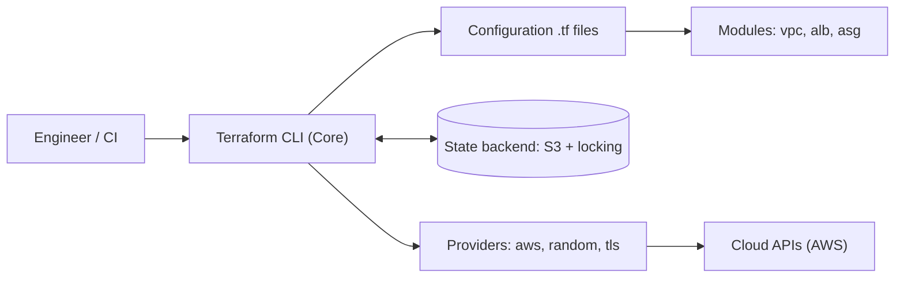
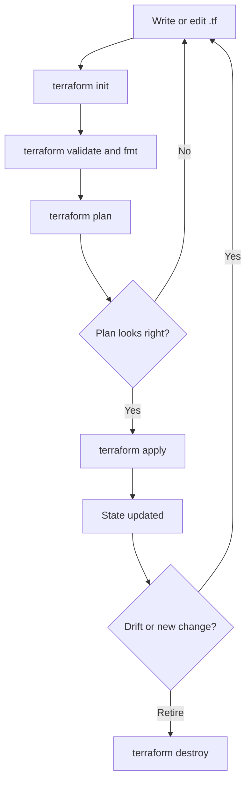
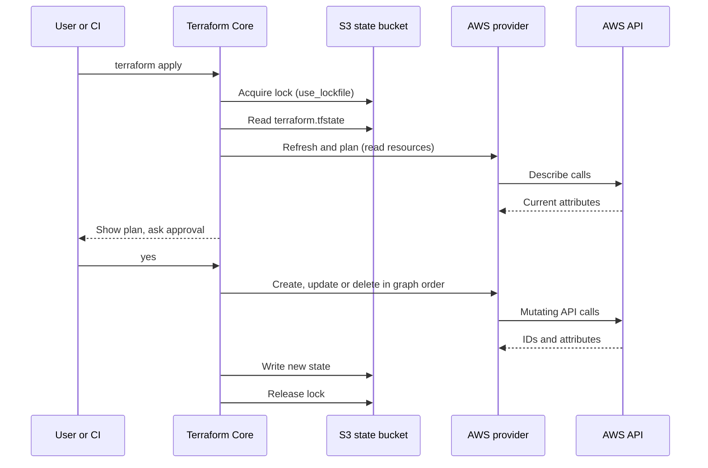
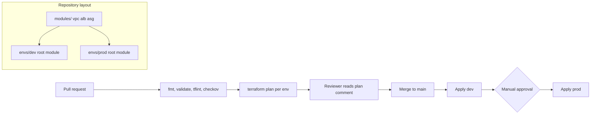

# Terraform & IaC

<!-- DEVOPS-SHACK:HEADER -->
<p align="center">
  <a href="https://www.youtube.com/@devopsshack"></a>
  <a href="https://www.youtube.com/@shackverse"></a>
  <a href="https://devopsshack.com"></a>
  <a href="https://www.instagram.com/devopsshack"></a>
  <a href="https://github.com/jaiswaladi246/DevOps-Cloud-Interview-Preparation-by-DevOps-Shack"></a>
</p>
<p align="center"><sub>Part of <b><a href="https://github.com/jaiswaladi246/DevOps-Cloud-Interview-Preparation-by-DevOps-Shack">DevOps &amp; Cloud Interview Preparation</a></b> — created by <b><a href="https://www.youtube.com/@devopsshack">DevOps Shack</a></b>. Free to learn from; please credit DevOps Shack when sharing.</sub></p>
<!-- /DEVOPS-SHACK:HEADER -->

> Define cloud infrastructure as code, review it like software, and change it safely. This is everything you need to answer Terraform questions in DevOps, SRE and Cloud interviews, from `terraform init` to multi-account production pipelines.

[🏠 Home](../README.md)

## What you'll master

- The Terraform core loop: write, `init`, `plan`, `apply`, `destroy`, and what each step really does to state
- HCL fluency: variables, locals, outputs, `count`, `for_each`, dynamic blocks, expressions and functions
- State as the source of truth: remote backends, S3 locking, `terraform state` surgery, `import`, `moved` blocks and drift
- Reusable modules: inputs and outputs, versioning, composition, and when not to write a module
- Environment strategy: separate root modules versus workspaces, and why most teams choose directories
- Quality gates: `terraform fmt`, `validate`, `tflint`, `checkov`, policy as code and automated tests
- CI/CD for infrastructure: plan on pull request, apply on merge, OIDC to AWS, approval gates
- Operating at scale: provider pinning, lock files, blast radius, secrets handling, cost and recovery from bad applies

## Architecture: how Terraform fits together

Terraform Core reads your configuration, compares it with state, asks providers to talk to cloud APIs, and writes the result back to state.



Core is cloud-agnostic. It builds a dependency graph from references between resources, and providers translate that graph into API calls. State is the only memory Terraform has, so protecting it is job one.

## Lifecycle: from code to real infrastructure

Every change follows the same loop. The `plan` step is a diff between desired config, recorded state and (after refresh) real infrastructure.



In production nobody runs `apply` from a laptop. The same loop is executed by a pipeline, with a saved plan file so what was reviewed is exactly what gets applied.

## Request and data flow: what happens during `apply`

This sequence shows how a single `terraform apply` locks state, calls the provider and persists results.



If two people apply at once, the second one fails fast on the lock instead of corrupting state. That single behaviour is why remote state with locking is non-negotiable for teams.

## Workflow: environments, modules and the pipeline

The layout we use in the lab and in most real teams: shared modules, one small root module per environment, and a pipeline in front of both.



Dev and prod call the same modules with different inputs and have different state files, so a mistake in dev cannot touch prod.

## Core concepts in 10 minutes

### Providers, resources and data sources

A provider is a plugin that knows one API (AWS, Azure, Kubernetes, GitHub). A `resource` block creates and manages something. A `data` block only reads something that already exists, such as the latest Amazon Linux AMI or an existing VPC.

```hcl
terraform {
  required_version = ">= 1.9"
  required_providers {
    aws = { source = "hashicorp/aws", version = "~> 6.0" }
  }
}

data "aws_ami" "al2023" {
  most_recent = true
  owners      = ["amazon"]
  filter {
    name   = "name"
    values = ["al2023-ami-2023.*-x86_64"]
  }
}
```

### State

State maps each resource address in your code (`aws_instance.web`) to a real object ID (`i-0abc...`). Without it Terraform would not know what it created. Never edit it by hand and never commit it to Git, because it can contain secrets in plain text. Use `terraform state list`, `state show`, `state mv` and `state rm` for surgery.

### Variables, locals and outputs

Input variables are the module's parameters, locals are named expressions to avoid repetition, and outputs are the module's return values. Mark anything secret with `sensitive = true`, which hides it from the CLI output but not from state.

### Dependencies and the graph

Terraform infers order from references. `aws_instance.web.subnet_id = aws_subnet.a.id` creates an implicit dependency. Use `depends_on` only when the relationship is real but invisible to Terraform, for example an IAM policy that must exist before a service starts.

### `count` versus `for_each`

`count` indexes resources by number, so removing the middle item shifts everything after it and causes replacements. `for_each` keys by string, so each instance has a stable address. In production we default to `for_each` for anything that is not a simple on/off toggle.

### Modules

A module is a folder of `.tf` files with inputs and outputs. The root module is the folder you run Terraform in. Child modules are called with a `module` block and a `source`. Pin registry modules with `version` and Git modules with `?ref=v1.2.0`.

### Remote state and locking

The S3 backend stores state in a bucket with versioning and encryption. Terraform 1.11 and later (experimental in 1.10) can lock natively using an S3 lock file (`use_lockfile = true`), so the old DynamoDB table is no longer required for new setups, although many existing estates still use it.

### Workspaces versus directories

Workspaces give you several states for one configuration, selected with `terraform workspace select`. They are handy for short-lived copies, but they hide which environment you are in and force identical code. For dev versus prod we use separate root directories that share modules, and each gets its own backend key.

### Lifecycle rules and meta-arguments

`lifecycle { create_before_destroy = true }` avoids downtime on replacement, `prevent_destroy = true` protects databases, and `ignore_changes` stops Terraform fighting an autoscaler over `desired_capacity`. `moved` blocks rename resources in code without destroying them.

### Drift and import

Drift is real infrastructure changing outside Terraform. `terraform plan` shows it, and `plan -refresh-only` shows only that. To adopt an existing resource, write an `import` block and run `terraform plan -generate-config-out=generated.tf`.

### Quality gates and CI

`terraform fmt -check` and `validate` catch syntax issues, `tflint` catches provider-specific mistakes such as invalid instance types, and `checkov` flags insecure settings like open security groups or unencrypted volumes. All of them run on every pull request before a human looks at the plan.

## Question banks

Every bank has 200 questions with collapsible answers, tagged 🟢 Beginner, 🟡 Intermediate and 🔴 Advanced.

| Bank | What it covers | Questions |
|---|---|---|
| [Concepts](./concepts.md) | Core ideas, internals, comparisons, commands | 200 |
| [Scenarios](./scenarios.md) | "What would you do if..." situations | 200 |
| [Troubleshooting](./troubleshooting.md) | Real error messages and how to fix them | 200 |
| [Production](./production.md) | Design, security, scale, cost, rapid-fire commands | 200 |

## Learning path

**Beginner**
- [ ] Install Terraform and the AWS CLI, and authenticate with a named profile
- [ ] Write a provider block and create one S3 bucket or EC2 instance
- [ ] Explain what `init`, `plan`, `apply` and `destroy` each do
- [ ] Use variables, outputs and `terraform.tfvars`
- [ ] Read `terraform.tfstate` and explain why it must not go in Git
- [ ] Use `terraform fmt` and `terraform validate` before every commit

**Intermediate**
- [ ] Move state to S3 with locking and migrate with `terraform init -migrate-state`
- [ ] Use `for_each`, `dynamic` blocks, `locals` and conditional expressions
- [ ] Write and version a reusable module, and call it from two environments
- [ ] Import an existing resource using an `import` block
- [ ] Run `tflint` and `checkov` locally and fix their findings
- [ ] Build a plan-on-PR, apply-on-merge pipeline in GitHub Actions

**Advanced**
- [ ] Authenticate CI to AWS with OIDC instead of long-lived keys
- [ ] Refactor with `moved` blocks and `state mv` without downtime
- [ ] Split state to limit blast radius and share data with `terraform_remote_state` or SSM
- [ ] Write tests with `terraform test` and enforce policy with OPA or Sentinel
- [ ] Detect drift on a schedule and decide how to remediate it
- [ ] Design a multi-account layout with pinned providers and a module registry

## Continue with

- [Hands-on lab](./hands-on-lab.md): VPC, ALB and Auto Scaling group with dev and prod, S3 state and a GitHub Actions pipeline
- [Assignments](./assignments.md): 25 graded exercises
- [Cheatsheet](./cheatsheet.md): commands, HCL patterns and interview one-liners

[🏠 Home](../README.md)

<!-- DEVOPS-SHACK:FOOTER -->
---

<div align="center">

### 🚀 Made with ❤️ by [DevOps Shack](https://www.youtube.com/@devopsshack)

**Learn DevOps, DevSecOps, Cloud and Kubernetes the practical way.**

[▶️ YouTube — DevOps Shack](https://www.youtube.com/@devopsshack) · [▶️ Hindi — @shackverse](https://www.youtube.com/@shackverse) · [🎓 devopsshack.com](https://devopsshack.com) · [📸 Instagram @devopsshack](https://www.instagram.com/devopsshack)

[🏠 Back to Home](../README.md) · [⭐ Star the original repo](https://github.com/jaiswaladi246/DevOps-Cloud-Interview-Preparation-by-DevOps-Shack)

<sub>© DevOps Shack · Licensed CC BY-NC-SA 4.0 · If you found this copy anywhere other than <a href="https://github.com/jaiswaladi246/DevOps-Cloud-Interview-Preparation-by-DevOps-Shack">github.com/jaiswaladi246</a>, the original and latest version is maintained by DevOps Shack.</sub>

</div>
<!-- /DEVOPS-SHACK:FOOTER -->
