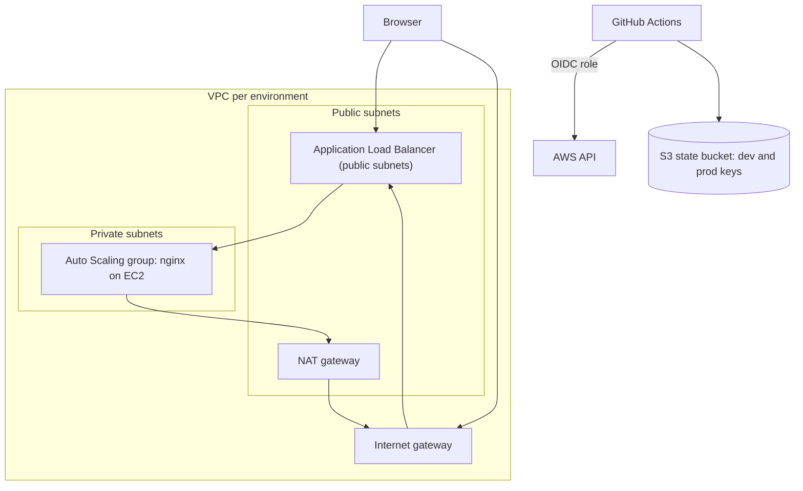
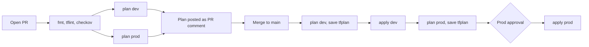

# Terraform & IaC — Hands-on Lab

<!-- DEVOPS-SHACK:HEADER -->
<p align="center">
  <a href="https://www.youtube.com/@devopsshack"></a>
  <a href="https://www.youtube.com/@shackverse"></a>
  <a href="https://devopsshack.com"></a>
  <a href="https://www.instagram.com/devopsshack"></a>
  <a href="https://github.com/jaiswaladi246/DevOps-Cloud-Interview-Preparation-by-DevOps-Shack"></a>
</p>
<p align="center"><sub>Part of <b><a href="https://github.com/jaiswaladi246/DevOps-Cloud-Interview-Preparation-by-DevOps-Shack">DevOps &amp; Cloud Interview Preparation</a></b> — created by <b><a href="https://www.youtube.com/@devopsshack">DevOps Shack</a></b>. Free to learn from; please credit DevOps Shack when sharing.</sub></p>
<!-- /DEVOPS-SHACK:HEADER -->

> Build a production-shaped web platform on AWS with Terraform: reusable modules (VPC, security groups, ALB, Auto Scaling group), separate dev and prod root modules, remote state in S3 with locking, `tflint` and `checkov` gates, and a GitHub Actions pipeline that plans on pull request and applies on merge.

[⬅ Back to Terraform & IaC](./README.md) · [🏠 Home](../README.md)

## Goal

By the end you will have one repository that provisions two isolated environments from the same modules:

- **dev**: small and cheap (one NAT gateway, one instance minimum)
- **prod**: highly available (NAT per AZ, three AZs, two instances minimum)

Nobody applies from a laptop after the first bootstrap. Every change goes through a pull request, shows a plan as a PR comment, and is applied by CI after merge, with a manual approval gate in front of prod.

## Architecture



Instances live in private subnets and are reachable only from the ALB's security group. They reach the internet through NAT to install packages, and we manage them with SSM Session Manager, so there is no SSH and no key pair.



## Repository layout

```text
tf-web-platform/
├── bootstrap/                 # one-time: state bucket, GitHub OIDC, IAM roles
│   ├── main.tf
│   ├── variables.tf
│   ├── outputs.tf
│   └── versions.tf
├── modules/
│   ├── vpc/                   # VPC, subnets, IGW, NAT, route tables
│   ├── security-groups/       # ALB and instance security groups
│   ├── alb/                   # load balancer, target group, listeners
│   └── asg/                   # launch template, ASG, scaling policy, IAM
├── envs/
│   ├── dev/                   # root module for dev
│   └── prod/                  # root module for prod
├── .github/workflows/terraform.yml
├── .tflint.hcl
├── .checkov.yaml
└── .gitignore
```

## Prerequisites

- An AWS account and an admin-capable profile for the **one-time bootstrap** (the pipeline takes over afterwards)
- Terraform 1.11 or newer (needed for native S3 locking), AWS CLI v2, Git, `tflint`, and Python 3 for `checkov`
- A GitHub account and a new empty repository, for example `your-org/tf-web-platform`
- Region used throughout: `ap-south-1`. Change it if you like, but keep it consistent

Cost warning: NAT gateways and ALBs bill by the hour. Dev costs roughly the price of one NAT, one ALB and one `t3.micro`. Destroy everything when finished (see [Cleanup](#cleanup)).

Check your tools:

```bash
terraform version
aws --version
tflint --version
pip install checkov && checkov --version
aws sts get-caller-identity --profile default
```

## Step 1. Create the repository skeleton

```bash
mkdir tf-web-platform && cd tf-web-platform
git init -b main
mkdir -p bootstrap modules/{vpc,security-groups,alb,asg} envs/{dev,prod} .github/workflows
```

Create `.gitignore`. Never commit state, plan files or `.terraform` directories. Do commit `.terraform.lock.hcl`.

```gitignore
.terraform/
*.tfstate
*.tfstate.*
*.tfplan
tfplan
plan.txt
crash.log
override.tf
override.tf.json
*.auto.tfvars.local
```

## Step 2. Bootstrap: state bucket, OIDC provider and IAM roles

The state bucket cannot be created by the configuration that stores its state in that bucket. So `bootstrap/` is applied once with local state. It also creates the GitHub OIDC trust, so CI never holds long-lived AWS keys.

`bootstrap/versions.tf`

```hcl
terraform {
  required_version = ">= 1.11"
  required_providers {
    aws = {
      source  = "hashicorp/aws"
      version = "~> 6.0"
    }
  }
}

provider "aws" {
  region = var.aws_region
}
```

`bootstrap/variables.tf`

```hcl
variable "aws_region" {
  description = "Region for the state bucket and IAM resources."
  type        = string
  default     = "ap-south-1"
}

variable "github_repo" {
  description = "GitHub repository allowed to assume the roles, as owner/name."
  type        = string
}
```

`bootstrap/main.tf`

```hcl
data "aws_caller_identity" "current" {}

locals {
  bucket_name = "tfstate-${data.aws_caller_identity.current.account_id}-${var.aws_region}"
}

# ---------- State bucket ----------
resource "aws_s3_bucket" "state" {
  bucket        = local.bucket_name
  force_destroy = true # lab only: lets cleanup delete versioned objects. Never in production.
}

resource "aws_s3_bucket_versioning" "state" {
  bucket = aws_s3_bucket.state.id
  versioning_configuration {
    status = "Enabled"
  }
}

resource "aws_s3_bucket_server_side_encryption_configuration" "state" {
  bucket = aws_s3_bucket.state.id
  rule {
    apply_server_side_encryption_by_default {
      sse_algorithm = "AES256"
    }
  }
}

resource "aws_s3_bucket_public_access_block" "state" {
  bucket                  = aws_s3_bucket.state.id
  block_public_acls       = true
  block_public_policy     = true
  ignore_public_acls      = true
  restrict_public_buckets = true
}

data "aws_iam_policy_document" "state_tls_only" {
  statement {
    sid       = "DenyInsecureTransport"
    effect    = "Deny"
    actions   = ["s3:*"]
    resources = [aws_s3_bucket.state.arn, "${aws_s3_bucket.state.arn}/*"]
    principals {
      type        = "*"
      identifiers = ["*"]
    }
    condition {
      test     = "Bool"
      variable = "aws:SecureTransport"
      values   = ["false"]
    }
  }
}

resource "aws_s3_bucket_policy" "state" {
  bucket     = aws_s3_bucket.state.id
  policy     = data.aws_iam_policy_document.state_tls_only.json
  depends_on = [aws_s3_bucket_public_access_block.state]
}

# ---------- GitHub OIDC ----------
resource "aws_iam_openid_connect_provider" "github" {
  url            = "https://token.actions.githubusercontent.com"
  client_id_list = ["sts.amazonaws.com"]
}

# Plan role: used by pull_request workflows. Read-only on AWS, read/write on state (for the lock file).
data "aws_iam_policy_document" "plan_trust" {
  statement {
    actions = ["sts:AssumeRoleWithWebIdentity"]
    principals {
      type        = "Federated"
      identifiers = [aws_iam_openid_connect_provider.github.arn]
    }
    condition {
      test     = "StringEquals"
      variable = "token.actions.githubusercontent.com:aud"
      values   = ["sts.amazonaws.com"]
    }
    condition {
      test     = "StringEquals"
      variable = "token.actions.githubusercontent.com:sub"
      values   = ["repo:${var.github_repo}:pull_request"]
    }
  }
}

# Apply role: only jobs that run in the dev or prod GitHub environment can assume it.
data "aws_iam_policy_document" "apply_trust" {
  statement {
    actions = ["sts:AssumeRoleWithWebIdentity"]
    principals {
      type        = "Federated"
      identifiers = [aws_iam_openid_connect_provider.github.arn]
    }
    condition {
      test     = "StringEquals"
      variable = "token.actions.githubusercontent.com:aud"
      values   = ["sts.amazonaws.com"]
    }
    condition {
      test     = "StringEquals"
      variable = "token.actions.githubusercontent.com:sub"
      values = [
        "repo:${var.github_repo}:environment:dev",
        "repo:${var.github_repo}:environment:prod",
      ]
    }
  }
}

data "aws_iam_policy_document" "state_access" {
  statement {
    actions   = ["s3:ListBucket"]
    resources = [aws_s3_bucket.state.arn]
  }
  statement {
    actions   = ["s3:GetObject", "s3:PutObject", "s3:DeleteObject"]
    resources = ["${aws_s3_bucket.state.arn}/*"]
  }
}

resource "aws_iam_role" "plan" {
  name               = "gha-terraform-plan"
  assume_role_policy = data.aws_iam_policy_document.plan_trust.json
}

resource "aws_iam_role_policy_attachment" "plan_readonly" {
  role       = aws_iam_role.plan.name
  policy_arn = "arn:aws:iam::aws:policy/ReadOnlyAccess"
}

resource "aws_iam_role_policy" "plan_state" {
  name   = "state-access"
  role   = aws_iam_role.plan.id
  policy = data.aws_iam_policy_document.state_access.json
}

resource "aws_iam_role" "apply" {
  name               = "gha-terraform-apply"
  assume_role_policy = data.aws_iam_policy_document.apply_trust.json
}

# Lab shortcut. In production scope this to the services the stack actually manages.
resource "aws_iam_role_policy_attachment" "apply_admin" {
  role       = aws_iam_role.apply.name
  policy_arn = "arn:aws:iam::aws:policy/AdministratorAccess"
}
```

`bootstrap/outputs.tf`

```hcl
output "state_bucket" {
  description = "Name of the S3 bucket that stores Terraform state."
  value       = aws_s3_bucket.state.id
}

output "plan_role_arn" {
  description = "Role assumed by pull request plan jobs."
  value       = aws_iam_role.plan.arn
}

output "apply_role_arn" {
  description = "Role assumed by apply jobs in the dev and prod environments."
  value       = aws_iam_role.apply.arn
}
```

Apply it:

```bash
cd bootstrap
terraform init
terraform apply -var="github_repo=your-org/tf-web-platform"
terraform output
cd ..
```

**Verify:** `terraform output` prints a bucket named `tfstate-<account-id>-ap-south-1` and two role ARNs. Confirm versioning is on:

```bash
aws s3api get-bucket-versioning --bucket "$(terraform -chdir=bootstrap output -raw state_bucket)"
# { "Status": "Enabled" }
```

Keep `bootstrap/terraform.tfstate` safe (it is git-ignored). It only manages a handful of long-lived resources.

## Step 3. Module: `vpc`

The module takes a CIDR and a list of AZs, then carves one public and one private /24 per AZ. `single_nat_gateway` trades resilience for cost: dev uses one NAT, prod uses one per AZ.

`modules/vpc/versions.tf`

```hcl
terraform {
  required_version = ">= 1.11"
  required_providers {
    aws = {
      source  = "hashicorp/aws"
      version = ">= 6.0"
    }
  }
}
```

`modules/vpc/variables.tf`

```hcl
variable "name" {
  description = "Name prefix for all resources."
  type        = string
}

variable "cidr_block" {
  description = "CIDR block of the VPC, for example 10.10.0.0/16."
  type        = string
}

variable "azs" {
  description = "Availability zones to spread subnets across."
  type        = list(string)
}

variable "single_nat_gateway" {
  description = "Use one shared NAT gateway (cheap) instead of one per AZ (resilient)."
  type        = bool
  default     = true
}
```

`modules/vpc/main.tf`

```hcl
locals {
  az_index = { for i, az in var.azs : az => i }
  nat_azs  = var.single_nat_gateway ? { (var.azs[0]) = 0 } : local.az_index
}

resource "aws_vpc" "this" {
  cidr_block           = var.cidr_block
  enable_dns_support   = true
  enable_dns_hostnames = true
  tags                 = { Name = "${var.name}-vpc" }
}

# Lock down the default security group so nothing accidentally uses it.
resource "aws_default_security_group" "this" {
  vpc_id = aws_vpc.this.id
  tags   = { Name = "${var.name}-default-sg-unused" }
}

resource "aws_internet_gateway" "this" {
  vpc_id = aws_vpc.this.id
  tags   = { Name = "${var.name}-igw" }
}

resource "aws_subnet" "public" {
  for_each = local.az_index

  vpc_id                  = aws_vpc.this.id
  availability_zone       = each.key
  cidr_block              = cidrsubnet(var.cidr_block, 8, each.value)
  map_public_ip_on_launch = false
  tags                    = { Name = "${var.name}-public-${each.key}", Tier = "public" }
}

resource "aws_subnet" "private" {
  for_each = local.az_index

  vpc_id            = aws_vpc.this.id
  availability_zone = each.key
  cidr_block        = cidrsubnet(var.cidr_block, 8, each.value + 10)
  tags              = { Name = "${var.name}-private-${each.key}", Tier = "private" }
}

resource "aws_eip" "nat" {
  for_each = local.nat_azs

  domain = "vpc"
  tags   = { Name = "${var.name}-nat-${each.key}" }
}

resource "aws_nat_gateway" "this" {
  for_each = local.nat_azs

  allocation_id = aws_eip.nat[each.key].id
  subnet_id     = aws_subnet.public[each.key].id
  tags          = { Name = "${var.name}-nat-${each.key}" }
  depends_on    = [aws_internet_gateway.this]
}

resource "aws_route_table" "public" {
  vpc_id = aws_vpc.this.id
  tags   = { Name = "${var.name}-public-rt" }
}

resource "aws_route" "public_internet" {
  route_table_id         = aws_route_table.public.id
  destination_cidr_block = "0.0.0.0/0"
  gateway_id             = aws_internet_gateway.this.id
}

resource "aws_route_table_association" "public" {
  for_each = aws_subnet.public

  subnet_id      = each.value.id
  route_table_id = aws_route_table.public.id
}

resource "aws_route_table" "private" {
  for_each = local.az_index

  vpc_id = aws_vpc.this.id
  tags   = { Name = "${var.name}-private-rt-${each.key}" }
}

resource "aws_route" "private_nat" {
  for_each = local.az_index

  route_table_id         = aws_route_table.private[each.key].id
  destination_cidr_block = "0.0.0.0/0"
  nat_gateway_id         = aws_nat_gateway.this[var.single_nat_gateway ? var.azs[0] : each.key].id
}

resource "aws_route_table_association" "private" {
  for_each = aws_subnet.private

  subnet_id      = each.value.id
  route_table_id = aws_route_table.private[each.key].id
}
```

`modules/vpc/outputs.tf`

```hcl
output "vpc_id" {
  description = "ID of the VPC."
  value       = aws_vpc.this.id
}

output "public_subnet_ids" {
  description = "IDs of the public subnets, one per AZ."
  value       = [for az in var.azs : aws_subnet.public[az].id]
}

output "private_subnet_ids" {
  description = "IDs of the private subnets, one per AZ."
  value       = [for az in var.azs : aws_subnet.private[az].id]
}
```

We key everything by AZ name with `for_each`, so adding a third AZ later never shifts or replaces the existing subnets, which is exactly the problem `count` would cause.

## Step 4. Module: `security-groups`

Two groups reference each other (ALB egress to instances, instances ingress from ALB). To avoid a dependency cycle we create empty groups first and attach rules as separate resources.

`modules/security-groups/versions.tf` is identical to the VPC one. Copy it:

```bash
cp modules/vpc/versions.tf modules/security-groups/versions.tf
cp modules/vpc/versions.tf modules/alb/versions.tf
cp modules/vpc/versions.tf modules/asg/versions.tf
```

`modules/security-groups/variables.tf`

```hcl
variable "name" {
  description = "Name prefix for the security groups."
  type        = string
}

variable "vpc_id" {
  description = "VPC in which to create the groups."
  type        = string
}

variable "app_port" {
  description = "Port the instances listen on."
  type        = number
  default     = 80
}

variable "alb_ingress_cidrs" {
  description = "CIDR blocks allowed to reach the load balancer."
  type        = list(string)
  default     = ["0.0.0.0/0"]
}

variable "enable_https" {
  description = "Open port 443 on the load balancer."
  type        = bool
  default     = false
}
```

`modules/security-groups/main.tf`

```hcl
resource "aws_security_group" "alb" {
  name        = "${var.name}-alb-sg"
  description = "Public load balancer"
  vpc_id      = var.vpc_id
  tags        = { Name = "${var.name}-alb-sg" }
}

resource "aws_security_group" "instance" {
  name        = "${var.name}-instance-sg"
  description = "Web instances behind the ALB"
  vpc_id      = var.vpc_id
  tags        = { Name = "${var.name}-instance-sg" }
}

# ALB: inbound HTTP from allowed CIDRs
resource "aws_vpc_security_group_ingress_rule" "alb_http" {
  for_each = toset(var.alb_ingress_cidrs)

  security_group_id = aws_security_group.alb.id
  description       = "HTTP from ${each.value}"
  cidr_ipv4         = each.value
  from_port         = 80
  to_port           = 80
  ip_protocol       = "tcp"
}

# ALB: inbound HTTPS, only when a certificate is configured
resource "aws_vpc_security_group_ingress_rule" "alb_https" {
  for_each = var.enable_https ? toset(var.alb_ingress_cidrs) : toset([])

  security_group_id = aws_security_group.alb.id
  description       = "HTTPS from ${each.value}"
  cidr_ipv4         = each.value
  from_port         = 443
  to_port           = 443
  ip_protocol       = "tcp"
}

# ALB: outbound only to the instances
resource "aws_vpc_security_group_egress_rule" "alb_to_instances" {
  security_group_id            = aws_security_group.alb.id
  description                  = "To web instances"
  referenced_security_group_id = aws_security_group.instance.id
  from_port                    = var.app_port
  to_port                      = var.app_port
  ip_protocol                  = "tcp"
}

# Instances: inbound only from the ALB group
resource "aws_vpc_security_group_ingress_rule" "instance_from_alb" {
  security_group_id            = aws_security_group.instance.id
  description                  = "App traffic from ALB"
  referenced_security_group_id = aws_security_group.alb.id
  from_port                    = var.app_port
  to_port                      = var.app_port
  ip_protocol                  = "tcp"
}

# Instances: outbound web only (package repos and SSM endpoints via NAT)
resource "aws_vpc_security_group_egress_rule" "instance_https" {
  security_group_id = aws_security_group.instance.id
  description       = "HTTPS to internet via NAT"
  cidr_ipv4         = "0.0.0.0/0"
  from_port         = 443
  to_port           = 443
  ip_protocol       = "tcp"
}

resource "aws_vpc_security_group_egress_rule" "instance_http" {
  security_group_id = aws_security_group.instance.id
  description       = "HTTP to internet via NAT for OS repos"
  cidr_ipv4         = "0.0.0.0/0"
  from_port         = 80
  to_port           = 80
  ip_protocol       = "tcp"
}
```

`modules/security-groups/outputs.tf`

```hcl
output "alb_sg_id" {
  description = "Security group ID for the load balancer."
  value       = aws_security_group.alb.id
}

output "instance_sg_id" {
  description = "Security group ID for the web instances."
  value       = aws_security_group.instance.id
}
```

## Step 5. Module: `alb`

With no certificate the ALB serves plain HTTP (fine for a lab). When `certificate_arn` is set, HTTP redirects to HTTPS and a TLS 1.3 policy listener forwards to the target group. Same module, two behaviours, driven by one input.

`modules/alb/variables.tf`

```hcl
variable "name" {
  description = "Name prefix. ALB and target group names are limited to 32 characters."
  type        = string
}

variable "vpc_id" {
  description = "VPC for the target group."
  type        = string
}

variable "subnet_ids" {
  description = "Public subnets for the load balancer."
  type        = list(string)
}

variable "security_group_ids" {
  description = "Security groups attached to the load balancer."
  type        = list(string)
}

variable "target_port" {
  description = "Port the targets listen on."
  type        = number
  default     = 80
}

variable "health_check_path" {
  description = "HTTP path used for target health checks."
  type        = string
  default     = "/"
}

variable "certificate_arn" {
  description = "ACM certificate ARN. When set, HTTP redirects to HTTPS."
  type        = string
  default     = null
}

variable "deletion_protection" {
  description = "Protect the load balancer from accidental deletion."
  type        = bool
  default     = false
}
```

`modules/alb/main.tf`

```hcl
locals {
  https = var.certificate_arn != null
}

resource "aws_lb" "this" {
  name                       = "${var.name}-alb"
  load_balancer_type         = "application"
  internal                   = false
  subnets                    = var.subnet_ids
  security_groups            = var.security_group_ids
  drop_invalid_header_fields = true
  enable_deletion_protection = var.deletion_protection
}

resource "aws_lb_target_group" "this" {
  name                 = "${var.name}-tg"
  port                 = var.target_port
  protocol             = "HTTP"
  target_type          = "instance"
  vpc_id               = var.vpc_id
  deregistration_delay = 30

  health_check {
    path                = var.health_check_path
    matcher             = "200"
    interval            = 15
    timeout             = 5
    healthy_threshold   = 2
    unhealthy_threshold = 3
  }
}

resource "aws_lb_listener" "http" {
  load_balancer_arn = aws_lb.this.arn
  port              = 80
  protocol          = "HTTP"

  dynamic "default_action" {
    for_each = local.https ? [] : [1]
    content {
      type             = "forward"
      target_group_arn = aws_lb_target_group.this.arn
    }
  }

  dynamic "default_action" {
    for_each = local.https ? [1] : []
    content {
      type = "redirect"
      redirect {
        port        = "443"
        protocol    = "HTTPS"
        status_code = "HTTP_301"
      }
    }
  }
}

resource "aws_lb_listener" "https" {
  count = local.https ? 1 : 0

  load_balancer_arn = aws_lb.this.arn
  port              = 443
  protocol          = "HTTPS"
  ssl_policy        = "ELBSecurityPolicy-TLS13-1-2-2021-06"
  certificate_arn   = var.certificate_arn

  default_action {
    type             = "forward"
    target_group_arn = aws_lb_target_group.this.arn
  }
}
```

`modules/alb/outputs.tf`

```hcl
output "dns_name" {
  description = "Public DNS name of the load balancer."
  value       = aws_lb.this.dns_name
}

output "target_group_arn" {
  description = "ARN of the target group the ASG registers into."
  value       = aws_lb_target_group.this.arn
}
```

## Step 6. Module: `asg`

The launch template enforces IMDSv2, encrypts the root volume and has no key pair. The ASG uses ELB health checks, so an instance that fails the ALB check is replaced, not just one that fails an EC2 status check. A target tracking policy keeps average CPU near 50 percent.

`modules/asg/variables.tf`

```hcl
variable "name" {
  description = "Name prefix for the ASG, launch template and IAM resources."
  type        = string
}

variable "environment" {
  description = "Environment label shown on the web page."
  type        = string
}

variable "subnet_ids" {
  description = "Private subnets for the instances."
  type        = list(string)
}

variable "security_group_ids" {
  description = "Security groups for the instances."
  type        = list(string)
}

variable "target_group_arn" {
  description = "Target group to register instances into."
  type        = string
}

variable "instance_type" {
  description = "EC2 instance type."
  type        = string
  default     = "t3.micro"
}

variable "ami_id" {
  description = "Pin an AMI. When null the latest Amazon Linux 2023 AMI is used."
  type        = string
  default     = null
}

variable "min_size" {
  description = "Minimum number of instances."
  type        = number
}

variable "max_size" {
  description = "Maximum number of instances."
  type        = number
}

variable "desired_capacity" {
  description = "Initial number of instances. Later changes are made by scaling policies."
  type        = number
}

variable "cpu_target" {
  description = "Target average CPU percentage for scaling."
  type        = number
  default     = 50
}

variable "tags" {
  description = "Tags applied to instances and volumes."
  type        = map(string)
  default     = {}
}
```

`modules/asg/user_data.sh.tftpl`

```bash
#!/bin/bash
set -euxo pipefail
dnf install -y nginx

TOKEN=$(curl -sS -X PUT "http://169.254.169.254/latest/api/token" -H "X-aws-ec2-metadata-token-ttl-seconds: 60")
IID=$(curl -sS -H "X-aws-ec2-metadata-token: $TOKEN" http://169.254.169.254/latest/meta-data/instance-id)
AZ=$(curl -sS -H "X-aws-ec2-metadata-token: $TOKEN" http://169.254.169.254/latest/meta-data/placement/availability-zone)

cat > /usr/share/nginx/html/index.html <<HTML
<h1>${environment} environment</h1>
<p>Served by $IID in $AZ</p>
HTML

systemctl enable --now nginx
```

`modules/asg/main.tf`

```hcl
data "aws_ami" "al2023" {
  most_recent = true
  owners      = ["amazon"]
  filter {
    name   = "name"
    values = ["al2023-ami-2023.*-x86_64"]
  }
}

# ---------- IAM: SSM Session Manager instead of SSH ----------
data "aws_iam_policy_document" "ec2_trust" {
  statement {
    actions = ["sts:AssumeRole"]
    principals {
      type        = "Service"
      identifiers = ["ec2.amazonaws.com"]
    }
  }
}

resource "aws_iam_role" "instance" {
  name_prefix        = "${var.name}-ec2-"
  assume_role_policy = data.aws_iam_policy_document.ec2_trust.json
}

resource "aws_iam_role_policy_attachment" "ssm" {
  role       = aws_iam_role.instance.name
  policy_arn = "arn:aws:iam::aws:policy/AmazonSSMManagedInstanceCore"
}

resource "aws_iam_instance_profile" "instance" {
  name_prefix = "${var.name}-ec2-"
  role        = aws_iam_role.instance.name
}

# ---------- Launch template ----------
resource "aws_launch_template" "this" {
  name_prefix            = "${var.name}-lt-"
  image_id               = coalesce(var.ami_id, data.aws_ami.al2023.id)
  instance_type          = var.instance_type
  vpc_security_group_ids = var.security_group_ids
  ebs_optimized          = true
  update_default_version = true
  user_data = base64encode(templatefile("${path.module}/user_data.sh.tftpl", {
    environment = var.environment
  }))

  iam_instance_profile {
    name = aws_iam_instance_profile.instance.name
  }

  monitoring {
    enabled = true
  }

  metadata_options {
    http_endpoint               = "enabled"
    http_tokens                 = "required"
    http_put_response_hop_limit = 1
  }

  block_device_mappings {
    device_name = "/dev/xvda"
    ebs {
      volume_size           = 8
      volume_type           = "gp3"
      encrypted             = true
      delete_on_termination = true
    }
  }

  tag_specifications {
    resource_type = "instance"
    tags          = merge(var.tags, { Name = "${var.name}-web" })
  }

  tag_specifications {
    resource_type = "volume"
    tags          = merge(var.tags, { Name = "${var.name}-web" })
  }
}

# ---------- Auto Scaling group ----------
resource "aws_autoscaling_group" "this" {
  name                      = "${var.name}-asg"
  min_size                  = var.min_size
  max_size                  = var.max_size
  desired_capacity          = var.desired_capacity
  vpc_zone_identifier       = var.subnet_ids
  target_group_arns         = [var.target_group_arn]
  health_check_type         = "ELB"
  health_check_grace_period = 120

  launch_template {
    id      = aws_launch_template.this.id
    version = aws_launch_template.this.latest_version
  }

  instance_refresh {
    strategy = "Rolling"
    preferences {
      min_healthy_percentage = 50
    }
  }

  lifecycle {
    ignore_changes = [desired_capacity] # the scaling policy owns this after creation
  }
}

resource "aws_autoscaling_policy" "cpu" {
  name                   = "${var.name}-cpu-target"
  autoscaling_group_name = aws_autoscaling_group.this.name
  policy_type            = "TargetTrackingScaling"

  target_tracking_configuration {
    target_value = var.cpu_target
    predefined_metric_specification {
      predefined_metric_type = "ASGAverageCPUUtilization"
    }
  }
}
```

`modules/asg/outputs.tf`

```hcl
output "asg_name" {
  description = "Name of the Auto Scaling group."
  value       = aws_autoscaling_group.this.name
}
```

Because the ASG points at `latest_version` of the launch template, any change to the AMI, instance type or user data creates a new template version and triggers a rolling instance refresh with no manual step.

## Step 7. Root module: `envs/dev`

A root module is thin. It sets up the provider and backend, wires modules together and feeds in environment-specific values. The backend block is deliberately missing the bucket name: backends cannot use variables, so we supply it at `init` time.

`envs/dev/versions.tf`

```hcl
terraform {
  required_version = ">= 1.11"
  required_providers {
    aws = {
      source  = "hashicorp/aws"
      version = "~> 6.0"
    }
  }

  backend "s3" {
    key          = "web-platform/dev/terraform.tfstate"
    region       = "ap-south-1"
    encrypt      = true
    use_lockfile = true
    # bucket is passed with: terraform init -backend-config="bucket=<name>"
  }
}

provider "aws" {
  region = var.aws_region

  default_tags {
    tags = {
      Project     = "web-platform"
      Environment = var.environment
      ManagedBy   = "terraform"
    }
  }
}
```

`envs/dev/variables.tf`

```hcl
variable "aws_region" {
  description = "AWS region."
  type        = string
  default     = "ap-south-1"
}

variable "environment" {
  description = "Environment name."
  type        = string
}

variable "vpc_cidr" {
  description = "CIDR block for the VPC."
  type        = string
}

variable "az_count" {
  description = "Number of availability zones to use."
  type        = number
}

variable "single_nat_gateway" {
  description = "One shared NAT gateway instead of one per AZ."
  type        = bool
}

variable "instance_type" {
  description = "EC2 instance type for web servers."
  type        = string
}

variable "min_size" {
  description = "Minimum ASG size."
  type        = number
}

variable "max_size" {
  description = "Maximum ASG size."
  type        = number
}

variable "desired_capacity" {
  description = "Initial ASG size."
  type        = number
}

variable "certificate_arn" {
  description = "ACM certificate ARN for HTTPS. Null serves plain HTTP."
  type        = string
  default     = null
}

variable "deletion_protection" {
  description = "Enable ALB deletion protection."
  type        = bool
  default     = false
}
```

`envs/dev/main.tf`

```hcl
data "aws_availability_zones" "available" {
  state = "available"
}

locals {
  name = "webplat-${var.environment}"
  azs  = slice(data.aws_availability_zones.available.names, 0, var.az_count)
  tags = {
    Project     = "web-platform"
    Environment = var.environment
  }
}

module "vpc" {
  source = "../../modules/vpc"

  name               = local.name
  cidr_block         = var.vpc_cidr
  azs                = local.azs
  single_nat_gateway = var.single_nat_gateway
}

module "security_groups" {
  source = "../../modules/security-groups"

  name         = local.name
  vpc_id       = module.vpc.vpc_id
  enable_https = var.certificate_arn != null
}

module "alb" {
  source = "../../modules/alb"

  name                = local.name
  vpc_id              = module.vpc.vpc_id
  subnet_ids          = module.vpc.public_subnet_ids
  security_group_ids  = [module.security_groups.alb_sg_id]
  certificate_arn     = var.certificate_arn
  deletion_protection = var.deletion_protection
}

module "asg" {
  source = "../../modules/asg"

  name               = local.name
  environment        = var.environment
  subnet_ids         = module.vpc.private_subnet_ids
  security_group_ids = [module.security_groups.instance_sg_id]
  target_group_arn   = module.alb.target_group_arn
  instance_type      = var.instance_type
  min_size           = var.min_size
  max_size           = var.max_size
  desired_capacity   = var.desired_capacity
  tags               = local.tags
}
```

`envs/dev/outputs.tf`

```hcl
output "alb_dns_name" {
  description = "Public DNS name of the load balancer."
  value       = module.alb.dns_name
}

output "asg_name" {
  description = "Name of the Auto Scaling group."
  value       = module.asg.asg_name
}

output "vpc_id" {
  description = "ID of the VPC."
  value       = module.vpc.vpc_id
}
```

`envs/dev/terraform.tfvars`

```hcl
environment        = "dev"
vpc_cidr           = "10.10.0.0/16"
az_count           = 2
single_nat_gateway = true
instance_type      = "t3.micro"
min_size           = 1
max_size           = 2
desired_capacity   = 1
```

## Step 8. Root module: `envs/prod`

Prod is a copy of dev's wiring with different values and a different state key. Copy the files and change only what differs:

```bash
cp envs/dev/{main.tf,variables.tf,outputs.tf,versions.tf} envs/prod/
sed -i 's#web-platform/dev/terraform.tfstate#web-platform/prod/terraform.tfstate#' envs/prod/versions.tf
```

`envs/prod/terraform.tfvars`

```hcl
environment         = "prod"
vpc_cidr            = "10.20.0.0/16"
az_count            = 3
single_nat_gateway  = false
instance_type       = "t3.small"
min_size            = 2
max_size            = 6
desired_capacity    = 2
deletion_protection = true
# certificate_arn   = "arn:aws:acm:ap-south-1:111122223333:certificate/..."
```

Duplicated root files look wasteful, but this is the point. Each environment is a separate state, a separate blast radius and can be upgraded on its own schedule. The logic lives in `modules/`, and the roots only hold wiring and values. (Some teams generate roots with Terragrunt or templates once they have many environments.)

`deletion_protection = true` means `terraform destroy` on prod fails until you turn it off and apply. That is intentional.

**Verify the diff between environments is only values:**

```bash
diff -r envs/dev envs/prod
```

## Step 9. Deploy dev locally and verify

This first run proves the modules work before CI is involved.

```bash
BUCKET=$(terraform -chdir=bootstrap output -raw state_bucket)

cd envs/dev
terraform init -backend-config="bucket=$BUCKET"
terraform fmt -recursive ../..
terraform validate
terraform plan -out=tfplan
terraform apply tfplan
```

Expect about 30 resources in the plan. Applying takes a few minutes, mostly the NAT gateway and ALB.

**Verify the infrastructure:**

```bash
terraform output alb_dns_name
curl -s "http://$(terraform output -raw alb_dns_name)"
# <h1>dev environment</h1>
# <p>Served by i-0abc123def4567890 in ap-south-1a</p>
```

The page may return `503` for the first 1 to 2 minutes while the instance installs nginx and passes two health checks. Check target health:

```bash
TG=$(aws elbv2 describe-target-groups --names webplat-dev-tg --query 'TargetGroups[0].TargetGroupArn' --output text)
aws elbv2 describe-target-health --target-group-arn "$TG" \
  --query 'TargetHealthDescriptions[].{id:Target.Id,state:TargetHealth.State}'
```

**Verify remote state and locking:**

```bash
aws s3 ls "s3://$BUCKET/web-platform/dev/"
# terraform.tfstate

# Run a plan and, in a second terminal, try another one while the first is waiting.
terraform plan -lock-timeout=0s
```

During an `apply` that is waiting at its confirmation prompt, a second terminal fails with `Error: Error acquiring the state lock` and shows `terraform.tfstate.tflock` as the lock object. That is native S3 locking working.

**Verify idempotency:** run `terraform plan` again. It must say `No changes. Your infrastructure matches the configuration.` If it does not, something is non-deterministic and you want to know now, not in CI.

Commit the lock file. It pins exact provider versions and hashes, so CI and your laptop use identical providers. Include hashes for the platforms you use:

```bash
terraform providers lock -platform=linux_amd64 -platform=darwin_arm64 -platform=windows_amd64
cd ../prod
terraform init -backend-config="bucket=$BUCKET"
terraform providers lock -platform=linux_amd64 -platform=darwin_arm64 -platform=windows_amd64
cd ../..
```

(Do **not** apply prod locally. The pipeline will do that.)

## Step 10. Linting with `tflint`

`tflint` knows the provider schema, so it catches mistakes `validate` cannot, like unknown instance types, deprecated syntax and unused variables.

`.tflint.hcl`

```hcl
plugin "terraform" {
  enabled = true
  preset  = "recommended"
}

plugin "aws" {
  enabled = true
  version = "0.38.0" # bump to the latest tflint-ruleset-aws release
  source  = "github.com/terraform-linters/tflint-ruleset-aws"
}
```

Run it from the repo root. With `--recursive` it lints every module and root, but the config file must be passed explicitly:

```bash
tflint --init
tflint --recursive --config "$(pwd)/.tflint.hcl"
```

A clean run prints nothing and exits `0`. Break something on purpose to see it work: set `instance_type = "t3.superbig"` in `envs/dev/terraform.tfvars` and the AWS ruleset flags the invalid type. Revert it afterwards.

## Step 11. Security scanning with `checkov`

`checkov` scans the HCL for insecure configuration: open security groups, unencrypted volumes, IMDSv1, public buckets and more. We have already built in the fixes for the common findings (encrypted gp3 root volume, IMDSv2, rule descriptions, locked-down default SG, `drop_invalid_header_fields`). A few findings are conscious lab trade-offs, and we record them with a reason in a config file rather than ignoring them silently.

`.checkov.yaml`

```yaml
framework:
  - terraform
directory:
  - .
quiet: true
compact: true
skip-check:
  - CKV_AWS_2      # ALB listener HTTP in lab; prod enables HTTPS via certificate_arn
  - CKV_AWS_91     # ALB access logs: needs a log bucket, add in a real platform
  - CKV_AWS_150    # ALB deletion protection: enabled only in prod through a variable
  - CKV2_AWS_20    # HTTP to HTTPS redirect: only when a certificate is configured
  - CKV2_AWS_28    # WAF on ALB: out of scope for the lab
  - CKV2_AWS_11    # VPC flow logs: add with a log group in a real platform
  - CKV_AWS_260    # ALB must accept port 80 from the internet by design
```

```bash
checkov --config-file .checkov.yaml
```

Read the summary line (`Passed checks: N, Failed checks: M`). Check IDs and rules evolve between releases, so if a new check fails, read its description and either fix the code or add a skip with a written reason. For a single resource, use an inline comment instead of a global skip:

```hcl
#checkov:skip=CKV_AWS_260:Public ALB must accept HTTP from the internet
resource "aws_vpc_security_group_ingress_rule" "alb_http" { ... }
```

Set the rule for your team: skips need a reason and a reviewer.

## Step 12. Configure GitHub: repo, variables and environments

Push the code and wire up the repository.

```bash
git add -A
git commit -m "Terraform web platform: modules, dev and prod roots"
git remote add origin git@github.com:your-org/tf-web-platform.git
git push -u origin main
```

Create repository **variables** (Settings → Secrets and variables → Actions → Variables). These are not secrets, which is the benefit of OIDC.

| Variable | Value |
|---|---|
| `AWS_REGION` | `ap-south-1` |
| `TF_STATE_BUCKET` | output `state_bucket` from bootstrap |
| `AWS_PLAN_ROLE_ARN` | output `plan_role_arn` |
| `AWS_APPLY_ROLE_ARN` | output `apply_role_arn` |

Or with the CLI:

```bash
gh variable set AWS_REGION --body "ap-south-1"
gh variable set TF_STATE_BUCKET --body "$BUCKET"
gh variable set AWS_PLAN_ROLE_ARN --body "$(terraform -chdir=bootstrap output -raw plan_role_arn)"
gh variable set AWS_APPLY_ROLE_ARN --body "$(terraform -chdir=bootstrap output -raw apply_role_arn)"
```

Create two **environments** under Settings → Environments: `dev` (no rules) and `prod` (enable **Required reviewers** and add yourself or your team). The apply job's `environment:` name becomes part of the OIDC token subject, which is what the apply role's trust policy matches on.

Then protect `main` (Settings → Branches): require a pull request, require the status checks `static-checks` and `plan (dev)` and `plan (prod)`, and block force pushes.

## Step 13. The pipeline

`.github/workflows/terraform.yml`

```yaml
name: terraform

on:
  pull_request:
    paths: ["envs/**", "modules/**", ".github/workflows/terraform.yml"]
  push:
    branches: [main]
    paths: ["envs/**", "modules/**", ".github/workflows/terraform.yml"]

permissions:
  contents: read

env:
  TF_IN_AUTOMATION: "true"
  TF_INPUT: "false"
  TF_VERSION: "1.13.x"

jobs:
  static-checks:
    if: github.event_name == 'pull_request'
    runs-on: ubuntu-latest
    steps:
      - uses: actions/checkout@v4

      - uses: hashicorp/setup-terraform@v3
        with:
          terraform_version: ${{ env.TF_VERSION }}

      - name: terraform fmt
        run: terraform fmt -check -recursive -diff

      - uses: terraform-linters/setup-tflint@v4

      - name: tflint
        run: |
          tflint --init
          tflint --recursive --config "$GITHUB_WORKSPACE/.tflint.hcl" --format compact
        env:
          GITHUB_TOKEN: ${{ github.token }}

      - uses: actions/setup-python@v5
        with:
          python-version: "3.12"

      - name: checkov
        run: |
          pip install checkov
          checkov --config-file .checkov.yaml

  plan:
    if: github.event_name == 'pull_request'
    needs: static-checks
    runs-on: ubuntu-latest
    strategy:
      fail-fast: false
      matrix:
        env: [dev, prod]
    permissions:
      id-token: write
      contents: read
      pull-requests: write
    concurrency:
      group: tf-${{ matrix.env }}
      cancel-in-progress: false
    defaults:
      run:
        working-directory: envs/${{ matrix.env }}
    steps:
      - uses: actions/checkout@v4

      - uses: hashicorp/setup-terraform@v3
        with:
          terraform_version: ${{ env.TF_VERSION }}
          terraform_wrapper: false

      - uses: aws-actions/configure-aws-credentials@v4
        with:
          role-to-assume: ${{ vars.AWS_PLAN_ROLE_ARN }}
          aws-region: ${{ vars.AWS_REGION }}

      - name: terraform init
        run: terraform init -backend-config="bucket=${{ vars.TF_STATE_BUCKET }}"

      - name: terraform validate
        run: terraform validate

      - name: terraform plan
        run: |
          set +e
          terraform plan -no-color -lock-timeout=120s -detailed-exitcode -out=tfplan > plan.txt 2>&1
          code=$?
          cat plan.txt
          # exit code 0 = no changes, 2 = changes, 1 = error
          if [ "$code" -eq 1 ]; then exit 1; fi
          exit 0

      - name: Comment plan on PR
        uses: actions/github-script@v7
        with:
          script: |
            const fs = require('fs');
            const plan = fs.readFileSync('envs/${{ matrix.env }}/plan.txt', 'utf8');
            const body = `### Terraform plan: \`${{ matrix.env }}\`\n\n\`\`\`\n${plan.slice(-60000)}\n\`\`\``;
            await github.rest.issues.createComment({
              ...context.repo,
              issue_number: context.issue.number,
              body,
            });

  plan-main:
    if: github.event_name == 'push'
    runs-on: ubuntu-latest
    strategy:
      max-parallel: 1
      matrix:
        env: [dev, prod]
    permissions:
      id-token: write
      contents: read
    defaults:
      run:
        working-directory: envs/${{ matrix.env }}
    steps:
      - uses: actions/checkout@v4

      - uses: hashicorp/setup-terraform@v3
        with:
          terraform_version: ${{ env.TF_VERSION }}
          terraform_wrapper: false

      - uses: aws-actions/configure-aws-credentials@v4
        with:
          role-to-assume: ${{ vars.AWS_PLAN_ROLE_ARN }}
          aws-region: ${{ vars.AWS_REGION }}

      - run: terraform init -backend-config="bucket=${{ vars.TF_STATE_BUCKET }}"

      - run: terraform plan -no-color -lock-timeout=120s -out=tfplan

      - uses: actions/upload-artifact@v4
        with:
          name: tfplan-${{ matrix.env }}
          path: envs/${{ matrix.env }}/tfplan
          retention-days: 1

  apply:
    if: github.event_name == 'push'
    needs: plan-main
    runs-on: ubuntu-latest
    strategy:
      max-parallel: 1 # dev first; if it fails, prod is skipped
      matrix:
        env: [dev, prod]
    environment: ${{ matrix.env }}
    permissions:
      id-token: write
      contents: read
    concurrency:
      group: tf-${{ matrix.env }}
      cancel-in-progress: false
    defaults:
      run:
        working-directory: envs/${{ matrix.env }}
    steps:
      - uses: actions/checkout@v4

      - uses: hashicorp/setup-terraform@v3
        with:
          terraform_version: ${{ env.TF_VERSION }}
          terraform_wrapper: false

      - uses: aws-actions/configure-aws-credentials@v4
        with:
          role-to-assume: ${{ vars.AWS_APPLY_ROLE_ARN }}
          aws-region: ${{ vars.AWS_REGION }}

      - uses: actions/download-artifact@v4
        with:
          name: tfplan-${{ matrix.env }}
          path: envs/${{ matrix.env }}

      - run: terraform init -backend-config="bucket=${{ vars.TF_STATE_BUCKET }}"

      - name: terraform apply (saved plan)
        run: terraform apply -lock-timeout=120s tfplan
```

How it behaves and why it is built this way:

- **Pull request:** static checks run first. If they pass, `plan` runs for dev and prod using the read-only plan role and posts each plan as a comment. Reviewers read exactly what will change.
- **Merge to main:** `plan-main` produces a fresh plan against current state and uploads it as a one-day artifact. `apply` then waits on the `prod` environment's required reviewers and applies **that saved plan**, so what was planned is what is applied. If state changed in between, Terraform refuses with `Saved plan is stale` instead of doing something unreviewed.
- **Credentials:** short-lived OIDC tokens. The plan role cannot modify infrastructure, and the apply role can only be assumed from jobs running in the `dev` or `prod` environment on this repository.
- **Concurrency groups** make sure two runs never plan or apply the same environment at once. S3 locking is the second line of defence.
- **Caveat:** a plan file can contain sensitive values. We keep retention at one day and the repository private. If that is not acceptable, run `terraform plan` and `apply` in the same job after the approval instead.

## Step 14. Run the pull request flow

Make a small change on a branch, for example raise dev's maximum size:

```bash
git checkout -b feat/dev-max-size
sed -i 's/max_size           = 2/max_size           = 3/' envs/dev/terraform.tfvars
git commit -am "dev: allow ASG to scale to 3"
git push -u origin feat/dev-max-size
gh pr create --fill
```

**Verify:**

1. The `static-checks` job passes (fmt, tflint, checkov).
2. Two plan comments appear. Dev shows `Plan: 0 to add, 1 to change, 0 to destroy` (the ASG `max_size`). Prod has never been applied, so its plan shows every resource as an addition (`Plan: ~40 to add`).
3. `gh pr checks` shows every check green.

Try the failure path too: add a badly formatted line (extra spaces around `=`) and push. `terraform fmt -check` fails the pipeline and blocks the merge. Run `terraform fmt -recursive` and push again.

## Step 15. Merge and apply

```bash
gh pr merge --squash --delete-branch
gh run watch
```

**Verify:**

1. `plan-main` runs for dev, then prod.
2. `apply (dev)` runs straight away. `apply (prod)` pauses with "Waiting for review". Open the run, review, and approve.
3. Prod applies **for the first time here**, creating about 40 resources across three AZs. Allow 5 to 8 minutes.
4. Confirm both environments:

```bash
for e in dev prod; do
  echo "== $e"
  terraform -chdir=envs/$e init -backend-config="bucket=$BUCKET" >/dev/null
  curl -s "http://$(terraform -chdir=envs/$e output -raw alb_dns_name)"
done

# prod has two instances in different AZs, so repeated requests show different IDs
URL="http://$(terraform -chdir=envs/prod output -raw alb_dns_name)"
for i in $(seq 1 10); do curl -s "$URL" | grep Served; done
```

```bash
aws autoscaling describe-auto-scaling-groups \
  --auto-scaling-group-names webplat-dev-asg webplat-prod-asg \
  --query 'AutoScalingGroups[].{name:AutoScalingGroupName,min:MinSize,max:MaxSize,running:length(Instances)}'
```

## Step 16. Prove self-healing, drift detection and refresh

Three short experiments that make good interview stories.

**Self-healing.** Terminate a prod instance and watch the ASG replace it:

```bash
ID=$(aws autoscaling describe-auto-scaling-groups --auto-scaling-group-names webplat-prod-asg \
  --query 'AutoScalingGroups[0].Instances[0].InstanceId' --output text)
aws ec2 terminate-instances --instance-ids "$ID"
watch -n 10 "aws autoscaling describe-auto-scaling-groups --auto-scaling-group-names webplat-prod-asg --query 'AutoScalingGroups[0].Instances[].[InstanceId,LifecycleState,HealthStatus]' --output text"
```

**Drift.** Change something by hand and let Terraform find it. Here we raise the dev ASG maximum outside Terraform:

```bash
aws autoscaling update-auto-scaling-group --auto-scaling-group-name webplat-dev-asg --max-size 5
cd envs/dev
terraform plan -refresh-only   # reports that max_size changed outside Terraform (3 to 5)
terraform plan                 # proposes to set max_size back to 3
```

`-refresh-only` shows drift without proposing to fix it. A normal plan treats the code as the truth and plans to revert it. In production we run a scheduled plan in CI and alert when the exit code is `2`, so drift is noticed in hours, not months.

**Instance refresh.** Change `instance_type` in `envs/dev/terraform.tfvars` from `t3.micro` to `t3.small` through a PR. After merge, the launch template gets a new version and the ASG performs a rolling refresh. Watch it:

```bash
aws autoscaling describe-instance-refreshes --auto-scaling-group-name webplat-dev-asg \
  --query 'InstanceRefreshes[0].{status:Status,pct:PercentageComplete}'
```

## Cleanup

Destroy in reverse order, and remember prod has deletion protection on. Do this from your machine with admin credentials.

```bash
# prod: turn off deletion protection first
cd envs/prod
sed -i 's/deletion_protection = true/deletion_protection = false/' terraform.tfvars
terraform init -backend-config="bucket=$BUCKET"
terraform apply -auto-approve
terraform destroy -auto-approve

# dev
cd ../dev
terraform destroy -auto-approve

# bootstrap last (it holds the state bucket; force_destroy empties it)
cd ../../bootstrap
terraform destroy -var="github_repo=your-org/tf-web-platform" -auto-approve
```

**Verify nothing is left** (these should all return empty):

```bash
aws ec2 describe-nat-gateways --filter Name=state,Values=available --query 'NatGateways[].NatGatewayId'
aws elbv2 describe-load-balancers --query 'LoadBalancers[].LoadBalancerName'
aws ec2 describe-addresses --query 'Addresses[].AllocationId'
```

Then delete the GitHub repository variables and environments if you no longer need them.

## What to say in an interview about this project

**Thirty-second pitch.** "I built a reusable-module Terraform platform on AWS: VPC, security groups, ALB and an Auto Scaling group of nginx servers in private subnets. Dev and prod are separate root modules calling the same modules with different inputs, each with its own S3 state and native locking. A GitHub Actions pipeline runs fmt, tflint and checkov on every PR, posts plans as comments, and on merge applies the saved plan, dev first and prod behind a manual approval. CI authenticates to AWS with OIDC, so there are no stored keys."

**Design decisions you should be able to defend:**

- **Separate root modules over workspaces.** Separate directories make the target environment explicit, allow different sizing and provider upgrades per environment, and keep states and permissions isolated. Workspaces share one codebase and make it easy to run against the wrong one.
- **`for_each` keyed by AZ.** Stable addresses, so adding an AZ does not replace existing subnets.
- **Security group rules as separate resources.** Avoids the circular dependency between ALB and instance groups, and avoids the inline-rule conflict with `aws_security_group_rule`.
- **Apply the saved plan.** What the reviewer saw is what runs, and a stale plan fails safely.
- **Two roles with different trust.** The PR plan role is read-only and cannot be assumed from a branch push. The apply role is only assumable from a protected GitHub environment.
- **`ignore_changes = [desired_capacity]`.** The scaling policy owns capacity, so Terraform must not fight it on every plan.
- **Remote state with versioning.** Versioning on the bucket gives you point-in-time recovery of state after a bad apply or accidental delete.
- **Honest trade-offs.** The apply role is AdministratorAccess in the lab. In production I would scope it per stack. Plans are stored as short-lived artifacts. Dev uses one NAT gateway, which is a deliberate single point of failure for cost.

**Follow-ups they may ask, with short answers:**

- *What if two engineers apply at once?* The second fails on the state lock. In CI, concurrency groups also serialise runs.
- *How do you roll back?* Revert the commit and let the pipeline apply it. For state corruption, restore a previous S3 object version. Destructive changes are caught in the plan review.
- *How would you add staging?* Copy an env directory, give it a new state key and tfvars, add it to the matrix and create a GitHub environment.
- *How would you version modules?* Move them to their own repo, tag releases and reference them with `?ref=v1.2.0`, so each environment upgrades deliberately.

## Common errors and fixes

| Error | Cause | Fix |
|---|---|---|
| `Error: Backend initialization required, please run "terraform init"` or `bucket: required` | Partial backend config and no bucket supplied | `terraform init -backend-config="bucket=<name>"` |
| `Error: Backend configuration changed` | Backend settings differ from `.terraform/` cache | `terraform init -reconfigure` (or `-migrate-state` to move existing state) |
| `Unsupported argument: use_lockfile` | Terraform older than 1.10 | Upgrade to 1.11+, or use `dynamodb_table` on old versions |
| `Error: Error acquiring the state lock` | Another run holds the lock, or a crashed run left it | Wait or check running jobs. If certain it is dead: `terraform force-unlock <LOCK_ID>` |
| `Could not assume role with OIDC: Not authorized to perform sts:AssumeRoleWithWebIdentity` | Trust policy `sub` does not match the workflow context | Plan jobs need `repo:ORG/REPO:pull_request`. Apply jobs must declare `environment:` and match `repo:ORG/REPO:environment:<name>`. Check the repo name casing |
| `Credentials could not be loaded` or `id-token` error in Actions | Job lacks `permissions: id-token: write` | Add it at job level (it is job-scoped when you override `permissions`) |
| `Error: Saved plan is stale` | State changed after the plan was created | Re-run the workflow to create a fresh plan |
| `"name" cannot be longer than 32 characters` on ALB or target group | Long name prefix | Shorten `local.name`; keep prefixes under about 24 characters |
| `503 Service Temporarily Unavailable` from the ALB | No healthy targets yet | Wait 2 minutes; then check target health, instance SG ingress from the ALB SG, and that nginx started (`aws ssm start-session`, then `sudo cloud-init status` and `journalctl -u nginx`) |
| Instances stay `unhealthy` and are replaced in a loop | User data fails, usually no route to the internet | Confirm the private route table points to a NAT gateway and the NAT is in a public subnet with the IGW route |
| `Error: Provider produced inconsistent final plan` or `Invalid for_each argument ... known only after apply` | `for_each` keys depend on values not known until apply | Key by values known at plan time (AZ names, static strings) |
| `tflint`: `Missing version constraint for provider "aws"` | Module lacks `required_providers` version | Add `version = ">= 6.0"` in the module `versions.tf` |
| `tflint`: `variable "x" should have a description` | `terraform_documented_variables` rule | Add `description` to every variable and output |
| `checkov` fails `CKV_AWS_*` on a new run | New or changed check in an updated version | Read the check, fix the code, or add a documented skip. Pin the checkov version in CI if you need stability |
| `Error: deleting ELBv2 Load Balancer: ... deletion protection is enabled` | Prod ALB has protection on | Set `deletion_protection = false`, apply, then destroy |
| `BucketNotEmpty` when destroying bootstrap | Versioned objects remain | The lab sets `force_destroy = true`; apply that first, then destroy |
| `Error: Failed to load plugin schemas` / hash mismatch for provider in CI | Lock file lacks hashes for the runner's platform | `terraform providers lock -platform=linux_amd64 ...` and commit it |

[⬅ Back to Terraform & IaC](./README.md) · [🏠 Home](../README.md)

<!-- DEVOPS-SHACK:FOOTER -->
---

<div align="center">

### 🚀 Made with ❤️ by [DevOps Shack](https://www.youtube.com/@devopsshack)

**Learn DevOps, DevSecOps, Cloud and Kubernetes the practical way.**

[▶️ YouTube — DevOps Shack](https://www.youtube.com/@devopsshack) · [▶️ Hindi — @shackverse](https://www.youtube.com/@shackverse) · [🎓 devopsshack.com](https://devopsshack.com) · [📸 Instagram @devopsshack](https://www.instagram.com/devopsshack)

[🏠 Back to Home](../README.md) · [⭐ Star the original repo](https://github.com/jaiswaladi246/DevOps-Cloud-Interview-Preparation-by-DevOps-Shack)

<sub>© DevOps Shack · Licensed CC BY-NC-SA 4.0 · If you found this copy anywhere other than <a href="https://github.com/jaiswaladi246/DevOps-Cloud-Interview-Preparation-by-DevOps-Shack">github.com/jaiswaladi246</a>, the original and latest version is maintained by DevOps Shack.</sub>

</div>
<!-- /DEVOPS-SHACK:FOOTER -->
