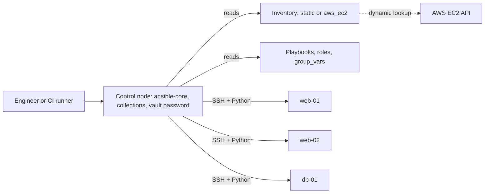
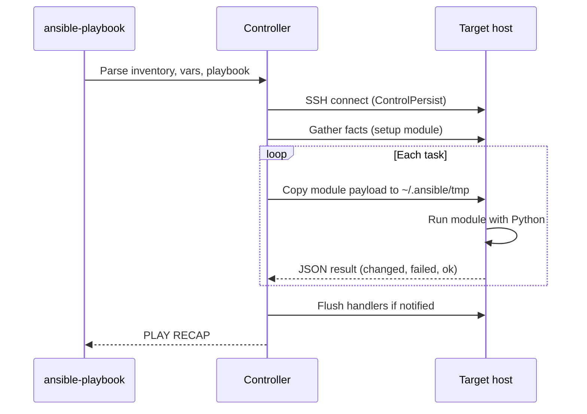
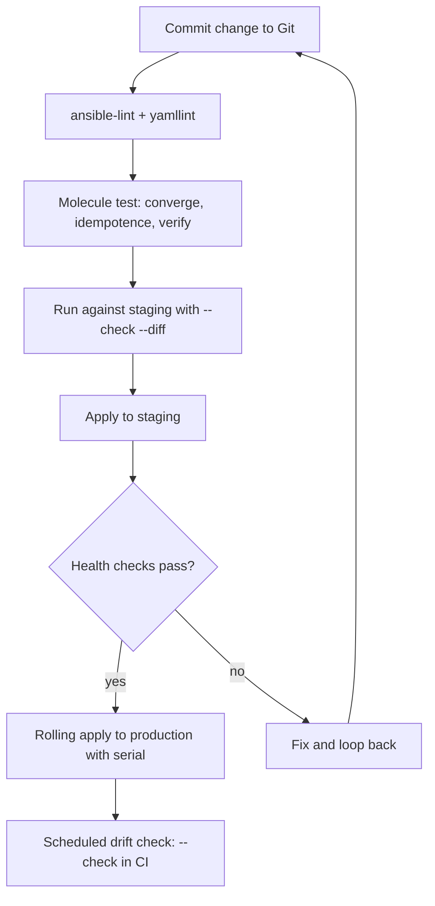
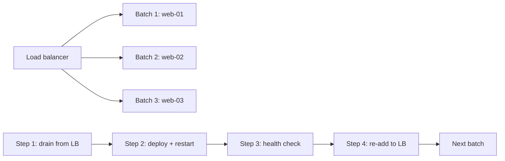

# Ansible & Configuration Management

<!-- DEVOPS-SHACK:HEADER -->

  
  
  
  
  

Part of <b><a href="https://github.com/jaiswaladi246/DevOps-Cloud-Interview-Preparation-by-DevOps-Shack">DevOps &amp; Cloud Interview Preparation</a></b> — created by <b><a href="https://www.youtube.com/@devopsshack">DevOps Shack</a></b>. Free to learn from; please credit DevOps Shack when sharing.

<!-- /DEVOPS-SHACK:HEADER -->

> Agentless configuration management, from your first ad-hoc command to rolling production deploys, vault-encrypted secrets and role testing with Molecule.

[🏠 Home](../README.md)

## What you'll master

- How Ansible works internally: control node, SSH, modules, the temporary `AnsiballZ` payload, facts and the play/task execution model
- Writing idempotent playbooks and knowing exactly when `command`/`shell` break idempotency
- Inventories (static, group_vars/host_vars, dynamic AWS via `amazon.aws.aws_ec2`) and variable precedence
- Roles, collections, Jinja2 templates, filters, loops, conditionals and handlers
- Ansible Vault for secrets, and how to keep them out of Git history and CI logs
- Rolling deployments with `serial`, `max_fail_percentage`, `wait_for`/`uri` health checks and `delegate_to`
- Testing roles with Molecule, `ansible-lint` and `--check --diff`
- Debugging and performance tuning: `-vvv`, `ANSIBLE_DEBUG`, pipelining, `forks`, `strategy: free`, `mitogen`-style trade-offs
- Explaining Ansible vs Terraform, Chef, Puppet and Salt in an interview without hand-waving

## Architecture: how Ansible reaches your fleet

Ansible is agentless. The control node holds the inventory, playbooks and roles, and pushes work to managed nodes over SSH (or WinRM for Windows). Nothing is installed on targets except Python.

In production the control node is usually a CI runner or a bastion-like "automation host" with a locked-down SSH key, not an engineer's laptop. Managed nodes need only SSH access and a Python interpreter.

## Execution flow: what happens when you run a playbook

For every task, Ansible builds a module payload, copies it to the target (unless pipelining is on), runs it and removes it. The JSON result decides `ok`, `changed`, `failed` or `skipped`. Handlers run only once per play, at the end of the play or at `meta: flush_handlers`.

## Configuration lifecycle: from code to a converged server

The key interview point is the second Molecule step: running converge twice and asserting zero `changed` tasks is how you prove idempotency, instead of hoping.

## Rolling deploy: how a zero-downtime update works

With `serial: 1` (or a percentage list such as `[1, 25%, 100%]`), Ansible finishes the whole play on one batch before touching the next. If a batch fails `max_fail_percentage`, the play aborts and the remaining hosts keep running the old version.

## Core concepts in 10 minutes

### Inventory and variables

An inventory maps hosts into groups. Static inventories are INI or YAML files, dynamic ones are plugins such as `amazon.aws.aws_ec2` that build groups from instance tags. Variables attach through `group_vars/` and `host_vars/` directories next to the inventory. Precedence has 22 levels; the practical rule is: role defaults are the weakest, `group_vars` beat defaults, `host_vars` beat `group_vars`, play `vars` beat those, and `-e` extra vars beat everything.

### Idempotency

A task should describe a desired state, not an action. `apt: name=nginx state=present` does nothing on the second run. `shell: apt install -y nginx` reports `changed` every time unless you add `creates:` or `changed_when`. Idempotency is the reason you can run the same playbook every hour as a drift check.

### Modules, tasks, plays, playbooks

A module is a unit of work (`ansible.builtin.copy`). A task calls one module. A play maps a group of hosts to tasks and roles. A playbook is a list of plays. Always use fully qualified collection names (`ansible.builtin.template`) so you never depend on which collection wins a short name.

### Roles and collections

A role is a standard directory layout (`tasks/`, `handlers/`, `templates/`, `defaults/`, `vars/`, `meta/`, `molecule/`) that makes automation reusable. A collection packages roles, modules, plugins and playbooks for distribution through Galaxy or Automation Hub. Pin collection versions in `requirements.yml`.

### Jinja2 and templates

`ansible.builtin.template` renders `.j2` files on the controller using facts and variables, then copies the result. Useful pieces: `{{ var | default('x') }}`, ``, `{{ ansible_facts['default_ipv4']['address'] }}`, `| to_nice_json`, `| ipaddr` (from `ansible.utils`). Pass `validate: 'nginx -t -c %s'` so a broken template never reaches the live path.

### Handlers

Handlers are tasks triggered by `notify` only when a task reports `changed`. They run once at the end of the play even if notified ten times. This is how you restart nginx only when its config actually changed. Gotcha: if a later task fails, pending handlers do not run unless `force_handlers: true`.

### Ansible Vault

Vault encrypts files or single values with AES256. Use `ansible-vault encrypt_string` for inline values and whole-file encryption for `vault.yml`. Keep the vault password in a file referenced by `vault_password_file` or fed by a CI secret, never in Git. A common pattern is `group_vars/prod/vars.yml` referencing `vault_db_password` defined in `group_vars/prod/vault.yml`.

### Error handling and control

`block/rescue/always` gives try/catch/finally. `failed_when` and `changed_when` redefine results. `any_errors_fatal`, `max_fail_percentage` and `serial` govern blast radius. `delegate_to` runs a task on a different host (for example the load balancer API call) while keeping the inventory host's variables.

### Performance

Turn on `pipelining = True` (needs `requiretty` off), `forks = 20` or higher, SSH `ControlPersist`, `gather_facts: false` where you do not need facts, `gather_subset`, fact caching, and `strategy: free` when hosts are independent. Avoid loops over `package` modules; pass a list to `name:` instead.

### Ansible vs the alternatives

Ansible is push, agentless, YAML. Puppet and Chef are pull, agent-based, Ruby DSLs with strong drift enforcement at scale. Salt supports both models and is fast thanks to ZeroMQ. Terraform provisions infrastructure (create the VPC and instances); Ansible configures what runs on them. They complement each other, and the overlap is smaller than interviewers pretend.

## Question banks

| Bank | Focus | Questions |
|------|-------|-----------|
| [Concepts](./concepts.md) | Internals, modules, variables, roles, Jinja2, vault, comparisons | 200 |
| [Scenarios](./scenarios.md) | "What would you do if..." design and decision questions | 200 |
| [Troubleshooting](./troubleshooting.md) | Real error messages, diagnosis and fixes | 200 |
| [Production](./production.md) | Architecture, security, scale, performance, rapid-fire commands | 200 |

## Learning path

**Beginner**
- [ ] Install `ansible-core` and run `ansible all -m ping` against one VM
- [ ] Write an INI inventory with two groups and use `group_vars`
- [ ] Run ad-hoc commands with `-m apt`, `-m service`, `-m copy`
- [ ] Write a first playbook that installs and starts nginx
- [ ] Understand `changed` vs `ok` and re-run to prove idempotency
- [ ] Use `--check`, `--diff`, `--limit`, `--tags`

**Intermediate**
- [ ] Split a playbook into roles with `defaults/` and `meta/`
- [ ] Render config with Jinja2 templates and validate before replacing
- [ ] Use handlers, `notify`, `listen` and `meta: flush_handlers`
- [ ] Encrypt secrets with Ansible Vault and use vault IDs
- [ ] Use loops, `when`, `register`, `block/rescue/always`
- [ ] Install collections and pin them in `requirements.yml`
- [ ] Build a dynamic AWS inventory with `aws_ec2` and `keyed_groups`

**Advanced**
- [ ] Do a rolling deploy with `serial`, `max_fail_percentage` and health checks
- [ ] Test a role with Molecule (converge, idempotence, verify)
- [ ] Write a custom filter plugin or a small custom module
- [ ] Tune performance: pipelining, forks, fact caching, `strategy: free`
- [ ] Run Ansible from CI with a vault password secret and an SSH agent
- [ ] Build an execution environment with `ansible-builder` for AWX/AAP

## Hands-on and references

- [Hands-on lab: configure a web fleet with roles, vault, dynamic inventory and rolling deploy](./hands-on-lab.md)
- [Assignments: 25 graded exercises](./assignments.md)
- [Cheatsheet: commands, config and top 15 one-liners](./cheatsheet.md)

[🏠 Home](../README.md)

<!-- DEVOPS-SHACK:FOOTER -->
---

### 🚀 Made with ❤️ by [DevOps Shack](https://www.youtube.com/@devopsshack)

**Learn DevOps, DevSecOps, Cloud and Kubernetes the practical way.**

[▶️ YouTube — DevOps Shack](https://www.youtube.com/@devopsshack) · [▶️ Hindi — @shackverse](https://www.youtube.com/@shackverse) · [🎓 devopsshack.com](https://devopsshack.com) · [📸 Instagram @devopsshack](https://www.instagram.com/devopsshack)

[🏠 Back to Home](../README.md) · [⭐ Star the original repo](https://github.com/jaiswaladi246/DevOps-Cloud-Interview-Preparation-by-DevOps-Shack)

© DevOps Shack · Licensed CC BY-NC-SA 4.0 · If you found this copy anywhere other than <a href="https://github.com/jaiswaladi246/DevOps-Cloud-Interview-Preparation-by-DevOps-Shack">github.com/jaiswaladi246</a>, the original and latest version is maintained by DevOps Shack.

<!-- /DEVOPS-SHACK:FOOTER -->
