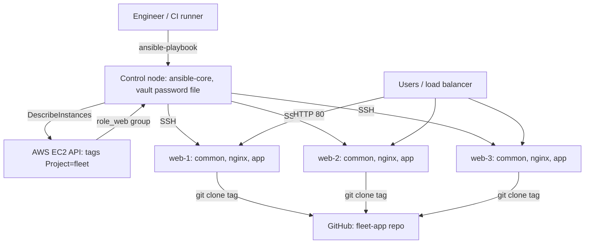

# Ansible Hands-on Lab: Configure a Web Fleet with Roles, Vault, Dynamic Inventory and Rolling Deploys

<!-- DEVOPS-SHACK:HEADER -->
<p align="center">
  <a href="https://www.youtube.com/@devopsshack"></a>
  <a href="https://www.youtube.com/@shackverse"></a>
  <a href="https://devopsshack.com"></a>
  <a href="https://www.instagram.com/devopsshack"></a>
  <a href="https://github.com/jaiswaladi246/DevOps-Cloud-Interview-Preparation-by-DevOps-Shack"></a>
</p>
<p align="center"><sub>Part of <b><a href="https://github.com/jaiswaladi246/DevOps-Cloud-Interview-Preparation-by-DevOps-Shack">DevOps &amp; Cloud Interview Preparation</a></b> — created by <b><a href="https://www.youtube.com/@devopsshack">DevOps Shack</a></b>. Free to learn from; please credit DevOps Shack when sharing.</sub></p>
<!-- /DEVOPS-SHACK:HEADER -->

> One end-to-end project: harden three Ubuntu EC2 servers, run nginx from Jinja2 templates, deploy a Flask app from Git, keep secrets in Ansible Vault, discover hosts through the AWS API, roll out releases one host at a time with health checks, and test a role with Molecule.

[⬅ Back to Ansible](./README.md) · [🏠 Home](../README.md)

## Goal

By the end you will have a repeatable `fleet-config` repo that turns three blank EC2 instances into a hardened, load-balancer-ready web tier, and can ship a new app version with no downtime and automatic rollback on a failed health check.

| Capability | Where it is built |
|------------|-------------------|
| Hardening (SSH, firewall, fail2ban, sysctl, auto-updates) | `roles/common` |
| nginx with templated config, validated before use | `roles/nginx` |
| App deploy from Git, systemd unit, handlers | `roles/app` |
| Secrets | Ansible Vault, `group_vars/role_web/vault.yml` |
| Host discovery | `amazon.aws.aws_ec2` dynamic inventory |
| Zero-downtime release | `deploy.yml` with `serial` and `uri` health checks |
| Role testing | Molecule (Docker driver) on `roles/nginx` |

## Architecture



On each web host, nginx listens on port 80 and proxies to gunicorn on `127.0.0.1:8000`. The path `/lb-health` is answered by nginx itself and returns 503 when a maintenance flag file exists. That is how we drain a host during a rolling deploy.

## Prerequisites

- An AWS account with permission to create EC2 instances and security groups. Three `t3.micro` instances for an hour cost well under a dollar; clean up at the end.
- AWS CLI v2 configured (`aws sts get-caller-identity` works) and region `ap-south-1` (change it everywhere if you prefer another).
- A Linux or macOS workstation (or WSL2) with Python 3.11+, Git, and Docker (for Molecule only).
- A GitHub account, to host the tiny app repository.

## Project layout

```text
fleet-config/
├── ansible.cfg
├── requirements.yml
├── site.yml
├── deploy.yml
├── .gitignore
├── inventories/
│   ├── aws_ec2.yml
│   └── group_vars/
│       ├── all.yml
│       └── role_web/
│           ├── vars.yml
│           └── vault.yml        # encrypted
└── roles/
    ├── common/   (tasks, handlers, defaults)
    ├── nginx/    (tasks, handlers, defaults, templates, molecule)
    └── app/      (tasks, handlers, defaults, templates)
```

---

## Step 1. Install the tooling

```bash
python3 -m venv ~/.venvs/ansible && source ~/.venvs/ansible/bin/activate
pip install --upgrade pip
pip install ansible-core ansible-lint molecule "molecule-plugins[docker]" boto3 botocore docker

ansible --version        # ansible-core 2.18 or newer
molecule --version
```

**Verify:** `ansible --version` prints a config file of `None` for now and the Python interpreter of your venv.

## Step 2. Create the project, `ansible.cfg` and collections

```bash
mkdir -p fleet-config/{inventories/group_vars/role_web,roles} && cd fleet-config
git init
printf '.vault_pass\n*.pem\n__pycache__/\n.cache/\n' > .gitignore
```

`ansible.cfg`:

```ini
[defaults]
inventory            = inventories/aws_ec2.yml
remote_user          = ubuntu
private_key_file     = ~/.ssh/fleet-key.pem
vault_password_file  = .vault_pass
forks                = 20
retry_files_enabled  = False
interpreter_python   = auto_silent

[ssh_connection]
pipelining = True
ssh_args   = -o ControlMaster=auto -o ControlPersist=60s -o StrictHostKeyChecking=accept-new
```

`requirements.yml`:

```yaml
---
collections:
  - name: amazon.aws
    version: ">=9.0.0"
  - name: community.general
    version: ">=10.0.0"
  - name: ansible.posix
    version: ">=1.6.0"
```

```bash
ansible-galaxy collection install -r requirements.yml
ansible-galaxy collection list | grep -E 'amazon.aws|community.general|ansible.posix'
```

**Verify:** all three collections are listed. `ansible --version` now shows `config file = .../fleet-config/ansible.cfg`.

## Step 3. Launch three EC2 instances

We tag instances `Project=fleet`, `Role=web`, `Env=prod`. Those tags are what the dynamic inventory keys on.

```bash
export AWS_REGION=ap-south-1

aws ec2 create-key-pair --key-name fleet-key --query KeyMaterial --output text > ~/.ssh/fleet-key.pem
chmod 400 ~/.ssh/fleet-key.pem

MY_IP=$(curl -s https://checkip.amazonaws.com)
SG_ID=$(aws ec2 create-security-group --group-name fleet-web-sg \
  --description "fleet web tier" --query GroupId --output text)
aws ec2 authorize-security-group-ingress --group-id "$SG_ID" --protocol tcp --port 22 --cidr "${MY_IP}/32"
aws ec2 authorize-security-group-ingress --group-id "$SG_ID" --protocol tcp --port 80 --cidr 0.0.0.0/0

AMI_ID=$(aws ssm get-parameter \
  --name /aws/service/canonical/ubuntu/server/24.04/stable/current/amd64/hvm/ebs-gp3/ami-id \
  --query Parameter.Value --output text)

for i in 1 2 3; do
  aws ec2 run-instances --image-id "$AMI_ID" --instance-type t3.micro \
    --key-name fleet-key --security-group-ids "$SG_ID" --count 1 \
    --tag-specifications "ResourceType=instance,Tags=[{Key=Name,Value=web-$i},{Key=Project,Value=fleet},{Key=Role,Value=web},{Key=Env,Value=prod}]" \
    --query 'Instances[0].InstanceId' --output text
done
```

Wait about a minute, then check:

```bash
aws ec2 describe-instances --filters "Name=tag:Project,Values=fleet" "Name=instance-state-name,Values=running" \
  --query 'Reservations[].Instances[].[Tags[?Key==`Name`]|[0].Value,PublicIpAddress]' --output table
```

**Verify:** three rows `web-1`, `web-2`, `web-3` with public IPs.

> In a real VPC you would put these in private subnets behind an ALB and reach them through SSM or a bastion. Public IPs keep the lab short.

## Step 4. Dynamic inventory with `aws_ec2`

`inventories/aws_ec2.yml` (the filename must end in `aws_ec2.yml` or `aws_ec2.yaml`):

```yaml
---
plugin: amazon.aws.aws_ec2
regions:
  - ap-south-1
filters:
  tag:Project: fleet
  instance-state-name: running
keyed_groups:
  - key: tags.Role
    prefix: role
  - key: tags.Env
    prefix: env
hostnames:
  - tag:Name
compose:
  ansible_host: public_ip_address
```

```bash
ansible-inventory --graph
ansible role_web -m ansible.builtin.ping
```

Expected graph:

```text
@all:
  |--@ungrouped:
  |--@env_prod:
  |  |--web-1
  |  |--web-2
  |  |--web-3
  |--@role_web:
  |  |--web-1
  |  |--web-2
  |  |--web-3
```

**Verify:** three `pong` replies. If you see `UNREACHABLE`, jump to the common errors section at the bottom.

## Step 5. Vault-encrypted secrets

Generate a vault password, store it outside Git, and create the encrypted file.

```bash
openssl rand -base64 32 > .vault_pass && chmod 600 .vault_pass

ansible-vault create inventories/group_vars/role_web/vault.yml
```

In the editor that opens, enter:

```yaml
vault_app_secret_key: "replace-with-a-long-random-string"
```

Plain variables reference the vaulted one, so `grep` tells you where a secret is used without decrypting anything. `inventories/group_vars/role_web/vars.yml`:

```yaml
---
app_secret_key: "{{ vault_app_secret_key }}"
app_repo: "https://github.com/YOUR_GITHUB_USER/fleet-app.git"
app_version: "v1.0.0"
nginx_server_name: "_"
```

`inventories/group_vars/all.yml`:

```yaml
---
ansible_python_interpreter: /usr/bin/python3
```

```bash
head -1 inventories/group_vars/role_web/vault.yml    # $ANSIBLE_VAULT;1.1;AES256
ansible-vault view inventories/group_vars/role_web/vault.yml
```

**Verify:** the first line shows the `$ANSIBLE_VAULT` header and `view` decrypts using `.vault_pass` from `ansible.cfg`.

## Step 6. The tiny app repo

Create a new GitHub repo `fleet-app` with three files. This is what the `app` role deploys.

`app.py`:

```python
import os
from flask import Flask, jsonify

app = Flask(__name__)
BASE = os.path.dirname(os.path.abspath(__file__))

def version():
    with open(os.path.join(BASE, "VERSION")) as f:
        return f.read().strip()

@app.get("/")
def index():
    return jsonify(app="fleet-app", version=version(), host=os.uname().nodename)

@app.get("/health")
def health():
    return jsonify(status="ok", version=version())
```

`requirements.txt`:

```text
flask==3.1.*
gunicorn==23.*
```

`VERSION` contains `1.0.0`. Commit, then tag two releases and one deliberately broken one:

```bash
git add . && git commit -m "fleet-app 1.0.0" && git tag v1.0.0 && git push origin main --tags

echo 1.1.0 > VERSION && git commit -am "1.1.0" && git tag v1.1.0

# broken release: /health returns 500
sed -i 's/return jsonify(status="ok", version=version())/return jsonify(status="broken"), 500/' app.py
echo 1.2.0-bad > VERSION && git commit -am "1.2.0 broken" && git tag v1.2.0-bad
git push origin main --tags
```

**Verify:** `git ls-remote --tags origin` lists `v1.0.0`, `v1.1.0` and `v1.2.0-bad`. Put your own GitHub username into `app_repo` in `vars.yml`.

## Step 7. Role `common`: baseline hardening

```bash
for r in common nginx app; do ansible-galaxy role init --init-path roles "$r"; done
```

`roles/common/defaults/main.yml`:

```yaml
---
common_packages:
  - acl
  - curl
  - ufw
  - fail2ban
  - chrony
  - unattended-upgrades
common_ssh_port: 22
common_allowed_ports: ["22", "80"]
common_sshd_settings:
  PermitRootLogin: "no"
  PasswordAuthentication: "no"
  X11Forwarding: "no"
  MaxAuthTries: "3"
  ClientAliveInterval: "300"
  ClientAliveCountMax: "2"
common_sysctl:
  net.ipv4.tcp_syncookies: "1"
  net.ipv4.conf.all.rp_filter: "1"
  net.ipv4.conf.all.accept_redirects: "0"
  net.ipv4.conf.all.send_redirects: "0"
```

`roles/common/tasks/main.yml`:

```yaml
---
- name: Install baseline packages
  ansible.builtin.apt:
    name: "{{ common_packages }}"
    state: present
    update_cache: true
    cache_valid_time: 3600

- name: Harden sshd (validated before it replaces the live file)
  ansible.builtin.lineinfile:
    path: /etc/ssh/sshd_config
    regexp: '^#?\s*{{ item.key }}\s'
    line: "{{ item.key }} {{ item.value }}"
    validate: /usr/sbin/sshd -t -f %s
  loop: "{{ common_sshd_settings | dict2items }}"
  notify: Restart ssh

- name: Allow required ports before enabling the firewall
  community.general.ufw:
    rule: allow
    port: "{{ item }}"
    proto: tcp
  loop: "{{ common_allowed_ports }}"
  when: ansible_virtualization_type | default('') != 'docker'

- name: Enable ufw with default deny incoming
  community.general.ufw:
    state: enabled
    policy: deny
    direction: incoming
  when: ansible_virtualization_type | default('') != 'docker'

- name: Apply kernel hardening
  ansible.posix.sysctl:
    name: "{{ item.key }}"
    value: "{{ item.value }}"
    sysctl_set: true
    reload: true
  loop: "{{ common_sysctl | dict2items }}"
  when: ansible_virtualization_type | default('') != 'docker'

- name: Configure fail2ban sshd jail
  ansible.builtin.copy:
    dest: /etc/fail2ban/jail.d/sshd.local
    content: |
      [sshd]
      enabled = true
      maxretry = 4
      findtime = 10m
      bantime = 1h
    owner: root
    group: root
    mode: "0644"
  notify: Restart fail2ban

- name: Enable unattended security upgrades
  ansible.builtin.copy:
    dest: /etc/apt/apt.conf.d/20auto-upgrades
    content: |
      APT::Periodic::Update-Package-Lists "1";
      APT::Periodic::Unattended-Upgrade "1";
    owner: root
    group: root
    mode: "0644"

- name: Ensure time sync and fail2ban are running
  ansible.builtin.service:
    name: "{{ item }}"
    state: started
    enabled: true
  loop: [chrony, fail2ban]
```

`roles/common/handlers/main.yml`:

```yaml
---
- name: Restart ssh
  ansible.builtin.service:
    name: ssh
    state: restarted

- name: Restart fail2ban
  ansible.builtin.service:
    name: fail2ban
    state: restarted
```

> The firewall rule for SSH is added before `ufw` is enabled on purpose. Reverse the order and you lock yourself out. Keep a second SSH session open the first time you run a hardening role.

## Step 8. Role `nginx`: Jinja2 templates and validation

`roles/nginx/defaults/main.yml`:

```yaml
---
nginx_server_name: "_"
nginx_upstream: "127.0.0.1:8000"
nginx_worker_connections: 1024
nginx_client_max_body_size: "5m"
nginx_maintenance_flag: /var/www/maintenance.flag
```

`roles/nginx/templates/nginx.conf.j2`:

```jinja
# Managed by Ansible. Local edits will be overwritten.
user www-data;
worker_processes auto;
pid /run/nginx.pid;
include /etc/nginx/modules-enabled/*.conf;

events {
    worker_connections {{ nginx_worker_connections }};
}

http {
    include       /etc/nginx/mime.types;
    default_type  application/octet-stream;
    sendfile      on;
    server_tokens off;
    client_max_body_size {{ nginx_client_max_body_size }};

    log_format main '$remote_addr "$request" $status $body_bytes_sent '
                    'rt=$request_time host={{ inventory_hostname }}';
    access_log /var/log/nginx/access.log main;
    error_log  /var/log/nginx/error.log warn;

    include /etc/nginx/conf.d/*.conf;
}
```

`roles/nginx/templates/app.conf.j2`:

```jinja
# Managed by Ansible.
upstream fleet_app {
    server {{ nginx_upstream }};
    keepalive 16;
}

server {
    listen 80 default_server;
    server_name {{ nginx_server_name }};

    add_header X-Content-Type-Options nosniff always;
    add_header X-Frame-Options DENY always;

    # Load balancer health endpoint, answered by nginx itself.
    # Creating the flag file drains this host.
    location = /lb-health {
        access_log off;
        default_type text/plain;
        if (-f {{ nginx_maintenance_flag }}) {
            return 503 "draining\n";
        }
        return 200 "ok\n";
    }

    location / {
        proxy_pass http://fleet_app;
        proxy_http_version 1.1;
        proxy_set_header Connection "";
        proxy_set_header Host $host;
        proxy_set_header X-Real-IP $remote_addr;
        proxy_set_header X-Forwarded-For $proxy_add_x_forwarded_for;
        proxy_read_timeout 30s;
    }
}
```

`roles/nginx/tasks/main.yml`:

```yaml
---
- name: Install nginx
  ansible.builtin.apt:
    name: nginx
    state: present
    update_cache: true
    cache_valid_time: 3600

- name: Ensure web root exists for the maintenance flag
  ansible.builtin.file:
    path: "{{ nginx_maintenance_flag | dirname }}"
    state: directory
    owner: root
    group: root
    mode: "0755"

- name: Render main nginx.conf (validated with nginx -t before replacing)
  ansible.builtin.template:
    src: nginx.conf.j2
    dest: /etc/nginx/nginx.conf
    owner: root
    group: root
    mode: "0644"
    validate: /usr/sbin/nginx -t -c %s
  notify: Reload nginx

- name: Render app server block
  ansible.builtin.template:
    src: app.conf.j2
    dest: /etc/nginx/conf.d/app.conf
    owner: root
    group: root
    mode: "0644"
  notify: Reload nginx

- name: Check the full configuration
  ansible.builtin.command: /usr/sbin/nginx -t
  changed_when: false

- name: Ensure nginx is enabled and running
  ansible.builtin.service:
    name: nginx
    state: started
    enabled: true
```

`roles/nginx/handlers/main.yml`:

```yaml
---
- name: Reload nginx
  ansible.builtin.service:
    name: nginx
    state: reloaded
```

The `validate:` option on `nginx.conf.j2` is the safety net: the rendered file is written to a temp path, `nginx -t -c` runs against it, and the real file is replaced only on success. The server block cannot be validated alone, so the `nginx -t` task after it fails the run loudly before any reload happens.

## Step 9. Role `app`: deploy from Git with handlers

`roles/app/defaults/main.yml`:

```yaml
---
app_user: fleetapp
app_dir: /opt/fleet-app
app_repo: ""
app_version: "main"
app_port: 8000
app_workers: 2
app_secret_key: ""
```

`roles/app/templates/fleet-app.service.j2`:

```ini
[Unit]
Description=fleet-app (gunicorn)
After=network.target

[Service]
User={{ app_user }}
Group={{ app_user }}
WorkingDirectory={{ app_dir }}/src
EnvironmentFile=/etc/fleet-app.env
ExecStart={{ app_dir }}/venv/bin/gunicorn --workers {{ app_workers }} --bind 127.0.0.1:{{ app_port }} app:app
Restart=on-failure
NoNewPrivileges=true
PrivateTmp=true
ProtectSystem=full

[Install]
WantedBy=multi-user.target
```

`roles/app/templates/fleet-app.env.j2`:

```jinja
SECRET_KEY={{ app_secret_key }}
```

`roles/app/tasks/main.yml`:

```yaml
---
- name: Install Git and Python venv support
  ansible.builtin.apt:
    name: [git, python3-venv, python3-pip]
    state: present
    cache_valid_time: 3600

- name: Create the application user
  ansible.builtin.user:
    name: "{{ app_user }}"
    system: true
    shell: /usr/sbin/nologin
    create_home: false

- name: Create application directory
  ansible.builtin.file:
    path: "{{ app_dir }}"
    state: directory
    owner: "{{ app_user }}"
    group: "{{ app_user }}"
    mode: "0755"

- name: Check out the requested version
  ansible.builtin.git:
    repo: "{{ app_repo }}"
    dest: "{{ app_dir }}/src"
    version: "{{ app_version }}"
    force: true
  become_user: "{{ app_user }}"
  register: app_checkout
  notify: Restart fleet-app

- name: Install Python dependencies into the venv
  ansible.builtin.pip:
    requirements: "{{ app_dir }}/src/requirements.txt"
    virtualenv: "{{ app_dir }}/venv"
    virtualenv_command: python3 -m venv
  become_user: "{{ app_user }}"
  notify: Restart fleet-app

- name: Write secrets to the env file (never logged)
  ansible.builtin.template:
    src: fleet-app.env.j2
    dest: /etc/fleet-app.env
    owner: root
    group: "{{ app_user }}"
    mode: "0640"
  no_log: true
  notify: Restart fleet-app

- name: Install the systemd unit
  ansible.builtin.template:
    src: fleet-app.service.j2
    dest: /etc/systemd/system/fleet-app.service
    owner: root
    group: root
    mode: "0644"
  notify:
    - Reload systemd
    - Restart fleet-app

- name: Enable and start fleet-app
  ansible.builtin.systemd_service:
    name: fleet-app
    enabled: true
    state: started
    daemon_reload: true
```

`roles/app/handlers/main.yml`:

```yaml
---
- name: Reload systemd
  ansible.builtin.systemd_service:
    daemon_reload: true

- name: Restart fleet-app
  ansible.builtin.systemd_service:
    name: fleet-app
    state: restarted
```

> `become_user` with a non-root user needs the `acl` package on the target (installed by `common`). Without it Ansible fails with "Failed to set permissions on the temporary files Ansible needs to create when becoming an unprivileged user". Running `ansible-playbook` with `pipelining = True` avoids the temp files too, but `acl` is the portable fix.
>
> The `pip` task reports `changed` only when a package was installed or changed, so a clean second run does not restart the service.

## Step 10. `site.yml` and the first converge

`site.yml`:

```yaml
---
- name: Configure the web fleet
  hosts: role_web
  become: true
  roles:
    - common
    - nginx
    - app
```

Dry-run first, then apply:

```bash
ansible-playbook site.yml --syntax-check
ansible-playbook site.yml --check --diff --limit web-1     # preview on one host
ansible-playbook site.yml
```

`--check` on a blank host fails later tasks that depend on earlier ones (for example enabling a service whose package was never installed). That is normal; the real run is the proof.

**Verify:**

```bash
IPS=$(aws ec2 describe-instances --filters "Name=tag:Project,Values=fleet" "Name=instance-state-name,Values=running" \
  --query 'Reservations[].Instances[].PublicIpAddress' --output text)
for ip in $IPS; do curl -s "http://$ip/"; echo; done
```

You should see JSON from each host with `"version":"1.0.0"` and three different `host` values. `PLAY RECAP` must show `failed=0 unreachable=0`.

## Step 11. Prove idempotency

```bash
ansible-playbook site.yml
```

The recap must read `changed=0` for all three hosts. Any task still showing `changed` is a bug in your role, usually a `command`/`shell` task without `changed_when`, or a template with a value that varies per run (a timestamp, a random value).

```text
PLAY RECAP *********************************************************************
web-1 : ok=27 changed=0 unreachable=0 failed=0 skipped=0 rescued=0 ignored=0
web-2 : ok=27 changed=0 unreachable=0 failed=0 skipped=0 rescued=0 ignored=0
web-3 : ok=27 changed=0 unreachable=0 failed=0 skipped=0 rescued=0 ignored=0
```

Now prove handlers fire only on real changes. Edit `nginx_worker_connections` in `roles/nginx/defaults/main.yml` to `2048` and rerun. Only the `nginx.conf` task and the `Reload nginx` handler should change, on all three hosts.

## Step 12. Rolling deploy with `serial` and health checks

`deploy.yml`:

```yaml
---
- name: Rolling deploy of fleet-app
  hosts: role_web
  become: true
  serial: "{{ rolling_serial | default(1) }}"
  max_fail_percentage: 0
  vars:
    app_version: "{{ target_version | mandatory }}"
    drain_wait_seconds: 10

  tasks:
    - name: Record the currently deployed commit (for rollback)
      ansible.builtin.command: git -C {{ app_dir | default('/opt/fleet-app') }}/src rev-parse HEAD
      register: previous_commit
      changed_when: false
      failed_when: false

    - name: Deploy with automatic rollback
      block:
        - name: Drain this host (load balancer sees 503)
          ansible.builtin.file:
            path: "{{ nginx_maintenance_flag | default('/var/www/maintenance.flag') }}"
            state: touch
            mode: "0644"
            modification_time: preserve
            access_time: preserve

        - name: Wait for the load balancer to notice
          ansible.builtin.pause:
            seconds: "{{ drain_wait_seconds }}"

        - name: Deploy the new version
          ansible.builtin.include_role:
            name: app

        - name: Apply pending restarts before the health check
          ansible.builtin.meta: flush_handlers

        - name: Health check through nginx
          ansible.builtin.uri:
            url: http://127.0.0.1/health
            status_code: 200
            return_content: true
          register: health
          retries: 10
          delay: 3
          until: health.status == 200

        - name: Put the host back in rotation
          ansible.builtin.file:
            path: "{{ nginx_maintenance_flag | default('/var/www/maintenance.flag') }}"
            state: absent

      rescue:
        - name: Roll back to the previous commit
          ansible.builtin.git:
            repo: "{{ app_repo }}"
            dest: "{{ app_dir | default('/opt/fleet-app') }}/src"
            version: "{{ previous_commit.stdout }}"
            force: true
          become_user: "{{ app_user | default('fleetapp') }}"
          when: previous_commit.rc == 0

        - name: Restart the service on the old code
          ansible.builtin.systemd_service:
            name: fleet-app
            state: restarted
          when: previous_commit.rc == 0

        - name: Put the rolled-back host back in rotation
          ansible.builtin.file:
            path: "{{ nginx_maintenance_flag | default('/var/www/maintenance.flag') }}"
            state: absent
          when: previous_commit.rc == 0

        - name: Abort the rollout so remaining hosts stay on the old version
          ansible.builtin.fail:
            msg: "Deploy of {{ app_version }} failed health check on {{ inventory_hostname }}; rolled back."
```

Run a good release:

```bash
ansible-playbook deploy.yml -e target_version=v1.1.0
```

In another terminal, poll while it runs. Because only one host drains at a time, the endpoint never fully disappears:

```bash
for ip in $IPS; do echo -n "$ip /lb-health: "; curl -s -o /dev/null -w '%{http_code}\n' "http://$ip/lb-health"; done
```

**Verify:** the play runs as three batches (one `PLAY` header, tasks executed host by host in order), and afterwards `curl http://<ip>/` shows `"version":"1.1.0"` on every host.

Variants worth trying:

```bash
ansible-playbook deploy.yml -e target_version=v1.1.0 -e rolling_serial=50%
ansible-playbook deploy.yml -e target_version=v1.0.0 --check --diff
```

## Step 13. Break it on purpose

Deploy the release whose `/health` returns 500:

```bash
ansible-playbook deploy.yml -e target_version=v1.2.0-bad
```

Expected behaviour on the first host:

```text
TASK [Health check through nginx] ***
FAILED - RETRYING: [web-1]: Health check through nginx (10 retries left).
...
fatal: [web-1]: FAILED! => {"msg": "Status code was 500 and not [200]: HTTP Error 500: INTERNAL SERVER ERROR"}
TASK [Roll back to the previous commit] ***
TASK [Abort the rollout so remaining hosts stay on the old version] ***
fatal: [web-1]: FAILED! => {"msg": "Deploy of v1.2.0-bad failed health check on web-1; rolled back."}

PLAY RECAP ***
web-1 : ok=.. changed=.. failed=1 rescued=1
web-2 : (not touched)
web-3 : (not touched)
```

**Verify:** all three hosts still serve `1.1.0`. One host failed, was rolled back and re-added; the other two never saw the bad code. That is what `serial: 1` plus `max_fail_percentage: 0` buys you.

## Step 14. Test the `nginx` role with Molecule

```bash
cd roles/nginx
mkdir -p molecule/default
```

`roles/nginx/molecule/default/molecule.yml`:

```yaml
---
driver:
  name: docker
platforms:
  - name: nginx-ubuntu2404
    image: geerlingguy/docker-ubuntu2404-ansible:latest
    command: ""
    privileged: true
    cgroupns_mode: host
    volumes:
      - /sys/fs/cgroup:/sys/fs/cgroup:rw
    pre_build_image: true
provisioner:
  name: ansible
verifier:
  name: ansible
```

`roles/nginx/molecule/default/converge.yml`:

```yaml
---
- name: Converge
  hosts: all
  become: true
  vars:
    nginx_server_name: example.test
    nginx_worker_connections: 512
  roles:
    - role: nginx
```

`roles/nginx/molecule/default/verify.yml`:

```yaml
---
- name: Verify
  hosts: all
  gather_facts: false
  tasks:
    - name: Gather service facts
      ansible.builtin.service_facts:

    - name: nginx is running and enabled
      ansible.builtin.assert:
        that:
          - ansible_facts.services['nginx.service'].state == 'running'
          - ansible_facts.services['nginx.service'].status == 'enabled'

    - name: Rendered config contains our tuning
      ansible.builtin.command: grep -q 'worker_connections 512;' /etc/nginx/nginx.conf
      changed_when: false

    - name: Version is hidden
      ansible.builtin.command: grep -q 'server_tokens off;' /etc/nginx/nginx.conf
      changed_when: false

    - name: Health endpoint answers 200
      ansible.builtin.uri:
        url: http://127.0.0.1/lb-health
        status_code: 200

    - name: Drain flag turns the endpoint into 503
      block:
        - name: Create flag
          ansible.builtin.file:
            path: /var/www/maintenance.flag
            state: touch
            mode: "0644"
        - name: Expect 503
          ansible.builtin.uri:
            url: http://127.0.0.1/lb-health
            status_code: 503
      always:
        - name: Remove flag
          ansible.builtin.file:
            path: /var/www/maintenance.flag
            state: absent
```

Run the full lifecycle:

```bash
molecule test
```

Molecule runs `dependency, cleanup, destroy, syntax, create, prepare, converge, idempotence, side_effect, verify, cleanup, destroy` in order. The `idempotence` step runs your role a second time and fails if any task reports `changed`. During development use `molecule converge`, `molecule verify` and `molecule login` against a live container, then `molecule destroy`.

**Verify:** the output ends with `Verifier completed successfully.` and the idempotence step prints `Idempotence completed successfully.`

> If the container cannot start systemd, check that Docker runs with cgroup v2 and that `cgroupns_mode: host` plus the `/sys/fs/cgroup` volume are set exactly as above.

## Step 15. Lint and run it from CI

```bash
cd ../..
ansible-lint --profile production
yamllint . 2>/dev/null || true
```

A minimal GitHub Actions workflow (`.github/workflows/ansible.yml`) that lints and tests the role on every pull request:

```yaml
name: ansible-ci
on: [pull_request]
jobs:
  test:
    runs-on: ubuntu-24.04
    steps:
      - uses: actions/checkout@v4
      - uses: actions/setup-python@v5
        with:
          python-version: "3.12"
      - run: pip install ansible-core ansible-lint molecule "molecule-plugins[docker]" docker
      - run: ansible-lint --profile production
      - run: cd roles/nginx && molecule test
```

For real deploys from CI, store the vault password as an encrypted secret and write it to a file only for the job:

```bash
echo "$VAULT_PASSWORD" > .vault_pass && chmod 600 .vault_pass
ansible-playbook site.yml --diff
rm -f .vault_pass
```

## Step 16. Drift detection

Someone logs in and edits `nginx.conf` by hand. Simulate it and find it:

```bash
ansible web-2 -b -m ansible.builtin.lineinfile -a "path=/etc/nginx/nginx.conf regexp='^worker_processes' line='worker_processes 1;'"
ansible-playbook site.yml --check --diff --limit web-2
```

The diff shows the template wanting to restore `worker_processes auto;`. Run the playbook without `--check` to converge. Scheduling the `--check` run nightly in CI and alerting on `changed > 0` turns Ansible into a drift detector.

## Cleanup

```bash
ids=$(aws ec2 describe-instances --filters "Name=tag:Project,Values=fleet" "Name=instance-state-name,Values=running,stopped" \
  --query 'Reservations[].Instances[].InstanceId' --output text)
aws ec2 terminate-instances --instance-ids $ids
aws ec2 wait instance-terminated --instance-ids $ids

aws ec2 delete-security-group --group-name fleet-web-sg
aws ec2 delete-key-pair --key-name fleet-key
rm -f ~/.ssh/fleet-key.pem .vault_pass

cd roles/nginx && molecule destroy
```

## What to say in an interview about this project

- "I built a role-based configuration layer for a web fleet: a `common` role for CIS-style baseline hardening, an `nginx` role driven by Jinja2 templates, and an `app` role that deploys tagged releases from Git."
- "Discovery is dynamic. The `aws_ec2` inventory plugin builds `role_web` and `env_prod` groups from instance tags, so there is no inventory file to keep in sync when autoscaling replaces instances."
- "Secrets live in Ansible Vault. Plain variables point to `vault_` variables so reviewers can see usage without decrypting, and `no_log: true` keeps values out of the output. CI gets the vault password from its secret store."
- "Deploys are rolling: `serial: 1`, `max_fail_percentage: 0`, a drain flag the load balancer health check sees, a `uri` health check with retries, and a `rescue` block that rolls back to the previous commit and aborts so untouched hosts stay on the old version."
- "Roles are idempotent and proven so. Molecule's `idempotence` step fails the build if a second converge changes anything, and a nightly `--check --diff` catches manual drift."
- Be ready for follow-ups: why `validate:` on templates, what happens to handlers when a task fails (`force_handlers`), why `acl` is needed for `become_user`, and why Terraform would create these instances while Ansible configures them.

## Common errors and fixes

| Error | Cause | Fix |
|-------|-------|-----|
| `UNREACHABLE! ... Permission denied (publickey)` | Wrong user or key | Ubuntu AMIs use `ubuntu`; check `private_key_file` and key mode `chmod 400` |
| `UNREACHABLE! ... Connection timed out` | Security group does not allow your current IP on 22 | Re-run `authorize-security-group-ingress` with the new `/32` |
| `ansible-inventory --graph` shows only `@ungrouped` | Filename does not end with `aws_ec2.yml`, or filters match nothing | Rename the file; test the filter with `aws ec2 describe-instances --filters ...` |
| `Failed to import the required Python library (botocore or boto3)` | Libraries missing from the venv running Ansible | `pip install boto3 botocore` in the same venv |
| `Attempting to decrypt but no vault secrets found` | `vault_password_file` unset or the file is missing | Check `ansible.cfg`, or pass `--vault-password-file .vault_pass` or `--ask-vault-pass` |
| `Decryption failed (no vault secrets were found that could decrypt)` | Wrong password | Use the password the file was encrypted with, or `ansible-vault rekey` |
| `'vault_app_secret_key' is undefined` | Group name mismatch, so `group_vars/role_web/` was never loaded | Confirm with `ansible-inventory --host web-1 --vars`; the directory name must equal the group name |
| `Failed to set permissions on the temporary files Ansible needs to create when becoming an unprivileged user` | `become_user` is non-root and `acl` is missing | Install `acl` (in `common`) or enable `pipelining` |
| `nginx: [emerg] unknown directive` during `validate` | Typo in the template, or a module-provided directive without its module | Read the `%s` path in the error, render locally, fix the template |
| `Unable to start service fleet-app: Job for fleet-app.service failed` | gunicorn failed to import `app:app` or the env file is unreadable | `journalctl -u fleet-app -n 50 --no-pager`; check `WorkingDirectory` and file mode `0640` with group `fleetapp` |
| `Status code was -1 and not [200]: Request failed: <urlopen error [Errno 111] Connection refused>` | App still starting, or crashed | The `retries/delay` loop covers slow starts; if it persists, read the journal |
| `fatal: ... Failed to checkout ... pathspec 'v1.1.0' did not match` | Tag not pushed | `git push origin --tags` on the app repo |
| Handler did not run after a failed task | Handlers are skipped on failure | Set `force_handlers: true` on the play when you must |
| `sshd -t` validation failure when hardening | Setting not valid for this OpenSSH version | Read the validate output, remove or fix the key |
| Molecule: `Failed to connect to bus: No such file or directory` | Container lacks working systemd | Use the geerlingguy image with `privileged`, `cgroupns_mode: host`, cgroup volume, `command: ""` |
| Every run shows `changed` on a `command` task | `command` has no idempotency guard | Add `changed_when: false`, or `creates:`/`removes:`, or use a real module |

[⬅ Back to Ansible](./README.md) · [🏠 Home](../README.md)

<!-- DEVOPS-SHACK:FOOTER -->
---

<div align="center">

### 🚀 Made with ❤️ by [DevOps Shack](https://www.youtube.com/@devopsshack)

**Learn DevOps, DevSecOps, Cloud and Kubernetes the practical way.**

[▶️ YouTube — DevOps Shack](https://www.youtube.com/@devopsshack) · [▶️ Hindi — @shackverse](https://www.youtube.com/@shackverse) · [🎓 devopsshack.com](https://devopsshack.com) · [📸 Instagram @devopsshack](https://www.instagram.com/devopsshack)

[🏠 Back to Home](../README.md) · [⭐ Star the original repo](https://github.com/jaiswaladi246/DevOps-Cloud-Interview-Preparation-by-DevOps-Shack)

<sub>© DevOps Shack · Licensed CC BY-NC-SA 4.0 · If you found this copy anywhere other than <a href="https://github.com/jaiswaladi246/DevOps-Cloud-Interview-Preparation-by-DevOps-Shack">github.com/jaiswaladi246</a>, the original and latest version is maintained by DevOps Shack.</sub>

</div>
<!-- /DEVOPS-SHACK:FOOTER -->
