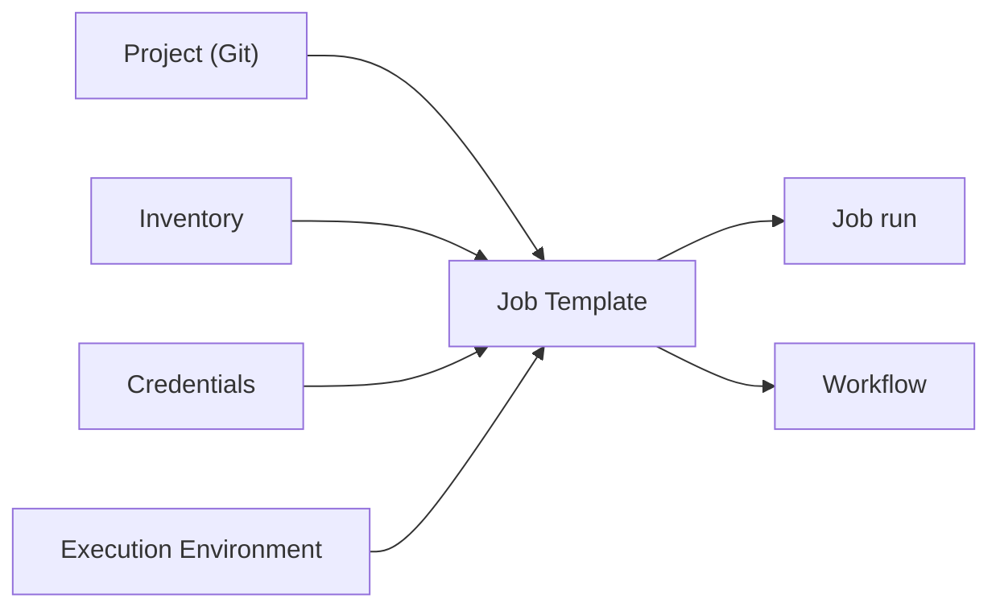
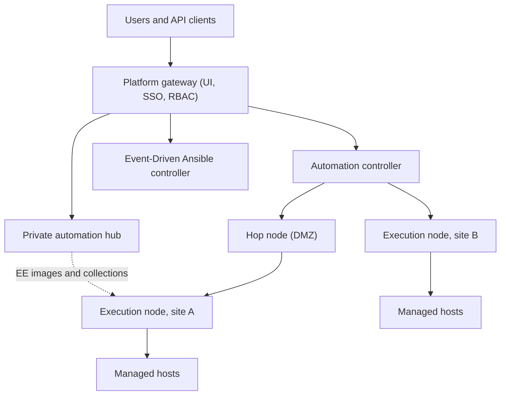
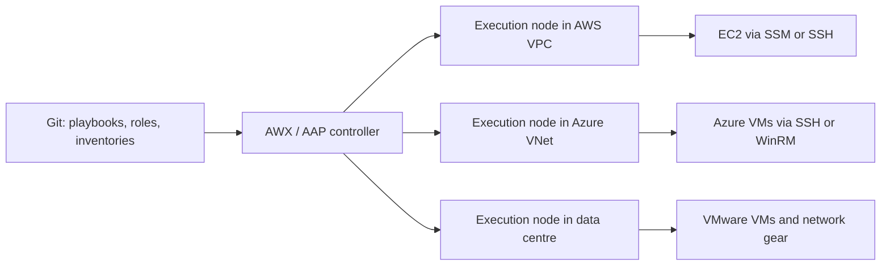

# Ansible — Production & Best Practices

<!-- DEVOPS-SHACK:HEADER -->
<p align="center">
  <a href="https://www.youtube.com/@devopsshack"></a>
  <a href="https://www.youtube.com/@shackverse"></a>
  <a href="https://devopsshack.com"></a>
  <a href="https://www.instagram.com/devopsshack"></a>
  <a href="https://github.com/jaiswaladi246/DevOps-Cloud-Interview-Preparation-by-DevOps-Shack"></a>
</p>
<p align="center"><sub>Part of <b><a href="https://github.com/jaiswaladi246/DevOps-Cloud-Interview-Preparation-by-DevOps-Shack">DevOps &amp; Cloud Interview Preparation</a></b> — created by <b><a href="https://www.youtube.com/@devopsshack">DevOps Shack</a></b>. Free to learn from; please credit DevOps Shack when sharing.</sub></p>
<!-- /DEVOPS-SHACK:HEADER -->

> Real-world Ansible: repo design, security, performance at scale, safe rollouts, testing, AWX/AAP, trade-offs and rapid-fire commands · 200 questions · 🟢 Beginner 🟡 Intermediate 🔴 Advanced

[⬅ Back to Ansible](./README.md) · [🏠 Home](../README.md)

## Table of contents
- [Project Structure and Design](#project-structure-and-design) — Q1–Q25
- [Security and Secrets](#security-and-secrets) — Q26–Q50
- [Performance and Scale](#performance-and-scale) — Q51–Q75
- [Rolling Updates, Delegation and Safe Deployments](#rolling-updates-delegation-and-safe-deployments) — Q76–Q100
- [Testing, CI/CD and Quality](#testing-cicd-and-quality) — Q101–Q125
- [AWX, AAP and Cloud Integration](#awx-aap-and-cloud-integration) — Q126–Q150
- [Architecture Decisions and Tool Comparisons](#architecture-decisions-and-tool-comparisons) — Q151–Q175
- [Rapid-Fire Commands](#rapid-fire-commands) — Q176–Q200

---

## Project Structure and Design

<!-- DEVOPS-SHACK:SECTION -->
> 🎥 **Learn this hands-on with DevOps Shack** → [YouTube @devopsshack](https://www.youtube.com/@devopsshack) · [Hindi @shackverse](https://www.youtube.com/@shackverse) · [Courses at devopsshack.com](https://devopsshack.com)

### Q1. What does a production Ansible repository look like? 🟢

<details>
<summary><b>Answer</b></summary>

In production we keep one repo with a predictable layout, so anyone on the team can find things in seconds.

```text
infra-ansible/
  ansible.cfg
  requirements.yml            # pinned collections and roles
  inventories/
    dev/   { aws_ec2.yml, group_vars/, host_vars/ }
    stage/ { ... }
    prod/  { ... }
  playbooks/
    site.yml  web.yml  db.yml  patch.yml  deploy.yml
  roles/                      # our own roles
  collections/                # installed deps (git-ignored)
  .ansible-lint  .yamllint  .pre-commit-config.yaml
```

Environments differ by inventory directory, never by forked copies of playbooks.

</details>

### Q2. Monorepo or separate repos for roles? How do you decide? 🟡

<details>
<summary><b>Answer</b></summary>

One monorepo is the right start: a single PR can change a role and its callers, and there is no version-matrix to manage. Split a role into its own repo (or collection) when other teams consume it, when it needs an independent release cycle, or when different people own it.

When we split, each role gets semantic version tags and consumers pin them in `requirements.yml`. The cost of splitting is dependency management and cross-repo changes, so do it only when the sharing benefit is real.

</details>

### Q3. How do you structure inventories for dev, stage and prod? 🟢

<details>
<summary><b>Answer</b></summary>

One inventory directory per environment, each with its own `group_vars/` and `host_vars/`, sharing the same playbooks and roles. Environment-neutral values go in `group_vars/all`, environment values in the environment's directory.

```bash
ansible-playbook playbooks/site.yml -i inventories/stage/
ansible-playbook playbooks/site.yml -i inventories/prod/ --limit web
```

This makes it obvious which environment a command targets and keeps prod secrets (separate vault) out of dev's reach.

</details>

### Q4. How do you prevent someone from running a playbook against production by accident? 🟡

<details>
<summary><b>Answer</b></summary>

Layer the guards, since none is perfect:

1. Run prod only from CI/AWX with an approval step, and make local runs read-only (no prod vault password on laptops).
2. Require a `--limit` for prod with an assertion on the first play.
3. Add an explicit confirmation for destructive plays.

```yaml
- hosts: all
  gather_facts: false
  tasks:
    - ansible.builtin.assert:
        that: ansible_limit is defined
        fail_msg: "Prod runs need --limit"
      run_once: true
      when: env == 'prod'
```

Separate credentials per environment is the real control: if you cannot log in, you cannot break it.

</details>

### Q5. What does "thin playbooks, fat roles" mean? 🟡

<details>
<summary><b>Answer</b></summary>

Playbooks should only map hosts to roles (and maybe set a few parameters), while the logic lives in roles. That makes playbooks readable as an architecture overview and makes the logic reusable and testable.

```yaml
- hosts: web
  become: true
  roles:
    - role: common
    - role: nginx
    - role: app
```

If a playbook contains hundreds of lines of tasks, it is a role waiting to be extracted. The opposite trap is a role per package with a sprawl of dependencies, so aim for roles that represent a service or capability.

</details>

### Q6. What makes a well-designed role? 🟡

<details>
<summary><b>Answer</b></summary>

- Single responsibility (nginx, not "web stack plus monitoring plus users").
- A documented interface: prefixed variables in `defaults/`, validated by `argument_specs`.
- Idempotent, supports check mode, and tested with Molecule on the OSes you run.
- No hidden coupling to inventory group names or other roles' variables.
- Handlers with unique, prefixed names.
- Sensible defaults that work out of the box, with secure settings on by default.

If using the role requires reading its tasks, the interface is not good enough.

</details>

### Q7. What goes into a project-level `ansible.cfg` for production? 🟢

<details>
<summary><b>Answer</b></summary>

```ini
[defaults]
roles_path          = roles
collections_path    = collections
forks               = 20
host_key_checking   = True
interpreter_python  = auto_silent
callbacks_enabled   = ansible.posix.profile_tasks, ansible.posix.timer
retry_files_enabled = False
timeout             = 30

[ssh_connection]
pipelining = True
ssh_args   = -o ControlMaster=auto -o ControlPersist=60s -o ServerAliveInterval=30
```

Commit it with the project, so CI and developers behave the same. Keep host-specific overrides (private key paths) out of it, using environment variables instead.

</details>

### Q8. What naming conventions do you enforce? 🟢

<details>
<summary><b>Answer</b></summary>

- Roles: lowercase with underscores, named after the service (`nginx`, `node_exporter`).
- Variables: role-prefixed (`nginx_worker_connections`), secrets prefixed `vault_`, internal ones `__role_name_x`.
- Tasks: start with a capital letter and a verb, optionally prefixed with the role (`nginx | Install package`), so the run output is searchable.
- Handlers: unique and prefixed.
- Files: `.yml` extension everywhere, one style.

`ansible-lint` enforces most of this, which removes the style arguments from code review.

</details>

### Q9. How do you avoid duplicating configuration between environments? 🟡

<details>
<summary><b>Answer</b></summary>

Layer variables. Put the shared baseline in `group_vars/all` or role `defaults`, and override only what differs in each environment's inventory. Use a dict of defaults combined with a small override dict so environments only list the deltas.

```yaml
# inventories/prod/group_vars/web.yml
nginx_overrides:
  worker_connections: 8192
nginx_config: "{{ nginx_defaults | combine(nginx_overrides, recursive=true) }}"
```

If dev, stage and prod each repeat 100 lines of variables, the environments will drift apart. Review diffs between environments regularly as a sanity check.

</details>

### Q10. What is a sensible tagging strategy in production? 🟡

<details>
<summary><b>Answer</b></summary>

Use a small, documented vocabulary of tags tied to purpose (`packages`, `config`, `users`, `certs`, `deploy`), applied on role import level so one tag selects a whole layer, plus `always` for essential setup and `never` for dangerous tasks.

Do not use tags as your main control flow, because partial runs skip dependencies and leave hosts half-configured. We run full playbooks in CI and use tags for fast, targeted runs, like `--tags certs` for rotating certificates. Always `--list-tasks --tags x` before a risky tagged run.

</details>

### Q11. What is your policy on `shell` and `command` tasks? 🟢

<details>
<summary><b>Answer</b></summary>

Use a module whenever one exists. If none does, `command` over `shell`, and every such task must be idempotent through `creates`/`removes`/`changed_when`/`failed_when`, with a comment on why no module fits.

`ansible-lint` rules (`no-changed-when`, `command-instead-of-module`, `risky-shell-pipe`) fail the build when someone slips. Add `set -o pipefail` plus `executable: /bin/bash` when piping, because otherwise failure of the first command in a pipe is hidden.

</details>

### Q12. What is your idempotency review checklist for a PR? 🟡

<details>
<summary><b>Answer</b></summary>

1. Second run reports `changed=0` (checked in Molecule's idempotence step).
2. No `shell`/`command` without guards.
3. `state: latest` avoided for packages unless patching is the goal.
4. Templates contain no timestamps or random values.
5. Handlers used instead of unconditional restarts.
6. `--check --diff` output is sane.
7. Passwords use fixed salts or `update_password: on_create`.
8. Downloads have a checksum.

Most "flapping" playbooks fail on 2 or 4.

</details>

### Q13. Golden images (Packer) versus configuring at boot with Ansible: how do you choose? 🔴

<details>
<summary><b>Answer</b></summary>

Bake what is slow, stable and shared (OS hardening, runtimes, agents) into an AMI with Packer and the Ansible provisioner. Configure at boot only what varies per environment or instance (hostnames, endpoints, secrets) via user-data, cloud-init, or `ansible-pull`.

Baking gives fast, consistent autoscaling and fewer boot-time failures, but needs an image pipeline and rebuilds for every patch. Boot-time Ansible gives flexibility, but slows scale-out and fails when package repos or the network are down at that moment. We bake, and keep Ansible as the single source of truth for both stages, so the same roles produce the image and later correct drift.

</details>

### Q14. How do you bootstrap brand new servers? 🟡

<details>
<summary><b>Answer</b></summary>

A dedicated `bootstrap.yml` play, run once with the initial credentials (root or the cloud default user), that does only what the normal runs depend on:

- ensure Python (using `raw` if needed)
- create the `ansible` automation user with SSH key and a sudoers drop-in
- disable password SSH logins, set hostname, time sync, base packages

After it, every later run uses the automation user. Keeping bootstrap separate means normal playbooks never need a root password or special connection settings.

</details>

### Q15. How do you detect and handle configuration drift? 🔴

<details>
<summary><b>Answer</b></summary>

Detect: run the playbooks regularly in `--check --diff` mode from AWX or CI on a schedule, and report hosts with `changed > 0`. Because check mode cannot predict everything (`command`/`shell` are skipped), pair it with idempotent modules and sanity assertions.

Handle: decide per case whether to enforce (apply the playbook on schedule) or alert and investigate. Enforcing nightly is safe only when playbooks are idempotent and tested. We also lock down interactive access and make changes only through Git, because drift is mostly a process problem rather than a tooling one.

</details>

### Q16. What should a role README contain? 🟢

<details>
<summary><b>Answer</b></summary>

What the role does and supports (OS and versions), a table of variables with defaults and meaning, dependencies (collections and roles), example playbook usage, tags, handlers, how to test it (`molecule test`), and known limitations.

With `argument_specs`, `ansible-doc -t role` can generate the variable documentation, so the README does not drift from the code.

</details>

### Q17. What Git workflow do you use for Ansible code? 🟢

<details>
<summary><b>Answer</b></summary>

Trunk-based with short-lived branches and pull requests. Branch protection requires CI (yamllint, ansible-lint, Molecule, syntax check) and one review before merging to `main`.

Merges to `main` auto-deploy to dev and stage via a pipeline, and prod needs an approval gate. Commit messages explain why the change is needed. No one runs ad hoc edits on servers, so Git history is the audit trail.

</details>

### Q18. How do you release and promote Ansible changes across environments? 🔴

<details>
<summary><b>Answer</b></summary>

Treat the repo as a versioned artifact. A merge to `main` is tagged (`v2025.11.3`), and the pipeline promotes the same tag through dev, stage and prod, so what was tested is exactly what runs in prod. AWX project is pinned to the tag or commit SHA for prod, not the moving `main` branch.

Execution environment images are tagged in step with the code, so collection versions match. Rollback means re-running the previous tag, which works because plays are idempotent, though it does not undo non-reversible changes such as database migrations.

</details>

### Q19. How do you manage collection and role dependencies in a team? 🟡

<details>
<summary><b>Answer</b></summary>

One `requirements.yml` in the repo with exact or tightly bounded versions, installed into a project-local `collections/` directory (git-ignored) by CI and by a `make deps` target. Dependencies of the dependencies are resolved by `ansible-galaxy`, so also record the resulting versions in CI logs.

Upgrades happen in a dedicated PR with a changelog check, and are tested in Molecule and in stage. In AWX or AAP, dependencies are baked into an execution environment, which is the better answer for reproducibility than installing at job time.

</details>

### Q20. How do you design inventory groups? 🔴

<details>
<summary><b>Answer</b></summary>

Think of groups on three independent axes and combine them with intersections, instead of one deep tree:

- function: `web`, `db`, `cache`
- environment: `env_prod`, `env_stage`
- location: `region_ap_south_1`, `az_a`

A play targets `hosts: web:&env_prod`. In a cloud, derive groups from tags with `keyed_groups`, so groups can never go stale. Variables go in the group they describe (function settings on `web`, endpoints on `env_prod`). Avoid defining the same variable on two sibling groups, because the alphabetical merge order will bite you.

</details>

### Q21. How do you keep variables from turning into an unmanageable mess? 🔴

<details>
<summary><b>Answer</b></summary>

- Few places: role `defaults` for tunables, `group_vars` per environment, `host_vars` as rare exceptions.
- Avoid `vars/main.yml` for things users might change, and avoid `set_fact` for values that should stay overridable.
- Never rely on extra vars in normal operation.
- Prefix names and validate with `argument_specs`.
- Use `ansible-inventory --host <name>` and `-vvv` to see the final merged values.

Treat precedence bugs as a design smell: if you need a table to explain where a value comes from, simplify the layout.

</details>

### Q22. Pets versus cattle: where does Ansible fit? 🟡

<details>
<summary><b>Answer</b></summary>

Ansible shines for long-lived "pets" such as databases, bare metal, network gear and legacy VMs, where in-place configuration is the model. For stateless "cattle" the better pattern is immutable: build an image, deploy it, replace instead of patch.

In many shops Ansible does both: it builds the images (Packer), bootstraps hosts, and then configures the stateful tier. Choose mutable configuration deliberately where replacement is expensive, and keep those hosts few and well documented.

</details>

### Q23. How do you change config files safely so a bad render does not cause an outage? 🟢

<details>
<summary><b>Answer</b></summary>

- `validate:` runs a syntax check on the rendered temp file before it replaces the real one.
- `backup: true` keeps a timestamped copy.
- Use `reload` instead of `restart` where the service supports it.
- Roll out in batches with `serial` and a health check after the change.

```yaml
- ansible.builtin.template:
    src: sshd_config.j2
    dest: /etc/ssh/sshd_config
    validate: /usr/sbin/sshd -t -f %s
    backup: true
  notify: Reload sshd
```

</details>

### Q24. How do you migrate legacy shell scripts and manual runbooks into Ansible? 🟡

<details>
<summary><b>Answer</b></summary>

Do it in slices, not as a rewrite. First wrap the script in a playbook with `script:` or `command:` and guards, so it is at least run in a controlled way. Then replace segments with modules one by one, verifying idempotency (second run `changed=0`) each time. Capture decisions as variables.

Start with the most frequently run or riskiest runbook, such as patching or user management. Keep the old script until the playbook has been used a few times in production.

</details>

### Q25. When should you organise content as collections rather than roles in one repo? 🔴

<details>
<summary><b>Answer</b></summary>

When you have enough shared content for several teams, or when you ship custom modules, filters or inventory plugins. A company collection such as `acme.platform` bundles roles and plugins under one version and namespace, is published to a private Automation Hub or Galaxy, and tested with `ansible-test`.

For a single team with a dozen roles, a plain `roles/` directory is simpler. The collection adds build, release and versioning overhead, which only pays off with consumers beyond the repo.

</details>

---

## Security and Secrets

<!-- DEVOPS-SHACK:SECTION -->
> 🎥 **Learn this hands-on with DevOps Shack** → [YouTube @devopsshack](https://www.youtube.com/@devopsshack) · [Hindi @shackverse](https://www.youtube.com/@shackverse) · [Courses at devopsshack.com](https://devopsshack.com)

### Q26. How do you set up a secure automation user and SSH access? 🟢

<details>
<summary><b>Answer</b></summary>

A dedicated non-human account (for example `ansible`) per environment, with key-based SSH only, password login disabled, and the public key in `authorized_keys`. Use Ed25519 keys, one key per environment, stored in the CI/AWX credential store rather than on laptops.

```yaml
- ansible.posix.authorized_key:
    user: ansible
    key: "{{ lookup('ansible.builtin.file', 'keys/ansible_prod.pub') }}"
    exclusive: true
```

`exclusive: true` removes any other keys on that account, so access is controlled entirely from Git. Combine with a restricted sudoers entry and logging of its use.

</details>

### Q27. How do you give the automation user sudo with least privilege? 🟡

<details>
<summary><b>Answer</b></summary>

Passwordless sudo for everything (`ansible ALL=(ALL) NOPASSWD: ALL`) is the common default and it makes the account equivalent to root. If your compliance regime requires tighter control, restrict by command, but be realistic: Ansible runs Python modules as `/bin/sh -c ... python3 ...`, so a command allow-list is hard to maintain.

Practical controls in order of value: key only access from a known control node (via `from=` in authorized_keys or security groups), a sudoers drop-in validated by `visudo`, session logging with `auditd`, and short-lived credentials where you can get them.

```yaml
- ansible.builtin.copy:
    dest: /etc/sudoers.d/ansible
    content: "ansible ALL=(ALL) NOPASSWD: ALL\n"
    mode: "0440"
    validate: /usr/sbin/visudo -cf %s
```

</details>

### Q28. What are the alternatives to Ansible Vault for secrets, and when do you use them? 🟡

<details>
<summary><b>Answer</b></summary>

Vault is simple and works offline, but secrets are static and rotation is manual. For larger setups pull secrets at run time from a manager through lookup plugins: HashiCorp Vault (`community.hashi_vault`), AWS Secrets Manager or SSM Parameter Store (`amazon.aws`), Azure Key Vault, CyberArk, or AAP's credential plugins.

Run-time lookups give central rotation, audit trails and per-identity access. The costs are an extra dependency in every run and that the controller needs credentials to the secret store. We usually use Vault for bootstrap secrets (the secret manager's own credentials) and the secret manager for everything else.

</details>

### Q29. How do you read AWS Secrets Manager and SSM parameters in a playbook? 🟡

<details>
<summary><b>Answer</b></summary>

```yaml
vars:
  db_password: "{{ lookup('amazon.aws.secretsmanager_secret', 'prod/app/db', region='ap-south-1') }}"
  api_key: "{{ lookup('amazon.aws.ssm_parameter', '/prod/app/api_key', region='ap-south-1', decrypt=true) }}"
```

Lookups run on the control node, using its AWS credentials (an instance role is best). The IAM policy should allow only `secretsmanager:GetSecretValue` on the specific ARNs. Lookups are re-evaluated every time the variable is used, so assign the value once with `set_fact` under `no_log: true` when it is used a lot.

</details>

### Q30. How do you integrate HashiCorp Vault with Ansible? 🔴

<details>
<summary><b>Answer</b></summary>

Use the `community.hashi_vault` collection (it needs the `hvac` Python library on the controller). Authenticate with AppRole, JWT/OIDC or a cloud auth method rather than a long-lived token.

```yaml
db_password: >-
  {{ lookup('community.hashi_vault.hashi_vault',
            'secret/data/prod/app:db_password',
            url='https://vault.example.com:8200',
            auth_method='approle',
            role_id=vault_role_id,
            secret_id=vault_secret_id) }}
```

Issues to design for: the `secret_id` is itself a secret (deliver it through CI as a short-lived, response-wrapped value), every lookup is a network call so fetch once per play, and Vault policies should give each pipeline access only to its environment's paths. AAP has a native HashiCorp Vault credential type that does this without code.

</details>

### Q31. How do you stop secrets from leaking into logs and output? 🟢

<details>
<summary><b>Answer</b></summary>

- `no_log: true` on tasks that handle secrets (and on loops, to hide item values).
- `diff: false` for templates containing passwords, because `--diff` prints content.
- Avoid `-vvv` in shared CI logs: connection debug output can include arguments.
- Never `debug` a secret variable.
- Keep secrets out of command lines: use `content:` or files rather than `shell: mysql -p{{ pw }}`, which shows in `ps`.
- Mask values in the CI system and restrict AWX job output access.

Test it: run once with `no_log` and grep the job log for a known secret fragment.

</details>

### Q32. How do you handle the vault password in CI/CD? 🟡

<details>
<summary><b>Answer</b></summary>

Store it in the CI system's secret store (masked, scoped to protected branches) and write it to a file or FIFO only for the job's duration.

```bash
umask 077
printf '%s' "$ANSIBLE_VAULT_PW" > "$RUNNER_TEMP/.vp"
ansible-playbook site.yml --vault-password-file "$RUNNER_TEMP/.vp"
rm -f "$RUNNER_TEMP/.vp"
```

A better pattern is an executable password script that fetches the password from a secrets manager using the runner's identity (OIDC), so no static secret lives in CI. Use different vault IDs per environment so a dev pipeline cannot decrypt prod.

</details>

### Q33. Should you disable `host_key_checking` in production? 🟢

<details>
<summary><b>Answer</b></summary>

No. Turning it off removes protection against man-in-the-middle attacks and it is only acceptable in throwaway lab environments. In cloud environments where hosts are ephemeral, the practical approach is to keep it on and handle keys properly:

- bake the host key trust through an SSH CA (`@cert-authority` in `known_hosts`),
- or populate `known_hosts` from a trusted source (for example EC2 console output) during provisioning,
- or avoid SSH host keys by using SSM Session Manager.

Disabling checks silently in `ansible.cfg` often survives from a lab into production, so lint for it.

</details>

### Q34. How do SSH certificates improve automation security? 🔴

<details>
<summary><b>Answer</b></summary>

With an SSH certificate authority, servers trust the CA public key (`TrustedUserCAKeys`) rather than individual keys. The pipeline requests a short-lived certificate (minutes) signed by the CA, such as from HashiCorp Vault's SSH secrets engine, and uses it for the run. There are no long-lived private keys to leak and no `authorized_keys` to manage.

You can also sign host keys, so clients trust hosts through `@cert-authority` and `StrictHostKeyChecking` can stay on without manual `known_hosts` entries.

```ini
[all:vars]
ansible_ssh_private_key_file=/tmp/run/id_ed25519
ansible_ssh_extra_args='-o CertificateFile=/tmp/run/id_ed25519-cert.pub'
```

</details>

### Q35. What does it take to use AWS SSM Session Manager instead of SSH? 🔴

<details>
<summary><b>Answer</b></summary>

The `aws_ssm` connection plugin (shipped in the `amazon.aws` or `community.aws` collection, depending on version) tunnels commands through SSM, so no inbound port 22, no bastion and no key management are needed.

Requirements: SSM Agent on the instance and an instance profile with `AmazonSSMManagedInstanceCore`, the `session-manager-plugin` on the controller, an S3 bucket for module transfer, and controller IAM permissions for `ssm:StartSession` and the bucket.

```ini
[all:vars]
ansible_connection=amazon.aws.aws_ssm
ansible_aws_ssm_bucket_name=acme-ansible-ssm
ansible_aws_ssm_region=ap-south-1
```

Trade-offs: slower per-task round trips than SSH (consider fewer, larger tasks), and every action is logged in CloudTrail and optionally Session Manager logs, which is useful for audit.

</details>

### Q36. How do you use Ansible for security hardening? 🟡

<details>
<summary><b>Answer</b></summary>

Encode the baseline as a role applied to every host: SSH settings, password policy, kernel sysctls, auditd rules, file permissions, removal of unneeded packages, firewall defaults. Use well-maintained content as a starting point (the DevSec hardening collection, ansible-lockdown CIS roles) and fork the parts you need.

Run it first in `--check --diff` on stage, and make each control a variable that can be switched off for a documented exception. Verify with an independent scanner (OpenSCAP, Lynis, InSpec), because "the task ran" is not the same as "the host is compliant".

</details>

### Q37. What IAM permissions does the `aws_ec2` inventory plugin need? 🟡

<details>
<summary><b>Answer</b></summary>

Read-only, scoped to describe calls:

```json
{
  "Version": "2012-10-17",
  "Statement": [{
    "Effect": "Allow",
    "Action": ["ec2:DescribeInstances", "ec2:DescribeRegions"],
    "Resource": "*"
  }]
}
```

Describe actions do not support resource-level restrictions, so `Resource: "*"` is required. Attach the policy to an instance role on the control node or a CI role assumed through OIDC. Do not reuse an admin's access keys for inventory, and set `regions:` explicitly so `DescribeRegions` is not needed.

</details>

### Q38. How do you protect the control node? 🟢

<details>
<summary><b>Answer</b></summary>

The control node can reach (and usually root) every managed host, so it is a high-value target.

- Dedicated, patched host or ephemeral CI runner/EE container, not a shared laptop.
- Restrict who can log in, require MFA, and log sessions.
- Keep SSH keys and vault passwords out of the file system where possible (use an agent or short-lived creds).
- Network rules: it may reach hosts on 22, but nothing should reach it.
- Review who can merge to branches that production pipelines run.

Compromise of a pipeline equals compromise of the fleet, so treat CI configuration as production code.

</details>

### Q39. How do you secure the supply chain of collections and roles? 🔴

<details>
<summary><b>Answer</b></summary>

- Pin exact versions in `requirements.yml` and commit it, never `latest`.
- Mirror what you need in a private Galaxy/Automation Hub and install only from it (`galaxy_server` list in `ansible.cfg`).
- Verify integrity with `ansible-galaxy collection verify`, and require GPG signatures for collections that provide them.
- Bake approved versions into execution environment images, scan them (Trivy, Grype), and sign images.
- Review roles from Galaxy before use. Their tasks run as root on your hosts.

```bash
ansible-galaxy collection install community.general:10.1.0 \
  --keyring ~/.ansible/pubring.kbx --required-valid-signature-count 1
```

</details>

### Q40. How do you rotate secrets such as database passwords or API keys with Ansible? 🟡

<details>
<summary><b>Answer</b></summary>

Orchestrate in the right order so there is no outage: generate the new value, update the source of truth (secret manager), apply it to the consumer (the database user, then app config), reload, verify health, and only then retire the old value.

For database accounts, support two valid credentials during the changeover, or rotate in a rolling manner with `serial`. Keep the rotation playbook idempotent and tagged (`--tags rotate_db`), and log each step without printing the secret (`no_log`). If a manager can rotate by itself (Secrets Manager rotation Lambda), let Ansible only consume the value.

</details>

### Q41. How do you deploy private keys and certificates safely? 🟡

<details>
<summary><b>Answer</b></summary>

```yaml
- ansible.builtin.copy:
    content: "{{ vault_tls_key }}"
    dest: /etc/ssl/private/app.key
    owner: root
    group: ssl-cert
    mode: "0640"
  no_log: true
  notify: Reload nginx
```

Use `content:` from a vaulted variable or a secret-manager lookup, restrictive mode and owner, `no_log`, and a handler to reload. Do not leave copies in `/tmp`. For certificates prefer ACME automation (certbot or `community.crypto.acme_certificate`) over copying long-lived files by hand.

</details>

### Q42. How do you keep secrets out of Git? 🟢

<details>
<summary><b>Answer</b></summary>

- Encrypt anything sensitive with Vault before committing, and name files so it is obvious (`vault.yml`).
- A pre-commit hook that rejects unencrypted vault files (check the `$ANSIBLE_VAULT;` header) plus a scanner such as `gitleaks` or `detect-secrets` in pre-commit and CI.
- `.gitignore` for `*.pem`, `.vault_pass`, `*.retry`, `collections/`.
- Branch protection so the CI scan cannot be skipped.

If a secret does get committed, treat it as compromised: rotate it first, then clean history. Rewriting history alone does not un-leak anything.

</details>

### Q43. What are the injection risks in Ansible, and how do you mitigate them? 🔴

<details>
<summary><b>Answer</b></summary>

Two classes. Template injection happens when untrusted text (an EC2 tag, a hostname, command output, an API response) is rendered as Jinja2 and contains `{{ ... }}`. Ansible marks facts, registered results and lookup outputs as unsafe by default so they are not re-templated. Do not defeat that with `| from_json` on untrusted input and then template it, or by `allow_unsafe`.

Shell injection happens when variables go into `shell:` strings. Mitigate by using modules or `command` with `argv`, and quoting with `quote` where a shell is unavoidable.

```yaml
- ansible.builtin.command:
    argv: ["/usr/bin/grep", "-r", "{{ term }}", "/var/log/app"]
- ansible.builtin.shell: "grep -r {{ term | quote }} /var/log/app"
```

</details>

### Q44. What does the `quote` filter do and when is it needed? 🟡

<details>
<summary><b>Answer</b></summary>

`quote` shell-escapes a value so it is treated as one literal word by `/bin/sh`. It is needed any time a variable is placed in a `shell:` (or `raw:`) command line, especially with spaces, `;`, `$`, or backticks.

```yaml
- ansible.builtin.shell: "tar czf {{ backup_file | quote }} {{ data_dir | quote }}"
```

For `command:` with the `argv` form, quoting is not required because there is no shell. Prefer `argv` when possible.

</details>

### Q45. How do you get an audit trail of who ran what, and where? 🟢

<details>
<summary><b>Answer</b></summary>

Run production through AWX/AAP or a CI system: they record who launched each job, with which inventory, credentials, project revision and variables, plus the full output. Stream those events to your SIEM (AAP supports external logging to Splunk, ELK and others).

On the hosts, `auditd` plus the sudo log record privileged commands made by the automation user. For local runs, set `log_path = /var/log/ansible/ansible.log`, though a central, tamper-resistant record beats files on someone's laptop.

</details>

### Q46. How do you apply least privilege to `become`? 🟢

<details>
<summary><b>Answer</b></summary>

Enable `become` only on the tasks that need it, not at play level for everything. Fact gathering, API calls delegated to localhost and reads do not need root. Use `become_user` for service accounts rather than root where possible, such as running application deploy steps as `app`.

```yaml
- hosts: web
  tasks:
    - ansible.builtin.git: { repo: "{{ repo }}", dest: /srv/app }
      become: true
      become_user: app
    - ansible.builtin.systemd_service: { name: app, state: restarted }
      become: true
```

</details>

### Q47. How do you secure Windows management over WinRM? 🟡

<details>
<summary><b>Answer</b></summary>

Use HTTPS (port 5986) with valid certificates, not plain HTTP on 5985 with `AllowUnencrypted`. For domain machines prefer Kerberos; for local accounts use NTLM over HTTPS, and CredSSP only when you need credential delegation (double hop).

```ini
[win:vars]
ansible_connection=winrm
ansible_port=5986
ansible_winrm_transport=kerberos
ansible_winrm_server_cert_validation=validate
```

Alternatively use OpenSSH on Windows with keys (`ansible_connection=ssh`, `ansible_shell_type=powershell`), which unifies Linux and Windows access models. Store credentials in vault or credential plugins and use a dedicated service account with only the rights it needs.

</details>

### Q48. Is it acceptable to put `ansible_ssh_pass` or `ansible_become_password` in inventory? 🟢

<details>
<summary><b>Answer</b></summary>

Not in plain text. If you must use passwords, store them in a vaulted file and reference them (`ansible_become_password: "{{ vault_become_password }}"`) or provide them through AWX credentials. Better still, remove passwords from the design: SSH keys or certificates for login and passwordless sudo for the automation user (with the other controls from this section).

Plain-text passwords in inventory also leak through `ansible-inventory --list` and AWX inventory exports.

</details>

### Q49. How should network segmentation and bastions be designed around Ansible? 🟡

<details>
<summary><b>Answer</b></summary>

Place the control node (or AWX execution nodes) in a management network with a narrow security group, allowing outbound SSH/WinRM only to managed subnets, and managed hosts only accept SSH from that source. For isolated networks, use a bastion with `ProxyJump`, or AAP automation mesh with receptor nodes inside the isolated segments so the controller never opens connections directly.

```ini
[private:vars]
ansible_ssh_common_args='-o ProxyJump=ansible@bastion.prod.example.com'
```

Avoid agent forwarding to a shared bastion. Keys on the bastion are a bigger risk than the jump itself.

</details>

### Q50. A vault password or SSH key has leaked. What do you do? 🔴

<details>
<summary><b>Answer</b></summary>

1. Contain: revoke the leaked credential (remove the key from `authorized_keys` via a quick `exclusive: true` play, or disable the CI token), and restrict access paths if compromise is suspected.
2. Rotate: change the vault password with `rekey` and, crucially, rotate every secret the vault protected, because anyone with the repo history and the old password can read earlier versions.
3. Investigate: check audit logs (AWX activity stream, sudo/auth logs, CloudTrail) for use of the credential.
4. Fix the cause: how did it leak (logs, laptop, chat)? Add a control such as a secret scanner or short-lived credentials.
5. Document the incident and the new rotation process.

Speed matters most in step 1, and completeness in step 2.

</details>

---

## Performance and Scale

<!-- DEVOPS-SHACK:SECTION -->
> 🎥 **Learn this hands-on with DevOps Shack** → [YouTube @devopsshack](https://www.youtube.com/@devopsshack) · [Hindi @shackverse](https://www.youtube.com/@shackverse) · [Courses at devopsshack.com](https://devopsshack.com)

### Q51. Why can Ansible be slower than a shell script for 100 servers, and what dominates the time? 🟢

<details>
<summary><b>Answer</b></summary>

Ansible does far more per step: for each task and host it opens or reuses an SSH connection, creates a temp dir, transfers a module payload, executes Python, parses JSON, and cleans up. Fact gathering adds a large setup run at the start of every play, and the default linear strategy makes each task wait for the slowest host, with only 5 hosts in parallel (the default `forks`).

In real playbooks the time sits in three places: fact gathering, a large number of small tasks, and slow tasks such as package installs or downloads. Measure with `profile_tasks` before tuning.

</details>

### Q52. How do you choose the `forks` value? 🟢

<details>
<summary><b>Answer</b></summary>

`forks` is the number of hosts processed in parallel. The default 5 is conservative. We raise it to 20 to 50 on a decent controller and measure.

```ini
[defaults]
forks = 40
```

Limits are the controller's CPU and memory (each fork is a Python process, often 50 to 100 MB), network and SSH connection capacity, and the targets (for example hammering one package mirror or API). Beyond roughly 100 forks, returns diminish and you should look at splitting runs across several controllers instead.

</details>

### Q53. What is SSH pipelining and why does it help? 🟢

<details>
<summary><b>Answer</b></summary>

Without pipelining, each task copies a module file to the target over SFTP/SCP and then runs it in a second SSH call. With `pipelining = True`, Ansible streams the module to the Python interpreter's stdin in a single SSH session, removing the transfer and cleanup steps and typically cutting task time by a third or more.

```ini
[ssh_connection]
pipelining = True
```

It is disabled by default because it requires that `requiretty` is not set in sudoers (an old RHEL default). It also avoids the temp-file permission issues when becoming unprivileged users.

</details>

### Q54. Which SSH settings matter for performance and stability? 🟡

<details>
<summary><b>Answer</b></summary>

```ini
[ssh_connection]
ssh_args = -o ControlMaster=auto -o ControlPersist=120s -o ServerAliveInterval=30 -o ServerAliveCountMax=5
control_path_dir = ~/.ansible/cp
pipelining = True
retries = 3
```

`ControlPersist` reuses connections; keep-alives stop NAT or load balancers from dropping idle sessions during long tasks; `retries` re-attempts transient connection failures. Use a short `control_path_dir`, since socket paths have a length limit. On very slow or high-latency links, fewer and larger tasks matter more than any flag.

</details>

### Q55. How do you find out which tasks are slow? 🟢

<details>
<summary><b>Answer</b></summary>

Enable the timing callbacks.

```bash
ANSIBLE_CALLBACKS_ENABLED=ansible.posix.profile_tasks,ansible.posix.timer \
  ansible-playbook site.yml
```

At the end, `profile_tasks` prints the slowest tasks, and per-task timestamps appear as you go. For per-role breakdowns, `ansible.posix.profile_roles` does the same by role. Fix the top three offenders, run again, and repeat. Guessing without data usually optimises the wrong thing.

</details>

### Q56. How do you reduce the cost of fact gathering? 🟡

<details>
<summary><b>Answer</b></summary>

- `gather_facts: false` on plays that do not use facts.
- `gather_subset: [min, network]` (or `!hardware`) to avoid slow hardware probes.
- Fact caching with `gathering = smart` and a `jsonfile` or Redis cache, so unchanged hosts skip the setup module.
- Use `gather_facts: false` and then a single early `setup` for what you need, instead of re-gathering in every play of the playbook.

```ini
[defaults]
gathering = smart
fact_caching = redis
fact_caching_connection = cache.internal:6379:0
fact_caching_timeout = 3600
```

Remember that cached facts can be stale after OS or IP changes.

</details>

### Q57. What is Mitogen for Ansible and would you use it? 🔴

<details>
<summary><b>Answer</b></summary>

Mitogen is a third-party strategy and connection plugin that replaces much of Ansible's per-task SSH and module-shipping machinery with a persistent Python process on the target, and can speed up playbooks several times.

The catch is support. It is not part of Ansible, and its compatibility has lagged behind current ansible-core releases and Python versions, so it can block upgrades or fail in odd ways. Today we would first exhaust pipelining, fact caching, forks, fewer tasks and async. Consider Mitogen only if you pin a compatible ansible-core version and have a strong test suite.

</details>

### Q58. How do you speed up long-running tasks across many hosts? 🟡

<details>
<summary><b>Answer</b></summary>

Use `async` with `poll: 0` to start the task on all hosts at once, regardless of `forks`, then wait for completion with `async_status`.

```yaml
- ansible.builtin.command: /opt/app/bin/reindex
  async: 7200
  poll: 0
  register: reindex

- ansible.builtin.async_status:
    jid: "{{ reindex.ansible_job_id }}"
  register: job
  until: job.finished
  retries: 240
  delay: 30
```

Good for patching, backups, large downloads and reindexing. Be careful that starting everything at once can overload shared resources (the mirror, storage), so combine it with `throttle` where needed.

</details>

### Q59. When does the `free` strategy help, and what are the downsides? 🟡

<details>
<summary><b>Answer</b></summary>

With `strategy: free`, each host runs through the tasks as fast as it can without waiting for the slowest host at every step. It helps when hosts differ greatly in speed (mixed instance sizes, slow mirrors) and tasks are independent.

Downsides: interleaved, hard-to-read output, tasks that depend on other hosts' results (`run_once`, delegation to shared resources, cluster operations) can become unsafe, and failure handling is less predictable. We do not use it for orchestrated rollouts, only for independent configuration of large groups.

</details>

### Q60. Why is a loop of package installs slower than a list? 🟢

<details>
<summary><b>Answer</b></summary>

A loop runs the module once per item: one connection round trip, one module execution, and one package manager transaction (with dependency solving) per package. Passing a list lets the package manager do a single transaction.

```yaml
# slow
- ansible.builtin.apt: { name: "{{ item }}" }
  loop: [git, curl, jq, htop]

# fast
- ansible.builtin.apt:
    name: [git, curl, jq, htop]
    state: present
```

The same applies to `user`, `file` and others that accept lists or can be consolidated.

</details>

### Q61. How do you cut down the number of tasks without hurting readability? 🟡

<details>
<summary><b>Answer</b></summary>

Prefer one `template` over a dozen `lineinfile` edits, pass lists to modules that accept them, use `copy` or `synchronize` on a directory instead of looping over files, and drop tasks that only gather information you can get from facts.

Combine several shell commands into a script only when each step is inherently non-idempotent anyway. Do not merge unrelated actions into mega-tasks to save seconds: you lose clear change reporting. The goal is the minimum number of round trips for the same state, not the minimum number of lines.

</details>

### Q62. How do `serial`, `forks` and `throttle` interact? 🔴

<details>
<summary><b>Answer</b></summary>

- `forks` is the global upper limit on parallel workers on the controller.
- `serial` splits the play's hosts into batches, and each batch runs the whole play before the next starts.
- `throttle` limits concurrency of one task (or block), even if forks and the batch size are larger.

The effective parallelism for a task is `min(forks, batch size, throttle)`. With `serial: 50` and `forks: 20`, each batch of 50 runs 20 at a time. With `serial: 1` and `forks: 100`, only one host is touched at a time.

```yaml
- hosts: web
  serial: [1, 5, "25%"]
  tasks:
    - ansible.builtin.command: /opt/app/bin/warm-cache
      throttle: 2
```

</details>

### Q63. How do you scale Ansible to thousands of hosts? 🔴

<details>
<summary><b>Answer</b></summary>

Do not fix it with just one big controller:

1. Tune the basics: pipelining, ControlPersist, caching, fewer tasks, async.
2. Split the work: run per environment, per region or per tier in parallel pipeline jobs with `--limit`.
3. Distribute execution: AAP automation mesh or several AWX execution nodes and instance groups close to the hosts (per region/datacenter), with hop nodes for isolated networks.
4. Use pull mode (`ansible-pull`) for autoscaled or very large fleets that configure themselves, with a central repo.
5. Shrink the problem: bake images so that day-to-day runs configure little.

Watch controller memory (each fork costs RAM), inventory sync time, and the load your automation puts on shared services such as mirrors and APIs.

</details>

### Q64. How do you size a control node or execution node? 🔴

<details>
<summary><b>Answer</b></summary>

Each fork is a separate Python process and typical usage is 50 to 150 MB, depending on the number of variables and the plugins. AWX uses about 100 MB per fork in its capacity calculation and counts about 4 forks per CPU core for scheduling.

So 50 concurrent forks want roughly 5 GB RAM and 8 to 12 vCPUs, with room for the OS, the controller's database and parallel jobs. Large inventories with big `hostvars` increase the per-fork footprint. Load test with a representative playbook, watch `free -m` and `top` during the run, and tune forks accordingly. If a job gets OOM-killed, lower forks first.

</details>

### Q65. How do you make dynamic inventory fast with many instances? 🟡

<details>
<summary><b>Answer</b></summary>

- Filter at the API (`filters:` and `regions:`) instead of fetching everything and discarding it client-side.
- Enable plugin caching (`cache: true`, `cache_timeout`) so repeated runs and `ansible-inventory` calls do not call the EC2 API each time.
- Avoid expensive `compose` expressions and unused `hostnames` strategies.
- In AWX, use inventory sources with "update on launch" and a cache timeout, or schedule syncs separately from jobs.

```yaml
plugin: amazon.aws.aws_ec2
regions: [ap-south-1]
filters:
  tag:Managed: ansible
  instance-state-name: running
cache: true
cache_timeout: 300
```

</details>

### Q66. How do you speed up package installs across a fleet? 🟢

<details>
<summary><b>Answer</b></summary>

Point hosts at an internal mirror or caching proxy (Artifactory, Nexus, apt-cacher-ng, a Pulp or Satellite repo) instead of the public internet. Use `cache_valid_time` for apt, install lists in one task, and bake common packages into the image.

With `async` the downloads happen in parallel, but a thousand hosts hitting one mirror at once will saturate it, so stagger with `serial` or `throttle`. Pin versions where repeatability matters, because unpinned installs can differ between runs a week apart.

</details>

### Q67. How do you transfer large files or artifacts efficiently? 🟡

<details>
<summary><b>Answer</b></summary>

Avoid pushing large files from the controller to every host: the controller's bandwidth becomes the bottleneck. Let the targets pull from where the data lives.

```yaml
- ansible.builtin.get_url:
    url: "{{ artifact_url }}"          # presigned S3 URL or internal repo
    dest: /opt/app/app.tar.gz
    checksum: "sha256:{{ artifact_sha256 }}"
- ansible.builtin.unarchive:
    src: /opt/app/app.tar.gz
    dest: /opt/app/releases/{{ app_version }}
    remote_src: true
```

For directory trees between hosts use `synchronize` (rsync). Always verify a checksum.

</details>

### Q68. How do you diagnose a slow playbook step by step? 🟡

<details>
<summary><b>Answer</b></summary>

1. Run with `profile_tasks` and note the top tasks and the gap between the end of the last task and the recap.
2. If time is spent before the first task, check inventory loading (`time ansible-inventory --list`) and fact gathering.
3. If it is spread over many tasks, check per-task SSH overhead: ControlPersist, pipelining, DNS delay on the target (`UseDNS`), slow shell profiles.
4. For a single slow host, run `-vvv` against it and compare with a fast host.
5. For slow tasks, run the same command by hand on the target to see if Ansible is the cause at all.

A frequent hidden cause is reverse DNS or GSSAPI auth making each SSH login wait a few seconds.

</details>

### Q69. Which timeouts matter and how do you set them? 🟡

<details>
<summary><b>Answer</b></summary>

- `timeout` in `[defaults]` (or `ansible_ssh_timeout`/`-T`): connection establishment, default 10 seconds.
- `ServerAliveInterval` in `ssh_args`: detects dead sessions during long tasks.
- `async` plus `poll`: for tasks that run longer than the connection can reliably last.
- Module-specific timeouts: `wait_for.timeout`, `reboot_timeout`, `uri.timeout`.
- `ansible_command_timeout` for network connections.

A hung task with no timeout blocks the entire batch in linear strategy, so put a timeout on every task that waits on something external, and fail loudly.

</details>

### Q70. What does the `throttle` keyword do? 🟢

<details>
<summary><b>Answer</b></summary>

`throttle: N` limits how many hosts run a specific task or block at the same time, regardless of `forks`. Use it to protect a shared resource: a database that handles a handful of migrations, a rate-limited API, or a package mirror.

```yaml
- name: Register with service discovery
  ansible.builtin.uri:
    url: "https://registry.example.com/nodes/{{ inventory_hostname }}"
    method: PUT
  throttle: 5
```

It is different from `serial`, which batches the whole play and not one task.

</details>

### Q71. How do you deal with cloud API rate limits when running cloud modules at scale? 🟡

<details>
<summary><b>Answer</b></summary>

Reduce calls, then slow down the rest. Use filters and caching in inventory, prefer modules that handle several resources, and avoid per-host cloud calls when one `run_once` call returns all data. Add `throttle`, `until/retries/delay` with backoff for throttling errors (`RequestLimitExceeded`, HTTP 429), and spread work with `serial`.

For AWS, set `AWS_MAX_ATTEMPTS` and `AWS_RETRY_MODE=adaptive` so botocore retries with backoff. If many jobs use the same account concurrently, stagger the schedules.

</details>

### Q72. What Jinja2 patterns slow a run down, and how do you avoid them? 🔴

<details>
<summary><b>Answer</b></summary>

Templating cost grows with data size, since variables are re-evaluated lazily every time they are used. Patterns that hurt:

- Looping over `hostvars` or `groups['all']` for every host (O(hosts²)), such as building a full cluster config on each of 2,000 hosts.
- Large dictionaries defined as variables that reference other variables, re-rendered on each access.
- Heavy filters (`json_query`, `regex`) inside loops.

Mitigations: compute once with `run_once: true` and `set_fact` (or `delegate_to: localhost` and a template), keep big data in files and load it with `include_vars` or `lookup('file')`, restrict hostvars to what you need with `map('extract', hostvars, 'key')`, and reduce group_vars bloat.

</details>

### Q73. What changes when the inventory has 10,000+ hosts? 🔴

<details>
<summary><b>Answer</b></summary>

Parsing and variable merging become noticeable, and each fork's memory grows with the size of `hostvars`.

- Prefer plugin `compose`/`keyed_groups` over thousands of per-host `host_vars` files.
- Keep `group_vars` small and avoid embedding large data blobs in variables.
- Cache the inventory and sync it separately from job runs (AWX inventory sync schedules).
- Always run with `--limit` or a targeted host pattern, and use job slicing in AWX to split one job template across many workers.
- Be careful with `hostvars`-wide loops (see Jinja2 cost) and `gather_facts` on every host.

`time ansible-inventory --list > /dev/null` tells you quickly how bad parsing is.

</details>

### Q74. How do you skip unchanged work to make repeat runs fast? 🟡

<details>
<summary><b>Answer</b></summary>

Use idempotent modules (they check state quickly), `creates`/`removes` on commands, and `when` guards based on a version marker so expensive steps happen only on change.

```yaml
- ansible.builtin.command: cat /opt/app/.version
  register: ver
  changed_when: false
  failed_when: false
- ansible.builtin.include_tasks: upgrade.yml
  when: ver.rc != 0 or ver.stdout | trim != app_version
```

Better: use tags to run targeted subsets, `--limit` to affected hosts, and fact caching. Avoid always-changed tasks, because they also trigger handlers and cost restarts.

</details>

### Q75. What is a quick-win checklist for a slow playbook? 🟢

<details>
<summary><b>Answer</b></summary>

1. `pipelining = True` and ControlPersist.
2. `forks` raised to match the controller and the targets.
3. `gather_facts: false` where not needed; `gather_subset` and caching otherwise.
4. Package names as lists, no one-item loops.
5. `profile_tasks` to find slow tasks and fix the top few.
6. `async` for slow independent tasks, `free` strategy where tasks are independent.
7. Local mirrors for packages and artifacts.
8. Run only what changed: `--limit`, tags.

Most of the gain comes from items 1 to 3.

</details>

---

## Rolling Updates, Delegation and Safe Deployments

<!-- DEVOPS-SHACK:SECTION -->
> 🎥 **Learn this hands-on with DevOps Shack** → [YouTube @devopsshack](https://www.youtube.com/@devopsshack) · [Hindi @shackverse](https://www.youtube.com/@shackverse) · [Courses at devopsshack.com](https://devopsshack.com)

### Q76. How do you do a rolling update with Ansible? 🟢

<details>
<summary><b>Answer</b></summary>

Use `serial` to process hosts in batches, so only part of the fleet is changing at any time.

```yaml
- hosts: web
  serial: 2
  tasks:
    - ansible.builtin.include_role: { name: app, tasks_from: deploy }
```

Each batch runs the whole play (all tasks and handlers) before the next batch starts. Combine it with a health check after each batch and a failure threshold, so a bad release stops after the first batch instead of taking down everything.

</details>

### Q77. What forms can `serial` take? 🟡

<details>
<summary><b>Answer</b></summary>

An integer, a percentage of the play's hosts, or a list that grows the batch size progressively.

```yaml
serial: 5            # five at a time
serial: "20%"        # 20 percent of hosts per batch (rounded up)
serial: [1, "10%", "50%"]   # canary of 1, then 10%, then 50% batches until done
```

The last value in a list repeats until all hosts are done. Percentages are relative to the number of hosts in the play, not the whole inventory. A variable works too, `serial: "{{ batch_size | default(2) }}"`, so operators can slow a rollout down at launch time.

</details>

### Q78. Show the standard pattern for a zero-downtime rolling deploy behind a load balancer. 🟡

<details>
<summary><b>Answer</b></summary>

Take each host out of rotation, change it, verify it, put it back, in small batches.

```yaml
- hosts: web
  serial: "25%"
  max_fail_percentage: 0
  pre_tasks:
    - community.general.haproxy:
        state: disabled
        host: "{{ inventory_hostname }}"
        backend: app
        wait: true
      delegate_to: "{{ groups['lb'][0] }}"
  roles:
    - app
  post_tasks:
    - ansible.builtin.uri:
        url: "http://{{ inventory_hostname }}:8080/health"
        status_code: 200
      register: h
      until: h.status == 200
      retries: 20
      delay: 3
    - community.general.haproxy:
        state: enabled
        host: "{{ inventory_hostname }}"
        backend: app
      delegate_to: "{{ groups['lb'][0] }}"
```

`max_fail_percentage: 0` stops the rollout on the first failed host, leaving the rest on the old, working version.

</details>

### Q79. Why do you add a health check inside the deployment play? 🟢

<details>
<summary><b>Answer</b></summary>

A service restart that returns success only means the process started. A health check proves it serves traffic. Without it, Ansible moves on to the next batch and you can break all hosts with one bad build.

```yaml
- ansible.builtin.uri:
    url: http://localhost:8080/health
    status_code: 200
  register: r
  until: r.status == 200
  retries: 15
  delay: 4
```

Make the check meaningful (dependencies reachable, version reported matches what you deployed), not just "port is open". If it never passes the task fails and the batch stops.

</details>

### Q80. How do `any_errors_fatal` and `max_fail_percentage` help a rollout? 🟢

<details>
<summary><b>Answer</b></summary>

They define when a failing rollout should stop. `max_fail_percentage: 0` (with `serial`) aborts after a batch where any host failed. `any_errors_fatal: true` stops the entire play on any failure, including within a batch.

For a stateless web tier, `serial: "25%"` with `max_fail_percentage: 0` is a safe default. For a database cluster use `serial: 1` and `any_errors_fatal: true`. Hosts that already got the change remain changed, so the rollback plan still matters.

</details>

### Q81. How do you do a canary deployment? 🟡

<details>
<summary><b>Answer</b></summary>

Either use a growing serial list, or define a canary group in inventory and run the canaries first with a pause for verification.

```yaml
- hosts: canary
  roles: [app]
  post_tasks:
    - ansible.builtin.pause:
        prompt: "Check dashboards for the canary, press Enter to continue"
      when: interactive | default(true)

- hosts: web:!canary
  serial: "25%"
  roles: [app]
```

In pipelines replace `pause` with an automated gate that queries error rate and latency (Prometheus API through `uri`) and fails if thresholds are exceeded. Let the canary run for long enough to see real traffic patterns.

</details>

### Q82. How would you implement blue/green deployment with Ansible? 🔴

<details>
<summary><b>Answer</b></summary>

Run two identical environments, with one live. Ansible (1) provisions or updates the idle one with the new release, (2) runs smoke tests against it directly, (3) switches traffic by flipping the load balancer listener rule, target group weights, or DNS record, and (4) keeps the old environment for fast rollback, then retires it later.

Rollback is the same switch in reverse, taking seconds. The hard parts are not in Ansible: backward-compatible database schema changes, session state, and the doubled infrastructure cost during the overlap. Use `amazon.aws` or `community.aws` modules for target groups, listener rules or Route 53 weights, and guard the switch with a verification task.

</details>

### Q83. How do you roll back a bad Ansible deployment? 🔴

<details>
<summary><b>Answer</b></summary>

Design for it up front:

- Deploy into versioned release directories with a `current` symlink, so rollback is repointing the link and restarting.
- Keep the previous N releases and the previous config versions (`backup: true`).
- Parameterise the version (`app_version`), so rollback is the same playbook with the old version, or a dedicated `rollback.yml`.
- Use `block/rescue` to revert automatically if the health check fails.

Things Ansible cannot undo: destructive database migrations, deleted data, external side effects. Make migrations backward compatible (expand and contract), so the old code still works on the new schema.

</details>

### Q84. How do you run database migrations in a rolling deploy? 🔴

<details>
<summary><b>Answer</b></summary>

Run the migration once, before the app hosts update, and make it backward compatible so old and new app versions can run side by side during the rollout.

```yaml
- hosts: app[0]
  tasks:
    - ansible.builtin.command: /opt/app/bin/migrate --to {{ app_version }}
      run_once: true
      register: mig
      changed_when: "'Applied' in mig.stdout"

- hosts: app
  serial: "25%"
  roles: [app]
```

Take a backup first, use a migration tool's own locking (Flyway, Alembic) so concurrent runs cannot corrupt state, and split risky changes into expand, deploy, contract steps across releases. Never rely on `run_once` alone to prevent two parallel pipeline runs; use pipeline concurrency controls too.

</details>

### Q85. How do you restart services without downtime in a play? 🟡

<details>
<summary><b>Answer</b></summary>

Prefer `reload` to `restart` when the service supports it. For full restarts use `serial` so capacity remains, remove the host from the load balancer, flush handlers, check health and re-enable.

```yaml
- ansible.builtin.template:
    src: app.conf.j2
    dest: /etc/app/app.conf
  notify: Restart app

- ansible.builtin.meta: flush_handlers

- ansible.builtin.wait_for:
    port: 8080
    timeout: 60
```

`flush_handlers` guarantees the restart happens before the readiness check instead of at the end of the play.

</details>

### Q86. How do you patch a fleet and reboot only when needed? 🟡

<details>
<summary><b>Answer</b></summary>

```yaml
- hosts: all
  serial: "10%"
  become: true
  tasks:
    - ansible.builtin.apt:
        upgrade: dist
        update_cache: true
    - ansible.builtin.stat: { path: /var/run/reboot-required }
      register: reboot_flag
    - ansible.builtin.reboot:
        reboot_timeout: 900
      when: reboot_flag.stat.exists
```

On RHEL family check `needs-restarting -r` (return code 1 means reboot required). Patch in rings (dev, stage, canary, then the rest), keep redundancy with `serial`, take nodes out of the load balancer first, and schedule within a change window.

</details>

### Q87. How does the `reboot` module work and what options matter? 🟡

<details>
<summary><b>Answer</b></summary>

It issues a reboot command, waits for the host to go down, then waits until it is reachable again and a test command succeeds. This avoids hand-built `shutdown` plus `wait_for_connection` logic.

```yaml
- ansible.builtin.reboot:
    reboot_timeout: 1200
    pre_reboot_delay: 5
    post_reboot_delay: 30
    test_command: systemctl is-system-running --wait
    msg: "Reboot by Ansible patch run"
```

`reboot_timeout` should cover slow bare-metal firmware or large instances. The module needs `become` and, for Windows hosts, the `ansible.windows.win_reboot` equivalent. Add a `post_reboot_delay` if services start slowly after the connection comes back.

</details>

### Q88. When and how do you use `delegate_to: localhost`? 🟢

<details>
<summary><b>Answer</b></summary>

For actions that operate through an API from the controller and are not tied to the host's OS: calling a cloud API, a webhook, a monitoring silence, or DNS update.

```yaml
- ansible.builtin.uri:
    url: "https://monitoring.example.com/api/silences"
    method: POST
    body_format: json
    body: { host: "{{ inventory_hostname }}", duration: "30m" }
  delegate_to: localhost
  become: false
```

The task runs once per host, so add `run_once: true` when it is a single, global action. Also set `become: false`, which otherwise inherits the play's setting.

</details>

### Q89. What go wrong when delegating to localhost? 🔴

<details>
<summary><b>Answer</b></summary>

- `become: true` at the play level makes the localhost task try `sudo` on the controller, which fails or prompts for a password. Set `become: false` on the task.
- Group variables meant for remote hosts leak onto the delegated task. `ansible_python_interpreter: /usr/bin/python3` in `group_vars/all` can point at a Python without `boto3`, and `ansible_user` or `ansible_ssh_private_key_file` can change how localhost is reached.
- The controller's Python needs the libraries (`boto3`, `kubernetes`), not the target's. With execution environments, they must be in the image.
- `connection: local` applies only if delegating to the implicit localhost; if `localhost` is defined in the inventory, check its connection variables.

A dedicated play with `hosts: localhost` is cleaner when no per-host data is needed.

</details>

### Q90. How do you perform a one-time action during a multi-host play? 🟡

<details>
<summary><b>Answer</b></summary>

`run_once: true`, usually with `delegate_to` for an action on a specific host.

```yaml
- name: Clear CDN cache after the whole batch
  ansible.builtin.uri:
    url: https://cdn.example.com/purge
    method: POST
  delegate_to: localhost
  run_once: true
```

Remember that with `serial`, `run_once` runs once per batch, not once per play. To run only at the very end, put the action in a later play (`hosts: localhost`) or use `when: inventory_hostname == ansible_play_hosts_all[-1]`.

</details>

### Q91. What are good pre-flight checks before a production change? 🟢

<details>
<summary><b>Answer</b></summary>

Put cheap assertions at the start of the play so you fail before anything changes:

- required variables are defined and well-formed
- enough free disk space (`ansible_facts['mounts']`)
- target version is not older than the installed one
- cluster is healthy (replication lag, quorum)
- the maintenance window or change ticket is valid
- connectivity to the artifact store

```yaml
- ansible.builtin.assert:
    that:
      - app_version is match('^\d+\.\d+\.\d+$')
      - (ansible_facts['mounts'] | selectattr('mount','eq','/') | first).size_available > 2000000000
```

</details>

### Q92. What happens to a rollout if a host fails halfway, and how do you resume? 🟢

<details>
<summary><b>Answer</b></summary>

The failed host is dropped from the rest of the play, the other hosts in the batch continue, and the failure counts toward `max_fail_percentage`. Hosts that already finished remain updated, which is why the plays must be idempotent and safe to re-run.

Fix the cause, then re-run only the failed hosts: `ansible-playbook deploy.yml --limit @deploy.retry` (when retry files are enabled) or by name. AWX offers "relaunch on failed hosts". Resume does not need special logic if each host's change is idempotent.

</details>

### Q93. How do you align Ansible runs with change management and maintenance windows? 🟡

<details>
<summary><b>Answer</b></summary>

Run prod changes through AWX/AAP or CI with an approval node (workflow approval) tied to the change ticket. Schedule jobs inside the window, and set a job timeout so it cannot overrun into business hours.

Attach a `--check --diff` run to the change request so approvers see exactly what will change. Silence monitoring for the affected hosts at the start and remove the silence at the end (in `always`). Post start, finish and failure notifications to the team channel, so the on-call knows what is happening.

</details>

### Q94. How do you deploy application releases idempotently with a rollback path? 🟡

<details>
<summary><b>Answer</b></summary>

Use release directories and an atomic symlink swap, so each deploy is a new directory and the switch is instantaneous.

```yaml
- ansible.builtin.unarchive:
    src: "{{ artifact_url }}"
    dest: "/srv/app/releases/{{ app_version }}"
    remote_src: true
    creates: "/srv/app/releases/{{ app_version }}/.deployed"

- ansible.builtin.file:
    src: "/srv/app/releases/{{ app_version }}"
    dest: /srv/app/current
    state: link
  notify: Restart app
```

Clean old releases with `find` and keep the last five. Rollback is the same symlink task with the previous version, followed by a restart.

</details>

### Q95. How do you automatically roll back with `block/rescue`? 🟡

<details>
<summary><b>Answer</b></summary>

```yaml
- block:
    - ansible.builtin.include_tasks: deploy.yml
    - ansible.builtin.uri:
        url: http://localhost:8080/health
        status_code: 200
      register: h
      until: h.status == 200
      retries: 10
      delay: 3
  rescue:
    - ansible.builtin.include_tasks: rollback.yml
    - ansible.builtin.fail:
        msg: "Deploy of {{ app_version }} failed, rolled back to {{ previous_version }}"
```

Finish the rescue with `fail`, otherwise the host counts as rescued, and `max_fail_percentage` will not stop the rollout, so the next batch would deploy the same broken version.

</details>

### Q96. How do you drive batch size from the outside without editing the playbook? 🟢

<details>
<summary><b>Answer</b></summary>

Template `serial` from a variable with a safe default, and let the pipeline or AWX survey set it.

```yaml
- hosts: web
  serial: "{{ rollout_batch | default('25%') }}"
```

```bash
ansible-playbook deploy.yml -e rollout_batch=1     # careful, one at a time
ansible-playbook deploy.yml -e rollout_batch=100%  # emergency, everything at once
```

Operators get a safe default and an escape hatch for emergencies or for a cautious first production rollout.

</details>

### Q97. How do you do rolling operations on stateful clusters (databases, Kafka, etcd)? 🔴

<details>
<summary><b>Answer</b></summary>

One node at a time with `serial: 1`, and in the right order: replicas or followers first, leader last. Before each node verify cluster health (all replicas in sync, quorum intact), drain or step down the node, make the change, wait for it to rejoin and catch up, and only then move on.

```yaml
- hosts: kafka
  serial: 1
  any_errors_fatal: true
  tasks:
    - ansible.builtin.include_tasks: assert_cluster_healthy.yml
    - ansible.builtin.include_tasks: upgrade_broker.yml
    - ansible.builtin.include_tasks: wait_for_isr.yml
```

Use `any_errors_fatal` so one failing node halts the whole operation. Test the procedure on a staging cluster, and take backups or snapshots first.

</details>

### Q98. How do you drain a Kubernetes node as part of a patching play? 🟡

<details>
<summary><b>Answer</b></summary>

The `kubernetes.core` collection has `k8s_drain`, which cordons the node and evicts pods, honouring PodDisruptionBudgets.

```yaml
- kubernetes.core.k8s_drain:
    state: drain
    name: "{{ inventory_hostname }}"
    delete_options:
      ignore_daemonsets: true
      delete_emptydir_data: true
      wait_timeout: 600
  delegate_to: localhost

- ansible.builtin.reboot:

- kubernetes.core.k8s_drain:
    state: uncordon
    name: "{{ inventory_hostname }}"
  delegate_to: localhost
```

Run with `serial: 1` (or small batches) so PDBs and capacity are respected. Node names in Kubernetes must match what you pass to `name`.

</details>

### Q99. What does `meta: end_batch` or `end_host` give you in rollouts? 🟢

<details>
<summary><b>Answer</b></summary>

They let a play stop part of its work without failing. `end_host` removes the current host from the rest of the play, for example when it is already on the target version. `end_batch` ends the current `serial` batch and moves to the next one. `end_play` stops everything cleanly.

```yaml
- ansible.builtin.meta: end_host
  when: installed_version == app_version
```

This keeps re-runs fast and avoids deeply nested `when` conditions on every task.

</details>

### Q100. When would you use an Auto Scaling Group instance refresh instead of rolling out with Ansible? 🔴

<details>
<summary><b>Answer</b></summary>

For stateless services on immutable images, replace instances instead of changing them. Ansible builds the new AMI (via Packer), updates the launch template, and triggers an ASG instance refresh with minimum healthy percentage and warm-up settings. AWS handles draining, replacement and health checks. This is more reliable than patching in place, since every instance is born from the same tested image.

Ansible can orchestrate it with the autoscaling modules in `amazon.aws` and `community.aws` (for example `community.aws.autoscaling_instance_refresh`). Keep in-place rolling plays for stateful hosts, appliances and anything that cannot be replaced cheaply.

</details>


---

## Testing, CI/CD and Quality

<!-- DEVOPS-SHACK:SECTION -->
> 🎥 **Learn this hands-on with DevOps Shack** → [YouTube @devopsshack](https://www.youtube.com/@devopsshack) · [Hindi @shackverse](https://www.youtube.com/@shackverse) · [Courses at devopsshack.com](https://devopsshack.com)

### Q101. What does a testing pyramid look like for Ansible code? 🟢

<details>
<summary><b>Answer</b></summary>

Cheap, fast checks run on every commit; slow, expensive checks run less often. In production we use four layers:

1. **Static**: `yamllint`, `ansible-lint`, `ansible-playbook --syntax-check`. Seconds, every push.
2. **Role tests**: Molecule converges each role in containers, checks idempotence and runs `verify`. Minutes, on every PR touching the role.
3. **Integration**: the full playbook against a short-lived staging environment (real VMs, real cloud). On merge to main or nightly.
4. **Production dry run**: `--check --diff` against prod with a limit, reviewed before the real change.

Most bugs are caught at layers 1 and 2. Layer 3 catches what containers cannot: kernels, systemd quirks, networking, cloud IAM.

</details>

### Q102. How do you roll out `ansible-lint` profiles across a team without blocking everyone? 🟡

<details>
<summary><b>Answer</b></summary>

`ansible-lint` ships progressive profiles: `min`, `basic`, `moderate`, `safety`, `shared`, `production`. Each one includes the rules of the previous profile. We never jump an existing repo straight to `production`; we start at the level the code already passes and tighten one step per sprint.

```yaml
# .ansible-lint
profile: moderate        # next quarter: safety, then production
exclude_paths:
  - .cache/
  - collections/ansible_collections/
offline: true            # do not hit Galaxy during lint in CI
```

New repos start at `production` from day one. CI runs the same config as developers so there is no "passes on my laptop" argument.

</details>

### Q103. When do you use `skip_list`, `warn_list` and `# noqa`? 🟡

<details>
<summary><b>Answer</b></summary>

- `skip_list`: a rule the team has agreed does not apply to this repo at all. Rare, and documented in the PR that added it.
- `warn_list`: a rule we intend to enforce but cannot yet; it reports without failing CI. Used during migrations.
- `# noqa: <rule>`: a single justified exception on one task, with the reason next to it.

```yaml
- name: Read current kernel version
  ansible.builtin.command: uname -r
  register: kernel
  changed_when: false

- name: Run vendor installer (no module exists)
  ansible.builtin.shell: ./install.sh --silent  # noqa: command-instead-of-shell  vendor script needs shell env
  args:
    chdir: /opt/vendor
    creates: /opt/vendor/.installed
```

Always name the rule in `noqa`. A bare `# noqa` hides future problems on that line too.

</details>

### Q104. How do you set up pre-commit hooks for an Ansible repo? 🟢

<details>
<summary><b>Answer</b></summary>

Pre-commit runs the cheap checks before code ever reaches CI, so reviews focus on design instead of indentation.

```yaml
# .pre-commit-config.yaml
repos:
  - repo: https://github.com/adrienverge/yamllint
    rev: v1.35.1
    hooks:
      - id: yamllint
  - repo: https://github.com/ansible/ansible-lint
    rev: v25.1.3
    hooks:
      - id: ansible-lint
  - repo: https://github.com/gitleaks/gitleaks
    rev: v8.21.2
    hooks:
      - id: gitleaks
```

```bash
pip install pre-commit
pre-commit install            # hook into git commit
pre-commit run --all-files    # first full run
pre-commit autoupdate         # bump pinned revs deliberately
```

CI runs `pre-commit run --all-files` too, because hooks on laptops can be skipped with `--no-verify`.

</details>

### Q105. How is a Molecule scenario laid out, and what does `molecule test` actually run? 🟡

<details>
<summary><b>Answer</b></summary>

A scenario lives in `roles/<role>/molecule/<scenario>/` and contains `molecule.yml` (driver, platforms, provisioner, verifier), `converge.yml` (applies the role), optionally `prepare.yml` (pre-state such as repos or users) and `verify.yml` (assertions).

`molecule test` runs the full sequence: `dependency → cleanup → destroy → syntax → create → prepare → converge → idempotence → side_effect → verify → cleanup → destroy`.

```yaml
# molecule/default/molecule.yml
driver:
  name: docker
platforms:
  - name: rocky9
    image: geerlingguy/docker-rockylinux9-ansible:latest
    pre_build_image: true
provisioner:
  name: ansible
verifier:
  name: ansible
```

The `idempotence` step re-runs converge and fails if anything reports `changed`, which is the single most valuable check Molecule gives you.

</details>

### Q106. Docker, Podman or real VMs as the Molecule driver: how do you choose? 🔴

<details>
<summary><b>Answer</b></summary>

- **Docker / Podman** (via `molecule-plugins[docker]` or `[podman]`): seconds to start, cheap, perfect for package, file, template and user logic. Weak for kernel modules, sysctl, firewalld, SELinux, mounts and anything that needs a real init system.
- **VMs** (EC2, Vagrant, or the `default` delegated driver with your own create/destroy playbooks): slow and costs money, but tests the real thing.

In production we use containers for every PR and a VM scenario (`molecule test -s ec2`) for roles that touch the kernel, networking or boot, run on merge or nightly. Podman is the natural choice on RHEL-based CI runners where rootless containers are the norm. Whatever the driver, the instance image must match production's OS major version.

</details>

### Q107. How do you test roles that manage systemd services inside Molecule containers? 🔴

<details>
<summary><b>Answer</b></summary>

A normal container has no init system, so `systemd` tasks fail with "System has not been booted with systemd". Use an image that runs systemd as PID 1 and give it the cgroup access it needs.

```yaml
platforms:
  - name: ubuntu2404
    image: geerlingguy/docker-ubuntu2404-ansible:latest
    pre_build_image: true
    command: ""                     # let the image start /lib/systemd/systemd
    cgroupns_mode: host
    privileged: true
    volumes:
      - /sys/fs/cgroup:/sys/fs/cgroup:rw
```

On cgroup v2 hosts `cgroupns_mode: host` plus the rw mount is what makes it work. Avoid `privileged` where your CI forbids it; Podman can run systemd containers with `systemd: always` without full privilege. If a service still behaves differently from a VM, move that role to a VM scenario rather than hacking around it.

</details>

### Q108. Ansible verifier or Testinfra: which do you use for Molecule `verify`? 🟡

<details>
<summary><b>Answer</b></summary>

Both work. The Ansible verifier (`verify.yml` with `assert`, `uri`, `command` + `changed_when: false`) keeps everything in one language, so the whole team can write tests. Testinfra (pytest) is more expressive for complex assertions and gives nicer failure output.

```python
# molecule/default/tests/test_default.py  (verifier: name: testinfra)
def test_nginx_running(host):
    svc = host.service("nginx")
    assert svc.is_running and svc.is_enabled

def test_listens_on_443(host):
    assert host.socket("tcp://0.0.0.0:443").is_listening
```

In production we default to the Ansible verifier for team-wide roles and allow Testinfra where a team is already comfortable with pytest. The bigger rule is what to test: behaviour (port answers, config parses), not that Ansible wrote the file it was told to write.

</details>

### Q109. How do you keep Molecule runs fast in CI? 🟡

<details>
<summary><b>Answer</b></summary>

1. Use **prebuilt images** with Python and systemd already installed (`pre_build_image: true`), not a Dockerfile built on every run.
2. Run only the scenarios of **roles that changed**: compute changed paths with `git diff --name-only origin/main...` and feed the list to a CI matrix.
3. Run platforms and roles **in parallel** jobs rather than one long job.
4. Cache Galaxy collections (`~/.ansible/collections`) and pip wheels between jobs.
5. Keep `prepare.yml` small; bake slow prerequisites into the test image.
6. Use `molecule converge` and `molecule verify` locally during development, and the full `molecule test` only in CI.

A role test that takes 15 minutes gets skipped by humans. Under 3 minutes it gets run.

</details>

### Q110. How do you make roles behave well in check mode? 🟡

<details>
<summary><b>Answer</b></summary>

A `--check` run is only useful if it completes and tells the truth. Rules we follow:

- Read-only commands that later tasks depend on get `check_mode: false`, so they actually run and register data.
- Tasks that depend on something created earlier in the same run guard themselves with `when: not ansible_check_mode`, or use `ignore_errors: "{{ ansible_check_mode }}"`.
- Prefer modules over `command`/`shell`, because modules report a real predicted change; shell tasks are just skipped in check mode.

```yaml
- name: Get installed app version
  ansible.builtin.command: /opt/app/bin/app --version
  register: app_ver
  changed_when: false
  check_mode: false
  failed_when: false
```

We run `--check --diff` in CI against staging so a role that crashes in check mode is caught before anyone relies on it in production.

</details>

### Q111. How do you unit test custom filters and modules? 🔴

<details>
<summary><b>Answer</b></summary>

Custom plugins are Python, so test them as Python. A filter plugin is just a function returned by `FilterModule.filters()`, which pytest can call directly.

```python
# tests/unit/plugins/filter/test_netutils.py
from ansible_collections.acme.platform.plugins.filter.netutils import FilterModule

def test_to_upstreams():
    f = FilterModule().filters()["to_upstreams"]
    assert f(["10.0.0.1", "10.0.0.2"], 8080) == ["10.0.0.1:8080", "10.0.0.2:8080"]
```

```bash
cd ansible_collections/acme/platform
ansible-test units --docker default -v tests/unit/plugins/filter/
```

For modules, mock `AnsibleModule` and the external calls (API client, subprocess) and assert on `exit_json`/`fail_json`. Integration tests in `tests/integration/targets/<name>/` then prove the module works end to end.

</details>

### Q112. What is `ansible-test` and when do you need it? 🔴

<details>
<summary><b>Answer</b></summary>

`ansible-test` ships with ansible-core and is the test runner for **collections**. It expects the collection to sit at `ansible_collections/<namespace>/<name>/`.

```bash
ansible-test sanity --docker default       # docs, imports, argument specs, Python compatibility
ansible-test units --docker default        # pytest unit tests
ansible-test integration --docker default  # targets under tests/integration/targets
```

Sanity tests catch things like module documentation not matching `argument_spec`, missing `__future__` imports and code that breaks on a supported Python version. If you only write roles and playbooks you do not need it; Molecule and ansible-lint cover you. Once you publish a collection with custom modules or plugins, run `ansible-test sanity` in CI for every supported ansible-core version.

</details>

### Q113. How do you version and release internal roles and collections? 🟡

<details>
<summary><b>Answer</b></summary>

Semantic versioning with Git tags. Breaking changes (renamed variables, removed defaults, changed behaviour) bump the major version; new optional features bump the minor; fixes bump the patch.

For collections, the version lives in `galaxy.yml`, and we generate the changelog from fragments with `antsibull-changelog`, so each PR adds a small YAML file instead of fighting over CHANGELOG conflicts.

```bash
antsibull-changelog release --version 2.3.0
ansible-galaxy collection build
ansible-galaxy collection publish acme-platform-2.3.0.tar.gz --server private_hub
```

Consumers pin versions in `requirements.yml` and upgrade through a PR, so a role change never reaches production because someone else tagged a release.

</details>

### Q114. How do you upgrade ansible-core safely across a large codebase? 🔴

<details>
<summary><b>Answer</b></summary>

Treat it like a language upgrade, because it is one. ansible-core 2.19 is the recent example: its templating changes made non-boolean conditionals and some implicit conversions errors, and plenty of old playbooks broke.

1. Read the porting guide for the target version and grep for the deprecated patterns it lists.
2. Clear all `[DEPRECATION WARNING]` lines on the current version first; they are the next version's errors.
3. Build a new EE (or virtualenv) with the new core and pinned collections.
4. Run lint, Molecule and `--check` runs of every playbook against staging in CI with both the old and new image.
5. Move one environment at a time: dev, staging, then prod, with the old image kept as a quick fallback.

Pin the core version everywhere (EE tag, `requirements.txt`), so nobody gets upgraded by a stray `pip install -U`.

</details>

### Q115. How do you make roles fail fast on bad input? 🟡

<details>
<summary><b>Answer</b></summary>

Validate inputs before the role changes anything, so a typo fails in the first second instead of leaving a host half configured.

- `meta/argument_specs.yml` declares types, required options and choices; Ansible checks them automatically when the role starts.
- `ansible.builtin.assert` covers rules a schema cannot express, such as cross-field checks.

```yaml
- name: Validate inputs
  ansible.builtin.assert:
    that:
      - app_port | int > 1024
      - app_env in ['dev', 'staging', 'prod']
      - not (app_env == 'prod' and app_debug | bool)
    fail_msg: "Invalid inputs for app role: check app_port, app_env and app_debug"
    quiet: true
```

Put the validation at the top of `tasks/main.yml` and give clear `fail_msg` text. The person who sees it at 2 AM did not write the role.

</details>

### Q116. Which `ansible-lint` rules catch the most real production problems? 🟡

<details>
<summary><b>Answer</b></summary>

From experience, these find actual bugs rather than style issues:

| Rule | Why it matters |
|---|---|
| `no-changed-when` | Command tasks always report changed, breaking idempotence and handler logic |
| `risky-file-permissions` | Files created without `mode` get umask-dependent permissions |
| `fqcn` | Short module names can resolve to a different collection than you expect |
| `no-handler` | `when: result.changed` instead of a handler, which misses restarts on re-runs |
| `package-latest` | `state: latest` silently upgrades packages in production |
| `risky-shell-pipe` | Pipes hide failures without `set -o pipefail` |
| `jinja[invalid]`, `yaml[truthy]` | Broken templates and `yes`/`no` surprises |

Style rules (`name[casing]`, line length) keep the code readable, but the list above is what we never put in `skip_list`.

</details>

### Q117. How do you build and test an Execution Environment in CI? 🔴

<details>
<summary><b>Answer</b></summary>

The EE is the runtime for every job, so it gets the same pipeline as any container image: build, test, scan, push, promote.

```yaml
# execution-environment.yml
version: 3
images:
  base_image:
    name: quay.io/centos/centos:stream9
dependencies:
  ansible_core:
    package_pip: ansible-core==2.18.6
  ansible_runner:
    package_pip: ansible-runner
  galaxy: requirements.yml
  python: requirements.txt
  system: bindep.txt
```

```bash
ansible-builder build -t registry.example.com/ee-platform:1.8.0 -f execution-environment.yml
podman run --rm registry.example.com/ee-platform:1.8.0 ansible-galaxy collection list
trivy image registry.example.com/ee-platform:1.8.0
```

Then run the Molecule or smoke tests with the new image before pushing. Tag immutably (`1.8.0`, plus the Git SHA), never deploy `latest`, and roll the new tag through dev and staging job templates first.

</details>

### Q118. How do you run playbooks in CI with the same EE that production uses? 🟡

<details>
<summary><b>Answer</b></summary>

Use `ansible-navigator` with the EE image, so CI, laptops and AWX all execute with identical ansible-core, collections and Python libraries.

```bash
ansible-navigator run playbooks/site.yml \
  -i inventories/staging \
  --eei registry.example.com/ee-platform:1.8.0 \
  --pull-policy missing \
  --mode stdout \
  --check --diff
```

Commit an `ansible-navigator.yml` with the image and settings so nobody has to remember the flags. Alternatively run the EE image directly as the CI job container and call `ansible-playbook` inside it. Either way, the image tag in CI must match the one in the AWX job template.

</details>

### Q119. How does a CI pipeline get credentials to deploy with Ansible without long-lived secrets? 🔴

<details>
<summary><b>Answer</b></summary>

Use short-lived, identity-based credentials:

- **Cloud APIs**: OIDC federation. GitHub Actions or GitLab exchanges its job token for a temporary AWS role; no access keys stored anywhere.
- **SSH**: SSH certificates signed per job by Vault or a CA with a 30 to 60 minute TTL, or SSM Session Manager so there is no SSH at all.
- **Vault password / secrets**: fetched at runtime from Vault or Secrets Manager using the same OIDC identity.

```yaml
permissions:
  id-token: write
  contents: read
steps:
  - uses: aws-actions/configure-aws-credentials@v4
    with:
      role-to-assume: arn:aws:iam::123456789012:role/ci-ansible-prod
      aws-region: ap-south-1
```

Scope the IAM role's trust policy to the repo and the protected branch or environment, so a fork or feature branch cannot assume the prod role.

</details>

### Q120. How do you protect production deploy jobs in GitHub Actions or GitLab CI? 🟡

<details>
<summary><b>Answer</b></summary>

- Put the prod job behind a protected **environment** with required reviewers (GitHub) or a `when: manual` job on a protected branch with protected environment approvals (GitLab).
- Only the prod environment holds prod secrets or can assume the prod OIDC role.
- Require the same commit to have passed lint, Molecule and the staging deploy first (`needs:` chains).
- Show the `--check --diff` output for prod in the approval step so the approver sees what will change.
- Use `concurrency` (GitHub) or `resource_group` (GitLab) so two prod runs never overlap.

```yaml
deploy-prod:
  needs: [deploy-staging]
  environment: production
  concurrency: ansible-prod
```

The goal is that nobody, including admins, can push to main and have it reach prod unreviewed.

</details>

### Q121. What does `--syntax-check` miss, and what catches it? 🟢

<details>
<summary><b>Answer</b></summary>

`ansible-playbook --syntax-check` only parses YAML and the play structure. It does not catch:

- Undefined variables and broken Jinja2 expressions (they fail at run time).
- Wrong module parameters, or modules from collections that are not installed in that environment.
- Logic errors, idempotence issues and wrong file permissions.

```bash
ansible-playbook --syntax-check playbooks/site.yml   # structure only
ansible-lint playbooks/                              # modules, args, best practices
ansible-playbook playbooks/site.yml --check --diff -l staging   # real variable resolution
```

So a green syntax check is the minimum, not proof. Lint plus a check-mode run against a real inventory catches far more.

</details>

### Q122. How do you write `verify` tests that are actually useful? 🟡

<details>
<summary><b>Answer</b></summary>

Test outcomes, not the steps Ansible already reported. Checking that `/etc/nginx/nginx.conf` exists after a `template` task proves nothing new.

Useful checks:

- The service answers on the expected port and protocol with the expected response.
- The config passes the application's own validator (`nginx -t`, `sshd -t`, `promtool check config`).
- Security properties hold: file owner and mode, the service does not run as root, the port is not open on the public interface.
- A restart or reboot leaves the service running (enabled, not just started).

```yaml
- name: App responds with expected version
  ansible.builtin.uri:
    url: http://localhost:8080/version
    return_content: true
  register: v
  failed_when: app_version not in v.content
```

</details>

### Q123. How do you measure the health of an Ansible codebase? 🟢

<details>
<summary><b>Answer</b></summary>

A few numbers we track over time:

- **Lint**: current profile level and number of `noqa` lines (should trend down).
- **Test coverage**: share of roles with a Molecule scenario that passes idempotence.
- **Drift**: hosts reporting `changed` on a scheduled check-mode run.
- **Run health**: failure rate and duration per job template, from AWX or CI.
- **Freshness**: age of pinned collection versions and of the ansible-core version.
- **Risky patterns**: count of `shell`/`command` tasks and of `ignore_errors: true`.

None of these need a fancy tool; a weekly CI job that greps and reports them is enough to show whether the code is getting better or worse.

</details>

### Q124. How do you handle secrets in Molecule and CI tests? 🟢

<details>
<summary><b>Answer</b></summary>

Tests should never need production secrets. Give each test environment its own dummy values:

- In Molecule, set test values in `provisioner.inventory.group_vars` inside `molecule.yml`, or in a test-only vars file committed in plain text because the values are fake.
- If the role reads vault-encrypted vars, keep a separate test vault file encrypted with a test-only vault ID whose password lives in a CI secret.
- Point lookups (Vault, Secrets Manager) at a dev instance or mock them with a variable override.

```yaml
provisioner:
  name: ansible
  inventory:
    group_vars:
      all:
        db_password: "molecule-not-a-secret"
```

If a test job ever needs the prod vault password, the test is designed wrong.

</details>

### Q125. How do you test roles that depend on external services such as a database or an API? 🟡

<details>
<summary><b>Answer</b></summary>

Give the role a realistic dependency inside the test, rather than mocking Ansible itself.

- Add a second Molecule platform (for example a `postgres` container) on a shared Docker network, and point the role's variables at it.
- Use `prepare.yml` to start a stub service (a small HTTP server returning canned JSON) for third-party APIs.
- For cloud APIs, run the role in check mode against a sandbox account, or use a local emulator where one exists.

```yaml
platforms:
  - name: app
    image: geerlingguy/docker-rockylinux9-ansible:latest
    networks: [{ name: molecule }]
  - name: db
    image: postgres:16
    env: { POSTGRES_PASSWORD: test }
    networks: [{ name: molecule }]
```

Exclude the dependency container from the converge with `hosts: app` in `converge.yml`.

</details>

---

## AWX, AAP and Cloud Integration

<!-- DEVOPS-SHACK:SECTION -->
> 🎥 **Learn this hands-on with DevOps Shack** → [YouTube @devopsshack](https://www.youtube.com/@devopsshack) · [Hindi @shackverse](https://www.youtube.com/@shackverse) · [Courses at devopsshack.com](https://devopsshack.com)

### Q126. AWX or Red Hat Ansible Automation Platform: what is the difference and what do you pay for? 🟢

<details>
<summary><b>Answer</b></summary>

AWX is the free upstream project. AAP is Red Hat's supported product built from it, plus more components.

| | AWX | AAP |
|---|---|---|
| Cost | Free | Subscription per managed node |
| Support | Community only | Red Hat support, SLAs, security errata |
| Upgrades | Frequent releases, upgrades can break | Tested, supported upgrade paths |
| Extras | Controller only | Private automation hub, Event-Driven Ansible controller, certified collections, platform gateway |

AWX is fine for teams comfortable running it on Kubernetes and owning the risk. Regulated companies, or teams that need someone to call during an outage, pay for AAP.

</details>

### Q127. What are the core objects in AWX and how do they fit together? 🟢

<details>
<summary><b>Answer</b></summary>

- **Organization**: top-level tenant that owns everything below.
- **Project**: a Git repo (and branch) with playbooks.
- **Inventory**: hosts and groups, static or synced from sources such as `aws_ec2`.
- **Credential**: SSH keys, cloud credentials, vault passwords, stored encrypted.
- **Execution Environment**: the container image the job runs in.
- **Job Template**: project + playbook + inventory + credentials + EE + options. This is what users launch.
- **Workflow Job Template**: a graph of job templates with success, failure and approval paths.



Teams and users get roles (admin, execute, read) on these objects, which is how RBAC works.

</details>

### Q128. How do you manage AWX configuration as code? 🟡

<details>
<summary><b>Answer</b></summary>

Click-ops in the AWX UI is unreviewed, untracked production change. We define every object with the `awx.awx` collection (or `ansible.controller` for AAP) in a Git repo and apply it from a pipeline.

```yaml
- name: Job template for web deploy
  awx.awx.job_template:
    name: "Deploy web - prod"
    organization: Platform
    project: infra-ansible
    playbook: playbooks/deploy_web.yml
    inventory: aws-prod
    credentials: [prod-ssh, prod-vault]
    execution_environment: ee-platform-1.8.0
    ask_limit_on_launch: true
    state: present
  environment:
    CONTROLLER_HOST: https://awx.example.com
    CONTROLLER_OAUTH_TOKEN: "{{ awx_token }}"
```

Red Hat's community `infra` configuration collections offer ready-made roles that read objects from YAML variables. Whatever you use, lock down UI edit rights so the code stays the source of truth.

</details>

### Q129. How do custom credential types work in AWX? 🔴

<details>
<summary><b>Answer</b></summary>

A custom credential type defines **inputs** (the fields a user fills in, with secret ones encrypted) and **injectors** (how those values reach the job: env vars, extra vars or temporary files). Playbooks never see where the secret is stored.

```yaml
# Input configuration
fields:
  - id: api_token
    type: string
    label: Monitoring API token
    secret: true
  - id: api_url
    type: string
    label: Monitoring API URL
required: [api_token, api_url]

# Injector configuration
env:
  MONITORING_TOKEN: "{{ api_token }}"
  MONITORING_URL: "{{ api_url }}"
```

The playbook reads `lookup('ansible.builtin.env', 'MONITORING_TOKEN')`. For tools that need a config file, use a `file` injector and point an env var at `{{ tower.filename }}`. This keeps secrets out of extra vars, which are visible in job details.

</details>

### Q130. How do you connect AWX to an external secrets manager? 🟡

<details>
<summary><b>Answer</b></summary>

Use **credential lookup plugins** (external secret management). Instead of storing the secret in AWX, a credential field is linked to a source such as HashiCorp Vault, CyberArk, Azure Key Vault, AWS Secrets Manager or Thycotic, and AWX fetches the value when the job launches.

Setup:

1. Create a credential of the source type (for example "HashiCorp Vault Secret Lookup") with the Vault URL and auth (token, AppRole or certificate).
2. In the machine or custom credential, click the key icon on a field and link it to that source with the secret path and key.
3. Jobs using that credential get the current value every run.

Rotation then happens in Vault only, with no AWX change, and AWX's database never holds the secret itself.

</details>

### Q131. How do you trigger AWX jobs from CI or other systems? 🟡

<details>
<summary><b>Answer</b></summary>

Three options, in order of preference for pipelines:

```bash
# 1. awx CLI (pip install awxkit): launch and wait for the result
export CONTROLLER_HOST=https://awx.example.com CONTROLLER_OAUTH_TOKEN=...
awx job_templates launch "Deploy web - prod" \
  --extra_vars '{"app_version": "2.4.1"}' --limit web --monitor

# 2. REST API
curl -s -X POST -H "Authorization: Bearer $TOKEN" -H "Content-Type: application/json" \
  -d '{"extra_vars": {"app_version": "2.4.1"}}' \
  https://awx.example.com/api/v2/job_templates/42/launch/
```

3. **Webhooks**: enable the GitHub or GitLab webhook on a job template, so a push or merge triggers it directly.

Use a dedicated service account with execute-only rights on that template. `--monitor` makes the CI job fail when the AWX job fails, which keeps the pipeline honest.

</details>

### Q132. How do project updates work in AWX, and what does "update revision on launch" trade off? 🟡

<details>
<summary><b>Answer</b></summary>

A project update clones or pulls the Git repo and installs `collections/requirements.yml` and `roles/requirements.yml`. Jobs run from that synced revision.

- **Update revision on launch** on: every job pulls the latest commit first. Always current, but adds seconds to each job and a broken commit hits the next run immediately.
- Off, with an explicit sync (webhook or pipeline step after merge): faster and controlled; you know exactly which commit is live.

For production we point the prod project at a release branch or tag and sync it from the release pipeline, so nothing reaches prod just because someone merged to main. A cache timeout reduces repeat pulls when jobs launch in bursts.

</details>

### Q133. What does the AAP 2.5+ architecture look like? 🔴

<details>
<summary><b>Answer</b></summary>



The gateway (new in 2.5) gives one login and RBAC across components. The controller schedules jobs; **automation mesh** (Receptor) carries them over hop nodes to execution nodes close to the managed hosts, so only outbound or single-port connections cross firewalls. Hub serves certified and internal collections and EE images. EDA turns events into job launches. In production we run controller and hub with an external, backed-up PostgreSQL and at least two execution nodes per site.

</details>

### Q134. What is Event-Driven Ansible and where does it make sense? 🔴

<details>
<summary><b>Answer</b></summary>

EDA listens to event sources (Alertmanager, Kafka, webhooks, cloud events) and, when a rule matches, runs a playbook or an AWX job template. Rules live in **rulebooks**.

```yaml
- name: Auto-remediate nginx
  hosts: all
  sources:
    - ansible.eda.alertmanager:
        host: 0.0.0.0
        port: 5000
  rules:
    - name: Restart nginx when down
      condition: event.alert.labels.alertname == "NginxDown" and event.alert.status == "firing"
      action:
        run_job_template:
          name: "Restart nginx"
          organization: Platform
```

Good uses: well-understood fixes (restart a stuck service, clear a full disk, enrich a ticket with diagnostics). Bad uses: anything where the fix is risky or the cause is unclear. Add throttling, keep humans in the loop for prod-impacting actions, and log every automated action to the incident channel.

</details>

### Q135. How do you set up AWX notifications that people actually read? 🟢

<details>
<summary><b>Answer</b></summary>

Create notification templates (Slack, Microsoft Teams via webhook, email, PagerDuty, generic webhook) and attach them to job templates or workflows for **start**, **success** and **failure**.

What works in practice:

- Failures of prod jobs go to the team channel and, for critical jobs, to PagerDuty.
- Successes of routine scheduled jobs go nowhere, or to a low-noise channel. Nobody reads 200 "success" messages a day.
- Customise the message to include the job name, limit, launched by, and the job URL so people can click straight to the output.

Manage notification templates as code with `awx.awx.notification_template` like every other AWX object.

</details>

### Q136. How do you back up and upgrade AWX running on Kubernetes? 🔴

<details>
<summary><b>Answer</b></summary>

The AWX Operator provides custom resources for both.

```yaml
apiVersion: awx.ansible.com/v1beta1
kind: AWXBackup
metadata:
  name: awx-backup-2026-11-09
  namespace: awx
spec:
  deployment_name: awx
```

The backup contains a PostgreSQL dump plus the secrets, including the **secret key** that encrypts credentials. Lose that key and every stored credential is unreadable. Restore with an `AWXRestore` resource.

Upgrade path: take a backup, read the release notes, bump the operator version (Kustomize or Helm), and let it reconcile the AWX deployment. Test on a staging AWX restored from a prod backup first, and if you run an external database, snapshot it too. Schedule backups as a CronJob and test restores, not just backups.

</details>

### Q137. How does AWX capacity work, and how do you scale it? 🔴

<details>
<summary><b>Answer</b></summary>

Capacity is measured in forks. Each instance's capacity comes from its CPU and memory (roughly 4 forks per CPU core, and about 100 MB of memory per fork), and an adjustment slider picks a point between the CPU-based and memory-based numbers. A job consumes its effective forks plus one, so a job with `forks: 50` on 200 hosts uses 51 units.

Scaling levers:

- Add execution nodes or bigger ones, grouped into **instance groups** (for example `prod-eu`, `prod-us`).
- Pin job templates and inventories to instance groups so prod work is not queued behind dev jobs.
- Use **container groups** to burst job pods into Kubernetes.
- Use **job slicing** to split one huge job across nodes.

Watch pending job counts and wait times; a queue that keeps growing means capacity, not playbook speed, is the bottleneck.

</details>

### Q138. What are container groups and how do you tune their pods? 🔴

<details>
<summary><b>Answer</b></summary>

A container group is an instance group backed by a Kubernetes namespace. Each job runs as a short-lived pod using the job's EE image, so capacity scales with the cluster instead of fixed AWX nodes.

You attach a Kubernetes or OpenShift API credential and optionally override the pod spec:

```yaml
apiVersion: v1
kind: Pod
metadata:
  namespace: awx-jobs
spec:
  serviceAccountName: awx-job-runner
  nodeSelector:
    workload: automation
  containers:
    - image: registry.example.com/ee-platform:1.8.0
      name: worker
      args: ["ansible-runner", "worker", "--private-data-dir=/runner"]
      resources:
        requests: { cpu: "500m", memory: "1Gi" }
        limits: { memory: "4Gi" }
```

Set memory limits from real job usage (high fork counts eat memory), give the service account IRSA or workload identity for cloud access, and use a dedicated node pool so automation does not compete with apps.

</details>

### Q139. How do you use Ansible to audit cloud resources for compliance? 🟡

<details>
<summary><b>Answer</b></summary>

Use the `_info` modules, which only read, and assert on the results. A nightly read-only job is low risk and catches drift that never passed through your IaC.

```yaml
- hosts: localhost
  gather_facts: false
  tasks:
    - amazon.aws.ec2_instance_info:
        region: ap-south-1
        filters:
          instance-state-name: running
      register: ec2

    - name: Find instances missing required tags
      ansible.builtin.set_fact:
        untagged: "{{ ec2.instances | rejectattr('tags.owner', 'defined') | map(attribute='instance_id') | list }}"

    - ansible.builtin.fail:
        msg: "Instances without an owner tag: {{ untagged }}"
      when: untagged | length > 0
```

Run it with a read-only IAM role and send the failure notification to the owning team. For broad cloud compliance, AWS Config or a CSPM tool is the better primary control; Ansible audits fill specific gaps.

</details>

### Q140. How do you run Ansible across many AWS accounts? 🔴

<details>
<summary><b>Answer</b></summary>

One automation identity in a central account, assuming a narrowly scoped role in each target account.

- **Inventory**: one `aws_ec2` source per account (or per account group) using `iam_role_arn`, with keyed groups that include the account so names never collide.
- **Modules**: pass the assumed-role credentials from `amazon.aws.sts_assume_role`, or use named profiles in the EE.

```yaml
# inventories/aws/prod-payments.aws_ec2.yml
plugin: amazon.aws.aws_ec2
iam_role_arn: arn:aws:iam::222233334444:role/ansible-inventory-read
regions: [ap-south-1, eu-west-1]
keyed_groups:
  - key: tags.role
    prefix: role
compose:
  aws_account: "'prod-payments'"
```

Keep the cross-account roles read-only for inventory and separate from the roles that can change things. In AWX, one inventory source per account makes sync failures easy to pin down.

</details>

### Q141. What tagging conventions make cloud inventory clean? 🟢

<details>
<summary><b>Answer</b></summary>

Agree on a small, mandatory tag set and turn it into groups with `keyed_groups`:

| Tag | Example | Ansible group |
|---|---|---|
| `env` | `prod` | `env_prod` |
| `role` | `web` | `role_web` |
| `app` | `checkout` | `app_checkout` |
| `owner` | `team-payments` | used for notifications |
| `ansible_managed` | `true` | filter: only these are inventoried |

Enforce the tags in Terraform modules and with AWS tag policies or SCPs, because one instance with `Env=Prod` instead of `env=prod` lands in the wrong group or none. Filter the inventory on `ansible_managed=true` so random experiments never receive production config.

</details>

### Q142. What do the Azure and GCP dynamic inventory plugins look like? 🟡

<details>
<summary><b>Answer</b></summary>

Same idea as `aws_ec2`: a YAML file whose name ends in the plugin's suffix, using cloud labels or tags for groups.

```yaml
# prod.azure_rm.yml
plugin: azure.azcollection.azure_rm
include_vm_resource_groups: [rg-prod-web]
auth_source: auto
keyed_groups:
  - prefix: tag_role
    key: tags.role | default('none')
```

```yaml
# prod.gcp.yml
plugin: google.cloud.gcp_compute
projects: [acme-prod]
auth_kind: application
filters:
  - status = RUNNING
keyed_groups:
  - prefix: role
    key: labels.role
hostnames: [private_ip, name]
```

Use managed identity on Azure and workload identity or a service account on GCP rather than key files. Check with `ansible-inventory -i prod.gcp.yml --graph`.

</details>

### Q143. How do you configure instances launched by an Auto Scaling Group? 🟡

<details>
<summary><b>Answer</b></summary>

Two common patterns when the image is not fully baked:

1. **AWX provisioning callback**: user data calls AWX at boot, and AWX runs the job template against just that host.

```bash
#!/bin/bash
curl -s -f -X POST -d "host_config_key=${CONFIG_KEY}" \
  https://awx.example.com/api/v2/job_templates/57/callback/
```

The host must be in the template's inventory, so enable "update on launch" on the inventory source.

2. **`ansible-pull`** in user data: the instance pulls the repo and configures itself, with no central controller involved.

Either way, keep boot-time configuration short. The more you bake into the AMI, the faster and more reliable scale-out becomes; Ansible at boot should only apply instance-specific settings.

</details>

### Q144. How do you keep cloud modules idempotent? 🟡

<details>
<summary><b>Answer</b></summary>

Cloud resources often have no natural unique name, so give each one a stable identity and let the module match on it.

```yaml
- amazon.aws.ec2_instance:
    region: ap-south-1
    name: "bastion-{{ env }}"
    image_id: "{{ ami_id }}"
    instance_type: t3.small
    exact_count: 1
    filters:
      "tag:Name": "bastion-{{ env }}"
      instance-state-name: [pending, running, stopped]
    tags:
      env: "{{ env }}"
```

- Use `exact_count` with filters instead of `count`, which creates more instances on every run.
- Match on tags you control, not on generated IDs.
- Use `_info` modules first when the "create" module cannot match by name.
- Avoid changing immutable properties in place; many modules replace or fail.

If you find yourself fighting this a lot, the resource probably belongs in Terraform, which tracks identity in state.

</details>

### Q145. How do you integrate AWX with corporate SSO and map users to teams? 🟡

<details>
<summary><b>Answer</b></summary>

Configure an SSO source (SAML, OIDC, LDAP or Azure AD) and map identity-provider groups to AWX organizations and teams. In AAP 2.5+ this lives in the platform gateway as authenticators and authenticator maps.

Practices that matter:

- Map **groups**, not individual users, so joiners and leavers are handled in the IdP.
- Keep a single break-glass local admin, stored in the password vault, for when SSO is down.
- Grant `execute` on job templates, not `admin`, to most teams; only the platform team edits templates.
- Remove the default "everyone is a member of Default org" mapping if it is not wanted.

Review the mapping as code alongside the rest of the AWX configuration.

</details>

### Q146. Why should secrets never be passed as AWX extra vars? 🟢

<details>
<summary><b>Answer</b></summary>

Extra vars are stored in the job record and shown in the job details to anyone who can view the job, and they can end up in the activity stream and API responses. A password passed as an extra var is effectively published.

Instead:

- Store secrets in **credentials** (built-in or custom types), which are encrypted and injected without being shown.
- If a survey must collect a secret, use the **password** field type, which is masked and encrypted.
- Mark tasks handling the secret with `no_log: true` so the value does not appear in job output.

Treat job output and extra vars as readable by your whole automation user base, because in practice they are.

</details>

### Q147. How do you monitor AWX itself? 🟡

<details>
<summary><b>Answer</b></summary>

AWX exposes Prometheus metrics at `/api/v2/metrics/`. Scrape it with a token of a read-only account.

```yaml
- job_name: awx
  metrics_path: /api/v2/metrics/
  scheme: https
  bearer_token_file: /etc/prometheus/awx_token
  static_configs:
    - targets: [awx.example.com]
```

Alert on: pending jobs growing, failed jobs ratio for prod templates, instance capacity near zero, and instances or nodes reporting unhealthy. Also watch the PostgreSQL database (connections, disk) and the Kubernetes pods (restarts, OOMKilled task pods). Most AWX incidents we have seen were the database or the task pod running out of resources, not Ansible itself.

</details>

### Q148. Why run a private automation hub or Galaxy NG? 🟡

<details>
<summary><b>Answer</b></summary>

So production never pulls collections straight from the public internet at run time.

- **Curated content**: only approved, scanned collection versions are available to jobs.
- **Internal collections**: teams publish `acme.*` collections with versions, like an internal package registry.
- **EE registry**: hub also serves execution environment images.
- **Availability**: a Galaxy outage or a deleted upstream version does not break your deploys.

Point everything at it in `ansible.cfg`:

```ini
[galaxy]
server_list = private_hub

[galaxy_server.private_hub]
url = https://hub.example.com/api/galaxy/content/published/
token = <injected by CI or AWX credential>
```

Artifactory or Nexus can fill a similar role if you already run them.

</details>

### Q149. How do you schedule recurring jobs in AWX without overlapping runs? 🟢

<details>
<summary><b>Answer</b></summary>

Add a **schedule** to the job template or workflow (RRULE-based, with a time zone), for example nightly drift checks or weekly patching.

To stop overlaps:

- Leave **Concurrent Jobs** (`allow_simultaneous`) disabled on the template. A new run waits until the previous one finishes instead of running in parallel against the same hosts.
- Make the schedule interval comfortably longer than the job's normal duration.
- Set a **job timeout** on the template so a stuck run does not block all later ones.

```yaml
- awx.awx.schedule:
    name: Nightly drift check
    unified_job_template: "Drift check - prod"
    rrule: "DTSTART;TZID=Asia/Kolkata:20261110T020000 RRULE:FREQ=DAILY;INTERVAL=1"
    state: present
```

</details>

### Q150. How do you manage Execution Environment versions in AWX? 🟡

<details>
<summary><b>Answer</b></summary>

- Register EEs in AWX with **immutable tags** (`ee-platform:1.8.0`), never `latest`, so a job's runtime only changes when someone changes the template.
- Set the pull policy to "missing" for immutable tags to avoid unnecessary pulls.
- Roll out a new EE by pointing dev templates at it first, then staging, then prod, all through config-as-code PRs.
- Keep the previous EE registered for quick rollback.
- Record the EE in the job output (AWX does) so every run is traceable to an exact ansible-core and collection set.

A project can also declare a default EE, but explicit per-template settings make promotion clearer.

</details>

---

## Architecture Decisions and Tool Comparisons

<!-- DEVOPS-SHACK:SECTION -->
> 🎥 **Learn this hands-on with DevOps Shack** → [YouTube @devopsshack](https://www.youtube.com/@devopsshack) · [Hindi @shackverse](https://www.youtube.com/@shackverse) · [Courses at devopsshack.com](https://devopsshack.com)

### Q151. Ansible or Terraform: where do you draw the line? 🟢

<details>
<summary><b>Answer</b></summary>

Terraform creates and destroys infrastructure; Ansible configures what runs on it.

| | Terraform | Ansible |
|---|---|---|
| Model | Declarative with a state file | Procedural tasks, mostly idempotent modules |
| Best at | VPCs, instances, IAM, managed services, DNS | OS config, packages, app deploys, orchestration |
| Knows what exists | Yes, via state and plan | No, checks on each run |
| Deletes removed resources | Yes | Only if you write a task for it |

In production we use Terraform for the cloud layer and Ansible for what is inside the instances and for ordered operations (rolling restarts, patching). Using Ansible cloud modules for long-lived infrastructure works but you lose plan and drift visibility.

</details>

### Q152. How does Ansible compare with Puppet, Chef and Salt? 🟡

<details>
<summary><b>Answer</b></summary>

- **Ansible**: agentless push over SSH or WinRM, YAML, easy to start, excellent for orchestration and ad-hoc work. Weaker at continuous enforcement unless you schedule runs.
- **Puppet**: agent-based pull with a declarative DSL and a central catalog. Strong continuous enforcement and reporting; more infrastructure and a steeper learning curve.
- **Chef**: agent-based, Ruby DSL, very flexible, popular with developer-heavy teams; usage has declined.
- **Salt**: agent (minion) with a fast ZeroMQ bus, can also run agentless; strong for event-driven and very large fleets.

Many large companies still run Puppet for baseline config and Ansible for orchestration. For new projects Ansible usually wins on simplicity and hiring.

</details>

### Q153. Why use Ansible instead of shell scripts? 🟢

<details>
<summary><b>Answer</b></summary>

- **Idempotence**: modules check state before changing it, so re-running is safe. Scripts usually are not.
- **Inventory and parallelism**: target groups of hosts with `forks` built in, instead of hand-written SSH loops.
- **Error handling**: per-host failure tracking, `serial`, `max_fail_percentage`, retries.
- **Dry runs**: `--check --diff` shows what would change.
- **Readability and reuse**: roles, variables per environment, templates.
- **Secrets**: Vault and credential plugins instead of passwords in scripts.

Shell is still the right tool for small, local, one-off tasks and inside containers. Once a script runs on more than a few servers or needs to be re-run safely, move it to Ansible.

</details>

### Q154. Where does Ansible fit once you run Kubernetes? 🟡

<details>
<summary><b>Answer</b></summary>

Inside the cluster, Kubernetes-native tools win: Helm or Kustomize for packaging and Argo CD or Flux for continuous reconciliation. Ansible applying manifests is a one-time push with no ongoing drift correction.

Ansible stays useful around the cluster:

- Building and patching nodes for self-managed clusters (kubeadm, kubespray).
- Bootstrapping a cluster: installing Argo CD, creating namespaces, initial secrets.
- Day-2 operations that span systems: drain, patch, reboot, uncordon.
- Hybrid workflows where cluster changes must be ordered with VMs, DNS or databases.

Rule of thumb: if a GitOps controller can own it, let it. Use Ansible for what sits outside or before that controller.

</details>

### Q155. cloud-init or Ansible for first boot configuration? 🟡

<details>
<summary><b>Answer</b></summary>

They work best together. cloud-init runs inside the instance at first boot with no network dependency on a controller, so it is ideal for the minimum: hostname, users and keys, mounting disks, installing the agent or Python, and registering the instance.

Ansible then does the real configuration, either pushed from AWX/CI once the instance is reachable, or via `ansible-pull` triggered from cloud-init.

```yaml
#cloud-config
users:
  - name: ansible
    ssh_authorized_keys: ["ssh-ed25519 AAAA... ansible@ctl"]
    sudo: "ALL=(ALL) NOPASSWD:ALL"
packages: [python3]
```

Do not let cloud-init grow into a second configuration management system; logic in user data is hard to test, version and re-run.

</details>

### Q156. When would you use AWS Systems Manager instead of, or together with, Ansible? 🟡

<details>
<summary><b>Answer</b></summary>

SSM is attractive when instances have no inbound SSH, or when the AWS-native team owns patching.

- **Patch Manager / Maintenance Windows**: managed OS patching with compliance reports.
- **Run Command / State Manager**: run commands or desired-state documents across tagged instances.
- **Ansible inside SSM**: the `AWS-ApplyAnsiblePlaybooks` document runs playbooks from S3 or GitHub on the instance itself.
- **Ansible over SSM**: the `amazon.aws.aws_ssm` connection plugin lets normal playbooks reach instances without SSH.

Our usual split: SSM for access and AWS-native patch compliance, Ansible for application config and orchestration. Avoid having both tools manage the same files, or they will fight over them.

</details>

### Q157. Should Ansible do application deployments or should a CD tool? 🔴

<details>
<summary><b>Answer</b></summary>

It depends on where the app runs.

- **VMs and bare metal**: Ansible is a solid deployment engine. Rolling batches, load balancer drain, health checks and rollback are all first-class. Often the CD tool (Jenkins, GitHub Actions, GitLab) orchestrates the pipeline and calls Ansible for the deploy step.
- **Containers on Kubernetes or ECS**: use the platform's native deploy (Argo CD, Helm, ECS deployments with circuit breakers). Ansible adds a layer without adding value.
- **Serverless**: SAM, CDK or Terraform.

Signs Ansible deploys have outgrown their place: you are building a release dashboard, approval system and history on top of it. At that point a CD platform with Ansible as an executor is the better design.

</details>

### Q158. Static inventory, dynamic inventory or a CMDB: how do you choose? 🟡

<details>
<summary><b>Answer</b></summary>

- **Static INI/YAML**: perfect for small, stable estates and lab environments. Reviewed in Git, easy to read. Falls behind reality as soon as hosts change often.
- **Dynamic (cloud plugins)**: the cloud API is the truth, so autoscaled and short-lived hosts are always correct. Grouping depends on tag discipline.
- **CMDB-backed** (ServiceNow, NetBox via `netbox.netbox.nb_inventory`): fits large on-prem and network estates where a CMDB is already the record of what exists and who owns it.

Many companies combine them: dynamic for cloud, NetBox for network gear and data centres, with a small static file for special hosts. What matters is that each host has exactly one source of truth.

</details>

### Q159. Ansible, Nornir or Terraform for network automation? 🟡

<details>
<summary><b>Answer</b></summary>

- **Ansible** (`network_cli`, `netconf`, `httpapi` connections with `cisco.ios`, `arista.eos`, `junipernetworks.junos` collections): the most common choice. Resource modules (for example `cisco.ios.ios_interfaces` with `state: merged|replaced|overridden`) give declarative config, and network engineers can read YAML.
- **Nornir**: Python framework, much faster for large device counts, full programming control. Better for teams with strong Python skills.
- **Terraform**: good for API-driven network services (cloud networking, SD-WAN controllers, firewalls with providers), not for CLI-based switches.

We start with Ansible for device config and backups, move hot paths to Nornir only when speed or complex logic demands it, and use Terraform for cloud networking.

</details>

### Q160. Ansible or PowerShell DSC for Windows? 🔴

<details>
<summary><b>Answer</b></summary>

- **Ansible** (`ansible.windows`, `community.windows`, `microsoft.ad`) over WinRM or SSH: one tool for Linux and Windows, agentless, easy orchestration across both. Good module coverage for features, services, registry, updates, IIS and Active Directory.
- **DSC**: native Windows desired state with continuous enforcement through the Local Configuration Manager, deep coverage through DSC resources.

They combine well: `ansible.windows.win_dsc` runs any DSC resource from a playbook, so you get DSC's coverage with Ansible's orchestration and inventory.

```yaml
- ansible.windows.win_dsc:
    resource_name: WindowsFeature
    Name: Web-Server
    Ensure: Present
```

Choose DSC alone only for Windows-only shops that need continuous enforcement and already have the skills.

</details>

### Q161. When is Ansible the wrong tool? 🟡

<details>
<summary><b>Answer</b></summary>

- **Long-lived cloud infrastructure** with many dependencies: Terraform's plan and state are a better fit.
- **Continuous enforcement every few minutes** on huge fleets: an agent-based tool or immutable images.
- **In-cluster Kubernetes resources**: GitOps controllers.
- **Real-time or high-frequency operations**: Ansible's per-run overhead is seconds, not milliseconds.
- **Complex application logic**: if the playbook is mostly `set_fact` and nested loops, write a Python script or a custom module.
- **Building container images**: a Dockerfile is simpler and cacheable.

Knowing these limits is a sign of experience. Interviewers like candidates who say "I would not use Ansible for that" with a reason.

</details>

### Q162. What is the difference between `ansible-core` and the `ansible` package, and how do you pick versions? 🟢

<details>
<summary><b>Answer</b></summary>

- **ansible-core**: the engine (CLI tools, `ansible.builtin` modules, plugins). Versions like 2.18, 2.19.
- **ansible**: a community bundle of ansible-core plus a large set of collections. Versions like 11 (core 2.18) and 12 (core 2.19).

In production we install `ansible-core` pinned to an exact version and list only the collections we need in `requirements.yml`, also pinned. That gives smaller EEs, faster builds and explicit upgrades.

```bash
pip install "ansible-core==2.18.6"
ansible-galaxy collection install -r collections/requirements.yml
ansible --version
```

The full `ansible` package is fine for laptops and learning, where convenience matters more than control.

</details>

### Q163. What Python version constraints matter for the control node and managed hosts? 🔴

<details>
<summary><b>Answer</b></summary>

Two separate constraints:

- **Controller**: each ansible-core release supports only recent Python versions (for example 2.18 needs Python 3.11 or newer). Running in an EE removes this problem from laptops and CI.
- **Managed nodes**: modules run with the target's Python. ansible-core 2.17 dropped Python 2.7 and 3.6 on targets, so old CentOS 7 or RHEL 7 hosts cannot be managed with it.

Production impact: a mixed estate with legacy hosts may need a second, older EE kept around specifically for them, while the rest moves forward. Set `ansible_python_interpreter` explicitly where auto-discovery picks the wrong Python, and check the ansible-core support matrix before every upgrade. The `raw` module still works without Python, which is how you bootstrap it.

</details>

### Q164. How would you design Ansible for a hybrid estate across on-prem, AWS and Azure? 🔴

<details>
<summary><b>Answer</b></summary>



Key decisions:

- **One codebase**, roles that branch on `ansible_os_family`, not on cloud.
- **Inventory per source** (`aws_ec2`, `azure_rm`, `vmware_vm_inventory` or NetBox) with common group names like `role_web` and `env_prod`.
- **Execution close to targets** via automation mesh, so no broad firewall openings from the controller.
- **Credentials per environment** using cloud-native identity where possible.
- **Same EE everywhere**, so behaviour does not depend on location.

</details>

### Q165. Fifty product teams want to use Ansible. Central platform or each team on its own? 🔴

<details>
<summary><b>Answer</b></summary>

A hybrid "paved road" model works best:

- **Platform team owns**: AWX/AAP, EEs, the private hub, baseline roles (hardening, monitoring agents, users), CI templates and lint config.
- **Product teams own**: their app roles and playbooks in their own repos, consuming platform collections by pinned version.
- **Guardrails**: org-wide lint profile, required Molecule tests for shared collections, RBAC so teams can only target their own inventories, prod job templates managed as code with approvals.

Fully central becomes a bottleneck with a long ticket queue. Fully independent gives 50 different hardening roles and no audit story. Publish clear contribution rules so teams can improve shared roles through PRs.

</details>

### Q166. When should you write a custom module instead of using `shell`, `uri` or a role? 🔴

<details>
<summary><b>Answer</b></summary>

Write a module when:

- The same multi-step `uri` or `shell` logic appears in several roles, and it needs real idempotence (read current state, compare, change only the difference).
- You need check mode and diff support for something with no existing module.
- The logic is too complex to express cleanly in YAML and Jinja2.

Do not write one when an existing collection already covers the API, or when a single `command` with `creates` or `changed_when` is enough.

Costs to accept: Python code to maintain, `argument_spec` and documentation, unit and `ansible-test sanity` tests, and support across ansible-core versions. Package it in an internal collection rather than a role's `library/` folder once more than one team uses it.

</details>

### Q167. Run Ansible from AWX/AAP or straight from CI runners? 🟡

<details>
<summary><b>Answer</b></summary>

| | CI runners | AWX / AAP |
|---|---|---|
| Setup | Nothing new to run | A platform to operate and upgrade |
| Trigger | Git events | UI, API, schedules, surveys, webhooks |
| Users | Engineers who use Git | Ops, support and other non-Git users too |
| RBAC per inventory/template | Coarse | Fine-grained |
| Job history and audit | Pipeline logs | Searchable history per host |
| Scale-out to private networks | Self-hosted runners | Automation mesh |

Small teams with GitOps habits do well with CI only. Once operators outside the platform team need self-service, scheduled runs, or fine-grained RBAC and audit, AWX/AAP pays for itself. Many companies combine them: CI builds and tests, then calls AWX to execute.

</details>

### Q168. Should you use Ansible to build container images? 🟡

<details>
<summary><b>Answer</b></summary>

Usually not. A Dockerfile or Containerfile gives layer caching, reproducible builds and tooling everyone understands. Running a playbook inside an image build produces big, uncached layers, needs Python in the image and hides what is installed.

Where Ansible does fit around containers:

- Installing and configuring Docker, Podman or containerd on hosts.
- Deploying and updating containers on plain VMs with `community.docker.docker_container` or `containers.podman.podman_container`, or with Quadlet units.
- Building images through `community.docker.docker_image` as part of a larger workflow, which still uses the Dockerfile.

Execution environments are the exception: `ansible-builder` generates a Containerfile for you, which is the right way to build those.

</details>

### Q169. What drives the cost of running Ansible at scale? 🟡

<details>
<summary><b>Answer</b></summary>

- **Licensing**: AAP is priced per managed node, so inventory hygiene matters. Stale hosts in inventory cost money. AWX is free but costs engineer time to run.
- **Compute**: controller, execution nodes, database. Fork counts and fact gathering drive CPU and memory.
- **Engineer time**: slow playbooks and flaky runs waste the most money of all.
- **Cloud API calls and data transfer**: big file copies across regions and heavy inventory syncs.
- **Test environments**: VMs for integration tests left running.

Cost levers: clean inventories (filter on tags, remove terminated hosts), fact caching, smaller and faster playbooks, autoscaled container groups, and automatic teardown of test environments.

</details>

### Q170. Ansible or Flyway/Liquibase for database schema changes? 🟢

<details>
<summary><b>Answer</b></summary>

Use a migration tool (Flyway, Liquibase, Alembic, Django or Rails migrations) for the schema. They track which migrations ran in a table, apply them in order and stay with the application code.

Ansible's role is around it:

- Install and configure the database server, users, grants and backups (`community.postgresql`, `community.mysql`).
- Run the migration tool once, at the right point in a rolling deploy, with `run_once: true`.

```yaml
- name: Apply schema migrations
  ansible.builtin.command: /opt/app/bin/migrate up
  run_once: true
  register: mig
  changed_when: "'No migrations' not in mig.stdout"
```

Writing raw SQL schema changes as Ansible tasks loses ordering and history and makes rollbacks guesswork.

</details>

### Q171. Should Ansible push secrets to servers, or should apps fetch them at runtime? 🔴

<details>
<summary><b>Answer</b></summary>

Runtime fetching is better for most secrets. When Ansible writes a secret into a config file, the secret sits on disk, rotation requires a playbook run on every host, and anyone with file read access has it.

Runtime patterns: the app reads from Vault or AWS Secrets Manager with its instance identity, Vault Agent renders and renews files, or an IAM role replaces the static credential completely.

Ansible's job becomes configuring the identity and the agent (instance profile, Vault Agent config, policies), not the secret itself.

Pushing with Ansible is still acceptable for software that only reads a static file and cannot integrate with a secret store (legacy apps, appliances). Then use `no_log`, strict file modes, and a rotation playbook you actually run.

</details>

### Q172. How do you choose the connection type for different targets? 🟡

<details>
<summary><b>Answer</b></summary>

| Target | Connection | Notes |
|---|---|---|
| Linux, reachable | `ssh` (default) | Pipelining and ControlPersist for speed |
| AWS instances without SSH | `amazon.aws.aws_ssm` | Needs SSM agent, instance role and an S3 bucket for file transfer |
| Windows | `winrm` or `psrp`, or `ssh` on modern Windows | PSRP is faster; use HTTPS and Kerberos or certificates |
| Network devices | `ansible.netcommon.network_cli`, `netconf`, `httpapi` | Set `ansible_network_os` |
| Containers | `community.docker.docker`, `containers.podman.podman` | For testing or one-offs, not production config |
| The controller itself | `local` | API calls, cloud modules |

Set the connection per group in `group_vars`, not on the command line, so the right one is used every time.

</details>

### Q173. What belongs in Ansible variables, and what belongs in a config service such as Consul or SSM Parameter Store? 🟡

<details>
<summary><b>Answer</b></summary>

Ansible variables are read when the playbook runs, so they suit settings that change with a deploy: package versions, ports, tuning, paths, feature defaults.

A config service suits values that change **independently of deploys**, or that other systems also read: feature flags, service endpoints, rate limits, anything updated by another team or pipeline.

A practical split:

- Static per-environment settings: `group_vars` in Git.
- Dynamic or shared values: Parameter Store, Consul, AppConfig; Ansible reads them with lookups when it needs them at deploy time, and apps read them at runtime.
- Secrets: a secret store, never plain variables.

Avoid copying the same value into both places; pick one owner per value.

</details>

### Q174. Can Ansible be used for GitOps? 🔴

<details>
<summary><b>Answer</b></summary>

Partly. GitOps means Git is the desired state and an agent continuously reconciles reality to it. Ansible is push-based and runs only when triggered, so out of the box it covers "Git is the source of truth" but not "continuous reconciliation".

Ways to get closer:

- Merge to main triggers the AWX job or CI pipeline (push-based GitOps).
- Scheduled check-mode runs detect drift and alert; scheduled real runs correct it.
- `ansible-pull` on a timer gives pull-based reconciliation on each host.
- EDA reacts to drift events.

For Kubernetes, use Argo CD or Flux. For VMs, scheduled runs plus drift detection are a reasonable, honest approximation of GitOps.

</details>

### Q175. How do you use AI assistants to write Ansible safely? 🟢

<details>
<summary><b>Answer</b></summary>

AI tools (Ansible Lightspeed in VS Code, general coding assistants) speed up writing tasks, but treat their output like code from a new team member:

- Check module names and parameters against `ansible-doc`; assistants sometimes invent options or use old, non-FQCN names.
- Run `ansible-lint` and Molecule on generated roles like any other code.
- Never paste secrets, internal hostnames or customer data into tools your company has not approved.
- Watch for `shell` where a module exists, missing `changed_when`, and `state: latest`.

Used this way, they are great for boilerplate, converting shell scripts to tasks and writing Molecule tests. The review still has to be human.

</details>

---

## Rapid-Fire Commands

<!-- DEVOPS-SHACK:SECTION -->
> 🎥 **Learn this hands-on with DevOps Shack** → [YouTube @devopsshack](https://www.youtube.com/@devopsshack) · [Hindi @shackverse](https://www.youtube.com/@shackverse) · [Courses at devopsshack.com](https://devopsshack.com)

### Q176. How do you see which hosts a playbook would run against, without running it? 🟢

<details>
<summary><b>Answer</b></summary>

```bash
ansible-playbook -i inventories/prod playbooks/site.yml --limit web --list-hosts
```

Always run this before a prod change with a new `--limit` pattern. It prints hosts per play and catches patterns that match far more (or fewer) hosts than intended.

</details>

### Q177. How do you list the tasks and tags a playbook contains? 🟢

<details>
<summary><b>Answer</b></summary>

```bash
ansible-playbook playbooks/site.yml --list-tasks
ansible-playbook playbooks/site.yml --list-tags
ansible-playbook playbooks/site.yml --tags nginx --list-tasks   # what a tag would run
```

Useful before using `--tags` or `--start-at-task`, to confirm the exact task names and what a tag actually selects.

</details>

### Q178. How do you inspect the inventory structure and a host's variables? 🟢

<details>
<summary><b>Answer</b></summary>

```bash
ansible-inventory -i inventories/prod --graph            # group tree
ansible-inventory -i inventories/prod --graph --vars     # tree with variables
ansible-inventory -i inventories/prod --host web01 --yaml
ansible-inventory -i inventories/prod --list > inv.json  # full JSON dump
```

The first check whenever a dynamic inventory or `keyed_groups` change is made.

</details>

### Q179. How do you restart a service on a group with an ad-hoc command? 🟢

<details>
<summary><b>Answer</b></summary>

```bash
ansible web -i inventories/prod -b -m ansible.builtin.systemd_service \
  -a "name=nginx state=restarted" --forks 5
```

`-b` enables become. Keep `--forks` low for restarts so you do not take the whole tier down at once; for a real rolling restart, use a playbook with `serial`.

</details>

### Q180. How do you resume a playbook from a specific task or step through it? 🟢

<details>
<summary><b>Answer</b></summary>

```bash
ansible-playbook site.yml --start-at-task "Deploy application config"
ansible-playbook site.yml --step     # confirm each task: (y)es / (n)o / (c)ontinue
```

`--start-at-task` skips everything before the named task, including tasks that register variables later tasks need, so use it carefully. It does not work with tasks inside `include_*` that has not been reached yet.

</details>

### Q181. How do you re-run a playbook only on the hosts that failed? 🟡

<details>
<summary><b>Answer</b></summary>

Enable retry files, then limit to the generated file:

```ini
# ansible.cfg
[defaults]
retry_files_enabled = True
retry_files_save_path = ~/.ansible/retry
```

```bash
ansible-playbook site.yml --limit @~/.ansible/retry/site.retry
```

Retry files are off by default. In AWX, use "Relaunch on failed hosts" from the job page instead.

</details>

### Q182. How do you check the value a variable resolves to on a specific host? 🟡

<details>
<summary><b>Answer</b></summary>

```bash
ansible web01 -i inventories/prod -m ansible.builtin.debug -a "var=ntp_servers"
ansible web01 -i inventories/prod -m ansible.builtin.debug -a "msg={{ hostvars[inventory_hostname] | to_nice_json }}"
```

This shows inventory, `group_vars` and `host_vars` values. It does not include role defaults or play vars, so for those add a temporary `debug` task in the play itself.

</details>

### Q183. How do you combine group patterns in `--limit`? 🟢

<details>
<summary><b>Answer</b></summary>

```bash
ansible-playbook site.yml --limit 'web:&prod'          # in web AND prod
ansible-playbook site.yml --limit 'web:!web03'         # web except web03
ansible-playbook site.yml --limit 'web:db:&eu'         # (web OR db) AND eu
ansible-playbook site.yml --limit '~web0[1-3]'         # regex
```

Quote the pattern so the shell does not interpret `!` or `&`. Confirm with `--list-hosts` before running.

</details>

### Q184. How do you see the effective Ansible configuration? 🟢

<details>
<summary><b>Answer</b></summary>

```bash
ansible --version                    # which ansible.cfg is in use, Python, collection paths
ansible-config dump --only-changed   # settings different from defaults, with their source
ansible-config init --disabled > ansible.cfg.example   # full commented template
```

The first command answers the classic "why is my `ansible.cfg` ignored" question: it prints the config file actually loaded.

</details>

### Q185. How do you read module documentation offline? 🟢

<details>
<summary><b>Answer</b></summary>

```bash
ansible-doc ansible.builtin.template         # full docs with examples
ansible-doc -s ansible.posix.firewalld       # short parameter snippet
ansible-doc -l | grep -i aws                 # list installed modules
ansible-doc -t lookup -l                     # list lookup plugins
ansible-doc -t inventory amazon.aws.aws_ec2  # inventory plugin options
```

It documents the exact versions installed in your environment, which matters more than the latest docs online.

</details>

### Q186. How do you gather only specific facts from hosts? 🟢

<details>
<summary><b>Answer</b></summary>

```bash
ansible web -m ansible.builtin.setup -a "filter=ansible_distribution*"
ansible web -m ansible.builtin.setup -a "gather_subset=!all,!min,network"
ansible web -m ansible.builtin.setup --tree /tmp/facts    # one JSON file per host
```

Handy for quick inventory audits, such as checking OS versions across a fleet before an upgrade.

</details>

### Q187. How do you pass extra variables from a file or as JSON? 🟢

<details>
<summary><b>Answer</b></summary>

```bash
ansible-playbook deploy.yml -e "app_version=2.4.1 env=staging"
ansible-playbook deploy.yml -e '{"app_ports": [8080, 8081]}'
ansible-playbook deploy.yml -e @vars/release-2.4.1.yml
```

Extra vars have the highest precedence. Key=value strings are always strings, so use JSON or a file for lists, booleans and numbers.

</details>

### Q188. How do you install collections from a requirements file into the project? 🟢

<details>
<summary><b>Answer</b></summary>

```bash
ansible-galaxy collection install -r collections/requirements.yml -p ./collections
ansible-galaxy role install -r roles/requirements.yml -p ./roles/external
ansible-galaxy collection install -r collections/requirements.yml --force   # reinstall pinned versions
```

Installing into the project keeps versions consistent per repo instead of depending on what is in `~/.ansible`.

</details>

### Q189. How do you list installed collections and check them for tampering? 🟢

<details>
<summary><b>Answer</b></summary>

```bash
ansible-galaxy collection list
ansible-galaxy collection list amazon.aws
ansible-galaxy collection verify amazon.aws
```

`verify` compares installed files with the checksums from the server. `list` shows every path where a collection exists, which explains why an unexpected version gets loaded.

</details>

### Q190. How do you scaffold a new role or collection? 🟢

<details>
<summary><b>Answer</b></summary>

```bash
ansible-galaxy role init roles/nginx
ansible-galaxy collection init acme.platform
cd roles/nginx && molecule init scenario default --driver-name docker
```

Most teams keep their own skeleton with the house lint config, README template and Molecule scenario: `ansible-galaxy role init --role-skeleton=skeletons/role roles/nginx`.

</details>

### Q191. How do you debug a connection problem at the lowest level? 🟡

<details>
<summary><b>Answer</b></summary>

```bash
ansible web01 -m ansible.builtin.ping -vvvv
ANSIBLE_KEEP_REMOTE_FILES=1 ansible web01 -m ansible.builtin.setup -vvv
ANSIBLE_DEBUG=1 ansible web01 -m ansible.builtin.ping
```

`-vvvv` shows the full SSH command and its output. `ANSIBLE_KEEP_REMOTE_FILES=1` leaves module files in `~/.ansible/tmp` on the target so you can run them by hand. `ANSIBLE_DEBUG` is very noisy; use it last.

</details>

### Q192. How do you run a long command in the background on many hosts and check it later? 🟡

<details>
<summary><b>Answer</b></summary>

```bash
ansible db -b -B 7200 -P 0 -m ansible.builtin.command -a "/opt/scripts/backup.sh"
# returns an ansible_job_id per host, e.g. j123456789.4242
ansible db -b -m ansible.builtin.async_status -a "jid=j123456789.4242"
```

`-B` is the maximum runtime in seconds, `-P 0` means fire and forget. Use the same become user when checking status, because job files live in that user's home.

</details>

### Q193. How do you preview changes on one host before a full rollout? 🟢

<details>
<summary><b>Answer</b></summary>

```bash
ansible-playbook site.yml --check --diff --limit web01
ansible-playbook site.yml --diff --limit web01        # real change, still showing diffs
```

Check one canary host first, then the real run on that host, then the rest. Tasks with `no_log` or binary files will not show diffs.

</details>

### Q194. How do you test a Jinja2 expression quickly from the command line? 🟢

<details>
<summary><b>Answer</b></summary>

```bash
ansible localhost -m ansible.builtin.debug \
  -a "msg={{ ['a','b','c'] | map('upper') | join(',') }}"

ansible localhost -e '{"ports":[80,443]}' -m ansible.builtin.debug \
  -a "msg={{ ports | map('string') | join(' ') }}"
```

Much faster than editing a template and running a whole play to see what a filter chain produces.

</details>

### Q195. How do you run `ansible-lint` with a profile and fix issues automatically? 🟡

<details>
<summary><b>Answer</b></summary>

```bash
ansible-lint --profile production playbooks/ roles/
ansible-lint --fix roles/nginx              # rewrites fixable issues (FQCN, yaml formatting)
ansible-lint -f sarif > lint.sarif          # for code scanning UIs
ansible-lint --list-rules
```

Review `--fix` changes before committing; it reformats YAML and can touch many files at once.

</details>

### Q196. Which Molecule commands do you use day to day? 🟡

<details>
<summary><b>Answer</b></summary>

```bash
molecule converge              # create instance if needed and apply the role
molecule converge && molecule converge   # quick manual idempotence check
molecule login -h rocky9       # shell into an instance to inspect
molecule verify                # run verify tests only
molecule test -s ec2           # full sequence for a named scenario
molecule test --destroy=never  # keep the instance after a failure for debugging
molecule destroy
```

`converge` and `verify` during development; full `test` in CI.

</details>

### Q197. How do you run a playbook inside an Execution Environment from the command line? 🟡

<details>
<summary><b>Answer</b></summary>

```bash
ansible-navigator run playbooks/site.yml -i inventories/staging \
  --eei registry.example.com/ee-platform:1.8.0 --mode stdout

ansible-navigator collections --eei registry.example.com/ee-platform:1.8.0 --mode stdout
ansible-navigator images
```

`--mode stdout` gives normal `ansible-playbook` style output; without it navigator opens its interactive text UI.

</details>

### Q198. How do you build an Execution Environment image? 🟡

<details>
<summary><b>Answer</b></summary>

```bash
pip install ansible-builder
ansible-builder create -f execution-environment.yml        # only generate the build context
ansible-builder build -f execution-environment.yml \
  -t registry.example.com/ee-platform:1.8.0 --container-runtime podman
podman push registry.example.com/ee-platform:1.8.0
```

`create` is handy for reviewing the generated Containerfile in `context/` before building.

</details>

### Q199. How do you run a playbook against the local machine only? 🟡

<details>
<summary><b>Answer</b></summary>

```bash
ansible-playbook -i localhost, -c local site.yml
ansible-playbook -i localhost, -c local -e "ansible_python_interpreter={{ ansible_playbook_python }}" site.yml
```

The trailing comma makes `localhost,` an inline inventory list. Setting the interpreter to `ansible_playbook_python` makes modules use the same virtualenv as Ansible, which avoids "No module named boto3" style errors for cloud modules.

</details>

### Q200. How do you collect a file such as a log from many hosts at once? 🟢

<details>
<summary><b>Answer</b></summary>

```bash
ansible web -b -m ansible.builtin.fetch -a "src=/var/log/nginx/error.log dest=./logs/"
# result: ./logs/web01/var/log/nginx/error.log, ./logs/web02/...
```

`fetch` stores each host's file under its own directory, so files never overwrite each other. Use `flat=yes` only for a single host, and compress large logs on the target first.

</details>

<!-- DEVOPS-SHACK:FOOTER -->
---

<div align="center">

### 🚀 Made with ❤️ by [DevOps Shack](https://www.youtube.com/@devopsshack)

**Learn DevOps, DevSecOps, Cloud and Kubernetes the practical way.**

[▶️ YouTube — DevOps Shack](https://www.youtube.com/@devopsshack) · [▶️ Hindi — @shackverse](https://www.youtube.com/@shackverse) · [🎓 devopsshack.com](https://devopsshack.com) · [📸 Instagram @devopsshack](https://www.instagram.com/devopsshack)

[🏠 Back to Home](../README.md) · [⭐ Star the original repo](https://github.com/jaiswaladi246/DevOps-Cloud-Interview-Preparation-by-DevOps-Shack)

<sub>© DevOps Shack · Licensed CC BY-NC-SA 4.0 · If you found this copy anywhere other than <a href="https://github.com/jaiswaladi246/DevOps-Cloud-Interview-Preparation-by-DevOps-Shack">github.com/jaiswaladi246</a>, the original and latest version is maintained by DevOps Shack.</sub>

</div>
<!-- /DEVOPS-SHACK:FOOTER -->
