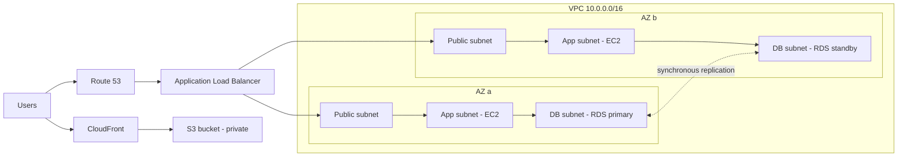
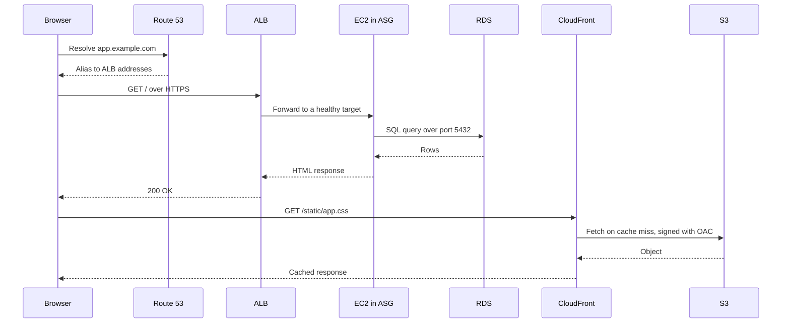
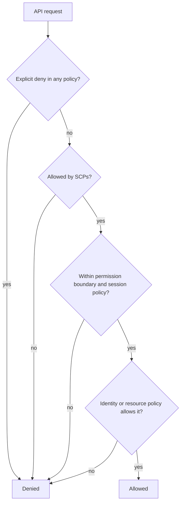
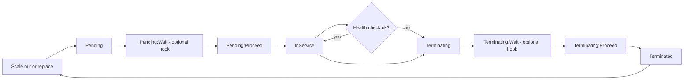
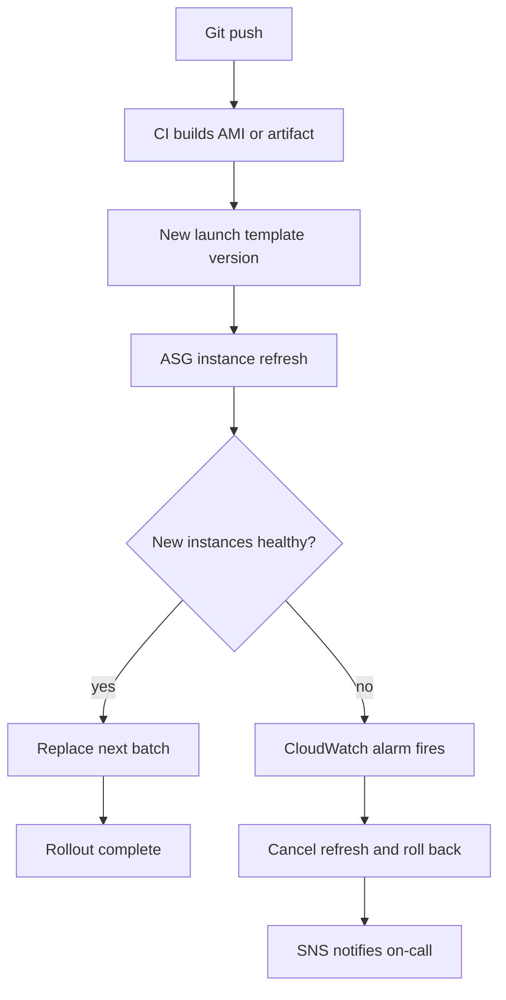

# AWS for DevOps

<!-- DEVOPS-SHACK:HEADER -->

  
  
  
  
  

Part of <b><a href="https://github.com/jaiswaladi246/DevOps-Cloud-Interview-Preparation-by-DevOps-Shack">DevOps &amp; Cloud Interview Preparation</a></b> — created by <b><a href="https://www.youtube.com/@devopsshack">DevOps Shack</a></b>. Free to learn from; please credit DevOps Shack when sharing.

<!-- /DEVOPS-SHACK:HEADER -->

> The AWS you actually use as a DevOps/SRE engineer: networking, compute, load balancing, databases, edge delivery, IAM, observability and cost, explained the way we run it in production and ask it in interviews.

[🏠 Home](../README.md)

## What you'll master

- Design a VPC that spans two Availability Zones with public, application and database tiers, and explain every route and security group in it
- Build a highly available web tier: ALB, Auto Scaling group, launch template, user data, health checks, target tracking
- Run RDS Multi-AZ in private subnets, know what a failover does to your application, and when Aurora is the better answer
- Serve static content through S3 and CloudFront with Origin Access Control, and put Route 53 in front of it all
- Write IAM policies with least privilege, understand policy evaluation, and use roles instead of keys everywhere
- Wire CloudWatch metrics, alarms, logs and SNS so a failure pages you before a customer does
- Tag everything, read a Cost Explorer report, and spot the usual bill surprises (NAT, data transfer, idle load balancers)
- Do all of the above from the AWS CLI, then explain the design in an interview with trade-offs

## Architecture at a glance

This is the reference design the lab in this folder builds. Users hit Route 53, static assets come from CloudFront backed by a private S3 bucket, dynamic traffic goes to an internet-facing ALB, and the instances and the database sit in private subnets.

Read it left to right: the ALB is the only compute-adjacent thing exposed to the internet. Instances have no public IPs; they reach the internet through a NAT gateway for package installs. The database only accepts connections from the app security group.

## Request and data flow

What happens when a browser loads a page that has dynamic content, a stylesheet and a database lookup. Knowing this sequence cold is what lets you debug "the site is slow" in an interview or at 2 a.m.

Two paths, two failure domains. If CSS is broken, look at CloudFront and S3. If the page returns 502 or 503, look at the ALB target group and the instances.

## IAM request evaluation

Every AWS API call is evaluated the same way. An explicit deny always wins, then organization guardrails and boundaries must allow it, then something must explicitly allow it.

The default answer is deny. Most "AccessDenied" tickets are one of these boxes. `aws iam simulate-principal-policy` and the CloudTrail error message tell you which.

## Auto Scaling instance lifecycle

An instance in an ASG moves through a predictable lifecycle. Health check grace period, lifecycle hooks and ELB health checks all attach to specific points here.

When an instance fails the ELB health check and the group uses `--health-check-type ELB`, the ASG terminates it and launches a replacement. That loop is the self-healing you are selling in the interview.

## Delivery workflow on AWS

A typical deployment path for this stack: build an image, roll it out with an instance refresh, and let alarms decide whether the rollout continues.

## Core concepts in 10 minutes

**Regions and Availability Zones.** A Region is a geographic area (`ap-south-1` is Mumbai) with at least three AZs, each one or more isolated data centers. Resources are regional or zonal. High availability means spreading across AZs; disaster recovery means spreading across Regions. Most services are Regional, IAM, Route 53 and CloudFront are global.

**VPC and subnets.** A VPC is your private network with a CIDR block. A subnet lives in exactly one AZ. "Public" means the route table has `0.0.0.0/0` to an internet gateway; "private" means it does not. Private instances reach out through a NAT gateway (one per AZ for real HA, one total for a lab). Gateway endpoints for S3 and DynamoDB are free and keep that traffic off the NAT.

**Security groups and NACLs.** Security groups are stateful, attach to network interfaces, allow rules only, and can reference other security groups. NACLs are stateless, attach to subnets, and have numbered allow and deny rules. In production we do almost everything with security groups and leave NACLs at default unless we need an explicit subnet-level deny.

**IAM.** Users are for humans who cannot use Identity Center, and almost never for workloads. Workloads get roles: EC2 instance profiles, ECS task roles, IRSA or Pod Identity on EKS, Lambda execution roles. A role has a trust policy (who can assume it) and permission policies (what it can do). Prefer short-lived credentials from STS over long-lived access keys.

**EC2 and Auto Scaling.** A launch template defines AMI, instance type, security groups, IAM profile and user data. An Auto Scaling group keeps a desired number of instances across subnets and AZs, replaces unhealthy ones, and scales on policies. Target tracking on a metric such as average CPU or ALB request count per target is the policy we reach for first.

**Load balancing.** ALB is layer 7 (HTTP/HTTPS, host and path routing, WebSockets, gRPC). NLB is layer 4 (TCP/UDP/TLS, static IPs, extreme throughput). Targets register in a target group and are judged by health checks. Cross-zone load balancing is on by default for ALB.

**RDS and Aurora.** RDS runs managed MySQL, PostgreSQL, MariaDB, Oracle and SQL Server. Multi-AZ keeps a synchronous standby in another AZ for failover, usually 60 to 120 seconds, with the same DNS endpoint. Multi-AZ is for availability, read replicas are for read scaling and cross-Region DR. Aurora separates compute from a six-copy distributed storage layer and fails over faster.

**S3.** Object storage with 11 nines of durability. Buckets are private by default and Block Public Access should stay on. Know storage classes, versioning, lifecycle rules, bucket policies versus IAM policies, and SSE-S3 versus SSE-KMS.

**CloudFront and Route 53.** CloudFront caches content at edge locations and shields the origin; Origin Access Control lets it read a private bucket. Route 53 is DNS with routing policies (simple, weighted, latency, failover, geolocation) and health checks. An alias record to an ALB or CloudFront distribution is free and works at the zone apex.

**CloudWatch, SNS and CloudTrail.** CloudWatch collects metrics, logs and alarms. Alarms act on SNS topics, Auto Scaling policies or EC2 actions. CloudTrail records API calls: it answers "who did what and when". Config records resource state over time and checks it against rules.

**Cost.** Biggest surprises are NAT gateway hourly and per-GB charges, cross-AZ and internet data transfer, idle ALBs and unattached EBS volumes, and oversized RDS. Tag everything with at least `Project`, `Environment`, `Owner`, and `CostCenter`, then activate those as cost allocation tags so Cost Explorer can group by them.

**Well-Architected.** Six pillars: operational excellence, security, reliability, performance efficiency, cost optimization, sustainability. Interviewers use them as a checklist for design questions, so structure your answers along them.

## Question banks

| Bank | What it covers | Questions |
|------|----------------|-----------|
| [Concepts](./concepts.md) | Core services, internals, comparisons, "what happens when" | 200 |
| [Scenarios](./scenarios.md) | Situational design and decision questions with a step-by-step approach | 200 |
| [Troubleshooting](./troubleshooting.md) | Real symptoms and exact error messages with diagnosis and fix | 200 |
| [Production](./production.md) | Architecture, security, cost, scale, trade-offs and rapid-fire commands | 200 |

## Learning path

**Beginner**
- [ ] Create an account, secure the root user with MFA, set a billing budget
- [ ] Configure the AWS CLI with SSO or a named profile and run `aws sts get-caller-identity`
- [ ] Explain Region, AZ, VPC, subnet, route table, internet gateway, NAT gateway
- [ ] Launch an EC2 instance with an instance profile and connect with Session Manager
- [ ] Create a private S3 bucket and serve it through CloudFront
- [ ] Write a policy that grants read on one S3 prefix and nothing else
- [ ] Finish assignments 1 to 10

**Intermediate**
- [ ] Build the full lab in [hands-on-lab.md](./hands-on-lab.md) from the CLI
- [ ] Explain ALB versus NLB and when each is right
- [ ] Run an RDS Multi-AZ failover and measure the impact on the app
- [ ] Add HTTPS with ACM and an HTTP to HTTPS redirect
- [ ] Use VPC endpoints and explain the cost trade-off against NAT
- [ ] Assume a role across accounts with an external ID
- [ ] Finish assignments 11 to 20

**Advanced**
- [ ] Rebuild the lab in Terraform with remote state and detect drift
- [ ] Design and test a multi-Region pilot light with a measured RTO and RPO
- [ ] Implement blue/green deployment with weighted target groups
- [ ] Enforce guardrails with SCPs, permission boundaries and Access Analyzer
- [ ] Run a cost optimization pass and show the before and after numbers
- [ ] Finish assignments 21 to 25 and work through all four question banks

## Continue

- 🛠 [Hands-on lab: highly available web app](./hands-on-lab.md)
- 📝 [25 assignments](./assignments.md)
- 📋 [Cheatsheet](./cheatsheet.md)
- 🏠 [Home](../README.md)

<!-- DEVOPS-SHACK:FOOTER -->
---

### 🚀 Made with ❤️ by [DevOps Shack](https://www.youtube.com/@devopsshack)

**Learn DevOps, DevSecOps, Cloud and Kubernetes the practical way.**

[▶️ YouTube — DevOps Shack](https://www.youtube.com/@devopsshack) · [▶️ Hindi — @shackverse](https://www.youtube.com/@shackverse) · [🎓 devopsshack.com](https://devopsshack.com) · [📸 Instagram @devopsshack](https://www.instagram.com/devopsshack)

[🏠 Back to Home](../README.md) · [⭐ Star the original repo](https://github.com/jaiswaladi246/DevOps-Cloud-Interview-Preparation-by-DevOps-Shack)

© DevOps Shack · Licensed CC BY-NC-SA 4.0 · If you found this copy anywhere other than <a href="https://github.com/jaiswaladi246/DevOps-Cloud-Interview-Preparation-by-DevOps-Shack">github.com/jaiswaladi246</a>, the original and latest version is maintained by DevOps Shack.

<!-- /DEVOPS-SHACK:FOOTER -->
