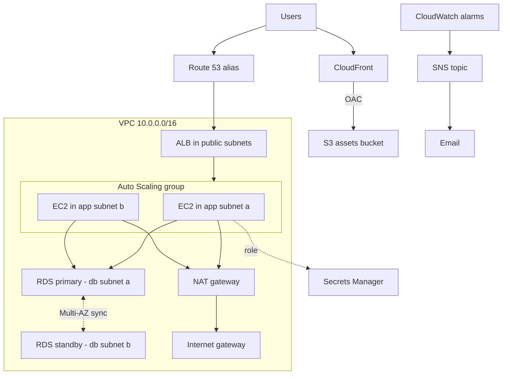

# AWS Hands-on Lab — Highly Available Web App from the CLI

<!-- DEVOPS-SHACK:HEADER -->
<p align="center">
  <a href="https://www.youtube.com/@devopsshack"></a>
  <a href="https://www.youtube.com/@shackverse"></a>
  <a href="https://devopsshack.com"></a>
  <a href="https://www.instagram.com/devopsshack"></a>
  <a href="https://github.com/jaiswaladi246/DevOps-Cloud-Interview-Preparation-by-DevOps-Shack"></a>
</p>
<p align="center"><sub>Part of <b><a href="https://github.com/jaiswaladi246/DevOps-Cloud-Interview-Preparation-by-DevOps-Shack">DevOps &amp; Cloud Interview Preparation</a></b> — created by <b><a href="https://www.youtube.com/@devopsshack">DevOps Shack</a></b>. Free to learn from; please credit DevOps Shack when sharing.</sub></p>
<!-- /DEVOPS-SHACK:HEADER -->

> Build a two-AZ web application with an ALB, Auto Scaling group, RDS Multi-AZ, S3 + CloudFront, Route 53, least-privilege IAM, CloudWatch alarms and cost tags using only the AWS CLI, then tear it all down.

[⬅ Back to AWS for DevOps](./README.md) · [🏠 Home](../README.md)

## Goal

By the end you have this running in `ap-south-1`:

- A VPC across two AZs with public, app and database subnets
- An internet-facing ALB forwarding to an Auto Scaling group (min 2, max 4) of nginx instances built from a launch template and user data
- PostgreSQL on RDS Multi-AZ in private subnets with a Secrets Manager-managed password
- A private S3 bucket served through CloudFront with Origin Access Control
- A Route 53 alias record (optional, needs a domain)
- An EC2 role with least privilege and no SSH keys, access via Session Manager
- CloudWatch alarms that notify an SNS email topic
- Cost tags on every resource, and a verified teardown

**Cost warning.** This is not free tier. The NAT gateway, ALB and Multi-AZ RDS together run to a few USD per day. Do the lab in one sitting and run the teardown the same day.

## Architecture



| Tier | Subnets | CIDR |
|------|---------|------|
| Public (ALB, NAT) | pub-a, pub-b | 10.0.0.0/24, 10.0.1.0/24 |
| App (EC2) | app-a, app-b | 10.0.10.0/24, 10.0.11.0/24 |
| Database (RDS) | db-a, db-b | 10.0.20.0/24, 10.0.21.0/24 |

## Prerequisites

- An AWS account where you can create IAM, VPC, EC2, RDS, S3, CloudFront, Route 53, SNS and CloudWatch resources. Use a sandbox account, not production.
- AWS CLI v2 (`aws --version` should say `aws-cli/2.x`), configured with SSO or a profile: `aws sts get-caller-identity` must work.
- `bash` (the tag shortcuts below rely on word splitting, so zsh needs `setopt sh_word_split`), `jq`, `curl`, `dig`.
- Optional: the Session Manager plugin for the AWS CLI, for the database check in step 11.
- Optional: a domain with a Route 53 public hosted zone for step 12.
- An email address you can read, for SNS.

Work in an empty directory. Every step saves its IDs into `ha-lab.env` so you can resume after a dropped terminal with `source ha-lab.env`.

---

## Step 1. Variables, tags and helpers

```bash
mkdir -p ~/ha-lab && cd ~/ha-lab

export AWS_REGION=ap-south-1 AWS_DEFAULT_REGION=ap-south-1
export PROJECT=ha-web ENVIRONMENT=lab OWNER=your-name
export ALERT_EMAIL=you@example.com
export AZ1=ap-south-1a AZ2=ap-south-1b
export ACCOUNT_ID=$(aws sts get-caller-identity --query Account --output text)

# Cost tags used on every resource, in CLI shorthand
export TAGS_CLI="Key=Project,Value=$PROJECT Key=Environment,Value=$ENVIRONMENT Key=Owner,Value=$OWNER Key=CostCenter,Value=training"

# Persist a variable to ha-lab.env
save() { echo "export $1=\"${!1}\"" >> ~/ha-lab/ha-lab.env; }
for v in AWS_REGION AWS_DEFAULT_REGION PROJECT ENVIRONMENT OWNER ALERT_EMAIL AZ1 AZ2 ACCOUNT_ID; do save $v; done
echo "export TAGS_CLI=\"$TAGS_CLI\"" >> ha-lab.env

# EC2-style tag specification: tags <resource-type> <name-suffix>
tags() { echo "ResourceType=$1,Tags=[{Key=Name,Value=$PROJECT-$2},{Key=Project,Value=$PROJECT},{Key=Environment,Value=$ENVIRONMENT},{Key=Owner,Value=$OWNER},{Key=CostCenter,Value=training}]"; }
declare -f save tags >> ha-lab.env
```

Verification:

```bash
echo "$ACCOUNT_ID $AWS_REGION"
tags vpc vpc
```

You should see your 12-digit account ID, `ap-south-1`, and a tag specification string.

## Step 2. VPC, subnets and internet gateway

```bash
VPC_ID=$(aws ec2 create-vpc --cidr-block 10.0.0.0/16 \
  --tag-specifications "$(tags vpc vpc)" --query Vpc.VpcId --output text); save VPC_ID
aws ec2 modify-vpc-attribute --vpc-id $VPC_ID --enable-dns-hostnames
aws ec2 modify-vpc-attribute --vpc-id $VPC_ID --enable-dns-support

mk_subnet() { aws ec2 create-subnet --vpc-id $VPC_ID --cidr-block $1 --availability-zone $2 \
  --tag-specifications "$(tags subnet $3)" --query Subnet.SubnetId --output text; }

PUB_A=$(mk_subnet 10.0.0.0/24  $AZ1 pub-a);  save PUB_A
PUB_B=$(mk_subnet 10.0.1.0/24  $AZ2 pub-b);  save PUB_B
APP_A=$(mk_subnet 10.0.10.0/24 $AZ1 app-a);  save APP_A
APP_B=$(mk_subnet 10.0.11.0/24 $AZ2 app-b);  save APP_B
DB_A=$(mk_subnet  10.0.20.0/24 $AZ1 db-a);   save DB_A
DB_B=$(mk_subnet  10.0.21.0/24 $AZ2 db-b);   save DB_B

IGW_ID=$(aws ec2 create-internet-gateway --tag-specifications "$(tags internet-gateway igw)" \
  --query InternetGateway.InternetGatewayId --output text); save IGW_ID
aws ec2 attach-internet-gateway --internet-gateway-id $IGW_ID --vpc-id $VPC_ID
```

Verification:

```bash
aws ec2 describe-subnets --filters Name=vpc-id,Values=$VPC_ID \
  --query 'Subnets[].[Tags[?Key==`Name`]|[0].Value,CidrBlock,AvailabilityZone]' --output table
```

Six subnets, three per AZ.

## Step 3. NAT gateway and route tables

The public route table sends `0.0.0.0/0` to the internet gateway. The private route table sends it to a NAT gateway so app instances can install packages. DB subnets stay on the VPC's main route table, which only has the local route, so the database has no path to the internet at all.

```bash
PUB_RT=$(aws ec2 create-route-table --vpc-id $VPC_ID --tag-specifications "$(tags route-table public-rt)" \
  --query RouteTable.RouteTableId --output text); save PUB_RT
aws ec2 create-route --route-table-id $PUB_RT --destination-cidr-block 0.0.0.0/0 --gateway-id $IGW_ID
aws ec2 associate-route-table --route-table-id $PUB_RT --subnet-id $PUB_A
aws ec2 associate-route-table --route-table-id $PUB_RT --subnet-id $PUB_B

EIP_ALLOC=$(aws ec2 allocate-address --domain vpc --tag-specifications "$(tags elastic-ip nat-eip)" \
  --query AllocationId --output text); save EIP_ALLOC
NAT_ID=$(aws ec2 create-nat-gateway --subnet-id $PUB_A --allocation-id $EIP_ALLOC \
  --tag-specifications "$(tags natgateway nat)" --query NatGateway.NatGatewayId --output text); save NAT_ID
aws ec2 wait nat-gateway-available --nat-gateway-ids $NAT_ID

PRIV_RT=$(aws ec2 create-route-table --vpc-id $VPC_ID --tag-specifications "$(tags route-table private-rt)" \
  --query RouteTable.RouteTableId --output text); save PRIV_RT
aws ec2 create-route --route-table-id $PRIV_RT --destination-cidr-block 0.0.0.0/0 --nat-gateway-id $NAT_ID
aws ec2 associate-route-table --route-table-id $PRIV_RT --subnet-id $APP_A
aws ec2 associate-route-table --route-table-id $PRIV_RT --subnet-id $APP_B
```

One NAT gateway is a single point of failure for outbound traffic and generates cross-AZ charges for app-b. In production we run one NAT per AZ; here we accept the trade-off to save money.

Verification:

```bash
aws ec2 describe-route-tables --route-table-ids $PUB_RT $PRIV_RT \
  --query 'RouteTables[].[RouteTableId,Routes[].[DestinationCidrBlock,GatewayId||NatGatewayId]]' --output json
```

Public table points at `igw-...`, private at `nat-...`.

## Step 4. Security groups

Chain them by reference: internet to ALB, ALB to app, app to database. Nothing else gets in.

```bash
mk_sg() { aws ec2 create-security-group --group-name $PROJECT-$1 --description "$2" --vpc-id $VPC_ID \
  --tag-specifications "$(tags security-group $1)" --query GroupId --output text; }

ALB_SG=$(mk_sg alb-sg "ALB ingress"); save ALB_SG
APP_SG=$(mk_sg app-sg "App tier from ALB only"); save APP_SG
DB_SG=$(mk_sg db-sg "Postgres from app tier only"); save DB_SG

aws ec2 authorize-security-group-ingress --group-id $ALB_SG --protocol tcp --port 80 --cidr 0.0.0.0/0
aws ec2 authorize-security-group-ingress --group-id $APP_SG \
  --ip-permissions "IpProtocol=tcp,FromPort=80,ToPort=80,UserIdGroupPairs=[{GroupId=$ALB_SG}]"
aws ec2 authorize-security-group-ingress --group-id $DB_SG \
  --ip-permissions "IpProtocol=tcp,FromPort=5432,ToPort=5432,UserIdGroupPairs=[{GroupId=$APP_SG}]"
```

Verification:

```bash
aws ec2 describe-security-groups --group-ids $ALB_SG $APP_SG $DB_SG \
  --query 'SecurityGroups[].[GroupName,IpPermissions[].[FromPort,UserIdGroupPairs[0].GroupId||IpRanges[0].CidrIp]]' --output json
```

## Step 5. RDS Multi-AZ PostgreSQL

Start this early; Multi-AZ creation takes 15 to 25 minutes and we continue in parallel. `--manage-master-user-password` makes RDS generate the password and store it in Secrets Manager, so no password ever appears in your shell history or in user data.

```bash
aws rds create-db-subnet-group --db-subnet-group-name $PROJECT-db-subnets \
  --db-subnet-group-description "Private DB subnets in two AZs" \
  --subnet-ids $DB_A $DB_B --tags $TAGS_CLI

aws rds create-db-instance \
  --db-instance-identifier $PROJECT-db \
  --engine postgres \
  --db-instance-class db.t4g.micro \
  --allocated-storage 20 --storage-type gp3 --storage-encrypted \
  --db-name appdb \
  --master-username appadmin --manage-master-user-password \
  --multi-az --no-publicly-accessible \
  --db-subnet-group-name $PROJECT-db-subnets \
  --vpc-security-group-ids $DB_SG \
  --backup-retention-period 1 \
  --no-deletion-protection \
  --tags $TAGS_CLI
```

We omit `--engine-version` so RDS picks the current default. In production you pin it. `--no-deletion-protection` is only for the lab; production databases get it turned on.

Verification (it will say `creating` for a while):

```bash
aws rds describe-db-instances --db-instance-identifier $PROJECT-db \
  --query 'DBInstances[0].[DBInstanceStatus,MultiAZ,PubliclyAccessible,MasterUserSecret.SecretArn]' --output text
```

`MultiAZ` must be `True` and `PubliclyAccessible` must be `False`. Save the secret ARN and carry on:

```bash
SECRET_ARN=$(aws rds describe-db-instances --db-instance-identifier $PROJECT-db \
  --query 'DBInstances[0].MasterUserSecret.SecretArn' --output text); save SECRET_ARN
```

If `SECRET_ARN` prints `None`, wait a minute and repeat.

## Step 6. S3 bucket and CloudFront with Origin Access Control

```bash
BUCKET=$PROJECT-assets-$ACCOUNT_ID-$AWS_REGION; save BUCKET
aws s3api create-bucket --bucket $BUCKET --region $AWS_REGION \
  --create-bucket-configuration LocationConstraint=$AWS_REGION
aws s3api put-public-access-block --bucket $BUCKET --public-access-block-configuration \
  BlockPublicAcls=true,IgnorePublicAcls=true,BlockPublicPolicy=true,RestrictPublicBuckets=true
aws s3api put-bucket-tagging --bucket $BUCKET --tagging \
  "TagSet=[{Key=Project,Value=$PROJECT},{Key=Environment,Value=$ENVIRONMENT},{Key=Owner,Value=$OWNER},{Key=CostCenter,Value=training}]"

mkdir -p assets/static assets/app
cat > assets/static/app.css <<'CSS'
body { font-family: system-ui, sans-serif; max-width: 42rem; margin: 3rem auto; }
.card { border: 1px solid #ccc; border-radius: 8px; padding: 1rem 1.5rem; }
h1 { color: #ff9900; }
CSS
echo "Served by the HA lab" > assets/app/banner.txt
aws s3 cp assets/ s3://$BUCKET/ --recursive
```

Create the access control and the distribution. The managed cache policy ID below is `Managed-CachingOptimized`.

```bash
OAC_ID=$(aws cloudfront create-origin-access-control --origin-access-control-config \
  "Name=$PROJECT-oac,Description=OAC for assets,SigningProtocol=sigv4,SigningBehavior=always,OriginAccessControlOriginType=s3" \
  --query OriginAccessControl.Id --output text); save OAC_ID

cat > cf-config.json <<CFG
{
  "CallerReference": "$PROJECT-$(date +%s)",
  "Comment": "$PROJECT static assets",
  "Enabled": true,
  "PriceClass": "PriceClass_100",
  "Origins": {
    "Quantity": 1,
    "Items": [{
      "Id": "s3-assets",
      "DomainName": "$BUCKET.s3.$AWS_REGION.amazonaws.com",
      "OriginAccessControlId": "$OAC_ID",
      "S3OriginConfig": { "OriginAccessIdentity": "" }
    }]
  },
  "DefaultCacheBehavior": {
    "TargetOriginId": "s3-assets",
    "ViewerProtocolPolicy": "redirect-to-https",
    "CachePolicyId": "658327ea-f89d-4fab-a63d-7e88639e58f6",
    "Compress": true,
    "AllowedMethods": { "Quantity": 2, "Items": ["GET", "HEAD"] }
  }
}
CFG

read CF_ID CF_DOMAIN CF_ARN < <(aws cloudfront create-distribution --distribution-config file://cf-config.json \
  --query 'Distribution.[Id,DomainName,ARN]' --output text)
save CF_ID; save CF_DOMAIN; save CF_ARN

aws cloudfront tag-resource --resource $CF_ARN --tags \
  "Items=[{Key=Project,Value=$PROJECT},{Key=Environment,Value=$ENVIRONMENT},{Key=Owner,Value=$OWNER},{Key=CostCenter,Value=training}]"
```

Now allow only this distribution to read the bucket:

```bash
cat > bucket-policy.json <<POL
{
  "Version": "2012-10-17",
  "Statement": [{
    "Sid": "AllowCloudFrontServicePrincipalReadOnly",
    "Effect": "Allow",
    "Principal": { "Service": "cloudfront.amazonaws.com" },
    "Action": "s3:GetObject",
    "Resource": "arn:aws:s3:::$BUCKET/*",
    "Condition": { "StringEquals": { "AWS:SourceArn": "$CF_ARN" } }
  }]
}
POL
aws s3api put-bucket-policy --bucket $BUCKET --policy file://bucket-policy.json
aws cloudfront wait distribution-deployed --id $CF_ID
```

Verification:

```bash
curl -sI https://$CF_DOMAIN/static/app.css | head -n 5
curl -sI https://$BUCKET.s3.$AWS_REGION.amazonaws.com/static/app.css | head -n 1
```

The first returns `HTTP/2 200` with an `x-cache` header (`Miss from cloudfront`, then `Hit` on repeat). The second must return `403`, which proves the bucket is private and only CloudFront can read it. Note that this distribution serves everything in the bucket, including `/app/banner.txt`. Do not store secrets in this bucket.

## Step 7. IAM role with least privilege

The instances need exactly three things: Session Manager (managed policy), read the one RDS secret, and read the `app/` prefix of the one bucket.

```bash
cat > trust.json <<'TRUST'
{
  "Version": "2012-10-17",
  "Statement": [{
    "Effect": "Allow",
    "Principal": { "Service": "ec2.amazonaws.com" },
    "Action": "sts:AssumeRole"
  }]
}
TRUST

aws iam create-role --role-name $PROJECT-ec2-role \
  --assume-role-policy-document file://trust.json --tags $TAGS_CLI
aws iam attach-role-policy --role-name $PROJECT-ec2-role \
  --policy-arn arn:aws:iam::aws:policy/AmazonSSMManagedInstanceCore

cat > app-policy.json <<POLICY
{
  "Version": "2012-10-17",
  "Statement": [
    {
      "Sid": "ReadDbSecret",
      "Effect": "Allow",
      "Action": "secretsmanager:GetSecretValue",
      "Resource": "$SECRET_ARN"
    },
    {
      "Sid": "ReadAppPrefix",
      "Effect": "Allow",
      "Action": "s3:GetObject",
      "Resource": "arn:aws:s3:::$BUCKET/app/*"
    }
  ]
}
POLICY
aws iam put-role-policy --role-name $PROJECT-ec2-role --policy-name app-access \
  --policy-document file://app-policy.json

aws iam create-instance-profile --instance-profile-name $PROJECT-ec2-profile --tags $TAGS_CLI
aws iam add-role-to-instance-profile --instance-profile-name $PROJECT-ec2-profile --role-name $PROJECT-ec2-role
sleep 15   # IAM is eventually consistent
```

Verification: prove the policy does what you intend and nothing more.

```bash
ROLE_ARN=arn:aws:iam::$ACCOUNT_ID:role/$PROJECT-ec2-role
aws iam simulate-principal-policy --policy-source-arn $ROLE_ARN \
  --action-names s3:GetObject s3:PutObject s3:DeleteObject \
  --resource-arns arn:aws:s3:::$BUCKET/app/banner.txt \
  --query 'EvaluationResults[].[EvalActionName,EvalDecision]' --output table
```

`s3:GetObject` is `allowed`; `PutObject` and `DeleteObject` are `implicitDeny`.

## Step 8. Launch template and user data

The user data installs nginx and the PostgreSQL client, pulls the banner from S3 with the instance role (no keys), and renders a page showing which instance and AZ served the request. It uses IMDSv2 for metadata.

```bash
cat > userdata.sh <<'UD'
#!/bin/bash
set -euxo pipefail
dnf install -y nginx postgresql16
TOKEN=$(curl -sX PUT http://169.254.169.254/latest/api/token -H "X-aws-ec2-metadata-token-ttl-seconds: 300")
IID=$(curl -s -H "X-aws-ec2-metadata-token: $TOKEN" http://169.254.169.254/latest/meta-data/instance-id)
AZ=$(curl -s -H "X-aws-ec2-metadata-token: $TOKEN" http://169.254.169.254/latest/meta-data/placement/availability-zone)
BANNER=$(aws s3 cp s3://__BUCKET__/app/banner.txt - --region ap-south-1)
cat > /usr/share/nginx/html/index.html <<HTML
<!doctype html><html><head><title>HA lab</title>
<link rel="stylesheet" href="https://__CF_DOMAIN__/static/app.css"></head>
<body><div class="card"><h1>HA web app</h1>
<p>$BANNER</p><p>Instance: <b>$IID</b><br>Zone: <b>$AZ</b></p></div></body></html>
HTML
echo ok > /usr/share/nginx/html/health.html
systemctl enable --now nginx
UD
sed -i "s/__BUCKET__/$BUCKET/; s/__CF_DOMAIN__/$CF_DOMAIN/" userdata.sh

AMI_ID=$(aws ssm get-parameter \
  --name /aws/service/ami-amazon-linux-latest/al2023-ami-kernel-default-x86_64 \
  --query Parameter.Value --output text); save AMI_ID

T="{Key=Project,Value=$PROJECT},{Key=Environment,Value=$ENVIRONMENT},{Key=Owner,Value=$OWNER},{Key=CostCenter,Value=training}"
cat > lt.json <<LT
{
  "ImageId": "$AMI_ID",
  "InstanceType": "t3.micro",
  "IamInstanceProfile": { "Name": "$PROJECT-ec2-profile" },
  "SecurityGroupIds": ["$APP_SG"],
  "MetadataOptions": { "HttpTokens": "required", "HttpEndpoint": "enabled" },
  "Monitoring": { "Enabled": true },
  "UserData": "$(base64 -w0 userdata.sh)",
  "TagSpecifications": [
    { "ResourceType": "instance", "Tags": [{"Key":"Name","Value":"$PROJECT-web"},$T] },
    { "ResourceType": "volume",   "Tags": [{"Key":"Name","Value":"$PROJECT-web"},$T] }
  ]
}
LT

aws ec2 create-launch-template --launch-template-name $PROJECT-lt \
  --version-description v1 --launch-template-data file://lt.json \
  --tag-specifications "$(tags launch-template lt)"
```

`base64 -w0` is GNU; on macOS use `base64 -i userdata.sh | tr -d '\n'`.

Verification:

```bash
aws ec2 describe-launch-template-versions --launch-template-name $PROJECT-lt --versions '$Latest' \
  --query 'LaunchTemplateVersions[0].LaunchTemplateData.[ImageId,InstanceType,MetadataOptions.HttpTokens]' --output text
```

## Step 9. Application Load Balancer

```bash
ALB_ARN=$(aws elbv2 create-load-balancer --name $PROJECT-alb --type application --scheme internet-facing \
  --subnets $PUB_A $PUB_B --security-groups $ALB_SG --tags $TAGS_CLI \
  --query 'LoadBalancers[0].LoadBalancerArn' --output text); save ALB_ARN

TG_ARN=$(aws elbv2 create-target-group --name $PROJECT-tg --protocol HTTP --port 80 \
  --vpc-id $VPC_ID --target-type instance \
  --health-check-path /health.html --health-check-interval-seconds 15 \
  --healthy-threshold-count 2 --unhealthy-threshold-count 2 --tags $TAGS_CLI \
  --query 'TargetGroups[0].TargetGroupArn' --output text); save TG_ARN

aws elbv2 modify-target-group-attributes --target-group-arn $TG_ARN \
  --attributes Key=deregistration_delay.timeout_seconds,Value=30

LISTENER_ARN=$(aws elbv2 create-listener --load-balancer-arn $ALB_ARN --protocol HTTP --port 80 \
  --default-actions Type=forward,TargetGroupArn=$TG_ARN \
  --query 'Listeners[0].ListenerArn' --output text); save LISTENER_ARN

aws elbv2 wait load-balancer-available --load-balancer-arns $ALB_ARN
read ALB_DNS ALB_ZONE < <(aws elbv2 describe-load-balancers --load-balancer-arns $ALB_ARN \
  --query 'LoadBalancers[0].[DNSName,CanonicalHostedZoneId]' --output text)
save ALB_DNS; save ALB_ZONE
```

Verification: the ALB is `active` and spans both AZs.

```bash
aws elbv2 describe-load-balancers --load-balancer-arns $ALB_ARN \
  --query 'LoadBalancers[0].[State.Code,AvailabilityZones[].ZoneName]' --output json
```

## Step 10. Auto Scaling group with target tracking

```bash
aws autoscaling create-auto-scaling-group --auto-scaling-group-name $PROJECT-asg \
  --launch-template "LaunchTemplateName=$PROJECT-lt,Version=\$Latest" \
  --min-size 2 --max-size 4 --desired-capacity 2 \
  --vpc-zone-identifier "$APP_A,$APP_B" \
  --target-group-arns $TG_ARN \
  --health-check-type ELB --health-check-grace-period 180 \
  --tags "Key=Name,Value=$PROJECT-web,PropagateAtLaunch=true" \
         "Key=Project,Value=$PROJECT,PropagateAtLaunch=true" \
         "Key=Environment,Value=$ENVIRONMENT,PropagateAtLaunch=true" \
         "Key=Owner,Value=$OWNER,PropagateAtLaunch=true" \
         "Key=CostCenter,Value=training,PropagateAtLaunch=true"

aws autoscaling put-scaling-policy --auto-scaling-group-name $PROJECT-asg \
  --policy-name cpu-target-50 --policy-type TargetTrackingScaling \
  --target-tracking-configuration '{"PredefinedMetricSpecification":{"PredefinedMetricType":"ASGAverageCPUUtilization"},"TargetValue":50.0}'

aws autoscaling enable-metrics-collection --auto-scaling-group-name $PROJECT-asg \
  --granularity 1Minute --metrics GroupInServiceInstances GroupDesiredCapacity
```

The ASG tags only the instances, because we put the cost tags on the launch template for volumes. `--health-check-type ELB` is what makes the group replace instances that fail the load balancer check, not only ones EC2 reports as dead.

Verification: wait two to four minutes for user data to finish.

```bash
aws autoscaling describe-auto-scaling-groups --auto-scaling-group-names $PROJECT-asg \
  --query 'AutoScalingGroups[0].Instances[].[InstanceId,AvailabilityZone,LifecycleState,HealthStatus]' --output table
aws elbv2 describe-target-health --target-group-arn $TG_ARN \
  --query 'TargetHealthDescriptions[].[Target.Id,TargetHealth.State]' --output table
```

Two instances, one per AZ, and both targets `healthy`.

## Step 11. Verify the application and the database

Hit the ALB repeatedly and watch the instance ID alternate:

```bash
for i in $(seq 1 8); do curl -s http://$ALB_DNS/ | grep -o 'i-[0-9a-f]*'; done | sort | uniq -c
```

You should see two different instance IDs. Open `http://$ALB_DNS/` in a browser to see the styled page, whose CSS comes from CloudFront.

Now check the database from an instance, with no SSH and no password typed anywhere. Wait until the DB is available first:

```bash
aws rds wait db-instance-available --db-instance-identifier $PROJECT-db
DB_HOST=$(aws rds describe-db-instances --db-instance-identifier $PROJECT-db \
  --query 'DBInstances[0].Endpoint.Address' --output text); save DB_HOST
INSTANCE_ID=$(aws autoscaling describe-auto-scaling-groups --auto-scaling-group-names $PROJECT-asg \
  --query 'AutoScalingGroups[0].Instances[0].InstanceId' --output text)
echo $DB_HOST $SECRET_ARN
aws ssm start-session --target $INSTANCE_ID
```

Inside the session, paste your actual `DB_HOST` and `SECRET_ARN` values:

```bash
export AWS_DEFAULT_REGION=ap-south-1
export PGPASSWORD=$(aws secretsmanager get-secret-value --secret-id "<SECRET_ARN>" \
  --query SecretString --output text | python3 -c 'import sys,json; print(json.load(sys.stdin)["password"])')
psql "host=<DB_HOST> dbname=appdb user=appadmin sslmode=require" -c "select now(), version();"
exit
```

A row back proves the app subnet reaches the database, the security group chain works, and the IAM role can read exactly that secret. If you cannot start a session, see the common errors table.

## Step 12. Route 53 alias record (optional)

Skip this step if you do not have a hosted zone. Use a subdomain you control.

```bash
export ZONE_NAME=example.com
export DOMAIN=lab.example.com
ZONE_ID=$(aws route53 list-hosted-zones-by-name --dns-name $ZONE_NAME \
  --query 'HostedZones[0].Id' --output text | cut -d/ -f3); save ZONE_ID; save DOMAIN

cat > r53-upsert.json <<R53
{
  "Comment": "Alias to $PROJECT ALB",
  "Changes": [{
    "Action": "UPSERT",
    "ResourceRecordSet": {
      "Name": "$DOMAIN",
      "Type": "A",
      "AliasTarget": {
        "HostedZoneId": "$ALB_ZONE",
        "DNSName": "dualstack.$ALB_DNS",
        "EvaluateTargetHealth": true
      }
    }
  }]
}
R53
aws route53 change-resource-record-sets --hosted-zone-id $ZONE_ID --change-batch file://r53-upsert.json
```

Verification:

```bash
dig +short $DOMAIN
curl -s http://$DOMAIN/ | grep -o 'i-[0-9a-f]*'
```

Alias records to an ALB cost nothing per query and have no TTL of their own. For HTTPS you would request an ACM certificate for `$DOMAIN`, validate it with a DNS record, add a 443 listener, and redirect port 80. That is assignment 17.

## Step 13. CloudWatch alarms and SNS

```bash
TOPIC_ARN=$(aws sns create-topic --name $PROJECT-alerts --tags $TAGS_CLI \
  --query TopicArn --output text); save TOPIC_ARN
aws sns subscribe --topic-arn $TOPIC_ARN --protocol email --notification-endpoint $ALERT_EMAIL
```

Click the confirmation link in the email AWS sends. Then create four alarms. The ALB and target group dimension values are the tail of their ARNs.

```bash
ALB_DIM=${ALB_ARN#*:loadbalancer/}
TG_DIM=${TG_ARN##*:}

aws cloudwatch put-metric-alarm --alarm-name $PROJECT-unhealthy-hosts \
  --namespace AWS/ApplicationELB --metric-name UnHealthyHostCount \
  --dimensions Name=TargetGroup,Value=$TG_DIM Name=LoadBalancer,Value=$ALB_DIM \
  --statistic Maximum --period 60 --evaluation-periods 3 \
  --threshold 1 --comparison-operator GreaterThanOrEqualToThreshold \
  --treat-missing-data notBreaching \
  --alarm-actions $TOPIC_ARN --ok-actions $TOPIC_ARN --tags $TAGS_CLI

aws cloudwatch put-metric-alarm --alarm-name $PROJECT-target-5xx \
  --namespace AWS/ApplicationELB --metric-name HTTPCode_Target_5XX_Count \
  --dimensions Name=LoadBalancer,Value=$ALB_DIM \
  --statistic Sum --period 60 --evaluation-periods 5 \
  --threshold 10 --comparison-operator GreaterThanThreshold \
  --treat-missing-data notBreaching \
  --alarm-actions $TOPIC_ARN --tags $TAGS_CLI

aws cloudwatch put-metric-alarm --alarm-name $PROJECT-rds-cpu \
  --namespace AWS/RDS --metric-name CPUUtilization \
  --dimensions Name=DBInstanceIdentifier,Value=$PROJECT-db \
  --statistic Average --period 300 --evaluation-periods 3 \
  --threshold 80 --comparison-operator GreaterThanThreshold \
  --alarm-actions $TOPIC_ARN --tags $TAGS_CLI

aws cloudwatch put-metric-alarm --alarm-name $PROJECT-asg-capacity-low \
  --namespace AWS/AutoScaling --metric-name GroupInServiceInstances \
  --dimensions Name=AutoScalingGroupName,Value=$PROJECT-asg \
  --statistic Minimum --period 60 --evaluation-periods 5 \
  --threshold 2 --comparison-operator LessThanThreshold \
  --treat-missing-data breaching \
  --alarm-actions $TOPIC_ARN --tags $TAGS_CLI
```

Verification: list the alarms and force one into `ALARM` to prove the email path works.

```bash
aws cloudwatch describe-alarms --alarm-name-prefix $PROJECT- \
  --query 'MetricAlarms[].[AlarmName,StateValue]' --output table
aws cloudwatch set-alarm-state --alarm-name $PROJECT-unhealthy-hosts \
  --state-value ALARM --state-reason "Lab notification test"
```

An email should arrive within a minute. The alarm resets itself at its next evaluation.

## Step 14. Failure drills

A design is only highly available if you have watched it fail. Do both drills.

**Drill A: kill an instance.** The ASG should replace it and the ALB should keep serving.

```bash
VICTIM=$(aws autoscaling describe-auto-scaling-groups --auto-scaling-group-names $PROJECT-asg \
  --query 'AutoScalingGroups[0].Instances[0].InstanceId' --output text)
aws autoscaling terminate-instance-in-auto-scaling-group --instance-id $VICTIM --no-should-decrement-desired-capacity

# In a second terminal, the site must keep answering
while true; do curl -s -o /dev/null -w "%{http_code}\n" --max-time 3 http://$ALB_DNS/; sleep 1; done
```

Watch the activity history:

```bash
aws autoscaling describe-scaling-activities --auto-scaling-group-name $PROJECT-asg --max-items 3 \
  --query 'Activities[].[StartTime,StatusCode,Description]' --output table
```

You should see mostly `200`, a brief window of reduced capacity, and a new instance launched and registered within a few minutes. Your `asg-capacity-low` alarm may fire for a few minutes, which is correct.

**Drill B: fail over the database.**

```bash
aws rds describe-db-instances --db-instance-identifier $PROJECT-db \
  --query 'DBInstances[0].[AvailabilityZone,SecondaryAvailabilityZone]' --output text
aws rds reboot-db-instance --db-instance-identifier $PROJECT-db --force-failover
aws rds wait db-instance-available --db-instance-identifier $PROJECT-db
aws rds describe-db-instances --db-instance-identifier $PROJECT-db \
  --query 'DBInstances[0].[AvailabilityZone,SecondaryAvailabilityZone]' --output text
aws rds describe-events --source-type db-instance --source-identifier $PROJECT-db --duration 30 \
  --query 'Events[].[Date,Message]' --output table
```

The two zones swap, the endpoint DNS name stays the same, and the events show `Multi-AZ instance failover started` and `completed`. Connections drop for one to two minutes; applications must retry and must not cache the resolved IP.

**Optional: rolling replacement.** Make a change to `userdata.sh`, create a new launch template version and roll it out with zero downtime:

```bash
aws ec2 create-launch-template-version --launch-template-name $PROJECT-lt \
  --source-version 1 --version-description v2 --launch-template-data file://lt.json
aws autoscaling start-instance-refresh --auto-scaling-group-name $PROJECT-asg \
  --preferences '{"MinHealthyPercentage":50,"InstanceWarmup":120}'
aws autoscaling describe-instance-refreshes --auto-scaling-group-name $PROJECT-asg \
  --query 'InstanceRefreshes[0].[Status,PercentageComplete]' --output text
```

## Step 15. Cost visibility

Confirm every resource carries the tags, so the bill can be sliced by project.

```bash
aws resourcegroupstaggingapi get-resources --tag-filters Key=Project,Values=$PROJECT \
  --query 'ResourceTagMappingList[].ResourceARN' --output text | tr '\t' '\n' | sort
```

Activate the tag keys for cost allocation. Keys only become activatable after they have appeared on a resource that incurred cost, which can take up to a day, so this call may fail on the first attempt. That is expected.

```bash
aws ce update-cost-allocation-tags-status --region us-east-1 --cost-allocation-tags-status \
  TagKey=Project,Status=Active TagKey=Environment,Status=Active TagKey=Owner,Status=Active TagKey=CostCenter,Status=Active
```

Put a guard in place so a forgotten lab cannot surprise you:

```bash
cat > budget.json <<BUDGET
{ "BudgetName": "$PROJECT-lab", "BudgetLimit": { "Amount": "10", "Unit": "USD" },
  "TimeUnit": "MONTHLY", "BudgetType": "COST" }
BUDGET
cat > budget-notify.json <<NOTIFY
[{ "Notification": { "NotificationType": "ACTUAL", "ComparisonOperator": "GREATER_THAN",
                     "Threshold": 80, "ThresholdType": "PERCENTAGE" },
   "Subscribers": [{ "SubscriptionType": "EMAIL", "Address": "$ALERT_EMAIL" }] }]
NOTIFY
aws budgets create-budget --account-id $ACCOUNT_ID --budget file://budget.json \
  --notifications-with-subscribers file://budget-notify.json
```

This budget covers the whole account. Once the tags are active you can add a `TagKeyValue` cost filter to scope it to this project.

---

## Cleanup

Delete in reverse dependency order. Do not skip the verification at the end; forgotten NAT gateways and ALBs are how lab bills happen.

```bash
cd ~/ha-lab && source ha-lab.env

# 1. DNS record (skip if you skipped step 12)
sed 's/"UPSERT"/"DELETE"/' r53-upsert.json > r53-delete.json
aws route53 change-resource-record-sets --hosted-zone-id $ZONE_ID --change-batch file://r53-delete.json

# 2. Alarms and topic
aws cloudwatch delete-alarms --alarm-names $PROJECT-unhealthy-hosts $PROJECT-target-5xx $PROJECT-rds-cpu $PROJECT-asg-capacity-low
aws sns delete-topic --topic-arn $TOPIC_ARN
aws budgets delete-budget --account-id $ACCOUNT_ID --budget-name $PROJECT-lab

# 3. Auto Scaling group, then launch template
aws autoscaling delete-auto-scaling-group --auto-scaling-group-name $PROJECT-asg --force-delete
while aws autoscaling describe-auto-scaling-groups --auto-scaling-group-names $PROJECT-asg \
  --query 'AutoScalingGroups[0].AutoScalingGroupName' --output text | grep -q $PROJECT-asg; do sleep 10; done
aws ec2 delete-launch-template --launch-template-name $PROJECT-lt

# 4. Load balancer and target group
aws elbv2 delete-listener --listener-arn $LISTENER_ARN
aws elbv2 delete-load-balancer --load-balancer-arn $ALB_ARN
aws elbv2 wait load-balancers-deleted --load-balancer-arns $ALB_ARN
aws elbv2 delete-target-group --target-group-arn $TG_ARN

# 5. Database (also removes the managed secret), then its subnet group
aws rds delete-db-instance --db-instance-identifier $PROJECT-db --skip-final-snapshot --delete-automated-backups
aws rds wait db-instance-deleted --db-instance-identifier $PROJECT-db
aws rds delete-db-subnet-group --db-subnet-group-name $PROJECT-db-subnets

# 6. CloudFront must be disabled, fully deployed, then deleted
aws cloudfront get-distribution-config --id $CF_ID > cf-cur.json
jq '.DistributionConfig | .Enabled=false' cf-cur.json > cf-off.json
aws cloudfront update-distribution --id $CF_ID --if-match "$(jq -r .ETag cf-cur.json)" --distribution-config file://cf-off.json
aws cloudfront wait distribution-deployed --id $CF_ID
aws cloudfront delete-distribution --id $CF_ID --if-match "$(aws cloudfront get-distribution --id $CF_ID --query ETag --output text)"
aws cloudfront delete-origin-access-control --id $OAC_ID \
  --if-match "$(aws cloudfront get-origin-access-control --id $OAC_ID --query ETag --output text)"

# 7. S3 bucket
aws s3 rm s3://$BUCKET --recursive
aws s3api delete-bucket --bucket $BUCKET

# 8. IAM
aws iam remove-role-from-instance-profile --instance-profile-name $PROJECT-ec2-profile --role-name $PROJECT-ec2-role
aws iam delete-instance-profile --instance-profile-name $PROJECT-ec2-profile
aws iam delete-role-policy --role-name $PROJECT-ec2-role --policy-name app-access
aws iam detach-role-policy --role-name $PROJECT-ec2-role --policy-arn arn:aws:iam::aws:policy/AmazonSSMManagedInstanceCore
aws iam delete-role --role-name $PROJECT-ec2-role

# 9. NAT gateway and its Elastic IP
aws ec2 delete-nat-gateway --nat-gateway-id $NAT_ID
aws ec2 wait nat-gateway-deleted --nat-gateway-ids $NAT_ID
aws ec2 release-address --allocation-id $EIP_ALLOC

# 10. Security groups (db first, it references app; app references alb)
aws ec2 delete-security-group --group-id $DB_SG
aws ec2 delete-security-group --group-id $APP_SG
aws ec2 delete-security-group --group-id $ALB_SG

# 11. Subnets (this also drops their route table associations), route tables, IGW, VPC
for s in $PUB_A $PUB_B $APP_A $APP_B $DB_A $DB_B; do aws ec2 delete-subnet --subnet-id $s; done
aws ec2 delete-route-table --route-table-id $PUB_RT
aws ec2 delete-route-table --route-table-id $PRIV_RT
aws ec2 detach-internet-gateway --internet-gateway-id $IGW_ID --vpc-id $VPC_ID
aws ec2 delete-internet-gateway --internet-gateway-id $IGW_ID
aws ec2 delete-vpc --vpc-id $VPC_ID
```

Final verification. Everything below should return nothing:

```bash
aws resourcegroupstaggingapi get-resources --tag-filters Key=Project,Values=$PROJECT \
  --query 'ResourceTagMappingList[].ResourceARN' --output text
aws ec2 describe-nat-gateways --filter Name=state,Values=available,pending \
  --query 'NatGateways[].NatGatewayId' --output text
aws ec2 describe-addresses --query 'Addresses[?AssociationId==null].AllocationId' --output text
aws elbv2 describe-load-balancers --query 'LoadBalancers[].LoadBalancerName' --output text
aws rds describe-db-instances --query 'DBInstances[].DBInstanceIdentifier' --output text
```

The tagging API can lag a few minutes and may still list just-deleted resources. Check again before worrying. Also check in the console that Billing shows no new charges tomorrow.

---

## What to say in an interview about this project

**The 60-second version.** "I built a highly available three-tier web app on AWS entirely from the CLI. A VPC across two AZs with public, app and database subnets; an ALB in the public subnets forwarding to an Auto Scaling group of instances launched from a launch template with user data. Instances sit in private subnets with no public IPs and no SSH keys, accessed through Session Manager. The database is RDS PostgreSQL Multi-AZ in isolated subnets with the password managed by RDS in Secrets Manager. Static assets are in a private S3 bucket served by CloudFront through Origin Access Control. IAM follows least privilege: the instance role can read one secret and one S3 prefix. CloudWatch alarms on unhealthy hosts, 5xx, RDS CPU and in-service capacity notify an SNS topic. Everything is tagged for cost allocation. I verified the HA by terminating an instance during a request loop and forcing an RDS failover."

**Follow-ups you should be ready for:**

- Why a NAT gateway, and what would you change for production? One per AZ for resilience, and VPC endpoints for S3, SSM and Secrets Manager to cut NAT data charges and keep traffic private.
- What happens during an RDS failover? The standby is promoted, the CNAME flips to it, connections drop for 60 to 120 seconds, and the app must reconnect and respect DNS TTL.
- Why ELB health checks on the ASG? EC2 status checks only see the hypervisor and OS. An instance with nginx dead still looks healthy to EC2, but not to the ALB.
- How would you deploy a new version? New AMI or launch template version, then instance refresh with a minimum healthy percentage, alarms as the abort signal. For stricter control, blue/green with two target groups.
- How do you stop the bucket being public while CloudFront still reads it? Block Public Access on, OAC with SigV4, and a bucket policy scoped to one distribution ARN using `AWS:SourceArn`.
- What would you do next? HTTPS with ACM, WAF on the ALB or CloudFront, Infrastructure as Code in Terraform, a read replica or Aurora, centralised logs, and scheduled scaling.
- What does this cost and how did you control it? Name the big three: NAT, ALB, Multi-AZ RDS. Tags, a budget alert, and a scripted teardown.

## Common errors and fixes

| Symptom or error | Likely cause | Fix |
|------------------|--------------|-----|
| `Invalid IAM Instance Profile name` or `iamInstanceProfile.name is invalid` when the ASG launches | IAM propagation delay, or profile name typo | Wait 15 to 30 seconds and retry; confirm with `aws iam get-instance-profile` |
| Targets stay `unhealthy` with `Health checks failed` | App SG does not allow port 80 from the ALB SG, or user data failed | Check `describe-target-health` reason; on an instance read `/var/log/cloud-init-output.log` |
| `dnf` hangs or `Failed to download metadata` in user data | App subnets have no route to NAT | Verify the private route table has `0.0.0.0/0` to the NAT gateway and the NAT is `available` |
| ALB returns `503 Service Temporarily Unavailable` | No healthy targets registered yet | Wait for the grace period, then check target health and the ASG activity history |
| ALB returns `504 Gateway Timeout` | Target SG or NACL blocks the ALB, or app is hung | Allow ALB SG to app SG on 80; test from an instance with `curl localhost/health.html` |
| CloudFront returns `403 AccessDenied` XML | Bucket policy `AWS:SourceArn` does not match the distribution ARN, wrong OAC, or key missing | Re-create the bucket policy with `$CF_ARN`; confirm the object exists with `aws s3 ls` |
| `DBSubnetGroupDoesNotCoverEnoughAZs` | DB subnet group has subnets in only one AZ | Pass subnets from at least two AZs |
| `InvalidParameterCombination: ... MasterUserPassword and ManageMasterUserPassword` | Both a password and managed password were supplied | Use only `--manage-master-user-password` |
| `aws ssm start-session` fails with `TargetNotConnected` | Role missing SSM policy, no outbound path, or agent not yet registered | Confirm the managed policy is attached, NAT is working, wait a few minutes after launch |
| `AccessDeniedException` on `GetSecretValue` from the instance | Wrong secret ARN in the role policy, or no `AWS_DEFAULT_REGION` set | Compare `$SECRET_ARN` to the policy; export the region |
| `DependencyViolation` on `delete-vpc`, subnet or security group | Leftover ENIs from the ALB or NAT, or a referencing SG rule | Wait for the ALB and NAT deletion to complete, then delete SGs in reverse reference order |
| `DistributionNotDisabled` on `delete-distribution` | Distribution still enabled or still deploying | Disable it, run `aws cloudfront wait distribution-deployed`, then delete |
| `BucketNotEmpty` | Objects (or versions) remain | `aws s3 rm --recursive`; for versioned buckets delete versions and delete markers too |
| `An error occurred (InvalidParameterValue) ... Tag` in `create-*` | Wrong tag syntax for that service | EC2 uses `--tag-specifications`, RDS and ELB use `--tags Key=,Value=`, S3 uses a `TagSet` |

## Where to go next

- Add HTTPS: ACM certificate, 443 listener, redirect rule (assignment 17)
- Replace the CLI steps with Terraform (assignment 21)
- Drill the theory in [concepts](./concepts.md) and [production](./production.md)
- Practice debugging in [troubleshooting](./troubleshooting.md)

[⬅ Back to AWS for DevOps](./README.md) · [🏠 Home](../README.md)

<!-- DEVOPS-SHACK:FOOTER -->
---

<div align="center">

### 🚀 Made with ❤️ by [DevOps Shack](https://www.youtube.com/@devopsshack)

**Learn DevOps, DevSecOps, Cloud and Kubernetes the practical way.**

[▶️ YouTube — DevOps Shack](https://www.youtube.com/@devopsshack) · [▶️ Hindi — @shackverse](https://www.youtube.com/@shackverse) · [🎓 devopsshack.com](https://devopsshack.com) · [📸 Instagram @devopsshack](https://www.instagram.com/devopsshack)

[🏠 Back to Home](../README.md) · [⭐ Star the original repo](https://github.com/jaiswaladi246/DevOps-Cloud-Interview-Preparation-by-DevOps-Shack)

<sub>© DevOps Shack · Licensed CC BY-NC-SA 4.0 · If you found this copy anywhere other than <a href="https://github.com/jaiswaladi246/DevOps-Cloud-Interview-Preparation-by-DevOps-Shack">github.com/jaiswaladi246</a>, the original and latest version is maintained by DevOps Shack.</sub>

</div>
<!-- /DEVOPS-SHACK:FOOTER -->
