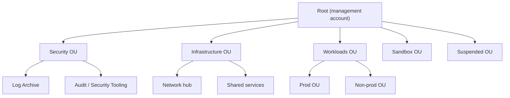
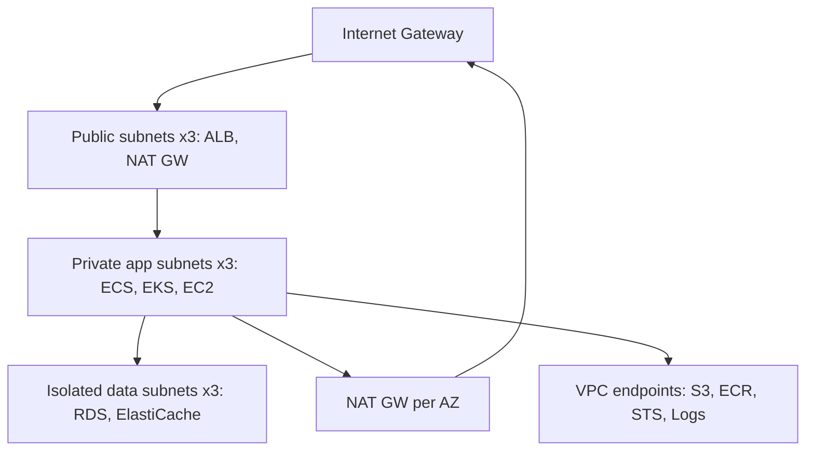
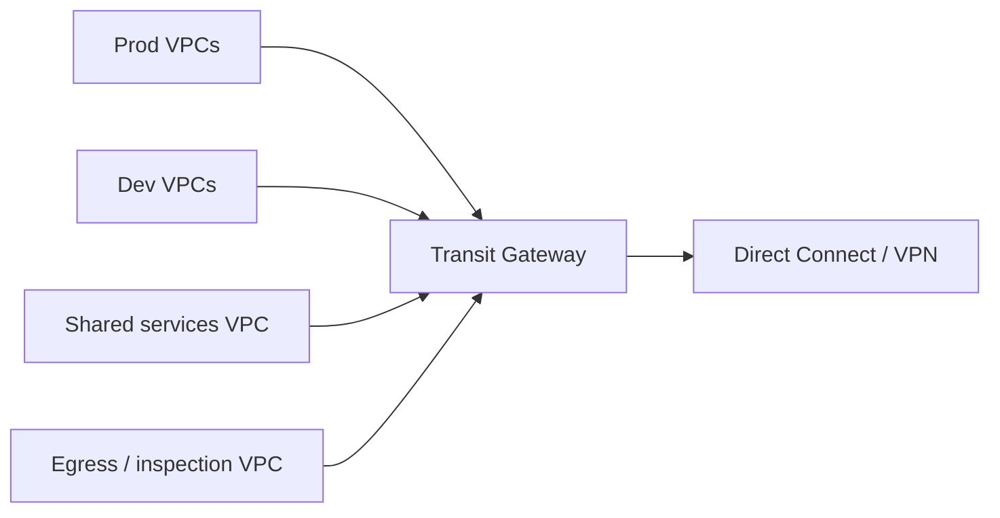
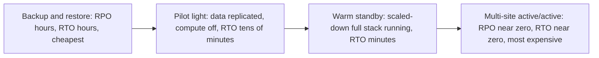
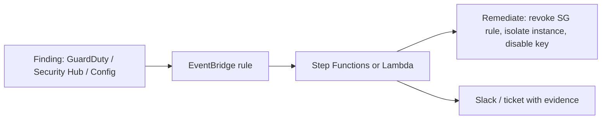
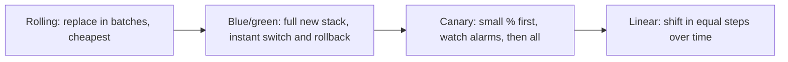

# AWS — Production & Best Practices

<!-- DEVOPS-SHACK:HEADER -->
<p align="center">
  <a href="https://www.youtube.com/@devopsshack"></a>
  <a href="https://www.youtube.com/@shackverse"></a>
  <a href="https://devopsshack.com"></a>
  <a href="https://www.instagram.com/devopsshack"></a>
  <a href="https://github.com/jaiswaladi246/DevOps-Cloud-Interview-Preparation-by-DevOps-Shack"></a>
</p>
<p align="center"><sub>Part of <b><a href="https://github.com/jaiswaladi246/DevOps-Cloud-Interview-Preparation-by-DevOps-Shack">DevOps &amp; Cloud Interview Preparation</a></b> — created by <b><a href="https://www.youtube.com/@devopsshack">DevOps Shack</a></b>. Free to learn from; please credit DevOps Shack when sharing.</sub></p>
<!-- /DEVOPS-SHACK:HEADER -->

> Real-world AWS architecture, multi-account governance, security, reliability, cost and operations, plus rapid-fire AWS CLI · 200 questions · 🟢 Beginner 🟡 Intermediate 🔴 Advanced

[⬅ Back to AWS](./README.md) · [🏠 Home](../README.md)

## Table of contents
- [Multi-Account and Landing Zone](#multi-account-and-landing-zone) — Q1–Q22
- [IAM Best Practices](#iam-best-practices) — Q23–Q44
- [VPC and Network Design](#vpc-and-network-design) — Q45–Q66
- [High Availability, Backup and DR](#high-availability-backup-and-dr) — Q67–Q88
- [EKS in Production](#eks-in-production) — Q89–Q110
- [Cost Optimization](#cost-optimization) — Q111–Q132
- [Security Services and Data Protection](#security-services-and-data-protection) — Q133–Q154
- [Observability, Deployments and Governance](#observability-deployments-and-governance) — Q155–Q175
- [Rapid-Fire AWS CLI](#rapid-fire-aws-cli) — Q176–Q200

---

## Multi-Account and Landing Zone

<!-- DEVOPS-SHACK:SECTION -->
> 🎥 **Learn this hands-on with DevOps Shack** → [YouTube @devopsshack](https://www.youtube.com/@devopsshack) · [Hindi @shackverse](https://www.youtube.com/@shackverse) · [Courses at devopsshack.com](https://devopsshack.com)

### Q1. Why do production teams use many AWS accounts instead of one big account? 🟢

<details>
<summary><b>Answer</b></summary>

The account is the strongest isolation boundary AWS gives you. Separate accounts give you a hard blast-radius limit (a bad IAM policy or a runaway script cannot touch prod from dev), separate service quotas, clean per-account billing, and simpler IAM because you stop writing "except prod" conditions everywhere. In production we treat accounts as cheap and disposable: one per workload per environment is normal, and nobody runs workloads in the management account.

</details>

### Q2. What does a typical OU structure look like for a mid-size company? 🟡

<details>
<summary><b>Answer</b></summary>

We follow the AWS multi-account guidance and keep OUs organized by policy, not by org chart:



SCPs attach at OU level, so "Prod" gets stricter guardrails than "NonProd", "Sandbox" gets budget limits, and "Suspended" denies everything for accounts being closed.

</details>

### Q3. What should and should not live in the management account? 🟢

<details>
<summary><b>Answer</b></summary>

Only Organizations, consolidated billing, Control Tower and Identity Center setup (Identity Center can be delegated). No workloads, no CI runners, no developer access. SCPs do not apply to the management account, so anything running there escapes every guardrail you built. We lock it down with hardware MFA on root, a handful of break-glass admins, and delegate security services (GuardDuty, Security Hub, Config aggregator, IAM Access Analyzer) to the Audit account.

</details>

### Q4. What does Control Tower give you that plain Organizations does not? 🟡

<details>
<summary><b>Answer</b></summary>

Organizations is the plumbing (accounts, OUs, SCPs). Control Tower is an opinionated landing zone on top: it creates Log Archive and Audit accounts, an org-wide CloudTrail and Config setup, Identity Center, a catalog of managed controls (preventive SCPs, detective Config rules, proactive CloudFormation hooks), drift detection for the landing zone, and Account Factory for vending new accounts with a baseline. The trade-off is less flexibility and some lag behind new features; teams that want full control build the same thing with Terraform and Organizations directly.

</details>

### Q5. How do you vend new accounts in a repeatable way? 🟡

<details>
<summary><b>Answer</b></summary>

Never by clicking. Options in order of maturity: Control Tower Account Factory (Service Catalog product), Account Factory for Terraform (AFT, a GitOps pipeline where an account request is a Terraform file in a repo), or a custom pipeline calling `organizations:CreateAccount`. Whatever the tool, the vend step must also apply the baseline: move to the right OU, set alternate contacts, create the IAM roles for CI, enable regions, set budgets, configure VPC from IPAM, and tag the account with owner and cost center.

</details>

### Q6. How do you design SCPs so they protect without blocking the platform team? 🔴

<details>
<summary><b>Answer</b></summary>

Use a deny-list strategy on top of `FullAWSAccess` and exempt your platform roles with a condition, never by naming individual users:

```json
{
  "Sid": "DenyLeaveOrgAndDisableSecurity",
  "Effect": "Deny",
  "Action": ["organizations:LeaveOrganization", "cloudtrail:StopLogging",
             "cloudtrail:DeleteTrail", "guardduty:DeleteDetector",
             "config:StopConfigurationRecorder"],
  "Resource": "*",
  "Condition": {"ArnNotLike": {"aws:PrincipalArn": "arn:aws:iam::*:role/PlatformAdmin"}}
}
```

Roll out new SCPs to Sandbox first, then NonProd, then Prod; watch CloudTrail for `AccessDenied` with an SCP reason. Remember the limits: max 5 SCPs per target and 5,120 characters per policy, so consolidate statements.

</details>

### Q7. Give five SCPs you would put on almost every production OU. 🟡

<details>
<summary><b>Answer</b></summary>

1. Deny `organizations:LeaveOrganization`.
2. Deny disabling CloudTrail, Config, GuardDuty, Security Hub and Access Analyzer.
3. Deny actions outside approved regions using `aws:RequestedRegion` (with `NotAction` exemptions for global services like IAM, Organizations, Route 53, CloudFront, Support).
4. Deny root user actions: condition `aws:PrincipalArn` like `arn:aws:iam::*:root`.
5. Deny creating IAM users and access keys (`iam:CreateUser`, `iam:CreateAccessKey`) except for an exempt role.

Optional extras: deny unencrypted EBS (`ec2:Encrypted` false), deny `ec2:RunInstances` without IMDSv2 (`ec2:MetadataHttpTokens` not `required`).

</details>

### Q8. What are Resource Control Policies and how do they complement SCPs? 🔴

<details>
<summary><b>Answer</b></summary>

SCPs cap what your principals can do. RCPs cap what can be done to your resources, regardless of who the caller is, including principals from outside your organization. That is how you build a data perimeter: an RCP on S3, STS, KMS, SQS and Secrets Manager that denies access unless `aws:PrincipalOrgID` equals your org ID (with exceptions for AWS service principals). SCP gives the identity perimeter, RCP the resource perimeter, VPC endpoint policies plus `aws:SourceVpce` the network perimeter.

</details>

### Q9. What are declarative policies in AWS Organizations? 🔴

<details>
<summary><b>Answer</b></summary>

Declarative policies enforce a desired service configuration at the org level instead of denying API calls. For EC2 you can enforce things like IMDSv2 by default, blocking public sharing of AMIs and EBS snapshots, disabling serial console access and allowing only approved AMI providers. The difference from an SCP: the setting is held by the service itself, so it still applies when the service adds new APIs, and users get a clear custom error message. We use them alongside SCPs, not as a replacement.

</details>

### Q10. What is a delegated administrator and why use it? 🟡

<details>
<summary><b>Answer</b></summary>

Many org-integrated services (GuardDuty, Security Hub, Config, Access Analyzer, Firewall Manager, IPAM, Backup, CloudFormation StackSets, Identity Center) let you nominate a member account as the admin for the whole org. We delegate security services to the Audit account and network services to the Network account so that day-to-day operators never need management-account access.

```bash
aws organizations register-delegated-administrator \
  --account-id 222233334444 --service-principal guardduty.amazonaws.com
```

</details>

### Q11. Where do org-wide logs go, and how do you protect them? 🟡

<details>
<summary><b>Answer</b></summary>

Into a dedicated Log Archive account that only security can read. We send the organization CloudTrail, Config snapshots, VPC Flow Logs, ALB/CloudFront access logs and DNS query logs there. The bucket has versioning, SSE-KMS with a key owned by the Log Archive account, S3 Object Lock (compliance mode for regulated data), a bucket policy limited to the org via `aws:SourceOrgID`, and lifecycle to Glacier. Even an admin in a workload account cannot delete history.

</details>

### Q12. How do you handle region enablement and region restriction? 🟢

<details>
<summary><b>Answer</b></summary>

Two layers. Opt-in regions (launched after March 2019) stay disabled unless you enable them. For default regions, an SCP using `aws:RequestedRegion` denies everything outside the approved list, with exemptions for global services. Do not forget that some global services are anchored in `us-east-1` (IAM, CloudFront certificates in ACM, Route 53, Billing), so blocking `us-east-1` entirely breaks things.

</details>

### Q13. How do you set up a sandbox OU for experimentation without surprise bills? 🟡

<details>
<summary><b>Answer</b></summary>

Give each engineer or team a sandbox account with: a Budget with alerts at 50/80/100 percent plus a Budget action that applies a deny SCP or IAM policy when exceeded, an SCP denying expensive families (`p5.*`, `x2*`, `u-*`), no connectivity to the corporate network, and an automated nuke job (for example `aws-nuke`) on a schedule. Developers get near-admin inside it, which is the point.

</details>

### Q14. How do you close an AWS account cleanly? 🟢

<details>
<summary><b>Answer</b></summary>

Move it to the Suspended OU (deny-all SCP) first and wait to see if anything breaks. Then remove resources that cost money or hold data you need to keep (export backups to another account), remove it from shared resources (RAM shares, TGW attachments), and close it with `aws organizations close-account --account-id ...`. A closed account stays recoverable for 90 days, and you can only close a limited percentage of member accounts in a rolling 30-day window.

</details>

### Q15. How do you share resources such as subnets or Transit Gateways across accounts? 🟢

<details>
<summary><b>Answer</b></summary>

AWS Resource Access Manager (RAM). In production we share subnets from a central Network account to workload accounts (VPC sharing), share the Transit Gateway with the whole org, and share Route 53 Resolver rules and IPAM pools. With sharing inside the organization enabled, invitations are auto-accepted. VPC sharing lets the network team own routing and NAT while app teams only launch resources into the subnets they were given.

</details>

### Q16. VPC sharing vs one VPC per account: which do you prefer? 🔴

<details>
<summary><b>Answer</b></summary>

VPC per account gives the strongest isolation and lets teams own their networking, but costs more (NAT gateways and endpoints per VPC) and needs Transit Gateway for connectivity. VPC sharing centralizes NAT, endpoints and routing, saving real money and IP space, but every participant shares the same blast radius at the network layer and per-VPC quotas (for example ENIs, security groups). We use shared VPCs for many small internal workloads per environment and dedicated VPCs for large, regulated or noisy workloads.

</details>

### Q17. How do you manage IP address space across hundreds of VPCs? 🟡

<details>
<summary><b>Answer</b></summary>

Amazon VPC IP Address Manager (IPAM) with a pool hierarchy: top-level pool (for example `10.0.0.0/8`), then regional pools, then environment pools. Account vending allocates VPC CIDRs from IPAM, so overlaps are impossible. IPAM also monitors utilization and flags overlapping or non-compliant CIDRs. In Terraform: `ipv4_ipam_pool_id` and `ipv4_netmask_length = 20` on `aws_vpc` instead of a hard-coded CIDR.

</details>

### Q18. How do you deploy a baseline (roles, Config rules, alarms) to every account? 🟡

<details>
<summary><b>Answer</b></summary>

CloudFormation StackSets with service-managed permissions and automatic deployment turned on, targeted at OUs. New accounts moved into the OU get the stack automatically; removed accounts have it deleted. Terraform shops use AFT customizations or a pipeline that iterates over accounts assuming a role in each. Key settings: `MaxConcurrentPercentage` and `FailureTolerancePercentage` so a bad template does not roll to 300 accounts at once.

</details>

### Q19. How do you organize CI/CD access across accounts? 🔴

<details>
<summary><b>Answer</b></summary>

One deploy role per target account, trusted only by the CI identity provider (GitHub OIDC, GitLab OIDC) or by a central tooling account role, with conditions pinning repo and branch or environment:

```json
"Condition": {
  "StringEquals": {"token.actions.githubusercontent.com:aud": "sts.amazonaws.com"},
  "StringLike": {"token.actions.githubusercontent.com:sub": "repo:acme/payments:environment:prod"}
}
```

Prod roles accept only the `prod` environment, which itself requires reviewers in GitHub. No static keys anywhere, and the deploy role has a permission boundary so it cannot create admin roles.

</details>

### Q20. How do you set alternate contacts and why does it matter? 🟢

<details>
<summary><b>Answer</b></summary>

AWS sends security, billing and operations notices to the alternate contacts (and to the root email if none are set). If the root email is a former employee's mailbox, you miss abuse reports and security notifications. We set them centrally from the management account for every account at vend time:

```bash
aws account put-alternate-contact --account-id 111122223333 \
  --alternate-contact-type SECURITY --name "SecOps" \
  --email-address secops@example.com --phone-number "+1-555-0100" --title "Security"
```

Root emails use a group alias, never a person.

</details>

### Q21. What is "account drift" in a landing zone and how do you catch it? 🟡

<details>
<summary><b>Answer</b></summary>

Drift is when an account no longer matches its baseline: someone moves it to the wrong OU, edits a Control Tower-managed SCP, deletes a baseline role or disables a Config recorder. Control Tower reports landing zone drift in its console and via SNS; for custom baselines we run StackSets drift detection, Config conformance packs, and a nightly job that checks every account for required roles, trails and tags. Fix drift by re-applying code, not by hand.

</details>

### Q22. When does a single account still make sense? 🟢

<details>
<summary><b>Answer</b></summary>

A solo developer, a short-lived proof of concept, or a tiny startup before its first production customer. Even then, create an Organization from day one with the management account kept empty and the workload in a member account, because migrating resources between accounts later is painful (many services cannot be moved, only rebuilt). At minimum, separate prod from everything else as soon as real users arrive.

</details>

---

## IAM Best Practices

<!-- DEVOPS-SHACK:SECTION -->
> 🎥 **Learn this hands-on with DevOps Shack** → [YouTube @devopsshack](https://www.youtube.com/@devopsshack) · [Hindi @shackverse](https://www.youtube.com/@shackverse) · [Courses at devopsshack.com](https://devopsshack.com)

### Q23. What does least privilege look like in practice, not in theory? 🟢

<details>
<summary><b>Answer</b></summary>

Start with a scoped policy for the actions you know, deploy, then tighten with data: IAM Access Analyzer policy generation from CloudTrail activity, last-accessed information per service and action, and unused access findings. Scope by resource ARN and condition (tags, VPC endpoint, org ID), not just by action. Review on a schedule; permissions grow over time and never shrink on their own.

</details>

### Q24. What are the IAM rules you enforce for humans? 🟢

<details>
<summary><b>Answer</b></summary>

- No IAM users for people: all human access through IAM Identity Center backed by the corporate IdP (Okta, Entra ID, Google).
- MFA enforced at the IdP, phishing-resistant (FIDO2) for admins.
- Short sessions (1 to 8 hours) and role-based permission sets.
- Production write access only through a separate, audited permission set or a just-in-time elevation flow.
- Root user: hardware MFA, no access keys, used only for the handful of tasks that require it.

</details>

### Q25. How do you design Identity Center permission sets for many teams? 🟡

<details>
<summary><b>Answer</b></summary>

Keep a small catalog of reusable permission sets (`ReadOnly`, `Developer`, `Operator`, `PlatformAdmin`, `BillingViewer`, `SecurityAudit`) and assign them to IdP groups per account, not to individuals. Team-specific needs go into an inline policy or customer managed policy reference inside the set. Set session duration per set (short for admin). Manage assignments as code (Terraform `aws_ssoadmin_account_assignment`) so access reviews are just reading a repo.

</details>

### Q26. How does ABAC with Identity Center work, and when is it worth it? 🔴

<details>
<summary><b>Answer</b></summary>

Identity Center passes user attributes from the IdP (for example `team` or `costCenter`) as session tags. Policies then compare `aws:PrincipalTag/team` with `aws:ResourceTag/team`:

```json
"Condition": {"StringEquals": {"aws:ResourceTag/team": "${aws:PrincipalTag/team}"}}
```

One permission set then serves every team, and new teams need no new policies. It is worth it when you have many teams sharing accounts; it requires strict tagging enforcement (tag on create, deny tag modification) or users can retag resources into their scope.

</details>

### Q27. When do you use permission boundaries in production? 🟡

<details>
<summary><b>Answer</b></summary>

When you delegate IAM creation. Developers or pipelines can create roles for their apps, but only if they attach a boundary, and the boundary caps what any created role can ever do:

```json
{
  "Effect": "Deny",
  "Action": ["iam:CreateRole", "iam:PutRolePermissionsBoundary"],
  "Resource": "*",
  "Condition": {"StringNotEquals": {"iam:PermissionsBoundary": "arn:aws:iam::111122223333:policy/AppBoundary"}}
}
```

Also deny deleting the boundary and editing the boundary policy itself. Effective permissions are the intersection of identity policy and boundary.

</details>

### Q28. How do you remove long-lived access keys from an existing estate? 🟡

<details>
<summary><b>Answer</b></summary>

Inventory with the credential report (`aws iam generate-credential-report` then `get-credential-report`), group keys by consumer, then migrate each: EC2/ECS/Lambda to roles, EKS to Pod Identity or IRSA, CI to OIDC federation, on-prem servers to IAM Roles Anywhere, laptops to Identity Center. Deactivate before deleting, watch `aws iam get-access-key-last-used` and CloudTrail for breakage, then add an SCP denying `iam:CreateAccessKey` so they never come back.

</details>

### Q29. How do you implement just-in-time privileged access in AWS? 🔴

<details>
<summary><b>Answer</b></summary>

Users hold only read access by default. For elevated access they request a permission set for a time window, with a reason and an approver; the assignment is created and then removed automatically when the window ends. AWS publishes the TEAM (Temporary Elevated Access Management) solution for Identity Center, and commercial tools do the same. Every elevated session is logged with the ticket ID, and a CloudWatch/EventBridge rule alerts on use of the break-glass role.

</details>

### Q30. What is the risk of `iam:PassRole` with `Resource: "*"` and how do you scope it? 🟡

<details>
<summary><b>Answer</b></summary>

Anyone who can pass any role and launch compute (EC2, Lambda, ECS, Glue) can run code as the most powerful role in the account, which is a privilege escalation. Scope it to specific role ARNs or a path, and restrict which service the role can be passed to:

```json
{
  "Effect": "Allow",
  "Action": "iam:PassRole",
  "Resource": "arn:aws:iam::111122223333:role/app/*",
  "Condition": {"StringEquals": {"iam:PassedToService": "ecs-tasks.amazonaws.com"}}
}
```

</details>

### Q31. How do you protect against the confused deputy problem when AWS services assume your roles? 🔴

<details>
<summary><b>Answer</b></summary>

Add `aws:SourceArn` and/or `aws:SourceAccount` conditions to trust policies and resource policies that grant access to service principals. That way, the service can only act on your behalf for requests originating from your resource, not another customer's. For third-party SaaS roles, require an `sts:ExternalId` that the vendor generates per customer.

```json
"Condition": {"StringEquals": {"aws:SourceAccount": "111122223333"},
              "ArnLike": {"aws:SourceArn": "arn:aws:sns:eu-west-1:111122223333:alerts"}}
```

</details>

### Q32. How do you review IAM changes before they hit production? 🟡

<details>
<summary><b>Answer</b></summary>

IAM lives in Terraform or CloudFormation and goes through pull requests. In the pipeline we run IAM Access Analyzer policy validation (`aws accessanalyzer validate-policy`), the custom policy checks (`check-no-new-access`, `check-access-not-granted`, `check-no-public-access`) to block changes that grant new or sensitive access, plus a scanner like Checkov. Reviewers see a diff of the policy JSON, not just "role changed".

```bash
aws accessanalyzer check-access-not-granted --policy-document file://policy.json \
  --access '[{"actions":["iam:CreateUser","s3:DeleteBucket"]}]' --policy-type IDENTITY_POLICY
```

</details>

### Q33. How do you structure roles for an application with several components? 🟢

<details>
<summary><b>Answer</b></summary>

One role per component per environment (`orders-api-prod`, `orders-worker-prod`), never a shared "app role". Each has only the actions and resources that component needs. Use role paths (`/app/orders/`) so PassRole and boundaries can match patterns. Shared roles make blast radius larger and make CloudTrail investigation harder because you cannot tell which component made a call.

</details>

### Q34. How do you prevent IAM privilege escalation paths? 🔴

<details>
<summary><b>Answer</b></summary>

Know the classic paths: `iam:CreatePolicyVersion` with set-as-default, `iam:AttachUserPolicy`/`AttachRolePolicy`, `iam:UpdateAssumeRolePolicy`, `iam:PassRole` plus a compute service, `lambda:UpdateFunctionCode` on a privileged function, `iam:CreateAccessKey` on another user, and `sts:AssumeRole` into a broader role. Mitigate with boundaries on delegated admins, SCPs denying modification of protected roles (path `/platform/`), Access Analyzer findings, and periodic scans with tools like PMapper or Cloudsplaining.

</details>

### Q35. What does a good trust policy for cross-account access look like? 🟡

<details>
<summary><b>Answer</b></summary>

Trust a specific role ARN, not the whole account root, unless you deliberately delegate the decision to the other account's admins. Add conditions such as `aws:PrincipalOrgID`, MFA for humans, and `sts:ExternalId` for third parties.

```json
{
  "Effect": "Allow",
  "Principal": {"AWS": "arn:aws:iam::444455556666:role/ci-deployer"},
  "Action": ["sts:AssumeRole", "sts:TagSession"],
  "Condition": {"StringEquals": {"aws:PrincipalOrgID": "o-abc123xyz"}}
}
```

</details>

### Q36. How do you enforce MFA for sensitive API actions? 🟡

<details>
<summary><b>Answer</b></summary>

With Identity Center, MFA happens at login and every session is MFA-backed, so the cleanest approach is enforcing MFA at the IdP. For roles assumed directly, use `aws:MultiFactorAuthPresent` in the trust policy, or deny sensitive actions when MFA is missing. Use `BoolIfExists` carefully: `"BoolIfExists": {"aws:MultiFactorAuthPresent": "false"}` in a deny also blocks long-term access keys, which never carry the key, so scope such denies to human principals.

</details>

### Q37. What is the right way to give a Lambda or ECS task access to a KMS-encrypted resource? 🟡

<details>
<summary><b>Answer</b></summary>

Both the IAM role policy and the KMS key policy must allow it (unless the key policy delegates to IAM with the standard "Enable IAM User Permissions" statement for the account). Grant only `kms:Decrypt` (and `kms:GenerateDataKey` if it writes), and constrain with `kms:ViaService` (for example `s3.eu-west-1.amazonaws.com`) and encryption context so the role cannot use the key directly for anything else.

</details>

### Q38. How do you audit who has access to what across 100 accounts? 🔴

<details>
<summary><b>Answer</b></summary>

Combine sources: Identity Center assignments (who can get into which account with which permission set), IAM Access Analyzer with the organization as zone of trust (external and unused access findings), IAM credential reports per account, and an aggregated inventory via AWS Config advanced queries on `AWS::IAM::Role` and `AWS::IAM::Policy`. Export to a data lake and run quarterly access reviews with managers signing off group memberships in the IdP.

</details>

### Q39. Should you use AWS managed policies like `AmazonS3FullAccess` in production? 🟢

<details>
<summary><b>Answer</b></summary>

Rarely for applications. They are broad (all buckets, all actions) and AWS can change them. They are fine for human job-function roles (`ReadOnlyAccess`, `ViewOnlyAccess`, `SecurityAudit`) and as a quick start in sandboxes. For workloads we write customer managed policies scoped to exact ARNs, and keep them in code so changes are reviewed.

</details>

### Q40. How do you protect the root user of every member account? 🟢

<details>
<summary><b>Answer</b></summary>

With Organizations centralized root access management you can remove root credentials (password, keys, MFA) from member accounts entirely and perform the few root-only tasks through short-lived privileged sessions from the management or delegated account (`sts:AssumeRoot`). Combine that with an SCP denying root actions and an EventBridge alert on any `userIdentity.type = "Root"` event. The management account root keeps a hardware MFA in a safe.

</details>

### Q41. How do you handle service-to-service access between accounts at scale? 🔴

<details>
<summary><b>Answer</b></summary>

Prefer resource policies with `aws:PrincipalOrgID` or `aws:PrincipalOrgPaths` for org-wide sharing (S3, SQS, SNS, KMS, Secrets Manager, ECR), and role assumption only where a resource policy is not supported. For API-level calls between services, use PrivateLink endpoint services or VPC Lattice with IAM auth policies (SigV4) so each call is authenticated by the caller's role. This avoids a mesh of N x N trust policies.

</details>

### Q42. What does `aws:PrincipalOrgPaths` let you do? 🟡

<details>
<summary><b>Answer</b></summary>

It matches the OU path of the calling account, so a resource policy can grant access to "any account in the Prod OU" instead of a fixed account list. New accounts in that OU get access automatically; accounts moved out lose it.

```json
"Condition": {"ForAnyValue:StringLike": {
  "aws:PrincipalOrgPaths": "o-abc123xyz/r-ab12/ou-ab12-prod1234/*"}}
```

</details>

### Q43. How long should role sessions last? 🟢

<details>
<summary><b>Answer</b></summary>

As short as practical. Defaults are 1 hour for assumed roles; the max session duration can be set from 1 to 12 hours per role. We keep admin sessions at 1 hour, developer sessions at 4 to 8 hours for usability, and CI sessions at the length of the job. Role chaining caps the session at 1 hour regardless. If a session is compromised, revoke with the console's "Revoke active sessions", which adds a deny on tokens issued before now.

</details>

### Q44. How do you detect and clean up unused roles and permissions? 🟡

<details>
<summary><b>Answer</b></summary>

Enable IAM Access Analyzer unused access analysis at the org level; it reports unused roles, unused access keys, unused passwords and unused services/actions within policies over a tracking period you choose. Combine with `RoleLastUsed` from `aws iam get-role`. Our process: auto-ticket the owner (from tags), wait 30 days, detach policies, wait again, delete. Never delete roles referenced by Lambda, ECS or trust policies without checking.

</details>

---

## VPC and Network Design

<!-- DEVOPS-SHACK:SECTION -->
> 🎥 **Learn this hands-on with DevOps Shack** → [YouTube @devopsshack](https://www.youtube.com/@devopsshack) · [Hindi @shackverse](https://www.youtube.com/@shackverse) · [Courses at devopsshack.com](https://devopsshack.com)

### Q45. Walk through a production VPC layout for a multi-tier app. 🟢

<details>
<summary><b>Answer</b></summary>

Three AZs, three subnet tiers per AZ:



Public subnets hold only load balancers and NAT gateways. App subnets route `0.0.0.0/0` to the NAT in the same AZ. Data subnets have no route to the internet at all. Size app subnets generously (`/19` or `/20`) because EKS and Lambda eat IPs.

</details>

### Q46. How do you size VPC CIDRs to avoid painting yourself into a corner? 🟡

<details>
<summary><b>Answer</b></summary>

Allocate from IPAM, never overlap with on-prem or other VPCs, and leave room. A `/16` per production VPC is common; a `/20` or `/21` per app subnet per AZ for container workloads. Keep public and data subnets smaller (`/24` to `/22`). If you outgrow, add a secondary CIDR (up to 5 by default) and new subnets, and for EKS pod IPs use a non-routable secondary range like `100.64.0.0/16` with CNI custom networking.

</details>

### Q47. One NAT gateway or one per AZ? 🟢

<details>
<summary><b>Answer</b></summary>

In production, one per AZ, with each private route table pointing at the NAT in its own AZ. A single NAT is a cross-AZ single point of failure: if its AZ fails, every AZ loses egress, and you also pay cross-AZ data transfer for traffic from other AZs. In dev and test, one NAT (or none, using endpoints and IPv6) is a reasonable cost cut. Each NAT gateway costs an hourly fee plus a per-GB processing fee, which is why the next questions matter.

</details>

### Q48. What are the biggest levers to reduce NAT gateway cost? 🟡

<details>
<summary><b>Answer</b></summary>

1. S3 and DynamoDB gateway endpoints: free, and remove the largest traffic from NAT.
2. Interface endpoints for chatty AWS APIs (ECR API and DKR, STS, CloudWatch Logs, SSM, Secrets Manager) where volume justifies the hourly cost.
3. Pull-through cache in ECR instead of pulling from Docker Hub through NAT.
4. Keep NAT and its consumers in the same AZ.
5. IPv6 egress via egress-only internet gateway, which has no processing charge.

Use VPC Flow Logs filtered on the NAT ENI to find the top destinations first.

</details>

### Q49. Which VPC endpoints do you create by default in a private EKS or ECS VPC? 🟡

<details>
<summary><b>Answer</b></summary>

Gateway: `s3` (also needed for ECR layer downloads) and `dynamodb` if used. Interface: `ecr.api`, `ecr.dkr`, `sts` (IRSA/Pod Identity token exchange), `logs`, `ec2` (for some controllers), `elasticloadbalancing` (LB controller), `ssm`, `ssmmessages`, `ec2messages` (Session Manager), `secretsmanager`, `kms`. With private DNS enabled, SDKs pick them up with no code change. In a hub-and-spoke design we centralize interface endpoints in a shared VPC with Route 53 private hosted zones shared to spokes.

</details>

### Q50. How do you lock down what can go through a VPC endpoint? 🔴

<details>
<summary><b>Answer</b></summary>

Attach an endpoint policy. For S3, allow only buckets in your organization so a compromised host cannot exfiltrate to an attacker-owned bucket:

```json
{
  "Statement": [{
    "Effect": "Allow", "Principal": "*", "Action": "s3:*", "Resource": "*",
    "Condition": {"StringEquals": {"aws:ResourceOrgID": "o-abc123xyz"}}
  }]
}
```

Add exceptions for AWS-owned buckets you need (for example Amazon Linux repos, ECR layer bucket). Pair it with bucket policies requiring `aws:SourceVpce` for sensitive buckets.

</details>

### Q51. Hub-and-spoke with Transit Gateway: how do you design route tables? 🔴

<details>
<summary><b>Answer</b></summary>

Use separate TGW route tables for segmentation instead of one flat table:



The prod route table propagates shared services, egress and on-prem, but not dev; dev does the same and cannot see prod. Shared services propagates to everyone. Disable default association and propagation on the TGW so every new attachment is placed deliberately. For inspection, enable appliance mode on the inspection VPC attachment to keep flows symmetric.

</details>

### Q52. Transit Gateway vs VPC Lattice vs PrivateLink for service connectivity? 🔴

<details>
<summary><b>Answer</b></summary>

- Transit Gateway: layer-3 routing between whole networks; needs non-overlapping CIDRs; charges per attachment hour and per GB.
- PrivateLink: expose one service (behind an NLB) to consumers privately; works with overlapping CIDRs; one-directional.
- VPC Lattice: application-layer service network across VPCs and accounts with IAM auth policies, path routing and weighted targets; works with overlapping CIDRs; no network plumbing.

We use TGW for broad network connectivity and on-prem, PrivateLink for SaaS-style exposure, and Lattice when teams want service-to-service connectivity with IAM auth without the network team in the loop.

</details>

### Q53. How do you centralize internet egress? 🔴

<details>
<summary><b>Answer</b></summary>

Spoke VPCs have no NAT or IGW; their default route points to the Transit Gateway, which sends it to an egress VPC containing NAT gateways (optionally behind AWS Network Firewall for domain allow-listing). Benefits: fewer NAT gateways, one place to enforce egress policy and log it. Costs: TGW data processing per GB on top of NAT, and the egress VPC becomes critical infrastructure that needs multi-AZ design. Run the numbers; for small estates distributed NAT is cheaper.

</details>

### Q54. Security groups: what conventions keep them manageable? 🟢

<details>
<summary><b>Answer</b></summary>

Reference security groups instead of CIDRs inside the VPC (the app SG allows 443 from the ALB SG; the DB SG allows 5432 from the app SG). One SG per role, not per instance. No `0.0.0.0/0` inbound except on internet-facing load balancers. Descriptions on every rule. Manage them in code and alert on console changes via Config rule `vpc-sg-open-only-to-authorized-ports` or `restricted-ssh`.

</details>

### Q55. Do you use NACLs in production? 🟡

<details>
<summary><b>Answer</b></summary>

Sparingly. Security groups do the real work. NACLs are stateless, need ephemeral port rules for return traffic, and are easy to break. We leave default allow NACLs on most subnets, and use explicit NACLs only for coarse subnet-level guardrails, for example denying the data subnets any traffic from the public subnets, or quickly blocking a malicious CIDR during an incident.

</details>

### Q56. How do you give private workloads a fixed outbound IP? 🟢

<details>
<summary><b>Answer</b></summary>

The NAT gateway's Elastic IP is the outbound address for everything in its route domain. One NAT per AZ means three IPs for the partner to allow-list. You can attach additional secondary EIPs to a NAT gateway for more connections per destination. If the partner needs a single IP, route that traffic through one dedicated NAT (accepting the AZ dependency) or use a centralized egress VPC.

</details>

### Q57. How do you design hybrid connectivity for production? 🟡

<details>
<summary><b>Answer</b></summary>

Direct Connect for bandwidth and predictable latency, with Site-to-Site VPN as a backup (or as the primary for small sites). For resilience, two DX connections at two different DX locations (the "high resiliency" model), terminated on a Direct Connect gateway associated to the Transit Gateway. BGP handles failover; use AS path prepending or local preference to prefer DX over VPN. Test failover by shutting down a BGP session, not by assuming.

</details>

### Q58. How do you handle DNS between on-prem and AWS? 🟡

<details>
<summary><b>Answer</b></summary>

Route 53 Resolver endpoints in a shared network VPC. Outbound endpoints plus forwarding rules (for `corp.example.com`) send queries to on-prem DNS; share the rules via RAM to every VPC. Inbound endpoints let on-prem DNS forward `aws.example.com` to Route 53 private hosted zones. Associate private hosted zones with spokes centrally. Enable Resolver query logging and Route 53 Resolver DNS Firewall to block known-bad domains.

</details>

### Q59. Should production workloads use IPv6? 🔴

<details>
<summary><b>Answer</b></summary>

Increasingly yes. AWS charges for every public IPv4 address per hour (including those on NAT gateways and load balancers), and EKS clusters can run out of private IPv4 space. Dual-stack VPCs with IPv6 egress through an egress-only internet gateway remove NAT processing cost for IPv6 destinations; EKS supports IPv6-only pod networking which removes pod IP exhaustion entirely. Check every dependency first: some AWS service endpoints and many third-party APIs are still IPv4-only, so you still need NAT64/DNS64 or a NAT path.

</details>

### Q60. How do you find and reduce public IPv4 address cost? 🟡

<details>
<summary><b>Answer</b></summary>

Every public IPv4 address (EIP attached or not, auto-assigned instance IPs, load balancer and NAT IPs) is billed hourly. Use the "Public IP Insights" view in VPC IPAM to list them. Reduce by: disabling auto-assign public IP on subnets, putting instances behind load balancers, using SSM instead of public SSH, releasing unattached EIPs, and moving to IPv6 or CloudFront where possible.

</details>

### Q61. How do you inspect east-west and north-south traffic? 🔴

<details>
<summary><b>Answer</b></summary>

AWS Network Firewall (managed Suricata-compatible stateful rules, domain lists) deployed in a dedicated inspection VPC behind Transit Gateway, or in each VPC in a distributed model. For third-party appliances use Gateway Load Balancer with GENEVE encapsulation. Key details: enable TGW appliance mode for symmetric routing, put firewall endpoints in each AZ, and route carefully so return traffic hits the same endpoint. Firewall Manager can push policies across accounts.

</details>

### Q62. Public ALB in front of private targets: what are the security details people miss? 🟡

<details>
<summary><b>Answer</b></summary>

- Targets accept traffic only from the ALB security group.
- HTTPS listener with a modern TLS policy (for example `ELBSecurityPolicy-TLS13-1-2-2021-06`), HTTP redirects to HTTPS.
- `routing.http.drop_invalid_header_fields.enabled = true`.
- Access logs to S3, deletion protection on.
- WAF web ACL attached.
- If behind CloudFront, restrict the ALB to the CloudFront managed prefix list and validate a secret custom header, or use CloudFront VPC origins so the ALB can be internal.

</details>

### Q63. How do you avoid cross-AZ data transfer charges in a chatty architecture? 🔴

<details>
<summary><b>Answer</b></summary>

Cross-AZ traffic is charged in both directions. Mitigations: keep NAT per AZ; enable topology-aware routing in Kubernetes (`service.kubernetes.io/topology-mode: Auto`) or traffic distribution `PreferClose`; consider disabling cross-zone load balancing on NLBs when targets are balanced per AZ; read from replicas in the same AZ; and colocate tightly coupled services. Do not sacrifice multi-AZ resilience for it; measure with Cost Explorer usage type `DataTransfer-Regional-Bytes` first.

</details>

### Q64. How do you expose an internal API privately to another company? 🟡

<details>
<summary><b>Answer</b></summary>

PrivateLink: put the service behind an NLB, create a VPC endpoint service, require acceptance, and allow-list the partner's account principal. They create an interface endpoint in their VPC. No routing, no CIDR coordination, traffic stays on the AWS network, and you can see and revoke each connection. Add private DNS names on the endpoint service (verified via a TXT record) so they call `api.partner.example.com`.

</details>

### Q65. How do you log network traffic in production without a huge bill? 🟡

<details>
<summary><b>Answer</b></summary>

VPC Flow Logs to S3 in Parquet format with hourly partitions (much cheaper than CloudWatch Logs and query-able with Athena). Use a custom format with useful fields (`vpc-id`, `subnet-id`, `pkt-srcaddr`, `pkt-dstaddr`, `flow-direction`, `traffic-path`). Enable at VPC level in prod, and sample or disable in sandboxes. Lifecycle old logs to Glacier. Send only REJECT records to CloudWatch if you need real-time alerting.

</details>

### Q66. What are the key VPC quotas you hit in production? 🟢

<details>
<summary><b>Answer</b></summary>

VPCs per region (default 5), Elastic IPs per region (default 5), security groups per ENI (5, adjustable to 16), rules per security group (60 inbound and 60 outbound, multiplied by SGs per ENI must stay within 1,000), interface endpoints per VPC, routes per route table (50 non-propagated, adjustable), and NAT gateways per AZ. Most are soft limits: request increases ahead of launches through Service Quotas, not during the incident.

</details>

---

## High Availability, Backup and DR

<!-- DEVOPS-SHACK:SECTION -->
> 🎥 **Learn this hands-on with DevOps Shack** → [YouTube @devopsshack](https://www.youtube.com/@devopsshack) · [Hindi @shackverse](https://www.youtube.com/@shackverse) · [Courses at devopsshack.com](https://devopsshack.com)

### Q67. What is the difference between high availability and disaster recovery? 🟢

<details>
<summary><b>Answer</b></summary>

High availability keeps a service running through common failures (an instance, an AZ) automatically, usually within a region: multi-AZ ASGs, RDS Multi-AZ, load balancers. Disaster recovery restores service after a larger event (region outage, data corruption, ransomware, account compromise), usually involving another region or account and a defined RTO/RPO. HA does not protect against `DROP TABLE`; backups and DR do.

</details>

### Q68. Explain the four AWS DR strategies and their trade-offs. 🟡

<details>
<summary><b>Answer</b></summary>



Pick per workload from business RTO/RPO, not one strategy for everything. Most companies run a few tier-1 services as warm standby or active/active, and the rest as backup and restore.

</details>

### Q69. How do you turn business requirements into RTO and RPO numbers? 🟢

<details>
<summary><b>Answer</b></summary>

Ask the business what an hour of downtime and an hour of lost data cost, including regulatory impact. RTO is the maximum acceptable time to restore service; RPO is the maximum acceptable data loss measured in time. Tier services (for example tier 1: RTO 15 min, RPO 1 min; tier 3: RTO 24 h, RPO 24 h), then choose the cheapest architecture that meets the tier, and prove it with a test, because an untested RTO is a guess.

</details>

### Q70. What does "static stability" mean and why does AWS keep talking about it? 🔴

<details>
<summary><b>Answer</b></summary>

A statically stable system keeps working during a failure without needing to make changes, especially without calling control-plane APIs that may be impaired. Example: run enough capacity in each AZ that losing one AZ leaves you fine without launching new instances (over-provision to N+1 AZ). Similarly, DR failover should rely on data-plane actions (Route 53 health checks, ARC routing controls) rather than creating resources in the failed region. Control planes are more complex and fail more often than data planes.

</details>

### Q71. How do you survive an AZ failure for a web tier? 🟢

<details>
<summary><b>Answer</b></summary>

ASG across at least three AZs with capacity sized so two AZs can carry the full load, ALB with health checks in all AZs, stateless app instances, sessions in ElastiCache or DynamoDB, RDS or Aurora Multi-AZ, and NAT per AZ. Use Amazon Application Recovery Controller zonal shift (or zonal autoshift) to move load balancer traffic away from an impaired AZ even when instances there still pass health checks (gray failure).

</details>

### Q72. What is zonal autoshift and when would you enable it? 🔴

<details>
<summary><b>Answer</b></summary>

Zonal autoshift lets AWS automatically shift traffic for a supported resource (ALB, NLB, EKS, ASG) away from an AZ when AWS detects an impairment there, and shift it back when the AZ recovers. You must configure a practice run schedule so AWS periodically tests it with your traffic, proving you have enough capacity in the remaining AZs. Enable it for services that are already statically stable; otherwise shifting away an AZ can overload the rest.

</details>

### Q73. How do you design multi-region failover with Route 53? 🔴

<details>
<summary><b>Answer</b></summary>

Failover or latency records with health checks per region, low TTL (60 s), and alias records to each region's ALB. For tier-1 services, use Application Recovery Controller routing controls: on/off switches backed by a highly available cluster across five regions, so failover is a data-plane call rather than editing records in the Route 53 control plane (which lives in `us-east-1`). Data replication (Aurora Global Database, DynamoDB global tables, S3 replication) must already be running, and the standby region needs enough capacity or reserved capacity.

</details>

### Q74. How do you replicate databases across regions? 🟡

<details>
<summary><b>Answer</b></summary>

- Aurora Global Database: storage-level replication, typically around one second of lag, managed switchover (no data loss, planned) and failover (unplanned).
- RDS cross-region read replica: promote on failure; lag depends on load.
- DynamoDB global tables: multi-active, last-writer-wins by default, with an option for multi-region strong consistency.
- ElastiCache Global Datastore for Redis/Valkey.

Know that promotion breaks replication; you rebuild the old primary as a replica after recovery.

</details>

### Q75. What does a solid AWS Backup setup look like? 🟡

<details>
<summary><b>Answer</b></summary>

Backup policies at the Organizations level, so every account gets plans by tag (`backup=daily`, `backup=critical`). Each plan has rules with frequency, retention, and a copy action to a vault in a separate backup account and a second region. Vaults use a customer managed KMS key, and the copy vault has Vault Lock. Restore testing plans run automatic restores on a schedule and validate them. Backup Audit Manager reports compliance with the policy.

</details>

### Q76. Why do backups belong in a separate account? 🔴

<details>
<summary><b>Answer</b></summary>

If an attacker gets admin in the production account, they can delete every snapshot and backup in it. Copies in a dedicated backup account, with no shared admins, an SCP denying `backup:DeleteRecoveryPoint`, and Vault Lock in compliance mode, survive that scenario. AWS Backup logically air-gapped vaults go further: recovery points are locked, encrypted with AWS-owned keys and can be shared to a recovery account for restore even if your org is compromised.

</details>

### Q77. Vault Lock governance mode vs compliance mode? 🟡

<details>
<summary><b>Answer</b></summary>

Governance mode prevents deletion of recovery points and lifecycle changes except by principals with specific IAM permissions; useful for testing your retention settings. Compliance mode, once its grace period (minimum 3 days) passes, is immutable: nobody, including root and AWS, can delete recovery points before retention ends or remove the lock. Use compliance mode only after you are sure about retention because you pay for storage until it expires.

</details>

### Q78. How do you prove backups actually work? 🟢

<details>
<summary><b>Answer</b></summary>

Restore them. AWS Backup restore testing automatically restores selected recovery points on a schedule and can run validation (for example a Lambda that connects to the restored database and checks row counts), then cleans up. Track the measured restore time against the RTO. We also do a quarterly manual restore of a critical database into an isolated account and have the application team verify data.

</details>

### Q79. What are typical RDS and Aurora backup best practices? 🟢

<details>
<summary><b>Answer</b></summary>

Automated backups enabled with retention 7 to 35 days (point-in-time restore to any second within it), deletion protection on, final snapshot on delete, snapshots copied cross-region and cross-account via AWS Backup, encryption with a customer managed key that is shared to the backup account. For Aurora, Backtrack (MySQL-compatible) can rewind in place for quick undo of bad queries. Automated backups are deleted with the instance unless you choose to retain them.

</details>

### Q80. How does S3 fit into DR and resilience? 🟡

<details>
<summary><b>Answer</b></summary>

S3 is already multi-AZ in a region (except One Zone classes). For DR: versioning, cross-region replication (with Replication Time Control for a 15-minute SLA on 99.99 percent of objects), replication to a bucket in another account with ownership override to the destination owner, Object Lock for immutability, and MFA delete on critical buckets. Remember replication does not copy existing objects by itself; use S3 Batch Replication for those.

</details>

### Q81. What is AWS Elastic Disaster Recovery and when would you use it? 🟡

<details>
<summary><b>Answer</b></summary>

DRS continuously replicates block-level data from source servers (on-prem, other clouds, or EC2 in another region) into a low-cost staging area in the target region, and launches full instances only during a drill or a real failover. RPO is seconds, RTO is minutes. It suits lift-and-shift and legacy servers that cannot be rebuilt from code. For cloud-native apps rebuilt by IaC, data replication plus pipelines is usually cleaner.

</details>

### Q82. Which AWS dependencies can break a "multi-region" design? 🔴

<details>
<summary><b>Answer</b></summary>

Hidden single-region dependencies: Route 53 record changes, IAM and Organizations changes, and CloudFront/ACM certificate management (all control planes anchored in `us-east-1`); a single-region Secrets Manager secret or KMS key (use replica secrets and multi-Region keys); container images in one ECR region (enable cross-region replication); CI/CD running in the failed region; Terraform state in a single-region bucket; and third-party SaaS. A failover runbook should be executable with only data-plane operations and assets already present in the standby region.

</details>

### Q83. How do you run a DR test that management will trust? 🟡

<details>
<summary><b>Answer</b></summary>

Define success criteria up front (RTO, RPO, error rate), announce a window, fail over real traffic (or a meaningful share of it), measure, fail back, and write a report with gaps and owners. Use AWS Fault Injection Service for controlled failures (AZ power interruption scenario, stopping instances, throttling APIs, network disruption) with stop conditions on CloudWatch alarms. Repeat at least twice a year; runbooks rot faster than code.

</details>

### Q84. What is AWS Fault Injection Service and how do you use it safely? 🔴

<details>
<summary><b>Answer</b></summary>

FIS runs experiments from templates: actions (stop or terminate instances, inject CPU stress via SSM, add network latency, pause EBS I/O, fail an RDS cluster over, interrupt Spot, disrupt AZ connectivity) applied to targets selected by tags or ARNs. Safety: stop conditions bound to CloudWatch alarms, an IAM role scoped to tagged targets only, start in staging, and limit blast radius with percentage selection modes. Scenario library templates like "AZ Availability: Power Interruption" reproduce realistic failures.

</details>

### Q85. How do you make sure the DR region can launch capacity during a regional event? 🔴

<details>
<summary><b>Answer</b></summary>

During a regional outage, everyone fails over at once and capacity in the target region gets tight. Options: run warm standby so instances already exist, On-Demand Capacity Reservations (ODCRs) in the DR region (you pay whether used or not; can combine with Savings Plans for discount), keep instance type flexibility in ASGs and Karpenter so any of several families works, and raise service quotas in the DR region in advance, since quotas are per region.

</details>

### Q86. How do you keep the DR environment from drifting from production? 🟡

<details>
<summary><b>Answer</b></summary>

Deploy both regions from the same IaC and the same pipeline with region as a parameter, deploying to DR on every release (not only during incidents). Run synthetic canaries against the DR stack continuously. Use AWS Config conformance packs in both regions. Drift usually comes from manual hotfixes in prod; ban console changes in prod with SCPs or alarms so the only path is code.

</details>

### Q87. What is cell-based architecture and when is it worth it? 🔴

<details>
<summary><b>Answer</b></summary>

You split a service into multiple independent copies (cells), each serving a subset of customers, with a thin routing layer mapping customer to cell. A bad deploy, poison request or overload affects only one cell's customers. It is how large AWS services limit blast radius. Worth it at large scale or for multi-tenant SaaS with strict availability targets; overkill for most internal apps because it multiplies operational surface and needs cell-aware deployment and migration tooling.

</details>

### Q88. What are the HA gaps in an EC2 instance with an attached EBS volume? 🟢

<details>
<summary><b>Answer</b></summary>

An EBS volume lives in one AZ and attaches to instances in that AZ only (io2 multi-attach is also AZ-scoped). If the AZ fails, the instance and its data are unavailable until recovery. Mitigations: keep the instance stateless with data in RDS/EFS/S3, take frequent snapshots (snapshots are regional and can restore in any AZ), use EC2 auto recovery for hardware failures, or run an application-level replica in another AZ.

</details>

---

## EKS in Production

<!-- DEVOPS-SHACK:SECTION -->
> 🎥 **Learn this hands-on with DevOps Shack** → [YouTube @devopsshack](https://www.youtube.com/@devopsshack) · [Hindi @shackverse](https://www.youtube.com/@shackverse) · [Courses at devopsshack.com](https://devopsshack.com)

### Q89. Managed node groups, self-managed nodes, Fargate, Karpenter or Auto Mode: how do you choose? 🟡

<details>
<summary><b>Answer</b></summary>

- Managed node groups: AWS handles node lifecycle and graceful rolling updates; good default for system workloads.
- Self-managed: full control (custom AMIs, unusual bootstrapping); more toil.
- Fargate: no nodes, one pod per micro-VM; no DaemonSets, no GPUs, no privileged pods; good for small, spiky or isolated workloads.
- Karpenter: provisions right-sized instances directly from pending pods with consolidation and Spot; best for diverse workloads.
- EKS Auto Mode: AWS runs Karpenter, core add-ons and node OS (Bottlerocket) for you.

A common production mix: a small managed node group for Karpenter and critical add-ons, Karpenter for everything else.

</details>

### Q90. How do you design Karpenter NodePools for production? 🔴

<details>
<summary><b>Answer</b></summary>

Separate NodePools by purpose (general, Spot batch, GPU), each with broad instance requirements so Karpenter has choice, limits to cap spend, and disruption settings:

```yaml
apiVersion: karpenter.sh/v1
kind: NodePool
metadata: {name: general}
spec:
  template:
    spec:
      nodeClassRef: {group: karpenter.k8s.aws, kind: EC2NodeClass, name: default}
      requirements:
        - {key: karpenter.sh/capacity-type, operator: In, values: ["spot", "on-demand"]}
        - {key: karpenter.k8s.aws/instance-category, operator: In, values: ["c", "m", "r"]}
        - {key: karpenter.k8s.aws/instance-generation, operator: Gt, values: ["5"]}
      expireAfter: 720h
  limits: {cpu: "1000"}
  disruption:
    consolidationPolicy: WhenEmptyOrUnderutilized
    consolidateAfter: 1m
    budgets: [{nodes: "10%"}]
```

Pods still need PodDisruptionBudgets, or consolidation will evict them freely.

</details>

### Q91. IRSA or EKS Pod Identity for new clusters? 🟡

<details>
<summary><b>Answer</b></summary>

Pod Identity for new EC2-based clusters: no per-cluster OIDC provider, no trust policy edits with cluster-specific OIDC URLs, the same role can be reused across clusters, and session tags (cluster, namespace, service account) enable ABAC. You install the `eks-pod-identity-agent` add-on and create associations:

```bash
aws eks create-pod-identity-association --cluster-name prod \
  --namespace orders --service-account orders-api \
  --role-arn arn:aws:iam::111122223333:role/orders-api
```

The role trusts `pods.eks.amazonaws.com` with `sts:AssumeRole` and `sts:TagSession`. Keep IRSA for Fargate pods and for tooling that does not yet support Pod Identity.

</details>

### Q92. How do you manage who can access the EKS API? 🟡

<details>
<summary><b>Answer</b></summary>

Use access entries (authentication mode `API`) instead of the legacy `aws-auth` ConfigMap: access is managed through the EKS API, so it is auditable in CloudTrail and manageable in Terraform, and a broken ConfigMap can no longer lock everyone out. Map Identity Center permission set roles to access policies like `AmazonEKSClusterAdminPolicy` or `AmazonEKSViewPolicy`, scoped to namespaces where needed, or to Kubernetes groups bound by your own RBAC.

```bash
aws eks create-access-entry --cluster-name prod --principal-arn arn:aws:iam::111122223333:role/AWSReservedSSO_Developer_abc
aws eks associate-access-policy --cluster-name prod --principal-arn arn:aws:iam::111122223333:role/AWSReservedSSO_Developer_abc \
  --policy-arn arn:aws:eks::aws:cluster-access-policy/AmazonEKSViewPolicy --access-scope type=namespace,namespaces=orders
```

</details>

### Q93. How do you run EKS version upgrades safely? 🔴

<details>
<summary><b>Answer</b></summary>

1. Read the Kubernetes and EKS release notes; check `aws eks list-insights --cluster-name prod` for deprecated API usage and add-on compatibility.
2. Upgrade non-prod first; upgrade the control plane one minor version at a time.
3. Update add-ons (VPC CNI, CoreDNS, kube-proxy, Pod Identity agent, EBS CSI) to versions compatible with the new release.
4. Roll data plane: managed node groups update with surge settings, Karpenter replaces nodes via drift once the EC2NodeClass AMI selector picks up the new AMI.
5. Validate workloads and PDBs before moving on.

For bigger jumps or risky changes, blue/green clusters behind DNS or a load balancer remove in-place risk at the cost of duplicate infrastructure.

</details>

### Q94. What happens if you stay on an old EKS version? 🟢

<details>
<summary><b>Answer</b></summary>

Each Kubernetes minor version gets 14 months of standard support on EKS, then 12 months of extended support at a much higher hourly control-plane price. When extended support ends, EKS auto-upgrades the control plane. You can set the cluster upgrade policy to `STANDARD` to avoid extended support charges (the cluster is then upgraded automatically at the end of standard support). Budget at least two upgrades a year.

</details>

### Q95. Which node OS do you use for EKS and why? 🟡

<details>
<summary><b>Answer</b></summary>

Amazon Linux 2023 or Bottlerocket. EKS stopped publishing Amazon Linux 2 optimized AMIs (Kubernetes 1.32 was the last version with AL2 AMIs), so AL2 node groups must migrate. AL2023 uses `nodeadm` with a YAML NodeConfig instead of `bootstrap.sh`. Bottlerocket is container-only, immutable, with a read-only root filesystem and atomic updates, which shrinks attack surface; it suits Karpenter fleets well. Custom AMIs only when compliance demands CIS-hardened images.

</details>

### Q96. How do you avoid pod IP exhaustion with the VPC CNI? 🔴

<details>
<summary><b>Answer</b></summary>

Options, from least to most change:

1. Prefix delegation (`ENABLE_PREFIX_DELEGATION=true`) assigns `/28` prefixes to ENIs, raising pods per node and reducing EC2 API calls; needs contiguous free space in subnets.
2. Tune `WARM_IP_TARGET` / `MINIMUM_IP_TARGET` so nodes do not hoard IPs.
3. Custom networking: add a secondary CIDR such as `100.64.0.0/16` to the VPC and put pod ENIs there via `ENIConfig`.
4. IPv6 clusters, which make exhaustion a non-issue.

Remember to raise `maxPods` on nodes when you enable prefix delegation.

</details>

### Q97. How do you expose services from EKS in production? 🟡

<details>
<summary><b>Answer</b></summary>

The AWS Load Balancer Controller: Ingress objects become ALBs, `Service type: LoadBalancer` becomes NLBs. Use IP target mode so traffic goes straight to pod IPs, group multiple Ingresses into one ALB with `alb.ingress.kubernetes.io/group.name` to save cost, set health check paths, attach WAF via annotation, and use ACM certificates. Configure pod readiness gates so rolling updates wait for ALB target health. Gateway API support is also available in the controller.

</details>

### Q98. Private or public EKS API endpoint? 🟡

<details>
<summary><b>Answer</b></summary>

Production: private endpoint enabled, public endpoint either disabled or restricted to specific CIDRs (VPN egress, CI runner IPs). With private-only, CI and engineers need network access via VPN, Direct Connect, a bastion via SSM, or self-hosted runners inside the VPC. Remember the public endpoint is still authenticated by IAM; restricting it reduces exposure to credential theft and API scanning.

</details>

### Q99. How do you encrypt Kubernetes secrets on EKS? 🟡

<details>
<summary><b>Answer</b></summary>

EKS clusters on newer versions encrypt all Kubernetes API data, including Secrets, at rest with envelope encryption by default (AWS-owned key), and you can supply a customer managed KMS key for control and audit. Better still, keep secrets out of Kubernetes: AWS Secrets Manager with the Secrets Store CSI Driver and AWS provider, or External Secrets Operator syncing from Secrets Manager or Parameter Store using Pod Identity for access.

</details>

### Q100. How do you make EKS add-ons production-ready? 🟡

<details>
<summary><b>Answer</b></summary>

Install core add-ons as EKS managed add-ons (VPC CNI, CoreDNS, kube-proxy, EBS CSI, Pod Identity agent) so versions are tracked and compatible. Pin versions in Terraform, set `resolve_conflicts_on_update = "OVERWRITE"` only if you manage config through add-on configuration values. Scale CoreDNS (or enable its autoscaling configuration), give critical add-ons `system-cluster-critical` priority, and run them on a dedicated, On-Demand node group so Spot interruptions do not take down DNS.

</details>

### Q101. How do you handle Spot interruptions on EKS? 🔴

<details>
<summary><b>Answer</b></summary>

Karpenter has native interruption handling: point it at an SQS queue fed by EventBridge rules for Spot interruption warnings, rebalance recommendations, scheduled maintenance and instance state changes. It cordons and drains the node, and launches a replacement ahead of time. Workloads need multiple replicas, PDBs, `terminationGracePeriodSeconds` under the two-minute warning, and spread across instance types and AZs. Keep stateful and singleton workloads on On-Demand.

</details>

### Q102. How do you spread workloads correctly across AZs on EKS? 🟡

<details>
<summary><b>Answer</b></summary>

Use topology spread constraints, not just anti-affinity:

```yaml
topologySpreadConstraints:
  - maxSkew: 1
    topologyKey: topology.kubernetes.io/zone
    whenUnsatisfiable: DoNotSchedule
    labelSelector: {matchLabels: {app: orders-api}}
```

Make sure the node provisioner can launch in all AZs (Karpenter respects the constraint when launching). For EBS-backed StatefulSets, volumes are AZ-bound, so use `WaitForFirstConsumer` storage classes and one replica per AZ.

</details>

### Q103. How do you give pods their own security groups, and what does it cost? 🔴

<details>
<summary><b>Answer</b></summary>

Security groups for pods: enable `ENABLE_POD_ENI=true` on the VPC CNI and create a `SecurityGroupPolicy` selecting pods by label. Those pods get a branch ENI with their own SGs, so an RDS SG can allow only the payments pods, not every node. Costs: supported only on Nitro instance types, branch ENI limits per instance reduce pod density, and pod startup is slightly slower. Use it for the few workloads that need SG-level isolation, NetworkPolicy for the rest.

</details>

### Q104. How do you observe EKS in production on AWS-native tooling? 🟡

<details>
<summary><b>Answer</b></summary>

Enable control plane logs (api, audit, authenticator at minimum) to CloudWatch, install the Amazon CloudWatch Observability add-on for Container Insights (enhanced observability) and Application Signals, or run Amazon Managed Service for Prometheus with Managed Grafana fed by the ADOT collector or Prometheus agent. Ship pod logs with Fluent Bit. Alert on node NotReady, pod restarts, pending pods, API server latency and 5xx, and CoreDNS errors.

</details>

### Q105. How do you run stateful workloads on EKS? 🔴

<details>
<summary><b>Answer</b></summary>

Prefer managed services (RDS, ElastiCache, MSK, OpenSearch) for data. When you must run state in the cluster: EBS CSI driver with gp3 storage classes (`WaitForFirstConsumer`, `allowVolumeExpansion: true`), StatefulSets with one replica per AZ, PDBs with `maxUnavailable: 1`, volume snapshots via the snapshot controller, and EFS CSI for shared ReadWriteMany data. Exclude these nodes from aggressive consolidation (`karpenter.sh/do-not-disrupt: "true"` on pods) and test node replacement.

</details>

### Q106. One big EKS cluster or many? 🟡

<details>
<summary><b>Answer</b></summary>

At minimum separate prod and non-prod clusters in separate accounts. Beyond that, split by blast radius, compliance and upgrade cadence: a regulated workload gets its own cluster; teams that cannot tolerate shared upgrades get their own. Each cluster costs a control-plane fee plus duplicated add-ons and ops effort, so platform teams usually run a few shared multi-tenant clusters with namespaces, quotas, NetworkPolicy and per-team Pod Identity roles.

</details>

### Q107. How do you bootstrap a new EKS cluster consistently? 🟡

<details>
<summary><b>Answer</b></summary>

Terraform (or CDK) creates VPC, cluster, access entries, managed add-ons, a system node group and IAM roles. Then GitOps (Argo CD or Flux) installs everything inside the cluster: Karpenter NodePools, LB controller, ExternalDNS, cert-manager, External Secrets, observability agents, policy engine (Kyverno or Gatekeeper), and app namespaces. The EKS Blueprints patterns are a good reference. The goal: delete and recreate a cluster from code in under an hour.

</details>

### Q108. How do you enforce policies on EKS workloads? 🔴

<details>
<summary><b>Answer</b></summary>

Pod Security Admission labels (`pod-security.kubernetes.io/enforce: restricted`) on namespaces for baseline pod hardening, plus a policy engine (Kyverno or OPA Gatekeeper) for organization rules: images only from your ECR registry, required labels, no `latest` tag, resource requests set, signed images verified (Kyverno `verifyImages` with Notation or cosign). Run in audit mode first, then enforce. Pair with GuardDuty EKS Protection and Runtime Monitoring for detection.

</details>

### Q109. What are the Fargate-on-EKS trade-offs you hit in production? 🟡

<details>
<summary><b>Answer</b></summary>

Each pod runs on its own micro-VM, so isolation is excellent and there is no node patching. But: no DaemonSets (logging uses the built-in Fluent Bit router), no privileged containers or host networking, no GPUs, no Pod Identity (use IRSA), slower pod startup, pricing per vCPU and GB rounded up to supported sizes, and only ALB IP targets. Good for bursty jobs and tenant isolation, costly for steady high-density workloads.

</details>

### Q110. How do you scale application pods on EKS beyond CPU? 🟡

<details>
<summary><b>Answer</b></summary>

HPA on custom or external metrics via KEDA, which has scalers for SQS queue depth, CloudWatch metrics, Kafka lag, Prometheus queries and cron schedules, and can scale to zero. Authenticate KEDA to AWS with Pod Identity or IRSA. Combine with Karpenter so new pods trigger new nodes within about a minute. Set sensible `minReplicas` for latency-sensitive services; scale-from-zero adds cold start time.

</details>

---

## Cost Optimization

<!-- DEVOPS-SHACK:SECTION -->
> 🎥 **Learn this hands-on with DevOps Shack** → [YouTube @devopsshack](https://www.youtube.com/@devopsshack) · [Hindi @shackverse](https://www.youtube.com/@shackverse) · [Courses at devopsshack.com](https://devopsshack.com)

### Q111. Where do you start when asked to cut an AWS bill? 🟢

<details>
<summary><b>Answer</b></summary>

Visibility first: Cost Explorer grouped by service, account, usage type and tag, and the Cost and Usage Report (CUR 2.0 via Data Exports) in Athena for detail. Then attack in order of payoff: delete waste (idle and orphaned resources), rightsize, modernize (Graviton, gp3), schedule non-prod, then commit (Savings Plans) on what remains. Committing before rightsizing locks in waste.

</details>

### Q112. Compute Savings Plans vs EC2 Instance Savings Plans vs Reserved Instances? 🟡

<details>
<summary><b>Answer</b></summary>

- Compute Savings Plans: commit to dollars per hour for 1 or 3 years; apply across EC2 (any family, size, region, OS), Fargate and Lambda; up to about 66 percent off.
- EC2 Instance Savings Plans: tied to one family in one region; larger discount (up to about 72 percent).
- Reserved Instances: still the only commitment option for RDS, ElastiCache, OpenSearch and Redshift; for EC2, Savings Plans have replaced them for most teams.

We cover the stable baseline (the lowest steady hourly spend over recent months) with Compute SPs and leave peaks to On-Demand and Spot.

</details>

### Q113. How do you size a Savings Plans commitment? 🔴

<details>
<summary><b>Answer</b></summary>

Use the Savings Plans recommendations in Cost Explorer as a starting point, but check them against your roadmap (migrations, Graviton moves, decommissions). Commit to the floor, not the average, aiming for near 100 percent utilization rather than maximum coverage. Buy in tranches (for example every quarter) so commitments expire on a staggered schedule and you can adjust. Purchase from the management account so the discount shares across the org, and track utilization and coverage reports monthly.

</details>

### Q114. Where is Spot a good fit and where is it not? 🟢

<details>
<summary><b>Answer</b></summary>

Good fit: stateless web tiers behind a load balancer with enough replicas, CI runners, batch and data processing, Kubernetes worker nodes for fault-tolerant workloads, dev and test environments. Poor fit: single-instance databases, long-running jobs without checkpointing, singletons and anything that cannot tolerate a two-minute termination notice. Savings are up to about 90 percent versus On-Demand.

</details>

### Q115. How do you configure an ASG for Spot reliability? 🟡

<details>
<summary><b>Answer</b></summary>

Mixed instances policy with many instance types (or attribute-based instance type selection: vCPU and memory ranges), multiple AZs, `price-capacity-optimized` allocation strategy, an On-Demand base capacity for the minimum you must always have, and Capacity Rebalancing enabled so the ASG launches replacements when it receives a rebalance recommendation. The more pools you allow, the fewer interruptions you see.

</details>

### Q116. How do you rightsize EC2, RDS and containers? 🟡

<details>
<summary><b>Answer</b></summary>

AWS Compute Optimizer gives recommendations for EC2, ASGs, EBS, Lambda, ECS on Fargate and RDS, based on CloudWatch metrics; enable enhanced infrastructure metrics (3 months lookback) and install the CloudWatch agent for memory metrics or recommendations will ignore memory. For Kubernetes, compare requests to actual usage (Kubecost, Container Insights, VPA recommendations). Rightsize in non-prod first, change one dimension at a time, and watch p99 latency after.

</details>

### Q117. Why move to Graviton and what blocks it? 🟡

<details>
<summary><b>Answer</b></summary>

Graviton (ARM64) instances typically give up to about 40 percent better price-performance than comparable x86 instances, and also apply to RDS, ElastiCache, OpenSearch, Lambda and Fargate. Blockers: native dependencies or binaries built only for x86, old base images, and vendor agents without ARM builds. Path: build multi-arch images with `docker buildx build --platform linux/amd64,linux/arm64`, run a canary on Graviton, compare latency and cost, then shift. Managed services are the easiest wins: change the instance class during a maintenance window.

</details>

### Q118. What quick EBS savings exist? 🟢

<details>
<summary><b>Answer</b></summary>

Migrate gp2 to gp3 (around 20 percent cheaper per GB, with a 3,000 IOPS and 125 MB/s baseline independent of size), live with `aws ec2 modify-volume --volume-type gp3`. Delete unattached volumes (`--filters Name=status,Values=available`), clean up old snapshots and AMIs nobody uses, use Data Lifecycle Manager or AWS Backup retention to expire snapshots automatically, and move rarely restored snapshots to the snapshot archive tier.

</details>

### Q119. How do you design S3 lifecycle rules for cost? 🟡

<details>
<summary><b>Answer</b></summary>

Match transitions to access patterns and minimum storage durations: Standard-IA and One Zone-IA have a 30-day minimum, Glacier Instant Retrieval and Flexible Retrieval 90 days, Deep Archive 180 days. Also expire noncurrent versions and abort incomplete multipart uploads:

```json
{"Rules": [{"ID": "logs", "Status": "Enabled", "Filter": {"Prefix": "logs/"},
  "Transitions": [{"Days": 30, "StorageClass": "STANDARD_IA"},
                  {"Days": 90, "StorageClass": "GLACIER"}],
  "NoncurrentVersionExpiration": {"NoncurrentDays": 30},
  "AbortIncompleteMultipartUpload": {"DaysAfterInitiation": 7},
  "Expiration": {"Days": 730}}]}
```

Watch out for millions of tiny objects: per-object transition request charges and per-object metadata overhead in Glacier classes can exceed the savings.

</details>

### Q120. When is S3 Intelligent-Tiering the right choice? 🟡

<details>
<summary><b>Answer</b></summary>

When access patterns are unknown or change. It moves objects between frequent, infrequent (after 30 days) and archive instant access (after 90 days) tiers automatically with no retrieval fees, for a small per-object monitoring fee. Objects smaller than 128 KB are not monitored and always stay in the frequent tier. Optional archive and deep archive tiers can be enabled for data that tolerates async retrieval. For predictable patterns, explicit lifecycle rules are cheaper.

</details>

### Q121. How do you find what is driving S3 cost? 🟡

<details>
<summary><b>Answer</b></summary>

S3 Storage Lens (org-wide dashboards: storage by class, noncurrent version bytes, incomplete multipart bytes, request counts), S3 Inventory reports for per-object analysis in Athena, and CUR usage types to split storage, requests and data transfer. Common surprises: noncurrent versions from versioning without expiry, incomplete multipart uploads, `LIST`-heavy applications, and cross-region replication data transfer.

</details>

### Q122. What are the main data transfer charges people forget? 🔴

<details>
<summary><b>Answer</b></summary>

- Internet egress (beyond the free monthly allowance), the classic one.
- Cross-AZ traffic, charged in each direction.
- NAT gateway data processing on every GB, including traffic to AWS services without endpoints.
- Cross-region replication and inter-region calls.
- Transit Gateway and interface endpoint per-GB processing.
- Public IPv4 address hourly charges.

Reductions: CloudFront in front of origins (origin to CloudFront transfer is free, and CloudFront egress pricing is lower at volume), compression, gateway endpoints, same-AZ affinity, and keeping chatty services in one region.

</details>

### Q123. How do you cut non-production cost without hurting developers? 🟢

<details>
<summary><b>Answer</b></summary>

Schedule: stop dev EC2 and RDS outside working hours (Instance Scheduler on AWS, or EventBridge Scheduler calling `ec2:StopInstances` and `rds:StopDBInstance`), scale EKS node pools and ECS services to zero at night, use Spot for dev clusters, single-AZ and smaller instance classes, Aurora Serverless v2 with a low minimum, and ephemeral preview environments that are destroyed when the pull request closes. Note a stopped RDS instance automatically starts again after seven days.

</details>

### Q124. How do you control CloudWatch costs? 🟢

<details>
<summary><b>Answer</b></summary>

Set retention on every log group (default is never expire), use the Infrequent Access log class for logs you rarely query, avoid DEBUG logging in prod, sample high-volume logs, send bulk logs to S3 via Firehose instead of CloudWatch, reduce custom metric cardinality (each unique dimension combination is a billed metric), prefer Embedded Metric Format for app metrics, and cut detailed monitoring on non-critical instances. Find top ingesters with the `IncomingBytes` metric per log group.

</details>

### Q125. How do you set up cost guardrails across an organization? 🟡

<details>
<summary><b>Answer</b></summary>

AWS Budgets per account and per team tag with forecast alerts, Budget actions on sandbox accounts, Cost Anomaly Detection monitors (per service and per linked account) notifying Slack via SNS or Chatbot, SCPs denying expensive instance families or regions, tag policies for cost allocation, and a monthly cost review with each team showing their trend. Show-back first, charge-back once tagging is reliable.

</details>

### Q126. How do you make Lambda cheaper? 🟡

<details>
<summary><b>Answer</b></summary>

Rightsize memory with AWS Lambda Power Tuning (more memory means more CPU, so higher memory is sometimes cheaper because duration drops), switch to ARM64 (cheaper per GB-second), cut duration by reusing connections outside the handler, avoid waiting on synchronous downstream calls (use Step Functions or async patterns), set log retention, and batch SQS/Kinesis events. Compute Savings Plans also apply to Lambda. For constant high load, containers can be cheaper than Lambda.

</details>

### Q127. How do you reduce RDS and Aurora costs? 🟡

<details>
<summary><b>Answer</b></summary>

Rightsize with Performance Insights and Compute Optimizer, move to Graviton classes, buy RDS Reserved Instances for steady prod, delete idle read replicas, use gp3 storage for RDS, stop non-prod at night, and pick the right Aurora storage configuration: Aurora I/O-Optimized when I/O charges exceed about a quarter of the cluster bill, Aurora Standard otherwise. Watch for RDS extended support charges on database engine versions past end of standard support.

</details>

### Q128. What is the cost trap with old database engine and Kubernetes versions? 🟢

<details>
<summary><b>Answer</b></summary>

Extended support. RDS for MySQL and PostgreSQL, Aurora, and EKS all automatically move clusters on versions past end of standard support into paid extended support, billed per vCPU-hour (RDS) or per cluster-hour (EKS). It can double or triple the bill for those resources without any change on your side. Track engine and Kubernetes end-of-support dates and plan upgrades as part of normal work.

</details>

### Q129. How do you find idle and orphaned resources at scale? 🟡

<details>
<summary><b>Answer</b></summary>

Trusted Advisor cost checks (idle load balancers, low-utilization EC2, unassociated EIPs, idle RDS), Compute Optimizer idle recommendations, Config advanced queries across the aggregator, and scripts for unattached EBS, old snapshots, unused NAT gateways (zero `BytesOutToDestination`), empty ECR repos and log groups without retention. Untagged resources are prime suspects; tag-on-create enforcement prevents new orphans.

</details>

### Q130. How do you build unit economics, like cost per customer or per request? 🔴

<details>
<summary><b>Answer</b></summary>

Combine CUR data (split by account, tag and, for EKS, split cost allocation data that attributes EC2 cost to pods by namespace and labels) with business metrics (requests, active customers, orders) in a data warehouse or QuickSight. Shared costs (networking, platform) are allocated by a defined rule. Track cost per unit monthly; it shows whether efficiency improves as you scale, which matters more to leadership than absolute spend.

</details>

### Q131. What are the cost implications of multi-AZ and multi-region designs? 🔴

<details>
<summary><b>Answer</b></summary>

Multi-AZ roughly doubles databases (Multi-AZ standby), adds a NAT per AZ, cross-AZ transfer and N+1 capacity headroom. Multi-region adds a second full or partial stack, replication transfer, double observability and pipelines. That is why DR strategy is chosen per workload tier: tier 1 justifies warm standby, tier 3 gets backups in another region. Put a dollar figure next to each RTO/RPO option so the business makes the trade-off explicitly.

</details>

### Q132. How do you choose between Fargate and EC2 for containers on cost? 🟡

<details>
<summary><b>Answer</b></summary>

Fargate charges per vCPU and GB per second with no idle node capacity and no node management, so it wins for small, spiky or low-utilization workloads. EC2 (with good bin packing, Spot and Savings Plans) wins for large steady fleets where you can drive node utilization above roughly 60 to 70 percent. Include people cost: patching and scaling nodes is not free. Fargate Spot gives a large discount for interruptible ECS tasks.

</details>

---

## Security Services and Data Protection

<!-- DEVOPS-SHACK:SECTION -->
> 🎥 **Learn this hands-on with DevOps Shack** → [YouTube @devopsshack](https://www.youtube.com/@devopsshack) · [Hindi @shackverse](https://www.youtube.com/@shackverse) · [Courses at devopsshack.com](https://devopsshack.com)

### Q133. What is a minimal security services baseline for every account? 🟢

<details>
<summary><b>Answer</b></summary>

Organization CloudTrail to the Log Archive account, AWS Config recording in every region you use, GuardDuty org-wide with auto-enable for new accounts, Security Hub CSPM with AWS Foundational Security Best Practices standard, IAM Access Analyzer (external and unused access), Amazon Inspector for EC2, ECR and Lambda, S3 Block Public Access at account level, EBS encryption by default, and IMDSv2 enforced. All delegated to the Audit account and enabled through code.

</details>

### Q134. How do you roll out GuardDuty across an organization and what protections do you turn on? 🟡

<details>
<summary><b>Answer</b></summary>

Delegate the admin to the Audit account and enable auto-enable for all member accounts, in every region (attackers like unused regions). Foundational data sources (CloudTrail management events, VPC Flow Logs, DNS logs) come with the detector. Then pick protection plans: S3 Protection, EKS Protection (audit logs), Runtime Monitoring for EKS, ECS and EC2 (agent-based), Malware Protection for EC2 and S3, RDS Protection and Lambda Protection. Extended Threat Detection correlates signals into attack sequence findings.

</details>

### Q135. How do you handle the flood of findings from GuardDuty and Security Hub? 🔴

<details>
<summary><b>Answer</b></summary>

Aggregate everything into the Audit account and one home region. Route by severity with EventBridge rules: critical and high go to the on-call pager and a ticket, medium to a ticket queue, low to a weekly review. Suppress known-good patterns with GuardDuty suppression rules (for example a pentest scanner IP) and Security Hub automation rules that adjust severity or suppress controls that do not apply. Measure mean time to triage. A finding nobody owns is the same as no finding.

</details>

### Q136. What does Security Hub add on top of GuardDuty? 🟢

<details>
<summary><b>Answer</b></summary>

GuardDuty detects threats (behavior: crypto mining, credential exfiltration, recon). Security Hub CSPM checks posture (configuration: public buckets, unencrypted volumes, open security groups, root without MFA) against standards like AWS FSBP, CIS AWS Foundations and PCI DSS, and aggregates findings from GuardDuty, Inspector, Macie, Access Analyzer and partners in a standard format (ASFF), with cross-region and cross-account aggregation.

</details>

### Q137. How do you automate remediation of security findings? 🔴

<details>
<summary><b>Answer</b></summary>



Start with safe, reversible fixes: remove `0.0.0.0/0` on port 22, enable bucket Block Public Access, tag and isolate a compromised instance with a quarantine SG and snapshot its volumes for forensics. Config rules can use SSM Automation documents for remediation. Always notify a human, and keep destructive actions manual until trusted.

</details>

### Q138. How do you design a KMS key strategy? 🔴

<details>
<summary><b>Answer</b></summary>

Customer managed keys per data domain and environment (not one key for everything, not one per resource), owned by the workload account or a central security account depending on who must control access. Key policies grant administration to a security role and usage to specific workload roles, with `kms:ViaService` and encryption context conditions. Automatic rotation on. Multi-Region keys only where data is replicated across regions and needs the same key material. Keep key deletion restricted by SCP and alarm on `ScheduleKeyDeletion`.

</details>

### Q139. AWS managed keys vs customer managed keys: when does it matter? 🟡

<details>
<summary><b>Answer</b></summary>

AWS managed keys (`aws/s3`, `aws/ebs`) are free to use and rotate automatically, but you cannot edit their key policies, cannot share them across accounts and cannot disable them. Customer managed keys cost a monthly fee per key plus requests, but give you key policies, cross-account sharing (essential for sharing encrypted snapshots or AMIs), the ability to disable a key as a kill switch, custom rotation periods and CloudTrail visibility on who used it. Production data that crosses accounts needs customer managed keys.

</details>

### Q140. How do you reduce KMS request cost and throttling for S3? 🟡

<details>
<summary><b>Answer</b></summary>

Enable S3 Bucket Keys on SSE-KMS buckets: S3 generates a bucket-level data key that is reused to create object keys, cutting KMS requests by up to 99 percent. Without it, every PUT and GET of an object calls KMS, which can hit KMS request quotas (shared per account per region) and cost noticeably at high volume. Note that with Bucket Keys, the encryption context in CloudTrail becomes the bucket ARN rather than the object ARN.

</details>

### Q141. How do you manage application secrets in production? 🟢

<details>
<summary><b>Answer</b></summary>

AWS Secrets Manager for credentials that rotate (database passwords, API keys), encrypted with a customer managed key, access per secret via resource policy and role policy, fetched at runtime by the app with caching (Secrets Manager caching libraries or the Lambda extension). For RDS, let RDS manage the master password in Secrets Manager (`--manage-master-user-password`) with automatic rotation. Plain configuration goes to SSM Parameter Store. Never put secrets in environment variables in plaintext, AMIs, images or Git.

</details>

### Q142. How do you share secrets across regions and accounts? 🔴

<details>
<summary><b>Answer</b></summary>

Cross-region: Secrets Manager replica secrets keep a read-only copy in other regions, encrypted with a regional key, updated when the primary rotates; perfect for DR. Cross-account: a resource policy on the secret allowing the consumer role, plus the customer managed KMS key policy allowing `kms:Decrypt` for that role (secrets encrypted with the AWS managed key cannot be shared cross-account). The consumer calls `GetSecretValue` with the full secret ARN.

</details>

### Q143. What does AWS WAF protect against and how do you start? 🟢

<details>
<summary><b>Answer</b></summary>

WAF inspects HTTP(S) requests at CloudFront, ALB, API Gateway, AppSync, Cognito and App Runner. Start with managed rule groups: Core rule set (`AWSManagedRulesCommonRuleSet`), Known bad inputs, SQL database, Amazon IP reputation list and, for bots, Bot Control. Add a rate-based rule per IP on login and API paths. Deploy rules in Count mode first, review WAF logs (to S3 or CloudWatch Logs) for false positives, then switch to Block.

</details>

### Q144. How do you protect against DDoS on AWS? 🔴

<details>
<summary><b>Answer</b></summary>

Shield Standard protects every customer against common layer 3/4 attacks automatically. Architect for it: put CloudFront and Route 53 in front (absorb at the edge), keep origins private (CloudFront VPC origins or origin restrictions), use WAF rate-based rules and Bot Control for layer 7, and scale behind ALBs. Shield Advanced adds DDoS cost protection, the Shield Response Team, automatic application-layer mitigation and health-based detection, worth it for high-profile or revenue-critical public apps. Firewall Manager can deploy WAF and Shield policies org-wide.

</details>

### Q145. How do you make CloudTrail trustworthy for investigations? 🟡

<details>
<summary><b>Answer</b></summary>

Organization trail, multi-region, management events in all accounts, delivered to the Log Archive bucket with Object Lock and SSE-KMS, log file integrity validation enabled (digest files let you prove logs were not altered with `aws cloudtrail validate-logs`), and a copy to CloudWatch Logs or CloudTrail Lake for querying. Enable data events selectively (sensitive S3 buckets, Lambda invocations) because they are billed per event. An SCP denies `StopLogging`, `DeleteTrail` and `PutEventSelectors` to everyone outside security.

</details>

### Q146. What CloudTrail-based alerts do you always set up? 🟡

<details>
<summary><b>Answer</b></summary>

EventBridge rules or metric filters for: root user activity, console login without MFA, IAM policy changes on admin roles, `CreateAccessKey`, CloudTrail or GuardDuty being disabled, `ScheduleKeyDeletion` and `DisableKey`, security group changes opening `0.0.0.0/0`, changes to SCPs, S3 bucket policy changes making buckets public, and `ConsoleLogin` failures spikes. Route to the security channel with the event JSON.

</details>

### Q147. How do you scan containers and instances for vulnerabilities? 🟢

<details>
<summary><b>Answer</b></summary>

Amazon Inspector: enable once at org level and it continuously scans EC2 instances (via SSM agent, or agentless EBS snapshot scanning), ECR images on push and continuously as new CVEs appear, and Lambda functions and code. Findings carry an Inspector score adjusted for network reachability and go to Security Hub. In CI, also scan images before push (Trivy, Grype, or the Inspector SBOM generator) so bad images never reach ECR.

</details>

### Q148. How do you find sensitive data in S3? 🟡

<details>
<summary><b>Answer</b></summary>

Amazon Macie: automated sensitive data discovery samples objects across all buckets in the org to find PII, credentials and financial data, and Macie also evaluates bucket security posture (public, unencrypted, shared). Use targeted classification jobs for high-risk buckets. Findings go to Security Hub and EventBridge. Cost grows with scanned bytes, so rely on automated sampling and run full jobs only where needed.

</details>

### Q149. How do you enforce encryption everywhere? 🟡

<details>
<summary><b>Answer</b></summary>

- At rest: EBS encryption by default per region, S3 default encryption (SSE-S3 is automatic on all new objects; SSE-KMS where you need key control), RDS and Aurora encryption at creation (cannot be turned on later without snapshot-copy-restore), SCPs denying unencrypted resources where condition keys exist.
- In transit: TLS on load balancers with modern policies, `aws:SecureTransport` deny in bucket policies, RDS `rds.force_ssl` or `require_secure_transport`.
- Detection: Config rules and Security Hub controls for unencrypted resources.

</details>

### Q150. How do you respond to a compromised EC2 instance? 🔴

<details>
<summary><b>Answer</b></summary>

1. Contain without destroying evidence: replace its security groups with an isolation SG (no inbound or outbound), detach it from the ASG and load balancer, tag it as quarantined.
2. Revoke credentials: deny active sessions on the instance role (revoke older sessions), rotate any secrets it could read.
3. Preserve: snapshot EBS volumes, capture memory if you have tooling, collect logs and Flow Logs.
4. Investigate in an isolated forensics account (Amazon Detective helps build the timeline).
5. Rebuild from a clean AMI; never "clean" the instance.

</details>

### Q151. What is a data perimeter and how do you implement one? 🔴

<details>
<summary><b>Answer</b></summary>

A set of preventive controls ensuring only trusted identities access trusted resources from expected networks:

- Identity perimeter (SCPs): your principals can only access resources in your org (`aws:ResourceOrgID`).
- Resource perimeter (RCPs and resource policies): your resources only accept principals from your org (`aws:PrincipalOrgID`), plus AWS services acting for you (`aws:PrincipalIsAWSService`).
- Network perimeter: access only from your VPCs or corporate IPs (`aws:SourceVpc`, `aws:SourceIp`, `aws:ViaAWSService`).

AWS publishes data perimeter policy examples; roll out gradually with CloudTrail analysis to find legitimate exceptions.

</details>

### Q152. How do you protect S3 buckets in production beyond Block Public Access? 🟡

<details>
<summary><b>Answer</b></summary>

Object Ownership set to Bucket owner enforced (ACLs disabled), bucket policies scoped to specific roles and org ID, deny non-TLS requests, versioning plus lifecycle on noncurrent versions, Object Lock for critical data, SSE-KMS with Bucket Keys for sensitive data, access logs or CloudTrail data events, and Access Analyzer monitoring for external sharing. Use S3 Access Points for shared datasets so each consumer gets its own policy.

</details>

### Q153. How do you secure IMDS on EC2? 🟢

<details>
<summary><b>Answer</b></summary>

Require IMDSv2 (session tokens via PUT, which blocks most SSRF-based credential theft) and set the hop limit to 1 for plain EC2, or 2 when containers on the host need IMDS access. Enforce at the account level with `aws ec2 modify-instance-metadata-defaults --http-tokens required`, in launch templates, and by SCP with `ec2:MetadataHttpTokens`. Check usage of v1 with the `MetadataNoToken` CloudWatch metric before enforcing.

</details>

### Q154. How do you manage patching and access for EC2 fleets securely? 🟡

<details>
<summary><b>Answer</b></summary>

Systems Manager: Session Manager for shell access (no SSH keys, no open port 22, sessions logged to S3 or CloudWatch with IAM-based access), Patch Manager with patch baselines and maintenance windows, Inventory for installed software, and Run Command for fleet operations. Better still, treat instances as immutable: bake patched AMIs with EC2 Image Builder on a schedule and roll ASGs with instance refresh.

</details>

---

## Observability, Deployments and Governance

<!-- DEVOPS-SHACK:SECTION -->
> 🎥 **Learn this hands-on with DevOps Shack** → [YouTube @devopsshack](https://www.youtube.com/@devopsshack) · [Hindi @shackverse](https://www.youtube.com/@shackverse) · [Courses at devopsshack.com](https://devopsshack.com)

### Q155. What should a production CloudWatch alarm strategy look like? 🟡

<details>
<summary><b>Answer</b></summary>

Alarm on symptoms users feel (error rate, latency, availability from canaries) for paging, and on causes (CPU, disk, queue age) for tickets. Use metric math for ratios (5xx divided by requests), M out of N datapoints to avoid flapping, explicit missing data treatment, and composite alarms to combine signals and suppress noise during known events. Every paging alarm links to a runbook. Manage alarms in code alongside the service.

</details>

### Q156. How do you alert on an error-rate percentage instead of a raw count? 🟡

<details>
<summary><b>Answer</b></summary>

Metric math in the alarm:

```bash
aws cloudwatch put-metric-alarm --alarm-name orders-5xx-rate \
  --evaluation-periods 5 --datapoints-to-alarm 3 --threshold 2 \
  --comparison-operator GreaterThanThreshold --treat-missing-data notBreaching \
  --metrics '[
   {"Id":"e","Expression":"100*(errors/requests)","Label":"5xx %","ReturnData":true},
   {"Id":"errors","MetricStat":{"Metric":{"Namespace":"AWS/ApplicationELB","MetricName":"HTTPCode_Target_5XX_Count","Dimensions":[{"Name":"LoadBalancer","Value":"app/orders/abc123"}]},"Period":60,"Stat":"Sum"},"ReturnData":false},
   {"Id":"requests","MetricStat":{"Metric":{"Namespace":"AWS/ApplicationELB","MetricName":"RequestCount","Dimensions":[{"Name":"LoadBalancer","Value":"app/orders/abc123"}]},"Period":60,"Stat":"Sum"},"ReturnData":false}]' \
  --alarm-actions arn:aws:sns:eu-west-1:111122223333:oncall
```

</details>

### Q157. How do you implement distributed tracing on AWS today? 🟡

<details>
<summary><b>Answer</b></summary>

Instrument with OpenTelemetry (AWS Distro for OpenTelemetry SDKs and collector), which AWS now recommends over the legacy X-Ray SDKs, and send traces to AWS X-Ray (or any OTel backend). Propagate trace context across services and through SQS/SNS/EventBridge. Use sampling rules (for example 5 percent of requests plus all errors) to control cost. CloudWatch Application Signals builds service maps, SLOs and RED metrics from the same telemetry automatically.

</details>

### Q158. How do you define SLOs with AWS-native tools? 🔴

<details>
<summary><b>Answer</b></summary>

CloudWatch Application Signals lets you create SLOs on latency or availability from service metrics, CloudWatch metrics or canary results, with attainment and error budget tracking and burn-rate alarms. Pick a user-centric SLI (for example 99.9 percent of `POST /orders` under 500 ms over 28 days), alarm on fast burn (page) and slow burn (ticket), and use the error budget to decide between feature work and reliability work.

</details>

### Q159. How do you monitor from the user's perspective? 🟢

<details>
<summary><b>Answer</b></summary>

CloudWatch Synthetics canaries (Node.js or Python scripts on a schedule) hit critical endpoints and run multi-step browser flows like login and checkout from multiple regions, recording screenshots, HAR files and latency. Alarms on canary success percentage catch failures even with no traffic. CloudWatch RUM collects real user page load times and JavaScript errors. Route 53 health checks give a simple external availability signal too.

</details>

### Q160. How do you centralize observability across many accounts? 🟡

<details>
<summary><b>Answer</b></summary>

CloudWatch cross-account observability: designate a monitoring account as the sink and link source accounts (or a whole OU) through Observability Access Manager, so dashboards, Logs Insights queries, alarms and traces in the monitoring account see data from all linked accounts without copying it. For long-term log retention, also stream logs to the Log Archive account via subscription filters and Firehose to S3.

</details>

### Q161. What deployment strategies do you use on AWS and when? 🟢

<details>
<summary><b>Answer</b></summary>



- EC2/ASG: instance refresh (rolling) with checkpoints, or blue/green via two target groups and ALB weighted forwarding.
- ECS: rolling with deployment circuit breaker and alarm-based rollback, or blue/green with traffic shifting.
- Lambda: aliases with weighted routing via CodeDeploy (`Canary10Percent5Minutes`, `Linear10PercentEvery1Minute`).
- EKS: Argo Rollouts or Flagger with ALB weights.

Pick canary for high-traffic services where metrics detect problems quickly; blue/green when you need instant rollback.

</details>

### Q162. How do you get automatic rollback on bad deployments? 🔴

<details>
<summary><b>Answer</b></summary>

Tie deployments to CloudWatch alarms. ECS: enable the deployment circuit breaker with `rollback: true` plus the `alarms` configuration on the service so the deployment rolls back if a 5xx or latency alarm fires during bake time. CodeDeploy: deployment group alarms with automatic rollback on alarm. ASG instance refresh: alarm-based rollback with `AutoRollback`. Lambda: CodeDeploy hooks plus alarms. The quality of the rollback depends on alarms that react within the bake window.

</details>

### Q163. How do you decouple deploy from release? 🟡

<details>
<summary><b>Answer</b></summary>

Feature flags. Ship code dark, then enable features gradually by percentage or user segment without a deployment. AWS AppConfig feature flags provide validators, deployment strategies (gradual rollout with bake time) and automatic rollback on CloudWatch alarms; third-party tools like LaunchDarkly do the same. Flags turn "rollback" into a config change that takes seconds, but need hygiene: remove flags after full rollout.

</details>

### Q164. How do you apply the Well-Architected Framework in practice? 🟢

<details>
<summary><b>Answer</b></summary>

Run Well-Architected reviews for critical workloads with the free Well-Architected Tool, covering the six pillars (operational excellence, security, reliability, performance efficiency, cost optimization, sustainability), plus relevant lenses (Serverless, SaaS, Container Build). The output is a list of high and medium risks; turn them into backlog items with owners and revisit the review every 6 to 12 months or after major changes. It is a conversation tool, not an audit.

</details>

### Q165. How do you manage service quotas proactively? 🟡

<details>
<summary><b>Answer</b></summary>

Know the quotas that bite (EC2 On-Demand vCPUs per family, Spot vCPUs, EIPs, VPCs, Lambda concurrency, ENIs, API rate limits) and request increases before launches and in DR regions. Use Service Quotas quota request templates in Organizations so new accounts automatically request standard increases. Alarm on usage with CloudWatch `AWS/Usage` metrics and the `SERVICE_QUOTA()` metric math function, for example at 80 percent of the vCPU quota.

</details>

### Q166. How do you handle AWS API throttling in automation? 🔴

<details>
<summary><b>Answer</b></summary>

Use SDK retry modes (`standard` or `adaptive`, configurable via `AWS_RETRY_MODE` and `AWS_MAX_ATTEMPTS`), exponential backoff with jitter, pagination instead of tight loops, caching describe results, event-driven designs (EventBridge) instead of polling, and spreading jobs across time. Remember many API rate limits are per account per region and shared by every tool in the account, so one noisy script can throttle Terraform, controllers and the console for everyone.

</details>

### Q167. What tagging standard do you enforce and why? 🟢

<details>
<summary><b>Answer</b></summary>

Mandatory tags: `owner` (team), `cost-center`, `environment`, `application`, and often `data-classification`. They drive cost allocation, ABAC, backup selection, automation (scheduling, patching), incident ownership and security triage. Keep keys case-consistent (AWS tags are case-sensitive, so `Environment` and `environment` are different tags). Apply defaults automatically in IaC (Terraform provider `default_tags`, CDK `Tags.of(app).add`).

</details>

### Q168. How do you enforce tagging across an organization? 🔴

<details>
<summary><b>Answer</b></summary>

Layers:
1. Tag policies in Organizations standardize keys and allowed values (and can enforce compliance for listed resource types on tagging operations).
2. SCPs deny creation without tags for key resources using `aws:RequestTag` and `aws:TagKeys`:

```json
{"Effect": "Deny", "Action": ["ec2:RunInstances", "ec2:CreateVolume"],
 "Resource": ["arn:aws:ec2:*:*:instance/*", "arn:aws:ec2:*:*:volume/*"],
 "Condition": {"Null": {"aws:RequestTag/cost-center": "true"}}}
```

3. Config rule `required-tags` for detection and reporting.
4. IaC default tags so engineers rarely think about it.

Activate cost allocation tags in Billing, or tags never appear in Cost Explorer.

</details>

### Q169. How do you prevent and detect console "ClickOps" changes in production? 🟡

<details>
<summary><b>Answer</b></summary>

Give humans read-only permission sets in prod by default; writes happen through pipelines with deploy roles. Break-glass for emergencies, audited. Detect remaining manual changes with EventBridge rules on CloudTrail events where `userIdentity.arn` matches human SSO roles and the event is a write, plus drift detection in Terraform (`terraform plan` on a schedule) and CloudFormation. Every detected manual change becomes a code change or gets reverted.

</details>

### Q170. How do you run production infrastructure as code across many accounts safely? 🔴

<details>
<summary><b>Answer</b></summary>

Small state files per account, region and component (network, cluster, app), never one giant state. Remote state in S3 with versioning and native S3 state locking (`use_lockfile = true` in recent Terraform) or DynamoDB locking, in a dedicated account. Pipelines assume per-account deploy roles via OIDC. Plans are reviewed in pull requests, policy-as-code (OPA, Checkov, Sentinel) gates them, applies run only from the pipeline, and prod applies need approval.

</details>

### Q171. How do you handle AWS Health events and scheduled maintenance? 🟡

<details>
<summary><b>Answer</b></summary>

Enable organizational view in AWS Health so the management or delegated account sees events for all accounts. Route `aws.health` events via EventBridge to Slack and tickets, tagged with the affected resources and owner. Scheduled events (EC2 retirement, RDS maintenance, certificate expiry, end of support) need owners and due dates; operational issues in your regions should trigger your incident process. Health events are a primary signal during regional incidents, before the status page updates.

</details>

### Q172. How do you handle operational logging for ALB, CloudFront and API Gateway? 🟡

<details>
<summary><b>Answer</b></summary>

Enable access logs on every production entry point: ALB and NLB access logs to S3, CloudFront standard logs (or real-time logs via Kinesis for live analysis), API Gateway access logging to CloudWatch with a JSON format including request ID, status, latency and integration latency. Query with Athena using partition projection. These logs answer "what did the client see" when application logs are silent, especially for 502/504 debugging.

</details>

### Q173. What does a good production runbook contain? 🟢

<details>
<summary><b>Answer</b></summary>

Trigger (which alarm), impact, dashboards and log queries to open, decision tree for diagnosis, exact commands or SSM Automation documents for mitigation (scale out, fail over, roll back, shift AZ), escalation contacts and the communication template. Keep it next to the alarm (link in alarm description), and test runbooks in game days. SSM Automation and Incident Manager can turn steps into one-click or automatic actions.

</details>

### Q174. How do you keep track of AWS resource inventory and configuration history? 🟢

<details>
<summary><b>Answer</b></summary>

AWS Config recording all supported resource types in every region (with periodic recording for high-churn types to control cost), aggregated to the Audit account. Advanced queries answer questions like "all security groups allowing 0.0.0.0/0 on 22" across the org with SQL. Configuration timelines show what changed, when and by whom (linked to CloudTrail). Resource Explorer gives fast cross-region search by name and tag.

</details>

### Q175. How do you decide between ECS, EKS and Lambda for a new production service? 🟡

<details>
<summary><b>Answer</b></summary>

Lambda for event-driven or low, spiky traffic with short executions and minimal ops. ECS on Fargate for containerized services when you want simple operations and deep AWS integration without Kubernetes. EKS when you already run Kubernetes, need its ecosystem (operators, Helm, service mesh, GitOps) or portability, and have a platform team to own it. Decide at the platform level, not per service: two container platforms double the operational burden.

</details>

---

## Rapid-Fire AWS CLI

<!-- DEVOPS-SHACK:SECTION -->
> 🎥 **Learn this hands-on with DevOps Shack** → [YouTube @devopsshack](https://www.youtube.com/@devopsshack) · [Hindi @shackverse](https://www.youtube.com/@shackverse) · [Courses at devopsshack.com](https://devopsshack.com)

### Q176. How do you check which identity and account the CLI is using? 🟢

<details>
<summary><b>Answer</b></summary>

```bash
aws sts get-caller-identity
aws configure list                     # where each setting comes from
aws configure list-profiles
export AWS_PROFILE=prod-readonly       # switch profile for this shell
```

</details>

### Q177. How do you log in with Identity Center (SSO) from the CLI? 🟢

<details>
<summary><b>Answer</b></summary>

```bash
aws configure sso                       # one-time: start URL, region, account, permission set
aws sso login --profile prod-readonly
aws s3 ls --profile prod-readonly
aws sso logout
```

</details>

### Q178. How do you assume a role manually and export the credentials? 🟡

<details>
<summary><b>Answer</b></summary>

```bash
read AK SK ST <<< $(aws sts assume-role \
  --role-arn arn:aws:iam::444455556666:role/Deployer --role-session-name debug-session \
  --query 'Credentials.[AccessKeyId,SecretAccessKey,SessionToken]' --output text)
export AWS_ACCESS_KEY_ID=$AK AWS_SECRET_ACCESS_KEY=$SK AWS_SESSION_TOKEN=$ST
```

Simpler: a profile with `role_arn` and `source_profile` in `~/.aws/config`, or `aws configure export-credentials --profile prod --format env`.

</details>

### Q179. How do you list running instances with name, ID, type and private IP in a table? 🟢

<details>
<summary><b>Answer</b></summary>

```bash
aws ec2 describe-instances \
  --filters Name=instance-state-name,Values=running \
  --query 'Reservations[].Instances[].{Name:Tags[?Key==`Name`]|[0].Value,Id:InstanceId,Type:InstanceType,IP:PrivateIpAddress,AZ:Placement.AvailabilityZone}' \
  --output table
```

</details>

### Q180. How do you find the latest Amazon Linux 2023 AMI without hard-coding an ID? 🟢

<details>
<summary><b>Answer</b></summary>

```bash
aws ssm get-parameter \
  --name /aws/service/ami-amazon-linux-latest/al2023-ami-kernel-default-x86_64 \
  --query Parameter.Value --output text
# EKS-optimized AL2023 AMI for a Kubernetes version
aws ssm get-parameter --name /aws/service/eks/optimized-ami/1.33/amazon-linux-2023/x86_64/standard/recommended/image_id \
  --query Parameter.Value --output text
```

</details>

### Q181. How do you open a shell or port-forward to a private instance without SSH? 🟢

<details>
<summary><b>Answer</b></summary>

```bash
aws ssm start-session --target i-0abc123def4567890
# Port-forward through an instance to a private RDS endpoint
aws ssm start-session --target i-0abc123def4567890 \
  --document-name AWS-StartPortForwardingSessionToRemoteHost \
  --parameters '{"host":["orders.cluster-xyz.eu-west-1.rds.amazonaws.com"],"portNumber":["5432"],"localPortNumber":["15432"]}'
```

Requires the Session Manager plugin installed locally.

</details>

### Q182. How do you run a command on a fleet of instances by tag? 🟢

<details>
<summary><b>Answer</b></summary>

```bash
aws ssm send-command --document-name AWS-RunShellScript \
  --targets Key=tag:app,Values=orders --max-concurrency 10% --max-errors 1 \
  --parameters 'commands=["systemctl restart orders","systemctl is-active orders"]' \
  --query Command.CommandId --output text
aws ssm list-command-invocations --command-id <id> --details \
  --query 'CommandInvocations[].[InstanceId,Status]' --output table
```

</details>

### Q183. How do you tail CloudWatch logs and run a Logs Insights query from the CLI? 🟢

<details>
<summary><b>Answer</b></summary>

```bash
aws logs tail /ecs/orders-api --follow --since 15m --filter-pattern ERROR
QID=$(aws logs start-query --log-group-name /ecs/orders-api \
  --start-time $(date -d '-1 hour' +%s) --end-time $(date +%s) \
  --query-string 'fields @timestamp, @message | filter @message like /ERROR/ | stats count() by bin(5m)' \
  --query queryId --output text)
aws logs get-query-results --query-id $QID
```

</details>

### Q184. How do you set retention on every log group that has none? 🟢

<details>
<summary><b>Answer</b></summary>

```bash
for lg in $(aws logs describe-log-groups \
    --query 'logGroups[?retentionInDays==`null`].logGroupName' --output text); do
  aws logs put-retention-policy --log-group-name "$lg" --retention-in-days 30
done
```

</details>

### Q185. How do you configure kubectl for an EKS cluster and check upgrade insights? 🟢

<details>
<summary><b>Answer</b></summary>

```bash
aws eks update-kubeconfig --name prod --region eu-west-1 --alias prod
aws eks describe-cluster --name prod --query 'cluster.{v:version,status:status,endpoint:endpoint}'
aws eks list-insights --cluster-name prod --filter categories=UPGRADE_READINESS
aws eks describe-addon-versions --addon-name vpc-cni --kubernetes-version 1.33 \
  --query 'addons[].addonVersions[0].addonVersion'
```

</details>

### Q186. How do you upgrade an EKS control plane and a managed node group from the CLI? 🟡

<details>
<summary><b>Answer</b></summary>

```bash
aws eks update-cluster-version --name prod --kubernetes-version 1.33
aws eks describe-update --name prod --update-id <update-id>
aws eks update-addon --cluster-name prod --addon-name coredns --addon-version <compatible-version>
aws eks update-nodegroup-version --cluster-name prod --nodegroup-name system
```

</details>

### Q187. How do you log Docker in to ECR and find images with critical findings? 🟢

<details>
<summary><b>Answer</b></summary>

```bash
aws ecr get-login-password --region eu-west-1 | \
  docker login --username AWS --password-stdin 111122223333.dkr.ecr.eu-west-1.amazonaws.com
aws ecr describe-image-scan-findings --repository-name orders-api --image-id imageTag=v1.4.2 \
  --query 'imageScanFindings.findingSeverityCounts'
```

</details>

### Q188. How do you sync a directory to S3, deleting removed files, with a dry run first? 🟢

<details>
<summary><b>Answer</b></summary>

```bash
aws s3 sync ./dist s3://web-assets-prod/ --delete --dryrun
aws s3 sync ./dist s3://web-assets-prod/ --delete \
  --cache-control "public,max-age=31536000,immutable" --exclude index.html
aws s3 cp ./dist/index.html s3://web-assets-prod/index.html --cache-control "no-cache"
```

</details>

### Q189. How do you check a bucket's security settings quickly? 🟢

<details>
<summary><b>Answer</b></summary>

```bash
B=orders-data-prod
aws s3api get-public-access-block --bucket $B
aws s3api get-bucket-encryption --bucket $B
aws s3api get-bucket-versioning --bucket $B
aws s3api get-bucket-ownership-controls --bucket $B
aws s3api get-bucket-policy --bucket $B --query Policy --output text | jq .
aws s3api get-bucket-policy-status --bucket $B
```

</details>

### Q190. How do you apply an S3 lifecycle configuration from a file? 🟢

<details>
<summary><b>Answer</b></summary>

```bash
aws s3api put-bucket-lifecycle-configuration --bucket logs-prod \
  --lifecycle-configuration file://lifecycle.json
aws s3api get-bucket-lifecycle-configuration --bucket logs-prod
```

The put call replaces the whole configuration, so include every rule in the file.

</details>

### Q191. How do you get last month's cost by service from the CLI? 🟡

<details>
<summary><b>Answer</b></summary>

```bash
aws ce get-cost-and-usage \
  --time-period Start=2026-10-01,End=2026-11-01 \
  --granularity MONTHLY --metrics UnblendedCost \
  --group-by Type=DIMENSION,Key=SERVICE \
  --query 'ResultsByTime[0].Groups[].[Keys[0],Metrics.UnblendedCost.Amount]' --output text | sort -k2 -nr | head
```

Use `Type=TAG,Key=cost-center` to group by an activated cost allocation tag. The End date is exclusive.

</details>

### Q192. How do you find unattached EBS volumes and unassociated Elastic IPs? 🟢

<details>
<summary><b>Answer</b></summary>

```bash
aws ec2 describe-volumes --filters Name=status,Values=available \
  --query 'Volumes[].[VolumeId,Size,VolumeType,CreateTime]' --output table
aws ec2 describe-addresses --query 'Addresses[?AssociationId==null].[PublicIp,AllocationId]' --output table
```

</details>

### Q193. How do you convert all gp2 volumes in a region to gp3? 🟡

<details>
<summary><b>Answer</b></summary>

```bash
for v in $(aws ec2 describe-volumes --filters Name=volume-type,Values=gp2 \
    --query 'Volumes[].VolumeId' --output text); do
  aws ec2 modify-volume --volume-id "$v" --volume-type gp3
done
aws ec2 describe-volumes-modifications --query 'VolumesModifications[].[VolumeId,ModificationState,Progress]' --output table
```

The change is online. Check large gp2 volumes first: their baseline IOPS (3 per GB) may exceed gp3's 3,000 default, so set `--iops` to match.

</details>

### Q194. How do you test an IAM policy against specific actions before granting it? 🟡

<details>
<summary><b>Answer</b></summary>

```bash
aws iam simulate-principal-policy \
  --policy-source-arn arn:aws:iam::111122223333:role/orders-api \
  --action-names s3:GetObject s3:PutObject kms:Decrypt \
  --resource-arns arn:aws:s3:::orders-data-prod/* \
  --query 'EvaluationResults[].[EvalActionName,EvalDecision]' --output table
aws accessanalyzer validate-policy --policy-type IDENTITY_POLICY --policy-document file://policy.json
```

The simulator does not evaluate SCPs from other accounts or all resource policies, so treat it as a first check.

</details>

### Q195. How do you find who performed an action recently with CloudTrail? 🟢

<details>
<summary><b>Answer</b></summary>

```bash
aws cloudtrail lookup-events \
  --lookup-attributes AttributeKey=EventName,AttributeValue=DeleteSecurityGroup \
  --start-time 2026-11-08T00:00:00Z --max-results 20 \
  --query 'Events[].[EventTime,Username,Resources[0].ResourceName]' --output table
```

`lookup-events` covers 90 days of management events in the current region only; use CloudTrail Lake or Athena on the org trail for anything else.

</details>

### Q196. How do you check and request a service quota increase? 🟡

<details>
<summary><b>Answer</b></summary>

```bash
aws service-quotas list-service-quotas --service-code ec2 \
  --query "Quotas[?contains(QuotaName,'On-Demand')].[QuotaName,QuotaCode,Value]" --output table
aws service-quotas request-service-quota-increase \
  --service-code ec2 --quota-code L-1216C47A --desired-value 512
aws service-quotas list-requested-service-quota-change-history --service-code ec2
```

`L-1216C47A` is "Running On-Demand Standard (A, C, D, H, I, M, R, T, Z) instances", measured in vCPUs.

</details>

### Q197. How do you read a secret and use it without leaking it to shell history or logs? 🟡

<details>
<summary><b>Answer</b></summary>

```bash
PGPASSWORD=$(aws secretsmanager get-secret-value --secret-id prod/orders/db \
  --query SecretString --output text | jq -r .password) \
  psql -h orders.cluster-xyz.eu-west-1.rds.amazonaws.com -U app orders
aws secretsmanager rotate-secret --secret-id prod/orders/db      # trigger rotation now
```

Avoid `set -x` in CI around these lines, and never echo the value.

</details>

### Q198. How do you list GuardDuty high-severity findings from the CLI? 🟡

<details>
<summary><b>Answer</b></summary>

```bash
DET=$(aws guardduty list-detectors --query 'DetectorIds[0]' --output text)
IDS=$(aws guardduty list-findings --detector-id $DET \
  --finding-criteria '{"Criterion":{"severity":{"Gte":7}}}' --query FindingIds --output text)
aws guardduty get-findings --detector-id $DET --finding-ids $IDS \
  --query 'Findings[].[Severity,Type,Resource.ResourceType,UpdatedAt]' --output table
```

</details>

### Q199. How do you list all accounts in the organization and find resources by tag across services? 🟢

<details>
<summary><b>Answer</b></summary>

```bash
aws organizations list-accounts --query 'Accounts[?Status==`ACTIVE`].[Id,Name,Email]' --output table
aws resourcegroupstaggingapi get-resources --tag-filters Key=owner,Values=team-payments \
  --query 'ResourceTagMappingList[].ResourceARN' --output text
```

</details>

### Q200. Which CLI habits make automation safe and fast in production? 🟢

<details>
<summary><b>Answer</b></summary>

```bash
aws ec2 terminate-instances --instance-ids i-0abc123 --dry-run   # permission check, no change
aws ec2 wait instance-running --instance-ids i-0abc123           # block until state reached
aws s3api list-objects-v2 --bucket logs-prod --max-items 100     # paginate, do not fetch all
export AWS_RETRY_MODE=adaptive AWS_MAX_ATTEMPTS=10               # back off on throttling
export AWS_PAGER=""                                               # no pager in scripts
aws ec2 describe-instances --region eu-west-1 --output json | jq . # explicit region and format
```

Always pass `--region` and `--profile` explicitly in scripts, prefer `--query` over grepping text, and use `--cli-input-json` / `--generate-cli-skeleton` for complex calls.

</details>

<!-- DEVOPS-SHACK:FOOTER -->
---

<div align="center">

### 🚀 Made with ❤️ by [DevOps Shack](https://www.youtube.com/@devopsshack)

**Learn DevOps, DevSecOps, Cloud and Kubernetes the practical way.**

[▶️ YouTube — DevOps Shack](https://www.youtube.com/@devopsshack) · [▶️ Hindi — @shackverse](https://www.youtube.com/@shackverse) · [🎓 devopsshack.com](https://devopsshack.com) · [📸 Instagram @devopsshack](https://www.instagram.com/devopsshack)

[🏠 Back to Home](../README.md) · [⭐ Star the original repo](https://github.com/jaiswaladi246/DevOps-Cloud-Interview-Preparation-by-DevOps-Shack)

<sub>© DevOps Shack · Licensed CC BY-NC-SA 4.0 · If you found this copy anywhere other than <a href="https://github.com/jaiswaladi246/DevOps-Cloud-Interview-Preparation-by-DevOps-Shack">github.com/jaiswaladi246</a>, the original and latest version is maintained by DevOps Shack.</sub>

</div>
<!-- /DEVOPS-SHACK:FOOTER -->
