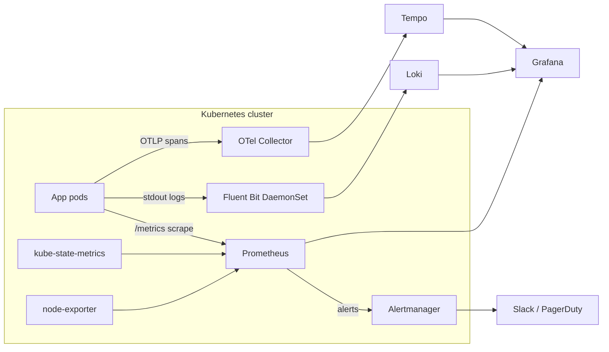
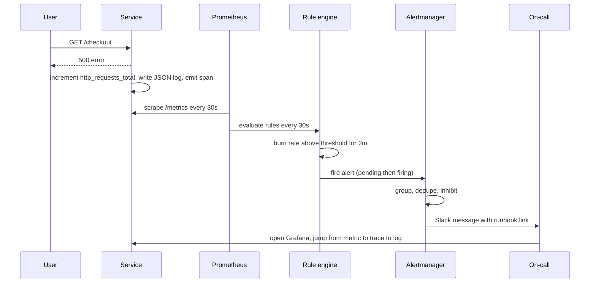
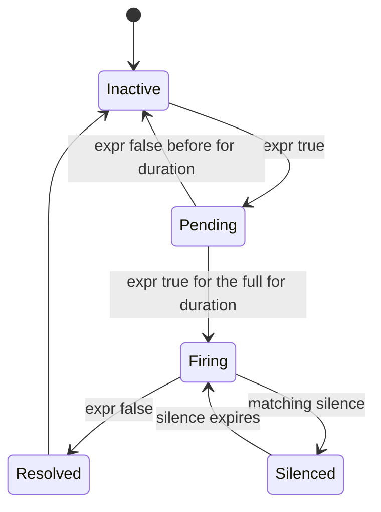
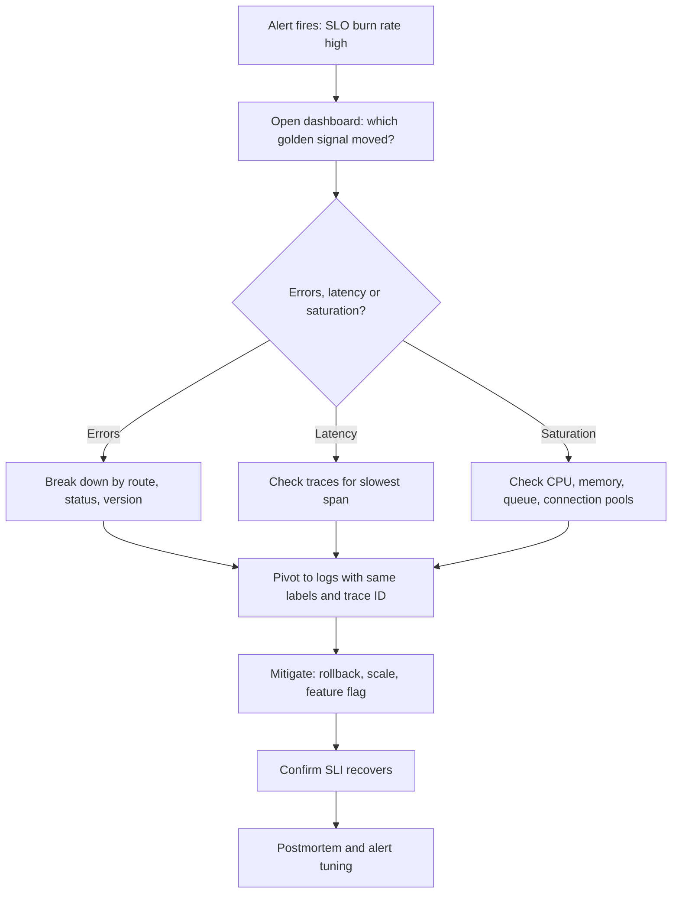

# Monitoring & Observability

<!-- DEVOPS-SHACK:HEADER -->
<p align="center">
  <a href="https://www.youtube.com/@devopsshack"></a>
  <a href="https://www.youtube.com/@shackverse"></a>
  <a href="https://devopsshack.com"></a>
  <a href="https://www.instagram.com/devopsshack"></a>
  <a href="https://github.com/jaiswaladi246/DevOps-Cloud-Interview-Preparation-by-DevOps-Shack"></a>
</p>
<p align="center"><sub>Part of <b><a href="https://github.com/jaiswaladi246/DevOps-Cloud-Interview-Preparation-by-DevOps-Shack">DevOps &amp; Cloud Interview Preparation</a></b> — created by <b><a href="https://www.youtube.com/@devopsshack">DevOps Shack</a></b>. Free to learn from; please credit DevOps Shack when sharing.</sub></p>
<!-- /DEVOPS-SHACK:HEADER -->

> Metrics, logs and traces with Prometheus, Grafana, Loki and OpenTelemetry: how to know your system is broken before your customers do, and how to find out why in minutes.

[🏠 Home](../README.md)

## What you'll master

- The difference between monitoring (known-unknowns) and observability (unknown-unknowns), and why interviewers keep asking it
- The three pillars (metrics, logs, traces) plus profiles and events, and when each one is the right tool
- Prometheus internals: scrape model, TSDB, labels, cardinality, service discovery, recording and alerting rules
- PromQL fluency: `rate()`, `histogram_quantile()`, aggregation, joins with `on()`/`group_left`, subqueries
- Alertmanager routing, grouping, inhibition, silences and receivers (Slack, PagerDuty)
- SLIs, SLOs, error budgets and multi-window multi-burn-rate alerts
- Grafana dashboards as code, provisioning, variables and the RED / USE / Four Golden Signals methods
- Log pipelines with Fluent Bit and Loki, LogQL, structured logging and label design
- Distributed tracing with OpenTelemetry, the Collector, Tempo and Jaeger, plus sampling strategies
- Running the whole stack on Kubernetes with `kube-prometheus-stack`, and keeping it affordable at scale

## Architecture of a modern observability stack

This is the shape of what we run in most clusters. Applications expose metrics, write structured logs to stdout and emit spans over OTLP. Each signal has its own pipeline and storage, and Grafana is the single pane that correlates them.



Metrics are pulled (Prometheus decides when to scrape), logs are pushed by an agent, and traces are pushed by the SDK to a collector. That asymmetry is a classic interview question.

## Request and data flow: from a user request to an alert

A single request produces all three signals. The metric tells you something is wrong, the trace tells you where, and the log tells you why.



The `for:` clause moves an alert from pending to firing. Alertmanager never evaluates expressions, it only routes what Prometheus sends it.

## Alert lifecycle

Understanding the states explains most "why did my alert flap?" questions.



Resolved is a state Alertmanager knows about (it sends `resolved` notifications). Inside Prometheus the alert simply disappears from the active set, with `keep_firing_for` available to damp flapping.

## Observability workflow in an incident

The workflow we teach every new on-call engineer. Start from user impact, narrow with metrics, confirm with traces, explain with logs, then write it down.



## Core concepts in 10 minutes

### Monitoring vs observability

Monitoring answers questions you thought of in advance: is the CPU above 90%, is the endpoint up. Observability is the property of a system that lets you ask new questions without shipping new code, because the telemetry is rich enough (high-cardinality labels, structured events, traces). In practice you need both: dashboards and alerts for the known failure modes, and exploratory tooling for the rest.

### The pillars

Metrics are cheap, aggregated numbers over time. They are great for alerting and trends and terrible for "which user". Logs are discrete events with full context, expensive to store and search at volume. Traces follow one request across services and show where time was spent. Treat them as a graph, not three silos: put the `trace_id` in every log line and attach exemplars to histogram buckets.

### Prometheus data model

A time series is identified by a metric name plus a set of labels. Types: counter (only goes up, resets on restart), gauge (up and down), histogram (cumulative buckets plus `_sum` and `_count`) and summary (client-side quantiles that cannot be aggregated). Always apply `rate()` to counters, never graph a raw counter.

```promql
sum by (route) (rate(http_requests_total{status=~"5.."}[5m]))
```

### Pull, scrape and service discovery

Prometheus pulls from targets every `scrape_interval`. On Kubernetes the Prometheus Operator replaces hand-written scrape configs with `ServiceMonitor` and `PodMonitor` custom resources. A target is discovered, relabeled, scraped and stored. The `up` metric is 1 or 0 per target and is the first thing to alert on.

### Cardinality

Each unique label combination is a new series. A label like `user_id` or `request_id` can take Prometheus down. Keep label values bounded (route templates, not raw URLs; status class, not free text). Check with `topk(10, count by (__name__)({__name__=~".+"}))` and the TSDB status page.

### SLIs, SLOs and error budgets

An SLI is a measurement (fraction of requests under 300 ms and non-5xx). An SLO is the target (99.9% over 30 days). The error budget is `1 - SLO` (43.2 minutes per 30 days at 99.9%). Burn rate is how fast you consume it: burn rate 1 spends the budget exactly at the end of the window, 14.4 spends it in 2 days. Paging on burn rate beats paging on raw thresholds because it ties alerts to user pain.

### The golden signals, RED and USE

Four Golden Signals (Google SRE): latency, traffic, errors, saturation. RED (Tom Wilkie) for request-driven services: rate, errors, duration. USE (Brendan Gregg) for resources: utilization, saturation, errors. Use RED for services, USE for nodes, disks and queues.

### Logs with Loki

Loki indexes only labels, not log content, which is why it is cheap. Keep labels low-cardinality (`namespace`, `app`, `level`) and filter content with LogQL line filters and parsers. High-cardinality labels create too many streams and kill ingestion.

### Tracing and OpenTelemetry

A trace is a tree of spans linked by a trace ID propagated through the W3C `traceparent` header. OpenTelemetry standardizes the SDKs, the OTLP wire protocol and the Collector. Sampling controls cost: head sampling decides at the start (cheap, blind), tail sampling decides after the trace completes (keeps errors and slow traces, needs more memory).

### Alerting philosophy

Page on symptoms (users hurt), ticket on causes. Every page must be actionable, urgent and have a runbook. Group related alerts, inhibit child alerts when the parent fires, and delete alerts nobody acts on. Alert fatigue is an outage in slow motion.

### Kubernetes specifics

`kube-prometheus-stack` bundles Prometheus Operator, Prometheus, Alertmanager, Grafana, kube-state-metrics, node-exporter and a large set of default rules and dashboards. Selection is label-driven: Prometheus picks up `ServiceMonitor`s whose labels match `serviceMonitorSelector` (by default the Helm release label). Forgetting that is the number one reason "my target does not show up".

## Question banks

Each bank has 200 questions with collapsible answers, tagged by difficulty.

| Bank | Focus | Questions |
|------|-------|-----------|
| [Concepts](./concepts.md) | Internals, comparisons, PromQL, "what happens when" | 200 |
| [Scenarios](./scenarios.md) | Situational "what would you do" with step-by-step answers | 200 |
| [Troubleshooting](./troubleshooting.md) | Real symptoms and error messages with diagnosis and fixes | 200 |
| [Production](./production.md) | Design, scale, cost, security, trade-offs, rapid-fire commands | 200 |

## Learning path

Work through these in order. Tick them off as you go.

**Beginner**
- [ ] Explain monitoring vs observability and the three pillars in your own words
- [ ] Run Prometheus locally and scrape `node_exporter`
- [ ] Write 10 PromQL queries using `rate`, `sum by` and `increase`
- [ ] Build a Grafana dashboard with the four golden signals
- [ ] Write a simple alert rule with a `for:` clause
- [ ] Ship container logs to Loki and query them with LogQL
- [ ] Finish the Beginner assignments

**Intermediate**
- [ ] Install `kube-prometheus-stack` with Helm and read its values file
- [ ] Instrument an app with a client library and write a `ServiceMonitor`
- [ ] Create recording rules and alert rules via `PrometheusRule`
- [ ] Route alerts to Slack with Alertmanager, including grouping and inhibition
- [ ] Use `histogram_quantile` correctly and explain why averaging quantiles is wrong
- [ ] Add OpenTelemetry tracing and view traces in Grafana Tempo or Jaeger
- [ ] Complete the [hands-on lab](./hands-on-lab.md) and the Intermediate assignments

**Advanced**
- [ ] Design and alert on SLOs with multi-window multi-burn-rate rules
- [ ] Control cardinality and measure the cost of a label
- [ ] Run Prometheus HA with Thanos or Mimir and explain deduplication
- [ ] Implement tail sampling in the OTel Collector
- [ ] Correlate metrics, logs and traces with exemplars and derived fields
- [ ] Write a postmortem-driven alert review and delete noisy alerts
- [ ] Complete the Advanced assignments

## More in this topic

- 🧪 [Hands-on lab](./hands-on-lab.md): full observability stack on Kubernetes
- 📝 [Assignments](./assignments.md): 25 practical exercises
- 📋 [Cheatsheet](./cheatsheet.md): PromQL, LogQL, kubectl, Helm, Alertmanager

[🏠 Home](../README.md)

<!-- DEVOPS-SHACK:FOOTER -->
---

<div align="center">

### 🚀 Made with ❤️ by [DevOps Shack](https://www.youtube.com/@devopsshack)

**Learn DevOps, DevSecOps, Cloud and Kubernetes the practical way.**

[▶️ YouTube — DevOps Shack](https://www.youtube.com/@devopsshack) · [▶️ Hindi — @shackverse](https://www.youtube.com/@shackverse) · [🎓 devopsshack.com](https://devopsshack.com) · [📸 Instagram @devopsshack](https://www.instagram.com/devopsshack)

[🏠 Back to Home](../README.md) · [⭐ Star the original repo](https://github.com/jaiswaladi246/DevOps-Cloud-Interview-Preparation-by-DevOps-Shack)

<sub>© DevOps Shack · Licensed CC BY-NC-SA 4.0 · If you found this copy anywhere other than <a href="https://github.com/jaiswaladi246/DevOps-Cloud-Interview-Preparation-by-DevOps-Shack">github.com/jaiswaladi246</a>, the original and latest version is maintained by DevOps Shack.</sub>

</div>
<!-- /DEVOPS-SHACK:FOOTER -->
