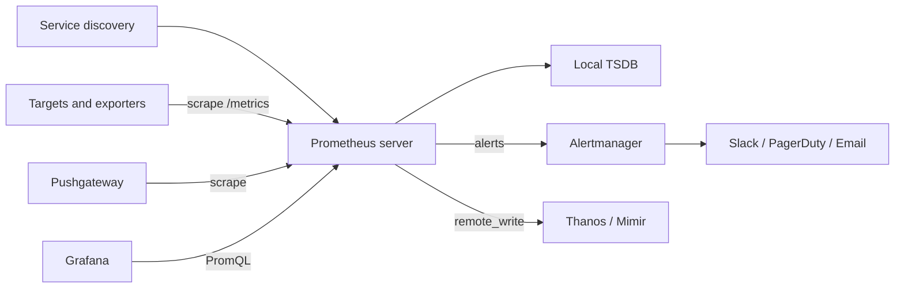
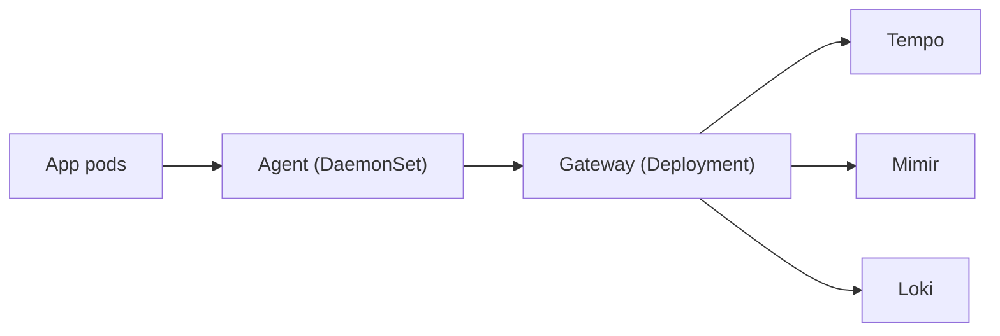
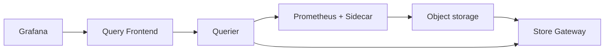

# Monitoring & Observability — Core Concepts

<!-- DEVOPS-SHACK:HEADER -->
<p align="center">
  <a href="https://www.youtube.com/@devopsshack"></a>
  <a href="https://www.youtube.com/@shackverse"></a>
  <a href="https://devopsshack.com"></a>
  <a href="https://www.instagram.com/devopsshack"></a>
  <a href="https://github.com/jaiswaladi246/DevOps-Cloud-Interview-Preparation-by-DevOps-Shack"></a>
</p>
<p align="center"><sub>Part of <b><a href="https://github.com/jaiswaladi246/DevOps-Cloud-Interview-Preparation-by-DevOps-Shack">DevOps &amp; Cloud Interview Preparation</a></b> — created by <b><a href="https://www.youtube.com/@devopsshack">DevOps Shack</a></b>. Free to learn from; please credit DevOps Shack when sharing.</sub></p>
<!-- /DEVOPS-SHACK:HEADER -->

> Core concepts, internals, comparisons and "what happens when…" questions for metrics, logs, traces, Prometheus, Grafana, Loki, OpenTelemetry and cloud monitoring · 200 questions · 🟢 Beginner 🟡 Intermediate 🔴 Advanced

[⬅ Back to Monitoring & Observability](./README.md) · [🏠 Home](../README.md)

## Table of contents
- [Observability Fundamentals & Signals](#observability-fundamentals--signals) — Q1–Q25
- [Prometheus Architecture](#prometheus-architecture) — Q26–Q55
- [PromQL & Recording Rules](#promql--recording-rules) — Q56–Q85
- [Alertmanager & Alerting](#alertmanager--alerting) — Q86–Q105
- [Grafana](#grafana) — Q106–Q120
- [Logging: ELK/EFK, Loki & Log Shippers](#logging-elkefk-loki--log-shippers) — Q121–Q150
- [Tracing & OpenTelemetry](#tracing--opentelemetry) — Q151–Q175
- [Kubernetes Monitoring, Scale & Cloud](#kubernetes-monitoring-scale--cloud) — Q176–Q200

---

## Observability Fundamentals & Signals

<!-- DEVOPS-SHACK:SECTION -->
> 🎥 **Learn this hands-on with DevOps Shack** → [YouTube @devopsshack](https://www.youtube.com/@devopsshack) · [Hindi @shackverse](https://www.youtube.com/@shackverse) · [Courses at devopsshack.com](https://devopsshack.com)

### Q1. What is the difference between monitoring and observability? 🟢

<details>
<summary><b>Answer</b></summary>

Monitoring answers questions you knew to ask in advance: "is CPU above 90%?", "is the error rate above 1%?". It is dashboards and alerts on predefined signals.

Observability is a property of the system: how well you can understand its internal state from the outside, including for failures you never predicted. It needs rich, high-context telemetry (metrics, logs, traces, profiles) that you can slice by arbitrary dimensions.

In production we say: monitoring tells you *that* something is wrong, observability lets you find out *why* without shipping new code.

</details>

### Q2. What are the "three pillars" of observability, and what is the fourth signal people now add? 🟢

<details>
<summary><b>Answer</b></summary>

- **Metrics**: numeric time series, cheap to store, great for alerting and trends.
- **Logs**: timestamped event records with detail and context.
- **Traces**: the path of one request across services, made of spans with timing.

The fourth signal is **continuous profiles**: CPU, memory allocation and lock profiles sampled all the time (Pyroscope, Parca, Grafana Pyroscope). OpenTelemetry added profiles as a signal. Profiles answer "which function burns the CPU" after metrics say "CPU is high".

</details>

### Q3. When would you reach for metrics, logs, traces or profiles during an incident? 🟢

<details>
<summary><b>Answer</b></summary>

1. **Metrics** detect and scope: which service, since when, how bad.
2. **Traces** localize: which hop in the request path is slow or failing.
3. **Logs** explain: the exact error, stack trace and input for that span.
4. **Profiles** pinpoint code: which function is hot or allocating.

The workflow works best when signals are correlated: exemplars link a metric point to a trace ID, and logs carry `trace_id` so you can jump from a span to its log lines.

</details>

### Q4. What are the four Prometheus metric types? 🟢

<details>
<summary><b>Answer</b></summary>

- **Counter**: only goes up (or resets to zero on restart). Requests served, errors, bytes sent.
- **Gauge**: goes up and down. Memory in use, queue depth, temperature.
- **Histogram**: counts observations into configurable buckets plus `_sum` and `_count`. Latency, response size.
- **Summary**: client-side calculated quantiles plus `_sum` and `_count`.

Note that on the wire Prometheus is mostly untyped; types are conventions and metadata, which is why naming (`_total`, `_bucket`) matters.

</details>

### Q5. Why should you never use a gauge to count requests? 🟢

<details>
<summary><b>Answer</b></summary>

A gauge sampled every 15s loses everything that happened between scrapes, and if it is reset per interval you lose data when a scrape is missed. A counter is cumulative, so `rate()` over any window gives the correct average even if scrapes are missed, and counter resets on restart are detected and handled automatically by `rate()`/`increase()`.

Rule: if you would ask "how many per second?", it is a counter.

</details>

### Q6. Histogram vs summary: what is the real difference, and which do you choose? 🟡

<details>
<summary><b>Answer</b></summary>

| | Histogram | Summary |
|---|---|---|
| Quantile computed | Server side (`histogram_quantile`) | Client side, in the app |
| Aggregatable across instances | Yes (sum the buckets) | No, you cannot average quantiles |
| Accuracy | Depends on bucket layout | Configurable error per quantile |
| Cost | One series per bucket | One series per quantile |

In production we choose histograms almost always, because we need p99 across 50 pods, and summaries cannot be aggregated. Summaries are only acceptable for a single-instance process where you need precise quantiles.

</details>

### Q7. What are native (sparse) histograms in Prometheus? 🔴

<details>
<summary><b>Answer</b></summary>

Native histograms store the whole distribution as a single series with exponential buckets chosen automatically by a schema (resolution factor), instead of one series per `le` bucket. Benefits: high resolution with far fewer series, no need to pick bucket boundaries, and cheaper aggregation.

They became stable in Prometheus 3.x (earlier behind `--enable-feature=native-histograms`). Scraping them needs the protobuf exposition format or OTLP. Querying uses the same functions:

```promql
histogram_quantile(0.99, sum by (job) (rate(http_request_duration_seconds[5m])))
```

Note: no `_bucket` suffix and no `le` label for native histograms.

</details>

### Q8. What is the RED method? 🟢

<details>
<summary><b>Answer</b></summary>

RED is for request-driven services (APIs, microservices):

- **Rate**: requests per second.
- **Errors**: failed requests per second (or error ratio).
- **Duration**: latency distribution, usually p50/p95/p99.

```promql
sum(rate(http_requests_total{job="api"}[5m]))
sum(rate(http_requests_total{job="api",code=~"5.."}[5m]))
histogram_quantile(0.99, sum by (le) (rate(http_request_duration_seconds_bucket{job="api"}[5m])))
```

</details>

### Q9. What is the USE method and where does it apply? 🟢

<details>
<summary><b>Answer</b></summary>

USE (Brendan Gregg) is for resources: CPU, memory, disk, network, connection pools.

- **Utilization**: percent of time the resource was busy.
- **Saturation**: queued work it cannot service yet (run queue, swap, I/O wait).
- **Errors**: error events (disk errors, dropped packets).

RED describes the service from the user's view; USE describes the infrastructure underneath. We dashboard both: RED on top, USE below.

</details>

### Q10. What are Google's four golden signals and how do they map to RED/USE? 🟢

<details>
<summary><b>Answer</b></summary>

From the Google SRE book: **Latency, Traffic, Errors, Saturation**.

- Latency = Duration, Traffic = Rate, Errors = Errors (that covers RED).
- Saturation comes from USE: how "full" the service is (CPU throttling, queue depth, thread pool usage).

Important nuance: measure latency of successful and failed requests separately, because fast errors make average latency look better.

</details>

### Q11. What is the difference between an SLI, SLO and SLA? 🟢

<details>
<summary><b>Answer</b></summary>

- **SLI**: a measured ratio, for example good requests / total requests.
- **SLO**: the internal target for that SLI over a window, for example 99.9% over 30 days.
- **SLA**: the external contract with financial consequences, usually looser than the SLO.

The SLO gives an **error budget**: 99.9% over 30 days allows about 43 minutes of full downtime. When the budget is spent, reliability work takes priority over features.

</details>

### Q12. What is an error budget burn rate? 🟡

<details>
<summary><b>Answer</b></summary>

Burn rate = observed error ratio / allowed error ratio. With a 99.9% SLO the allowed ratio is 0.001; an error ratio of 0.0144 is a burn rate of 14.4, which consumes 2% of a 30-day budget in one hour.

Multi-window burn-rate alerts (for example 1h and 5m windows both above 14.4) page quickly for big outages and avoid paging for brief blips, which is why they replaced plain threshold alerts on error rate.

</details>

### Q13. What is cardinality in the context of metrics? 🟢

<details>
<summary><b>Answer</b></summary>

Cardinality is the number of unique time series, where a series is a metric name plus a unique set of label values. `http_requests_total` with 5 methods x 10 paths x 6 status codes x 20 pods = 6,000 series.

Each series costs memory in the Prometheus head block (roughly a few KB), so unbounded labels (user ID, request ID, full URL, email) can take Prometheus down.

</details>

### Q14. What is white-box vs black-box monitoring? 🟢

<details>
<summary><b>Answer</b></summary>

- **White-box**: telemetry from inside the system: app metrics, logs, traces, runtime stats.
- **Black-box**: probe from outside like a user: HTTP checks, DNS, TCP, TLS expiry (Prometheus `blackbox_exporter`, synthetic monitoring).

White-box catches causes and early signs; black-box proves the user actually can reach you, including DNS, load balancer and certificate issues that internal metrics miss.

</details>

### Q15. What does the Prometheus exposition format look like? 🟢

<details>
<summary><b>Answer</b></summary>

Plain text over HTTP, usually at `/metrics`:

```text
# HELP http_requests_total Total HTTP requests.
# TYPE http_requests_total counter
http_requests_total{method="GET",code="200"} 1027
http_requests_total{method="POST",code="500"} 3
# TYPE process_resident_memory_bytes gauge
process_resident_memory_bytes 2.3e+07
```

Each line is `name{labels} value [timestamp]`. OpenMetrics is the standardized successor (adds `# EOF`, exemplars, `_created`). Check any target with `curl -s localhost:9100/metrics | head`.

</details>

### Q16. What are Prometheus metric naming conventions? 🟡

<details>
<summary><b>Answer</b></summary>

- `snake_case`, prefixed with the domain or app: `myapp_jobs_processed_total`.
- Base units in the name: `_seconds`, `_bytes`, `_ratio` (never milliseconds or MB).
- Counters end in `_total`; histograms produce `_bucket`, `_sum`, `_count`.
- Labels describe dimensions, not the metric itself: `http_requests_total{code="500"}`, not `http_500_requests_total`.

Prometheus 3.x supports UTF-8 metric and label names (to interoperate with OpenTelemetry dotted names), but we still use the classic convention for portability.

</details>

### Q17. What is an exemplar? 🟡

<details>
<summary><b>Answer</b></summary>

An exemplar is a sample attached to a metric value carrying a trace ID, for example one specific slow request inside a latency histogram bucket. Grafana shows exemplars as dots on a latency panel; clicking one opens the trace in Tempo or Jaeger.

```text
http_request_duration_seconds_bucket{le="0.5"} 1203 # {trace_id="4bf92f3577b34da6"} 0.43 1730000000.0
```

Prometheus stores exemplars when started with `--enable-feature=exemplar-storage` and they are scraped via OpenMetrics.

</details>

### Q18. Why are averages misleading for latency? 🟡

<details>
<summary><b>Answer</b></summary>

Latency distributions are long-tailed. If 99 requests take 50 ms and 1 takes 5 s, the average is about 100 ms, which hides that 1% of users wait 5 s. At high fan-out (one page calling 20 services), nearly every page view hits some service's p99.

So we track percentiles (p50, p95, p99, p99.9) from histograms, and SLOs are expressed as "99% of requests under 300 ms" rather than "average under 100 ms".

</details>

### Q19. What is the difference between push-based and pull-based metric collection? 🟡

<details>
<summary><b>Answer</b></summary>

- **Pull** (Prometheus): the server scrapes targets on a schedule. Easy to know if a target is down (`up == 0`), the server controls load, and you can curl a target by hand.
- **Push** (StatsD, OTLP, CloudWatch agent, InfluxDB line protocol): clients send to a collector. Works through NAT/firewalls and for short-lived jobs.

Pull needs service discovery; push needs a separate liveness signal because silence looks the same as "no traffic". Modern stacks mix both: Prometheus scrapes, and the OTel Collector or `remote_write` pushes.

</details>

### Q20. What is high-cardinality, high-dimensionality data, and why does observability need it? 🔴

<details>
<summary><b>Answer</b></summary>

High cardinality means fields with many unique values (user ID, build ID, request ID). High dimensionality means events with many fields. Debugging unknown-unknowns needs both: "slow only for tenant X on build Y in AZ Z".

Metrics TSDBs cannot hold this (every combination is a series), so we push it into traces and structured logs (wide events), where each event is stored once and queried by any field. Rule of thumb: bounded dimensions in metrics, unbounded ones in traces/logs.

</details>

### Q21. What is synthetic monitoring vs real user monitoring (RUM)? 🟡

<details>
<summary><b>Answer</b></summary>

- **Synthetic**: scripted probes from fixed locations on a schedule (blackbox_exporter, Grafana Synthetic Monitoring, CloudWatch Synthetics canaries). Gives a consistent baseline and works when there is no traffic.
- **RUM**: telemetry from real browsers or mobile apps (Core Web Vitals, JS errors, page load). Shows real user experience across devices and networks.

Synthetic catches outages at 3 a.m. with zero traffic; RUM catches "slow only on Android in India".

</details>

### Q22. What are Core Web Vitals and why would a DevOps team care? 🟡

<details>
<summary><b>Answer</b></summary>

Google's front-end user experience metrics: **LCP** (Largest Contentful Paint, loading), **INP** (Interaction to Next Paint, responsiveness, replaced FID in 2024) and **CLS** (Cumulative Layout Shift, visual stability).

Backend SLOs can be green while users suffer from a slow CDN, large bundles or third-party scripts. Collecting these via RUM (Grafana Faro, OpenTelemetry browser SDK, CloudWatch RUM) closes the gap between "server is fine" and "site feels slow".

</details>

### Q23. What is the difference between an event and a metric? 🟡

<details>
<summary><b>Answer</b></summary>

An event is a single occurrence with full context (one request: path, user, status, duration, build). A metric is a pre-aggregated number over many events (requests per second by status).

Metrics are aggregated at write time, so they are cheap but you cannot ask new questions of old data. Events keep everything and aggregate at read time, so they are flexible but expensive. Logs and spans are events; Prometheus samples are metrics.

</details>

### Q24. Why is alert fatigue considered an observability failure, not just an on-call problem? 🟡

<details>
<summary><b>Answer</b></summary>

When alerts fire on causes (CPU, single pod restarts) rather than user-facing symptoms, most pages require no action, people stop trusting the pager, and real incidents are missed. That is a design flaw in what we measure and alert on.

The fix is conceptual: alert on SLO burn and symptoms, route cause-based signals to dashboards or tickets, and require every page to be actionable with a runbook link.

</details>

### Q25. What does "instrumentation" mean, and what is auto-instrumentation? 🟢

<details>
<summary><b>Answer</b></summary>

Instrumentation is adding code that emits telemetry: counters, histograms, spans, structured logs. Manual instrumentation uses a library (Prometheus client, OpenTelemetry API) in your code.

Auto-instrumentation injects it without code changes: Java agent (`-javaagent:opentelemetry-javaagent.jar`), Python `opentelemetry-instrument`, .NET and Node.js auto loaders, eBPF tools (Grafana Beyla, OBI). It covers HTTP, gRPC, DB clients and messaging; business metrics still need manual code.

</details>

---

## Prometheus Architecture

<!-- DEVOPS-SHACK:SECTION -->
> 🎥 **Learn this hands-on with DevOps Shack** → [YouTube @devopsshack](https://www.youtube.com/@devopsshack) · [Hindi @shackverse](https://www.youtube.com/@shackverse) · [Courses at devopsshack.com](https://devopsshack.com)

### Q26. Describe the Prometheus architecture. 🟢

<details>
<summary><b>Answer</b></summary>



The server discovers targets, scrapes them over HTTP, stores samples in its local TSDB, evaluates recording and alerting rules, and sends firing alerts to Alertmanager. Grafana and the HTTP API query it with PromQL.

</details>

### Q27. What does a basic prometheus.yml look like? 🟢

<details>
<summary><b>Answer</b></summary>

```yaml
global:
  scrape_interval: 15s
  evaluation_interval: 15s
rule_files:
  - /etc/prometheus/rules/*.yml
alerting:
  alertmanagers:
    - static_configs:
        - targets: ["alertmanager:9093"]
scrape_configs:
  - job_name: node
    static_configs:
      - targets: ["10.0.1.10:9100", "10.0.1.11:9100"]
```

Validate with `promtool check config prometheus.yml` and reload without restart via `kill -HUP <pid>` or `curl -X POST localhost:9090/-/reload` (needs `--web.enable-lifecycle`).

</details>

### Q28. What is the `up` metric? 🟢

<details>
<summary><b>Answer</b></summary>

Prometheus generates `up{job, instance}` for every scrape: `1` if the scrape succeeded, `0` if it failed (connection refused, timeout, bad format). It also records `scrape_duration_seconds`, `scrape_samples_scraped` and `scrape_series_added`.

```promql
up == 0
```

This is the most basic "target down" alert, and a big advantage of the pull model.

</details>

### Q29. What are `job` and `instance` labels and where do they come from? 🟢

<details>
<summary><b>Answer</b></summary>

Prometheus attaches them to every scraped series: `job` is the `job_name` from the scrape config, and `instance` is the `host:port` of the target (from `__address__`). Together they identify where a series came from.

If the exposed metrics already carry a `job` or `instance` label, Prometheus renames them to `exported_job` / `exported_instance` unless `honor_labels: true` is set (used for Pushgateway and federation).

</details>

### Q30. How is the Prometheus TSDB organized on disk? 🔴

<details>
<summary><b>Answer</b></summary>

- **Head block** in memory holds the most recent samples (about 2 to 3 hours), backed by the **WAL** (`wal/` directory, 128 MB segments) for crash recovery, plus memory-mapped head chunks (`chunks_head/`).
- Every 2 hours the head is compacted into an immutable **block** directory (ULID name) containing `chunks/`, `index`, `meta.json` and `tombstones`.
- Background compaction merges small blocks into larger ones (up to 10% of retention or 31 days).

Samples are compressed with Gorilla-style delta-of-delta timestamps and XOR values, around 1.3 bytes per sample. Deletes only write tombstones until compaction.

</details>

### Q31. What is the WAL and why does Prometheus restart slowly sometimes? 🔴

<details>
<summary><b>Answer</b></summary>

The Write-Ahead Log records every incoming sample before it is in the head block, so a crash loses nothing that was acknowledged. On startup Prometheus replays the WAL (plus checkpoints and mmapped chunks) to rebuild the head.

With millions of active series and a large WAL, replay can take many minutes and spike memory, causing OOM loops. Mitigations: lower cardinality, enough memory headroom, and keeping `chunks_head` (mmapped) so less needs replaying. Log line to watch: `Replaying WAL, this may take a while`.

</details>

### Q32. How do you configure Prometheus retention? 🟢

<details>
<summary><b>Answer</b></summary>

With command-line flags:

```bash
prometheus --storage.tsdb.path=/prometheus \
  --storage.tsdb.retention.time=15d \
  --storage.tsdb.retention.size=200GB
```

Default is 15 days. If both are set, whichever hits first wins. Retention deletes whole blocks, so actual data kept can slightly exceed the target. For months or years we use remote storage (Thanos, Mimir, Cortex, VictoriaMetrics), not a bigger local disk.

</details>

### Q33. What is an exporter? Name common ones. 🟢

<details>
<summary><b>Answer</b></summary>

An exporter is a process that translates metrics from a system that does not speak Prometheus into the exposition format.

- `node_exporter` (:9100): Linux host CPU, memory, disk, network.
- `blackbox_exporter` (:9115): HTTP/TCP/ICMP/DNS probes.
- `mysqld_exporter`, `postgres_exporter`, `redis_exporter`, `kafka_exporter`.
- `kube-state-metrics`: Kubernetes object state.
- `cAdvisor` (in the kubelet): container resource usage.
- `windows_exporter` for Windows hosts.

</details>

### Q34. How does the blackbox exporter work with Prometheus? 🟡

<details>
<summary><b>Answer</b></summary>

Prometheus scrapes the exporter's `/probe` endpoint, passing the real target as a parameter; the exporter performs the probe and returns `probe_success`, `probe_duration_seconds`, `probe_ssl_earliest_cert_expiry` and so on. Relabeling moves the target into the URL parameter:

```yaml
- job_name: blackbox-http
  metrics_path: /probe
  params: { module: [http_2xx] }
  static_configs:
    - targets: ["https://shop.example.com"]
  relabel_configs:
    - source_labels: [__address__]
      target_label: __param_target
    - source_labels: [__param_target]
      target_label: instance
    - target_label: __address__
      replacement: blackbox-exporter:9115
```

</details>

### Q35. What is the Pushgateway and when should you use it? 🟡

<details>
<summary><b>Answer</b></summary>

The Pushgateway is a metrics cache that short-lived batch jobs push to, and Prometheus scrapes it. Use it only for **service-level batch jobs** that finish before a scrape could happen (nightly backup, cron job).

```bash
echo "backup_last_success_timestamp_seconds $(date +%s)" | \
  curl --data-binary @- http://pushgateway:9091/metrics/job/db_backup
```

Scrape it with `honor_labels: true` so the pushed `job` label is kept.

</details>

### Q36. What are the pitfalls of the Pushgateway? 🔴

<details>
<summary><b>Answer</b></summary>

- Metrics **never expire**: a job that stopped running still shows its last value forever unless you delete the group (`curl -X DELETE .../metrics/job/db_backup`).
- You lose `up` health per job; the Pushgateway is up even if jobs are dead.
- It is a single point of failure and bottleneck if many instances push.
- Using it for long-running services just turns pull into a worse push.

So we push a `last_success_timestamp` and alert on `time() - backup_last_success_timestamp_seconds > 90000`, which works even when the job never ran.

</details>

### Q37. What is service discovery in Prometheus? 🟢

<details>
<summary><b>Answer</b></summary>

Instead of static target lists, Prometheus asks a source of truth for targets and refreshes them automatically. Built-in mechanisms include `kubernetes_sd_configs`, `ec2_sd_configs`, `consul_sd_configs`, `azure_sd_configs`, `gce_sd_configs`, `dns_sd_configs`, `file_sd_configs` and `http_sd_configs`.

Discovered targets come with `__meta_*` labels (tags, pod labels, namespace) that you use in relabeling to filter and label them. Check the result at `/targets` and `/service-discovery` in the UI.

</details>

### Q38. What roles does `kubernetes_sd_configs` support? 🟡

<details>
<summary><b>Answer</b></summary>

- `node`: one target per node (kubelet address).
- `pod`: one target per declared container port.
- `service`: one target per service port (for blackbox probing).
- `endpoints` / `endpointslice`: one target per backing pod address of a service; the most common for app scraping.
- `ingress`: one target per ingress path (for probing).

```yaml
kubernetes_sd_configs:
  - role: endpointslice
    namespaces: { names: [payments] }
```

</details>

### Q39. How does EC2 service discovery work? 🟡

<details>
<summary><b>Answer</b></summary>

Prometheus calls the EC2 API (needs `ec2:DescribeInstances`, usually via an instance role) and creates targets on the private IP with a set port, exposing `__meta_ec2_tag_<Name>`, `__meta_ec2_instance_id`, `__meta_ec2_availability_zone` and so on.

```yaml
- job_name: ec2-node
  ec2_sd_configs:
    - region: ap-south-1
      port: 9100
      filters:
        - name: tag:monitoring
          values: ["enabled"]
  relabel_configs:
    - source_labels: [__meta_ec2_tag_Name]
      target_label: name
```

</details>

### Q40. What is `file_sd_configs` and when is it useful? 🟡

<details>
<summary><b>Answer</b></summary>

Prometheus watches JSON or YAML files listing targets and reloads them on change, without a restart. It is the universal integration point: Ansible, Terraform or a cron script writes the file, and Prometheus picks it up.

```yaml
- job_name: legacy
  file_sd_configs:
    - files: ["/etc/prometheus/targets/*.json"]
      refresh_interval: 1m
```

```json
[{"targets": ["10.0.2.5:9100"], "labels": {"env": "prod", "team": "billing"}}]
```

</details>

### Q41. What is relabeling, and what are its stages? 🟡

<details>
<summary><b>Answer</b></summary>

Relabeling rewrites label sets with rules. There are four places:

1. `relabel_configs`: before scrape, on targets. Filter targets, set `__address__`, `__metrics_path__`, `__scheme__`, copy `__meta_*` into real labels.
2. `metric_relabel_configs`: after scrape, before storage, on every sample. Drop expensive series or labels.
3. `alert_relabel_configs`: on alerts before sending to Alertmanager.
4. `write_relabel_configs`: on samples before `remote_write`.

Labels starting with `__` are dropped after target relabeling (except they drive the scrape).

</details>

### Q42. What relabel actions exist? 🟡

<details>
<summary><b>Answer</b></summary>

- `replace` (default): regex on joined `source_labels`, write `replacement` to `target_label`.
- `keep` / `drop`: keep or drop the target or sample if the regex matches.
- `keepequal` / `dropequal`: compare source labels to the target label.
- `labelmap`: copy labels whose names match the regex, for example `__meta_kubernetes_pod_label_(.+)`.
- `labeldrop` / `labelkeep`: remove or keep label names matching a regex.
- `hashmod`: set a label to a hash modulo N, used for sharding.
- `lowercase` / `uppercase`.

</details>

### Q43. Write relabeling that only scrapes pods annotated with `prometheus.io/scrape: "true"`. 🟡

<details>
<summary><b>Answer</b></summary>

```yaml
- job_name: annotated-pods
  kubernetes_sd_configs:
    - role: pod
  relabel_configs:
    - source_labels: [__meta_kubernetes_pod_annotation_prometheus_io_scrape]
      action: keep
      regex: "true"
    - source_labels: [__meta_kubernetes_pod_annotation_prometheus_io_path]
      action: replace
      target_label: __metrics_path__
      regex: (.+)
    - source_labels: [__meta_kubernetes_namespace]
      target_label: namespace
    - source_labels: [__meta_kubernetes_pod_name]
      target_label: pod
```

Annotation names are sanitized: dots and slashes become underscores. With the Prometheus Operator we use ServiceMonitor/PodMonitor instead.

</details>

### Q44. How do you drop a high-cardinality metric at scrape time? 🟡

<details>
<summary><b>Answer</b></summary>

Use `metric_relabel_configs`, which runs after the scrape but before storage:

```yaml
metric_relabel_configs:
  - source_labels: [__name__]
    regex: "apiserver_request_duration_seconds_bucket|etcd_request_duration_seconds_bucket"
    action: drop
  - regex: "pod_template_hash|controller_revision_hash"
    action: labeldrop
```

The sample is still transferred over the network but never hits the TSDB. If you can change the app, fixing it at the source is better.

</details>

### Q45. What are `scrape_interval`, `scrape_timeout` and `evaluation_interval`? 🟢

<details>
<summary><b>Answer</b></summary>

- `scrape_interval`: how often targets are scraped (default 1m; most set 15s or 30s).
- `scrape_timeout`: max time per scrape (default 10s), must be less than or equal to the interval.
- `evaluation_interval`: how often recording and alerting rules run (default 1m).

They can be overridden per job or rule group. Keep the interval consistent across a job; mixing 15s and 60s for the same metric confuses `rate()` windows.

</details>

### Q46. What is staleness in Prometheus? 🔴

<details>
<summary><b>Answer</b></summary>

When a target disappears or a series is no longer exposed, Prometheus writes a special **stale marker** (a NaN) so queries stop returning that series immediately instead of showing the last value. If no stale marker exists (for example data pushed via `remote_write` or a scrape gap), an instant query looks back at most `--query.lookback-delta` (default 5m) for the latest sample.

That is why a dead pod's series vanishes from graphs right away, and why gaps longer than 5 minutes show as missing data.

</details>

### Q47. What is federation in Prometheus? 🟡

<details>
<summary><b>Answer</b></summary>

A Prometheus server scrapes the `/federate` endpoint of other Prometheus servers, selecting series with `match[]`:

```yaml
- job_name: federate
  honor_labels: true
  metrics_path: /federate
  params:
    "match[]": ['{__name__=~"job:.*"}']
  static_configs:
    - targets: ["prom-eu:9090", "prom-us:9090"]
```

It is meant for pulling **aggregated** recording-rule results upward, not for copying everything. For a full global view and long retention we use Thanos or Mimir instead.

</details>

### Q48. What is `remote_write` and how does it work internally? 🔴

<details>
<summary><b>Answer</b></summary>

`remote_write` streams samples to a remote endpoint (Mimir, Thanos Receive, Cortex, VictoriaMetrics, Amazon Managed Prometheus) as snappy-compressed protobuf. Prometheus tails its own WAL and sends via sharded queues that scale up and down with throughput.

```yaml
remote_write:
  - url: https://mimir.example.com/api/v1/push
    queue_config:
      max_shards: 50
      capacity: 10000
      max_samples_per_send: 2000
```

If the remote is down, data buffers in the WAL (about 2 hours). Watch `prometheus_remote_storage_samples_pending` and `prometheus_remote_storage_highest_timestamp_in_seconds` minus `queue_highest_sent_timestamp_seconds` for lag. Remote Write 2.0 adds metadata and exemplars natively.

</details>

### Q49. What is Prometheus agent mode? 🟡

<details>
<summary><b>Answer</b></summary>

`prometheus --agent` runs only scraping, service discovery and `remote_write`. There is no local querying, no rules, no alerting and no long-term TSDB, only a WAL buffer. It uses much less memory and disk.

We use it in edge clusters or many small clusters that ship everything to a central Mimir/Thanos where querying and alerting happen. Alternatives for the same role: Grafana Alloy or the OTel Collector with a Prometheus receiver.

</details>

### Q50. How does Prometheus achieve high availability? 🔴

<details>
<summary><b>Answer</b></summary>

Run two identical replicas scraping the same targets with an `external_labels` difference (`replica: a` / `replica: b`). Both evaluate rules and send alerts to all Alertmanager instances; Alertmanager deduplicates identical alerts.

The replicas do not replicate data to each other, so each may have different gaps. For a single consistent query view, put Thanos Query (dedup on the `replica` label) or Mimir (HA tracker dedup on `cluster`/`__replica__`) in front.

</details>

### Q51. What are `external_labels` used for? 🟡

<details>
<summary><b>Answer</b></summary>

`external_labels` in the `global` block are attached to every series and alert when data leaves this Prometheus: via federation, `remote_write`, Thanos sidecar uploads, or alerts sent to Alertmanager.

```yaml
global:
  external_labels:
    cluster: prod-mumbai
    replica: a
```

They identify the source in a global view and are required for HA deduplication. They are not stored in the local TSDB itself.

</details>

### Q52. What does `honor_timestamps` do? 🔴

<details>
<summary><b>Answer</b></summary>

By default (`honor_timestamps: true`) if an exposed sample carries an explicit timestamp, Prometheus uses it instead of the scrape time. Setting it to `false` forces the scrape time.

Exposing timestamps is almost always a mistake for live metrics: samples older than the head block window are rejected as `out of bounds`, and staleness handling does not work for timestamped series. It is legitimate only for federation and some exporters that mirror external systems.

</details>

### Q53. How do you limit the damage one bad target can do to Prometheus? 🔴

<details>
<summary><b>Answer</b></summary>

Per-scrape-config limits:

```yaml
- job_name: apps
  sample_limit: 50000
  label_limit: 30
  label_name_length_limit: 128
  label_value_length_limit: 512
  target_limit: 500
  body_size_limit: 20MB
```

If a scrape exceeds `sample_limit`, the whole scrape fails and `up` becomes 0, which is visible and alertable, instead of silently adding a million series. Watch `prometheus_target_scrapes_exceeded_sample_limit_total`.

</details>

### Q54. What are the useful Prometheus HTTP API endpoints? 🟡

<details>
<summary><b>Answer</b></summary>

```bash
curl -s 'localhost:9090/api/v1/query?query=up'
curl -s 'localhost:9090/api/v1/query_range?query=up&start=2026-11-01T00:00:00Z&end=2026-11-01T01:00:00Z&step=60s'
curl -s localhost:9090/api/v1/targets | jq '.data.activeTargets[] | {job:.labels.job, health}'
curl -s localhost:9090/api/v1/rules
curl -s localhost:9090/api/v1/alerts
curl -s localhost:9090/api/v1/status/tsdb   # top series by metric and label
curl -s localhost:9090/api/v1/label/__name__/values
```

`/api/v1/status/tsdb` is the first stop for cardinality investigations.

</details>

### Q55. What does `promtool` do? 🟢

<details>
<summary><b>Answer</b></summary>

`promtool` ships with Prometheus and is used in CI and debugging:

```bash
promtool check config prometheus.yml
promtool check rules rules/*.yml
promtool test rules tests/alerts_test.yml      # unit test alerts
promtool query instant http://localhost:9090 'up == 0'
promtool tsdb analyze /prometheus               # cardinality by block
promtool check metrics < metrics.txt            # lint exposition
```

We run `check rules` and `test rules` on every pull request that touches alert rules.

</details>

---

## PromQL & Recording Rules

<!-- DEVOPS-SHACK:SECTION -->
> 🎥 **Learn this hands-on with DevOps Shack** → [YouTube @devopsshack](https://www.youtube.com/@devopsshack) · [Hindi @shackverse](https://www.youtube.com/@shackverse) · [Courses at devopsshack.com](https://devopsshack.com)

### Q56. What are the PromQL data types? 🟢

<details>
<summary><b>Answer</b></summary>

- **Instant vector**: a set of series, each with one sample at the evaluation time. `http_requests_total`
- **Range vector**: a set of series, each with samples over a time range. `http_requests_total[5m]`
- **Scalar**: a single number. `time()`, `scalar(...)`
- **String**: rarely used.

Graphs need instant vectors; functions like `rate()` take a range vector and return an instant vector. "Range vector not allowed" errors mean you tried to graph `metric[5m]` directly.

</details>

### Q57. What label matchers does PromQL support? 🟢

<details>
<summary><b>Answer</b></summary>

```promql
http_requests_total{job="api"}            # equal
http_requests_total{code!="200"}          # not equal
http_requests_total{code=~"5.."}          # regex match (fully anchored)
http_requests_total{path!~"/health|/metrics"}  # regex not match
```

Regexes are RE2 and fully anchored, so `"5.."` matches `500` but not `1500`. Every selector needs at least one matcher that does not match the empty string.

</details>

### Q58. Explain `rate()`. 🟢

<details>
<summary><b>Answer</b></summary>

`rate(counter[5m])` returns the per-second average increase of a counter over the last 5 minutes, handling counter resets and extrapolating to the window edges.

```promql
sum by (job) (rate(http_requests_total[5m]))
```

Rules: only apply it to counters, apply `rate` first and `sum` after, and make the range at least 4 times the scrape interval so there are enough samples.

</details>

### Q59. `rate()` vs `irate()`: what is the difference? 🟡

<details>
<summary><b>Answer</b></summary>

- `rate()` uses all samples in the window and gives a smoothed average. Good for alerts, SLOs and most dashboards.
- `irate()` uses only the **last two samples** in the window. It reacts instantly to spikes but is noisy, and at wide graph steps it skips most data (it shows whatever happened in the last scrape interval of each step).

Use `irate` only for zoomed-in, high-resolution graphs of fast-moving counters. Never alert on `irate`.

</details>

### Q60. What does `increase()` return and why is it sometimes a non-integer? 🟡

<details>
<summary><b>Answer</b></summary>

`increase(x[1h])` is the total increase over the window; it is syntactic sugar for `rate(x[1h]) * 3600`. Because `rate()` extrapolates to the window boundaries (the first and last sample rarely sit exactly on the edges), `increase()` of an integer counter can return `4.8` instead of `5`.

That is expected. For exact counts over long windows, use a recording rule or round it in the display. Prometheus 3.x has experimental `xincrease`/`xrate`-style functions that address some extrapolation complaints.

</details>

### Q61. Why must you `rate()` before `sum()`, never the reverse? 🟡

<details>
<summary><b>Answer</b></summary>

`rate()` detects counter resets per series. If you sum first, one pod restarting (its counter dropping to 0) makes the summed value drop, and `rate` interprets that as a reset of the whole sum, producing a huge false spike.

```promql
sum(rate(http_requests_total[5m]))      # correct
rate(sum(http_requests_total)[5m:])     # wrong, breaks on restarts
```

</details>

### Q62. How do PromQL aggregation operators and `by`/`without` work? 🟢

<details>
<summary><b>Answer</b></summary>

Operators: `sum`, `avg`, `min`, `max`, `count`, `stddev`, `stdvar`, `topk`, `bottomk`, `quantile`, `count_values`, `group`, and in 3.x `limitk`/`limit_ratio` (experimental).

```promql
sum by (namespace) (rate(container_cpu_usage_seconds_total[5m]))
sum without (instance, pod) (rate(http_requests_total[5m]))
topk(5, sum by (pod) (container_memory_working_set_bytes))
```

`by` keeps only the listed labels; `without` drops the listed ones and keeps the rest.

</details>

### Q63. How does `histogram_quantile()` work? 🟡

<details>
<summary><b>Answer</b></summary>

It estimates a quantile from cumulative bucket counters by finding the bucket where the rank falls and linearly interpolating within it.

```promql
histogram_quantile(0.95,
  sum by (le, service) (rate(http_request_duration_seconds_bucket[5m])))
```

Always keep `le` in the `by` clause and `rate()` the buckets first. Accuracy depends on bucket boundaries: if all requests are between 0.5 and 1 s and you only have those two buckets, p95 is a guess within that range.

</details>

### Q64. What are common mistakes with `histogram_quantile()`? 🔴

<details>
<summary><b>Answer</b></summary>

- Dropping `le` during aggregation: result is empty or nonsense.
- Applying it to raw bucket counters without `rate()`: you get the quantile since process start.
- Averaging quantiles: `avg(histogram_quantile(...))` per pod is not the fleet p99.
- Quantile landing in the `+Inf` bucket: it returns the upper bound of the last finite bucket, so p99 "stuck at 10s" means your buckets are too small.
- Buckets changed between versions of the app: mixed `le` sets give wrong results until old series age out.

</details>

### Q65. How do you compute an error ratio in PromQL? 🟢

<details>
<summary><b>Answer</b></summary>

```promql
sum(rate(http_requests_total{job="api",code=~"5.."}[5m]))
/
sum(rate(http_requests_total{job="api"}[5m]))
```

Both sides are aggregated to the same labels (none here), so the division matches. For per-service ratios, use `sum by (service)` on both sides. Multiply by 100 for percent only in the display, keep ratios 0–1 in rules.

</details>

### Q66. What does the `offset` modifier do? 🟡

<details>
<summary><b>Answer</b></summary>

`offset` shifts the evaluation time back for that selector, useful for comparisons with the past:

```promql
sum(rate(http_requests_total[5m]))
/
sum(rate(http_requests_total[5m] offset 1w))
```

This is week-over-week traffic ratio. `offset` must come right after the selector or range. Negative offsets (`offset -1h`) are allowed. The related `@` modifier pins evaluation to an absolute time: `http_requests_total @ 1730000000`.

</details>

### Q67. How does binary operator vector matching work (`on`, `ignoring`, `group_left`)? 🔴

<details>
<summary><b>Answer</b></summary>

For `a / b`, Prometheus pairs series with identical label sets. To control it:

- `on(labels)`: match only on these labels.
- `ignoring(labels)`: match on all labels except these.
- `group_left` / `group_right`: allow many-to-one matching and copy extra labels from the "one" side.

```promql
sum by (namespace, pod) (rate(container_cpu_usage_seconds_total[5m]))
* on (namespace, pod) group_left(team)
kube_pod_labels{label_team!=""}
```

The error `many-to-many matching not allowed` means the "one" side has duplicates for the match labels.

</details>

### Q68. What does `absent()` do and why is it important for alerting? 🟡

<details>
<summary><b>Answer</b></summary>

`absent(v)` returns a single series with value 1 when the selector matches nothing, and nothing otherwise. Normal alerts cannot fire on missing data, because `x > 0` on no data is simply no result.

```promql
absent(up{job="payments-api"})
absent_over_time(backup_last_success_timestamp_seconds[2h])
```

Use it to catch "the exporter vanished" or "the job was renamed and all alerts went silent".

</details>

### Q69. What are `_over_time` functions? 🟡

<details>
<summary><b>Answer</b></summary>

They aggregate each series over a time range (for gauges): `avg_over_time`, `max_over_time`, `min_over_time`, `sum_over_time`, `count_over_time`, `quantile_over_time`, `stddev_over_time`, `last_over_time`, `present_over_time`.

```promql
max_over_time(node_load1[1h])
quantile_over_time(0.95, queue_depth[30m])
avg_over_time(up{job="api"}[1d])   # availability-ish ratio
```

Note `sum` aggregates across series at one instant; `sum_over_time` aggregates across time within one series.

</details>

### Q70. What is a subquery? 🔴

<details>
<summary><b>Answer</b></summary>

A subquery evaluates an instant query at a resolution over a range, producing a range vector you can feed to `_over_time` functions:

```promql
max_over_time(rate(http_requests_total[5m])[1h:1m])
```

This means "the highest 5-minute rate in the last hour, sampled every minute". Subqueries are expensive on large data; if you use one regularly, write the inner expression as a recording rule and apply `max_over_time` to that.

</details>

### Q71. What does `predict_linear()` do? 🟡

<details>
<summary><b>Answer</b></summary>

It fits a linear regression over a range of a gauge and predicts the value N seconds ahead. Classic use, disk filling within 4 hours:

```promql
predict_linear(node_filesystem_avail_bytes{fstype!~"tmpfs|overlay"}[6h], 4 * 3600) < 0
```

Combine with a minimum free-space condition to avoid alerts on brief write bursts. `deriv()` gives the per-second slope of a gauge (do not use `rate()` on gauges).

</details>

### Q72. What are `label_replace()` and `label_join()`? 🟡

<details>
<summary><b>Answer</b></summary>

They create or rewrite labels at query time with a regex:

```promql
label_replace(up, "host", "$1", "instance", "(.*):.*")
label_join(up, "target", "/", "job", "instance")
```

Useful to align labels before vector matching (for example `instance` with port vs `node` without). If you need it on every query, fix it in relabeling instead.

</details>

### Q73. How do you calculate node CPU utilization from node_exporter? 🟢

<details>
<summary><b>Answer</b></summary>

`node_cpu_seconds_total` is a counter per CPU per mode. Utilization is 1 minus idle:

```promql
1 - avg by (instance) (rate(node_cpu_seconds_total{mode="idle"}[5m]))
```

Memory used ratio:

```promql
1 - node_memory_MemAvailable_bytes / node_memory_MemTotal_bytes
```

Use `MemAvailable`, not `MemFree`, because Linux uses free memory for page cache.

</details>

### Q74. What is the difference between an instant query and a range query? 🟢

<details>
<summary><b>Answer</b></summary>

- **Instant query** (`/api/v1/query`): evaluates the expression at one timestamp. Used by alert rules, recording rules and Grafana stat panels.
- **Range query** (`/api/v1/query_range`): evaluates the same expression at every `step` between `start` and `end`. Used by graphs.

Range queries are many instant evaluations, so a dashboard with a 30-day range at a 15s step is expensive. Grafana's `$__rate_interval` and step settings control this.

</details>

### Q75. What is `$__rate_interval` in Grafana and why use it over a fixed `[5m]`? 🟡

<details>
<summary><b>Answer</b></summary>

`$__rate_interval` is a Grafana variable equal to max(`$__interval` + scrape interval, 4 x scrape interval). It guarantees that the range in `rate()` always contains enough samples, no matter how far you zoom out, and avoids gaps at small ranges.

```promql
sum(rate(http_requests_total[$__rate_interval]))
```

Set the datasource's "Scrape interval" correctly for it to work.

</details>

### Q76. What are recording rules and why use them? 🟡

<details>
<summary><b>Answer</b></summary>

Recording rules precompute expensive expressions on a schedule and store the result as a new series. Benefits: fast dashboards, cheaper alerts, consistent definitions, and smaller data to federate or keep long-term.

```yaml
groups:
  - name: api.rules
    interval: 30s
    rules:
      - record: job:http_requests:rate5m
        expr: sum by (job) (rate(http_requests_total[5m]))
      - record: job:http_errors:ratio_rate5m
        expr: |
          sum by (job) (rate(http_requests_total{code=~"5.."}[5m]))
          / sum by (job) (rate(http_requests_total[5m]))
```

</details>

### Q77. What is the naming convention for recording rules? 🟡

<details>
<summary><b>Answer</b></summary>

`level:metric:operations`:

- **level**: the labels kept after aggregation (`job`, `namespace_pod`, `cluster`).
- **metric**: the original metric name, with `_total` stripped when rated.
- **operations**: what was applied, newest first (`rate5m`, `ratio_rate5m`, `sum`).

Example: `namespace:container_cpu_usage_seconds:sum_rate5m`. The name tells a reader exactly how the series was built without opening the rule file.

</details>

### Q78. How do rule groups evaluate, and what happens if evaluation is slow? 🔴

<details>
<summary><b>Answer</b></summary>

Rules within a group run **sequentially** in file order at the group's interval, so a later rule can use an earlier rule's output from the same evaluation. Different groups run in parallel.

If a group takes longer than its interval, iterations are skipped: watch `prometheus_rule_group_iterations_missed_total` and `prometheus_rule_group_last_duration_seconds`. Fix by splitting groups, simplifying expressions, or reducing cardinality. Prometheus 3.x can run independent rules within a group concurrently (`--enable-feature=concurrent-rule-eval`).

</details>

### Q79. What does an alerting rule look like? 🟢

<details>
<summary><b>Answer</b></summary>

```yaml
groups:
  - name: api.alerts
    rules:
      - alert: APIHighErrorRate
        expr: job:http_errors:ratio_rate5m{job="api"} > 0.05
        for: 10m
        keep_firing_for: 5m
        labels:
          severity: page
          team: payments
        annotations:
          summary: "API error rate {{ $value | humanizePercentage }}"
          runbook_url: "https://runbooks.example.com/api-errors"
```

`labels` drive routing in Alertmanager; `annotations` carry human text and links.

</details>

### Q80. What do alert states inactive, pending and firing mean? 🟢

<details>
<summary><b>Answer</b></summary>

- **Inactive**: the expression returns no result.
- **Pending**: the expression is true, but has not been true for the full `for` duration yet.
- **Firing**: true for at least `for`; Prometheus sends it to Alertmanager every evaluation (re-sent periodically).

When the expression stops returning, the alert resolves (after `keep_firing_for` if set). You can query `ALERTS{alertstate="firing"}` and `ALERTS_FOR_STATE` as series.

</details>

### Q81. What does `for` protect against and what does `keep_firing_for` add? 🟡

<details>
<summary><b>Answer</b></summary>

`for: 10m` requires the condition to hold continuously for 10 minutes, filtering out brief spikes. If the condition flips false even once, the pending timer resets.

`keep_firing_for: 5m` keeps an alert firing for 5 minutes after the condition clears, preventing flapping resolve/fire notifications when a metric hovers around the threshold or a scrape is missed. Too long a `for` delays real pages, so it is a trade-off against detection time.

</details>

### Q82. How do you unit test alerting rules? 🔴

<details>
<summary><b>Answer</b></summary>

With `promtool test rules` and synthetic series:

```yaml
rule_files: [api-alerts.yml]
evaluation_interval: 1m
tests:
  - interval: 1m
    input_series:
      - series: 'job:http_errors:ratio_rate5m{job="api"}'
        values: '0.01 0.08x15'
    alert_rule_test:
      - eval_time: 12m
        alertname: APIHighErrorRate
        exp_alerts:
          - exp_labels: { job: api, severity: page, team: payments }
```

`0.08x15` means 0.08 repeated 15 more times. We run this in CI so threshold and label changes are reviewed with proof.

</details>

### Q83. What is the difference between `count`, `count_over_time` and `count_values`? 🟡

<details>
<summary><b>Answer</b></summary>

- `count(up == 1)`: number of series at this instant (targets up now).
- `count_over_time(up[1h])`: number of samples per series in the last hour (detects missed scrapes).
- `count_values("version", build_info)`: counts series grouped by their *value*, writing the value into a label; useful for "how many pods run each version" when versions are numeric.

</details>

### Q84. How do you write a PromQL query for an SLO multi-window burn-rate alert? 🔴

<details>
<summary><b>Answer</b></summary>

For a 99.9% SLO (error budget 0.001), a fast-burn page at 14.4x on 1h and 5m windows:

```promql
(
  job:slo_errors_per_request:ratio_rate1h{job="api"} > (14.4 * 0.001)
and
  job:slo_errors_per_request:ratio_rate5m{job="api"} > (14.4 * 0.001)
)
```

The long window gives significance, the short window makes the alert resolve quickly once the issue stops. Pair with a slow-burn ticket (6x on 6h and 30m). Tools like Sloth or Pyrra generate these rules from an SLO spec.

</details>

### Q85. What do `and`, `or` and `unless` do in PromQL? 🟡

<details>
<summary><b>Answer</b></summary>

They are set operators on label sets:

- `a and b`: series from `a` that have a matching series in `b`.
- `a or b`: all of `a`, plus series from `b` with no match in `a`.
- `a unless b`: series from `a` with no match in `b`.

```promql
up{job="api"} == 0 unless on(instance) maintenance_mode == 1
```

Values come from the left side; `b` acts as a filter.

</details>

---

## Alertmanager & Alerting

<!-- DEVOPS-SHACK:SECTION -->
> 🎥 **Learn this hands-on with DevOps Shack** → [YouTube @devopsshack](https://www.youtube.com/@devopsshack) · [Hindi @shackverse](https://www.youtube.com/@shackverse) · [Courses at devopsshack.com](https://devopsshack.com)

### Q86. What does Alertmanager do that Prometheus does not? 🟢

<details>
<summary><b>Answer</b></summary>

Prometheus decides **when** an alert fires. Alertmanager decides **what happens next**:

- **Deduplication** of identical alerts from HA Prometheus pairs.
- **Grouping** of related alerts into one notification.
- **Routing** to the right receiver (Slack, PagerDuty, Opsgenie, email, webhook, MS Teams).
- **Inhibition**: suppress alerts when a related bigger alert fires.
- **Silences**: mute alerts temporarily.
- Repeat and resolve notifications.

</details>

### Q87. Explain the Alertmanager routing tree. 🟡

<details>
<summary><b>Answer</b></summary>

Every alert enters the root `route` and walks down child routes; the first matching child takes it (unless `continue: true`), and it goes to that route's receiver. Child routes inherit settings from parents.

```yaml
route:
  receiver: default-slack
  group_by: [alertname, cluster]
  routes:
    - matchers: [severity="page"]
      receiver: pagerduty
      routes:
        - matchers: [team="payments"]
          receiver: payments-pagerduty
    - matchers: [severity="ticket"]
      receiver: jira-webhook
```

Test with `amtool config routes test --config.file=alertmanager.yml severity=page team=payments`.

</details>

### Q88. What do `group_by`, `group_wait`, `group_interval` and `repeat_interval` control? 🟡

<details>
<summary><b>Answer</b></summary>

- `group_by`: labels that define a group; alerts with the same values are batched into one notification. `[...]` groups by all labels (disables grouping).
- `group_wait` (default 30s): wait before the first notification of a new group, to collect related alerts.
- `group_interval` (default 5m): wait before notifying about new alerts added to an existing group.
- `repeat_interval` (default 4h): resend a still-firing group with no changes.

</details>

### Q89. What is inhibition? Give an example. 🟡

<details>
<summary><b>Answer</b></summary>

Inhibition mutes target alerts while a source alert is firing and the `equal` labels match.

```yaml
inhibit_rules:
  - source_matchers: [alertname="ClusterUnreachable"]
    target_matchers: [severity=~"warning|page"]
    equal: [cluster]
  - source_matchers: [severity="critical"]
    target_matchers: [severity="warning"]
    equal: [alertname, namespace]
```

When a whole cluster is down, the 50 per-service alerts in that cluster are suppressed and only the root cause pages.

</details>

### Q90. What are silences and how do you create them? 🟢

<details>
<summary><b>Answer</b></summary>

A silence mutes alerts matching a set of matchers for a fixed time window. Created in the UI or with `amtool`:

```bash
amtool silence add alertname=NodeDown instance=~"db-0[12].*" \
  --duration=2h --comment="kernel patching CHG-1234" \
  --alertmanager.url=http://alertmanager:9093
amtool silence query
amtool silence expire <id>
```

Silences differ from inhibition: silences are manual and time-bound; inhibition is automatic and rule-based. Alerts still show in the UI as suppressed.

</details>

### Q91. What are mute time intervals and active time intervals? 🟡

<details>
<summary><b>Answer</b></summary>

Recurring schedules attached to routes:

```yaml
time_intervals:
  - name: offhours
    time_intervals:
      - weekdays: ["saturday", "sunday"]
      - times: [{ start_time: "20:00", end_time: "08:00" }]
        location: Asia/Kolkata
route:
  routes:
    - matchers: [severity="ticket"]
      receiver: jira
      mute_time_intervals: [offhours]
```

`mute_time_intervals` mute during the window; `active_time_intervals` only notify during it. Unlike silences, they repeat.

</details>

### Q92. How does Alertmanager clustering work? 🔴

<details>
<summary><b>Answer</b></summary>

Multiple Alertmanager instances form a cluster using a gossip protocol (memberlist, port 9094) to share notification log and silences. Prometheus sends every alert to **all** instances (not via a load balancer). Each instance waits a position-based delay (`--cluster.peer-timeout`, 15s per peer index) and checks the shared notification log before sending, so only one notifies.

```bash
alertmanager --cluster.peer=am-0:9094 --cluster.peer=am-1:9094 --cluster.peer=am-2:9094
```

Behind a load balancer, dedup breaks and silences may not apply.

</details>

### Q93. How do notification templates work in Alertmanager? 🟡

<details>
<summary><b>Answer</b></summary>

Receivers use Go templates over the grouped alert data (`.Status`, `.CommonLabels`, `.CommonAnnotations`, `.Alerts`):

```yaml
receivers:
  - name: payments-slack
    slack_configs:
      - channel: "#payments-alerts"
        send_resolved: true
        title: '[{{ .Status | toUpper }}] {{ .CommonLabels.alertname }}'
        text: >-
          {{ range .Alerts }}*{{ .Labels.instance }}*: {{ .Annotations.summary }}
          Runbook: {{ .Annotations.runbook_url }}
          {{ end }}
```

Shared templates live in files listed under `templates:`.

</details>

### Q94. What is the "Watchdog" or dead man's switch alert? 🟡

<details>
<summary><b>Answer</b></summary>

An alert that always fires (`expr: vector(1)`), routed to an external heartbeat service (PagerDuty heartbeat, Healthchecks.io, Opsgenie heartbeat, Grafana OnCall). If the external service stops receiving it, the whole pipeline (Prometheus, rule evaluation, Alertmanager, network) is broken and it pages you.

kube-prometheus-stack ships this as `Watchdog`. Without it, a dead Prometheus means silence, which looks exactly like "everything is fine".

</details>

### Q95. What is the difference between symptom-based and cause-based alerts? 🟢

<details>
<summary><b>Answer</b></summary>

- **Symptom**: what users feel: error rate, latency SLO burn, checkout failures, probe failures.
- **Cause**: internal reasons: high CPU, a pod restart, disk at 80%.

Page on symptoms because they always matter and cover unknown causes. Keep cause-based signals for dashboards and tickets, except for imminent, certain failures (disk full in 2 hours, certificate expiring in 7 days).

</details>

### Q96. What labels and annotations should every alert have? 🟢

<details>
<summary><b>Answer</b></summary>

Labels (for routing): `severity` (page/ticket/info), `team` or `owner`, `service`, `cluster`/`env`.

Annotations (for humans): `summary` with the current value, `description` with context, `runbook_url`, and a `dashboard` link.

Labels must be stable; never put `$value` in a label, because each new value creates a new alert identity and breaks grouping and silences.

</details>

### Q97. How do Prometheus and Alertmanager communicate about alert resolution? 🔴

<details>
<summary><b>Answer</b></summary>

Prometheus resends firing alerts every evaluation (at least every `--rules.alert.resend-delay`, default 1m) with an `endsAt` set a few intervals in the future (`4 x resend delay` or evaluation interval). When the alert resolves, Prometheus sends it once more with `endsAt` = now.

If Prometheus dies, Alertmanager stops receiving updates and auto-resolves alerts once `endsAt` passes. That is why a dead Prometheus can cause "resolved" notifications, and why you need the Watchdog alert.

</details>

### Q98. What is `amtool` used for? 🟢

<details>
<summary><b>Answer</b></summary>

The Alertmanager CLI:

```bash
amtool check-config alertmanager.yml
amtool config routes show --config.file=alertmanager.yml
amtool config routes test --config.file=alertmanager.yml severity=page team=db
amtool alert query --alertmanager.url=http://localhost:9093
amtool silence add ...
```

`check-config` and `routes test` belong in CI for Alertmanager config changes.

</details>

### Q99. What does `continue: true` do on a route? 🟡

<details>
<summary><b>Answer</b></summary>

Normally an alert stops at the first matching child route. With `continue: true`, Alertmanager keeps evaluating sibling routes after a match, so the alert can go to multiple receivers.

```yaml
routes:
  - matchers: [severity="page"]
    receiver: audit-webhook
    continue: true
  - matchers: [team="payments"]
    receiver: payments-pagerduty
```

Common for sending everything to an audit or analytics webhook in addition to the real receiver.

</details>

### Q100. How does Grafana Alerting differ from Prometheus + Alertmanager? 🟡

<details>
<summary><b>Answer</b></summary>

Grafana Alerting (unified alerting) evaluates rules inside Grafana against any datasource (Prometheus, Loki, CloudWatch, SQL), with multi-dimensional rules, contact points, notification policies (a routing tree similar to Alertmanager's) and silences. It can also forward to an external Alertmanager.

Prometheus rules evaluate close to the data, keep working if Grafana is down, and are easy to version as YAML. We keep critical metric alerts in Prometheus/Mimir rulers and use Grafana Alerting for non-Prometheus sources like CloudWatch or SQL.

</details>

### Q101. What receiver integrations does Alertmanager support natively? 🟢

<details>
<summary><b>Answer</b></summary>

Email, PagerDuty, Opsgenie, Slack, Microsoft Teams (`msteams_configs` and the newer `msteamsv2_configs` for Workflows), Webex, Telegram, Discord, VictorOps/Splunk On-Call, Pushover, SNS, WeChat, Jira (`jira_configs`), Rocket.Chat and a generic `webhook_configs`.

Anything else (ServiceNow, custom bots) goes through a webhook receiver that posts JSON with the grouped alerts.

</details>

### Q102. What is the difference between `matchers` and the old `match`/`match_re` syntax? 🟡

<details>
<summary><b>Answer</b></summary>

`match` (exact) and `match_re` (regex) maps are deprecated. `matchers` is a list of PromQL-style expressions that supports `=`, `!=`, `=~`, `!~` in one place:

```yaml
matchers:
  - severity=~"page|critical"
  - team!="sandbox"
```

The same syntax is used in inhibition (`source_matchers`, `target_matchers`) and silences. Alertmanager 0.27+ uses a stricter UTF-8 matcher parser, so quote values with special characters.

</details>

### Q103. Why should `group_by` usually include `alertname` and a location label? 🟡

<details>
<summary><b>Answer</b></summary>

Grouping by `[alertname, cluster]` means a node failure that triggers `KubePodNotReady` for 30 pods sends one notification listing 30 pods, instead of 30 pages. Grouping by too little (`[]`, single group) merges unrelated incidents into one message; grouping by too much (`[...]`) sends one notification per alert.

Choose labels that represent "one thing a human will fix at once".

</details>

### Q104. What is alert routing by severity, and what severities make sense? 🟢

<details>
<summary><b>Answer</b></summary>

A small, meaningful set:

- `page` / `critical`: user impact now, wake someone up.
- `ticket` / `warning`: needs attention in working hours.
- `info`: dashboards and chat only, no action required.

Routes send `page` to PagerDuty/Opsgenie, `ticket` to Jira or a team channel. More than three or four levels usually means nobody knows the difference.

</details>

### Q105. How do you reduce duplicate notifications when the same alert fires from multiple clusters? 🔴

<details>
<summary><b>Answer</b></summary>

Alerts are identical (and deduplicated) only if their full label sets match. Each cluster's Prometheus adds `cluster` via `external_labels`, so the alerts are distinct by design. Options:

- If the alert is truly global (for example a shared external API), evaluate it once in a global ruler (Thanos Ruler or Mimir ruler) instead of per cluster.
- Group by `alertname` only for that route so one notification lists all clusters.
- Use `alert_relabel_configs` to drop the `replica` label so HA pairs dedupe correctly.

</details>

---

## Grafana

<!-- DEVOPS-SHACK:SECTION -->
> 🎥 **Learn this hands-on with DevOps Shack** → [YouTube @devopsshack](https://www.youtube.com/@devopsshack) · [Hindi @shackverse](https://www.youtube.com/@shackverse) · [Courses at devopsshack.com](https://devopsshack.com)

### Q106. What is Grafana and what is it not? 🟢

<details>
<summary><b>Answer</b></summary>

Grafana is a visualization and alerting front end that queries datasources (Prometheus, Loki, Tempo, Elasticsearch, CloudWatch, PostgreSQL and many more) and renders dashboards. It stores dashboards, users and settings in its own database (SQLite by default, MySQL/PostgreSQL for HA).

It is not a storage backend for metrics or logs; data stays in the datasource. Mimir, Loki, Tempo and Pyroscope are the separate Grafana Labs backends ("LGTM" stack).

</details>

### Q107. What is a Grafana datasource and how do you provision one? 🟢

<details>
<summary><b>Answer</b></summary>

A datasource is a configured connection to a backend. Provision it as code from `/etc/grafana/provisioning/datasources/`:

```yaml
apiVersion: 1
datasources:
  - name: Prometheus
    uid: prom-main
    type: prometheus
    access: proxy
    url: http://prometheus:9090
    isDefault: true
    jsonData:
      timeInterval: 15s
```

Setting a fixed `uid` lets dashboards reference the datasource stably across environments. `timeInterval` should match the scrape interval.

</details>

### Q108. What are dashboard variables and what types exist? 🟡

<details>
<summary><b>Answer</b></summary>

Variables make one dashboard reusable across environments, clusters and services. Types: **Query** (from the datasource), **Custom** (static list), **Constant**, **Text box**, **Interval**, **Datasource** (switch between datasources), and **Ad hoc filters**.

```promql
label_values(up{job="api"}, namespace)          # query variable
sum by (pod) (rate(http_requests_total{namespace="$namespace"}[$__rate_interval]))
```

Variables can chain: `$pod` depends on `$namespace`.

</details>

### Q109. How do multi-value and "All" variables work in PromQL queries? 🟡

<details>
<summary><b>Answer</b></summary>

With multi-value enabled, Grafana formats selections as a regex alternation (`api|web|worker`), so use the regex matcher:

```promql
sum by (service) (rate(http_requests_total{service=~"$service"}[$__rate_interval]))
```

For "All", set a custom all value of `.*` to avoid sending a huge alternation of every value. Using `=` instead of `=~` with a multi-value variable is a classic bug that returns no data.

</details>

### Q110. What are Grafana's built-in time variables? 🟡

<details>
<summary><b>Answer</b></summary>

- `$__interval`: auto step based on time range and panel width.
- `$__rate_interval`: safe range for `rate()` (see Q75).
- `$__range`: the whole dashboard time range (`increase(x[$__range])` for "total in selected period").
- `$__from` / `$__to`: epoch ms of the range.
- `$__timeFilter(column)`: SQL datasource time filter macro.

</details>

### Q111. What does "dashboards as code" mean and what are the options? 🟡

<details>
<summary><b>Answer</b></summary>

Dashboards defined in version control and deployed automatically instead of clicked in the UI. Options:

- **File provisioning**: JSON dashboards in a folder Grafana watches.
- **Kubernetes sidecar**: ConfigMaps labeled `grafana_dashboard: "1"` picked up by the Grafana Helm chart sidecar.
- **Terraform** `grafana` provider (`grafana_dashboard`, `grafana_folder`).
- **Grafana Operator** `GrafanaDashboard` CRDs.
- **Generators**: Jsonnet with Grafonnet, or the Grafana Foundation SDK (Go, TypeScript, Python).
- **Git Sync** in Grafana 12 (experimental) syncing dashboards with a Git repo.

</details>

### Q112. How do you provision dashboards from files? 🟢

<details>
<summary><b>Answer</b></summary>

```yaml
# /etc/grafana/provisioning/dashboards/default.yml
apiVersion: 1
providers:
  - name: default
    folder: Platform
    type: file
    disableDeletion: true
    allowUiUpdates: false
    options:
      path: /var/lib/grafana/dashboards
      foldersFromFilesStructure: true
```

Drop JSON files into that path. With `allowUiUpdates: false`, UI edits cannot be saved, which forces changes through Git.

</details>

### Q113. What is a Grafana dashboard JSON model, and why do `uid` and datasource references matter? 🔴

<details>
<summary><b>Answer</b></summary>

Every dashboard is a JSON document with `uid`, `title`, `panels[]`, `templating.list[]` (variables), `time`, `schemaVersion` and `version`. The `uid` is the stable identity used in URLs and API calls; if two files share a `uid`, one overwrites the other.

Panels reference datasources as `{"type": "prometheus", "uid": "prom-main"}`. Hard-coded uids break when the dashboard is imported elsewhere, so exported dashboards use a `${DS_PROMETHEUS}` input or a datasource variable. Grafana 12 introduces a v2 dashboard schema with a different layout model.

</details>

### Q114. What panel types do you use most for operations dashboards? 🟢

<details>
<summary><b>Answer</b></summary>

- **Time series**: rates, latencies, resources over time.
- **Stat** and **Gauge**: single current values (SLO remaining, active alerts).
- **Table**: top-N lists, inventory.
- **Heatmap**: latency histogram buckets over time.
- **Logs**: Loki/Elasticsearch log lines.
- **Traces** and **Node graph**: Tempo/Jaeger traces and service maps.
- **State timeline**: up/down or deployment history.

</details>

### Q115. How do you visualize a Prometheus histogram as a heatmap in Grafana? 🟡

<details>
<summary><b>Answer</b></summary>

Query the bucket rates grouped by `le`, set the query **Format** to `Heatmap`, and use the Heatmap panel:

```promql
sum by (le) (increase(http_request_duration_seconds_bucket{job="api"}[$__rate_interval]))
```

Grafana converts cumulative buckets into per-bucket counts. Each column is a time slice and color shows how many requests fell into each latency band, revealing bimodal latency that a p99 line hides.

</details>

### Q116. What are Grafana annotations? 🟡

<details>
<summary><b>Answer</b></summary>

Annotations are event markers on time series panels: deployments, incidents, config changes. They come from a datasource query (for example a Prometheus `changes(kube_deployment_status_observed_generation[5m]) > 0` or Loki logs) or are posted via API from CI:

```bash
curl -X POST -H "Authorization: Bearer $GRAFANA_TOKEN" -H "Content-Type: application/json" \
  https://grafana.example.com/api/annotations \
  -d '{"tags":["deploy","api"],"text":"api v2.14.0 deployed"}'
```

"Did the latency jump right after the deploy?" becomes visible instantly.

</details>

### Q117. How do Grafana correlations link metrics, logs and traces? 🔴

<details>
<summary><b>Answer</b></summary>

- **Exemplars** on Prometheus panels link to the Tempo/Jaeger datasource via `exemplarTraceIdDestinations`.
- **Derived fields** on Loki extract `trace_id` from log lines with a regex and link to Tempo.
- **Trace to logs / trace to metrics** settings on Tempo build Loki or Prometheus queries from span attributes (service name, pod).
- **Correlations** (a Grafana feature) define generic links between any datasources.

Configured right, an engineer goes from a latency spike to a trace to the exact log lines in three clicks.

</details>

### Q118. How do you run Grafana in high availability? 🔴

<details>
<summary><b>Answer</b></summary>

Run multiple Grafana replicas behind a load balancer sharing an external MySQL or PostgreSQL database (not SQLite). For unified alerting, configure HA so replicas share alert state and deduplicate notifications:

```ini
[database]
type = postgres
host = grafana-db:5432
[unified_alerting]
ha_peers = grafana-0.grafana:9094,grafana-1.grafana:9094
```

Use a shared remote cache or sticky sessions are not required. Keep provisioning files identical on every replica.

</details>

### Q119. What is Grafana Mimir, Loki, Tempo, Pyroscope and Alloy (the LGTM stack)? 🟡

<details>
<summary><b>Answer</b></summary>

- **Mimir**: horizontally scalable, multi-tenant Prometheus-compatible metrics store (object storage backend).
- **Loki**: logs, indexing only labels.
- **Tempo**: traces, stored in object storage, queried by trace ID or TraceQL.
- **Pyroscope**: continuous profiling.
- **Grafana**: the UI.
- **Alloy**: the collector (successor to Grafana Agent, which reached end of life in late 2025), built on OpenTelemetry Collector components plus Prometheus scraping.

All of them use object storage (S3, GCS, Azure Blob) for cheap long-term retention.

</details>

### Q120. How do you control Grafana access for many teams? 🟡

<details>
<summary><b>Answer</b></summary>

- **Organizations** for hard separation (different datasources and users).
- **Teams** and **folder permissions** within an org (Viewer/Editor/Admin per folder).
- **SSO** via OAuth/OIDC, SAML or LDAP with group-to-team or group-to-role mapping.
- **Service accounts** with tokens for automation (replaced API keys).
- Datasource permissions and, for multi-tenant backends, a tenant header (`X-Scope-OrgID`) per datasource.

</details>

---

## Logging: ELK/EFK, Loki & Log Shippers

<!-- DEVOPS-SHACK:SECTION -->
> 🎥 **Learn this hands-on with DevOps Shack** → [YouTube @devopsshack](https://www.youtube.com/@devopsshack) · [Hindi @shackverse](https://www.youtube.com/@shackverse) · [Courses at devopsshack.com](https://devopsshack.com)

### Q121. What is the ELK stack, and what is EFK? 🟢

<details>
<summary><b>Answer</b></summary>

- **ELK**: Elasticsearch (store and search), Logstash (ingest and transform), Kibana (UI). Beats (Filebeat) usually ship logs into it, sometimes called the Elastic Stack.
- **EFK**: Elasticsearch, **Fluentd or Fluent Bit**, Kibana. Common in Kubernetes because Fluent Bit runs light as a DaemonSet.

OpenSearch and OpenSearch Dashboards are the Apache 2.0 fork used by AWS (Amazon OpenSearch Service) and many self-hosters.

</details>

### Q122. How does Elasticsearch store and search logs? 🟡

<details>
<summary><b>Answer</b></summary>

Each log is a JSON document in an **index**. Indexes are split into **primary shards** (each a Lucene index) with **replica shards** on other nodes. Text fields are analyzed into an **inverted index** (term to document list), which makes full-text search fast; keyword fields support exact match and aggregations.

Documents are written to an in-memory buffer and become searchable after a **refresh** (default 1s), giving near-real-time search. The cost is that the full-text index is often as large as the raw data.

</details>

### Q123. What is ILM (Index Lifecycle Management) and why do log clusters need it? 🟡

<details>
<summary><b>Answer</b></summary>

ILM moves indexes through phases automatically: **hot** (active writes, fast disks) to **warm** (read-only, fewer replicas) to **cold/frozen** (cheap storage or searchable snapshots) to **delete**.

```json
{"policy":{"phases":{
  "hot":{"actions":{"rollover":{"max_primary_shard_size":"50gb","max_age":"1d"}}},
  "warm":{"min_age":"7d","actions":{"shrink":{"number_of_shards":1},"forcemerge":{"max_num_segments":1}}},
  "delete":{"min_age":"30d","actions":{"delete":{}}}}}}
```

Combined with data streams, it prevents oversized shards and disks filling up.

</details>

### Q124. What is an Elasticsearch data stream? 🔴

<details>
<summary><b>Answer</b></summary>

A data stream is an append-only abstraction for time series data like logs: you write to one name (`logs-app-prod`), and Elasticsearch routes writes to the current hidden backing index (`.ds-logs-app-prod-2026.11.09-000042`), rolling over by ILM policy. Documents need a `@timestamp` field and are created with `op_type=create`.

It replaces the older pattern of alias plus `logs-app-YYYY.MM.dd` indexes and manual rollover, and plays well with ILM and index templates.

</details>

### Q125. What is an index template and mapping, and what is a mapping explosion? 🔴

<details>
<summary><b>Answer</b></summary>

An index template defines settings (shards, ILM policy) and mappings (field types) for indexes matching a pattern. With dynamic mapping, every new JSON key becomes a new field. If apps log arbitrary keys (user IDs as keys, nested maps), the field count explodes, hitting `Limit of total fields [1000] has been exceeded` and bloating cluster state.

Fixes: explicit mappings with `"dynamic": "strict"` or `false`, `flattened` field type for arbitrary maps, and agreeing on a schema such as Elastic Common Schema (ECS) or OpenTelemetry semantic conventions.

</details>

### Q126. What does Logstash do compared with Beats? 🟡

<details>
<summary><b>Answer</b></summary>

- **Filebeat/Beats**: lightweight Go agents that tail files and ship them, with simple processors.
- **Logstash**: a JVM pipeline (`input` then `filter` then `output`) for heavy transformation: grok parsing, enrichment, routing to multiple outputs, persistent queues.

```conf
filter {
  grok { match => { "message" => "%{COMBINEDAPACHELOG}" } }
  date { match => ["timestamp", "dd/MMM/yyyy:HH:mm:ss Z"] }
}
```

Many teams now replace Logstash with Elasticsearch ingest pipelines or Fluent Bit/Vector processing to save resources.

</details>

### Q127. What is Grafana Loki and how is it different from Elasticsearch? 🟢

<details>
<summary><b>Answer</b></summary>

Loki indexes only a small set of **labels** (namespace, app, pod, level) and stores the log lines as compressed chunks in object storage. Queries pick streams by labels, then grep the content.

Elasticsearch indexes every word. So Loki is far cheaper to run and store, but full-text searches over large time ranges are slower and depend on good label selection. Elasticsearch is stronger for complex search and analytics; Loki for cheap, Kubernetes-native log aggregation.

</details>

### Q128. What is a Loki stream, and why does label cardinality matter? 🟡

<details>
<summary><b>Answer</b></summary>

A stream is a unique combination of labels; each stream has its own chunks. High-cardinality labels (`user_id`, `trace_id`, `request_id`, `pod_ip`) create millions of tiny streams and chunks, wrecking ingestion and query performance and hitting `stream limit exceeded` / `max streams per user` limits.

Keep labels to low-cardinality, bounded values. Put high-cardinality fields in the log line or in **structured metadata** (Loki 3.x), and filter with LogQL at query time.

</details>

### Q129. What are the main Loki components? 🔴

<details>
<summary><b>Answer</b></summary>

- **Distributor**: receives pushes, validates, hashes streams to ingesters.
- **Ingester**: builds chunks in memory with a WAL, flushes to object storage.
- **Querier / Query frontend / Query scheduler**: split, cache and execute queries.
- **Index gateway**: serves the TSDB index (the `tsdb` index type with schema v13 is current).
- **Compactor**: compacts index files and applies retention and deletes.
- **Ruler**: evaluates LogQL alerting and recording rules.

Deployment modes: monolithic, simple scalable (read/write/backend, being phased out), and microservices (distributed Helm chart).

</details>

### Q130. Write basic LogQL queries. 🟢

<details>
<summary><b>Answer</b></summary>

```logql
{namespace="payments", app="api"}                        # stream selector
{app="api"} |= "error" != "timeout"                       # line filters
{app="api"} |~ "status=(500|502|503)"                     # regex filter
{app="api"} | json | level="error" | duration > 500ms     # parse and filter
{app="nginx"} | logfmt | line_format "{{.method}} {{.path}} {{.status}}"
```

Always start with the most selective stream selector, then line filters, then parsers. Line filters are the cheapest step.

</details>

### Q131. What are LogQL metric queries? 🟡

<details>
<summary><b>Answer</b></summary>

They turn log streams into numbers using range aggregations:

```logql
sum by (app) (rate({namespace="payments"} |= "error" [5m]))
sum by (status) (count_over_time({app="nginx"} | logfmt [1m]))
quantile_over_time(0.99, {app="api"} | json | unwrap duration_seconds [5m]) by (route)
bytes_over_time({namespace="payments"}[1h])
```

`unwrap` extracts a numeric label to aggregate. These power Loki alert rules and log-based dashboards without changing the app.

</details>

### Q132. What LogQL parsers exist? 🟡

<details>
<summary><b>Answer</b></summary>

- `json`: extracts JSON keys as labels (nested keys flattened with `_`).
- `logfmt`: parses `key=value` lines.
- `pattern`: fast positional extraction: `| pattern "<ip> - - [<_>] \"<method> <path> <_>\" <status> <size>"`.
- `regexp`: named capture groups, most flexible, slowest.
- `unpack`: reverses Promtail/Alloy `pack` stage.

Extracted labels exist only at query time; they do not increase index cardinality.

</details>

### Q133. What is Loki structured metadata? 🔴

<details>
<summary><b>Answer</b></summary>

Structured metadata (Loki 3.x, schema v13 with TSDB index) attaches key-value pairs to each log line that are stored alongside the line but are **not** indexed as stream labels. It is designed for high-cardinality data such as `trace_id`, `pod_uid` or OTLP resource attributes.

```logql
{app="api"} | trace_id="4bf92f3577b34da6a3ce929d0e0e4736"
```

The OTLP ingestion endpoint maps most OpenTelemetry attributes into structured metadata and only a few (service.name, namespace) into index labels.

</details>

### Q134. What is Promtail and what replaced it? 🟢

<details>
<summary><b>Answer</b></summary>

Promtail was Loki's original agent: it tailed files and Kubernetes pod logs, attached labels via Prometheus-style service discovery and relabeling, and pushed to Loki. Promtail is deprecated (feature-frozen, end of life in 2026) in favor of **Grafana Alloy**.

Fluent Bit, Vector and the OpenTelemetry Collector can also push to Loki (Loki output plugin or OTLP endpoint).

</details>

### Q135. Fluent Bit vs Fluentd: what is the difference? 🟡

<details>
<summary><b>Answer</b></summary>

| | Fluent Bit | Fluentd |
|---|---|---|
| Language | C | Ruby + C |
| Memory | about 1–5 MB baseline | about 40+ MB |
| Plugins | Built-in set, growing | 1000+ community gems |
| Typical role | Node agent / DaemonSet | Aggregator with heavy routing |

Both are CNCF graduated. In Kubernetes we run Fluent Bit as a DaemonSet; Fluentd only as an aggregator when we need a specific plugin. Many setups use Fluent Bit end to end now.

</details>

### Q136. Describe the Fluent Bit data pipeline. 🟡

<details>
<summary><b>Answer</b></summary>

`Input` then `Parser` then `Filter` then `Buffer` then `Router` then `Output`. Each record has a **tag**; outputs and filters select records with `Match` patterns.

```ini
[INPUT]
    Name              tail
    Path              /var/log/containers/*.log
    Tag               kube.*
    multiline.parser  docker, cri
[FILTER]
    Name    kubernetes
    Match   kube.*
    Merge_Log On
[OUTPUT]
    Name   loki
    Match  kube.*
    Host   loki-gateway.monitoring.svc
    Labels job=fluent-bit, namespace=$kubernetes['namespace_name']
```

Fluent Bit also supports a YAML config format.

</details>

### Q137. What does the Fluent Bit Kubernetes filter do? 🟡

<details>
<summary><b>Answer</b></summary>

It reads the pod name, namespace and container from the log file name (`/var/log/containers/<pod>_<ns>_<container>-<id>.log`), queries the Kubernetes API (or kubelet with `Use_Kubelet On`) for metadata and enriches each record with labels, annotations, node name and pod ID.

`Merge_Log On` parses JSON log lines into structured fields. Pods can choose their parser or exclude themselves with annotations `fluentbit.io/parser` and `fluentbit.io/exclude`.

</details>

### Q138. How does Fluent Bit handle backpressure and outages of the destination? 🔴

<details>
<summary><b>Answer</b></summary>

By default buffers live in memory, limited per input by `Mem_Buf_Limit`; when it is hit, the input pauses (for tail, logs keep accumulating in files and are read later, but rotated files can be lost).

With `storage.type filesystem` on inputs and `storage.path` set, chunks spill to disk, survive restarts, and `storage.total_limit_size` on outputs caps disk use. Outputs retry with `Retry_Limit`. Watch `fluentbit_output_retries_failed_total` and `fluentbit_output_dropped_records_total` metrics.

</details>

### Q139. How do Kubernetes container logs get from the app to a log backend? 🟢

<details>
<summary><b>Answer</b></summary>

1. The app writes to stdout/stderr.
2. The container runtime (containerd/CRI-O) writes it to `/var/log/pods/<ns>_<pod>_<uid>/<container>/0.log` in CRI format (`timestamp stream flag message`), symlinked from `/var/log/containers/`.
3. The kubelet rotates these files (`containerLogMaxSize`, default 10Mi, `containerLogMaxFiles`, default 5).
4. A DaemonSet agent (Fluent Bit, Alloy, OTel Collector filelog receiver) tails them, enriches with metadata and ships to Loki/Elasticsearch/CloudWatch.

`kubectl logs` reads the same files via the kubelet.

</details>

### Q140. What are structured logs and why are they better? 🟢

<details>
<summary><b>Answer</b></summary>

Structured logs are machine-parseable records, usually JSON, with consistent fields, instead of free text:

```json
{"ts":"2026-11-09T10:15:02.123Z","level":"error","service":"checkout","trace_id":"4bf92f35...","user_tier":"gold","msg":"payment declined","provider":"stripe","duration_ms":812}
```

You can filter and aggregate by any field without fragile regexes, correlate with traces through `trace_id`, and avoid multiline parsing problems. Pick a schema (ECS or OTel semantic conventions) and enforce it in the logging library.

</details>

### Q141. Why is multiline logging a problem and how do you handle it? 🟡

<details>
<summary><b>Answer</b></summary>

Stack traces span many lines; a line-based shipper turns one exception into 40 separate log events, breaking search and alerting.

Fixes, best first:
1. Log JSON with the stack trace as one escaped field.
2. Configure multiline parsing in the agent: Fluent Bit `multiline.parser java,python,go` or a custom regex start-state; Filebeat `multiline.pattern`; OTel `filelog` receiver `multiline.line_start_pattern`.

</details>

### Q142. What log levels exist and how should they be used in production? 🟢

<details>
<summary><b>Answer</b></summary>

Common levels: `TRACE`, `DEBUG`, `INFO`, `WARN`, `ERROR`, `FATAL`.

- Production default: `INFO`; `DEBUG` only enabled dynamically for a service or request while debugging.
- `ERROR` means something failed and someone may need to act; do not log expected validation failures as errors.
- `WARN` is for degraded but handled situations (retry succeeded).

Log volume costs real money; most bills are driven by noisy `INFO`/`DEBUG` lines from a few services.

</details>

### Q143. What is log sampling and when is it acceptable? 🔴

<details>
<summary><b>Answer</b></summary>

Log sampling keeps a fraction of repetitive events (for example 1 in 100 successful request logs) while keeping all errors and warnings. It cuts ingestion cost on high-volume paths.

It is acceptable for success-path access logs when metrics already capture rates and traces capture examples. It is not acceptable for audit, security or billing logs. Implement it in the app logger (zap sampling), the agent (Fluent Bit `sampling` processor, Vector `sample` transform) or the OTel Collector, and tag sampled events with the rate so counts can be reconstructed.

</details>

### Q144. What are the common log routing destinations and why separate them? 🟡

<details>
<summary><b>Answer</b></summary>

- **Hot search** (Loki, Elasticsearch, CloudWatch Logs): days to weeks, for debugging.
- **Archive** (S3/GCS with lifecycle to Glacier): months to years, for compliance, queried with Athena when needed.
- **SIEM** (Splunk, Elastic Security, Microsoft Sentinel): security and audit logs only.

Routing by type in the agent (security logs to SIEM, all logs to S3, app logs to Loki) keeps expensive tools small and cheap storage complete.

</details>

### Q145. How does Kibana fit in, and what is KQL? 🟢

<details>
<summary><b>Answer</b></summary>

Kibana is the UI for Elasticsearch: Discover (search logs), dashboards, Lens visualizations, alerting rules and security apps. You define a **data view** (formerly index pattern) such as `logs-*` to search across indexes.

KQL (Kibana Query Language) is the search bar syntax:

```text
service.name : "checkout" and log.level : "error" and not http.response.status_code : 404
```

Lucene syntax and ES|QL (piped query language) are also available.

</details>

### Q146. What are Elasticsearch cluster health states? 🟡

<details>
<summary><b>Answer</b></summary>

```bash
curl -s localhost:9200/_cluster/health?pretty
curl -s 'localhost:9200/_cat/shards?v&h=index,shard,prirep,state,unassigned.reason'
```

- **Green**: all primary and replica shards assigned.
- **Yellow**: all primaries assigned, some replicas not (common on a single-node cluster). No data loss but reduced redundancy.
- **Red**: at least one primary shard unassigned; some data is unsearchable and writes to it fail.

`GET _cluster/allocation/explain` tells you why a shard is unassigned (disk watermark, node left, allocation filter).

</details>

### Q147. What is Vector and where does it fit? 🟡

<details>
<summary><b>Answer</b></summary>

Vector (by Datadog, Rust) is a high-performance agent and aggregator for logs and metrics, configured as **sources**, **transforms** and **sinks**. Its VRL (Vector Remap Language) is a typed, safe transformation language:

```toml
[transforms.parse]
type = "remap"
inputs = ["k8s"]
source = '. = merge(., parse_json!(.message)); del(.password)'
```

It competes with Fluent Bit and the OTel Collector, and is popular for aggregator tiers that need heavy transformation and fan-out to many sinks.

</details>

### Q148. Why should you not log secrets or PII, and how do you enforce it? 🟡

<details>
<summary><b>Answer</b></summary>

Logs are copied to many systems with broad access and long retention, so a leaked token or card number in a log is a breach (and a GDPR/DPDP or PCI DSS violation).

Enforcement layers: logging library redaction (field allowlists, masking), linting in code review, and pipeline scrubbing (Fluent Bit `modify`/Lua filters, OTel Collector `redaction` or `transform` processor, Vector VRL `redact`). Defense in depth matters because one layer always misses something.

</details>

### Q149. How do Loki retention and deletion work? 🔴

<details>
<summary><b>Answer</b></summary>

Retention is enforced by the **compactor**:

```yaml
compactor:
  retention_enabled: true
  delete_request_store: s3
limits_config:
  retention_period: 744h
  retention_stream:
    - selector: '{namespace="dev"}'
      priority: 1
      period: 72h
```

Per-tenant and per-stream retention is supported. Log-line deletion (for GDPR) uses delete requests via the API, processed by the compactor. Object storage lifecycle rules alone are unsafe because they delete chunks the index still references.

</details>

### Q150. What do `|=`, `|~`, `!=`, `!~` cost in LogQL compared with label filters after a parser? 🔴

<details>
<summary><b>Answer</b></summary>

Line filters run directly on raw log bytes and are the cheapest operation after stream selection; `|=` (substring) is faster than `|~` (regex). Label filters after `| json` require parsing every line first, which is much more CPU.

So we write:

```logql
{app="api"} |= "checkout" | json | status >= 500
```

instead of `{app="api"} | json | path="/checkout" | status >= 500`. The pre-filter discards most lines before the expensive parser. Loki 3.x bloom filters can also accelerate `|=` searches on structured metadata.

</details>

---

## Tracing & OpenTelemetry

<!-- DEVOPS-SHACK:SECTION -->
> 🎥 **Learn this hands-on with DevOps Shack** → [YouTube @devopsshack](https://www.youtube.com/@devopsshack) · [Hindi @shackverse](https://www.youtube.com/@shackverse) · [Courses at devopsshack.com](https://devopsshack.com)

### Q151. What is distributed tracing, and what are a trace, a span and a span context? 🟢

<details>
<summary><b>Answer</b></summary>

Distributed tracing records the path of one request as it crosses services, queues and databases, so you can see where the time went and where it failed.

- **Trace**: the whole request, identified by a 128-bit `trace_id`.
- **Span**: one unit of work inside it (an HTTP handler, a SQL query, a Kafka publish), with a start time, duration and a 64-bit `span_id`.
- **Span context**: the small, immutable part that travels between processes: `trace_id`, `span_id`, trace flags (sampled or not) and trace state.

Spans point to their parent span, which is how the backend rebuilds the tree (the "waterfall" view). Metrics tell you *that* p99 is high; a trace tells you *which hop* made it high.

</details>

### Q152. What fields does an OpenTelemetry span carry? 🟢

<details>
<summary><b>Answer</b></summary>

| Field | Purpose |
|---|---|
| `trace_id`, `span_id`, `parent_span_id` | Identity and tree structure |
| `name` | Low-cardinality operation name, e.g. `GET /users/{id}` |
| `kind` | SERVER, CLIENT, PRODUCER, CONSUMER, INTERNAL |
| `start_time`, `end_time` | Nanosecond timestamps |
| `attributes` | Key/value pairs, e.g. `http.request.method`, `db.system` |
| `events` | Timestamped annotations inside the span (e.g. an exception) |
| `links` | References to spans in other traces |
| `status` | `Unset`, `Ok` or `Error` with an optional message |

The span also inherits **resource** attributes (`service.name`, `k8s.pod.name`) from the SDK that produced it. In production we keep high-cardinality values (user ID, order ID) in attributes, never in the span name.

</details>

### Q153. What are span kinds and why do they matter? 🟡

<details>
<summary><b>Answer</b></summary>

Span kind tells the backend what role a span plays in a call:

- **SERVER**: handles an inbound synchronous request.
- **CLIENT**: makes an outbound synchronous request.
- **PRODUCER**: sends a message to a queue (may finish before the consumer starts).
- **CONSUMER**: processes a message.
- **INTERNAL**: work that does not cross a process boundary.

Backends use kind to build service graphs and RED metrics: a CLIENT span in `orders` paired with a SERVER span in `payments` becomes an edge `orders → payments`. Wrong kinds (everything INTERNAL) give you a trace waterfall but an empty service map and missing span metrics.

</details>

### Q154. What does the W3C `traceparent` header look like? 🟡

<details>
<summary><b>Answer</b></summary>

```
traceparent: 00-4bf92f3577b34da6a3ce929d0e0e4736-00f067aa0ba902b7-01
             │  │                                │                │
             │  trace-id (16 bytes hex)          parent-id (8 b)  flags (01 = sampled)
             version
tracestate: vendor1=opaqueValue,vendor2=xyz
```

`traceparent` carries the identity and sampling decision; `tracestate` carries vendor-specific data in a list that every hop must forward. W3C Trace Context is the default propagator in OpenTelemetry and replaces older formats like Zipkin B3 (`X-B3-TraceId`) and Jaeger's `uber-trace-id`. If any proxy or gateway in the path strips unknown headers, the trace breaks into pieces at that hop.

</details>

### Q155. What is baggage, and how is it different from span attributes? 🟡

<details>
<summary><b>Answer</b></summary>

**Baggage** is a set of key/value pairs propagated with the request across process boundaries (the `baggage` HTTP header), for example `tenant.id=acme`. Every downstream service can read it.

**Span attributes** live only on one span and are never propagated.

Baggage is not automatically recorded on spans; you add a processor (or in the Collector, copy it) if you want it as an attribute. Cautions: it travels on every outbound call, including to third parties, so never put secrets or PII in it, and keep it small because it adds bytes to every request.

```
baggage: tenant.id=acme,plan=enterprise
```

</details>

### Q156. What is OpenTelemetry and what are its main parts? 🟢

<details>
<summary><b>Answer</b></summary>

OpenTelemetry (OTel) is the CNCF vendor-neutral standard for producing and shipping telemetry: traces, metrics, logs (and profiles, in development).

- **API**: what libraries and application code call to create spans and metrics.
- **SDK**: the implementation per language: sampling, batching, exporting.
- **Instrumentation libraries / auto-instrumentation**: ready-made hooks for HTTP frameworks, DB drivers, gRPC, Kafka.
- **OTLP**: the wire protocol.
- **Collector**: a standalone pipeline to receive, process and export telemetry.
- **Semantic conventions**: standard attribute names (`http.response.status_code`, `service.name`).

The point: instrument once, send anywhere (Tempo, Jaeger, Datadog, X-Ray, Elastic) by changing an exporter, not your code.

</details>

### Q157. Why does OpenTelemetry separate the API from the SDK? 🔴

<details>
<summary><b>Answer</b></summary>

So that **libraries** can depend on the API without forcing a telemetry implementation on the application.

- A library (an HTTP client, an ORM) calls the API to create spans. If the application never installs an SDK, the API is a **no-op**: near-zero overhead, no exporter, no surprises.
- The **application owner** chooses and configures the SDK: samplers, exporters, resource attributes.
- The API is kept very stable (backward compatible), while the SDK can evolve.

This is why it is safe for library authors to ship native OTel instrumentation and why you never call SDK classes from shared library code. It also lets you swap SDK configuration (or even a vendor distro) without recompiling libraries.

</details>

### Q158. What is OTLP, and what are its default ports? 🟢

<details>
<summary><b>Answer</b></summary>

OTLP (OpenTelemetry Protocol) is the native protocol for traces, metrics and logs, encoded as Protobuf.

| Transport | Default port | Path |
|---|---|---|
| gRPC | `4317` | n/a |
| HTTP/protobuf (or JSON) | `4318` | `/v1/traces`, `/v1/metrics`, `/v1/logs` |

```bash
export OTEL_EXPORTER_OTLP_ENDPOINT=http://otel-collector:4318
export OTEL_EXPORTER_OTLP_PROTOCOL=http/protobuf
```

We use gRPC inside the cluster for efficiency and HTTP when going through proxies or load balancers that do not handle gRPC well. Most backends (Tempo, Jaeger v2, Prometheus' OTLP receiver, Mimir, Loki, Datadog, Elastic) now accept OTLP directly.

</details>

### Q159. Describe the OpenTelemetry Collector architecture. 🟡

<details>
<summary><b>Answer</b></summary>

The Collector is built from components wired into **pipelines** per signal:

- **Receivers**: get data in (`otlp`, `prometheus`, `filelog`, `hostmetrics`, `k8s_cluster`).
- **Processors**: transform in order (`memory_limiter`, `batch`, `k8sattributes`, `attributes`, `filter`, `tail_sampling`, `transform`).
- **Exporters**: send data out (`otlp`, `otlphttp`, `prometheusremotewrite`, `debug`).
- **Connectors**: act as an exporter in one pipeline and a receiver in another (`spanmetrics`, `servicegraph`).
- **Extensions**: non-data features (`health_check`, `pprof`, auth).

```yaml
service:
  pipelines:
    traces:
      receivers: [otlp]
      processors: [memory_limiter, k8sattributes, batch]
      exporters: [otlp/tempo]
```

A component defined but not referenced in `service.pipelines` is simply ignored.

</details>

### Q160. What is the difference between the Collector core, contrib and a custom build? 🟡

<details>
<summary><b>Answer</b></summary>

- **otelcol (core)**: a small set of stable components (OTLP receiver/exporter, batch, memory_limiter, debug).
- **otelcol-contrib**: hundreds of community components (Kafka, filelog, k8sattributes, tail_sampling, prometheusremotewrite). Convenient, but a large binary and attack surface.
- **otelcol-k8s**: a distribution trimmed for Kubernetes use.
- **Custom build** with the **OpenTelemetry Collector Builder (`ocb`)**: you list exactly the components you need in a manifest.

```yaml
# builder-config.yaml
dist: { name: otelcol-acme, output_path: ./dist }
receivers:
  - gomod: go.opentelemetry.io/collector/receiver/otlpreceiver v0.115.0
exporters:
  - gomod: go.opentelemetry.io/collector/exporter/otlpexporter v0.115.0
```

In production we prefer a custom build or vendor distro (Grafana Alloy, ADOT) for a smaller CVE footprint.

</details>

### Q161. What are the agent and gateway deployment patterns for the Collector? 🟡

<details>
<summary><b>Answer</b></summary>

- **Agent**: a Collector on every node (DaemonSet) or as a sidecar. Apps send to `localhost`/node IP. It adds host and Kubernetes metadata (`k8sattributes`), collects node logs and host metrics, and offloads apps fast.
- **Gateway**: a central, horizontally scaled Deployment behind a Service. It handles tail sampling, auth to vendors, routing, rate limiting and secrets for backends.



Most production setups use both. Tail sampling in a gateway needs trace-ID-aware load balancing (the `loadbalancing` exporter) so all spans of one trace reach the same replica.

</details>

### Q162. In what order should Collector processors run, and why? 🔴

<details>
<summary><b>Answer</b></summary>

Processors execute in the listed order, so order is a correctness and stability decision.

```yaml
processors: [memory_limiter, k8sattributes, filter, transform, tail_sampling, batch]
```

1. **`memory_limiter` first**: it refuses data (returns a retryable error to the sender) before memory is exhausted, so the Collector is not OOMKilled.
2. **Enrichment** (`k8sattributes`, `resourcedetection`) early, so later filters can use those attributes.
3. **Filtering / dropping** before expensive work, so you do not process data you will throw away.
4. **Sampling** after enrichment.
5. **`batch` last**: it groups data right before export to cut network calls.

```yaml
memory_limiter:
  check_interval: 1s
  limit_percentage: 80
  spike_limit_percentage: 20
```

Pair it with `GOMEMLIMIT` set near the container limit.

</details>

### Q163. Head-based vs tail-based sampling: what is the difference? 🟡

<details>
<summary><b>Answer</b></summary>

- **Head-based**: the decision is made when the root span starts (e.g. keep 10%) and propagated in the `sampled` flag. Cheap and simple, but blind: it drops 90% of errors and slow requests too.
- **Tail-based**: all spans are buffered until the trace is complete (or a timeout), then a policy decides: keep all errors, all traces over 1 s, and 5% of the rest. Much better signal, but it needs memory, a central Collector tier and trace-ID-aware routing.

| | Head | Tail |
|---|---|---|
| Where | SDK | Collector gateway |
| Cost | Very low | Buffering memory |
| Keeps all errors | No | Yes |

Common production combination: modest head sampling in the SDK (or 100% for low-volume services) plus tail sampling in the gateway.

</details>

### Q164. How do the `ParentBased` and `TraceIdRatioBased` samplers work together? 🔴

<details>
<summary><b>Answer</b></summary>

`TraceIdRatioBased(0.1)` makes a deterministic decision from the trace ID, so every service using the same ratio agrees on the same trace. `ParentBased` wraps it: **if there is an incoming parent, follow the parent's decision**; only root spans use the ratio.

```bash
export OTEL_TRACES_SAMPLER=parentbased_traceidratio
export OTEL_TRACES_SAMPLER_ARG=0.1
```

Without `ParentBased`, a downstream service with a different ratio would drop spans of traces the upstream kept, producing broken traces. Other options: `always_on`, `always_off`, `parentbased_always_on` (the default). Also note: an unsampled span is still created for context propagation; it is just not recorded or exported.

</details>

### Q165. How do you configure tail sampling in the Collector? 🔴

<details>
<summary><b>Answer</b></summary>

```yaml
processors:
  tail_sampling:
    decision_wait: 10s
    num_traces: 100000
    expected_new_traces_per_sec: 2000
    policies:
      - name: errors
        type: status_code
        status_code: { status_codes: [ERROR] }
      - name: slow
        type: latency
        latency: { threshold_ms: 1000 }
      - name: baseline
        type: probabilistic
        probabilistic: { sampling_percentage: 5 }
```

A trace is kept if **any** policy says sample (use `and` / `composite` policies for more control). `decision_wait` must be longer than your typical trace duration; `num_traces` bounds memory. Spans of one trace must reach the same Collector, so front the tail-sampling tier with the `loadbalancing` exporter using `routing_key: traceID`. Watch `otelcol_processor_tail_sampling_sampling_trace_dropped_too_early` to detect an undersized buffer.

</details>

### Q166. What are semantic conventions and resource attributes? 🟡

<details>
<summary><b>Answer</b></summary>

**Semantic conventions** standardise attribute names so dashboards and backends work across languages: `http.request.method`, `http.response.status_code`, `url.path`, `db.system`, `messaging.system`, `rpc.service`.

**Resource attributes** describe *who* produced the telemetry and apply to every span, metric and log from that process:

```bash
export OTEL_SERVICE_NAME=checkout
export OTEL_RESOURCE_ATTRIBUTES=service.version=1.4.2,deployment.environment.name=prod,service.namespace=shop
```

`service.name` is the single most important one: without it everything shows as `unknown_service`. The `k8sattributes` processor adds `k8s.namespace.name`, `k8s.pod.name`, `k8s.deployment.name`. Note that the HTTP conventions were renamed when they went stable (old `http.status_code` became `http.response.status_code`), so mixed SDK versions can split your queries.

</details>

### Q167. Which standard `OTEL_*` environment variables do you use most? 🟢

<details>
<summary><b>Answer</b></summary>

All official SDKs honour the same variables, which makes Kubernetes configuration uniform:

```bash
OTEL_SERVICE_NAME=payments
OTEL_RESOURCE_ATTRIBUTES=deployment.environment.name=prod,service.version=2.3.0
OTEL_EXPORTER_OTLP_ENDPOINT=http://otel-agent:4317
OTEL_EXPORTER_OTLP_PROTOCOL=grpc
OTEL_TRACES_SAMPLER=parentbased_traceidratio
OTEL_TRACES_SAMPLER_ARG=0.2
OTEL_PROPAGATORS=tracecontext,baggage
OTEL_TRACES_EXPORTER=otlp
OTEL_METRICS_EXPORTER=otlp      # or none / prometheus
OTEL_LOGS_EXPORTER=otlp
OTEL_SDK_DISABLED=false
```

In Kubernetes we often set the endpoint to the node's agent with `valueFrom.fieldRef.fieldPath: status.hostIP`. The OpenTelemetry Operator's `Instrumentation` resource injects these automatically.

</details>

### Q168. How does context propagation work in-process and across processes? 🔴

<details>
<summary><b>Answer</b></summary>

- **In-process**: the SDK stores the active span in a **context** object (thread-local in Java, `contextvars` in Python, `context.Context` passed explicitly in Go, AsyncLocalStorage in Node.js). New spans pick the active span as their parent.
- **Across processes**: a **propagator** *injects* the context into a carrier (HTTP headers, gRPC metadata, Kafka record headers) on the client side and *extracts* it on the server side.

```go
ctx, span := tracer.Start(r.Context(), "charge-card")
defer span.End()
req, _ := http.NewRequestWithContext(ctx, "POST", url, body)
otel.GetTextMapPropagator().Inject(ctx, propagation.HeaderCarrier(req.Header))
```

Typical breaks: thread pools or goroutines that do not carry the context, async callbacks, and message queues where nobody injects headers. Auto-instrumentation handles common frameworks; custom executors need manual wrapping.

</details>

### Q169. Compare Jaeger, Zipkin and Grafana Tempo. 🟡

<details>
<summary><b>Answer</b></summary>

| | Jaeger | Zipkin | Tempo |
|---|---|---|---|
| Origin | Uber, CNCF graduated | Twitter | Grafana Labs |
| Storage | Cassandra, Elasticsearch/OpenSearch, Badger, memory | Cassandra, ES, MySQL | Object storage only (S3, GCS, Azure Blob) |
| Index | Indexes tags for search | Indexes tags | No index; searches via columnar Parquet blocks and TraceQL |
| Ingest | OTLP native (Jaeger v2 is built on the OTel Collector) | Zipkin format, OTLP via Collector | OTLP, Jaeger, Zipkin |
| Strength | Mature UI, good search | Simple, lightweight | Cheap at huge scale, Grafana integration |

Note that the old Jaeger client libraries are retired; instrumentation should be OpenTelemetry regardless of backend. We pick Tempo when cost and Grafana correlation matter and Jaeger when the team wants a standalone UI on existing Elasticsearch/OpenSearch.

</details>

### Q170. How does Grafana Tempo store traces, and what is TraceQL? 🟡

<details>
<summary><b>Answer</b></summary>

Tempo writes traces into blocks in object storage using an Apache Parquet columnar format. There is no expensive per-tag index; the distributor hashes by trace ID, ingesters build blocks, the compactor merges them, and queriers scan columns in parallel. Lookup by trace ID is cheap; search scans only the columns needed.

**TraceQL** queries spans by their properties and structure:

```
{ resource.service.name = "checkout" && span.http.response.status_code >= 500 }
{ duration > 2s && span.db.system = "postgresql" }
{ resource.service.name = "frontend" } >> { resource.service.name = "payments" && status = error }
{ resource.service.name = "api" } | rate() by (span.http.route)
```

`>>` means "descendant of". The last line is a TraceQL metrics query, which computes rates from spans on the fly.

</details>

### Q171. What do the `spanmetrics` and `servicegraph` connectors do? 🔴

<details>
<summary><b>Answer</b></summary>

Both turn traces into Prometheus-style metrics inside the Collector.

- **`spanmetrics`**: emits request counts and duration histograms per `service.name`, span name, kind and status: instant RED metrics for every instrumented service.
- **`servicegraph`**: pairs CLIENT and SERVER spans (or PRODUCER/CONSUMER) to emit edge metrics like `traces_service_graph_request_total{client="orders",server="payments"}`, which power a service map.

```yaml
connectors:
  spanmetrics:
    histogram:
      explicit: { buckets: [50ms, 100ms, 250ms, 500ms, 1s, 2s, 5s] }
    dimensions:
      - name: http.request.method
service:
  pipelines:
    traces:  { receivers: [otlp], exporters: [spanmetrics, otlp/tempo] }
    metrics: { receivers: [spanmetrics], exporters: [prometheusremotewrite] }
```

They must run **before** sampling, or the metrics are biased. Tempo's metrics-generator offers the same features server side.

</details>

### Q172. Span events vs span links vs logs: when do you use each? 🟡

<details>
<summary><b>Answer</b></summary>

- **Span event**: a timestamped point inside one span, e.g. `exception` with `exception.type` and `exception.stacktrace`, or "cache miss". Use it for things that only make sense in the context of that operation.
- **Span link**: a reference from one span to another span, often in a *different* trace. Use it for batch consumers processing 100 messages from 100 different producers, or a job triggered by an earlier request. Parent/child cannot express many-to-one; links can.
- **Log record**: a standalone event with its own lifecycle, retention and search. With OTel logs, records carry `trace_id` and `span_id`, so they correlate anyway.

Rule of thumb: high-volume diagnostic output goes to logs; small, operation-specific facts go into span events.

</details>

### Q173. What is continuous profiling and how does it complement tracing? 🟡

<details>
<summary><b>Answer</b></summary>

Continuous profiling samples stack traces (CPU, memory allocations, locks, goroutines) from production processes all the time at low overhead, and stores them as flame graphs over time. Tools: Grafana Pyroscope, Parca, Datadog and Elastic profilers; OpenTelemetry is adding profiles as a fourth signal.

Tracing says "the `resize-image` span takes 900 ms"; profiling says "70% of that CPU is in `png.Encode`". With span-profile linking (e.g. Pyroscope + Tempo), you jump from a slow span straight to the flame graph for that span.

```bash
# Go: expose pprof and let the agent scrape it
import _ "net/http/pprof"
```

eBPF-based profilers need no code changes at all.

</details>

### Q174. How does eBPF-based observability work, and what are its limits? 🔴

<details>
<summary><b>Answer</b></summary>

eBPF lets small verified programs run in the Linux kernel, attached to syscalls, kernel functions, network hooks and user-space probes (uprobes). Observability tools use it to see traffic and latency **without changing application code**.

Examples: Grafana Beyla (donated to OpenTelemetry as its eBPF instrumentation project), Pixie, Cilium Hubble for network flows, Parca/Pyroscope eBPF profilers, Inspektor Gadget.

Strengths: language-agnostic RED metrics and basic spans for HTTP/gRPC/SQL, network flow visibility, near-zero onboarding.

Limits:
- Needs a recent kernel, privileged pods or `CAP_BPF`/`CAP_SYS_ADMIN`.
- TLS traffic needs uprobes on the TLS library to see plaintext.
- Context propagation across async code and queues is limited, so traces are shallower than SDK instrumentation.
- No business attributes (customer tier, cart value).

We use eBPF for coverage and SDK instrumentation for depth.

</details>

### Q175. How do you correlate logs with traces? 🟢

<details>
<summary><b>Answer</b></summary>

Put the active `trace_id` and `span_id` into every log line, then configure the UI to link them.

1. Use the OTel logging bridge or a log appender (Logback/Log4j MDC, Python `LoggingInstrumentor`, `otelslog` in Go) so the IDs are added automatically.
2. Log in JSON:
   ```json
   {"level":"error","msg":"charge failed","trace_id":"4bf92f3577b34da6a3ce929d0e0e4736","span_id":"00f067aa0ba902b7"}
   ```
3. In Grafana, configure **derived fields** on the Loki datasource (regex on `trace_id`) to link to Tempo, and **trace to logs** on the Tempo datasource to query Loki by trace ID.

Now an engineer goes from an error log to the full request waterfall in one click, and from a slow span to its logs.

</details>

---

## Kubernetes Monitoring, Scale & Cloud

<!-- DEVOPS-SHACK:SECTION -->
> 🎥 **Learn this hands-on with DevOps Shack** → [YouTube @devopsshack](https://www.youtube.com/@devopsshack) · [Hindi @shackverse](https://www.youtube.com/@shackverse) · [Courses at devopsshack.com](https://devopsshack.com)

### Q176. What is kube-prometheus-stack and what does it install? 🟢

<details>
<summary><b>Answer</b></summary>

`kube-prometheus-stack` is the prometheus-community Helm chart that gives you a full Kubernetes monitoring setup in one release:

- **Prometheus Operator** and its CRDs
- **Prometheus** and **Alertmanager** (managed by the operator)
- **Grafana** with ready-made dashboards
- **node-exporter** (DaemonSet) and **kube-state-metrics**
- ServiceMonitors for kubelet/cAdvisor, API server, CoreDNS, and control-plane components
- Default alerting and recording rules from the kubernetes-mixin

```bash
helm repo add prometheus-community https://prometheus-community.github.io/helm-charts
helm install monitoring prometheus-community/kube-prometheus-stack -n monitoring --create-namespace
```

On managed clusters (EKS, GKE, AKS) we disable the scrapes for control-plane components we cannot reach, such as `kubeScheduler`, `kubeControllerManager` and `kubeEtcd`, to avoid permanent `TargetDown` alerts.

</details>

### Q177. What CRDs does the Prometheus Operator provide? 🟡

<details>
<summary><b>Answer</b></summary>

| CRD | Purpose |
|---|---|
| `Prometheus` / `PrometheusAgent` | A Prometheus (or agent) deployment and its config |
| `Alertmanager` | An Alertmanager cluster |
| `ServiceMonitor` | Scrape endpoints behind a Kubernetes Service |
| `PodMonitor` | Scrape pods directly, no Service needed |
| `Probe` | Blackbox-style probing of static targets or Ingresses |
| `ScrapeConfig` | Raw scrape configs (static, file, HTTP, EC2 SD and more) |
| `PrometheusRule` | Recording and alerting rules |
| `AlertmanagerConfig` | Namespaced routes, receivers and inhibitions |
| `ThanosRuler` | Thanos rule evaluation |

```yaml
apiVersion: monitoring.coreos.com/v1
kind: ServiceMonitor
metadata: { name: api, labels: { release: monitoring } }
spec:
  selector: { matchLabels: { app: api } }
  endpoints: [{ port: http-metrics, interval: 30s }]
```

App teams own their ServiceMonitors and PrometheusRules in their namespace; the platform team owns the `Prometheus` object.

</details>

### Q178. How does the Prometheus Operator decide which ServiceMonitors to load? 🟡

<details>
<summary><b>Answer</b></summary>

The `Prometheus` resource has selectors:

```yaml
spec:
  serviceMonitorSelector:
    matchLabels: { release: monitoring }
  serviceMonitorNamespaceSelector: {}   # {} = all namespaces; nil = only own namespace
  ruleSelector:
    matchLabels: { release: monitoring }
```

A ServiceMonitor is loaded only if its labels match `serviceMonitorSelector` **and** its namespace matches `serviceMonitorNamespaceSelector`. The classic gotcha with kube-prometheus-stack: by default it only selects objects labelled `release: <helm release name>`. Either add that label or set:

```yaml
prometheus:
  prometheusSpec:
    serviceMonitorSelectorNilUsesHelmValues: false
    ruleSelectorNilUsesHelmValues: false
```

Also, the ServiceMonitor `port` must be the **name** of a Service port, not a number.

</details>

### Q179. Which cAdvisor container memory metric should you watch, and why? 🟡

<details>
<summary><b>Answer</b></summary>

| Metric | Meaning |
|---|---|
| `container_memory_usage_bytes` | Total usage including all page cache; overstates real pressure |
| `container_memory_working_set_bytes` | Usage minus inactive file cache; what the kubelet uses for eviction and what `kubectl top` shows |
| `container_memory_rss` | Anonymous memory (heap, stacks); cannot be reclaimed |
| `container_memory_cache` | Page cache, mostly reclaimable |

We alert on working set against the limit:

```promql
sum by (namespace, pod, container) (container_memory_working_set_bytes{container!=""})
/
sum by (namespace, pod, container) (kube_pod_container_resource_limits{resource="memory"}) > 0.9
```

Filter `container!=""` and `container!="POD"` to avoid double counting the pod-level cgroup and the pause container.

</details>

### Q180. How do metrics-server and the custom/external metrics APIs relate to HPA? 🟡

<details>
<summary><b>Answer</b></summary>

Kubernetes exposes three aggregated metrics APIs:

| API | Served by | Used for |
|---|---|---|
| `metrics.k8s.io` | metrics-server | `kubectl top`, HPA on CPU/memory |
| `custom.metrics.k8s.io` | prometheus-adapter, KEDA | HPA on per-pod metrics like requests per second |
| `external.metrics.k8s.io` | KEDA, prometheus-adapter, cloud adapters | HPA on queue length, SQS depth, Kafka lag |

metrics-server scrapes each kubelet's `/metrics/resource` endpoint (default every 15 s), keeps only the latest values in memory and is **not** a monitoring system: no history, no alerts.

```bash
kubectl get apiservices | grep metrics
kubectl get --raw /apis/metrics.k8s.io/v1beta1/nodes
```

If `kubectl top` fails with `Metrics API not available`, check the `v1beta1.metrics.k8s.io` APIService status.

</details>

### Q181. Which kube-state-metrics metrics do you use most? 🟢

<details>
<summary><b>Answer</b></summary>

kube-state-metrics turns the state of Kubernetes objects (from the API server) into metrics:

| Metric | Use |
|---|---|
| `kube_pod_status_phase` | Pods Pending/Failed |
| `kube_pod_container_status_restarts_total` | Crash loops |
| `kube_pod_container_status_waiting_reason` | `CrashLoopBackOff`, `ImagePullBackOff` |
| `kube_deployment_status_replicas_available` vs `kube_deployment_spec_replicas` | Degraded Deployments |
| `kube_node_status_condition` | Node Ready / pressure conditions |
| `kube_pod_container_resource_requests` / `_limits` | Capacity and cost |
| `kube_job_status_failed` | Failed Jobs |
| `kube_persistentvolumeclaim_status_phase` | Unbound PVCs |

It reports *desired vs actual state*, not resource usage. Usage comes from cAdvisor and node-exporter.

</details>

### Q182. What endpoints does the kubelet expose for Prometheus? 🔴

<details>
<summary><b>Answer</b></summary>

All on the kubelet's secure port `10250`, protected by authn/authz (Prometheus needs a ServiceAccount with `nodes/metrics` access):

| Path | Content |
|---|---|
| `/metrics` | Kubelet's own metrics: pod start latency, PLEG relist duration, volume operations |
| `/metrics/cadvisor` | Container CPU, memory, network, filesystem (`container_*`) |
| `/metrics/probes` | Liveness/readiness/startup probe results (`prober_probe_total`) |
| `/metrics/resource` | Compact CPU/memory data used by metrics-server |

```bash
kubectl get --raw /api/v1/nodes/<node>/proxy/metrics/cadvisor | head
```

A useful health signal is `kubelet_pleg_relist_duration_seconds`: when PLEG relisting gets slow (container runtime struggling), nodes flip to `NotReady` with "PLEG is not healthy".

</details>

### Q183. What are the key metrics for the Kubernetes API server and etcd? 🔴

<details>
<summary><b>Answer</b></summary>

**API server**
- `apiserver_request_total{code, verb, resource}`: error rates (5xx, 429).
- `apiserver_request_duration_seconds_bucket`: latency per verb; exclude `WATCH` and `CONNECT`, which are long-lived.
- `apiserver_current_inflight_requests` and APF metrics (`apiserver_flowcontrol_rejected_requests_total`): overload and throttling.

**etcd**
- `etcd_server_has_leader` (must be 1) and `etcd_server_leader_changes_seen_total`.
- `etcd_disk_wal_fsync_duration_seconds_bucket` (p99 should be under ~10 ms) and `etcd_disk_backend_commit_duration_seconds_bucket`.
- `etcd_mvcc_db_total_size_in_bytes` against the quota (default 2 GiB; at quota etcd raises the `NOSPACE` alarm and rejects writes).

```promql
histogram_quantile(0.99, sum by (le, verb) (rate(apiserver_request_duration_seconds_bucket{verb!~"WATCH|CONNECT"}[5m])))
```

Slow etcd disks show up as slow API server writes across the whole cluster.

</details>

### Q184. What are the Thanos components? 🟡

<details>
<summary><b>Answer</b></summary>

| Component | Role |
|---|---|
| **Sidecar** | Runs next to Prometheus, uploads 2h TSDB blocks to object storage, serves recent data via the Store API |
| **Store Gateway** | Serves historical blocks from object storage |
| **Querier (Query)** | PromQL engine that fans out to sidecars, stores and receivers; deduplicates HA replicas |
| **Query Frontend** | Splits long queries by time, caches results |
| **Compactor** | Compacts blocks, downsamples to 5m and 1h, applies retention; run exactly one per bucket |
| **Ruler** | Evaluates rules against the Querier for global alerts |
| **Receive** | Accepts `remote_write` instead of the sidecar model |



</details>

### Q185. Describe the Grafana Mimir architecture. 🔴

<details>
<summary><b>Answer</b></summary>

Mimir is a horizontally scalable, multi-tenant Prometheus-compatible store (successor to Cortex).

**Write path**: Prometheus/Alloy `remote_write` → **distributor** (validates, applies per-tenant limits, hashes series to ingesters with replication factor 3) → **ingesters** (hold recent data in memory/TSDB, upload 2h blocks to object storage). Newer Mimir versions can use a Kafka-compatible ingest storage layer between distributors and ingesters to decouple write and read paths.

**Read path**: **query-frontend** (splits, caches) → **query-scheduler** → **queriers** (read recent data from ingesters, older data from **store-gateways**).

**Background**: **compactor** (merges and deduplicates blocks, retention), **ruler**, multi-tenant **Alertmanager**.

Tenancy comes from the `X-Scope-OrgID` header; limits such as `max_global_series_per_user` and `ingestion_rate` are set per tenant in a runtime overrides file. It runs as a monolith, read-write mode or microservices.

</details>

### Q186. Compare Thanos, Mimir and VictoriaMetrics for long-term metrics storage. 🟡

<details>
<summary><b>Answer</b></summary>

| | Thanos | Mimir | VictoriaMetrics |
|---|---|---|---|
| Ingest model | Sidecar (pull from Prometheus blocks) or Receive | `remote_write` | `remote_write`, many protocols |
| Storage | Object storage | Object storage | Local disks (block storage) |
| Multi-tenancy | Possible (Receive), basic | First-class, per-tenant limits | Cluster version supports tenants |
| Downsampling | Yes, built in | No (relies on query performance) | Enterprise feature |
| Ops complexity | Medium, can be adopted incrementally | Higher, many components | Low, few binaries |
| Query language | PromQL | PromQL | MetricsQL (PromQL superset) |

Rule of thumb: Thanos when you want to keep existing Prometheus servers and add a global view cheaply; Mimir for a central multi-tenant platform; VictoriaMetrics when resource efficiency and simplicity matter most.

</details>

### Q187. What is downsampling, and what does it not do? 🔴

<details>
<summary><b>Answer</b></summary>

Downsampling (Thanos compactor) creates lower-resolution copies of blocks: **5-minute** resolution for blocks older than 40 hours and **1-hour** resolution for blocks older than 10 days. Each downsampled point stores aggregates (count, sum, min, max, counter) so `rate()` and `_over_time` still work.

```bash
thanos compact --retention.resolution-raw=30d \
  --retention.resolution-5m=180d --retention.resolution-1h=2y --wait
```

What it does **not** do:
- It does not save space by itself: it *adds* blocks. Savings only come from shorter retention on raw data.
- It does not reduce series count or cardinality.
- It loses detail: a 1-minute spike disappears in 1h data, and `[5m]` windows on 1h data return nothing.

It speeds up long-range queries, which is its real purpose.

</details>

### Q188. How does Prometheus memory and disk usage scale? 🔴

<details>
<summary><b>Answer</b></summary>

**Memory** is driven mainly by **active series in the head block** (the last ~2–3 hours), not by retention. Plan for a few KB per active series including labels, chunks and index overhead, plus query load and churn (series created and dropped by pod restarts).

**Disk** is driven by samples ingested and retention. Compressed samples take about 1–2 bytes each:

```
disk ≈ retention_seconds × ingested_samples_per_second × ~1.5 bytes
```

```promql
prometheus_tsdb_head_series
rate(prometheus_tsdb_head_samples_appended_total[5m])
```

Example: 1M active series at a 30 s interval ≈ 33k samples/s; 15 days (1.296M seconds) ≈ 43B samples × 1.5 bytes ≈ 65 GB, plus WAL. So doubling retention doubles disk; doubling series doubles both memory and disk.

</details>

### Q189. What are the core concepts of Amazon CloudWatch metrics? 🟢

<details>
<summary><b>Answer</b></summary>

- **Namespace**: container for metrics, e.g. `AWS/EC2`, `AWS/RDS`, or your own `MyApp`.
- **Metric**: a time series such as `CPUUtilization`.
- **Dimensions**: name/value pairs identifying the series, e.g. `InstanceId=i-0abc`. Each unique combination is a separate (billed) custom metric.
- **Resolution**: standard (1 minute) or high resolution (1 second) for custom metrics. EC2 basic monitoring is 5 minutes; detailed monitoring is 1 minute.
- **Statistics**: `Average`, `Sum`, `Minimum`, `Maximum`, `SampleCount`, percentiles like `p99`.
- **Retention**: rolls up automatically: sub-minute data for 3 hours, 1-minute for 15 days, 5-minute for 63 days, 1-hour for 15 months.

```bash
aws cloudwatch put-metric-data --namespace MyApp --metric-name OrdersFailed --value 1 --dimensions Env=prod
```

</details>

### Q190. What are CloudWatch Logs and Logs Insights? 🟢

<details>
<summary><b>Answer</b></summary>

CloudWatch Logs stores logs in **log groups** (per app or service) made of **log streams** (per instance, container or Lambda execution environment). Retention is set per log group (default is never expire, a common cost trap).

**Logs Insights** is the query language:

```
fields @timestamp, @message, @logStream
| filter @message like /ERROR/
| stats count(*) as errors by bin(5m)
| sort errors desc
```

Other features: **metric filters** (turn a log pattern into a CloudWatch metric you can alarm on), **subscription filters** (stream to Lambda, Kinesis or Firehose for shipping to another backend) and the Infrequent Access log class for cheaper storage of rarely queried logs.

```bash
aws logs put-retention-policy --log-group-name /app/api --retention-in-days 30
```

</details>

### Q191. How do CloudWatch alarms work, including metric math and composite alarms? 🟡

<details>
<summary><b>Answer</b></summary>

An alarm watches one metric (or a metric math expression) and moves between `OK`, `ALARM` and `INSUFFICIENT_DATA`. Key settings: `Period`, `EvaluationPeriods`, `DatapointsToAlarm` (M out of N) and `TreatMissingData` (`missing`, `notBreaching`, `breaching`, `ignore`).

```bash
aws cloudwatch put-metric-alarm --alarm-name api-5xx \
  --namespace AWS/ApplicationELB --metric-name HTTPCode_Target_5XX_Count \
  --dimensions Name=LoadBalancer,Value=app/api/123abc \
  --statistic Sum --period 60 --evaluation-periods 5 --datapoints-to-alarm 3 \
  --threshold 50 --comparison-operator GreaterThanThreshold \
  --treat-missing-data notBreaching --alarm-actions arn:aws:sns:eu-west-1:111122223333:oncall
```

- **Metric math**: alarm on expressions like an error ratio `100 * errors / requests`.
- **Anomaly detection**: alarm outside a learned band.
- **Composite alarms**: combine alarms with `AND`/`OR`/`NOT` to page only when, for example, both 5xx and latency alarms fire, which cuts noise.

</details>

### Q192. What are the CloudWatch agent, ADOT and Container Insights? 🟡

<details>
<summary><b>Answer</b></summary>

- **CloudWatch agent**: collects OS-level metrics EC2 does not provide by default (memory, disk usage), plus log files, StatsD/collectd metrics. Configured via JSON, often stored in SSM Parameter Store.
- **AWS Distro for OpenTelemetry (ADOT)**: AWS-supported OTel Collector and SDKs that export to CloudWatch, X-Ray, Amazon Managed Service for Prometheus or any OTLP backend.
- **Container Insights**: per-cluster, node, pod and container metrics and logs for ECS and EKS. On EKS it is installed via the `amazon-cloudwatch-observability` add-on, which also offers enhanced observability for control-plane and workload metrics.

```bash
aws eks create-addon --cluster-name prod --addon-name amazon-cloudwatch-observability
```

Without the agent, "memory utilisation" for EC2 simply does not exist in CloudWatch.

</details>

### Q193. What are Amazon Managed Service for Prometheus and Amazon Managed Grafana? 🟡

<details>
<summary><b>Answer</b></summary>

- **AMP**: a serverless, Prometheus-compatible store (built on Cortex/Mimir lineage). You keep scraping with Prometheus, Prometheus Agent, ADOT or the AWS managed collector, and send data with `remote_write` signed by SigV4. Queries use PromQL. Billed per samples ingested, stored and query samples processed.
- **Amazon Managed Grafana**: managed Grafana workspaces with IAM Identity Center/SAML auth and built-in AWS datasources.

```yaml
remote_write:
  - url: https://aps-workspaces.eu-west-1.amazonaws.com/workspaces/ws-1234abcd/api/v1/remote_write
    sigv4:
      region: eu-west-1
    queue_config:
      max_samples_per_send: 1000
      max_shards: 200
```

On EKS the Prometheus pod gets permissions through IRSA or EKS Pod Identity with `aps:RemoteWrite`. Rules and alerts can run inside AMP with a managed Alertmanager that sends to SNS.

</details>

### Q194. What is AWS X-Ray and how does it relate to OpenTelemetry? 🟡

<details>
<summary><b>Answer</b></summary>

X-Ray is AWS's distributed tracing service with a service map, trace analytics and native integration with Lambda, API Gateway, ALB and Step Functions. Its propagation header is:

```
X-Amzn-Trace-Id: Root=1-5759e988-bd862e3fe1be46a994272793;Parent=53995c3f42cd8ad8;Sampled=1
```

The `Root` contains an epoch timestamp, which is why X-Ray trace IDs have a specific format. AWS now steers new instrumentation to OpenTelemetry (ADOT or upstream SDKs) instead of the X-Ray SDKs and daemon, and X-Ray/CloudWatch can ingest OTLP spans. The ADOT Collector's `awsxray` exporter and the AWS X-Ray propagator (`OTEL_PROPAGATORS=tracecontext,baggage,xray`) bridge the formats, so a trace from API Gateway can continue into OTel-instrumented services.

</details>

### Q195. How do Azure and GCP monitoring services map to AWS and open-source tools? 🟢

<details>
<summary><b>Answer</b></summary>

| Need | AWS | Azure | GCP | Open source |
|---|---|---|---|---|
| Metrics | CloudWatch Metrics | Azure Monitor Metrics | Cloud Monitoring | Prometheus |
| Logs | CloudWatch Logs | Log Analytics (KQL) | Cloud Logging | Loki / ELK |
| Traces / APM | X-Ray, Application Signals | Application Insights | Cloud Trace | Tempo / Jaeger |
| Managed Prometheus | AMP | Azure Monitor managed service for Prometheus | Managed Service for Prometheus | Mimir / Thanos |
| Managed Grafana | Amazon Managed Grafana | Azure Managed Grafana | (self-host or Grafana Cloud) | Grafana |
| Containers | Container Insights | Container Insights | GKE observability | kube-prometheus-stack |

All three clouds accept OTLP and PromQL in some form today, which is why we standardise on OTel instrumentation and PromQL-based dashboards to stay portable.

</details>

### Q196. How do you get CloudWatch metrics into Prometheus or Grafana, and what does it cost? 🟡

<details>
<summary><b>Answer</b></summary>

Three options:

1. **Grafana CloudWatch datasource**: queries CloudWatch on demand. Simple, no copying, but every panel refresh calls `GetMetricData`, which is billed per metric requested.
2. **Exporter**: YACE (yet-another-cloudwatch-exporter) or the official `cloudwatch_exporter` polls the API and exposes Prometheus metrics. Lets you use PromQL and Alertmanager, but polling cost grows with metrics × dimensions × frequency, and data lags by several minutes.
3. **CloudWatch Metric Streams**: push metrics continuously via Firehose to an HTTP endpoint or vendor. Billed per metric update; good for large accounts.

```yaml
# YACE discovery job (excerpt)
discovery:
  jobs:
    - type: AWS/SQS
      regions: [eu-west-1]
      period: 300
      metrics:
        - name: ApproximateAgeOfOldestMessage
          statistics: [Maximum]
```

Scope by tags and namespaces; scraping "everything every minute" is a common surprise bill.

</details>

### Q197. What are monitoring mixins? 🟡

<details>
<summary><b>Answer</b></summary>

A mixin is a reusable package of **alerts, recording rules and Grafana dashboards** for one system, written in Jsonnet and versioned alongside the software. Examples: `kubernetes-mixin`, `node-mixin`, `etcd` mixin, Loki/Mimir/Tempo mixins.

```bash
jb install github.com/kubernetes-monitoring/kubernetes-mixin@master
jsonnet -J vendor -S -e 'std.manifestYamlDoc((import "mixin.libsonnet").prometheusAlerts)' > alerts.yaml
```

kube-prometheus-stack already ships rendered versions of these, which is where alerts like `KubePodCrashLooping` and `KubeCPUOvercommit` come from. In production we vendor a pinned mixin version, override thresholds and selectors through its `_config` object, and render it in CI instead of hand-editing generated YAML.

</details>

### Q198. How do you monitor Kubernetes events? 🟢

<details>
<summary><b>Answer</b></summary>

Kubernetes events (`FailedScheduling`, `BackOff`, `Unhealthy`, `FailedMount`, `Evicted`) are stored in etcd with a short TTL (1 hour by default), so you must export them to keep them.

```bash
kubectl get events -A --sort-by=.lastTimestamp
kubectl get events -A --field-selector type=Warning
```

Ways to export:
- **kubernetes-event-exporter** to Loki, Elasticsearch, Slack or webhooks.
- **OTel Collector** `k8sobjects` receiver (watch `events`) or `k8s_events` receiver.
- **Grafana Alloy** `loki.source.kubernetes_events`.

Once in Loki you can query `{job="integrations/kubernetes/eventhandler"} |= "FailedScheduling"` and build alerts. Events often explain *why* a metric changed.

</details>

### Q199. What is OpenMetrics, and how does it differ from the classic Prometheus text format? 🔴

<details>
<summary><b>Answer</b></summary>

OpenMetrics is the CNCF standardisation of the Prometheus exposition format. Differences that matter:

- Content type `application/openmetrics-text; version=1.0.0`.
- The payload must end with `# EOF`.
- Counter samples must end in `_total`; a `_created` series may expose the counter's creation time.
- **Exemplars** are only supported in OpenMetrics:
  ```
  http_requests_total{code="200"} 1027 # {trace_id="4bf92f3577b34da6"} 1 1731100000.123
  ```
- Adds `unit`, `info` and `stateset` metric types.
- Timestamps are in seconds (classic format uses milliseconds).

Prometheus negotiates the format through the `Accept` header; in Prometheus 3.x you control the order with `scrape_protocols` (e.g. `[OpenMetricsText1.0.0, PrometheusProto, PrometheusText0.0.4]`). Exemplar storage also needs `--enable-feature=exemplar-storage`.

</details>

### Q200. How do you detect restarts and OOMKills from kube-state-metrics? 🟢

<details>
<summary><b>Answer</b></summary>

```promql
# Containers restarting more than 3 times in 15 minutes
increase(kube_pod_container_status_restarts_total[15m]) > 3

# Last termination was an OOM kill (combine with restarts to catch recent ones)
kube_pod_container_status_last_terminated_reason{reason="OOMKilled"} == 1
  and on (namespace, pod, container)
increase(kube_pod_container_status_restarts_total[10m]) > 0

# Stuck waiting
kube_pod_container_status_waiting_reason{reason=~"CrashLoopBackOff|ImagePullBackOff"} == 1
```

`last_terminated_reason` keeps reporting the old reason until the next termination, so on its own it gives stale alerts; joining with a recent restart increase fixes that. The `restarts_total` counter resets when the pod is recreated, which `increase()` handles.

</details>

<!-- DEVOPS-SHACK:FOOTER -->
---

<div align="center">

### 🚀 Made with ❤️ by [DevOps Shack](https://www.youtube.com/@devopsshack)

**Learn DevOps, DevSecOps, Cloud and Kubernetes the practical way.**

[▶️ YouTube — DevOps Shack](https://www.youtube.com/@devopsshack) · [▶️ Hindi — @shackverse](https://www.youtube.com/@shackverse) · [🎓 devopsshack.com](https://devopsshack.com) · [📸 Instagram @devopsshack](https://www.instagram.com/devopsshack)

[🏠 Back to Home](../README.md) · [⭐ Star the original repo](https://github.com/jaiswaladi246/DevOps-Cloud-Interview-Preparation-by-DevOps-Shack)

<sub>© DevOps Shack · Licensed CC BY-NC-SA 4.0 · If you found this copy anywhere other than <a href="https://github.com/jaiswaladi246/DevOps-Cloud-Interview-Preparation-by-DevOps-Shack">github.com/jaiswaladi246</a>, the original and latest version is maintained by DevOps Shack.</sub>

</div>
<!-- /DEVOPS-SHACK:FOOTER -->
