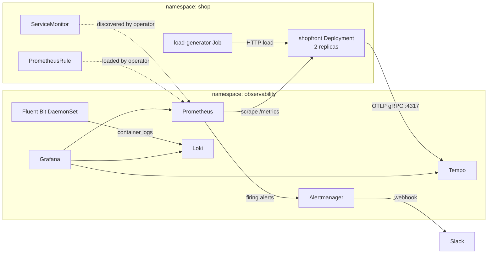

# Hands-on Lab: Full Observability Stack on Kubernetes

<!-- DEVOPS-SHACK:HEADER -->
<p align="center">
  <a href="https://www.youtube.com/@devopsshack"></a>
  <a href="https://www.youtube.com/@shackverse"></a>
  <a href="https://devopsshack.com"></a>
  <a href="https://www.instagram.com/devopsshack"></a>
  <a href="https://github.com/jaiswaladi246/DevOps-Cloud-Interview-Preparation-by-DevOps-Shack"></a>
</p>
<p align="center"><sub>Part of <b><a href="https://github.com/jaiswaladi246/DevOps-Cloud-Interview-Preparation-by-DevOps-Shack">DevOps &amp; Cloud Interview Preparation</a></b> — created by <b><a href="https://www.youtube.com/@devopsshack">DevOps Shack</a></b>. Free to learn from; please credit DevOps Shack when sharing.</sub></p>
<!-- /DEVOPS-SHACK:HEADER -->

> Build metrics, logs, traces and SLO alerting for a real service on Kubernetes, then break it on purpose and watch the stack catch it.

[⬅ Back to Monitoring](./README.md) · [🏠 Home](../README.md)

## Goal

By the end of this lab you will have, on a local `kind` cluster:

- `kube-prometheus-stack` (Prometheus Operator, Prometheus, Alertmanager, Grafana, kube-state-metrics, node-exporter) installed with Helm
- A Python service called `shopfront`, instrumented with a `/metrics` endpoint, JSON logs and OpenTelemetry traces
- A `ServiceMonitor` that makes Prometheus scrape the service
- Recording rules and multi-window multi-burn-rate SLO alerts (a `PrometheusRule`)
- Alertmanager routing alerts to Slack
- A Grafana dashboard (JSON, provisioned as code) covering the four golden signals
- Loki plus Fluent Bit for logs, with a click-through from a log line to its trace
- Tempo for traces, fed over OTLP (Jaeger swap-in notes at the end)
- A fault-injection test: raise the error rate and watch the burn-rate alert reach Slack

## Architecture



## Prerequisites

- Docker 24+, `kind` 0.23+, `kubectl` 1.29+, `helm` 3.14+
- 4 CPUs and 8 GB RAM free for Docker (the stack is not tiny)
- A Slack workspace where you can create an Incoming Webhook (https://api.slack.com/apps, enable Incoming Webhooks, add one to a channel such as `#alerts`)
- Basic Python and YAML reading skills

```bash
docker --version && kind --version && kubectl version --client && helm version --short
export SLACK_WEBHOOK_URL='https://hooks.slack.com/services/T000/B000/XXXX'   # your real URL, never commit it
```

Work in an empty directory, for example `mkdir obs-lab && cd obs-lab`. All files below are created there.

## Step 1. Create the cluster

```bash
cat > kind-config.yaml <<'EOF'
kind: Cluster
apiVersion: kind.x-k8s.io/v1alpha4
nodes:
  - role: control-plane
  - role: worker
  - role: worker
EOF

kind create cluster --name obs --config kind-config.yaml
kubectl create namespace observability
kubectl create namespace shop
```

Verify:

```bash
kubectl get nodes
# NAME                STATUS   ROLES           AGE   VERSION
# obs-control-plane   Ready    control-plane   60s   v1.30.x
# obs-worker          Ready    <none>          40s   v1.30.x
# obs-worker2         Ready    <none>          40s   v1.30.x
```

Three `Ready` nodes and two empty namespaces mean you are good to go.

## Step 2. Add the Helm repositories

```bash
helm repo add prometheus-community https://prometheus-community.github.io/helm-charts
helm repo add grafana https://grafana.github.io/helm-charts
helm repo add fluent https://fluent.github.io/helm-charts
helm repo update
helm search repo prometheus-community/kube-prometheus-stack | head -3
```

In production you pin chart versions (`--version x.y.z`) and bump them through a pull request. In this lab we take the latest so you see current defaults.

## Step 3. Store the Slack webhook as a Secret

Alertmanager reads the webhook URL from a file, so the URL never lands in a ConfigMap or in Git.

```bash
kubectl -n observability create secret generic slack-webhook \
  --from-literal=url="$SLACK_WEBHOOK_URL"
```

The secret will be mounted at `/etc/alertmanager/secrets/slack-webhook/url` once we list it under `alertmanagerSpec.secrets`.

## Step 4. Install kube-prometheus-stack

The values file does four jobs: lets Prometheus pick up any `ServiceMonitor` and `PrometheusRule` regardless of labels, sets retention, wires Alertmanager to Slack, and registers Loki and Tempo as Grafana data sources (with the log-to-trace link).

```bash
cat > kps-values.yaml <<'EOF'
fullnameOverride: kps

prometheus:
  prometheusSpec:
    retention: 7d
    scrapeInterval: 30s
    evaluationInterval: 30s
    # Select ServiceMonitors, PodMonitors, rules and probes from ALL namespaces
    # regardless of the Helm release label.
    serviceMonitorSelectorNilUsesHelmValues: false
    podMonitorSelectorNilUsesHelmValues: false
    ruleSelectorNilUsesHelmValues: false
    probeSelectorNilUsesHelmValues: false
    resources:
      requests: { cpu: 200m, memory: 700Mi }

alertmanager:
  alertmanagerSpec:
    secrets:
      - slack-webhook
  config:
    global:
      resolve_timeout: 5m
    route:
      receiver: "null"
      group_by: ["alertname", "namespace", "severity"]
      group_wait: 30s
      group_interval: 5m
      repeat_interval: 4h
      routes:
        - receiver: "null"
          matchers: ['alertname="Watchdog"']
        - receiver: slack-page
          matchers: ['severity="critical"']
          repeat_interval: 1h
        - receiver: slack-ticket
          matchers: ['severity="warning"']
    inhibit_rules:
      # While a critical alert fires, mute the warning with the same name and namespace.
      - source_matchers: ['severity="critical"']
        target_matchers: ['severity="warning"']
        equal: ["alertname", "namespace"]
    receivers:
      - name: "null"
      - name: slack-page
        slack_configs:
          - api_url_file: /etc/alertmanager/secrets/slack-webhook/url
            channel: "#alerts"
            send_resolved: true
            title: '[{{ .Status | toUpper }}] {{ .CommonLabels.alertname }} ({{ .CommonLabels.severity }})'
            text: |-
              {{ range .Alerts }}*{{ .Annotations.summary }}*
              {{ .Annotations.description }}
              Runbook: {{ .Annotations.runbook_url }}
              {{ end }}
      - name: slack-ticket
        slack_configs:
          - api_url_file: /etc/alertmanager/secrets/slack-webhook/url
            channel: "#alerts"
            send_resolved: true
            title: '[{{ .Status | toUpper }}] {{ .CommonLabels.alertname }} ({{ .CommonLabels.severity }})'
            text: |-
              {{ range .Alerts }}{{ .Annotations.summary }}
              {{ end }}

grafana:
  adminPassword: admin-change-me
  defaultDashboardsTimezone: browser
  sidecar:
    dashboards:
      enabled: true
      label: grafana_dashboard
      labelValue: "1"
      searchNamespace: ALL
  additionalDataSources:
    - name: Loki
      uid: loki
      type: loki
      access: proxy
      url: http://loki.observability.svc.cluster.local:3100
      jsonData:
        derivedFields:
          # Turn the trace_id in a JSON log line into a link to Tempo.
          - name: TraceID
            matcherRegex: '"trace_id":"(\w+)"'
            url: '$${__value.raw}'
            datasourceUid: tempo
    - name: Tempo
      uid: tempo
      type: tempo
      access: proxy
      url: http://tempo.observability.svc.cluster.local:3100
      jsonData:
        tracesToLogsV2:
          datasourceUid: loki
          filterByTraceID: false
          customQuery: true
          query: '{app="shopfront"} |= "$${__span.traceId}"'
        tracesToMetrics:
          datasourceUid: prometheus
        serviceMap:
          datasourceUid: prometheus
        nodeGraph:
          enabled: true
EOF

helm install kps prometheus-community/kube-prometheus-stack \
  --namespace observability \
  --values kps-values.yaml \
  --wait --timeout 10m
```

Note the `$$` in the Grafana values. Grafana expands `$VAR` in provisioning files, so a literal `${__value.raw}` must be written as `$${__value.raw}`.

Verify:

```bash
kubectl -n observability get pods
# alertmanager-kps-alertmanager-0     2/2   Running
# kps-grafana-xxxxx                   3/3   Running
# kps-kube-state-metrics-xxxxx        1/1   Running
# kps-operator-xxxxx                  1/1   Running
# kps-prometheus-node-exporter-xxxxx  1/1   Running   (one per node)
# prometheus-kps-prometheus-0         2/2   Running

kubectl -n observability port-forward svc/kps-prometheus 9090:9090 &
# open http://localhost:9090/targets  -> kubelet, apiserver, node-exporter, kube-state-metrics all UP
```

If you do not see `Running` for everything, do not continue. The rest of the lab depends on this.

## Step 5. Install Loki (single binary, filesystem storage)

For a lab, Loki runs as a single binary with local storage. In production you use object storage (S3, GCS) and the distributed or simple-scalable mode.

```bash
cat > loki-values.yaml <<'EOF'
deploymentMode: SingleBinary

loki:
  auth_enabled: false
  commonConfig:
    replication_factor: 1
  storage:
    type: filesystem
  schemaConfig:
    configs:
      - from: "2024-04-01"
        store: tsdb
        object_store: filesystem
        schema: v13
        index:
          prefix: loki_index_
          period: 24h
  limits_config:
    retention_period: 72h
    allow_structured_metadata: true
  compactor:
    retention_enabled: true
    delete_request_store: filesystem

singleBinary:
  replicas: 1
  persistence:
    enabled: true
    size: 5Gi

# Disable everything that belongs to the scalable modes.
backend: { replicas: 0 }
read: { replicas: 0 }
write: { replicas: 0 }
gateway: { enabled: false }
chunksCache: { enabled: false }
resultsCache: { enabled: false }
lokiCanary: { enabled: false }
test: { enabled: false }
monitoring:
  selfMonitoring: { enabled: false, grafanaAgent: { installOperator: false } }
  serviceMonitor: { enabled: true }
EOF

helm install loki grafana/loki \
  --namespace observability \
  --values loki-values.yaml \
  --wait --timeout 10m
```

Verify Loki is ready:

```bash
kubectl -n observability get pods -l app.kubernetes.io/name=loki
kubectl -n observability port-forward svc/loki 3100:3100 &
curl -s localhost:3100/ready
# ready
```

`ready` means the ingester finished starting (it can say `Ingester not ready` for up to 15 seconds first, which is normal).

## Step 6. Install Fluent Bit as the log shipper

Fluent Bit runs as a DaemonSet, tails `/var/log/containers/*.log` on every node, enriches records with Kubernetes metadata, parses the application JSON and pushes to Loki. Only low-cardinality labels are used: the job, the namespace and the pod labels (`app`).

```bash
cat > fluentbit-values.yaml <<'EOF'
config:
  service: |
    [SERVICE]
        Daemon Off
        Flush 1
        Log_Level info
        HTTP_Server On
        HTTP_Listen 0.0.0.0
        HTTP_Port 2020
        Health_Check On

  inputs: |
    [INPUT]
        Name tail
        Path /var/log/containers/*.log
        multiline.parser docker, cri
        Tag kube.*
        Mem_Buf_Limit 5MB
        Skip_Long_Lines On

  filters: |
    [FILTER]
        Name kubernetes
        Match kube.*
        Kube_URL https://kubernetes.default.svc:443
        Merge_Log On
        Keep_Log Off
        K8S-Logging.Parser Off
        K8S-Logging.Exclude Off
        Labels On
        Annotations Off

    # Do not ship the logs of the log pipeline itself or of kube-system noise.
    [FILTER]
        Name grep
        Match kube.*
        Exclude $kubernetes['namespace_name'] ^(kube-system|local-path-storage)$

  outputs: |
    [OUTPUT]
        Name loki
        Match kube.*
        Host loki.observability.svc.cluster.local
        Port 3100
        Labels job=fluent-bit
        Label_keys $kubernetes['namespace_name']
        Auto_kubernetes_labels On
        Remove_keys kubernetes,stream,_p
        Line_format json
EOF

helm install fluent-bit fluent/fluent-bit \
  --namespace observability \
  --values fluentbit-values.yaml \
  --wait
```

`Auto_kubernetes_labels On` turns every pod label into a Loki stream label (dots become underscores), so our `app: shopfront` pod label becomes `app="shopfront"`. The namespace comes from `Label_keys`, and Fluent Bit derives its label name from the record accessor (it appears as `kubernetes_namespace_name` in recent versions). Always confirm the real names with the label API below instead of trusting this text. In production you would restrict which pod labels become stream labels, because every extra label multiplies streams.

Verify:

```bash
kubectl -n observability get ds fluent-bit
kubectl -n observability logs ds/fluent-bit --tail=5
curl -s localhost:3100/loki/api/v1/labels
# {"status":"success","data":["app","job","kubernetes_namespace_name", ...]}
```

Once the labels appear, logs are flowing. Next we need an application worth observing.

## Step 7. Install Tempo for traces

```bash
cat > tempo-values.yaml <<'__END_CHUNK2__'
tempo:
  retention: 24h
  receivers:
    otlp:
      protocols:
        grpc:
          endpoint: "0.0.0.0:4317"
        http:
          endpoint: "0.0.0.0:4318"
persistence:
  enabled: false
serviceMonitor:
  enabled: true
__END_CHUNK2__

helm install tempo grafana/tempo \
  --namespace observability \
  --values tempo-values.yaml \
  --wait
```

Verify:

```bash
kubectl -n observability get svc tempo
# PORT(S): 3100/TCP (query API), 4317/TCP (OTLP gRPC), 4318/TCP (OTLP HTTP), ...
kubectl -n observability get pod -l app.kubernetes.io/name=tempo
```

Tempo with no persistence loses traces on restart. That is fine for a lab and wrong for production.

## Step 8. Write the instrumented application

`shopfront` is a tiny Flask service with a `/checkout` endpoint whose error rate and latency we can dial through environment variables. It exposes four things: a `/metrics` endpoint (RED metrics with route templates, never raw URLs), JSON logs carrying the active `trace_id`, OTLP traces and a `/healthz` probe.

```bash
mkdir -p app && cd app

cat > requirements.txt <<'__END_CHUNK2__'
flask==3.0.3
gunicorn==22.0.0
prometheus-client==0.20.0
opentelemetry-api==1.27.0
opentelemetry-sdk==1.27.0
opentelemetry-exporter-otlp-proto-grpc==1.27.0
opentelemetry-instrumentation-flask==0.48b0
__END_CHUNK2__

cat > app.py <<'__END_CHUNK2__'
import json
import logging
import os
import random
import time

from flask import Flask, Response, jsonify, request
from prometheus_client import CONTENT_TYPE_LATEST, Counter, Gauge, Histogram, generate_latest

from opentelemetry import trace
from opentelemetry.exporter.otlp.proto.grpc.trace_exporter import OTLPSpanExporter
from opentelemetry.instrumentation.flask import FlaskInstrumentor
from opentelemetry.sdk.resources import Resource
from opentelemetry.sdk.trace import TracerProvider
from opentelemetry.sdk.trace.export import BatchSpanProcessor

# ---------- Tracing (OpenTelemetry) ----------
resource = Resource.create({"service.name": "shopfront", "service.version": os.getenv("APP_VERSION", "1.0.0")})
provider = TracerProvider(resource=resource)
# Endpoint comes from OTEL_EXPORTER_OTLP_ENDPOINT (set in the Deployment).
provider.add_span_processor(BatchSpanProcessor(OTLPSpanExporter()))
trace.set_tracer_provider(provider)
tracer = trace.get_tracer("shopfront")

# ---------- Logging (structured JSON with trace correlation) ----------
class JsonFormatter(logging.Formatter):
    def format(self, record):
        ctx = trace.get_current_span().get_span_context()
        payload = {
            "ts": self.formatTime(record, "%Y-%m-%dT%H:%M:%S%z"),
            "level": record.levelname.lower(),
            "msg": record.getMessage(),
            "logger": record.name,
        }
        if ctx.is_valid:
            payload["trace_id"] = format(ctx.trace_id, "032x")
            payload["span_id"] = format(ctx.span_id, "016x")
        extra = getattr(record, "extra_fields", None)
        if extra:
            payload.update(extra)
        return json.dumps(payload)

handler = logging.StreamHandler()
handler.setFormatter(JsonFormatter())
log = logging.getLogger("shopfront")
log.setLevel(logging.INFO)
log.addHandler(handler)
log.propagate = False

# ---------- Metrics (Prometheus) ----------
REQUESTS = Counter("http_requests_total", "Total HTTP requests", ["method", "route", "status"])
LATENCY = Histogram(
    "http_request_duration_seconds",
    "HTTP request latency in seconds",
    ["route"],
    buckets=(0.01, 0.025, 0.05, 0.1, 0.25, 0.3, 0.5, 1, 2.5, 5),
)
INFLIGHT = Gauge("http_requests_in_flight", "Requests currently being processed")
ORDERS = Counter("shop_orders_total", "Orders by outcome", ["outcome"])

app = Flask(__name__)
FlaskInstrumentor().instrument_app(app, excluded_urls="metrics,healthz")

ERROR_RATE = float(os.getenv("ERROR_RATE", "0.0"))      # 0.0 to 1.0
EXTRA_LATENCY_MS = int(os.getenv("EXTRA_LATENCY_MS", "0"))

@app.before_request
def start_timer():
    request._start = time.perf_counter()
    INFLIGHT.inc()

@app.after_request
def record(resp):
    # url_rule gives the route template (/items/<id>), keeping cardinality bounded.
    route = request.url_rule.rule if request.url_rule else "unmatched"
    if route not in ("/metrics", "/healthz"):
        REQUESTS.labels(request.method, route, str(resp.status_code)).inc()
        LATENCY.labels(route).observe(time.perf_counter() - request._start)
    INFLIGHT.dec()
    return resp

@app.route("/")
def index():
    return jsonify(service="shopfront", status="ok")

@app.route("/items/<int:item_id>")
def item(item_id):
    time.sleep(random.uniform(0.005, 0.04))
    return jsonify(id=item_id, name=f"item-{item_id}")

@app.route("/checkout", methods=["POST", "GET"])
def checkout():
    with tracer.start_as_current_span("charge-payment") as span:
        delay = random.uniform(0.03, 0.15) + EXTRA_LATENCY_MS / 1000
        time.sleep(delay)
        span.set_attribute("payment.provider", "demo-psp")
        if random.random() < ERROR_RATE:
            ORDERS.labels("failed").inc()
            span.set_attribute("error", True)
            log.error("payment failed", extra={"extra_fields": {"route": "/checkout", "reason": "psp_timeout"}})
            return jsonify(error="payment failed"), 500
    ORDERS.labels("ok").inc()
    log.info("order placed", extra={"extra_fields": {"route": "/checkout"}})
    return jsonify(status="order placed")

@app.route("/healthz")
def healthz():
    return "ok", 200

@app.route("/metrics")
def metrics():
    return Response(generate_latest(), mimetype=CONTENT_TYPE_LATEST)
__END_CHUNK2__

cat > Dockerfile <<'__END_CHUNK2__'
FROM python:3.12-slim
ENV PYTHONUNBUFFERED=1
WORKDIR /srv
COPY requirements.txt .
RUN pip install --no-cache-dir -r requirements.txt
COPY app.py .
RUN useradd -r -u 10001 appuser
USER 10001
EXPOSE 8080
# One worker: prometheus_client keeps its registry in process memory.
CMD ["gunicorn", "--workers", "1", "--threads", "8", "--bind", "0.0.0.0:8080", "app:app"]
__END_CHUNK2__

docker build -t shopfront:1.0.0 .
kind load docker-image shopfront:1.0.0 --name obs
cd ..
```

The `--workers 1` is deliberate. With several gunicorn workers each process has its own metric registry and Prometheus would see a random worker on every scrape. For multi-worker apps use `prometheus_client` multiprocess mode, or run one worker per pod and scale with replicas (the Kubernetes way).

Verify the image runs locally before it goes near the cluster:

```bash
docker run --rm -d --name sf -p 8080:8080 -e OTEL_SDK_DISABLED=true shopfront:1.0.0
curl -s localhost:8080/checkout; curl -s localhost:8080/metrics | grep -E '^http_requests_total|^shop_orders_total'
docker rm -f sf
```

## Step 9. Deploy the app with a ServiceMonitor

```bash
cat > shopfront.yaml <<'__END_CHUNK2__'
apiVersion: apps/v1
kind: Deployment
metadata:
  name: shopfront
  namespace: shop
  labels: { app: shopfront }
spec:
  replicas: 2
  selector:
    matchLabels: { app: shopfront }
  template:
    metadata:
      labels:
        app: shopfront
    spec:
      containers:
        - name: shopfront
          image: shopfront:1.0.0
          imagePullPolicy: IfNotPresent
          ports:
            - name: http
              containerPort: 8080
          env:
            - name: ERROR_RATE
              value: "0.0"
            - name: EXTRA_LATENCY_MS
              value: "0"
            - name: APP_VERSION
              value: "1.0.0"
            - name: OTEL_EXPORTER_OTLP_ENDPOINT
              value: http://tempo.observability.svc.cluster.local:4317
            - name: OTEL_EXPORTER_OTLP_INSECURE
              value: "true"
          readinessProbe:
            httpGet: { path: /healthz, port: http }
            periodSeconds: 5
          livenessProbe:
            httpGet: { path: /healthz, port: http }
            initialDelaySeconds: 10
            periodSeconds: 10
          resources:
            requests: { cpu: 50m, memory: 96Mi }
            limits: { cpu: 500m, memory: 256Mi }
---
apiVersion: v1
kind: Service
metadata:
  name: shopfront
  namespace: shop
  labels: { app: shopfront }
spec:
  selector: { app: shopfront }
  ports:
    - name: http
      port: 80
      targetPort: http
---
apiVersion: monitoring.coreos.com/v1
kind: ServiceMonitor
metadata:
  name: shopfront
  namespace: shop
  labels:
    app: shopfront
    release: kps
spec:
  selector:
    matchLabels: { app: shopfront }
  namespaceSelector:
    matchNames: [shop]
  endpoints:
    - port: http          # the NAME of the Service port, not the number
      path: /metrics
      interval: 15s
__END_CHUNK2__

kubectl apply -f shopfront.yaml
kubectl -n shop rollout status deploy/shopfront
```

Verify the target is scraped:

```bash
kubectl -n shop get pods,svc,servicemonitor
# open http://localhost:9090/targets and look for serviceMonitor/shop/shopfront/0 (2/2 up)
curl -s 'localhost:9090/api/v1/query?query=up{job="shopfront"}' | head -c 400
```

Two series with value `1` and `job="shopfront"` confirm discovery works end to end: the operator saw the `ServiceMonitor`, generated scrape config, Prometheus reloaded and found both pod endpoints.

## Step 10. Generate traffic

```bash
cat > load.yaml <<'__END_CHUNK2__'
apiVersion: apps/v1
kind: Deployment
metadata:
  name: load-generator
  namespace: shop
spec:
  replicas: 1
  selector:
    matchLabels: { app: load-generator }
  template:
    metadata:
      labels: { app: load-generator }
    spec:
      containers:
        - name: curl
          image: curlimages/curl:8.8.0
          command: ["/bin/sh", "-c"]
          args:
            - |
              while true; do
                curl -s -o /dev/null http://shopfront.shop.svc.cluster.local/
                curl -s -o /dev/null http://shopfront.shop.svc.cluster.local/items/$((RANDOM % 50))
                curl -s -o /dev/null http://shopfront.shop.svc.cluster.local/checkout
                sleep 0.2
              done
          resources:
            requests: { cpu: 20m, memory: 16Mi }
__END_CHUNK2__

kubectl apply -f load.yaml
```

This yields roughly 15 requests per second across the two replicas. Wait a minute, then check:

```bash
curl -s 'localhost:9090/api/v1/query' --data-urlencode 'query=sum(rate(http_requests_total{job="shopfront"}[1m]))'
# "value":[...,"14.8"]
```

## Step 11. Recording rules and SLO burn-rate alerts

The SLO: **99.9% of requests succeed (non-5xx) over 30 days.** The error budget is 0.1%. We follow the multi-window, multi-burn-rate approach from the Google SRE Workbook:

| Severity | Burn rate | Long window | Short window | Budget consumed if sustained |
|----------|-----------|-------------|--------------|------------------------------|
| critical (page) | 14.4 | 1h | 5m | 2% in 1 hour |
| critical (page) | 6 | 6h | 30m | 5% in 6 hours |
| warning (ticket) | 3 | 1d | 2h | 10% in 1 day |
| warning (ticket) | 1 | 3d | 6h | 10% in 3 days |

The short window makes the alert reset quickly once the problem stops, so you do not get paged for something that already recovered. Recording rules precompute the error ratio for each window so the alert expressions stay cheap and readable.

```bash
cat > slo-rules.yaml <<'__END_CHUNK2__'
apiVersion: monitoring.coreos.com/v1
kind: PrometheusRule
metadata:
  name: shopfront-slo
  namespace: shop
  labels:
    app: shopfront
    release: kps
spec:
  groups:
    - name: shopfront.sli.recording
      interval: 30s
      rules:
        - record: job:http_requests:rate5m
          expr: sum by (job) (rate(http_requests_total{job="shopfront"}[5m]))
        - record: job:http_request_errors:ratio_rate5m
          expr: |
            sum by (job) (rate(http_requests_total{job="shopfront",status=~"5.."}[5m]))
            /
            sum by (job) (rate(http_requests_total{job="shopfront"}[5m]))
        - record: job:http_request_errors:ratio_rate30m
          expr: |
            sum by (job) (rate(http_requests_total{job="shopfront",status=~"5.."}[30m]))
            /
            sum by (job) (rate(http_requests_total{job="shopfront"}[30m]))
        - record: job:http_request_errors:ratio_rate1h
          expr: |
            sum by (job) (rate(http_requests_total{job="shopfront",status=~"5.."}[1h]))
            /
            sum by (job) (rate(http_requests_total{job="shopfront"}[1h]))
        - record: job:http_request_errors:ratio_rate2h
          expr: |
            sum by (job) (rate(http_requests_total{job="shopfront",status=~"5.."}[2h]))
            /
            sum by (job) (rate(http_requests_total{job="shopfront"}[2h]))
        - record: job:http_request_errors:ratio_rate6h
          expr: |
            sum by (job) (rate(http_requests_total{job="shopfront",status=~"5.."}[6h]))
            /
            sum by (job) (rate(http_requests_total{job="shopfront"}[6h]))
        - record: job:http_request_errors:ratio_rate1d
          expr: |
            sum by (job) (rate(http_requests_total{job="shopfront",status=~"5.."}[1d]))
            /
            sum by (job) (rate(http_requests_total{job="shopfront"}[1d]))
        - record: job:http_request_errors:ratio_rate3d
          expr: |
            sum by (job) (rate(http_requests_total{job="shopfront",status=~"5.."}[3d]))
            /
            sum by (job) (rate(http_requests_total{job="shopfront"}[3d]))
        - record: job_route:http_request_duration_seconds:p99_5m
          expr: |
            histogram_quantile(0.99,
              sum by (job, route, le) (rate(http_request_duration_seconds_bucket{job="shopfront"}[5m])))

    - name: shopfront.slo.alerts
      rules:
        - alert: ShopfrontErrorBudgetBurnFast
          expr: |
            job:http_request_errors:ratio_rate1h{job="shopfront"} > (14.4 * 0.001)
            and
            job:http_request_errors:ratio_rate5m{job="shopfront"} > (14.4 * 0.001)
          for: 2m
          labels:
            severity: critical
            slo: availability
          annotations:
            summary: "shopfront is burning its error budget 14.4x too fast"
            description: "Error ratio is {{ $value | humanizePercentage }} over the last 5m. At this rate the 30d budget is gone in about 2 days."
            runbook_url: "https://github.com/your-org/runbooks/blob/main/shopfront-errors.md"

        - alert: ShopfrontErrorBudgetBurnSlow
          expr: |
            job:http_request_errors:ratio_rate6h{job="shopfront"} > (6 * 0.001)
            and
            job:http_request_errors:ratio_rate30m{job="shopfront"} > (6 * 0.001)
          for: 15m
          labels:
            severity: critical
            slo: availability
          annotations:
            summary: "shopfront is burning its error budget 6x too fast"
            description: "Sustained error ratio over 6h and 30m windows. 5% of the monthly budget gone in 6 hours."
            runbook_url: "https://github.com/your-org/runbooks/blob/main/shopfront-errors.md"

        - alert: ShopfrontErrorBudgetBurnTicket
          expr: |
            job:http_request_errors:ratio_rate1d{job="shopfront"} > (3 * 0.001)
            and
            job:http_request_errors:ratio_rate2h{job="shopfront"} > (3 * 0.001)
          for: 1h
          labels:
            severity: warning
            slo: availability
          annotations:
            summary: "shopfront error budget burning 3x too fast (ticket)"
            description: "A slow leak: 10% of the budget goes in 1 day if this continues."
            runbook_url: "https://github.com/your-org/runbooks/blob/main/shopfront-errors.md"

        - alert: ShopfrontErrorBudgetBurnVerySlow
          expr: |
            job:http_request_errors:ratio_rate3d{job="shopfront"} > (1 * 0.001)
            and
            job:http_request_errors:ratio_rate6h{job="shopfront"} > (1 * 0.001)
          for: 3h
          labels:
            severity: warning
            slo: availability
          annotations:
            summary: "shopfront is spending budget at exactly the unsustainable rate (ticket)"
            description: "10% of the budget gone in 3 days at the current error ratio."
            runbook_url: "https://github.com/your-org/runbooks/blob/main/shopfront-errors.md"

        - alert: ShopfrontLatencyP99High
          expr: job_route:http_request_duration_seconds:p99_5m{job="shopfront",route="/checkout"} > 0.3
          for: 10m
          labels:
            severity: warning
            slo: latency
          annotations:
            summary: "p99 latency on /checkout is above 300ms"
            description: "p99 is {{ $value | humanizeDuration }} for route {{ $labels.route }}."
            runbook_url: "https://github.com/your-org/runbooks/blob/main/shopfront-latency.md"

        - alert: ShopfrontTargetDown
          expr: count(up{job="shopfront"} == 1) < 2
          for: 3m
          labels:
            severity: critical
          annotations:
            summary: "Fewer than 2 shopfront replicas are being scraped"
            description: "Only {{ $value }} shopfront targets are up."
            runbook_url: "https://github.com/your-org/runbooks/blob/main/shopfront-down.md"
__END_CHUNK2__

kubectl apply -f slo-rules.yaml
```

Two accuracy notes. The 3d and 1d rules recorded this way need Prometheus retention of at least that long to have data, so in this 7-day lab they will be empty at first and the slower alerts only become meaningful after a day or two. And `count(up == 1) < 2` returns nothing (not zero) when no targets are up, so in production you also add `absent(up{job="shopfront"})`.

Verify the rules loaded:

```bash
kubectl -n shop get prometheusrule
# open http://localhost:9090/rules  -> groups shopfront.sli.recording and shopfront.slo.alerts, health "ok"
curl -s 'localhost:9090/api/v1/query?query=job:http_request_errors:ratio_rate5m'
# value 0 while ERROR_RATE=0.0
```

If the group does not show up, the operator rejected the rule or Prometheus cannot see it. See the error table at the end.

## Step 12. Provision the golden-signals dashboard as code

The Grafana sidecar watches ConfigMaps labeled `grafana_dashboard: "1"` in all namespaces and loads the JSON inside. This is how dashboards live in Git instead of in someone's browser.

```bash
cat > dashboard.json <<'__END_CHUNK2__'
{
  "uid": "shopfront-golden",
  "title": "Shopfront - Golden Signals",
  "tags": ["shopfront", "slo"],
  "timezone": "browser",
  "schemaVersion": 39,
  "version": 1,
  "refresh": "10s",
  "time": { "from": "now-30m", "to": "now" },
  "templating": {
    "list": [
      {
        "name": "route",
        "type": "query",
        "datasource": { "type": "prometheus", "uid": "prometheus" },
        "query": "label_values(http_requests_total{job=\"shopfront\"}, route)",
        "refresh": 2,
        "includeAll": true,
        "multi": true,
        "current": { "text": "All", "value": "$__all" }
      }
    ]
  },
  "panels": [
    {
      "id": 1, "type": "timeseries", "title": "Traffic (requests/s by route)",
      "gridPos": { "h": 8, "w": 12, "x": 0, "y": 0 },
      "datasource": { "type": "prometheus", "uid": "prometheus" },
      "fieldConfig": { "defaults": { "unit": "reqps" }, "overrides": [] },
      "targets": [
        { "refId": "A", "legendFormat": "{{route}}",
          "expr": "sum by (route) (rate(http_requests_total{job=\"shopfront\",route=~\"$route\"}[$__rate_interval]))" }
      ]
    },
    {
      "id": 2, "type": "timeseries", "title": "Errors (5xx ratio)",
      "gridPos": { "h": 8, "w": 12, "x": 12, "y": 0 },
      "datasource": { "type": "prometheus", "uid": "prometheus" },
      "fieldConfig": {
        "defaults": {
          "unit": "percentunit", "min": 0,
          "thresholds": { "mode": "absolute", "steps": [ { "color": "green", "value": null }, { "color": "red", "value": 0.001 } ] },
          "custom": { "thresholdsStyle": { "mode": "line" } }
        },
        "overrides": []
      },
      "targets": [
        { "refId": "A", "legendFormat": "5xx ratio",
          "expr": "sum(rate(http_requests_total{job=\"shopfront\",status=~\"5..\"}[$__rate_interval])) / sum(rate(http_requests_total{job=\"shopfront\"}[$__rate_interval]))" }
      ]
    },
    {
      "id": 3, "type": "timeseries", "title": "Latency (p50 / p95 / p99)",
      "gridPos": { "h": 8, "w": 12, "x": 0, "y": 8 },
      "datasource": { "type": "prometheus", "uid": "prometheus" },
      "fieldConfig": { "defaults": { "unit": "s" }, "overrides": [] },
      "targets": [
        { "refId": "A", "legendFormat": "p50",
          "expr": "histogram_quantile(0.50, sum by (le) (rate(http_request_duration_seconds_bucket{job=\"shopfront\",route=~\"$route\"}[$__rate_interval])))" },
        { "refId": "B", "legendFormat": "p95",
          "expr": "histogram_quantile(0.95, sum by (le) (rate(http_request_duration_seconds_bucket{job=\"shopfront\",route=~\"$route\"}[$__rate_interval])))" },
        { "refId": "C", "legendFormat": "p99",
          "expr": "histogram_quantile(0.99, sum by (le) (rate(http_request_duration_seconds_bucket{job=\"shopfront\",route=~\"$route\"}[$__rate_interval])))" }
      ]
    },
    {
      "id": 4, "type": "timeseries", "title": "Saturation (CPU vs limit, memory vs limit)",
      "gridPos": { "h": 8, "w": 12, "x": 12, "y": 8 },
      "datasource": { "type": "prometheus", "uid": "prometheus" },
      "fieldConfig": { "defaults": { "unit": "percentunit", "min": 0 }, "overrides": [] },
      "targets": [
        { "refId": "A", "legendFormat": "CPU {{pod}}",
          "expr": "sum by (pod) (rate(container_cpu_usage_seconds_total{namespace=\"shop\",pod=~\"shopfront-.*\",container=\"shopfront\"}[$__rate_interval])) / sum by (pod) (kube_pod_container_resource_limits{namespace=\"shop\",pod=~\"shopfront-.*\",resource=\"cpu\"})" },
        { "refId": "B", "legendFormat": "Memory {{pod}}",
          "expr": "sum by (pod) (container_memory_working_set_bytes{namespace=\"shop\",pod=~\"shopfront-.*\",container=\"shopfront\"}) / sum by (pod) (kube_pod_container_resource_limits{namespace=\"shop\",pod=~\"shopfront-.*\",resource=\"memory\"})" }
      ]
    },
    {
      "id": 5, "type": "stat", "title": "30d availability SLI (target 99.9%)",
      "gridPos": { "h": 5, "w": 6, "x": 0, "y": 16 },
      "datasource": { "type": "prometheus", "uid": "prometheus" },
      "fieldConfig": {
        "defaults": {
          "unit": "percentunit", "decimals": 3,
          "thresholds": { "mode": "absolute", "steps": [ { "color": "red", "value": null }, { "color": "green", "value": 0.999 } ] }
        },
        "overrides": []
      },
      "targets": [
        { "refId": "A",
          "expr": "1 - (sum(increase(http_requests_total{job=\"shopfront\",status=~\"5..\"}[$__range])) / sum(increase(http_requests_total{job=\"shopfront\"}[$__range])))" }
      ]
    },
    {
      "id": 6, "type": "stat", "title": "Error budget remaining (over dashboard range)",
      "gridPos": { "h": 5, "w": 6, "x": 6, "y": 16 },
      "datasource": { "type": "prometheus", "uid": "prometheus" },
      "fieldConfig": {
        "defaults": {
          "unit": "percentunit", "decimals": 1, "max": 1,
          "thresholds": { "mode": "absolute", "steps": [ { "color": "red", "value": null }, { "color": "orange", "value": 0.25 }, { "color": "green", "value": 0.5 } ] }
        },
        "overrides": []
      },
      "targets": [
        { "refId": "A",
          "expr": "1 - ((sum(increase(http_requests_total{job=\"shopfront\",status=~\"5..\"}[$__range])) / sum(increase(http_requests_total{job=\"shopfront\"}[$__range]))) / 0.001)" }
      ]
    },
    {
      "id": 7, "type": "timeseries", "title": "Burn rate (1h window, 14.4 pages)",
      "gridPos": { "h": 5, "w": 12, "x": 12, "y": 16 },
      "datasource": { "type": "prometheus", "uid": "prometheus" },
      "fieldConfig": {
        "defaults": {
          "unit": "none", "min": 0,
          "thresholds": { "mode": "absolute", "steps": [ { "color": "green", "value": null }, { "color": "red", "value": 14.4 } ] },
          "custom": { "thresholdsStyle": { "mode": "line" } }
        },
        "overrides": []
      },
      "targets": [
        { "refId": "A", "legendFormat": "burn rate 1h",
          "expr": "job:http_request_errors:ratio_rate1h{job=\"shopfront\"} / 0.001" },
        { "refId": "B", "legendFormat": "burn rate 5m",
          "expr": "job:http_request_errors:ratio_rate5m{job=\"shopfront\"} / 0.001" }
      ]
    },
    {
      "id": 8, "type": "logs", "title": "Application logs (Loki)",
      "gridPos": { "h": 9, "w": 24, "x": 0, "y": 21 },
      "datasource": { "type": "loki", "uid": "loki" },
      "options": { "showTime": true, "wrapLogMessage": true, "enableLogDetails": true, "sortOrder": "Descending" },
      "targets": [
        { "refId": "A", "expr": "{app=\"shopfront\"} | json | level=~\"error|warn\"" }
      ]
    }
  ]
}
__END_CHUNK2__

python3 -m json.tool dashboard.json > /dev/null && echo "valid JSON"

kubectl -n observability create configmap shopfront-dashboard --from-file=shopfront-golden.json=dashboard.json
kubectl -n observability label configmap shopfront-dashboard grafana_dashboard=1
```

Verify:

```bash
kubectl -n observability port-forward svc/kps-grafana 3000:80 &
# open http://localhost:3000  (admin / admin-change-me)
# Dashboards -> Shopfront - Golden Signals: traffic about 15 req/s, errors at 0, p99 around 150-200ms
# Connections -> Data sources: Prometheus, Alertmanager, Loki and Tempo should all say "Data source is working" on Test
```

## Step 13. Fault injection: burn the error budget

Now the fun part. Make 30% of checkouts fail and watch every layer react.

```bash
kubectl -n shop set env deploy/shopfront ERROR_RATE=0.3
kubectl -n shop rollout status deploy/shopfront
```

What you should observe, in order:

1. **Within 1 minute**, the Errors panel jumps to about 10% (checkout is one third of traffic, 30% of it fails) and the burn rate panel passes 14.4 (10% divided by 0.1% is a burn rate near 100).
2. **After about 10 minutes**, the 1h error ratio crosses `14.4 * 0.001` (the 1h window has to fill with enough bad data) and the 5m ratio is already above it. `ShopfrontErrorBudgetBurnFast` turns **Pending**, then **Firing** after its `for: 2m`. Watch it at `http://localhost:9090/alerts`.
3. **After Alertmanager's `group_wait` (30s)** a Slack message arrives in `#alerts` titled `[FIRING] ShopfrontErrorBudgetBurnFast (critical)`.
4. Check Alertmanager itself:

```bash
kubectl -n observability port-forward svc/kps-alertmanager 9093:9093 &
curl -s localhost:9093/api/v2/alerts | python3 -m json.tool | head -30
```

Roll back and confirm recovery:

```bash
kubectl -n shop set env deploy/shopfront ERROR_RATE=0.0
```

The 5m ratio drops below the threshold within minutes, the alert resolves even though the 1h window still looks bad (that is the whole point of the short window), and Slack receives a `[RESOLVED]` message because of `send_resolved: true`.

You can also test latency: `kubectl -n shop set env deploy/shopfront EXTRA_LATENCY_MS=400` pushes `/checkout` p99 above 300 ms and `ShopfrontLatencyP99High` follows after its 10 minutes.

## Step 14. Investigate like on-call: metric to log to trace

While `ERROR_RATE=0.3` is active (set it again if you rolled back), walk the incident path.

**Metrics.** Which route is failing?

```promql
sum by (route, status) (rate(http_requests_total{job="shopfront",status=~"5.."}[5m]))
```

Only `/checkout` returns 5xx. Now the logs for that route.

**Logs (Grafana Explore, Loki data source).**

```logql
{app="shopfront"} | json | level="error"
```

Expand a line. You see `"msg":"payment failed"`, `"reason":"psp_timeout"` and a `trace_id`. Next to the field there is a **TraceID** link (the derived field from Step 4). Click it and Grafana opens that trace in Tempo.

Count errors per minute straight from logs:

```logql
sum by (app) (count_over_time({app="shopfront"} | json | level="error" [1m]))
```

**Traces (Grafana Explore, Tempo data source).** Run a TraceQL search:

```traceql
{ resource.service.name = "shopfront" && status = error }
```

Open a trace. You see the Flask server span (`POST /checkout` or `GET /checkout`) and its child `charge-payment` span with `payment.provider=demo-psp` and the error flag. From the span, use "Logs for this span" (the `tracesToLogsV2` setting) to jump back to the log lines of that exact request. You have now closed the loop: alert, dashboard, logs, trace, logs again.

## Step 15. Optional: swap Tempo for Jaeger

The app only speaks OTLP, so the backend is a one-line change. To try Jaeger all-in-one:

```bash
kubectl -n observability apply -f - <<'__END_CHUNK2__'
apiVersion: apps/v1
kind: Deployment
metadata: { name: jaeger, namespace: observability }
spec:
  replicas: 1
  selector: { matchLabels: { app: jaeger } }
  template:
    metadata: { labels: { app: jaeger } }
    spec:
      containers:
        - name: jaeger
          image: jaegertracing/all-in-one:1.58
          env: [ { name: COLLECTOR_OTLP_ENABLED, value: "true" } ]
          ports: [ { containerPort: 16686 }, { containerPort: 4317 } ]
---
apiVersion: v1
kind: Service
metadata: { name: jaeger, namespace: observability }
spec:
  selector: { app: jaeger }
  ports:
    - { name: ui, port: 16686 }
    - { name: otlp-grpc, port: 4317 }
__END_CHUNK2__

kubectl -n shop set env deploy/shopfront OTEL_EXPORTER_OTLP_ENDPOINT=http://jaeger.observability.svc.cluster.local:4317
kubectl -n observability port-forward svc/jaeger 16686:16686 &
# open http://localhost:16686 and search service "shopfront"
```

In a real platform you would put an OpenTelemetry Collector between apps and backends. Apps send to one stable endpoint, and the Collector handles batching, tail sampling, attribute scrubbing and fan-out to Tempo, Jaeger or a vendor, so changing backends never means redeploying applications.

## Cleanup

```bash
kubectl delete -f load.yaml -f shopfront.yaml -f slo-rules.yaml
kind delete cluster --name obs
unset SLACK_WEBHOOK_URL
```

Then revoke the Slack webhook in your Slack app settings if it was for the lab only. Kill background port-forwards with `pkill -f "kubectl.*port-forward"`.

## What to say in an interview about this project

Lead with the outcome, then the decisions.

"I built a full observability stack on Kubernetes using `kube-prometheus-stack`. A Python service exposed RED metrics with route-templated labels so cardinality stayed bounded, and a `ServiceMonitor` made Prometheus discover it. I defined a 99.9% availability SLO and alerted with multi-window multi-burn-rate rules from the SRE Workbook: a 14.4x burn over 1h and 5m pages immediately, slower burns open tickets. Recording rules precompute the error ratio per window. Alertmanager groups by alertname and namespace, inhibits warnings while the critical alert of the same name fires, and posts to Slack with a runbook link, with the webhook mounted from a Secret rather than a ConfigMap. Logs were structured JSON shipped by Fluent Bit to Loki with only low-cardinality labels, and each log line carried the OpenTelemetry trace ID, so from a Loki line I could jump to the Tempo trace and back. The Grafana dashboard was JSON in Git, loaded by the sidecar. I validated everything with fault injection: raised the error rate to 30% and watched the alert go pending, firing, Slack, and then resolve after rollback."

Be ready for these follow-ups:

- **Why burn-rate alerts instead of `error_rate > 1%`?** A static threshold either pages on harmless blips or misses slow leaks. Burn rate ties the alert to how fast the budget is consumed, and the two windows cut both detection time and reset time.
- **Why did you not use a `user_id` label?** Cardinality. Unbounded labels explode series count and memory. Per-user detail belongs in logs and traces.
- **What would you change for production?** Object storage for Loki and Tempo, Thanos or Mimir for long retention and HA, an OTel Collector with tail sampling, `PodDisruptionBudgets` and persistent volumes, pinned chart versions through GitOps, and alert rules tested with `promtool test rules`.
- **How do you stop alert fatigue?** Page only on symptoms, require a runbook, review every page in a weekly meeting and delete or downgrade alerts that were not actionable.

## Common errors and fixes

| Symptom | Cause | Fix |
|---------|-------|-----|
| Target `shopfront` missing in `/targets` | `ServiceMonitor` port is a number, or `selector.matchLabels` does not match the Service labels | Use the Service port **name** (`http`), compare `kubectl -n shop get svc shopfront --show-labels` |
| Target missing and `ServiceMonitor` looks right | Prometheus selector limited to the Helm release label | Set `serviceMonitorSelectorNilUsesHelmValues: false` or add `release: kps` to the `ServiceMonitor` |
| Target is DOWN: `connection refused` or `context deadline exceeded` | App not listening on the container port, or NetworkPolicy blocks Prometheus | `kubectl -n shop port-forward deploy/shopfront 8080` and curl `/metrics`, check policies |
| `PrometheusRule` applied but not in `/rules` | Rule selector excludes it, or invalid PromQL made the operator skip it | `kubectl -n observability logs deploy/kps-operator`, run `promtool check rules` on the spec |
| `error: no matches for kind "ServiceMonitor"` | CRDs not installed (stack not ready) | Finish Step 4 first, `kubectl get crd servicemonitors.monitoring.coreos.com` |
| Slack never receives anything | Wrong webhook, secret name mismatch, or alert routed to `"null"` | `kubectl -n observability logs alertmanager-kps-alertmanager-0 -c alertmanager`, look for `notify retry canceled` or `404`, check `http://localhost:9093/#/status` |
| Alertmanager pod crash loops with `unable to read URL from file` | `api_url_file` path wrong or secret not listed in `alertmanagerSpec.secrets` | The path is `/etc/alertmanager/secrets/<secret-name>/<key>` |
| Grafana datasource `Loki` fails: `connection refused` | Service name or port differs | `kubectl -n observability get svc loki`, URL must be `http://loki.observability.svc.cluster.local:3100` |
| Loki: `too many outstanding requests` or `entry too far behind` | Burst from Fluent Bit replaying old files, or out-of-order limits | Lower the replay with `Read_from_Head Off`, check `limits_config` ingestion limits |
| No logs in Loki, Fluent Bit logs `[error] [output:loki:loki.0] ... 400` | Invalid label name or too many labels | Read Loki's response body in Fluent Bit logs, simplify `Label_keys` |
| Loki: `maximum active stream limit exceeded` | A high-cardinality label (pod name, request id) became a stream label | Remove it from labels, keep it in the log line and filter with `\| json` |
| No traces in Tempo | App cannot reach `:4317`, or exporter uses TLS against a plaintext port | Set `OTEL_EXPORTER_OTLP_INSECURE=true`, check app logs for `Transient error StatusCode.UNAVAILABLE`, test with `kubectl -n shop exec deploy/shopfront -- python -c "import socket;socket.create_connection(('tempo.observability.svc.cluster.local',4317),3)"` |
| `trace_id` missing in logs | Log written outside a request or span | Log inside a request handler, make sure the instrumentor ran before the first request |
| Dashboard shows `No data` | Datasource UID mismatch | In Grafana open the Prometheus data source and compare its UID with `"uid": "prometheus"` in the JSON |
| Dashboard ConfigMap ignored by sidecar | Missing label or wrong `labelValue` | `kubectl -n observability get cm shopfront-dashboard --show-labels` must show `grafana_dashboard=1` |
| `histogram_quantile` returns `NaN` | No traffic in the window (0/0), or `le` was aggregated away | Keep `le` in `sum by (le, ...)` and guard with traffic checks |
| `ImagePullBackOff` for `shopfront:1.0.0` | Image was not loaded into the kind nodes | `kind load docker-image shopfront:1.0.0 --name obs`, keep `imagePullPolicy: IfNotPresent` |
| Pods `Pending` or Prometheus `OOMKilled` | Not enough Docker memory | Give Docker 8 GB, lower retention and `scrapeInterval`, remove unneeded exporters |

[⬅ Back to Monitoring](./README.md) · [🏠 Home](../README.md)

<!-- DEVOPS-SHACK:FOOTER -->
---

<div align="center">

### 🚀 Made with ❤️ by [DevOps Shack](https://www.youtube.com/@devopsshack)

**Learn DevOps, DevSecOps, Cloud and Kubernetes the practical way.**

[▶️ YouTube — DevOps Shack](https://www.youtube.com/@devopsshack) · [▶️ Hindi — @shackverse](https://www.youtube.com/@shackverse) · [🎓 devopsshack.com](https://devopsshack.com) · [📸 Instagram @devopsshack](https://www.instagram.com/devopsshack)

[🏠 Back to Home](../README.md) · [⭐ Star the original repo](https://github.com/jaiswaladi246/DevOps-Cloud-Interview-Preparation-by-DevOps-Shack)

<sub>© DevOps Shack · Licensed CC BY-NC-SA 4.0 · If you found this copy anywhere other than <a href="https://github.com/jaiswaladi246/DevOps-Cloud-Interview-Preparation-by-DevOps-Shack">github.com/jaiswaladi246</a>, the original and latest version is maintained by DevOps Shack.</sub>

</div>
<!-- /DEVOPS-SHACK:FOOTER -->
