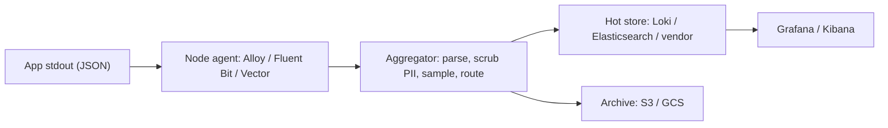
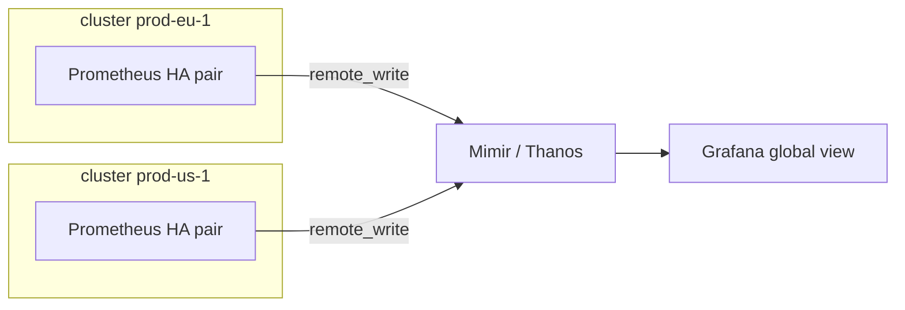

# Monitoring & Observability — Production & Best Practices

<!-- DEVOPS-SHACK:HEADER -->
<p align="center">
  <a href="https://www.youtube.com/@devopsshack"></a>
  <a href="https://www.youtube.com/@shackverse"></a>
  <a href="https://devopsshack.com"></a>
  <a href="https://www.instagram.com/devopsshack"></a>
  <a href="https://github.com/jaiswaladi246/DevOps-Cloud-Interview-Preparation-by-DevOps-Shack"></a>
</p>
<p align="center"><sub>Part of <b><a href="https://github.com/jaiswaladi246/DevOps-Cloud-Interview-Preparation-by-DevOps-Shack">DevOps &amp; Cloud Interview Preparation</a></b> — created by <b><a href="https://www.youtube.com/@devopsshack">DevOps Shack</a></b>. Free to learn from; please credit DevOps Shack when sharing.</sub></p>
<!-- /DEVOPS-SHACK:HEADER -->

> Real-world observability: symptom and SLO-based alerting, dashboards, scaling Prometheus, cardinality and cost, log and trace pipelines, Kubernetes at scale, observability as code, security, vendors and rapid-fire PromQL/LogQL · 200 questions · 🟢 Beginner 🟡 Intermediate 🔴 Advanced

[⬅ Back to Monitoring & Observability](./README.md) · [🏠 Home](../README.md)

## Table of contents
- [Alerting Strategy, SLOs & Runbooks](#alerting-strategy-slos--runbooks) — Q1–Q30
- [On-Call Integration & Alert Fatigue](#on-call-integration--alert-fatigue) — Q31–Q45
- [Dashboard Design Standards](#dashboard-design-standards) — Q46–Q60
- [Scaling Prometheus, Long-Term Storage & HA](#scaling-prometheus-long-term-storage--ha) — Q61–Q85
- [Cardinality Control & Cost](#cardinality-control--cost) — Q86–Q100
- [Log Pipelines](#log-pipelines) — Q101–Q120
- [Tracing & Sampling](#tracing--sampling) — Q121–Q135
- [Kubernetes & Multi-Cluster Observability](#kubernetes--multi-cluster-observability) — Q136–Q155
- [Observability as Code, Security & Vendor Choices](#observability-as-code-security--vendor-choices) — Q156–Q180
- [Rapid-Fire PromQL & LogQL](#rapid-fire-promql--logql) — Q181–Q200

---

## Alerting Strategy, SLOs & Runbooks

<!-- DEVOPS-SHACK:SECTION -->
> 🎥 **Learn this hands-on with DevOps Shack** → [YouTube @devopsshack](https://www.youtube.com/@devopsshack) · [Hindi @shackverse](https://www.youtube.com/@shackverse) · [Courses at devopsshack.com](https://devopsshack.com)

### Q1. What is the single most important rule for deciding whether an alert should page a human? 🟢

<details>
<summary><b>Answer</b></summary>

A page must be **urgent, actionable and user-impacting**. If the alert can wait until business hours, it is a ticket. If nobody can do anything about it, it is a dashboard. If users are not affected (and will not be soon), it is not a page.

In production we run every new paging rule through three questions before merging: "Is a user hurting right now or within the hour?", "Is there a concrete action in the runbook?", "Would I be glad to be woken for this?" Any "no" demotes it to `severity: ticket` or `severity: info`.

</details>

### Q2. What severity levels do you define, and where does each one go? 🟢

<details>
<summary><b>Answer</b></summary>

Keep it small and unambiguous. We use three:

| Severity | Meaning | Destination |
|---|---|---|
| `page` | User impact now, act within minutes | PagerDuty/Opsgenie, phone/push |
| `ticket` | Needs a fix within days (disk at 80% in 5 days, cert in 14 days) | Jira/Linear queue, Slack channel |
| `info` | Context only | Slack or dashboard annotation |

More than three or four levels and people stop knowing what "P3 warning-high" means. The label is set in the rule and Alertmanager routes on it.

</details>

### Q3. Why do mature teams alert on SLO burn rate instead of raw error rate thresholds? 🟡

<details>
<summary><b>Answer</b></summary>

A static "error rate > 1%" threshold is either too sensitive (pages on a 2-minute blip that costs 0.01% of the budget) or too dull (misses a steady 0.5% leak that burns the whole month). Burn rate measures **how fast you are spending the error budget** relative to the SLO, so the alert severity is tied to business impact.

A burn rate of 1 spends exactly the budget over the window; 14.4 spends 2% of a 30-day budget in one hour. Paging on fast burns and ticketing on slow burns gives you one consistent policy for every service, regardless of its traffic level or SLO target.

</details>

### Q4. In a multi-window burn-rate alert, what is the short window for? 🔴

<details>
<summary><b>Answer</b></summary>

The long window (for example 1h) gives significance: enough budget has really been spent. But on its own it keeps firing for up to an hour **after** the problem is fixed, because the bad minutes are still inside the window. The short window (typically 1/12 of the long one, e.g. 5m) checks that the burn is **still happening now**. Both must be true:

```yaml
expr: |
  job:slo_errors_per_request:ratio_rate1h{job="checkout"} > (14.4 * 0.001)
  and
  job:slo_errors_per_request:ratio_rate5m{job="checkout"} > (14.4 * 0.001)
```

Result: fast detection, fast reset, and no lingering page after recovery.

</details>

### Q5. How do you generate SLO alert rules without hand-writing dozens of burn-rate expressions? 🟡

<details>
<summary><b>Answer</b></summary>

Use an SLO generator. **Sloth** and **Pyrra** take a small spec and emit recording rules plus multi-window, multi-burn-rate alerts. In production we keep the spec next to the service code:

```yaml
version: "prometheus/v1"
service: "checkout"
slos:
  - name: "requests-availability"
    objective: 99.9
    sli:
      events:
        error_query: sum(rate(http_requests_total{job="checkout",code=~"5.."}[{{.window}}]))
        total_query: sum(rate(http_requests_total{job="checkout"}[{{.window}}]))
    alerting:
      page_alert: { labels: { severity: page } }
      ticket_alert: { labels: { severity: ticket } }
```

`sloth generate -i slo.yaml -o rules.yaml` produces consistent, reviewed rules; nobody copy-pastes the 14.4/6/3/1 factors wrong.

</details>

### Q6. How do you pick an SLO target for a service that has never had one? 🟢

<details>
<summary><b>Answer</b></summary>

Start from data, not ambition. Measure the SLI for the last 4 weeks, see what you actually delivered, and set the first SLO slightly **below** that (if you delivered 99.95%, start at 99.9%). Then check it against what users and dependencies need: you cannot promise 99.99% on top of a database with 99.9%.

Review it after one quarter. A target nobody ever misses is too loose; a target missed every month is either wrong or a signal to invest in reliability. Never start with "five nines" because it sounds good.

</details>

### Q7. What makes a good SLI, and where should it be measured? 🟡

<details>
<summary><b>Answer</b></summary>

A good SLI is a **ratio of good events to valid events** that correlates with user happiness: successful requests / all requests, requests under 300 ms / all requests, fresh records / all records. Measure as close to the user as practical: the load balancer or ingress beats the app process, because it also catches crashes, timeouts and requests the app never saw. Synthetic probes add coverage for low-traffic paths.

Exclude what users do not experience as failure (4xx from bad input, health checks) but be careful: a 429 from your own rate limiter is usually a real failure.

</details>

### Q8. How do you handle SLO alerting for a low-traffic service where one failed request is 5% of the hour? 🔴

<details>
<summary><b>Answer</b></summary>

Burn-rate math breaks with small denominators: two errors out of 40 requests "burns" at 50x. Options we use:

1. **Synthetic traffic**: add a blackbox probe every 30s so there is always a steady baseline of valid events.
2. **Minimum event guard**: `and sum(increase(http_requests_total[1h])) > 100` so the alert needs real volume.
3. **Longer windows** or count-based alerts ("more than 5 failures in 1h") for that service only.
4. **Aggregate** several tiny endpoints into one SLO.

Document the choice in the SLO spec so nobody "fixes" it back.

</details>

### Q9. What should a runbook linked from an alert contain? 🟢

<details>
<summary><b>Answer</b></summary>

Short and operational, readable at 3 a.m.:

- **What it means** in one sentence, and the user impact.
- **First checks**: the exact dashboard link and 2–3 commands/queries.
- **Common causes and fixes**, most likely first, with copy-pasteable commands.
- **Escalation**: owning team, Slack channel, when to call the incident commander.
- **Safe mitigations**: rollback, scale up, feature flag off.

We keep runbooks in Git next to the alert rules and review them in the same pull request, so they do not rot.

</details>

### Q10. How do you attach a runbook and dashboard to every alert, and enforce it? 🟡

<details>
<summary><b>Answer</b></summary>

Put them in annotations and lint for them in CI:

```yaml
- alert: CheckoutHighErrorBudgetBurn
  expr: ...
  labels:
    severity: page
    team: payments
  annotations:
    summary: "Checkout is burning error budget 14x faster than allowed"
    runbook_url: "https://runbooks.example.com/payments/checkout-burn"
    dashboard_url: "https://grafana.example.com/d/checkout-slo"
```

A CI step fails the merge if any `severity: page` rule lacks `runbook_url`. A simple `yq` check or `pint` (Cloudflare's Prometheus rule linter) with a `rule/annotation` check does this.

</details>

### Q11. Why should alert labels and annotations be treated differently? 🟡

<details>
<summary><b>Answer</b></summary>

**Labels** form the alert's identity: Alertmanager groups, routes, inhibits and deduplicates on them. Changing a label value creates a different alert. **Annotations** are descriptive text and links that can change freely.

So never put the current value (`{{ $value }}`) in a label; every evaluation would create a "new" alert and break grouping and silences. Put values in annotations, and keep labels to stable dimensions such as `severity`, `team`, `service`, `cluster`.

</details>

### Q12. When is a cause-based alert still worth paging on? 🟡

<details>
<summary><b>Answer</b></summary>

When the cause **predicts imminent, unavoidable user impact** and the symptom would arrive too late to fix cheaply. Classic examples:

- Disk will fill in under 4 hours (`predict_linear`) on a database.
- TLS certificate expires in under 72 hours and auto-renewal has failed.
- Quorum about to be lost (2 of 3 etcd members down).
- Monitoring itself is down (dead man's switch silent).

These are the exceptions. Everything else cause-shaped (high CPU, pod restart, GC pauses) goes to tickets or dashboards.

</details>

### Q13. How do you use `for:` and `keep_firing_for:` correctly in alert rules? 🟡

<details>
<summary><b>Answer</b></summary>

`for:` requires the condition to be true continuously for that long before the alert moves from pending to firing; it removes blips. `keep_firing_for:` (Prometheus 2.42+) keeps the alert firing for a while after the condition clears, which stops flapping resolve/re-fire notifications.

```yaml
- alert: QueueBacklogHigh
  expr: queue_depth > 10000
  for: 10m
  keep_firing_for: 15m
```

Keep `for:` short on burn-rate alerts (the windows already smooth), and remember a Prometheus restart resets pending state unless rule state restoration applies (it does for `for` up to `--rules.alert.for-outage-tolerance`).

</details>

### Q14. How would you alert on latency in a way that maps to an SLO? 🟡

<details>
<summary><b>Answer</b></summary>

Turn latency into a ratio: "fraction of requests slower than the threshold". With a histogram that has a bucket at the threshold:

```promql
1 - (
  sum(rate(http_request_duration_seconds_bucket{job="api",le="0.3"}[5m]))
  /
  sum(rate(http_request_duration_seconds_count{job="api"}[5m]))
)
```

That is the bad-event ratio, which plugs straight into burn-rate alerts. Alerting on "p99 > 300ms" instead is noisier and cannot be summed into a budget. Make sure a bucket boundary sits exactly on the SLO threshold.

</details>

### Q15. Which alerts belong to the platform team versus the application teams? 🟢

<details>
<summary><b>Answer</b></summary>

Platform owns the shared substrate: node health, cluster control plane, ingress, DNS, CI runners, the monitoring stack itself, and SLOs for the platform as a product (e.g. "deploys succeed 99%"). Application teams own their service SLOs, dependency errors seen from their service, and business metrics.

The rule we use: **whoever can fix it gets paged**. Every rule carries a `team` label and Alertmanager routes on it; rules without an owner fail CI.

</details>

### Q16. How do you alert on business metrics such as orders per minute? 🟡

<details>
<summary><b>Answer</b></summary>

Business metrics catch failures that technical metrics miss (payment provider returning 200 with "declined"). Compare to a historical baseline rather than a fixed number:

```promql
sum(rate(orders_completed_total[10m]))
  < 0.5 * sum(rate(orders_completed_total[10m] offset 1w))
```

Add a minimum-volume guard for quiet hours, and route to the product team plus on-call. Use `offset 1w` to respect weekly seasonality; for holidays, add silences or a second comparison against `offset 1d`.

</details>

### Q17. How do you write alerts that survive a missing metric or a scrape failure? 🟡

<details>
<summary><b>Answer</b></summary>

An expression over a series that disappears returns nothing, so the alert quietly resolves. Guard against it:

```promql
# Fire if the target is down
up{job="payments"} == 0

# Fire if the metric vanished entirely
absent(up{job="payments"})

# Fire if a metric stopped updating
absent_over_time(payments_processed_total[15m])
```

Pair each critical SLO alert with an absence alert, and keep a global "target down" ticket rule. Otherwise a broken exporter looks exactly like a healthy service.

</details>

### Q18. What is an error budget policy and why does it matter for alerting? 🟢

<details>
<summary><b>Answer</b></summary>

It is a written agreement on what happens when a service spends its budget: for example, at 50% spent the team reviews recent changes; at 100% feature releases freeze except reliability fixes until the budget recovers. Leadership signs it.

For alerting it gives the burn-rate pages teeth: a slow-burn ticket is not ignored because it leads to a known consequence. Without a policy, SLOs become just another dashboard.

</details>

### Q19. How do you review and prune alert rules over time? 🟡

<details>
<summary><b>Answer</b></summary>

Quarterly, pull alert history from PagerDuty/Opsgenie analytics and Alertmanager (or the `ALERTS` series) and look at each rule:

- **Never fired in 6 months**: still meaningful? Test it or delete it.
- **Fired often, rarely acted on**: demote or retune.
- **Acknowledged then auto-resolved**: probably flapping or too sensitive.
- **Incident found by users, not alerts**: a gap to fill.

```promql
sort_desc(count by (alertname) (changes(ALERTS_FOR_STATE[30d])))
```

We track "pages per on-call shift" and "% pages that were actionable" as team metrics.

</details>

### Q20. How do you test alerting rules before they reach production? 🟡

<details>
<summary><b>Answer</b></summary>

Unit-test them with `promtool`:

```yaml
# tests.yaml
rule_files: [rules.yaml]
evaluation_interval: 1m
tests:
  - interval: 1m
    input_series:
      - series: 'http_requests_total{job="api",code="500"}'
        values: '0+10x30'
      - series: 'http_requests_total{job="api",code="200"}'
        values: '0+100x30'
    alert_rule_test:
      - eval_time: 20m
        alertname: ApiHighErrorRate
        exp_alerts:
          - exp_labels: { severity: page, job: api }
```

Run `promtool check rules rules.yaml` and `promtool test rules tests.yaml` in CI, plus `pint` for style checks. Then deploy new rules with `severity: ticket` for a week before promoting to page.

</details>

### Q21. What is a dead man's switch, and how do you wire it end-to-end? 🟢

<details>
<summary><b>Answer</b></summary>

An alert that **always fires**. If the external receiver stops hearing it, the whole pipeline (Prometheus, rule evaluation, Alertmanager, network) is broken.

```yaml
- alert: Watchdog
  expr: vector(1)
  labels: { severity: none }
```

Route it to a heartbeat service (PagerDuty heartbeat/Cronitor/Healthchecks.io, Opsgenie Heartbeat) with `repeat_interval: 1m`; if no ping arrives within ~5 minutes, that external service pages you. It must live outside your own infrastructure.

</details>

### Q22. How do you alert on saturation without paging on harmless spikes? 🟡

<details>
<summary><b>Answer</b></summary>

Alert on **time-to-exhaustion**, not the instantaneous level. A disk at 85% that grows 1% a month is fine; a disk at 60% filling in 2 hours is an emergency.

```promql
predict_linear(node_filesystem_avail_bytes{mountpoint="/var/lib/postgresql"}[6h], 4*3600) < 0
and
node_filesystem_avail_bytes / node_filesystem_size_bytes < 0.3
```

The second clause stops false positives from short write bursts. Same pattern for connection pools and queue capacity.

</details>

### Q23. How do you define SLOs for asynchronous pipelines (queues, batch jobs)? 🔴

<details>
<summary><b>Answer</b></summary>

Request success rate does not describe a pipeline. Use **freshness** and **correctness**:

- Freshness: "99% of events are processed within 5 minutes of being produced", measured with an end-to-end latency histogram or `time() - last_processed_timestamp_seconds`.
- Completeness: "99.9% of daily batches complete before 06:00".
- Correctness: records that pass validation / records processed.

```promql
time() - max(pipeline_last_success_timestamp_seconds{pipeline="billing-export"}) > 3600
```

Emit timestamps from the job itself (push to Pushgateway only for batch jobs) so a job that never starts is still caught.

</details>

### Q24. What is the difference between an SLA, an SLO and an SLI in practice? 🟢

<details>
<summary><b>Answer</b></summary>

- **SLI**: the measurement (fraction of requests served under 300 ms).
- **SLO**: the internal target for that measurement (99.9% over 30 days).
- **SLA**: a contract with customers, with financial penalties (99.5%, with service credits).

The SLO is always tighter than the SLA so you get warned and react before money is at stake. Engineers alert on SLOs; lawyers and account managers care about SLAs.

</details>

### Q25. How do you alert on dependencies you do not own, such as a payment provider? 🟡

<details>
<summary><b>Answer</b></summary>

Measure them **from your side**: client-side metrics on outbound calls (`http_client_requests_total{peer="stripe"}`), latency histograms and circuit breaker state. Page your team only when it hurts your SLO; otherwise ticket and notify.

Subscribe the vendor's status page into the incident Slack channel, and have the runbook cover failover or graceful degradation. Paging on "Stripe 5xx" alone just tells you something you cannot fix.

</details>

### Q26. How do you handle alerts across environments (dev, staging, prod)? 🟢

<details>
<summary><b>Answer</b></summary>

Use the same rules everywhere (rules are code, tested in lower environments first) but route by an `env` external label: prod pages, staging goes to a Slack channel, dev goes nowhere or to the owning team's channel. Never page anyone for dev.

```yaml
route:
  routes:
    - matchers: [ env="prod", severity="page" ]
      receiver: pagerduty-payments
    - matchers: [ env=~"staging|dev" ]
      receiver: slack-nonprod
```

</details>

### Q27. What is the right `group_by`, `group_wait`, `group_interval` and `repeat_interval` strategy? 🟡

<details>
<summary><b>Answer</b></summary>

- `group_by: [alertname, cluster, service]`: one notification per problem per service, not per pod.
- `group_wait: 30s`: wait briefly so related alerts arrive in one message.
- `group_interval: 5m`: how often to send updates when new alerts join a group.
- `repeat_interval: 4h` for pages (the incident tool handles re-notification), `24h` for tickets.

Grouping by `instance` or `pod` is the most common cause of notification storms. Use `group_by: ['...']` only for receivers that really want every alert separately.

</details>

### Q28. How do inhibition rules reduce noise, and what is a safe example? 🟡

<details>
<summary><b>Answer</b></summary>

Inhibition mutes target alerts while a source alert fires and the `equal` labels match. Classic: a cluster-wide outage suppresses per-service alerts in the same cluster.

```yaml
inhibit_rules:
  - source_matchers: [ alertname="ClusterUnreachable" ]
    target_matchers: [ severity=~"page|ticket" ]
    equal: [ cluster ]
```

Keep `equal` strict. An inhibition without `equal` can mute alerts across the whole company. Also make sure the source alert itself pages, or you have hidden everything.

</details>

### Q29. How do you treat alerts during planned maintenance? 🟢

<details>
<summary><b>Answer</b></summary>

Create time-bound silences scoped to exactly what is changing, with a comment and creator:

```bash
amtool silence add cluster="prod-eu-1" service="orders-db" \
  --duration=2h --comment="CHG-4821 Postgres 16 upgrade" --author="aditya"
```

Or use Alertmanager `time_intervals` with `mute_time_intervals` for recurring windows. Never silence by `severity` alone, and keep the SLO alerts for unrelated services active.

</details>

### Q30. What is "alerting as a product" and how does it change behaviour? 🔴

<details>
<summary><b>Answer</b></summary>

Treat the alerting system as a product whose users are on-call engineers. That means:

- Owners, review, and quality metrics: actionable rate, pages per shift, mean time to acknowledge, false positive rate.
- A feedback loop: every page gets tagged "actionable / noise / duplicate" in the incident tool, and noisy rules get a ticket automatically.
- Standards: SLO-based pages, mandatory runbooks, CI linting, staged rollout.

In practice this turns "the pager is noisy" from a complaint into a backlog with measurable progress.

</details>

## On-Call Integration & Alert Fatigue

<!-- DEVOPS-SHACK:SECTION -->
> 🎥 **Learn this hands-on with DevOps Shack** → [YouTube @devopsshack](https://www.youtube.com/@devopsshack) · [Hindi @shackverse](https://www.youtube.com/@shackverse) · [Courses at devopsshack.com](https://devopsshack.com)

### Q31. How do you integrate Alertmanager with PagerDuty correctly? 🟢

<details>
<summary><b>Answer</b></summary>

Use the Events API v2 integration key (routing key) per PagerDuty service:

```yaml
receivers:
  - name: pagerduty-payments
    pagerduty_configs:
      - routing_key_file: /etc/alertmanager/secrets/pd-payments
        severity: '{{ if eq .CommonLabels.severity "page" }}critical{{ else }}warning{{ end }}'
        description: '{{ .CommonAnnotations.summary }}'
        links:
          - href: '{{ .CommonAnnotations.runbook_url }}'
            text: Runbook
```

Alertmanager sends resolve events automatically, so incidents close when the alert clears. One PagerDuty service per owning team keeps escalation policies clean.

</details>

### Q32. How do you integrate Alertmanager with Opsgenie? 🟢

<details>
<summary><b>Answer</b></summary>

```yaml
receivers:
  - name: opsgenie-platform
    opsgenie_configs:
      - api_key_file: /etc/alertmanager/secrets/opsgenie
        responders:
          - name: platform-team
            type: team
        priority: '{{ if eq .CommonLabels.severity "page" }}P1{{ else }}P3{{ end }}'
        tags: '{{ .CommonLabels.cluster }},{{ .CommonLabels.service }}'
```

Opsgenie handles schedules, escalation and the heartbeat for the Watchdog alert. Note that Atlassian has announced Opsgenie's end of sale and migration into Jira Service Management/Compass, so new setups often target JSM or PagerDuty instead.

</details>

### Q33. What is alert fatigue and how do you measure it? 🟢

<details>
<summary><b>Answer</b></summary>

Alert fatigue is when on-call engineers become desensitised because most alerts are noise, so they miss or delay the real one. Measure it with:

- Pages per shift and per night (target: a handful per week, near zero overnight).
- % of pages that required action.
- Time to acknowledge, trending up.
- Number of alerts auto-resolved before anyone looked.

These come straight from PagerDuty/Opsgenie analytics. Share them in the weekly ops review.

</details>

### Q34. What should an on-call handover include? 🟢

<details>
<summary><b>Answer</b></summary>

A short written note (Slack thread or doc) covering: incidents and pages during the shift, anything still open, active silences and when they expire, risky changes scheduled, noisy alerts that need tickets, and known flaky dependencies. Outgoing and incoming engineers spend 10 minutes on it live for busy weeks. This keeps context from living only in one person's head.

</details>

### Q35. How do you design escalation policies for a 24x7 service? 🟡

<details>
<summary><b>Answer</b></summary>

- Level 1: primary on-call, notified immediately (push + phone).
- Level 2: secondary on-call after 10–15 minutes without acknowledgement.
- Level 3: team lead / engineering manager after another 15 minutes.
- Repeat the policy 2–3 times.

Use follow-the-sun rotations if you have teams in several time zones so nobody is paged at night routinely. Keep shifts at one week with a compensating day off after a heavy night.

</details>

### Q36. How do you prevent the same incident from paging three different teams? 🟡

<details>
<summary><b>Answer</b></summary>

- Route on symptoms at the **owning** layer; downstream teams get notified, not paged.
- Inhibition with `equal` on shared labels (`cluster`, `region`) when a platform-level alert fires.
- PagerDuty Event Orchestration / Opsgenie alert policies to deduplicate on a `dedup_key` and merge related incidents.
- Incident tooling (incident.io, FireHydrant, Rootly) that creates one incident channel and invites the other teams.

</details>

### Q37. What metrics would you show in an on-call health report? 🟡

<details>
<summary><b>Answer</b></summary>

- Pages per week, split business hours versus off-hours.
- Top 10 noisiest alert rules.
- MTTA (acknowledge) and MTTR (resolve).
- Actionable vs non-actionable ratio from post-page tagging.
- Number of incidents found by customers before alerts.
- On-call load per person (fairness).

We review it monthly and turn the top three noisy rules into tickets every time.

</details>

### Q38. How do you route alerts to Slack without flooding channels? 🟢

<details>
<summary><b>Answer</b></summary>

One channel per team for non-paging alerts, a separate channel for pages (for awareness), and good grouping:

```yaml
- name: slack-payments
  slack_configs:
    - api_url_file: /etc/alertmanager/secrets/slack-payments
      channel: '#payments-alerts'
      send_resolved: true
      title: '[{{ .Status | toUpper }}] {{ .CommonLabels.alertname }} ({{ .Alerts.Firing | len }})'
      text: '{{ .CommonAnnotations.summary }} | <{{ .CommonAnnotations.runbook_url }}|runbook>'
```

Avoid a single `#alerts` channel for the whole company; nobody reads it after week one.

</details>

### Q39. What is a reasonable on-call target for pages per shift? 🟢

<details>
<summary><b>Answer</b></summary>

The Google SRE guideline is at most about two incidents per 12-hour shift, so there is time to handle each properly and do the follow-up. In practice we aim for **zero to a few pages per week** and almost none at night. If the rate is higher, reliability work and alert tuning take priority over new features until it drops.

</details>

### Q40. How do you make alert notifications more useful in the message body? 🟡

<details>
<summary><b>Answer</b></summary>

Use Alertmanager templates to include: what is affected (service, cluster, region), the impact in plain words, the current value, a link to the exact Grafana panel with the time range, the runbook, and how many alerts are in the group.

```yaml
templates: ['/etc/alertmanager/templates/*.tmpl']
```

```
{{ define "slack.text" }}{{ range .Alerts.Firing }}• {{ .Annotations.summary }} ({{ .Labels.cluster }})
  value={{ .Annotations.value }} <{{ .Annotations.dashboard_url }}|dashboard> <{{ .Annotations.runbook_url }}|runbook>
{{ end }}{{ end }}
```

Grafana dashboard links with `?var-service=...&from=now-1h` save the responder a minute of clicking.

</details>

### Q41. How should postmortems feed back into alerting? 🟡

<details>
<summary><b>Answer</b></summary>

Every postmortem answers: "Did we detect it from alerts, and how quickly?" Action items commonly include: a new symptom alert that would have fired earlier, a removed alert that added noise during the incident, a runbook update, and a missing dashboard panel. Track **time to detect** as a postmortem metric; if customers keep reporting before the pager, the SLIs are wrong.

</details>

### Q42. What is the difference between Prometheus alerting and Grafana-managed alerting, and which do you use? 🟡

<details>
<summary><b>Answer</b></summary>

Prometheus rules run next to the data, are versioned as YAML and evaluated even if Grafana is down. Grafana Alerting can query many data sources (Loki, CloudWatch, SQL) and has a UI, contact points and notification policies.

In production we keep **critical metric-based paging rules in Prometheus/Mimir ruler** (code, tested with promtool) and use Grafana alerting for multi-source or log-based rules, also provisioned as code. Avoid defining the same alert in both.

</details>

### Q43. How do you reduce pages from flapping Kubernetes workloads like CrashLoopBackOff? 🟡

<details>
<summary><b>Answer</b></summary>

A single crashing pod is usually not a page. Ticket on per-pod restarts, page only when the service's SLO is burning or when a deployment has no available replicas:

```promql
kube_deployment_status_replicas_available{namespace="payments"} == 0
  and kube_deployment_spec_replicas > 0
```

Add `for: 10m` to restart-based ticket alerts and group by `deployment` rather than `pod` so one rollout does not create twenty notifications.

</details>

### Q44. How do you make sure on-call engineers can actually act on alerts? 🟢

<details>
<summary><b>Answer</b></summary>

- Access: break-glass credentials and the right RBAC tested before the shift starts.
- Training: shadow shifts and game days on staging.
- Runbooks linked from every page.
- Tools: laptop VPN, `kubectl` contexts, Grafana, logs, all verified.
- Authority: permission to roll back or disable features without asking.

An alert that requires access the responder does not have is not actionable.

</details>

### Q45. How do you run a game day to test your alerting? 🔴

<details>
<summary><b>Answer</b></summary>

1. Pick a scenario: kill a dependency, inject latency with a chaos tool (Chaos Mesh, Litmus, AWS FIS), fill a disk.
2. Write down the expected alert, severity, routing and time to fire.
3. Run it in staging (later in prod with guardrails) with the on-call responding as if real.
4. Measure: did it page the right team, how long it took, was the runbook enough.
5. File fixes for every gap.

Repeat quarterly. It is the only way to know the pipeline from metric to phone actually works.

</details>

## Dashboard Design Standards

<!-- DEVOPS-SHACK:SECTION -->
> 🎥 **Learn this hands-on with DevOps Shack** → [YouTube @devopsshack](https://www.youtube.com/@devopsshack) · [Hindi @shackverse](https://www.youtube.com/@shackverse) · [Courses at devopsshack.com](https://devopsshack.com)

### Q46. What is the standard layout for a service dashboard? 🟢

<details>
<summary><b>Answer</b></summary>

Top to bottom, most important first:

1. **SLO row**: availability and latency SLI, error budget remaining, burn rate.
2. **RED row**: request rate, error rate, latency (p50/p90/p99) per route.
3. **Saturation row**: CPU, memory, connection pools, queue depth.
4. **Dependencies row**: outbound call errors and latency.
5. **Deploy and change annotations** across all panels.

A responder should know "are users OK?" in under 5 seconds from the top row.

</details>

### Q47. What is the difference between RED and USE, and where do you apply each? 🟢

<details>
<summary><b>Answer</b></summary>

- **RED** (Rate, Errors, Duration) for request-driven services: APIs, gateways, microservices.
- **USE** (Utilization, Saturation, Errors) for resources: CPU, disks, network interfaces, thread pools.

Service dashboards are built on RED; infrastructure dashboards on USE. The four golden signals (latency, traffic, errors, saturation) combine both.

</details>

### Q48. What anti-patterns do you see most in Grafana dashboards? 🟢

<details>
<summary><b>Answer</b></summary>

- 60 panels on one page, so nothing stands out.
- Averages hiding tail latency.
- Stacked graphs of rates that should not be stacked.
- Missing units and unlabelled y-axes.
- Hardcoded cluster/namespace instead of variables.
- Copy-pasted dashboards per service that drift apart.
- Pie charts for time series data.

The fix is a small number of standard, templated dashboards generated from code.

</details>

### Q49. How do you structure dashboards so engineers can drill down quickly? 🟡

<details>
<summary><b>Answer</b></summary>

Build a hierarchy: **overview** (all services, SLO status) → **service** (RED and SLO) → **component** (pods, DB, cache) → **logs and traces**. Link levels with data links and dashboard links that carry template variables and time range:

```
/d/svc-detail?var-service=${__field.labels.service}&${__url_time_range}
```

Add Grafana data links from latency panels to Tempo (exemplars) and from error panels to a pre-filtered Loki query. Drill-down beats a single huge dashboard.

</details>

### Q50. How do you use template variables safely on large environments? 🟡

<details>
<summary><b>Answer</b></summary>

Use chained variables (`cluster` → `namespace` → `service`), populate them with cheap queries (`label_values(up{cluster="$cluster"}, namespace)`), and avoid `All` on high-cardinality variables like `pod`, which can explode into thousands of series in a single query. Set a sensible default and use "refresh on time range change" only when needed. Regex-filter variables to hide system namespaces.

</details>

### Q51. How do you show latency correctly on a dashboard? 🟡

<details>
<summary><b>Answer</b></summary>

Show percentiles computed from histograms across the fleet, not averages:

```promql
histogram_quantile(0.99, sum by (le, route) (rate(http_request_duration_seconds_bucket{service="$service"}[$__rate_interval])))
```

Plot p50, p90 and p99 together, with a horizontal threshold line at the SLO target. A heatmap panel of the buckets shows bimodal distributions that percentiles hide. Always set the unit to seconds.

</details>

### Q52. What is `$__rate_interval` and why should dashboards use it? 🟡

<details>
<summary><b>Answer</b></summary>

`$__rate_interval` is a Grafana variable that picks a range for `rate()` that is at least four times the scrape interval and grows with the dashboard step. Hardcoding `[1m]` breaks when the step is larger (you skip data) or when the scrape interval is 30s (too few samples, gaps). Set the data source's scrape interval correctly in Grafana for it to work.

</details>

### Q53. How do you keep hundreds of dashboards consistent across teams? 🔴

<details>
<summary><b>Answer</b></summary>

Generate them. Write a library of standard panels and rows in Grafonnet (Jsonnet) or the Grafana Foundation SDK, and a function `serviceDashboard(name, slo)` that every team calls. Store in Git, render in CI, push through the Grafana API or Terraform/Grafana Operator. Manually edited dashboards live in a "Sandbox" folder that is clearly not authoritative.

Result: improving a panel in the library improves every service dashboard on the next release.

</details>

### Q54. How do you organise folders and permissions in Grafana for a large organisation? 🟡

<details>
<summary><b>Answer</b></summary>

- One folder per team (or per domain), owned by that team's Grafana team (synced from SSO groups).
- A shared "Platform" folder for cluster and infrastructure dashboards, read-only for everyone.
- A "Sandbox" folder for experiments, auto-cleaned.
- Data source permissions so only authorised teams see sensitive logs.

Use SSO (OIDC/SAML) team sync so permissions follow HR changes, not manual edits.

</details>

### Q55. When should a dashboard show a single stat versus a time series? 🟢

<details>
<summary><b>Answer</b></summary>

Single stat (with a sparkline and colour thresholds) for "right now" answers: error budget left, current availability, open incidents. Time series when the shape over time matters: traffic patterns, latency trends, before/after a deploy. Gauges are rarely useful; a stat with thresholds says the same in less space.

</details>

### Q56. How do you annotate deployments on dashboards? 🟢

<details>
<summary><b>Answer</b></summary>

Send an annotation from CD, or derive one from metrics. From the pipeline:

```bash
curl -s -X POST https://grafana.example.com/api/annotations \
  -H "Authorization: Bearer $GRAFANA_TOKEN" -H "Content-Type: application/json" \
  -d '{"tags":["deploy","checkout"],"text":"checkout v2.14.0 by pipeline #812"}'
```

Or a query annotation on `changes(kube_deployment_status_observed_generation{deployment="checkout"}[2m]) > 0`. "Did it start after a deploy?" is the first incident question.

</details>

### Q57. How do you make dashboards load fast? 🟡

<details>
<summary><b>Answer</b></summary>

- Use recording rules for heavy aggregations shown on popular dashboards.
- Limit panels per dashboard (under ~25 visible) and collapse rows that are rarely used.
- Avoid regex matchers on high-cardinality labels and `All` on `pod`.
- Set `Max data points` and min interval sensibly.
- Use query caching (Grafana Enterprise/Cloud, or Thanos/Mimir query-frontend result cache).

Slow dashboards during incidents are an outage of your observability.

</details>

### Q58. Should every team build its own dashboards? 🟡

<details>
<summary><b>Answer</b></summary>

No for the basics, yes for the specifics. The platform team provides golden dashboards automatically for every service (RED, SLO, Kubernetes resources), generated from standard metric names. Teams add domain dashboards (checkout funnel, fraud scores) on top. This removes the "new service has no dashboard" gap entirely.

</details>

### Q59. How do you design an executive or status overview dashboard? 🟡

<details>
<summary><b>Answer</b></summary>

One screen, no scrolling: SLO compliance per customer-facing journey (login, search, checkout) over 30 days, error budget remaining, active incidents, and trend arrows. No CPU graphs. Use the Grafana "state timeline" or stat panels with green/amber/red based on budget, and link each tile to the service dashboard. Executives want "are customers OK and are we getting better?".

</details>

### Q60. How do you handle colour and accessibility in dashboards? 🟢

<details>
<summary><b>Answer</b></summary>

Use consistent semantics (red = bad, green = good) but do not rely on colour alone: add threshold lines, text values and icons. Prefer colour-blind-safe palettes, keep the same colour for the same series across panels (overrides by series name), and set units and decimals explicitly. Dark and light themes should both be readable.

</details>

## Scaling Prometheus, Long-Term Storage & HA

<!-- DEVOPS-SHACK:SECTION -->
> 🎥 **Learn this hands-on with DevOps Shack** → [YouTube @devopsshack](https://www.youtube.com/@devopsshack) · [Hindi @shackverse](https://www.youtube.com/@shackverse) · [Courses at devopsshack.com](https://devopsshack.com)

### Q61. What are the practical limits of a single Prometheus server? 🟡

<details>
<summary><b>Answer</b></summary>

It scales vertically only. As a rough guide, a well-sized server handles a few million active series and a few hundred thousand samples per second; memory is the usual limit (roughly a few KB per active series including overhead). Local retention is typically 15 days to a few weeks. There is no built-in replication or global query. Beyond that you shard, federate, or move to a horizontally scalable backend.

```promql
prometheus_tsdb_head_series
rate(prometheus_tsdb_head_samples_appended_total[5m])
```

</details>

### Q62. When does hierarchical federation still make sense? 🟡

<details>
<summary><b>Answer</b></summary>

When a global Prometheus only needs a **small set of pre-aggregated series** from each cluster: recording rules like `job:http_requests:rate5m`. It is cheap and simple.

```yaml
- job_name: federate
  honor_labels: true
  metrics_path: /federate
  params:
    'match[]': ['{__name__=~"job:.*"}']
  static_configs:
    - targets: ['prom-eu-1:9090', 'prom-us-1:9090']
```

It breaks down for raw data, long retention or many clusters: big `/federate` scrapes time out and there is no HA. That is when remote_write or Thanos comes in.

</details>

### Q63. How do you shard Prometheus scraping, and what do you lose? 🔴

<details>
<summary><b>Answer</b></summary>

Use `hashmod` relabelling so each server keeps a subset of targets, or the Prometheus Operator `shards` field, which does the same automatically:

```yaml
relabel_configs:
  - source_labels: [__address__]
    modulus: 4
    target_label: __tmp_hash
    action: hashmod
  - source_labels: [__tmp_hash]
    regex: "2"
    action: keep
```

You lose a single query view and cross-shard recording rules/alerts. You need a query layer (Thanos Query, Mimir, Promxy) on top, and alert rules that need the global view must move there.

</details>

### Q64. Compare Thanos, Grafana Mimir and VictoriaMetrics. 🔴

<details>
<summary><b>Answer</b></summary>

| | Thanos | Mimir | VictoriaMetrics |
|---|---|---|---|
| Ingest | Sidecar uploads blocks (or Receive for remote_write) | remote_write to distributors | remote_write / scrape via vmagent |
| Storage | Object storage | Object storage | Local disks (cluster version shards vmstorage) |
| Strengths | Incremental adoption next to existing Prometheus | Multi-tenancy, very large scale, Grafana ecosystem | Low resource usage, simple ops, fast |
| Cost | Moderate, many components | Many microservices, needs tuning | Cheapest per series typically |

We pick Thanos to extend existing Prometheus quickly, Mimir for multi-tenant platforms at large scale, and VictoriaMetrics when efficiency and simplicity matter most.

</details>

### Q65. Thanos sidecar versus Thanos Receive: how do you choose? 🔴

<details>
<summary><b>Answer</b></summary>

- **Sidecar**: runs next to each Prometheus, uploads 2-hour TSDB blocks to object storage and serves recent data via the Store API. Prometheus stays the source of truth; good when Querier can reach every cluster.
- **Receive**: Prometheus (or agents) push via remote_write to a central, replicated Receive ring. Good when clusters are behind NAT, ephemeral, or you want Prometheus in agent mode at the edge.

Receive adds hashring management and replication but centralises ingest; sidecar is simpler but needs network paths to every cluster.

</details>

### Q66. What is Prometheus agent mode and when do you use it? 🟡

<details>
<summary><b>Answer</b></summary>

`--agent` mode (stable since Prometheus 2.32+) disables local querying, alerting and long-term TSDB; it only scrapes and remote-writes with a small WAL. Ideal for edge clusters that send everything to Mimir, Thanos Receive, VictoriaMetrics or a vendor.

```bash
prometheus --agent --config.file=prometheus.yml --storage.agent.path=/data
```

Grafana Alloy and the OpenTelemetry Collector's Prometheus receiver fill the same role. Alerting then runs in the central ruler.

</details>

### Q67. How do you tune `remote_write` for high throughput? 🔴

<details>
<summary><b>Answer</b></summary>

```yaml
remote_write:
  - url: https://mimir.example.com/api/v1/push
    queue_config:
      capacity: 10000
      max_shards: 50
      max_samples_per_send: 2000
      batch_send_deadline: 5s
    write_relabel_configs:
      - source_labels: [__name__]
        regex: 'go_gc_.*|apiserver_request_slo_.*'
        action: drop
```

Watch `prometheus_remote_storage_samples_pending`, `prometheus_remote_storage_shards` and the gap between `prometheus_remote_storage_highest_timestamp_in_seconds` and `queue_highest_sent_timestamp_seconds`. Drop unused series before they leave (cost), and enable remote write 2.0 / compression when both sides support it.

</details>

### Q68. How do you make Prometheus itself highly available? 🟡

<details>
<summary><b>Answer</b></summary>

Run two identical replicas scraping the same targets, with an external label distinguishing them:

```yaml
global:
  external_labels:
    cluster: prod-eu-1
    replica: prom-0
```

Both send alerts to the Alertmanager cluster, which deduplicates. For queries, Thanos Query deduplicates with `--query.replica-label=replica`, and Mimir's HA tracker (`accept_ha_samples: true`, `ha_cluster_label: cluster`, `ha_replica_label: replica`) accepts samples from one replica at a time. The Prometheus Operator does this with `replicas: 2`.

</details>

### Q69. How does Alertmanager clustering work, and what are the rules for running it HA? 🟡

<details>
<summary><b>Answer</b></summary>

Alertmanager replicas gossip notification state and silences (memberlist on port 9094). Every Prometheus sends every alert to **all** replicas (never through a load balancer); the replicas coordinate so only one sends each notification.

```bash
alertmanager --cluster.listen-address=0.0.0.0:9094 \
  --cluster.peer=alertmanager-0.alertmanager:9094 \
  --cluster.peer=alertmanager-1.alertmanager:9094
```

Run three replicas across zones, check `alertmanager_cluster_members` and `alertmanager_cluster_failed_peers`. A network partition can cause duplicate notifications, which is acceptable; missing ones are not.

</details>

### Q70. How do you plan object-storage retention and downsampling for long-term metrics? 🟡

<details>
<summary><b>Answer</b></summary>

Typical policy: raw data 30 days, 5-minute resolution 6–12 months, 1-hour resolution 2+ years. With Thanos compactor:

```bash
thanos compact --retention.resolution-raw=30d \
  --retention.resolution-5m=180d --retention.resolution-1h=2y --wait
```

Downsampling helps query speed for long ranges, not necessarily storage (Thanos keeps all resolutions). Mimir has no downsampling; it relies on query sharding and caching instead. Run exactly one compactor per bucket.

</details>

### Q71. What caching layers matter in a Thanos/Mimir deployment? 🔴

<details>
<summary><b>Answer</b></summary>

- **Query-frontend results cache**: repeated dashboard queries split by day and cached (Memcached/Redis).
- **Index cache** and **chunks cache** on store-gateways: avoid object-storage GETs.
- **Metadata cache** for bucket listings.

Without caches, a 30-day dashboard can trigger thousands of S3 requests per refresh, which is slow and expensive. Size Memcached for the working set (most recent days of index) and watch hit rates.

</details>

### Q72. How do you enforce per-tenant limits in Mimir? 🔴

<details>
<summary><b>Answer</b></summary>

Mimir is multi-tenant via the `X-Scope-OrgID` header. Per-tenant overrides control ingest and query limits:

```yaml
overrides:
  team-payments:
    ingestion_rate: 200000
    max_global_series_per_user: 3000000
    max_label_names_per_series: 30
    max_fetched_series_per_query: 100000
```

When a tenant exceeds limits, writes get rejected with 429/400 and `cortex_discarded_samples_total{reason="per_user_series_limit"}` grows. Alert on that per tenant so the team hears about it before its data silently disappears.

</details>

### Q73. How do you run alerting and recording rules at global scale? 🔴

<details>
<summary><b>Answer</b></summary>

Local rules (per-cluster alerts) stay in each Prometheus so they work even if the central store is down. Global rules (cross-cluster SLOs) run in the **Mimir ruler** or **Thanos Ruler**, which queries the central store. Keep rule groups small and spread them (the Mimir ruler shards groups across instances), and watch `prometheus_rule_group_last_duration_seconds` versus the interval: if evaluation takes longer than the interval, rules get skipped (`prometheus_rule_group_iterations_missed_total`).

</details>

### Q74. How do you capacity-plan a Prometheus server? 🟡

<details>
<summary><b>Answer</b></summary>

Inputs: active series, samples/sec, retention. Rough rules of thumb:

- Memory: a few KB per active head series plus query headroom (2x for safety).
- Disk: about 1–2 bytes per sample after compression × samples/sec × retention seconds.
- CPU: grows with ingestion and rule/query load.

```promql
rate(prometheus_tsdb_head_samples_appended_total[1h]) * 86400 * 15 * 2   # bytes for 15d at ~2B/sample
```

Measure the real compression on your data (`prometheus_tsdb_compaction_chunk_size_bytes`) and leave 30–40% headroom.

</details>

### Q75. When would you choose VictoriaMetrics single-node over a clustered system? 🟡

<details>
<summary><b>Answer</b></summary>

When the data fits a single big machine (it handles many millions of active series efficiently), you want minimal operational overhead and you can tolerate the HA model of "two independent instances fed by vmagent" instead of replicated storage. It is one binary with PromQL-compatible MetricsQL. Move to the cluster version (vminsert/vmselect/vmstorage) when you need horizontal scale or multi-tenancy.

</details>

### Q76. How do you protect the metrics backend from expensive queries? 🔴

<details>
<summary><b>Answer</b></summary>

- Prometheus: `--query.timeout`, `--query.max-samples`, `--query.max-concurrency`.
- Mimir/Thanos: query-frontend splitting and sharding, `max_fetched_series_per_query`, `max_query_lookback`, per-tenant concurrency.
- Grafana: data source timeout, panel query limits.
- Separate read paths for dashboards and for rules so a heavy ad-hoc query cannot delay alert evaluation.

Log slow queries (`--query.active-query-tracker` and Mimir's query stats) and fix the worst offenders with recording rules.

</details>

### Q77. How do you monitor the monitoring stack? 🟢

<details>
<summary><b>Answer</b></summary>

- A Watchdog alert to an external heartbeat.
- Meta-monitoring: a small, separate Prometheus (or the vendor) scraping the main stack.
- Key alerts: `PrometheusRuleFailures`, `PrometheusNotIngestingSamples`, `PrometheusRemoteWriteBehind`, `AlertmanagerFailedToSendAlerts`, `AlertmanagerClusterDown`, Mimir/Thanos component errors.

The `kube-prometheus` mixin and the Mimir/Thanos mixins ship ready-made alerts and dashboards for this.

</details>

### Q78. How do you upgrade a production Prometheus or Mimir safely? 🟡

<details>
<summary><b>Answer</b></summary>

Read the changelog for breaking changes (flags, storage format, PromQL behaviour), upgrade staging first, then one HA replica at a time while the other keeps scraping and alerting. For Mimir, follow the documented component order and use rolling updates with zone-aware replication so one zone at a time restarts. Check ingestion rate, rule evaluation failures and query errors after each step. Have a rollback plan; TSDB format changes are usually forward-only.

</details>

### Q79. How do you choose scrape intervals for different workloads at scale? 🟡

<details>
<summary><b>Answer</b></summary>

30s is a good global default; 15s for latency-sensitive services where fast detection matters; 60s+ for slow-changing infrastructure (inventory, cloud exporters) where frequent scraping only adds cost and API calls. Halving the interval doubles samples and storage. Keep intervals consistent within a job, and make `rate()` windows at least 4x the interval.

</details>

### Q80. What is the role of out-of-order ingestion, and when do you enable it? 🔴

<details>
<summary><b>Answer</b></summary>

Prometheus traditionally rejects samples older than the head's latest for a series (`out of order sample`). With `storage.tsdb.out_of_order_time_window` (Prometheus 2.39+, also in Mimir) it accepts late samples within a window:

```yaml
storage:
  tsdb:
    out_of_order_time_window: 30m
```

Enable it for remote_write from agents with network interruptions, IoT, or backfilled data. It costs extra memory and compaction work, so keep the window small.

</details>

### Q81. How do you backfill historical data into Prometheus? 🔴

<details>
<summary><b>Answer</b></summary>

Use `promtool tsdb create-blocks-from` with OpenMetrics input, or to backfill new recording rules over past data:

```bash
promtool tsdb create-blocks-from rules \
  --start 2026-10-01T00:00:00Z --end 2026-11-01T00:00:00Z \
  --url http://prometheus:9090 rules.yaml
```

Move the produced blocks into the data directory (Prometheus picks them up; overlapping blocks are handled since 2.x versions with vertical compaction). This is useful after introducing an SLO recording rule so the 30-day window is full immediately.

</details>

### Q82. What does zone-aware replication give you in Mimir or Loki? 🔴

<details>
<summary><b>Answer</b></summary>

With replication factor 3 and zone awareness, each series is written to ingesters in three different availability zones. A whole zone can fail (or be rolled out) without data loss or write errors. Without it, all three replicas might land in the same zone. Enable it with `-ingester.ring.zone-awareness-enabled=true` and an instance zone per ingester; roll out one zone at a time with the rollout-operator.

</details>

### Q83. What are the main ways you can lose metrics data, and how do you guard against each? 🟡

<details>
<summary><b>Answer</b></summary>

| Risk | Guard |
|---|---|
| Prometheus pod lost with local data | HA replicas, remote_write or sidecar uploads, persistent volumes |
| Remote write backlog drops samples | Monitor pending samples, size WAL, alert on lag |
| Tenant limits reject series | Alert on discarded samples |
| Object storage deletion | Bucket versioning, lifecycle rules reviewed |
| Compactor bugs/corruption | Single compactor, monitor halts (`thanos_compact_halted`) |

</details>

### Q84. How do you query across Prometheus servers in different regions with low latency? 🔴

<details>
<summary><b>Answer</b></summary>

Keep the query fan-out close to the data. Thanos supports distributed query: a global Querier queries regional Queriers, and with the distributed execution engine aggregation is pushed down to each region so only partial results cross regions. In Mimir/central-store designs, all data is already in one place and you pay latency at write time instead. Either way, put pre-aggregated recording rules behind global dashboards.

</details>

### Q85. Why might you keep alerting local even with a central long-term store? 🟡

<details>
<summary><b>Answer</b></summary>

Failure isolation. If the central store, the WAN link or the remote_write path is down, local Prometheus still evaluates rules and sends to Alertmanager. The worst time to lose alerting is during a network incident, which is exactly when central-only designs fail. We keep cluster-scoped alerts local and only cross-cluster SLO alerts central.

</details>

## Cardinality Control & Cost

<!-- DEVOPS-SHACK:SECTION -->
> 🎥 **Learn this hands-on with DevOps Shack** → [YouTube @devopsshack](https://www.youtube.com/@devopsshack) · [Hindi @shackverse](https://www.youtube.com/@shackverse) · [Courses at devopsshack.com](https://devopsshack.com)

### Q86. What is cardinality and why is it the main cost driver for metrics? 🟢

<details>
<summary><b>Answer</b></summary>

Cardinality is the number of unique time series: every unique combination of metric name and label values is a separate series. A metric with labels `route` (50 values) × `code` (10) × `pod` (200) is 100,000 series. Memory, storage, query time and vendor bills all scale with active series, so one careless label can multiply cost by 100x overnight.

</details>

### Q87. How do you find which metrics and labels are driving cardinality? 🟡

<details>
<summary><b>Answer</b></summary>

```bash
# Prometheus TSDB stats (also in the UI at Status -> TSDB Status)
curl -s http://prometheus:9090/api/v1/status/tsdb | jq '.data.seriesCountByMetricName[:10]'
promtool tsdb analyze /prometheus
```

```promql
topk(10, count by (__name__) ({__name__=~".+"}))
count(count by (path) (http_requests_total))
```

Mimir has a cardinality API (`/api/v1/cardinality/label_names`), Grafana Cloud has the Cardinality Management dashboards, and VictoriaMetrics has a cardinality explorer. Run the expensive `{__name__=~".+"}` query off-peak.

</details>

### Q88. Which labels should never appear on metrics? 🟢

<details>
<summary><b>Answer</b></summary>

Unbounded or per-request values: user IDs, emails, session IDs, request IDs, trace IDs, full URLs with IDs (`/orders/839201`), raw error messages, IP addresses of clients, timestamps. Those belong in logs or traces. Normalise routes to templates (`/orders/{id}`) in the instrumentation middleware.

</details>

### Q89. How do you enforce cardinality limits so one team cannot blow up the shared system? 🔴

<details>
<summary><b>Answer</b></summary>

Layered guards:

```yaml
# Per scrape job in Prometheus
- job_name: team-x
  sample_limit: 50000
  label_limit: 30
  label_value_length_limit: 200
```

- Prometheus Operator: `enforcedSampleLimit` on the Prometheus resource, `sampleLimit` on ServiceMonitors.
- Mimir: `max_global_series_per_user` and `max_global_series_per_metric` per tenant.
- CI: lint instrumentation PRs for label names like `user_id`.

Exceeding `sample_limit` fails the whole scrape (`up == 0`), which is visible and forces a fix.

</details>

### Q90. How do you drop or aggregate metrics you do not need? 🟡

<details>
<summary><b>Answer</b></summary>

Drop at scrape time with `metric_relabel_configs` (after scraping, before storage), or before sending with `write_relabel_configs`:

```yaml
metric_relabel_configs:
  - source_labels: [__name__]
    regex: 'apiserver_request_duration_seconds_bucket|etcd_request_duration_seconds_bucket'
    action: drop
  - regex: 'pod_template_hash|controller_revision_hash'
    action: labeldrop
```

For vendors, Grafana Cloud Adaptive Metrics and Datadog Metrics without Limits aggregate away unused labels server-side. Always check dashboards and alerts before dropping (Grafana's `mimirtool analyze` lists used metrics).

</details>

### Q91. How do histograms affect cardinality, and how do you control it? 🟡

<details>
<summary><b>Answer</b></summary>

A classic histogram creates one series per bucket plus `_sum` and `_count`, multiplied by every label combination. 20 buckets × 50 routes × 5 codes × 100 pods = 500,000 series for one metric. Controls:

- Fewer, well-chosen buckets around the SLO thresholds.
- Drop `pod` from the histogram (aggregate with a recording rule, then drop raw).
- Native histograms (sparse, one series per label set).
- Do not put `code` on the histogram if a separate counter already has it.

</details>

### Q92. How do you estimate the monthly cost of a new metric before it ships? 🟡

<details>
<summary><b>Answer</b></summary>

Multiply label cardinalities: `values(label1) × values(label2) × ... × buckets × replicas (pods)`. Multiply by the per-series price (vendor) or by memory per series (self-hosted). Example: 8 buckets + 2 × 30 routes × 4 codes × 60 pods = 72,000 series; at a vendor rate of a few dollars per 1,000 series per month, that is a real line item. Make this estimate part of the instrumentation review.

</details>

### Q93. What is series churn and why is it expensive? 🔴

<details>
<summary><b>Answer</b></summary>

Churn is series being created and abandoned quickly, e.g. a `pod` label on workloads that redeploy many times a day, or autoscaling batch jobs. Each new series costs head memory and index entries, and old series stay in blocks until retention expires. Measure:

```promql
rate(prometheus_tsdb_head_series_created_total[1h])
```

Reduce it by aggregating away `pod`/`instance` in recording rules for long-term storage, dropping the raw series from remote_write, and not putting deploy-specific values (`version`, `image`) on high-volume metrics unless needed.

</details>

### Q94. How do you reduce observability costs without losing incident visibility? 🟡

<details>
<summary><b>Answer</b></summary>

- Metrics: drop unused series, aggregate per-pod data, longer scrape intervals for slow metrics.
- Logs: drop debug in prod, sample high-volume success logs, tier retention.
- Traces: tail sampling that keeps errors and slow requests.
- Retention: short hot retention, cheap object storage for long term.
- Show teams their cost (showback) per namespace or service.

Keep full fidelity on SLIs, errors and anything an alert uses.

</details>

### Q95. How do you build cost showback for observability? 🔴

<details>
<summary><b>Answer</b></summary>

Attribute volume to owners: active series per `namespace`/`team` from the metrics backend, log bytes per `service` from the ingest pipeline, spans per service from the collector. Multiply by unit cost and publish a monthly dashboard per team.

```promql
sort_desc(count by (namespace) ({__name__=~".+"}))
sum by (service) (rate(loki_distributor_bytes_received_total[1d]))
```

Mimir per-tenant usage stats or vendor usage APIs (Datadog usage attribution by tag) make this easier. Visibility alone usually cuts volume 20–40%.

</details>

### Q96. When should you use logs, metrics or traces for a given signal to keep costs sane? 🟢

<details>
<summary><b>Answer</b></summary>

- **Metrics** for aggregated numbers you alert and trend on: cheap per event, fixed cost.
- **Logs** for per-event detail you search occasionally: expensive per event.
- **Traces** for request flow across services: sample them.

Turning a hot log line ("request completed") into a counter plus sampled traces often cuts log volume dramatically while improving alerting.

</details>

### Q97. What are native histograms and how do they change cost? 🔴

<details>
<summary><b>Answer</b></summary>

Native (sparse/exponential) histograms store the whole distribution in a single series per label set with dynamic exponential buckets, instead of one series per bucket. Benefits: much lower series count, better resolution, no bucket guessing. Enable on the server with `--enable-feature=native-histograms` (scrape protobuf) and in client libraries. Costs: newer tooling support, different PromQL (`histogram_quantile(0.99, sum(rate(x[5m])))` without `le`), and every component in the pipeline (remote_write, backend) must support them.

</details>

### Q98. How do you stop exporters from producing high-cardinality metrics by default? 🟡

<details>
<summary><b>Answer</b></summary>

Configure them narrowly: `kube-state-metrics --metric-labels-allowlist` and `--metric-annotations-allowlist` only for labels you need, node_exporter with only needed collectors (`--no-collector.<name>`), cAdvisor metrics filtered with `metric_relabel_configs`, and cloud exporters (YACE, Stackdriver) limited to the metrics and dimensions you use. Defaults in many charts are generous.

</details>

### Q99. How do you handle a cardinality explosion that is happening right now? 🟡

<details>
<summary><b>Answer</b></summary>

1. Identify the metric and job via TSDB status or `topk(10, count by (__name__, job) ({__name__=~".+"}))`.
2. Stop the bleeding: add a `metric_relabel_configs` drop or `labeldrop` for that job, or set `sample_limit`, and reload Prometheus (`curl -X POST /-/reload` with `--web.enable-lifecycle`).
3. Notify the owning team to fix instrumentation.
4. Head memory drops after the next head compaction (every 2 hours).

Prevent with limits and instrumentation review.

</details>

### Q100. How do you decide retention periods for metrics? 🟢

<details>
<summary><b>Answer</b></summary>

By use case: incident debugging needs full resolution for 1–2 weeks; SLO reporting needs 30–90 days; capacity planning and year-over-year trends need 13 months of downsampled or recorded series. Keep raw high-cardinality series short, keep aggregated recording-rule series long. Compliance rarely applies to metrics but does to logs.

</details>

## Log Pipelines

<!-- DEVOPS-SHACK:SECTION -->
> 🎥 **Learn this hands-on with DevOps Shack** → [YouTube @devopsshack](https://www.youtube.com/@devopsshack) · [Hindi @shackverse](https://www.youtube.com/@shackverse) · [Courses at devopsshack.com](https://devopsshack.com)

### Q101. What does a production log pipeline look like end to end? 🟢

<details>
<summary><b>Answer</b></summary>



Apps write structured logs to stdout, a node agent tails and enriches them with Kubernetes metadata, an aggregation tier buffers and processes, then data goes to a searchable hot store and a cheap archive.

</details>

### Q102. Why structured (JSON) logging, and what fields should every log line have? 🟢

<details>
<summary><b>Answer</b></summary>

Structured logs can be filtered and aggregated without fragile regex. Standard fields:

```json
{"ts":"2026-11-09T10:15:02.113Z","level":"error","service":"checkout","env":"prod",
 "trace_id":"4bf92f3577b34da6a3ce929d0e0e4736","span_id":"00f067aa0ba902b7",
 "msg":"payment authorization failed","order_id":"o-82913","error":"card_declined","duration_ms":412}
```

`trace_id` is the key one: it links logs to traces. Agree on field names org-wide (OpenTelemetry semantic conventions are a good base).

</details>

### Q103. Fluent Bit, Vector, Grafana Alloy or the OpenTelemetry Collector: how do you choose a log agent? 🟡

<details>
<summary><b>Answer</b></summary>

- **Fluent Bit**: tiny C agent, very common on Kubernetes, many outputs.
- **Vector**: Rust, powerful VRL transforms, great as both agent and aggregator.
- **Grafana Alloy**: successor to Grafana Agent and Promtail (Promtail is deprecated), best fit for Loki/Mimir/Tempo stacks, handles all signals.
- **OTel Collector**: vendor-neutral, all three signals, standard OTLP; filelog receiver for logs.

We choose based on the backend and the team's skills; standardising on one agent for all signals (Alloy or OTel) reduces DaemonSets on every node.

</details>

### Q104. Why add an aggregation tier instead of sending directly from agents to the backend? 🟡

<details>
<summary><b>Answer</b></summary>

- **Buffering**: absorbs backend outages and spikes (disk buffers, Kafka).
- **Central processing**: PII scrubbing, sampling, routing changed in one place, not on 2,000 nodes.
- **Fan-out**: same stream to Loki, SIEM and S3.
- **Credentials**: only the aggregator holds backend secrets.
- **Cost control**: drop or sample before paying for ingest.

For very large volume, put Kafka between agents and aggregators for durable buffering.

</details>

### Q105. How do you design log retention tiers? 🟡

<details>
<summary><b>Answer</b></summary>

| Tier | Data | Retention | Store |
|---|---|---|---|
| Hot | All app logs, searchable fast | 7–14 days | Loki/Elasticsearch/vendor |
| Warm | Important logs (errors, audit) | 30–90 days | Loki on object storage / ES warm nodes |
| Cold/Archive | Everything compressed | 1–7 years (compliance) | S3 with Glacier lifecycle |

Rehydrate from archive only when needed (Datadog rehydration, Athena over S3, Loki querying old chunks). Retention per stream in Loki is set with `retention_stream` overrides.

</details>

### Q106. How do you scrub PII from logs in the pipeline? 🟡

<details>
<summary><b>Answer</b></summary>

Do it as early as possible, ideally in the app (do not log it), with a safety net in the pipeline. Example Vector transform:

```toml
[transforms.scrub]
type = "remap"
inputs = ["k8s_logs"]
source = '''
.message = redact(string!(.message), filters: [r'\b[\w.+-]+@[\w-]+\.[\w.]+\b', r'\b(?:\d[ -]?){13,16}\b'])
del(.authorization)
del(.password)
'''
```

The OTel Collector has the `redaction` and `transform` processors for the same job. Test patterns against sample logs in CI and audit the stored data periodically.

</details>

### Q107. How and when do you sample logs? 🟡

<details>
<summary><b>Answer</b></summary>

Never sample errors, warnings, audit or security logs. Sample high-volume, low-value lines (successful health checks, 200 OK access logs) at 1–10%, and record the sample rate as a field so counts can be scaled back:

```toml
[transforms.sample_access]
type = "sample"
inputs = ["access_logs"]
rate = 10            # keep 1 in 10
exclude = '.status >= 400'
```

Better still, turn those access logs into metrics (`rate`, `latency`) and stop shipping most of them.

</details>

### Q108. What are the most important Loki design rules for labels? 🟡

<details>
<summary><b>Answer</b></summary>

Loki indexes **labels only**, not content. Labels define streams; every unique label set is a stream. Keep labels low-cardinality and static: `cluster`, `namespace`, `app`, `env`, `level`. Never use `user_id`, `trace_id`, `pod` IP or request path as labels. Put high-cardinality fields in the log body or as **structured metadata** (Loki 3.x) and filter at query time with `| json | trace_id="..."`. Too many streams cause tiny chunks, high memory and slow queries.

</details>

### Q109. Loki versus Elasticsearch/OpenSearch for logs: what are the trade-offs? 🟡

<details>
<summary><b>Answer</b></summary>

- **Loki**: label index plus compressed chunks in object storage. Much cheaper to run and store, simple operations, but full-text search across huge ranges is brute force (scans chunks).
- **Elasticsearch/OpenSearch**: full inverted index, fast arbitrary search and rich aggregations, but expensive in CPU, RAM and disk, and heavier to operate (shards, mappings, JVM).

We use Loki for most application logs and an indexed store (or SIEM) for security and search-heavy use cases.

</details>

### Q110. How do you handle multiline logs such as Java stack traces? 🟢

<details>
<summary><b>Answer</b></summary>

Best: log JSON with the stack trace in a field, so one event is one line. Otherwise configure the agent's multiline parser. Fluent Bit:

```ini
[INPUT]
    Name              tail
    Path              /var/log/containers/*.log
    multiline.parser  docker, cri, java
```

Without this, each stack frame becomes a separate log entry, which breaks search and inflates counts.

</details>

### Q111. How do you prevent the logging pipeline from losing data during a backend outage? 🟡

<details>
<summary><b>Answer</b></summary>

- Disk-backed buffers on agents and aggregators (Fluent Bit `storage.type filesystem`, Vector `buffer.type = "disk"`).
- Retry with backoff and bounded queues.
- Kafka as a durable buffer for large setups.
- Monitor buffer usage and dropped records (`fluentbit_output_dropped_records_total`, `vector_buffer_events`).
- Decide explicitly what happens when buffers fill: drop oldest, block, or drop low-priority streams first.

</details>

### Q112. How do you route logs to different destinations by type? 🟡

<details>
<summary><b>Answer</b></summary>

Classify in the aggregator and route: application logs to Loki, audit/security logs to the SIEM and immutable S3, debug logs to a short-retention tenant or dropped, billing events to a data warehouse. In Vector, a `route` transform splits streams by VRL conditions; in the OTel Collector, the routing connector does the same. Each destination gets its own retention and access policy.

</details>

### Q113. What should Kubernetes audit logs and control-plane logs feed into? 🔴

<details>
<summary><b>Answer</b></summary>

Audit logs answer "who did what to which resource". Send them to a tamper-resistant store (SIEM, S3 with Object Lock) with long retention, plus a searchable tier for investigations. Write an audit policy that logs `Metadata` for most resources, `RequestResponse` for sensitive ones only, and never logs Secret bodies:

```yaml
- level: Metadata
  resources: [{ group: "", resources: ["secrets", "configmaps"] }]
```

On EKS enable `audit` control plane logging to CloudWatch, then forward to the SIEM. Alert on things like `create clusterrolebinding` or `exec` into prod pods.

</details>

### Q114. How do you derive metrics from logs, and when should you? 🟡

<details>
<summary><b>Answer</b></summary>

When you cannot change the app (legacy, third party) or need a quick metric from existing logs. Loki recording rules:

```yaml
- record: nginx:requests_5xx:rate5m
  expr: sum by (cluster, app) (rate({app="nginx"} | json | status >= 500 [5m]))
```

Or count in the pipeline (Vector `log_to_metric`, OTel `count` connector) before storage. Native app metrics are still preferred: cheaper, more reliable.

</details>

### Q115. How do you make logs, metrics and traces correlate in Grafana? 🟡

<details>
<summary><b>Answer</b></summary>

- Same resource labels everywhere: `service`, `namespace`, `cluster`, `env`.
- `trace_id` in every log line; Loki derived fields turn it into a link to Tempo.
- Tempo "trace to logs" and "trace to metrics" configured with the shared labels.
- Exemplars on latency histograms linking to traces.

Using the OpenTelemetry SDK for all signals gives consistent `service.name` and resource attributes automatically.

</details>

### Q116. What log levels should production services emit by default? 🟢

<details>
<summary><b>Answer</b></summary>

`INFO` by default, `WARN` and `ERROR` always, `DEBUG` off. Make the level changeable at runtime (config reload or a feature flag) so you can raise it for one service during an incident without redeploying, then lower it again. Don't log at INFO inside hot loops; that is what metrics are for.

</details>

### Q117. How do you control Loki costs and performance at scale? 🔴

<details>
<summary><b>Answer</b></summary>

- Limit streams per tenant (`max_global_streams_per_user`) and enforce label hygiene.
- Per-tenant ingestion rate limits (`ingestion_rate_mb`, `ingestion_burst_size_mb`).
- Retention per stream via the compactor (`retention_enabled: true`).
- Query limits: `max_query_series`, `max_query_parallelism`, `split_queries_by_interval`.
- Bloom filters / structured metadata (Loki 3.x) for needle-in-haystack searches on high-cardinality fields.
- Caches for results and chunks; TSDB index (schema v13).

Watch `loki_discarded_samples_total` by reason to see what is being rejected.

</details>

### Q118. How do you treat security and audit logs differently from application logs? 🟡

<details>
<summary><b>Answer</b></summary>

- Never sampled or dropped.
- Immutable storage (S3 Object Lock in compliance mode, WORM).
- Separate access controls; application engineers cannot delete them.
- Longer retention set by compliance (PCI DSS requires 1 year with 3 months immediately available).
- Sent to the SIEM for detection rules.

Pipeline health for these streams gets its own alerts.

</details>

### Q119. What is the cost difference between ingest-based and query-based log pricing, and how does it change design? 🔴

<details>
<summary><b>Answer</b></summary>

Ingest/index-priced tools (Datadog, Splunk, Elastic Cloud by size) charge for every byte stored, so you filter and sample hard before sending. Storage-cheap tools (Loki, ClickHouse-based stores, S3 + Athena) make it affordable to keep more but queries cost compute and are slower. A common hybrid: send everything to cheap object storage, send only valuable streams to the indexed tool, and rehydrate when needed. Datadog's "Logging without Limits" (ingest everything, index selectively) and Flex Logs follow the same idea.

</details>

### Q120. How do you design log access control in a multi-team platform? 🟡

<details>
<summary><b>Answer</b></summary>

Use tenancy: one Loki tenant per team or environment (`X-Scope-OrgID`), with Grafana data sources per tenant and team-scoped permissions, or LBAC (label-based access control) in Grafana Enterprise/Cloud. In Elasticsearch use index-per-team plus roles. Sensitive streams (payments, auth) go to a restricted tenant. Access is granted through SSO groups and reviewed regularly.

</details>

## Tracing & Sampling

<!-- DEVOPS-SHACK:SECTION -->
> 🎥 **Learn this hands-on with DevOps Shack** → [YouTube @devopsshack](https://www.youtube.com/@devopsshack) · [Hindi @shackverse](https://www.youtube.com/@shackverse) · [Courses at devopsshack.com](https://devopsshack.com)

### Q121. In production, when do you pick tail-based over head-based trace sampling, and what does it cost you? 🟢

<details>
<summary><b>Answer</b></summary>

- **Head sampling**: the decision is made at the start of the trace (in the SDK of the first service) and propagated downstream. Cheap and simple, but blind: it keeps 10% of all traces, including boring ones, and may drop the one rare error.
- **Tail sampling**: spans are buffered in a collector until the trace is complete, then a policy decides (keep errors, slow traces, 5% of the rest). Much better signal but needs memory and all spans of a trace in the same collector.

</details>

### Q122. How do you configure head sampling correctly in OpenTelemetry? 🟢

<details>
<summary><b>Answer</b></summary>

Use `parentbased_traceidratio` so downstream services follow the root decision and traces stay complete:

```bash
export OTEL_TRACES_SAMPLER=parentbased_traceidratio
export OTEL_TRACES_SAMPLER_ARG=0.1
```

A plain `traceidratio` in every service samples independently and produces broken, partial traces. Set the ratio only at the edge services in practice; downstream services inherit it via the `traceparent` sampled flag.

</details>

### Q123. How do you set up tail sampling in the OpenTelemetry Collector? 🟡

<details>
<summary><b>Answer</b></summary>

```yaml
processors:
  tail_sampling:
    decision_wait: 10s
    num_traces: 100000
    policies:
      - name: errors
        type: status_code
        status_code: { status_codes: [ERROR] }
      - name: slow
        type: latency
        latency: { threshold_ms: 1000 }
      - name: baseline
        type: probabilistic
        probabilistic: { sampling_percentage: 5 }
```

A trace is kept if any policy matches. `decision_wait` must cover your longest normal trace; `num_traces` bounds memory. Watch `otelcol_processor_tail_sampling_sampling_trace_dropped_too_early`.

</details>

### Q124. Why does tail sampling need a load-balancing tier, and how do you build it? 🔴

<details>
<summary><b>Answer</b></summary>

All spans of a trace must reach the **same** collector instance or the policy sees partial traces. Use a two-tier setup: the first tier uses the `loadbalancing` exporter with `routing_key: traceID`, the second tier runs `tail_sampling`.

```yaml
exporters:
  loadbalancing:
    routing_key: traceID
    protocol:
      otlp: { tls: { insecure: false } }
    resolver:
      k8s: { service: otel-sampler.observability }
```

When sampler pods scale, the hash ring changes and some traces split; keep the sampler tier stable and sized with headroom.

</details>

### Q125. How do you combine head and tail sampling in a high-traffic system? 🔴

<details>
<summary><b>Answer</b></summary>

Use a generous head sample (say 25%) in SDKs to cut network and collector load, then tail sampling in collectors to keep all errors and slow traces from that 25% and only 5% of normal ones. Errors that fall in the 75% head-dropped part are lost, so for critical paths keep head sampling at 100% and rely on tail sampling only. Record the effective sample rate as an attribute so span metrics can be scaled correctly.

</details>

### Q126. How do you get accurate RED metrics if traces are sampled? 🟡

<details>
<summary><b>Answer</b></summary>

Generate metrics **before** sampling. The OTel Collector `spanmetrics` connector (or Tempo's metrics-generator, Datadog's trace metrics) computes request counts, errors and latency histograms from 100% of spans, then traces are sampled. Alternatively rely on app-level Prometheus metrics for RED and use traces only for debugging. Never compute rates from a sampled trace store.

</details>

### Q127. What should you put in span attributes and what should you avoid? 🟢

<details>
<summary><b>Answer</b></summary>

Use OpenTelemetry semantic conventions: `http.request.method`, `http.route`, `http.response.status_code`, `db.system`, `server.address`, plus useful business IDs (`order.id`, `tenant.id`). Traces handle high cardinality fine. Avoid secrets, tokens, full request bodies, card numbers and personal data; use the collector's `redaction` or `attributes` processor as a safety net.

</details>

### Q128. How do you propagate context across asynchronous boundaries like Kafka? 🟡

<details>
<summary><b>Answer</b></summary>

Inject W3C `traceparent`/`tracestate` into message headers on produce and extract on consume. OTel instrumentation for Kafka clients does this automatically. For a consumer processing batches, create a span with **links** to each message's context rather than a single parent, because one batch has many parents. Without propagation, traces end at the queue.

</details>

### Q129. Jaeger, Grafana Tempo or a vendor for trace storage: how do you decide? 🟡

<details>
<summary><b>Answer</b></summary>

- **Tempo**: stores traces in object storage, indexed only by trace ID plus TraceQL search over Parquet blocks. Very cheap at scale, fits Grafana.
- **Jaeger** (v2 is built on the OTel Collector): mature UI, storage on Cassandra/Elasticsearch/OpenSearch or Badger, more expensive storage at scale.
- **Vendor** (Datadog APM, Honeycomb, New Relic): best analytics and UI, priced per span/host.

We choose Tempo for cost-efficient self-hosting, a vendor when the team needs rich high-cardinality analysis without operating it.

</details>

### Q130. How do you roll out tracing across 100 microservices without stalling? 🔴

<details>
<summary><b>Answer</b></summary>

1. Deploy the collector tier and backend first.
2. Use zero-code instrumentation: the OpenTelemetry Operator injects auto-instrumentation via an `Instrumentation` resource and the pod annotation `instrumentation.opentelemetry.io/inject-java: "true"` (also Python, Node.js, .NET, Go).
3. Start at the edge (ingress, gateway) so traces have roots, then follow the critical user journeys.
4. Add manual spans only where auto-instrumentation is blind.
5. Standardise `service.name` and resource attributes through the operator.

eBPF-based tools (Grafana Beyla, OBI) cover services you cannot touch.

</details>

### Q131. What is the cost model of tracing and how do you keep it bounded? 🟡

<details>
<summary><b>Answer</b></summary>

Cost scales with spans per second × span size × retention. A single request can produce dozens of spans. Bound it with sampling, by dropping noisy spans (health checks, Redis `GET` spans in hot loops) with collector filter processors, limiting attribute sizes, and using short retention (7–14 days) since traces are mainly for recent debugging.

```yaml
processors:
  filter/healthchecks:
    traces:
      span:
        - 'attributes["http.route"] == "/healthz"'
```

</details>

### Q132. How do you size and run the OpenTelemetry Collector in production? 🟡

<details>
<summary><b>Answer</b></summary>

- Run agents (DaemonSet or sidecar) for local collection and a gateway Deployment for processing and export.
- Always use `memory_limiter` first in the pipeline and `batch` near the end.
- Use the persistent sending queue (`file_storage` extension) for durability.
- Set GOMEMLIMIT around 80% of the container limit.
- Autoscale the gateway on CPU and monitor `otelcol_exporter_send_failed_spans`, `otelcol_processor_refused_spans` and queue size.

</details>

### Q133. What are exemplars used for in production and what must be in place? 🟡

<details>
<summary><b>Answer</b></summary>

Exemplars attach a `trace_id` to specific histogram observations, so a latency spike on a dashboard links straight to an example trace. Requirements: client libraries that record exemplars (OTel SDK, Prometheus clients with exemplar support), OpenMetrics scraping, Prometheus started with `--enable-feature=exemplar-storage`, the backend storing them (Mimir supports it), and the Grafana data source configured with a trace link. Note that with sampling, the linked trace might not have been kept, so tail-sample slow requests.

</details>

### Q134. How do you trace through a service mesh or load balancer? 🔴

<details>
<summary><b>Answer</b></summary>

Istio/Envoy can create spans for every hop and pass trace headers, but the application must **forward** the incoming context headers to outgoing calls, otherwise each hop starts a new trace. Configure the mesh to use the same propagation format (W3C) and the same collector endpoint. Mesh spans give network timing; app spans give business context. Cloud load balancers (AWS ALB) add their own headers (`X-Amzn-Trace-Id`) that you can map or ignore.

</details>

### Q135. What is continuous profiling and where does it fit in observability? 🟡

<details>
<summary><b>Answer</b></summary>

Continuous profiling samples CPU, memory allocation and lock profiles from production processes all the time at low overhead, so you can see which function consumed CPU at the moment of a latency spike. Tools: Grafana Pyroscope, Parca, Datadog Continuous Profiler, plus eBPF profilers that need no code changes. OpenTelemetry is adding profiles as a fourth signal. It answers "why is this service slow" after traces tell you "which service".

</details>

## Kubernetes & Multi-Cluster Observability

<!-- DEVOPS-SHACK:SECTION -->
> 🎥 **Learn this hands-on with DevOps Shack** → [YouTube @devopsshack](https://www.youtube.com/@devopsshack) · [Hindi @shackverse](https://www.youtube.com/@shackverse) · [Courses at devopsshack.com](https://devopsshack.com)

### Q136. Which `kube-prometheus-stack` values do you always change before going to production? 🟡

<details>
<summary><b>Answer</b></summary>

The defaults are tuned for a demo. Before production we set persistent storage, retention by time and size, real resources, HA replicas, an external `cluster` label, and open up the selectors so teams' `ServiceMonitor`s are picked up without the Helm release label.

```yaml
prometheus:
  prometheusSpec:
    replicas: 2
    retention: 15d
    retentionSize: 90GB          # keep below the PVC size
    externalLabels: { cluster: prod-eu-1 }
    serviceMonitorSelectorNilUsesHelmValues: false
    podMonitorSelectorNilUsesHelmValues: false
    ruleSelectorNilUsesHelmValues: false
    resources: { requests: { cpu: "2", memory: 12Gi }, limits: { memory: 16Gi } }
    storageSpec:
      volumeClaimTemplate:
        spec: { storageClassName: gp3, resources: { requests: { storage: 100Gi } } }
alertmanager:
  alertmanagerSpec: { replicas: 3 }
```

Also pin the chart version and keep the values file in Git.

</details>

### Q137. On a managed control plane (EKS, GKE, AKS), which default components and rules do you turn off? 🟡

<details>
<summary><b>Answer</b></summary>

You cannot scrape etcd, the scheduler or the controller manager on managed control planes, so those targets show `DOWN` forever and their alerts fire constantly. Disable them, and silence rules that do not fit your capacity model instead of living with the noise.

```yaml
kubeEtcd: { enabled: false }
kubeScheduler: { enabled: false }
kubeControllerManager: { enabled: false }
defaultRules:
  rules: { etcd: false, kubeSchedulerAlerting: false, kubeControllerManager: false }
  disabled:
    KubeCPUOvercommit: true      # we run cluster autoscaling, overcommit is expected
```

The API server is still scrapeable through the `kubernetes` service, so keep its rules. On EKS, provider-side control plane metrics also land in CloudWatch.

</details>

### Q138. One Prometheus per cluster or one central Prometheus scraping every cluster? 🔴

<details>
<summary><b>Answer</b></summary>

One Prometheus (HA pair) **per cluster**, with a central long-term store for the global view. Scraping across clusters adds network hops, cross-account firewall rules and a single point of failure, and when the network between clusters breaks you lose monitoring exactly when you need it.



Alerting stays local (per-cluster rules and Alertmanager), global views and cross-cluster SLOs query the central store. Alternatively run Prometheus in agent mode per cluster when you do not need local querying.

</details>

### Q139. How do you make sure every series can be traced back to its cluster and environment? 🟢

<details>
<summary><b>Answer</b></summary>

Set `externalLabels` on every Prometheus. They are attached to series on `remote_write`, federation and to alerts sent to Alertmanager, without bloating the local TSDB.

```yaml
prometheus:
  prometheusSpec:
    externalLabels:
      cluster: prod-eu-1
      env: prod
      region: eu-west-1
```

Agree on the label names organisation-wide (`cluster`, not `k8s_cluster` in one place and `cluster_name` in another), otherwise every global dashboard needs `label_replace` hacks. Include `{{ $labels.cluster }}` in alert titles so on-call knows where to look.

</details>

### Q140. Karpenter replaces nodes every few hours. How do you keep monitoring cheap and useful? 🔴

<details>
<summary><b>Answer</b></summary>

Every new node and pod creates new series (node-exporter, cAdvisor, kubelet), so heavy node churn means heavy **series churn**: head memory grows and compaction does more work even though the active series count looks stable.

What we do:
- Aggregate away `instance`/`node` in recording rules and build dashboards on node pools (`karpenter.sh/nodepool` label via `kube_node_labels`), not individual nodes.
- Drop high-churn, low-value cAdvisor series (`container_network_*` per interface, `container_tasks_state`, `container_memory_failures_total`) with `metricRelabelings`.
- Alert on pool-level symptoms (pending pods, allocatable headroom) instead of per-node `NodeNotReady` for nodes being drained on purpose.
- Watch `prometheus_tsdb_head_series_created_total` rate as the churn KPI.

</details>

### Q141. How do you use metrics to right-size requests and limits across the cluster? 🟡

<details>
<summary><b>Answer</b></summary>

Compare actual usage percentiles over a week or two with the requests. Over-requested pods waste node capacity; under-requested pods get throttled or evicted.

```promql
# CPU request utilisation per workload, p95 over 7 days
quantile_over_time(0.95,
  sum by (namespace, pod) (rate(container_cpu_usage_seconds_total{container!=""}[5m]))[7d:5m])
/
sum by (namespace, pod) (kube_pod_container_resource_requests{resource="cpu"})
```

We publish a weekly "top wasted cores and GiB" report per namespace, and run VPA in `Off` (recommendation) mode or use Goldilocks so teams see a suggested request. Memory requests should cover peak usage; CPU requests can sit around p90 with no CPU limit for latency-sensitive services.

</details>

### Q142. How do you monitor GPU nodes running ML workloads? 🟡

<details>
<summary><b>Answer</b></summary>

Deploy NVIDIA's DCGM exporter as a DaemonSet on GPU nodes (it is part of the NVIDIA GPU Operator) and scrape it on port 9400. It maps GPU metrics to the pod using the device.

Key metrics: `DCGM_FI_DEV_GPU_UTIL` (utilisation), `DCGM_FI_DEV_FB_USED` and `DCGM_FI_DEV_FB_FREE` (framebuffer memory), `DCGM_FI_DEV_GPU_TEMP`, `DCGM_FI_DEV_POWER_USAGE` and `DCGM_FI_DEV_XID_ERRORS` (hardware or driver faults).

```promql
avg by (namespace, pod) (DCGM_FI_DEV_GPU_UTIL) < 20   # paying for idle GPUs
```

GPUs are expensive, so the most valuable dashboard is "allocated but idle GPUs by team". Alert on XID errors and thermal throttling; ticket on low utilisation.

</details>

### Q143. Which of the default Kubernetes alerts do you let page, and which become tickets? 🟢

<details>
<summary><b>Answer</b></summary>

Most of the bundled `kubernetes-mixin` alerts describe causes, not user pain, so we keep only a few at `critical`:

- **Page:** `KubeAPIErrorBudgetBurn`, `KubeNodeNotReady` across many nodes at once, `TargetDown` for the API server, `PrometheusNotIngestingSamples`, `Watchdog` missing, persistent volume about to fill (`KubePersistentVolumeFillingUp` critical).
- **Ticket / warning:** `KubePodCrashLooping`, `KubeDeploymentReplicasMismatch`, `CPUThrottlingHigh`, `KubeCPUOvercommit`, `KubeJobFailed`.

Application pages come from that service's own SLO burn-rate alerts. Route by the `namespace` label so app-level warnings reach the owning team, not the platform channel.

</details>

### Q144. How do you give teams self-service alerting on a shared cluster without letting them break routing? 🔴

<details>
<summary><b>Answer</b></summary>

Use the operator's namespaced CRDs. Teams own `PrometheusRule` and `AlertmanagerConfig` objects in their namespace; the platform owns the global `alertmanager.yaml`. The operator automatically adds a `namespace="<their-ns>"` matcher to each `AlertmanagerConfig` route, so one team cannot capture another team's alerts.

```yaml
apiVersion: monitoring.coreos.com/v1alpha1
kind: AlertmanagerConfig
metadata: { name: payments, namespace: payments, labels: { alertmanagerConfig: enabled } }
spec:
  route: { receiver: payments-slack, groupBy: [alertname], matchers: [{ name: severity, value: warning }] }
  receivers:
    - name: payments-slack
      slackConfigs:
        - apiURL: { name: slack-webhook, key: url }
          channel: "#payments-alerts"
```

Guard rails: admission policies (Kyverno or Gatekeeper) requiring `runbook_url`, CI running `promtool`, and per-tenant limits on rules.

</details>

### Q145. What do you monitor for certificate expiry on Kubernetes? 🟡

<details>
<summary><b>Answer</b></summary>

Expired certs cause total outages with zero warning in normal metrics, so we alert weeks ahead:
- **Ingress / public endpoints:** blackbox exporter `probe_ssl_earliest_cert_expiry - time() < 21 * 86400`.
- **cert-manager:** `certmanager_certificate_expiration_timestamp_seconds` and `certmanager_certificate_ready_status{condition="False"}` to catch renewals that silently fail.
- **Kubelet client certs:** `kubelet_certificate_manager_client_ttl_seconds` (self-managed clusters).
- **Clients hitting the API server with near-expiry certs:** `apiserver_client_certificate_expiration_seconds` (the mixin's `KubeClientCertificateExpiration`).

Ticket at 21 days, page at 7 days. A failed renewal is the real signal; the expiry date is the backstop.

</details>

### Q146. How do you define and alert on an SLO for the Kubernetes API server? 🟡

<details>
<summary><b>Answer</b></summary>

The API server is a product for every team that deploys. Split the SLI into availability (non-5xx) and latency for read and write verbs, excluding long-running `WATCH` and `CONNECT`.

```promql
# availability error ratio
sum(rate(apiserver_request_total{code=~"5.."}[5m]))
/ sum(rate(apiserver_request_total[5m]))

# p99 latency for mutating calls
histogram_quantile(0.99, sum by (le, verb) (
  rate(apiserver_request_sli_duration_seconds_bucket{verb=~"POST|PUT|PATCH|DELETE"}[5m])))
```

The `kubernetes-mixin` already ships `KubeAPIErrorBudgetBurn` with multi-window burn rates against a 99% target. Prefer `apiserver_request_sli_duration_seconds` because it excludes webhook and priority-and-fairness queue time you do not control.

</details>

### Q147. How do you size storage for Prometheus running in Kubernetes? 🟢

<details>
<summary><b>Answer</b></summary>

Roughly: `ingested samples/s × bytes per sample (1–2 after compression) × retention seconds`, plus about 30% for the WAL and compaction headroom.

```promql
rate(prometheus_tsdb_head_samples_appended_total[1h])
```

Example: 200k samples/s × 1.5 bytes × 15 days (1,296,000 s) ≈ 390 GB. Set `retentionSize` to about 85% of the PVC so Prometheus deletes old blocks before the disk fills, use an SSD storage class (gp3/pd-ssd) with `allowVolumeExpansion: true`, and never use NFS or EFS for the TSDB.

</details>

### Q148. How do you capture Kubernetes events, and why bother? 🟢

<details>
<summary><b>Answer</b></summary>

Events (`FailedScheduling`, `BackOff`, `Evicted`, `FailedMount`, `Killing`) explain *why* a pod misbehaved, but the API server keeps them for only one hour by default. Ship them to Loki so they survive and can be correlated with metrics.

Options: Grafana Alloy's `loki.source.kubernetes_events` component, or `kubernetes-event-exporter` writing JSON to stdout or Loki.

```logql
sum by (reason) (count_over_time({job="integrations/kubernetes/eventhandler"} | json | type="Warning" [10m]))
```

We overlay warning events on service dashboards as annotations, which makes "it started right after the node drain" obvious.

</details>

### Q149. When is the Pushgateway the right choice, and what are its production pitfalls? 🟡

<details>
<summary><b>Answer</b></summary>

Only for **service-level batch jobs** whose result is not tied to a machine, such as a nightly backup pushing `backup_last_success_timestamp_seconds`.

Pitfalls:
- It never forgets: a series pushed once stays until deleted, so a dead job looks healthy. Alert on the timestamp, not on a status gauge: `time() - backup_last_success_timestamp_seconds > 26*3600`.
- It is a single point of failure and a funnel; using it to proxy long-running services hides `up` and breaks per-instance health.
- Scrape it with `honor_labels: true` so the job's labels win.

For Kubernetes Jobs, kube-state-metrics (`kube_job_status_failed`) often covers the need without any push.

</details>

### Q150. How do you add synthetic (blackbox) monitoring to an internal Kubernetes platform? 🟢

<details>
<summary><b>Answer</b></summary>

Run the blackbox exporter and declare probes with the operator's `Probe` CRD. It tests from the outside in: DNS, TCP, TLS and HTTP status, which catches broken ingress or certs that internal metrics miss.

```yaml
apiVersion: monitoring.coreos.com/v1
kind: Probe
metadata: { name: shop-public, namespace: observability }
spec:
  interval: 30s
  module: http_2xx
  prober: { url: blackbox-exporter.observability.svc:9115 }
  targets:
    staticConfig: { static: ["https://shop.example.com/healthz"] }
```

Alert on `probe_success == 0` for 3 minutes from at least two probe locations, so one bad probe network does not page.

</details>

### Q151. How do you isolate tenants' metrics in a shared Mimir or Thanos backend? 🔴

<details>
<summary><b>Answer</b></summary>

Mimir and Loki are multi-tenant via the `X-Scope-OrgID` header. Decide the tenant boundary (team, environment or cluster), then enforce it at write and read time:

- **Write:** each cluster's Prometheus or Alloy sends with its tenant header; for per-namespace tenancy, an Alloy or collector tier splits by namespace and sets the header.
- **Read:** Grafana data sources per tenant (or a gateway that maps the user's team to an OrgID), with folder permissions per team.
- **Limits:** per-tenant `ingestion_rate`, `max_global_series_per_user`, `max_fetched_series_per_query` in the runtime overrides file.

Cross-tenant queries (`tenant1|tenant2` with `tenant_federation` enabled) are reserved for the platform team.

</details>

### Q152. How do you upgrade `kube-prometheus-stack` safely, especially its CRDs? 🟡

<details>
<summary><b>Answer</b></summary>

`helm upgrade` does not update CRDs, so a new chart version can reference fields the old CRDs do not know and the operator fails. Our procedure:

1. Read the chart's "Upgrading" notes for every major version you cross.
2. Apply the matching CRDs first, server-side (they exceed the client-side annotation size limit):
```bash
kubectl apply --server-side --force-conflicts -f crds/   # from the prometheus-operator release that matches the chart
```
3. `helm diff upgrade kps prometheus-community/kube-prometheus-stack -f values.yaml --version <new>` to review.
4. Upgrade staging, verify targets, rules and Alertmanager config load, then production.

</details>

### Q153. How do you monitor cluster capacity and scheduling headroom? 🟡

<details>
<summary><b>Answer</b></summary>

Track requested versus allocatable resources, not raw usage, because the scheduler places pods on requests.

```promql
sum(kube_pod_container_resource_requests{resource="cpu"})
/ sum(kube_node_status_allocatable{resource="cpu"})

sum(kube_pod_status_phase{phase="Pending"}) > 0
```

Alert (ticket) when request utilisation stays above 85% with no autoscaler able to add nodes, and page when pods sit `Pending` for 10+ minutes in production namespaces. With Cluster Autoscaler or Karpenter, also watch their own metrics for failed scale-ups (cloud quota, no capacity in an AZ).

</details>

### Q154. Where does eBPF-based observability fit next to Prometheus and OpenTelemetry? 🔴

<details>
<summary><b>Answer</b></summary>

eBPF tools observe from the kernel, so they need no code changes:
- **Cilium Hubble:** L3–L7 network flows, DNS and HTTP metrics, dropped packets by policy.
- **Grafana Beyla / OBI:** auto-generated RED metrics and spans for HTTP/gRPC services in any language.
- **Pixie, Parca, Pyroscope eBPF:** protocol tracing and continuous profiling.

They are excellent for coverage of legacy or third-party services and for network questions, but they cannot see business context (order ID, tenant) and context propagation through async code is limited. We use eBPF as the baseline layer and SDK instrumentation for critical services. They need privileged DaemonSets and recent kernels, so security review is part of the rollout.

</details>

### Q155. How do you collect metrics from applications that cannot expose `/metrics` (legacy, Windows, closed-source)? 🟡

<details>
<summary><b>Answer</b></summary>

Pick the closest translator:
- **Exporters** that sit next to the system: mysqld_exporter, postgres_exporter, windows_exporter, JMX exporter as a Java agent.
- **Log-derived metrics** in Alloy, Vector or Loki recording rules when the only output is logs.
- **OTel Collector receivers** (`hostmetrics`, `sqlquery`, `jmx`, `statsd`) converting to Prometheus with the `prometheus` exporter or `prometheusremotewrite`.
- **StatsD/Graphite bridges** (`statsd_exporter`, `graphite_exporter`) with mapping configs that turn dotted names into labels.

Always map to bounded labels, and treat the exporter as part of the service's deployment so it scales and is monitored (`up`) like the app.

</details>

## Observability as Code, Security & Vendor Choices

<!-- DEVOPS-SHACK:SECTION -->
> 🎥 **Learn this hands-on with DevOps Shack** → [YouTube @devopsshack](https://www.youtube.com/@devopsshack) · [Hindi @shackverse](https://www.youtube.com/@shackverse) · [Courses at devopsshack.com](https://devopsshack.com)

### Q156. What does "observability as code" cover, and why insist on it? 🟢

<details>
<summary><b>Answer</b></summary>

Everything that defines what we see and who gets woken up lives in Git and is deployed by a pipeline: scrape configs (`ServiceMonitor`, `PodMonitor`, `Probe`), recording and alert rules (`PrometheusRule`), Alertmanager routing, Grafana dashboards, data sources, folders and contact points, collector and agent configs, and SLO definitions.

Why: changes are reviewed, tested (`promtool`, `amtool`), versioned and reproducible in a new cluster. ClickOps dashboards and alerts drift, get deleted by accident, and nobody knows who changed the threshold at 2 a.m. In Grafana we disable editing of provisioned dashboards in production so the UI cannot diverge from Git.

</details>

### Q157. How do you manage Grafana with Terraform? 🟡

<details>
<summary><b>Answer</b></summary>

The official `grafana/grafana` provider manages folders, dashboards, data sources, teams, permissions and Grafana-managed alerting resources. Dashboard JSON stays in the repo and is loaded with `file()`.

```hcl
resource "grafana_folder" "payments" {
  title = "Payments"
}

resource "grafana_dashboard" "checkout" {
  folder      = grafana_folder.payments.uid
  config_json = file("${path.module}/dashboards/checkout.json")
  overwrite   = true
}
```

Strip `id` and `version` from exported JSON and keep a stable `uid` so links survive. Use one Terraform state per Grafana instance or organisation, and a service account token stored in the CI secret store.

</details>

### Q158. How do you validate Alertmanager configuration in CI? 🟢

<details>
<summary><b>Answer</b></summary>

Two checks with `amtool`: syntax and routing behaviour.

```bash
amtool check-config alertmanager.yml
amtool config routes show --config.file=alertmanager.yml
amtool config routes test --config.file=alertmanager.yml \
  severity=critical team=payments          # prints the receiver that would get it
```

We keep a small table of label sets and expected receivers in the repo and fail the pipeline when `routes test` output differs. That catches the classic bug of a new route placed below a catch-all with no `continue`.

</details>

### Q159. What does a CI pipeline for Prometheus rules look like? 🟡

<details>
<summary><b>Answer</b></summary>

1. `promtool check rules rules/*.yaml` for syntax (extract the `spec` from `PrometheusRule` objects first, or lint with `pint`).
2. `promtool test rules tests/*.yaml` with unit tests that feed synthetic series and assert which alerts fire and with which labels.
3. `pint ci` (Cloudflare) against a live Prometheus to catch rules referencing metrics that do not exist, missing `runbook_url`, or rate over gauges.
4. Merge, then GitOps (Argo CD / Flux) applies the CRDs.

```yaml
tests:
  - interval: 1m
    input_series:
      - series: 'job:http_errors:ratio_rate5m{job="api"}'
        values: '0.2x15'
    alert_rule_test:
      - eval_time: 10m
        alertname: APIHighErrorRate
        exp_alerts: [{ exp_labels: { severity: critical, job: api } }]
```

</details>

### Q160. Raw dashboard JSON, Jsonnet/Grafonnet or the Grafana Foundation SDK: which do you pick? 🔴

<details>
<summary><b>Answer</b></summary>

- **Raw JSON (exported from the UI):** easiest start, but diffs are huge and copy-paste spreads across hundreds of files.
- **Jsonnet + Grafonnet:** functions and libraries generate consistent panels; it is the language of the monitoring mixins. Steep learning curve and a niche language.
- **Grafana Foundation SDK:** typed builders in Go, TypeScript, Python, Java and PHP generated from Grafana's schemas. Teams use a language they already know with IDE completion.

Our rule: raw JSON for one-off dashboards owned by a team, generated code for anything standardised (the service RED dashboard every team gets). Generated output is still committed or rendered in CI so reviewers can see the result.

</details>

### Q161. What are monitoring mixins and how do you consume them? 🔴

<details>
<summary><b>Answer</b></summary>

A mixin is a Jsonnet package bundling dashboards, recording rules and alerts for one system, written by people who know it (`kubernetes-mixin`, `node-mixin`, Prometheus, Loki, Mimir, etcd mixins). `kube-prometheus-stack` is largely built from them.

```bash
jb init && jb install github.com/kubernetes-monitoring/kubernetes-mixin@master
# render with a small jsonnet file that imports the mixin and overrides _config
jsonnet -J vendor -m out/ render.jsonnet
```

We override `_config` (selectors, thresholds, `clusterLabel`) instead of editing generated YAML, pin versions, and re-render on upgrade. Editing the generated output by hand is how teams end up stuck on a three-year-old mixin.

</details>

### Q162. How do Grafana dashboards get loaded automatically in `kube-prometheus-stack`? 🟢

<details>
<summary><b>Answer</b></summary>

The Grafana sidecar watches ConfigMaps (and optionally Secrets) with a label, `grafana_dashboard: "1"` by default, and writes them into Grafana's provisioning path. Teams ship dashboards with their Helm chart.

```yaml
apiVersion: v1
kind: ConfigMap
metadata:
  name: checkout-dashboard
  namespace: payments
  labels: { grafana_dashboard: "1" }
  annotations: { grafana_folder: "Payments" }
data:
  checkout.json: |-
    { "uid": "checkout", "title": "Checkout", "panels": [] }
```

Set `grafana.sidecar.dashboards.searchNamespace: ALL` to watch every namespace and `folderAnnotation: grafana_folder` with `provider.foldersFromFilesStructure: true` to place dashboards in folders. ConfigMaps are limited to about 1 MiB, so very large dashboards may need compression or the Grafana Operator.

</details>

### Q163. How do you secure Prometheus and Alertmanager endpoints? 🟡

<details>
<summary><b>Answer</b></summary>

By default both serve unauthenticated HTTP, and anyone who reaches them can read every metric (which may leak hostnames, versions and business numbers) or create silences. Layers we apply:

- Do not expose them publicly. Access through Grafana, an authenticating reverse proxy (oauth2-proxy) or `kubectl port-forward`.
- Native TLS and basic auth via `--web.config.file`:
```yaml
tls_server_config:
  cert_file: /etc/prometheus/tls/tls.crt
  key_file: /etc/prometheus/tls/tls.key
basic_auth_users:
  grafana: $2y$10$...bcrypt-hash...
```
- NetworkPolicies so only Grafana, the rule evaluators and the proxy can reach port 9090/9093.
- Keep `--web.enable-admin-api` off.

</details>

### Q164. Should application `/metrics` endpoints be protected, and how? 🟡

<details>
<summary><b>Answer</b></summary>

Yes, when the port is reachable from outside the cluster or across tenants. Metrics expose internal routes, versions, queue names and traffic volumes, and a scrape can be expensive enough to be a DoS vector.

Practical options: serve metrics on a separate internal port (`:9090` for metrics, `:8080` for traffic) that the Ingress never routes; restrict that port with a NetworkPolicy allowing only the Prometheus namespace; or use kube-rbac-proxy in front so Prometheus authenticates with its service account token (`bearerTokenFile` / `authorization` in the `ServiceMonitor`). Never put secrets, emails or tokens in label values.

</details>

### Q165. How do you keep secrets out of Alertmanager and collector configs in Git? 🟢

<details>
<summary><b>Answer</b></summary>

Reference secrets from files or Kubernetes Secrets instead of inlining them:

```yaml
receivers:
  - name: slack-critical
    slack_configs:
      - api_url_file: /etc/alertmanager/secrets/slack-webhook/url
        channel: "#incidents"
```

With the operator, `AlertmanagerConfig` uses `apiURL: { name: slack-webhook, key: url }` and `alertmanagerSpec.secrets` mounts Secrets. The OTel Collector supports `${env:DD_API_KEY}` substitution. The Secrets themselves come from External Secrets Operator or Sealed Secrets. A Slack webhook URL in a public repo is abused within hours, so add secret scanning (gitleaks) to the pipeline.

</details>

### Q166. How do you set up authentication and authorisation in Grafana for a large company? 🟡

<details>
<summary><b>Answer</b></summary>

- **SSO** through OIDC/SAML (Okta, Entra ID, Google) with the login form disabled.
- **Role mapping** from IdP groups: `role_attribute_path` maps groups to Viewer, Editor or Admin; team sync (Enterprise/Cloud) or the Grafana Operator keeps teams in line with groups.
- **Folder permissions** per team; most users are Viewers in other teams' folders.
- **Service accounts** with scoped tokens for CI and Terraform, never personal API keys.
- **Data source permissions** to restrict sensitive tenants (security logs).

```ini
[auth.generic_oauth]
role_attribute_path = contains(groups[*], 'sre') && 'Admin' || contains(groups[*], 'eng') && 'Editor' || 'Viewer'
```

</details>

### Q167. What NetworkPolicies do you apply to the monitoring namespace? 🟡

<details>
<summary><b>Answer</b></summary>

Default deny ingress, then allow only what is needed:
- Grafana from the ingress controller.
- Prometheus (9090) from Grafana, Thanos Query or the Mimir ruler, and from itself for HA.
- Alertmanager (9093) from Prometheus; cluster gossip (9094 TCP/UDP) between Alertmanager peers.
- Loki and Tempo writes from the agents' namespace only.

Egress also matters: Prometheus must reach every scrape target, so application namespaces with default-deny need an ingress rule allowing the `monitoring` namespace on the metrics port. Forgetting that is a common cause of targets going `DOWN` with `context deadline exceeded` after a security hardening sprint.

</details>

### Q168. Which Prometheus flags and APIs are dangerous in production? 🔴

<details>
<summary><b>Answer</b></summary>

- `--web.enable-admin-api`: exposes `/api/v1/admin/tsdb/delete_series`, `clean_tombstones` and `snapshot`. Anyone with network access can delete data. Enable only temporarily, behind auth.
- `--web.enable-lifecycle`: allows `POST /-/reload` and `POST /-/quit`. Fine for the config-reloader sidecar inside the pod, dangerous if the port is reachable.
- `--web.enable-remote-write-receiver`: turns Prometheus into a write endpoint anyone can push garbage or high-cardinality data into.
- `honor_labels: true` on untrusted targets: lets a target overwrite `job` and `instance`.

Combine with `--web.config.file` auth and NetworkPolicies, and audit the running flags on the `/flags` page.

</details>

### Q169. Why is telemetry data a compliance concern, and how do you handle it? 🟡

<details>
<summary><b>Answer</b></summary>

Logs and traces routinely capture emails, IP addresses, tokens, card numbers in URLs and request bodies. Under GDPR, PCI DSS and HIPAA that data inherits the same obligations as the primary database: purpose limitation, retention limits, access control, data residency and deletion requests.

What we do: scrub at the source (logging libraries with redaction) and again in the pipeline (OTel `transform`/`redaction` processors, Fluent Bit Lua or `modify` filters); keep traces 7–14 days; store EU telemetry in EU regions; restrict sensitive streams to a separate tenant; and log who queried security data. "We'll delete it from logs later" is never a plan because logs are immutable in object storage.

</details>

### Q170. How do you reduce the security risk of the agents and exporters themselves? 🔴

<details>
<summary><b>Answer</b></summary>

Agents run on every node with broad access, which makes them an attractive target:
- node-exporter needs `hostPID`, `hostNetwork` and a read-only host root mount; it does not need privileged mode or write access. Drop all capabilities and run as non-root.
- Log agents need read access to `/var/log` only, not the container runtime socket.
- Pin images by digest, scan them (Trivy), and track CVEs in the collector distribution; use the minimal `otelcol-k8s` or a custom `ocb` build with only the components you use.
- Restrict RBAC: kube-state-metrics needs list/watch, not secrets data; avoid granting `get secrets` cluster-wide.
- Use Pod Security Admission exceptions only for the namespace that needs them.

</details>

### Q171. Self-hosted LGTM stack or a SaaS like Datadog: how do you decide? 🟡

<details>
<summary><b>Answer</b></summary>

Compare total cost, not license cost:

| Factor | Self-hosted (Prometheus, Loki, Tempo, Mimir) | SaaS (Datadog, New Relic, Grafana Cloud) |
|---|---|---|
| Spend | Infra plus 1–3 engineers to run it | Per host, per GB, per custom metric; grows fast |
| Time to value | Weeks | Days |
| Control | Full: retention, data residency, cardinality | Vendor limits and pricing levers |
| Features | Assemble yourself | APM, RUM, security, ML alerts included |

Rule of thumb: small teams without platform capacity buy; large fleets where SaaS bills reach the cost of a team often self-host or go hybrid (SaaS for APM, self-hosted metrics and logs). Instrument with OpenTelemetry either way so switching stays possible.

</details>

### Q172. How does OpenTelemetry reduce vendor lock-in in practice? 🟢

<details>
<summary><b>Answer</b></summary>

Applications use the vendor-neutral OTel SDK and send OTLP to a Collector you control. The backend choice becomes an exporter in the Collector config, so changing vendors (or sending to two at once during a migration) is a config change, not a code change across 100 services.

```yaml
exporters:
  otlphttp/tempo: { endpoint: http://tempo:4318 }
  otlphttp/vendor: { endpoint: https://otlp.vendor.example, headers: { api-key: "${env:VENDOR_KEY}" } }
service:
  pipelines:
    traces: { receivers: [otlp], processors: [memory_limiter, batch], exporters: [otlphttp/tempo, otlphttp/vendor] }
```

Lock-in still exists in dashboards, alert definitions and query languages, so keep those in code and prefer PromQL-compatible backends.

</details>

### Q173. What are the trade-offs of managed Prometheus services such as AMP or Google Managed Prometheus? 🟡

<details>
<summary><b>Answer</b></summary>

Amazon Managed Service for Prometheus, Google Cloud Managed Service for Prometheus, Azure Monitor managed Prometheus and Grafana Cloud remove the hardest part of running Prometheus at scale: durable, HA long-term storage and querying.

- **Pros:** no TSDB operations, IAM integration, PromQL compatibility, managed rules and alerting.
- **Cons:** pricing per sample ingested and per sample queried, so cardinality and dashboard refreshes cost money directly; feature lag behind upstream; some limits on query size and labels.

On EKS we run Prometheus in agent mode or the ADOT collector, `remote_write` with SigV4 to AMP, and use Amazon Managed Grafana or our own Grafana. Budget alerts on the ingestion bill are part of the setup.

</details>

### Q174. CloudWatch or Prometheus on AWS: when do you use each? 🟡

<details>
<summary><b>Answer</b></summary>

Use **CloudWatch** for AWS-managed services (ALB, RDS, Lambda, SQS, DynamoDB): the metrics are already there, free at standard resolution, and some (Lambda throttles, SQS age of oldest message) exist nowhere else. Alarms can trigger Auto Scaling and SNS natively.

Use **Prometheus** for Kubernetes and application metrics: richer labels, PromQL, no per-metric charge, and a huge exporter ecosystem. CloudWatch custom metrics charge per unique metric/dimension combination, so high-cardinality app metrics are expensive there.

Most AWS shops run both and unify them in Grafana with the CloudWatch data source, or pull key AWS metrics into Prometheus with YACE.

</details>

### Q175. How do you keep a CloudWatch bill under control? 🔴

<details>
<summary><b>Answer</b></summary>

The usual top items are log ingestion, custom metrics and API calls.
- **Logs:** set retention on every log group (default is "never expire"), use the Infrequent Access log class for logs you rarely query, drop debug logs at the source, and avoid sending VPC Flow Logs for every ENI at full detail.
- **Custom metrics:** each name plus dimension combination is billed separately, so never put pod names or request IDs in dimensions. Use Embedded Metric Format (EMF) to emit metrics from logs only for the aggregates you need.
- **API calls:** third-party tools polling `GetMetricData` every minute cost real money; use metric streams (Firehose) or lengthen polling intervals.
- **Logs Insights:** priced per GB scanned, so narrow the time range and log groups.

Cost Explorer filtered by usage type (`DataProcessing-Bytes`, `MetricMonitorUsage`) shows which lever matters.

</details>

### Q176. How do you get CloudWatch metrics into Prometheus or Grafana? 🟡

<details>
<summary><b>Answer</b></summary>

Three patterns:
1. **Grafana CloudWatch data source:** query CloudWatch directly from dashboards. Simplest, no copy, but no PromQL and every panel refresh is an API call.
2. **YACE (yet-another-cloudwatch-exporter, prometheus-community):** discovers resources by tag and exports metrics as Prometheus series with resource tags as labels. Good for alerting in Alertmanager alongside everything else.
3. **CloudWatch metric streams → Firehose → backend:** near real-time push, cheaper than polling at scale, supported by most vendors and Grafana Cloud.

Remember CloudWatch metrics arrive with 1–5 minute delay; set YACE `delay`/`period` and alert `for:` durations accordingly, or you will see false gaps.

</details>

### Q177. How do you migrate from one observability vendor to another without losing visibility? 🔴

<details>
<summary><b>Answer</b></summary>

1. Put a Collector/agent tier you control in front of everything (OTel Collector, Alloy, Vector) if it is not there already.
2. **Dual-ship** to old and new backends for a full on-call cycle plus a month-end, so you see real incidents in both.
3. Port dashboards and alerts as code, starting with paging alerts and SLOs; compare alert firing histories side by side.
4. Train on-call on the new UI with game days before cutover.
5. Cut over paging first, keep the old system read-only until its retention covers the comparison window, then stop shipping.

The risks are subtle semantic differences (percentile calculations, counter handling, rollups), so validate key numbers match before trusting the new alerts.

</details>

### Q178. Where do synthetic monitoring and real user monitoring (RUM) fit? 🟢

<details>
<summary><b>Answer</b></summary>

- **Synthetic monitoring** runs scripted checks (HTTP or full browser journeys like login and checkout) from several regions on a schedule. It finds outages when there is no traffic (3 a.m., new region) and validates third-party paths such as DNS and CDN. Tools: blackbox exporter, Grafana Synthetic Monitoring, k6 browser, CloudWatch Synthetics canaries.
- **RUM** measures what real browsers and apps experience: Core Web Vitals, JS errors, slow regions and devices. Tools: Grafana Faro, Datadog RUM, OpenTelemetry browser SDK.

Backend SLOs can be green while users see a broken page because of a CDN or JS error. RUM catches that; synthetics give a steady baseline.

</details>

### Q179. How do you audit changes to monitoring itself, such as silences and alert rules? 🟡

<details>
<summary><b>Answer</b></summary>

- Rules, routing and dashboards come from Git, so the Git log is the audit trail.
- **Silences** are the gap: anyone with UI access can mute production. Require a `comment` and `createdBy`, keep silences short, and export them with `amtool silence query -o json` into a log or a Slack channel. Alert on silences that last more than 24 hours or match `severity="critical"` broadly.
- Grafana audit logs (Enterprise/Cloud) or the API record dashboard and permission changes.
- Prometheus exposes `prometheus_config_last_reload_success_timestamp_seconds` so you can correlate a missing alert with a config change.

</details>

### Q180. You join a company with weak observability. What do you do in the first 90 days? 🔴

<details>
<summary><b>Answer</b></summary>

1. **Weeks 1–3, stop the bleeding:** inventory what exists, make sure critical services have `up`, error-rate and latency alerts with a dead man's switch, and fix the noisiest pages.
2. **Weeks 4–6, standardise:** `kube-prometheus-stack` (or managed Prometheus) per cluster, a log pipeline with structured JSON, external labels and naming conventions, a default RED dashboard per service generated from code.
3. **Weeks 7–10, SLOs:** pick the top 3 user journeys, agree SLIs and SLOs with product, switch their paging to burn-rate alerts with runbooks.
4. **Weeks 11–13, tracing and cost:** OTel Collector, auto-instrumentation at the edge and checkout path, cardinality and retention review.

Measure success by pages per week, MTTD/MTTR and how many incidents were first detected by monitoring rather than customers.

</details>

## Rapid-Fire PromQL & LogQL

<!-- DEVOPS-SHACK:SECTION -->
> 🎥 **Learn this hands-on with DevOps Shack** → [YouTube @devopsshack](https://www.youtube.com/@devopsshack) · [Hindi @shackverse](https://www.youtube.com/@shackverse) · [Courses at devopsshack.com](https://devopsshack.com)

### Q181. Requests per second per service over the last 5 minutes? 🟢

<details>
<summary><b>Answer</b></summary>

```promql
sum by (service) (rate(http_requests_total[5m]))
```

`rate()` first on the raw counter (it handles resets), then `sum by` to drop pod and instance labels.

</details>

### Q182. Percentage of 5xx responses per service? 🟢

<details>
<summary><b>Answer</b></summary>

```promql
100 * sum by (service) (rate(http_requests_total{status=~"5.."}[5m]))
    / sum by (service) (rate(http_requests_total[5m]))
```

Both sides aggregate by the same labels, so the division matches one-to-one.

</details>

### Q183. p99 latency per route from a histogram? 🟡

<details>
<summary><b>Answer</b></summary>

```promql
histogram_quantile(0.99,
  sum by (le, route) (rate(http_request_duration_seconds_bucket[5m])))
```

Keep `le` in the `by` clause. For native histograms drop `_bucket` and `le`: `histogram_quantile(0.99, sum by (route) (rate(http_request_duration_seconds[5m])))`.

</details>

### Q184. Top 5 pods by CPU usage in a namespace? 🟢

<details>
<summary><b>Answer</b></summary>

```promql
topk(5, sum by (pod) (rate(container_cpu_usage_seconds_total{namespace="shop", container!=""}[5m])))
```

`container!=""` removes the pod-level cgroup series that would double-count.

</details>

### Q185. Memory working set as a percentage of the container limit? 🟡

<details>
<summary><b>Answer</b></summary>

```promql
100 * sum by (namespace, pod, container) (container_memory_working_set_bytes{container!=""})
    / sum by (namespace, pod, container) (kube_pod_container_resource_limits{resource="memory"})
```

Working set is what the OOM killer looks at, not `container_memory_usage_bytes` (which includes reclaimable page cache).

</details>

### Q186. Which scrape targets are down right now? 🟢

<details>
<summary><b>Answer</b></summary>

```promql
up == 0
```

As a ratio per job: `avg by (job) (up) < 0.9` alerts when more than 10% of a job's targets are down.

</details>

### Q187. Which filesystems will fill up within 4 hours? 🟡

<details>
<summary><b>Answer</b></summary>

```promql
predict_linear(node_filesystem_avail_bytes{fstype!~"tmpfs|overlay"}[6h], 4 * 3600) < 0
and node_filesystem_avail_bytes{fstype!~"tmpfs|overlay"} / node_filesystem_size_bytes < 0.2
```

The second condition stops noise from small, nearly empty disks with a steep but harmless trend.

</details>

### Q188. Which containers restarted in the last hour? 🟢

<details>
<summary><b>Answer</b></summary>

```promql
increase(kube_pod_container_status_restarts_total[1h]) > 0
```

Add `kube_pod_container_status_last_terminated_reason{reason="OOMKilled"} == 1` to see which restarts were OOM kills.

</details>

### Q189. Alert when a job's metrics disappear completely? 🟡

<details>
<summary><b>Answer</b></summary>

```promql
absent(up{job="payments-api"} == 1)
```

Fires when no target of that job is up, including when the series vanished entirely (deleted ServiceMonitor, broken relabeling). For a whole metric over time use `absent_over_time(payments_processed_total[15m])`.

</details>

### Q190. CPU throttling ratio per pod? 🟡

<details>
<summary><b>Answer</b></summary>

```promql
sum by (namespace, pod) (rate(container_cpu_cfs_throttled_periods_total{container!=""}[5m]))
/ sum by (namespace, pod) (rate(container_cpu_cfs_periods_total{container!=""}[5m]))
```

Above roughly 25% on a latency-sensitive service usually means the CPU limit is too low, even if average usage looks fine.

</details>

### Q191. Add the `node` label to an application metric that does not have it? 🔴

<details>
<summary><b>Answer</b></summary>

```promql
sum by (namespace, pod) (rate(http_requests_total[5m]))
* on (namespace, pod) group_left (node)
  max by (namespace, pod, node) (kube_pod_info)
```

`kube_pod_info` has value 1, so multiplying keeps the original value. The `max by` dedupes it when kube-state-metrics runs with two replicas, which otherwise causes `many-to-many matching not allowed`.

</details>

### Q192. 1-hour burn rate for a 99.9% availability SLO? 🔴

<details>
<summary><b>Answer</b></summary>

```promql
(
  sum(rate(http_requests_total{job="checkout", status=~"5.."}[1h]))
  / sum(rate(http_requests_total{job="checkout"}[1h]))
) / (1 - 0.999)
```

A value of 14.4 sustained for 1 hour (confirmed by the 5-minute window) burns 2% of a 30-day budget and is the standard fast-burn page threshold.

</details>

### Q193. Highest 5-minute request rate in the last 24 hours? 🔴

<details>
<summary><b>Answer</b></summary>

```promql
max_over_time(sum(rate(http_requests_total{job="checkout"}[5m]))[1d:5m])
```

A subquery: evaluate the inner expression every 5 minutes over 1 day, then take the max. Expensive, so put the inner expression in a recording rule if it runs on a dashboard.

</details>

### Q194. Which jobs contribute the most series? 🟡

<details>
<summary><b>Answer</b></summary>

```promql
topk(10, count by (job) ({__name__=~".+"}))
```

Run it ad hoc, not on a dashboard, because it touches every series. `prometheus_tsdb_head_series` gives the total cheaply, and the `/tsdb-status` page lists top metrics and labels by cardinality.

</details>

### Q195. LogQL: error lines per app per minute in production? 🟢

<details>
<summary><b>Answer</b></summary>

```logql
sum by (app) (count_over_time({namespace="prod"} |= "error" [1m]))
```

The stream selector narrows streams using the index; the `|=` line filter is a fast substring match applied before any parsing.

</details>

### Q196. LogQL: show only JSON logs with HTTP status 500 or above for the checkout service? 🟡

<details>
<summary><b>Answer</b></summary>

```logql
{namespace="prod", app="checkout"} | json | __error__="" | status >= 500
```

`json` extracts fields as labels at query time, `__error__=""` drops lines that failed to parse, and the numeric comparison filters on the extracted `status`.

</details>

### Q197. LogQL: p95 request duration per route from log lines? 🔴

<details>
<summary><b>Answer</b></summary>

```logql
quantile_over_time(0.95,
  {app="checkout"} | json | __error__="" | unwrap duration_ms [5m]) by (route)
```

`unwrap` turns an extracted label into the sample value. Useful when the service has no histogram, but it scans every line, so convert it into a Loki recording rule or real metric if it becomes a dashboard staple.

</details>

### Q198. LogQL: top 10 pods by log volume in the last hour? 🟡

<details>
<summary><b>Answer</b></summary>

```logql
topk(10, sum by (namespace, pod) (bytes_over_time({namespace=~".+"}[1h])))
```

This is the query we run before a log-cost review; one debug-logging pod often turns out to be half the bill.

</details>

### Q199. LogQL: find every log line for a trace ID and print it compactly? 🟡

<details>
<summary><b>Answer</b></summary>

```logql
{namespace=~"prod|payments"} |= "4bf92f3577b34da6a3ce929d0e0e4736"
  | json | line_format "{{.app}} {{.level}} {{.msg}}"
```

Filter by the raw string before `json` so parsing only runs on matching lines. If `trace_id` is stored as structured metadata, `| trace_id="4bf9..."` is faster still.

</details>

### Q200. LogQL: rate of 4xx responses per path from unstructured NGINX access logs? 🔴

<details>
<summary><b>Answer</b></summary>

```logql
sum by (path) (rate(
  {app="ingress-nginx"}
  | pattern "<ip> - <_> [<_>] \"<method> <path> <_>\" <status> <size> <_>"
  | status >= 400 | status < 500 [5m]))
```

The `pattern` parser is faster and easier to read than `regexp` for fixed-format lines. Watch cardinality: if `path` contains IDs, normalise it with `label_format` or group by a coarser label.

</details>

[⬅ Back to Monitoring & Observability](./README.md) · [🏠 Home](../README.md)

<!-- DEVOPS-SHACK:FOOTER -->
---

<div align="center">

### 🚀 Made with ❤️ by [DevOps Shack](https://www.youtube.com/@devopsshack)

**Learn DevOps, DevSecOps, Cloud and Kubernetes the practical way.**

[▶️ YouTube — DevOps Shack](https://www.youtube.com/@devopsshack) · [▶️ Hindi — @shackverse](https://www.youtube.com/@shackverse) · [🎓 devopsshack.com](https://devopsshack.com) · [📸 Instagram @devopsshack](https://www.instagram.com/devopsshack)

[🏠 Back to Home](../README.md) · [⭐ Star the original repo](https://github.com/jaiswaladi246/DevOps-Cloud-Interview-Preparation-by-DevOps-Shack)

<sub>© DevOps Shack · Licensed CC BY-NC-SA 4.0 · If you found this copy anywhere other than <a href="https://github.com/jaiswaladi246/DevOps-Cloud-Interview-Preparation-by-DevOps-Shack">github.com/jaiswaladi246</a>, the original and latest version is maintained by DevOps Shack.</sub>

</div>
<!-- /DEVOPS-SHACK:FOOTER -->
