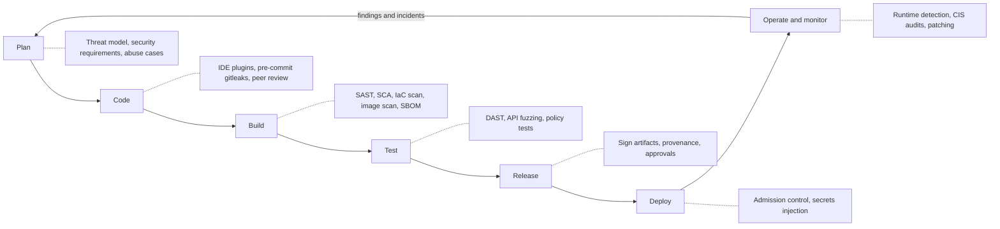
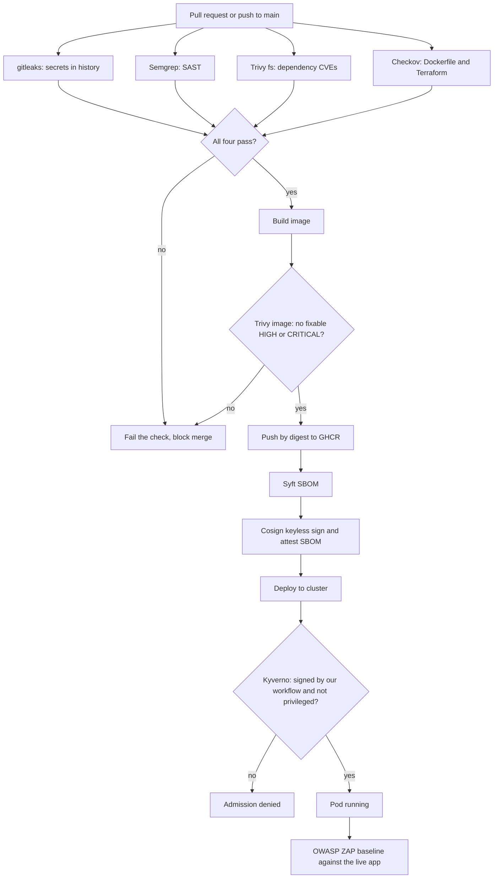
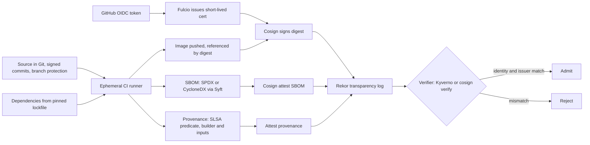
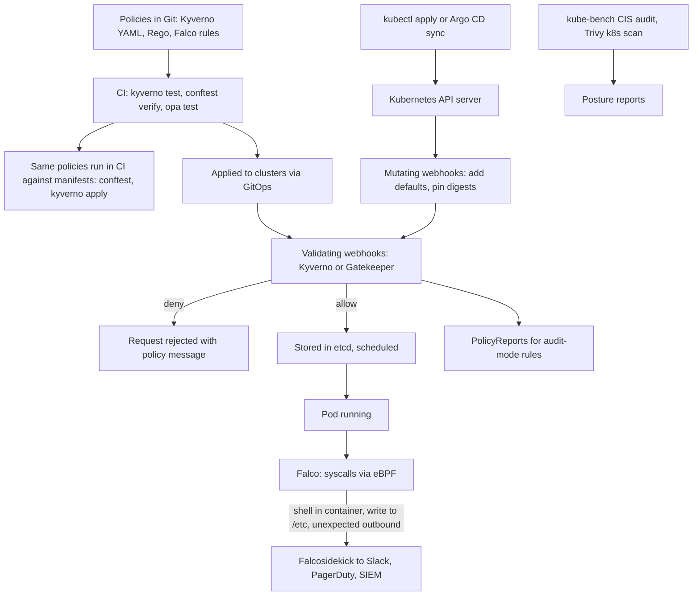

# DevSecOps

<!-- DEVOPS-SHACK:HEADER -->

  
  
  
  
  

Part of <b><a href="https://github.com/jaiswaladi246/DevOps-Cloud-Interview-Preparation-by-DevOps-Shack">DevOps &amp; Cloud Interview Preparation</a></b> — created by <b><a href="https://www.youtube.com/@devopsshack">DevOps Shack</a></b>. Free to learn from; please credit DevOps Shack when sharing.

<!-- /DEVOPS-SHACK:HEADER -->

> Security built into every stage of delivery, not bolted on at the end: secret scanning, SAST, SCA, IaC and image scanning, SBOMs, signing, admission control, secrets management and runtime detection, explained the way we run it in production and ask it in interviews.

[🏠 Home](../README.md)

## What you'll master

- Explain shift-left in concrete terms: which control runs on the laptop, which in the pull request, which at build, which at deploy and which at runtime, and why
- Build a CI pipeline where gitleaks, Semgrep, Trivy and Checkov act as real gates with agreed severity thresholds, not as noise generators
- Tell SAST, DAST, SCA, IaC scanning and secret scanning apart, and know the false positive and false negative profile of each
- Generate SBOMs with Syft, scan them with Grype, sign images keylessly with Cosign and attach provenance that maps to SLSA levels
- Enforce "only signed images, no privileged pods" at the cluster door with Kyverno, and write the same rule as OPA/Rego with Conftest
- Keep secrets out of Git, images and CI logs using Vault, External Secrets Operator or Sealed Secrets, with short-lived identity instead of static keys
- Detect what slips through at runtime with Falco, audit a cluster against CIS with kube-bench, and wire findings into an on-call flow
- Talk about vulnerability management like an owner: triage, SLAs per severity, exceptions with expiry, and metrics that show the risk going down

## The shift-left secure SDLC

Security activities map onto every phase of the lifecycle. The earlier a control runs, the cheaper the fix: a secret caught by a pre-commit hook costs seconds, the same secret found in a public repo costs a rotation, an incident review and maybe a disclosure.

Shift-left does not mean shift-everything-left. DAST needs a running app, admission control needs a cluster, and runtime detection needs production traffic. The goal is to run each control at the earliest point where it can work, and to feed what you learn in production back into the threat model.

## Secure CI/CD pipeline with security gates

This is the pipeline the [hands-on lab](./hands-on-lab.md) builds on GitHub Actions. The fast, cheap checks run in parallel on every pull request; the image is only built when they pass; nothing reaches the cluster unsigned.

Two design choices matter in interviews. First, the gates have explicit thresholds (fail on fixable HIGH and CRITICAL, warn on the rest) that the team agreed on; a gate that fails on everything gets disabled within a week. Second, the cluster re-checks what CI claims. CI can be bypassed by someone with registry write access; the admission controller cannot.

## Supply-chain security: SBOM, signing and provenance

Supply-chain attacks target the path from source to running artifact: a poisoned dependency, a compromised build runner, a swapped image tag. The defence is to know what is inside the artifact (SBOM), prove who built it (signature) and prove how it was built (provenance), then verify all three before running it.

Keyless signing removes the hardest part of signing, which is protecting a private key. The CI job proves its identity with an OIDC token, Fulcio issues a certificate valid for about ten minutes that names the exact workflow, and the signature is recorded in Rekor so anyone can audit it. The verifier then checks the certificate identity (repo, workflow, branch) and the issuer, not a public key file.

SLSA levels are a shorthand for how much you can trust the build: Build L1 means provenance exists, L2 means it is generated and signed by a hosted build platform, L3 means the build runs isolated so even the project's own steps cannot forge the provenance. GitHub's `actions/attest-build-provenance` and the SLSA GitHub generator are the usual ways to get there on GitHub Actions.

## Runtime security and policy-as-code

Admission control decides what is allowed to start. Runtime detection watches what it does after it starts. Policy-as-code makes both reviewable, testable and versioned in Git like everything else.

Run new policies in audit mode first, read the PolicyReports for a week, fix or exempt what breaks, then switch to enforce. The same rules running in CI with `conftest` or `kyverno apply` give developers the failure in the pull request instead of at deploy time.

## Core concepts in 10 minutes

**DevSecOps.** Security as a shared responsibility owned by the teams that build and run the software, enforced through automation in the pipeline. The security team moves from gatekeeper to platform provider: it writes the policies, picks the scanners, sets thresholds and handles exceptions, while engineers fix findings in their normal flow.

**Threat modeling.** A structured "what can go wrong" before you build. STRIDE (Spoofing, Tampering, Repudiation, Information disclosure, Denial of service, Elevation of privilege) is the common checklist. Draw the data flow, mark trust boundaries, list threats per boundary, decide mitigations. Do it at design time and revisit it when the architecture changes.

**SAST.** Static analysis of source code for insecure patterns: injection, unsafe deserialisation, hard-coded credentials, weak crypto. Fast and runs without a running app, but no runtime context, so false positives are common. Semgrep, CodeQL, SonarQube. Tune rule sets and use baseline scans so pull requests only show new findings.

**SCA.** Software composition analysis finds known vulnerabilities (CVEs) and license issues in third-party dependencies by matching package versions against advisory databases. Trivy, Grype, Snyk, Dependabot, OWASP Dependency-Check. Most of your code is other people's code, so SCA usually finds more real risk than SAST.

**DAST.** Dynamic testing of a running application from the outside: missing security headers, XSS, injection, misconfigured TLS, exposed endpoints. OWASP ZAP and Burp Suite. Fewer false positives than SAST, but only sees what it can reach, and a full active scan is slow and must never point at production without permission.

**Secret scanning.** Detects credentials in code and Git history with regexes and entropy. gitleaks, TruffleHog, GitHub push protection. A leaked secret is fixed by rotation, not by deleting the commit; history rewrites do not help once it was pushed.

**IaC scanning.** Static checks on Terraform, CloudFormation, Kubernetes manifests, Helm charts and Dockerfiles for misconfigurations: public buckets, open security groups, missing encryption, root containers. Checkov, Trivy config, tfsec (now folded into Trivy), KICS. Scanning the Terraform plan JSON catches values that only exist after variable resolution.

**Container image security.** Small base images (distroless, Chainguard, Alpine, slim), non-root user, no package manager or shell in the final stage, pinned by digest, rebuilt regularly. Scan with Trivy or Grype and fail on fixable HIGH and CRITICAL. "Fixable" matters: failing on unfixed CVEs blocks you with nothing to do.

**SBOM.** A software bill of materials lists every component in an artifact with versions and identifiers (purl, CPE). Formats are SPDX and CycloneDX. When the next Log4Shell lands, an SBOM store answers "which of our images contain this package" in minutes instead of days. Generate at build, attest it to the image, store it centrally.

**Signing and provenance.** A signature proves who produced an artifact and that it has not changed. Provenance describes how it was built: source commit, builder, parameters. Sigstore (Cosign, Fulcio, Rekor) makes keyless signing practical. Verification at admission closes the loop.

**Secrets management.** Secrets live in a dedicated store (Vault, AWS Secrets Manager, Azure Key Vault, GCP Secret Manager) and reach workloads at runtime. External Secrets Operator syncs them into Kubernetes Secrets; Sealed Secrets encrypts them so the ciphertext can live in Git; the Vault Agent or CSI driver mounts them as files. Prefer dynamic, short-lived credentials and workload identity (IRSA, Pod Identity, Workload Identity, GitHub OIDC) over static keys.

**Policy-as-code.** Rules written as code, reviewed in pull requests and tested. Kyverno uses Kubernetes-native YAML (and CEL in newer policy types), OPA Gatekeeper and Conftest use Rego. Kubernetes also ships ValidatingAdmissionPolicy with CEL for simple in-process checks. Pod Security Admission enforces the baseline and restricted Pod Security Standards per namespace with labels.

**Runtime security.** Detects behaviour that static checks cannot: a shell spawned in a container, a binary written and executed, a process reading `/etc/shadow`, an outbound connection to a mining pool. Falco with the modern eBPF driver is the CNCF standard; Tetragon adds in-kernel enforcement. Pair it with network policies so a compromised pod cannot reach everything.

**Vulnerability management.** Scanners find; people decide. Define SLAs (for example critical in 7 days, high in 30), route findings to the owning team, track exceptions with an owner, a reason and an expiry date, and report trend metrics such as mean time to remediate and open criticals per service. Use VEX statements and reachability to cut noise from CVEs that cannot be exploited in your context.

**OWASP Top 10.** The standard awareness list of web application risk categories, useful as a shared vocabulary in interviews. The [cheatsheet](./cheatsheet.md#owasp-top-10-quick-table) maps each category to the pipeline control that catches it.

## Question banks

| Bank | What it covers | Questions |
|------|----------------|-----------|
| [Concepts](./concepts.md) | Foundations, testing types, supply chain, secrets, Kubernetes and cloud security, comparisons | 200 |
| [Scenarios](./scenarios.md) | Situational questions: leaked keys, zero-days, blocked releases, audits, with a step-by-step approach | 200 |
| [Troubleshooting](./troubleshooting.md) | Real scanner, signing, admission and secrets errors with diagnosis and fix | 200 |
| [Production](./production.md) | Program design, thresholds, exceptions, scale, compliance, trade-offs and rapid-fire commands | 200 |

## Learning path

**Beginner**
- [ ] Explain shift-left, SAST vs DAST vs SCA, and why a leaked secret needs rotation
- [ ] Install gitleaks as a pre-commit hook and scan a repo's full history
- [ ] Scan a container image with Trivy and read the output: package, installed version, fixed version, severity
- [ ] Write a non-root, multi-stage Dockerfile and check it with Checkov or Trivy config
- [ ] Run Semgrep with a registry ruleset and suppress one false positive properly
- [ ] Recite the OWASP Top 10 categories with one example each
- [ ] Finish assignments 1 to 10

**Intermediate**
- [ ] Build the full pipeline in [hands-on-lab.md](./hands-on-lab.md) and break each gate on purpose
- [ ] Generate SPDX and CycloneDX SBOMs with Syft and scan them with Grype
- [ ] Sign an image keylessly with Cosign and verify the certificate identity
- [ ] Enforce signed images and Pod Security in a kind cluster with Kyverno
- [ ] Sync a secret from Vault into Kubernetes with External Secrets Operator
- [ ] Run an OWASP ZAP baseline scan and tune its rules file
- [ ] Finish assignments 11 to 20

**Advanced**
- [ ] Reach SLSA Build L3 provenance on GitHub Actions and verify it at admission
- [ ] Write Rego policies for Terraform plans and test them with `opa test`
- [ ] Deploy Falco with custom rules and route alerts through Falcosidekick
- [ ] Audit a cluster with kube-bench and remediate the failed checks
- [ ] Design a vulnerability management program with SLAs, VEX, exceptions and metrics
- [ ] Finish assignments 21 to 25 and work through all four question banks

## Continue

- 🛠 [Hands-on lab: end-to-end secure pipeline on GitHub Actions](./hands-on-lab.md)
- 📝 [25 assignments](./assignments.md)
- 📋 [Cheatsheet](./cheatsheet.md)
- 🏠 [Home](../README.md)

<!-- DEVOPS-SHACK:FOOTER -->
---

### 🚀 Made with ❤️ by [DevOps Shack](https://www.youtube.com/@devopsshack)

**Learn DevOps, DevSecOps, Cloud and Kubernetes the practical way.**

[▶️ YouTube — DevOps Shack](https://www.youtube.com/@devopsshack) · [▶️ Hindi — @shackverse](https://www.youtube.com/@shackverse) · [🎓 devopsshack.com](https://devopsshack.com) · [📸 Instagram @devopsshack](https://www.instagram.com/devopsshack)

[🏠 Back to Home](../README.md) · [⭐ Star the original repo](https://github.com/jaiswaladi246/DevOps-Cloud-Interview-Preparation-by-DevOps-Shack)

© DevOps Shack · Licensed CC BY-NC-SA 4.0 · If you found this copy anywhere other than <a href="https://github.com/jaiswaladi246/DevOps-Cloud-Interview-Preparation-by-DevOps-Shack">github.com/jaiswaladi246</a>, the original and latest version is maintained by DevOps Shack.

<!-- /DEVOPS-SHACK:FOOTER -->
