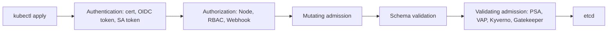
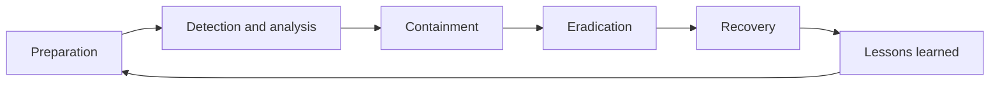

# DevSecOps — Core Concepts

<!-- DEVOPS-SHACK:HEADER -->
<p align="center">
  <a href="https://www.youtube.com/@devopsshack"></a>
  <a href="https://www.youtube.com/@shackverse"></a>
  <a href="https://devopsshack.com"></a>
  <a href="https://www.instagram.com/devopsshack"></a>
  <a href="https://github.com/jaiswaladi246/DevOps-Cloud-Interview-Preparation-by-DevOps-Shack"></a>
</p>
<p align="center"><sub>Part of <b><a href="https://github.com/jaiswaladi246/DevOps-Cloud-Interview-Preparation-by-DevOps-Shack">DevOps &amp; Cloud Interview Preparation</a></b> — created by <b><a href="https://www.youtube.com/@devopsshack">DevOps Shack</a></b>. Free to learn from; please credit DevOps Shack when sharing.</sub></p>
<!-- /DEVOPS-SHACK:HEADER -->

> Core concepts, internals and comparisons for DevSecOps interviews · 200 questions · 🟢 Beginner 🟡 Intermediate 🔴 Advanced

[⬅ Back to DevSecOps](./README.md) · [🏠 Home](../README.md)

## Table of contents
- [Foundations, Threat Modeling and OWASP](#foundations-threat-modeling-and-owasp) — Q1–Q25
- [Application Security Testing (SAST, DAST, SCA, Secrets)](#application-security-testing-sast-dast-sca-secrets) — Q26–Q50
- [Supply Chain, SBOM, Signing and Image/IaC Scanning](#supply-chain-sbom-signing-and-imageiac-scanning) — Q51–Q75
- [Secrets Management and Identity](#secrets-management-and-identity) — Q76–Q100
- [Kubernetes Security](#kubernetes-security) — Q101–Q125
- [Cloud Security, CIS and Compliance](#cloud-security-cis-and-compliance) — Q126–Q150
- [Vulnerability Management and Incident Response](#vulnerability-management-and-incident-response) — Q151–Q175
- [Tool Internals and Comparisons](#tool-internals-and-comparisons) — Q176–Q200

---

## Foundations, Threat Modeling and OWASP

<!-- DEVOPS-SHACK:SECTION -->
> 🎥 **Learn this hands-on with DevOps Shack** → [YouTube @devopsshack](https://www.youtube.com/@devopsshack) · [Hindi @shackverse](https://www.youtube.com/@shackverse) · [Courses at devopsshack.com](https://devopsshack.com)

### Q1. What is DevSecOps, and how is it different from DevOps? 🟢

<details>
<summary><b>Answer</b></summary>

DevSecOps is DevOps with security built into every stage of the delivery pipeline instead of bolted on at the end. DevOps optimises for fast, reliable delivery; DevSecOps adds the rule that speed must not come at the cost of unreviewed risk.

In practice it means automated security checks in CI/CD, security as code (policies in Git), shared ownership between dev, ops and security, and fast feedback to the developer who wrote the change. The security team stops being a gate at the end and becomes a platform and advisory team.

</details>

### Q2. What does "shift-left" mean? 🟢

<details>
<summary><b>Answer</b></summary>

Shift-left means moving security activities earlier on the delivery timeline (left side of a plan-code-build-test-release-run diagram). A bug found in a pull request costs minutes to fix; the same bug found in production costs an incident, a patch and possibly a disclosure.

Typical shift-left controls: threat modeling during design, IDE plugins and pre-commit hooks (gitleaks, Semgrep), SAST and SCA on every PR, IaC scanning before `terraform apply`, and image scanning before push. It does not mean removing later controls.

</details>

### Q3. If we shift left, why do we still need "shift-right" controls? 🟡

<details>
<summary><b>Answer</b></summary>

Pre-production tools only see what is known at build time. Production brings new CVEs against already-shipped code, misconfigurations introduced by hand, stolen credentials and zero-days. Shift-right covers that: runtime detection (Falco), admission control, continuous image re-scanning, CSPM, WAF, logging and alerting, and incident response.

In production we treat shift-left as prevention and shift-right as detection and response. You need both because no scanner catches everything.

</details>

### Q4. What are the phases of a secure SDLC and a security activity for each? 🟢

<details>
<summary><b>Answer</b></summary>

- **Requirements**: security and compliance requirements, abuse cases.
- **Design**: threat modeling, architecture review, choose secure defaults.
- **Implementation**: secure coding standards, IDE linting, pre-commit secret scanning, peer review.
- **Verification**: SAST, SCA, DAST, IaC and container scanning, pen tests.
- **Release**: artifact signing, SBOM, change approval.
- **Operations**: monitoring, patching, vulnerability management, incident response, post-incident learning feeding back into design.

</details>

### Q5. Explain the CIA triad with a DevOps example for each property. 🟢

<details>
<summary><b>Answer</b></summary>

- **Confidentiality**: only authorised parties read data. Example: S3 bucket with Block Public Access and KMS encryption.
- **Integrity**: data and code are not changed without authorisation. Example: signed container images verified at admission.
- **Availability**: systems stay usable. Example: rate limiting and multi-AZ deployment to survive DDoS or an AZ failure.

Security trade-offs are usually a tension between these three, for example aggressive encryption rotation can hurt availability if done badly.

</details>

### Q6. What is threat modeling and when should you do it? 🟢

<details>
<summary><b>Answer</b></summary>

Threat modeling is a structured way to answer four questions: what are we building, what can go wrong, what are we going to do about it, and did we do a good job. You do it at design time, and again whenever the architecture changes meaningfully (new external integration, new data store, new trust boundary).

The output is a list of threats with mitigations, owners and tickets, not a one-off document. A lightweight session of 60 minutes around a data flow diagram beats a 40-page report nobody reads.

</details>

### Q7. What does STRIDE stand for? 🟢

<details>
<summary><b>Answer</b></summary>

Each letter is a threat category with the security property it violates:

| Letter | Threat | Property violated | Typical mitigation |
|---|---|---|---|
| S | Spoofing | Authentication | MFA, mTLS, signed tokens |
| T | Tampering | Integrity | Signing, checksums, immutable logs |
| R | Repudiation | Non-repudiation | Audit logging, CloudTrail |
| I | Information disclosure | Confidentiality | Encryption, access control |
| D | Denial of service | Availability | Rate limits, autoscaling, quotas |
| E | Elevation of privilege | Authorisation | Least privilege, input validation |

</details>

### Q8. How do you apply STRIDE to a data flow diagram? 🔴

<details>
<summary><b>Answer</b></summary>

Draw the DFD with external entities, processes, data stores, data flows and trust boundaries. Then walk each element and ask only the STRIDE categories that apply to it: external entities are subject to S and R; processes to all six; data stores to T, I, D (and R if they hold logs); data flows to T, I, D.

Focus on flows that cross a trust boundary. Example: browser to API gateway crosses the internet boundary, so ask about spoofing (token theft), tampering (TLS stripping) and DoS (no rate limit). Record each threat as a ticket with a mitigation and a verification test.

</details>

### Q9. STRIDE vs PASTA vs attack trees: when would you pick each? 🟡

<details>
<summary><b>Answer</b></summary>

- **STRIDE**: developer-friendly, design-centric, best default for teams starting out.
- **PASTA**: seven-stage, risk and business-impact oriented, heavier; fits regulated environments that need threat-to-business-risk mapping.
- **Attack trees**: goal-oriented ("steal customer PII") decomposed into AND/OR sub-steps; good for deep analysis of one critical asset and for prioritising by cost to attacker.

In practice we use STRIDE per feature and attack trees for the crown-jewel assets.

</details>

### Q10. What is a trust boundary and why does it matter? 🟡

<details>
<summary><b>Answer</b></summary>

A trust boundary is a line where the level of trust or privilege changes: internet to DMZ, service to database, customer tenant to tenant, CI runner to production account, your code to a third-party dependency. Data crossing it must be authenticated, authorised and validated.

Most vulnerabilities live where a boundary was assumed but not enforced, for example an internal service that trusts any caller because "it's inside the VPC".

</details>

### Q11. List the OWASP Top 10 (2021 edition) categories. 🟢

<details>
<summary><b>Answer</b></summary>

A01 Broken Access Control, A02 Cryptographic Failures, A03 Injection, A04 Insecure Design, A05 Security Misconfiguration, A06 Vulnerable and Outdated Components, A07 Identification and Authentication Failures, A08 Software and Data Integrity Failures, A09 Security Logging and Monitoring Failures, A10 Server-Side Request Forgery.

The 2025 refresh reorders these and promotes supply chain risk to its own category, but the 2021 list is still what most interviews and scanner rule tags reference. Mention both if asked.

</details>

### Q12. What is Broken Access Control and what is an IDOR? 🟡

<details>
<summary><b>Answer</b></summary>

Broken access control means a user can act outside their intended permissions. An IDOR (insecure direct object reference) is the classic case: `GET /api/invoices/1042` returns another customer's invoice because the server checks that you are logged in but not that the invoice belongs to you.

Fix: enforce authorisation server-side on every request using the object's owner (`WHERE id = ? AND tenant_id = ?`), deny by default, and use non-guessable IDs as defence in depth, not as the control. DAST often misses IDORs; they need authorisation tests in the test suite.

</details>

### Q13. How do you prevent SQL injection? 🟢

<details>
<summary><b>Answer</b></summary>

Use parameterised queries or an ORM that binds parameters, so user input is always data, never part of the SQL grammar.

```python
cur.execute("SELECT * FROM users WHERE email = %s", (email,))   # safe
cur.execute(f"SELECT * FROM users WHERE email = '{email}'")     # vulnerable
```

Add input validation with allow-lists, least-privilege database accounts (no DROP, no superuser), and SAST rules (Semgrep, CodeQL) to catch string-built queries in review.

</details>

### Q14. What is SSRF and why is it especially dangerous in cloud environments? 🔴

<details>
<summary><b>Answer</b></summary>

SSRF makes the server issue requests on the attacker's behalf, for instance a "fetch image from URL" feature pointed at `http://169.254.169.254/latest/meta-data/iam/security-credentials/`. In cloud, the instance metadata service hands out IAM role credentials, so SSRF becomes credential theft.

Mitigations: enforce IMDSv2 (`HttpTokens=required`, hop limit 1), egress allow-lists, URL validation that resolves DNS and blocks private and link-local ranges (including after redirects), and least-privilege instance roles so stolen creds are not catastrophic.

</details>

### Q15. Difference between insecure design and insecure implementation? 🟡

<details>
<summary><b>Answer</b></summary>

Insecure design is a flaw in the blueprint: no rate limit on password reset, business logic that lets you apply a coupon unlimited times, no tenant isolation in the model. Perfect code cannot fix it. Insecure implementation is a correct design coded badly, such as a missing input check or a buffer bug.

Scanners find implementation bugs; design flaws are found by threat modeling and abuse-case reviews. That is why shift-left starts before code.

</details>

### Q16. What counts as a security misconfiguration? Give cloud and Kubernetes examples. 🟢

<details>
<summary><b>Answer</b></summary>

Any insecure setting, default or missing hardening step. Examples: public S3 bucket, security group open to `0.0.0.0/0` on port 22, default admin credentials, verbose error pages, a Kubernetes pod running privileged, `automountServiceAccountToken` left on, an unauthenticated kubelet or Redis exposed.

It is the most common real-world cause of breaches, which is why IaC scanning, CIS benchmarks and policy as code exist.

</details>

### Q17. What are "vulnerable and outdated components" and how do you manage them? 🟡

<details>
<summary><b>Answer</b></summary>

Using libraries, base images or runtimes with known CVEs (Log4Shell is the textbook case). Manage it with: an inventory (SBOM), automated SCA on every build, automated update PRs (Dependabot, Renovate), lockfiles with pinned versions, minimal base images, and a patch SLA by severity.

Transitive dependencies are where most issues hide, so scan the resolved dependency tree, not just `package.json` or `pom.xml`.

</details>

### Q18. How do XSS attacks work and what are the defences? 🟡

<details>
<summary><b>Answer</b></summary>

XSS injects attacker-controlled script into a page viewed by other users (stored, reflected, DOM-based). The script runs with the victim's session, so it can steal tokens or act as the user.

Defences, in order: contextual output encoding (frameworks like React do this by default), avoid `innerHTML` and `dangerouslySetInnerHTML`, sanitise rich text with a vetted library (DOMPurify), a strict Content-Security-Policy (`default-src 'self'`, nonces, no `unsafe-inline`), and `HttpOnly` plus `Secure` cookie flags to limit impact.

</details>

### Q19. What is CSRF and how do SameSite cookies help? 🟡

<details>
<summary><b>Answer</b></summary>

CSRF tricks a logged-in user's browser into sending an authenticated, state-changing request to your site from another origin. The browser attaches cookies automatically, so the server cannot tell it was forged.

Defences: anti-CSRF tokens (synchroniser or double-submit), `SameSite=Lax` or `Strict` on session cookies so they are not sent on cross-site subrequests, checking `Origin`/`Referer`, and requiring custom headers for APIs. APIs using bearer tokens in the `Authorization` header are not CSRF-prone.

</details>

### Q20. What is defence in depth? 🟢

<details>
<summary><b>Answer</b></summary>

Layering independent controls so that one failure does not mean compromise. A request to a pod might pass through WAF, ingress TLS, NetworkPolicy, authN/authZ in the app, least-privilege IAM for the pod, encrypted storage and audit logging.

Each layer assumes the previous one has failed. The anti-pattern is a hard perimeter with a soft interior.

</details>

### Q21. What are least privilege and zero trust, and how do they relate? 🟡

<details>
<summary><b>Answer</b></summary>

Least privilege: every identity (human, service, pipeline) gets only the permissions needed, only for as long as needed. Zero trust: never trust based on network location; authenticate and authorise every request, verify device and context, assume breach.

Zero trust is the architecture; least privilege is the policy applied inside it. Examples: workload identity instead of shared keys, short-lived credentials, mTLS between services, per-service NetworkPolicy.

</details>

### Q22. Security gate vs advisory scan: when do you block the pipeline? 🔴

<details>
<summary><b>Answer</b></summary>

Block on findings that are high-confidence and high-impact: verified secrets, critical or high CVEs with a fix available and reachable, IaC rules like public buckets, failed signature verification. Report-only for noisy or low-severity findings, and for new tools during a tuning period.

Gate on *new* findings introduced by the change (diff-aware scanning) rather than the whole backlog, or the pipeline is red forever and people bypass it. Always give a documented, time-boxed exception path with an owner.

</details>

### Q23. What are OWASP ASVS, SAMM and BSIMM, and how do they differ? 🔴

<details>
<summary><b>Answer</b></summary>

- **ASVS**: a checklist of verifiable application security requirements in three levels; use it to define what "secure enough" means for a given app.
- **SAMM**: a prescriptive maturity model for the whole software security programme; you score yourself and plan improvements.
- **BSIMM**: descriptive; it reports what real organisations actually do, so you can benchmark against peers.

Use ASVS for requirements and test scope, SAMM to plan the programme, BSIMM to compare yourself with others.

</details>

### Q24. What is a security champion and why does the model work? 🟡

<details>
<summary><b>Answer</b></summary>

A security champion is a developer on each team who takes extra security training and acts as the first point of contact for security questions, triages scanner findings and helps run threat models. The central security team cannot scale to review every PR; champions spread the knowledge inside the teams where code is written.

It works when champions have protected time, a community (regular syncs, shared Slack channel) and management recognition.

</details>

### Q25. What are the common JWT pitfalls? 🔴

<details>
<summary><b>Answer</b></summary>

- Accepting `alg: none` or letting the token choose the algorithm; pin the expected algorithm server-side.
- Not validating `iss`, `aud`, `exp` and `nbf`.
- HS256 with a weak or shared secret; prefer asymmetric RS256/ES256 with JWKS for multi-service setups.
- Storing tokens in `localStorage` where XSS can read them.
- Long-lived tokens with no revocation; use short expiry plus refresh tokens with rotation.
- Putting sensitive data in the payload: it is only base64url-encoded, not encrypted.

</details>

## Application Security Testing (SAST, DAST, SCA, Secrets)

<!-- DEVOPS-SHACK:SECTION -->
> 🎥 **Learn this hands-on with DevOps Shack** → [YouTube @devopsshack](https://www.youtube.com/@devopsshack) · [Hindi @shackverse](https://www.youtube.com/@shackverse) · [Courses at devopsshack.com](https://devopsshack.com)

### Q26. What is SAST and what are its strengths and limits? 🟢

<details>
<summary><b>Answer</b></summary>

Static Application Security Testing analyses source code (or bytecode) without running it, using pattern matching, AST analysis and data-flow (taint) tracking. Strengths: runs early, points to exact file and line, covers all code paths, language-aware.

Limits: false positives, no knowledge of runtime config or deployment, weak on business-logic flaws and on framework magic. Examples: SonarQube, Semgrep, CodeQL.

</details>

### Q27. What is DAST and how does it differ from SAST? 🟢

<details>
<summary><b>Answer</b></summary>

DAST attacks a running application from the outside (black box), sending crafted requests and observing responses. It finds runtime issues such as missing security headers, reflected XSS, injection, misconfigured TLS and auth problems, regardless of language.

SAST sees code but not behaviour; DAST sees behaviour but not code, is slower and needs a deployed environment. Use SAST on every PR and DAST against a staging deployment on merge or nightly.

</details>

### Q28. What is IAST and RASP? 🟡

<details>
<summary><b>Answer</b></summary>

IAST instruments the application (an agent in the runtime) while functional or DAST tests run, observing real data flows from source to sink. It has fewer false positives than SAST and gives code-level locations like SAST, but needs an agent and good test coverage.

RASP is the same instrumentation idea used in production to block attacks in-process. It adds overhead and a dependency on the runtime, so most teams rely on WAF plus runtime detection instead.

</details>

### Q29. What is SCA and what does it scan? 🟢

<details>
<summary><b>Answer</b></summary>

Software Composition Analysis identifies open-source dependencies (direct and transitive) from manifests and lockfiles, matches them against vulnerability databases (NVD, GitHub Advisory Database, OSV) and reports CVEs and licence issues.

Tools: Trivy fs, Grype, OWASP Dependency-Check, Snyk, `npm audit`, `pip-audit`, `osv-scanner`. A good SCA run reads the lockfile so versions are exact.

</details>

### Q30. How does a SAST tool find a SQL injection using taint analysis? 🔴

<details>
<summary><b>Answer</b></summary>

The engine defines **sources** (untrusted input such as `request.args`), **sinks** (dangerous functions such as `cursor.execute`) and **sanitizers** (functions that neutralise taint). It builds a data-flow graph and reports a finding when a path exists from a source to a sink without passing through a sanitizer.

CodeQL models this as queries over a code database; Semgrep taint mode uses `pattern-sources`, `pattern-sinks` and `pattern-sanitizers`. Accuracy depends on how well the tool models frameworks and inter-procedural flows.

</details>

### Q31. How do you write a simple Semgrep rule? 🟡

<details>
<summary><b>Answer</b></summary>

```yaml
rules:
  - id: python-subprocess-shell-true
    languages: [python]
    severity: ERROR
    message: subprocess called with shell=True; pass an argument list instead
    pattern: subprocess.$FUNC(..., shell=True, ...)
```

Run it with `semgrep --config rules.yml .` or use registry packs like `semgrep --config p/owasp-top-ten`. `$FUNC` is a metavariable and `...` matches any arguments.

</details>

### Q32. What is CodeQL and how does its model differ from Semgrep? 🟡

<details>
<summary><b>Answer</b></summary>

CodeQL compiles your code into a relational database (for compiled languages, by observing the build) and you query it with a Datalog-like language. That enables deep inter-procedural data-flow and control-flow analysis. It is strong for finding complex vulnerabilities and variant analysis, but scans are slower and need a build for Java, C#, Go and C/C++.

Semgrep matches on syntax trees with code-like patterns; it is fast, needs no build and rules are easy to write, but has shallower cross-file analysis in the open-source engine.

</details>

### Q33. How does SonarQube's Quality Gate work? 🟡

<details>
<summary><b>Answer</b></summary>

A Quality Gate is a set of conditions on metrics; if any fails, the gate fails. The default "Sonar way" gate focuses on *new code*: no new bugs or vulnerabilities, new security hotspots reviewed, coverage and duplication thresholds on new code.

The scanner uploads results with `sonar-scanner`; CI can wait and fail the job with `-Dsonar.qualitygate.wait=true`. Clean-as-you-code (gate on new code only) is what keeps legacy debt from blocking every build.

</details>

### Q34. In SonarQube, what is the difference between a vulnerability and a security hotspot? 🟡

<details>
<summary><b>Answer</b></summary>

A vulnerability is code Sonar is confident is exploitable and must be fixed. A security hotspot is security-sensitive code (for example using a regex, setting CORS, hashing) that needs a human to review and mark it Safe or Fixed, because whether it is a real problem depends on context.

The Quality Gate requires hotspots on new code to be reviewed, not necessarily changed.

</details>

### Q35. What is OWASP ZAP and what are its scan modes? 🟢

<details>
<summary><b>Answer</b></summary>

ZAP is an open-source DAST proxy and scanner. Modes in CI: **baseline** (spider plus passive checks only, safe for most environments), **full scan** (spider plus active attacks, only against disposable environments), and **API scan** (imports OpenAPI, GraphQL or SOAP definitions).

```bash
docker run --rm -v $(pwd):/zap/wrk -t ghcr.io/zaproxy/zaproxy:stable \
  zap-baseline.py -t https://staging.example.com -r zap-report.html
```

</details>

### Q36. Why must you authenticate a DAST scan, and how is it done? 🔴

<details>
<summary><b>Answer</b></summary>

Unauthenticated scans only see the login page and public routes, which is a small fraction of the attack surface. Authenticated scanning covers the real functionality.

With ZAP you define a context, an authentication method (form, JSON, script, header-based) and a user, plus a logged-in indicator regex so ZAP can detect session loss, usually driven from an automation framework YAML. Use a dedicated low-privilege test account and a throwaway environment, because active scans create and modify data.

</details>

### Q37. SCA reports a CVE in a transitive dependency. What are your options? 🟡

<details>
<summary><b>Answer</b></summary>

1. Upgrade the direct parent that pulls the vulnerable version.
2. Override the transitive version (`overrides` in npm, `<dependencyManagement>` in Maven, `constraints` in pip) after checking compatibility.
3. Replace the library.
4. If the vulnerable code path is not reachable, document a VEX statement or suppression with expiry.
5. Add a compensating control (WAF rule, config flag) while waiting for a fix.

Always record the decision so the next scan does not reopen it without context.

</details>

### Q38. What is reachability analysis in SCA? 🔴

<details>
<summary><b>Answer</b></summary>

Reachability analysis checks whether your code actually calls the vulnerable function in a dependency, using call-graph analysis. A CVE in a library function you never invoke has much lower real risk than one on your request path.

It cuts noise considerably, but it is imperfect (reflection, dynamic dispatch, plugins), so treat "unreachable" as a priority reducer with an expiry, not a permanent dismissal.

</details>

### Q39. How does secrets scanning work in tools like gitleaks and trufflehog? 🟡

<details>
<summary><b>Answer</b></summary>

They scan files and Git history using regex rules for known token formats (AWS `AKIA...`, GitHub `ghp_...`) plus entropy checks for random-looking strings. TruffleHog additionally **verifies** many detected credentials by calling the provider API, so it can report whether a key is live.

```bash
gitleaks detect --source . --redact --verbose
trufflehog git file://. --only-verified
```

Scan the full history, not just HEAD: a deleted secret is still in old commits.

</details>

### Q40. A secret was committed and pushed. What is the correct response? 🟢

<details>
<summary><b>Answer</b></summary>

1. **Revoke and rotate the credential immediately.** That is the only real fix.
2. Check provider logs (CloudTrail, audit logs) for use of the key during the exposure window.
3. Remove it from history (`git filter-repo` or BFG) and force-push if policy allows, knowing forks, clones and caches may still hold it.
4. Add a pre-commit hook and CI scan so it does not repeat.

Rewriting history without rotating is theatre, because the secret must be assumed leaked.

</details>

### Q41. Where should secrets scanning run: pre-commit, CI, or both? 🟡

<details>
<summary><b>Answer</b></summary>

Both, plus server-side. Pre-commit (`gitleaks protect --staged` or the pre-commit framework) gives instant feedback but developers can skip it with `--no-verify`. CI scanning is the enforceable backstop. GitHub push protection or GitLab secret push protection blocks pushes server-side before the secret lands in the repo.

Layering them means the cheap local check catches most cases and the server-side check catches the rest.

</details>

### Q42. What are false positives and false negatives in security scanning, and which hurts more? 🟢

<details>
<summary><b>Answer</b></summary>

A false positive flags something that is not a real problem; a false negative misses a real one. False negatives are dangerous because they give false confidence; false positives are dangerous in a different way, because alert fatigue makes developers ignore or bypass the tool.

Good programmes tune rules, require evidence in findings, and measure the false-positive rate per tool.

</details>

### Q43. What is the Dependency-Check tool and what is its known weakness? 🟡

<details>
<summary><b>Answer</b></summary>

OWASP Dependency-Check identifies libraries and maps them to CPE identifiers to look up CVEs in the NVD. Its weakness is that CPE matching is fuzzy, so it produces false positives (wrong library matched) and false negatives (no CPE for a package), and it was slow to update when NVD feeds throttled.

Ecosystem-aware scanners that use package URLs (purl) and advisories like OSV or GHSA (Trivy, Grype, osv-scanner) are generally more precise.

</details>

### Q44. What are CVE, CWE, CVSS and EPSS? 🟢

<details>
<summary><b>Answer</b></summary>

- **CVE**: identifier for a specific vulnerability (CVE-2021-44228).
- **CWE**: category of weakness (CWE-89 SQL injection).
- **CVSS**: severity score 0–10 based on exploitability and impact.
- **EPSS**: probability that a CVE will be exploited in the next 30 days.

CVSS says how bad it could be; EPSS and the CISA KEV list say how likely it is to be exploited. Prioritise with both.

</details>

### Q45. What is the CISA KEV catalog and how do you use it? 🟡

<details>
<summary><b>Answer</b></summary>

The Known Exploited Vulnerabilities catalog lists CVEs with confirmed exploitation in the wild, with required remediation dates for US federal agencies. For everyone else it is a high-signal prioritisation feed.

In practice we pull KEV (JSON feed) into the vulnerability management tool and treat any KEV match in an internet-facing asset as top priority regardless of CVSS.

</details>

### Q46. What is fuzzing and where does it fit in DevSecOps? 🔴

<details>
<summary><b>Answer</b></summary>

Fuzzing feeds large volumes of malformed or random inputs to a program to trigger crashes, hangs and memory errors. Coverage-guided fuzzers (libFuzzer, AFL++, Go's native `go test -fuzz`, Jazzer for Java) mutate inputs that reach new code paths.

It is most valuable for parsers and native code. In CI, run short fuzz sessions on PRs for regression corpora and long continuous fuzzing on a schedule (for example OSS-Fuzz for open-source projects, ClusterFuzzLite in your own pipeline).

</details>

### Q47. What are pre-commit hooks and what security checks suit them? 🟢

<details>
<summary><b>Answer</b></summary>

Pre-commit hooks run scripts before a commit is created. The `pre-commit` framework manages them from `.pre-commit-config.yaml`.

```yaml
repos:
  - repo: https://github.com/gitleaks/gitleaks
    rev: v8.18.4
    hooks:
      - id: gitleaks
```

Good fits: secret detection, large-file checks, Terraform fmt/validate, tfsec/Checkov on changed files. Keep them under a few seconds or developers will skip them.

</details>

### Q48. What is a security hotspot-style "baseline" in scanners, and why use one? 🟡

<details>
<summary><b>Answer</b></summary>

A baseline is a snapshot of existing findings that the tool treats as known, so only new findings fail the build. Examples: `gitleaks --baseline-path`, Semgrep `--baseline-commit`, Checkov `--baseline`, SonarQube new-code period.

It lets you adopt a scanner on a legacy codebase on day one without a wall of red, while a separate backlog burn-down handles old findings.

</details>

### Q49. What is SARIF and why does it matter? 🟡

<details>
<summary><b>Answer</b></summary>

SARIF (Static Analysis Results Interchange Format) is a JSON standard for tool results. Because most scanners emit it, you can upload results from many tools to a single place, such as GitHub code scanning, where they show as PR annotations and in the Security tab.

```yaml
- uses: github/codeql-action/upload-sarif@v3
  with:
    sarif_file: results.sarif
```

</details>

### Q50. How do you decide between running scans on every PR versus nightly? 🔴

<details>
<summary><b>Answer</b></summary>

Match scan cost to feedback value. Fast scans (secrets, Semgrep diff, SCA lockfile, IaC lint) run on every PR in under a few minutes. Slower scans (full CodeQL, DAST active scan, full image scan with deep layers, fuzzing) run on merge to main or nightly and open tickets or fail the release gate.

Rule of thumb: if the developer is still in context (within about 10 minutes), put the check on the PR; if not, run it on a schedule and route results through backlog tooling.

</details>

## Supply Chain, SBOM, Signing and Image/IaC Scanning

<!-- DEVOPS-SHACK:SECTION -->
> 🎥 **Learn this hands-on with DevOps Shack** → [YouTube @devopsshack](https://www.youtube.com/@devopsshack) · [Hindi @shackverse](https://www.youtube.com/@shackverse) · [Courses at devopsshack.com](https://devopsshack.com)

### Q51. What is a software supply chain attack? Give examples. 🟢

<details>
<summary><b>Answer</b></summary>

An attack that compromises software through something you depend on or build with rather than your own code: a malicious or hijacked package, a poisoned build system, a compromised update channel or CI action.

Well-known cases: SolarWinds (build system tampering), Codecov (bash uploader modified), event-stream and `ua-parser-js` (hijacked npm packages), the `xz` backdoor (malicious maintainer), and compromised GitHub Actions such as `tj-actions/changed-files`.

</details>

### Q52. Explain dependency confusion and typosquatting. 🟡

<details>
<summary><b>Answer</b></summary>

**Dependency confusion**: an attacker publishes a public package with the same name as your internal one but a higher version; a misconfigured resolver prefers the public one. **Typosquatting**: a package named `reqeusts` waits for typos.

Defences: scoped or namespaced internal packages, resolver config that routes internal namespaces only to the private registry, a proxy registry (Artifactory, Nexus) with allow-lists, lockfiles with integrity hashes, and reviewing new dependencies.

</details>

### Q53. What is an SBOM and why do we need one? 🟢

<details>
<summary><b>Answer</b></summary>

A Software Bill of Materials is a machine-readable inventory of the components in an artifact: names, versions, licences, hashes and relationships. When the next Log4Shell lands you can query "which of our images contain log4j-core 2.14?" in minutes instead of grepping repos.

It is also increasingly required by customers and regulation (US executive order 14028, EU Cyber Resilience Act).

</details>

### Q54. CycloneDX vs SPDX: how do they differ? 🟡

<details>
<summary><b>Answer</b></summary>

Both are standard SBOM formats. **SPDX** (Linux Foundation, ISO/IEC 5962) originated in licence compliance and has strong provenance and licensing fields. **CycloneDX** (OWASP, ECMA-424) was designed for security use cases and supports VEX, services, and an extensible BOM model for hardware, ML and cryptography.

Tools like Syft and Trivy emit both. Pick what your consumers require; many teams generate CycloneDX for security tooling and SPDX for legal or customer requests.

</details>

### Q55. How do you generate and use an SBOM with Syft and Grype? 🟢

<details>
<summary><b>Answer</b></summary>

```bash
syft myapp:1.4.2 -o cyclonedx-json=sbom.cdx.json
syft dir:. -o spdx-json=sbom.spdx.json
grype sbom:sbom.cdx.json --fail-on high
```

Syft catalogues packages from image layers or directories; Grype matches the SBOM against its vulnerability DB. Scanning the stored SBOM later (without the image) is how you re-check old releases against new CVEs.

</details>

### Q56. What is VEX? 🟡

<details>
<summary><b>Answer</b></summary>

Vulnerability Exploitability eXchange is a statement attached to a product saying whether a given CVE affects it: `not_affected`, `affected`, `fixed` or `under_investigation`, with a justification such as `vulnerable_code_not_in_execute_path`.

It reduces noise for consumers of your SBOM, who would otherwise see every CVE in every component. Formats include CycloneDX VEX, OpenVEX and CSAF.

</details>

### Q57. What is Sigstore and what are its components? 🟡

<details>
<summary><b>Answer</b></summary>

Sigstore is an open-source ecosystem for signing and verifying software, with a focus on keyless signing:

- **Cosign**: signs and verifies container images and other artifacts.
- **Fulcio**: certificate authority issuing short-lived certificates bound to an OIDC identity.
- **Rekor**: public, append-only transparency log recording signatures.
- **Policy-controller / admission integrations** to enforce verification in clusters.

</details>

### Q58. How does Cosign keyless signing work? 🔴

<details>
<summary><b>Answer</b></summary>

1. The CI job obtains an OIDC token (for example from GitHub Actions) proving "this workflow in this repo on this ref".
2. Cosign generates an ephemeral key pair and sends the public key plus token to Fulcio.
3. Fulcio issues a short-lived (about 10 minute) X.509 certificate with the identity in the SAN.
4. Cosign signs the image digest, discards the private key, and records the signature and certificate in Rekor.

Verification checks the signature, the certificate chain, the identity and issuer you expect, and the Rekor inclusion proof. No long-lived key to leak.

</details>

### Q59. Show the commands to sign and verify an image with Cosign. 🟡

<details>
<summary><b>Answer</b></summary>

```bash
# sign by digest (keyless in CI)
cosign sign --yes registry.example.com/app@sha256:<digest>

# verify, pinning who is allowed to have signed
cosign verify registry.example.com/app@sha256:<digest> \
  --certificate-identity-regexp 'https://github.com/acme/app/.github/workflows/release.yml@refs/tags/.*' \
  --certificate-oidc-issuer https://token.actions.githubusercontent.com
```

Always sign and verify the **digest**, never a mutable tag.

</details>

### Q60. Why sign digests and not tags? 🟢

<details>
<summary><b>Answer</b></summary>

Tags are mutable pointers: `app:1.4` can be repointed to different content after you signed or scanned it. A digest (`sha256:...`) identifies the exact manifest content. Scanning, signing, attestation and deployment should all reference the digest so what you verified is what runs.

Pin digests in manifests (or let a controller resolve tag to digest at admission) for the same reason.

</details>

### Q61. What is an attestation and how does it differ from a signature? 🟡

<details>
<summary><b>Answer</b></summary>

A signature says "this identity vouches for this artifact". An attestation is a signed statement about an artifact with a typed predicate: SLSA provenance, an SBOM, a vulnerability scan result, a test result. It follows the in-toto attestation format.

```bash
cosign attest --yes --predicate sbom.cdx.json --type cyclonedx app@sha256:<digest>
cosign verify-attestation --type cyclonedx app@sha256:<digest> ...
```

Admission policies can then require "has provenance from our builder" rather than just "is signed".

</details>

### Q62. What is SLSA and what are its levels? 🟡

<details>
<summary><b>Answer</b></summary>

Supply-chain Levels for Software Artifacts is a framework for build integrity. In v1.0 the Build track has levels: **L0** none, **L1** provenance exists, **L2** provenance is signed and produced by a hosted build platform, **L3** hardened build platform where builds are isolated and provenance cannot be forged by the build's own steps.

It answers "was this artifact built from this source by this builder, unmodified?". The slsa-github-generator and GitHub artifact attestations produce L2/L3 provenance.

</details>

### Q63. What is build provenance and what does it contain? 🔴

<details>
<summary><b>Answer</b></summary>

Provenance is a signed attestation (predicate type `https://slsa.dev/provenance/v1`) describing how an artifact was built: subject digest, builder identity, build type, source repo and commit, build parameters, and resolved dependencies.

Verifying it lets you reject an image that was built on a laptop, from a fork, or from an unexpected branch. For L3 the builder must generate it outside the control of the build steps, which is why reusable workflows or hardened builders matter.

</details>

### Q64. What is a reproducible build and why is it valuable? 🔴

<details>
<summary><b>Answer</b></summary>

A build is reproducible when the same source and inputs always produce bit-for-bit identical output. Independent parties can then rebuild and compare digests, which detects a compromised build system (SolarWinds-style injection).

It requires pinned dependencies and toolchains, normalised timestamps (`SOURCE_DATE_EPOCH`), deterministic ordering and no network during build. Fully reproducible builds are hard; hermetic builds with Bazel or Nix get closest.

</details>

### Q65. How do GitHub Actions become a supply-chain risk, and how do you mitigate it? 🔴

<details>
<summary><b>Answer</b></summary>

Third-party actions run with your job's token and secrets, and tags like `@v3` can be moved by a compromised maintainer.

- Pin actions to a full commit SHA, with Dependabot to update them.
- Set `permissions:` to least privilege (`contents: read` by default).
- Avoid `pull_request_target` with checkout of untrusted code.
- Never interpolate untrusted input (`${{ github.event.issue.title }}`) into `run:` scripts; pass via env.
- Use OIDC to cloud instead of stored keys, and restrict which actions are allowed at org level.

</details>

### Q66. What does a container image scanner like Trivy actually do? 🟢

<details>
<summary><b>Answer</b></summary>

It unpacks the image layers, identifies OS packages (from dpkg/rpm/apk databases) and language dependencies (lockfiles, jars, binaries), then matches package and version against its vulnerability database. It can also scan for misconfigurations, secrets and licences.

```bash
trivy image --severity HIGH,CRITICAL --ignore-unfixed --exit-code 1 myapp:1.4.2
```

`--exit-code 1` makes the CI job fail when matching findings exist.

</details>

### Q67. Why do image scanners disagree with each other? 🟡

<details>
<summary><b>Answer</b></summary>

Different vulnerability data sources (distro security trackers, NVD, GHSA, vendor feeds), different package detection, different handling of distro backports and "won't fix" statuses, and different update cadence. Debian may mark a CVE `no-dsa` while NVD says it is critical.

Pick one primary scanner for gating, understand its data sources, and use a second only to spot-check. Chasing zero diff between tools wastes time.

</details>

### Q68. Which image vulnerabilities should you ignore or deprioritise? 🟡

<details>
<summary><b>Answer</b></summary>

Findings with no fix available (`--ignore-unfixed`), vulnerabilities in packages not used at runtime (shell tools in a container that has no shell access path), and CVEs marked `not_affected` by the vendor or via VEX. Never ignore silently: use an ignore file with a reason and an expiry date.

```
# .trivyignore
CVE-2024-12345 exp:2026-03-01
```

Better still, remove the package with a minimal base image so the finding disappears.

</details>

### Q69. What makes a base image "secure"? Compare distroless, Alpine and slim. 🟡

<details>
<summary><b>Answer</b></summary>

Fewer packages mean smaller attack surface and fewer CVEs. **Distroless** has only the runtime and your app (no shell or package manager); hard for attackers and for debugging. **Alpine** is tiny, uses musl and busybox; occasional compatibility issues. **Debian slim** is a compromise with glibc and broad support. Chainguard and other minimal-maintained images aim for near-zero known CVEs.

Also: pin by digest, rebuild regularly, run as non-root, multi-stage builds so build tools never ship.

</details>

### Q70. What Dockerfile practices improve security? 🟢

<details>
<summary><b>Answer</b></summary>

```dockerfile
FROM golang:1.23 AS build
RUN CGO_ENABLED=0 go build -o /app ./cmd/app

FROM gcr.io/distroless/static-debian12:nonroot
COPY --from=build /app /app
USER 65532:65532
ENTRYPOINT ["/app"]
```

Use multi-stage builds, a non-root `USER`, a minimal pinned base, no secrets in `ENV` or `ARG` (use BuildKit `--mount=type=secret`), `COPY` specific files rather than `.`, and a `.dockerignore`. Lint with Hadolint.

</details>

### Q71. How can secrets leak through Docker image layers? 🟡

<details>
<summary><b>Answer</b></summary>

Every `RUN`, `COPY` and `ENV` is stored in a layer. `COPY .env .` followed by `RUN rm .env` still leaves the file in the earlier layer. Build `ARG`s are visible in `docker history`.

Use BuildKit secret mounts, which expose the secret only during that `RUN` and never write it to a layer:

```dockerfile
RUN --mount=type=secret,id=npmrc,target=/root/.npmrc npm ci
```

```bash
docker build --secret id=npmrc,src=$HOME/.npmrc .
```

</details>

### Q72. What is IaC scanning and what do Checkov and tfsec check? 🟢

<details>
<summary><b>Answer</b></summary>

IaC scanning statically analyses Terraform, CloudFormation, Kubernetes manifests, Helm and Dockerfiles for misconfigurations before deployment, such as unencrypted volumes, public security groups and missing logging.

```bash
checkov -d . --framework terraform --compact --quiet
tfsec .
```

tfsec's rules have been merged into Trivy (`trivy config .`), which is now the recommended path; Checkov remains popular with a large policy library and custom Python or YAML policies.

</details>

### Q73. Plan-time vs source-time IaC scanning: what is the difference? 🔴

<details>
<summary><b>Answer</b></summary>

Source scanning reads `.tf` files; it cannot see values that resolve at plan time (variables, module outputs, data sources). Plan scanning evaluates the real resolved resources:

```bash
terraform plan -out tfplan
terraform show -json tfplan > tfplan.json
checkov -f tfplan.json --framework terraform_plan
```

Plan scanning has fewer false positives and catches misconfigurations produced by modules, but needs credentials and provider initialisation. We run source scans on PRs for speed and plan scans before apply.

</details>

### Q74. How do you suppress a Checkov or tfsec finding properly? 🟡

<details>
<summary><b>Answer</b></summary>

Inline, next to the resource, with a justification so reviewers see it in the diff:

```hcl
resource "aws_s3_bucket" "logs" {
  #checkov:skip=CKV_AWS_144:Cross-region replication not required for log archive
  bucket = "acme-logs"
}
```

tfsec uses `#tfsec:ignore:aws-s3-enable-versioning`. Avoid global skips in CLI flags; they hide the decision and apply to everything.

</details>

### Q75. What is a malicious-package defence strategy for npm, PyPI and Maven? 🔴

<details>
<summary><b>Answer</b></summary>

Route all installs through a proxy registry with a quarantine or minimum-age policy for brand-new versions; use lockfiles and `npm ci` / `pip install --require-hashes`; disable install scripts where possible (`npm ci --ignore-scripts`); scan with tools that detect malicious behaviour (Socket, OpenSSF package-analysis, GuardDog); and require review for new direct dependencies.

Build in an egress-restricted environment so a malicious install script cannot phone home.

</details>

## Secrets Management and Identity

<!-- DEVOPS-SHACK:SECTION -->
> 🎥 **Learn this hands-on with DevOps Shack** → [YouTube @devopsshack](https://www.youtube.com/@devopsshack) · [Hindi @shackverse](https://www.youtube.com/@shackverse) · [Courses at devopsshack.com](https://devopsshack.com)

### Q76. Why is hard-coding secrets or putting them in environment variables a problem? 🟢

<details>
<summary><b>Answer</b></summary>

Hard-coded secrets end up in Git history, logs, images and developer laptops, and cannot be rotated without a redeploy. Env vars are better but still leak via `docker inspect`, `/proc/<pid>/environ`, crash dumps and child processes.

Fetch secrets at runtime from a secrets manager using workload identity, keep them in memory or a tmpfs file mount, and make them short-lived and rotatable.

</details>

### Q77. What does HashiCorp Vault provide? 🟢

<details>
<summary><b>Answer</b></summary>

Vault is a secrets and encryption platform: a KV store, **dynamic secrets** (database, AWS, Kubernetes credentials generated on demand with a TTL), PKI certificate issuance, a Transit engine (encryption as a service), identity-based auth methods, fine-grained policies and a full audit log.

```bash
vault kv put secret/app/db password=s3cr3t
vault read database/creds/readonly
```

OpenBao is the open-source community fork under the Linux Foundation, API-compatible for most uses.

</details>

### Q78. Explain Vault's seal/unseal process. 🟡

<details>
<summary><b>Answer</b></summary>

Vault stores data encrypted with an encryption key, which is itself encrypted by a root (unseal) key. When sealed, Vault cannot decrypt anything. The unseal key is split with Shamir's Secret Sharing (for example 5 shares, threshold 3), so several operators must cooperate.

In production we use **auto-unseal** with a cloud KMS (AWS KMS, Azure Key Vault, GCP KMS) so restarts do not need humans, and the recovery keys are only used for privileged operations.

</details>

### Q79. What are Vault dynamic secrets and why are they better than static ones? 🟡

<details>
<summary><b>Answer</b></summary>

Vault creates a unique credential on request (for instance a Postgres role with a 1 hour lease) and revokes it when the lease expires or is revoked. Each consumer gets its own credential, so a leak is traceable, scoped and short-lived, and there is nothing long-lived to rotate.

```bash
vault write database/config/pg plugin_name=postgresql-database-plugin ...
vault write database/roles/ro db_name=pg creation_statements="CREATE ROLE ..." default_ttl=1h
```

</details>

### Q80. How do Kubernetes workloads authenticate to Vault? 🔴

<details>
<summary><b>Answer</b></summary>

With the Kubernetes auth method. The pod presents its projected ServiceAccount JWT; Vault validates it via the TokenReview API (or JWKS in newer setups) and maps the ServiceAccount name and namespace to a Vault role, which carries policies and a TTL.

```bash
vault write auth/kubernetes/role/app \
  bound_service_account_names=app bound_service_account_namespaces=prod \
  policies=app-read ttl=15m
```

Delivery to the pod is via Vault Agent injector, the Secrets Store CSI driver, or Vault Secrets Operator.

</details>

### Q81. What is AWS Secrets Manager and how does it compare with SSM Parameter Store? 🟢

<details>
<summary><b>Answer</b></summary>

Secrets Manager stores secrets with built-in **automatic rotation** (Lambda-based, native for RDS), versioning with staging labels, cross-region replication and resource policies. It costs per secret per month plus API calls.

Parameter Store is cheaper (standard parameters are free), good for config and simple secrets (`SecureString` with KMS), but has no native rotation. We use Secrets Manager for credentials needing rotation and Parameter Store for config.

</details>

### Q82. What is External Secrets Operator? 🟡

<details>
<summary><b>Answer</b></summary>

ESO is a Kubernetes operator that syncs secrets from external stores (AWS Secrets Manager, Vault, GCP/Azure) into native Kubernetes Secrets. You declare an `ExternalSecret` that references a `SecretStore`, and ESO keeps the Secret up to date at `refreshInterval`.

```yaml
apiVersion: external-secrets.io/v1beta1
kind: ExternalSecret
metadata: {name: db}
spec:
  refreshInterval: 1h
  secretStoreRef: {name: aws-sm, kind: ClusterSecretStore}
  target: {name: db-creds}
  data:
  - secretKey: password
    remoteRef: {key: prod/db, property: password}
```

</details>

### Q83. Sealed Secrets vs External Secrets: when do you use which? 🟡

<details>
<summary><b>Answer</b></summary>

**Sealed Secrets** encrypts a Secret with the cluster controller's public key (`kubeseal`), so the ciphertext is safe in Git and only that cluster can decrypt it. Simple, no external dependency, but secrets are tied to a cluster key and rotation means re-sealing.

**External Secrets** keeps the source of truth in a central manager with its own audit, rotation and access control. Prefer it when you already run Vault or a cloud secrets manager; use Sealed Secrets for small GitOps setups without one.

</details>

### Q84. Are Kubernetes Secrets secure by default? 🟢

<details>
<summary><b>Answer</b></summary>

No. They are base64-encoded, not encrypted, and stored in etcd in plain form unless encryption at rest is enabled. Anyone with `get secrets` RBAC or etcd access can read them.

Harden: enable encryption at rest with a KMS provider (`EncryptionConfiguration`), restrict RBAC on secrets, avoid exposing them as env vars, enable audit logging for secret access, and consider an external store.

</details>

### Q85. How do you enable envelope encryption of Secrets in Kubernetes? 🔴

<details>
<summary><b>Answer</b></summary>

Configure the API server with an `EncryptionConfiguration` using the KMS v2 provider so each secret is encrypted with a data-encryption key (DEK) that the external KMS wraps with a key-encryption key (KEK).

```yaml
apiVersion: apiserver.config.k8s.io/v1
kind: EncryptionConfiguration
resources:
- resources: [secrets]
  providers:
  - kms: {apiVersion: v2, name: awskms, endpoint: unix:///var/run/kms.sock}
  - identity: {}
```

Managed services expose it as a checkbox (EKS envelope encryption with a KMS key). After enabling, rewrite existing secrets: `kubectl get secrets -A -o json | kubectl replace -f -`.

</details>

### Q86. What is the Secrets Store CSI Driver? 🟡

<details>
<summary><b>Answer</b></summary>

A CSI driver that mounts secrets from external providers (Vault, AWS, Azure, GCP) into pods as files through a `SecretProviderClass`. Secrets can optionally also be synced into a Kubernetes Secret. Because it mounts a volume at pod start, the pod cannot start without the secret, and rotation is handled with the optional rotation reconciler.

Compared with ESO, it avoids creating Kubernetes Secret objects unless you ask for it.

</details>

### Q87. What is the difference between authentication and authorisation, and where do OAuth2 and OIDC fit? 🟢

<details>
<summary><b>Answer</b></summary>

Authentication proves who you are; authorisation decides what you can do. **OAuth 2.0** is an authorisation delegation framework that issues access tokens for APIs. **OpenID Connect** is a thin identity layer on OAuth 2.0 that adds an ID token (a JWT with claims about the user) for authentication.

For service-to-service use the client credentials flow; for web apps, authorisation code flow with PKCE.

</details>

### Q88. What is workload identity federation and why replace static cloud keys with it? 🟡

<details>
<summary><b>Answer</b></summary>

The workload presents a short-lived token from a trusted identity provider (GitHub OIDC, Kubernetes ServiceAccount, another cloud) and the cloud exchanges it for temporary credentials via a role trust policy. There is no stored access key to leak or rotate.

Examples: GitHub Actions to AWS via `sts:AssumeRoleWithWebIdentity`, EKS IRSA / Pod Identity, GKE Workload Identity, Azure Workload Identity.

</details>

### Q89. How do you configure GitHub Actions to assume an AWS role without keys? 🟡

<details>
<summary><b>Answer</b></summary>

Create an IAM OIDC provider for `token.actions.githubusercontent.com` and a role whose trust policy restricts the `sub` claim:

```json
"Condition": {
  "StringEquals": {"token.actions.githubusercontent.com:aud": "sts.amazonaws.com"},
  "StringLike": {"token.actions.githubusercontent.com:sub": "repo:acme/app:ref:refs/heads/main"}
}
```

The workflow needs `permissions: id-token: write` and uses `aws-actions/configure-aws-credentials` with `role-to-assume`. A loose `sub` wildcard is the common mistake.

</details>

### Q90. IRSA vs EKS Pod Identity: what is the difference? 🔴

<details>
<summary><b>Answer</b></summary>

**IRSA** uses the cluster's OIDC provider and a ServiceAccount annotation; the role trust policy references the cluster OIDC URL and the ServiceAccount, so each cluster needs its own trust entries and an IAM OIDC provider.

**Pod Identity** uses an EKS agent and an association (`aws eks create-pod-identity-association`), with a single trust to `pods.eks.amazonaws.com`, so roles are reusable across clusters and no OIDC provider setup is needed. It also supports session tags for ABAC. Prefer Pod Identity for new clusters; IRSA still works everywhere including non-EKS.

</details>

### Q91. What is RBAC vs ABAC? 🟢

<details>
<summary><b>Answer</b></summary>

RBAC assigns permissions to roles and roles to users (role `developer` can read logs). ABAC decides based on attributes of user, resource and context (department, tag, time). AWS IAM can do ABAC with tags: allow access when `aws:PrincipalTag/team` equals `aws:ResourceTag/team`.

ABAC scales better with many teams because you stop creating a role per team-resource combination.

</details>

### Q92. How is an AWS IAM policy evaluated? 🟡

<details>
<summary><b>Answer</b></summary>

Default is implicit deny. An explicit `Deny` in any applicable policy always wins. Otherwise an `Allow` is needed from identity policies, and for cross-account or resource-based cases from both sides. Permission boundaries, SCPs and session policies only restrict; they never grant.

The effective permission is the intersection of SCP, permission boundary, session policy and the identity or resource policy allow.

</details>

### Q93. What is a permission boundary and how does it differ from an SCP? 🔴

<details>
<summary><b>Answer</b></summary>

A permission boundary caps the maximum permissions of one IAM user or role, which is useful for delegating role creation to developers safely ("you may create roles, but never above this boundary"). An SCP applies to every principal in an AWS Organizations account or OU (except the management account) and caps what the account can ever do, for example denying non-approved regions.

Neither grants permissions; both only filter.

</details>

### Q94. How do you achieve least privilege in IAM in practice? 🟡

<details>
<summary><b>Answer</b></summary>

Start from a narrow policy, not `*:*`. Use IAM Access Analyzer's policy generation from CloudTrail activity to tighten, and "last accessed" data to remove unused permissions. Scope with resource ARNs and conditions (`aws:SourceIp`, `aws:RequestedRegion`, MFA), and review with `iam simulate-principal-policy`.

```bash
aws iam generate-service-last-accessed-details --arn <role-arn>
```

Treat wildcards on `iam:*`, `sts:AssumeRole` and `s3:*` as review triggers.

</details>

### Q95. What are common IAM privilege-escalation paths? 🔴

<details>
<summary><b>Answer</b></summary>

Permissions that let a principal grant itself more: `iam:CreatePolicyVersion`, `iam:AttachUserPolicy`, `iam:PassRole` combined with `ec2:RunInstances` or `lambda:CreateFunction` (run something with a stronger role), `iam:UpdateAssumeRolePolicy`, `sts:AssumeRole` into admin roles, and `lambda:UpdateFunctionCode` on a privileged function.

Detect with Access Analyzer, Prowler or PMapper-style graph tools, restrict `iam:PassRole` to specific roles and services, and use permission boundaries for delegated admins.

</details>

### Q96. What is MFA and which factors are phishing-resistant? 🟢

<details>
<summary><b>Answer</b></summary>

MFA requires two or more factors: something you know, have, or are. SMS and TOTP codes can be phished or relayed in real time. Phishing-resistant factors are FIDO2/WebAuthn security keys and passkeys, which bind authentication to the legitimate origin.

Mandate them for admins, cloud root users and anything with production access.

</details>

### Q97. How should the AWS root user be protected? 🟢

<details>
<summary><b>Answer</b></summary>

Enable MFA (hardware key preferred), delete or never create root access keys, use a shared mailbox with restricted access for the root email, store break-glass credentials offline, and use root only for the handful of tasks that require it. Centralised root access management in AWS Organizations can remove root credentials from member accounts entirely.

Alert on any root login via CloudWatch or EventBridge.

</details>

### Q98. How does secret rotation work and why is it hard? 🟡

<details>
<summary><b>Answer</b></summary>

Rotation replaces a credential with a new one on a schedule or after exposure. It is hard because every consumer must pick up the new value without downtime. Secrets Manager's approach is a four-step Lambda (createSecret, setSecret, testSecret, finishSecret) with `AWSPENDING` and `AWSCURRENT` stage labels, and alternating-user rotation to avoid a window where neither works.

Applications must re-read secrets (or restart) rather than cache them forever.

</details>

### Q99. What is envelope encryption and why does KMS use it? 🟡

<details>
<summary><b>Answer</b></summary>

Data is encrypted with a data key (DEK); the DEK is encrypted by a master key (KEK) held in KMS/HSM. Only small DEKs travel to KMS, so large data is encrypted locally and fast, and the master key never leaves the HSM. Rotation of the KEK only needs re-wrapping DEKs.

```bash
aws kms generate-data-key --key-id alias/app --key-spec AES_256
```

Returns a plaintext key for immediate use and an encrypted copy to store beside the data.

</details>

### Q100. What is the difference between encryption at rest, in transit and in use? 🟢

<details>
<summary><b>Answer</b></summary>

At rest protects stored data (EBS, S3 SSE-KMS, database TDE). In transit protects data on the wire (TLS 1.2+ or 1.3, mTLS between services). In use protects data while processed in memory, using confidential computing (Nitro Enclaves, AMD SEV, Intel TDX).

Most compliance baselines require the first two; in use is for high-sensitivity workloads.

</details>


## Kubernetes Security

<!-- DEVOPS-SHACK:SECTION -->
> 🎥 **Learn this hands-on with DevOps Shack** → [YouTube @devopsshack](https://www.youtube.com/@devopsshack) · [Hindi @shackverse](https://www.youtube.com/@shackverse) · [Courses at devopsshack.com](https://devopsshack.com)

### Q101. What are the 4Cs of cloud native security? 🟢

<details>
<summary><b>Answer</b></summary>

Cloud, Cluster, Container, Code. Each layer is wrapped by the one outside it, so a weakness in an outer layer undermines everything inside. Perfect application code does not help if the cloud account has a public etcd endpoint or an admin key in a public repo.

- **Cloud**: IAM, network, account guardrails, managed control plane settings.
- **Cluster**: API server access, RBAC, admission control, network policies, etcd encryption.
- **Container**: base image, non-root user, capabilities, image signing and scanning.
- **Code**: dependencies, secrets handling, input validation, TLS.

</details>

### Q102. What happens to a request between `kubectl apply` and etcd from a security point of view? 🟡

<details>
<summary><b>Answer</b></summary>

The API server runs every request through three gates in order: authentication (who are you), authorisation (are you allowed this verb on this resource), and admission (mutating, then schema validation, then validating). Only then is the object persisted to etcd.



A failure at any gate returns 401 (authn), 403 (authz) or an admission denial message, and nothing is stored.

</details>

### Q103. Explain Role, ClusterRole, RoleBinding and ClusterRoleBinding. 🟢

<details>
<summary><b>Answer</b></summary>

A Role grants verbs on resources inside one namespace; a ClusterRole defines permissions cluster-wide or for cluster-scoped resources (nodes, namespaces). A RoleBinding attaches a Role or ClusterRole to subjects inside one namespace; a ClusterRoleBinding attaches a ClusterRole across the whole cluster.

```yaml
apiVersion: rbac.authorization.k8s.io/v1
kind: Role
metadata: { name: pod-reader, namespace: payments }
rules:
- apiGroups: [""]
  resources: ["pods", "pods/log"]
  verbs: ["get", "list", "watch"]
```

In production we define reusable ClusterRoles and bind them per namespace with RoleBindings. RBAC is additive only: there are no deny rules.

</details>

### Q104. How do you check what a user or service account is allowed to do? 🟢

<details>
<summary><b>Answer</b></summary>

Use `kubectl auth can-i` with impersonation. It asks the API server's authoriser directly, so it reflects RBAC exactly as enforced.

```bash
kubectl auth can-i create deployments -n payments --as jane@acme.com
kubectl auth can-i --list -n payments --as system:serviceaccount:payments:api
kubectl auth can-i get secrets -A --as system:serviceaccount:ci:deployer
```

For a cluster-wide review, tools like `rbac-tool` or `kubectl-who-can` show who can perform a given verb on a given resource.

</details>

### Q105. Which RBAC permissions are effectively cluster-admin in disguise? 🔴

<details>
<summary><b>Answer</b></summary>

- `create` on `pods` (or any workload): run a pod that mounts a privileged SA token or a hostPath, and become someone stronger.
- `get`/`list`/`watch` on `secrets`: read every SA token and credential in scope. `list` returns full contents, not just names.
- `escalate` and `bind` on roles: grant yourself permissions you do not hold.
- `impersonate` on users, groups or service accounts.
- `pods/exec`, `pods/attach`, `nodes/proxy`: run commands in other workloads or reach the kubelet API.
- `update`/`patch` on `validatingwebhookconfigurations` or `mutatingwebhookconfigurations`: disable or hijack policy.
- Wildcards (`*`) on verbs or resources.

We alert on bindings that grant any of these outside the platform team.

</details>

### Q106. How do service account tokens work now, and what is `automountServiceAccountToken`? 🟡

<details>
<summary><b>Answer</b></summary>

Since Kubernetes 1.24 pods get short-lived, audience-bound tokens through a projected volume (TokenRequest API), rotated by the kubelet and invalidated when the pod is deleted. Long-lived Secret-based tokens are no longer created automatically and legacy unused ones are cleaned up.

Most pods never call the API server, so they should not get a token at all:

```yaml
apiVersion: v1
kind: ServiceAccount
metadata: { name: web, namespace: shop }
automountServiceAccountToken: false
```

Create one service account per workload, never use `default`, and bind only the permissions that workload needs.

</details>

### Q107. What are the three Pod Security Standards? 🟢

<details>
<summary><b>Answer</b></summary>

- **Privileged**: no restrictions. For system components such as CNI and storage drivers.
- **Baseline**: blocks known privilege escalations: privileged containers, hostNetwork/hostPID/hostIPC, hostPath, added dangerous capabilities, hostPort.
- **Restricted**: baseline plus hardening: `runAsNonRoot`, `allowPrivilegeEscalation: false`, drop ALL capabilities, seccomp `RuntimeDefault` or `Localhost`, limited volume types.

Our default is restricted for application namespaces, baseline only with a documented reason, privileged only for `kube-system`-style namespaces.

</details>

### Q108. How does Pod Security Admission enforce those standards? 🟡

<details>
<summary><b>Answer</b></summary>

PSA is a built-in admission controller (GA in 1.25, replacing PodSecurityPolicy). You opt in per namespace with labels, choosing a level for each of three modes: `enforce` rejects pods, `audit` writes an audit annotation, `warn` returns a warning to the client.

```bash
kubectl label ns shop \
  pod-security.kubernetes.io/enforce=restricted \
  pod-security.kubernetes.io/enforce-version=latest \
  pod-security.kubernetes.io/warn=restricted
```

Rollout pattern: set `warn` and `audit` first, fix violations, then turn on `enforce`. PSA only checks pods, and it is not customisable; anything beyond the standards needs Kyverno, Gatekeeper or ValidatingAdmissionPolicy.

</details>

### Q109. What does a hardened `securityContext` look like? 🟢

<details>
<summary><b>Answer</b></summary>

```yaml
spec:
  securityContext:
    runAsNonRoot: true
    runAsUser: 10001
    fsGroup: 10001
    seccompProfile: { type: RuntimeDefault }
  containers:
  - name: api
    image: ghcr.io/acme/api@sha256:...
    securityContext:
      allowPrivilegeEscalation: false
      readOnlyRootFilesystem: true
      capabilities: { drop: ["ALL"] }
```

This passes the restricted profile. `readOnlyRootFilesystem` stops attackers dropping tools on disk; mount an `emptyDir` at `/tmp` if the app needs scratch space.

</details>

### Q110. What are Linux capabilities, and why do we drop ALL? 🟡

<details>
<summary><b>Answer</b></summary>

Capabilities split root's power into about 40 units (`CAP_NET_ADMIN`, `CAP_SYS_ADMIN`, `CAP_NET_RAW` and so on). Container runtimes grant a default set that includes `NET_RAW` (ARP/DNS spoofing within the node network), `CHOWN`, `SETUID` and others most apps never use.

Dropping ALL and adding back only what is needed shrinks what an attacker can do after code execution. The common add-back is `NET_BIND_SERVICE` to bind ports below 1024, and even that is avoidable by listening on 8080. `CAP_SYS_ADMIN` is close to full root and should be treated like `privileged: true`.

</details>

### Q111. What do seccomp and AppArmor add on top of capabilities? 🟡

<details>
<summary><b>Answer</b></summary>

Seccomp filters which syscalls a process may make. The `RuntimeDefault` profile blocks dozens of rarely needed and historically exploitable syscalls (`keyctl`, `unshare` in many cases, `kexec_load`, module loading). AppArmor (or SELinux) is mandatory access control on files, mounts and network by path or label.

```yaml
securityContext:
  seccompProfile: { type: RuntimeDefault }
  appArmorProfile: { type: RuntimeDefault }
```

The `appArmorProfile` field went GA in 1.30, replacing the old annotation. Several container escape CVEs were blocked by the default seccomp profile alone, which is why restricted PSS requires it.

</details>

### Q112. Why are `privileged`, `hostPath`, `hostPID` and `hostNetwork` dangerous? 🟡

<details>
<summary><b>Answer</b></summary>

Each removes part of the isolation between container and node:

- `privileged: true`: all capabilities, all devices, no seccomp/AppArmor. Mounting the host disk is one command.
- `hostPath`: a mount of `/`, `/var/run/containerd/containerd.sock` or `/var/lib/kubelet` gives node root or access to every pod's tokens.
- `hostPID`: see and signal every process on the node, read their environment via `/proc`.
- `hostNetwork`: bypass NetworkPolicy, bind node ports, reach services that trust localhost.

Baseline PSS blocks all four; exceptions belong in dedicated, tightly controlled namespaces.

</details>

### Q113. How does a container escape typically happen? 🔴

<details>
<summary><b>Answer</b></summary>

Containers share the host kernel, so an escape is either a misconfiguration or a kernel/runtime bug:

1. **Misconfiguration**: privileged pod, mounted container runtime socket, writable hostPath, `CAP_SYS_ADMIN` with cgroup v1 `release_agent` abuse.
2. **Runtime bug**: e.g. CVE-2019-5736 (runc binary overwrite) and CVE-2024-21626 (runc leaked file descriptor giving host filesystem access via `WORKDIR`).
3. **Kernel bug**: Dirty Pipe (CVE-2022-0847) and similar privilege escalations.

Defences: restricted PSS, seccomp, patched runc/containerd and node kernels, user namespaces (`hostUsers: false`), and sandboxed runtimes such as gVisor or Kata Containers for untrusted workloads.

</details>

### Q114. How do you implement a default-deny NetworkPolicy? 🟡

<details>
<summary><b>Answer</b></summary>

By default every pod can reach every other pod. A policy with an empty `podSelector` selects all pods in the namespace; listing both policy types with no rules denies everything.

```yaml
apiVersion: networking.k8s.io/v1
kind: NetworkPolicy
metadata: { name: default-deny, namespace: shop }
spec:
  podSelector: {}
  policyTypes: ["Ingress", "Egress"]
```

Then add allow policies per flow, and remember to allow egress to CoreDNS on UDP and TCP 53, or every name lookup fails.

</details>

### Q115. What are the common NetworkPolicy gotchas? 🔴

<details>
<summary><b>Answer</b></summary>

- **The CNI must enforce it.** Flannel alone ignores NetworkPolicy; Calico, Cilium and the AWS VPC CNI (with network policy enabled) enforce it.
- **Selectors in one `from` entry are ANDed, separate entries are ORed.** `namespaceSelector` and `podSelector` in the same list item means "these pods in those namespaces"; as two items it means "any pod in those namespaces, or these pods in my namespace".
- **Policies are additive allow lists.** There is no deny rule in the core API; use Cilium or Calico policies, or AdminNetworkPolicy, for cluster-wide denies.
- **No L7 and no FQDN rules** in the core API.
- **hostNetwork pods** are not governed.

Test with a throwaway pod (`kubectl run tmp --rm -it --image=busybox -- wget -qO- http://svc`) rather than trusting the YAML.

</details>

### Q116. What is the difference between mutating and validating admission webhooks? 🟡

<details>
<summary><b>Answer</b></summary>

Mutating webhooks change the object (inject sidecars, add default labels, set `runAsNonRoot`). Validating webhooks only accept or reject. Mutating runs first, then validating, so validators see the final object.

Security-relevant settings on the webhook configuration:

- `failurePolicy: Fail` for security policy (fail closed), `Ignore` only for non-critical mutation.
- `namespaceSelector` to exclude `kube-system` so a broken webhook cannot block the control plane.
- `timeoutSeconds` short, because webhook latency adds to every API call.

A webhook outage with `Fail` can block deployments cluster-wide, so we run webhooks with multiple replicas and PDBs.

</details>

### Q117. OPA Gatekeeper vs Kyverno: how do they differ? 🟡

<details>
<summary><b>Answer</b></summary>

Both are admission controllers with audit of existing resources. Gatekeeper uses Rego in ConstraintTemplates plus Constraint CRDs: very expressive, same language as OPA elsewhere (Conftest, API authz), but a learning curve. Kyverno writes policies as Kubernetes YAML (with CEL support in newer versions), and natively supports mutate, generate (e.g. default NetworkPolicy per namespace), cleanup and image signature verification.

We choose Kyverno when platform engineers own policy and want YAML and image verification out of the box; Gatekeeper when the organisation already standardises on Rego across Terraform, Kubernetes and APIs.

</details>

### Q118. What is ValidatingAdmissionPolicy and why does it matter? 🔴

<details>
<summary><b>Answer</b></summary>

A built-in, in-process admission policy (GA in Kubernetes 1.30) using CEL expressions. No webhook, no extra deployment, no network hop, so no webhook-outage failure mode.

```yaml
apiVersion: admissionregistration.k8s.io/v1
kind: ValidatingAdmissionPolicy
metadata: { name: require-nonroot }
spec:
  failurePolicy: Fail
  matchConstraints:
    resourceRules:
    - apiGroups: ["apps"]
      apiVersions: ["v1"]
      operations: ["CREATE", "UPDATE"]
      resources: ["deployments"]
  validations:
  - expression: >-
      has(object.spec.template.spec.securityContext) &&
      has(object.spec.template.spec.securityContext.runAsNonRoot) &&
      object.spec.template.spec.securityContext.runAsNonRoot == true
    message: "runAsNonRoot must be true"
```

It needs a ValidatingAdmissionPolicyBinding with `validationActions: [Deny]` (or `Warn`, `Audit`) to take effect. It cannot mutate or call external data, so Kyverno and Gatekeeper still cover those cases.

</details>

### Q119. How do you enforce that only signed images run in a cluster? 🔴

<details>
<summary><b>Answer</b></summary>

Verify at admission with Kyverno `verifyImages`, Sigstore policy-controller, or Ratify with Gatekeeper. A Kyverno example for keyless images built by GitHub Actions:

```yaml
apiVersion: kyverno.io/v1
kind: ClusterPolicy
metadata: { name: verify-signed-images }
spec:
  validationFailureAction: Enforce
  rules:
  - name: keyless-github
    match:
      any:
      - resources: { kinds: ["Pod"] }
    verifyImages:
    - imageReferences: ["ghcr.io/acme/*"]
      mutateDigest: true
      attestors:
      - entries:
        - keyless:
            subject: "https://github.com/acme/*"
            issuer: "https://token.actions.githubusercontent.com"
```

`mutateDigest` rewrites tags to the verified digest so a tag cannot be swapped after verification. Start in `Audit` mode, then enforce.

</details>

### Q120. How do you secure etcd? 🟡

<details>
<summary><b>Answer</b></summary>

etcd holds every Secret and the full cluster state, so read access is cluster compromise.

- TLS for client and peer traffic, with client certificate auth; only the API server holds a client cert.
- Never expose ports 2379/2380 beyond control-plane nodes.
- Encryption at rest for Secrets via `EncryptionConfiguration` with a KMS provider.
- Encrypted, access-controlled backups (`etcdctl snapshot save`); a snapshot is as sensitive as etcd itself.

On EKS, GKE and AKS etcd is managed and not reachable, so our job shrinks to enabling envelope encryption and protecting backups such as Velero buckets.

</details>

### Q121. Which kubelet settings matter for security? 🔴

<details>
<summary><b>Answer</b></summary>

The kubelet API on port 10250 can exec into any pod on the node, so it must not be open.

```yaml
apiVersion: kubelet.config.k8s.io/v1beta1
kind: KubeletConfiguration
authentication:
  anonymous: { enabled: false }
  webhook: { enabled: true }
authorization:
  mode: Webhook
readOnlyPort: 0
rotateCertificates: true
protectKernelDefaults: true
```

`Webhook` mode delegates authorisation to the API server, and the Node authorizer plus the NodeRestriction admission plugin limit each kubelet to its own node's objects. kube-bench checks all of these.

</details>

### Q122. How does Kubernetes audit logging work? 🟡

<details>
<summary><b>Answer</b></summary>

The API server records requests according to an audit policy. Levels: `None`, `Metadata` (who, what, when), `Request` (plus request body), `RequestResponse` (plus response body). Rules are matched top-down; the first match wins.

```yaml
apiVersion: audit.k8s.io/v1
kind: Policy
omitStages: ["RequestReceived"]
rules:
- level: Metadata
  resources: [{ group: "", resources: ["secrets", "configmaps"] }]
- level: RequestResponse
  resources: [{ group: "rbac.authorization.k8s.io" }]
- level: Metadata
```

Log Secrets at `Metadata` only, or you write secret values into logs. On EKS, enable the `audit` control-plane log type to send it to CloudWatch.

</details>

### Q123. What is Falco and how do its rules work? 🟡

<details>
<summary><b>Answer</b></summary>

Falco is a CNCF runtime security tool that watches syscalls (and Kubernetes audit events via plugins) and alerts when behaviour matches a rule: shell in a container, write below `/etc`, read of `/etc/shadow`, unexpected outbound connection.

```yaml
- rule: Shell spawned in container
  desc: Interactive shell started inside a container
  condition: spawned_process and container and proc.name in (bash, sh, zsh)
  output: "Shell in container (user=%user.name container=%container.name image=%container.image.repository cmd=%proc.cmdline)"
  priority: WARNING
  tags: [container, mitre_execution]
```

Falco detects; it does not block. Alerts go through Falcosidekick to Slack, a SIEM, or a response function.

</details>

### Q124. How does a service mesh contribute to zero trust inside the cluster? 🟡

<details>
<summary><b>Answer</b></summary>

The mesh gives every workload a cryptographic identity (SPIFFE ID derived from its service account) and encrypts pod-to-pod traffic with mutual TLS, with automatic certificate rotation. Authorisation policies can then allow calls by identity rather than IP.

```yaml
apiVersion: security.istio.io/v1
kind: PeerAuthentication
metadata: { name: default, namespace: istio-system }
spec:
  mtls: { mode: STRICT }
```

`STRICT` rejects plaintext. Roll out with `PERMISSIVE` first, then flip once all clients have sidecars or ambient mode enabled. NetworkPolicy (L3/L4) and mesh AuthorizationPolicy (L7 identity) complement each other.

</details>

### Q125. What is kube-bench and what does the CIS Kubernetes Benchmark cover? 🟢

<details>
<summary><b>Answer</b></summary>

The CIS Kubernetes Benchmark is a consensus hardening guide for control-plane components, etcd, kubelet, and policies (RBAC, PSS, network policy, secrets). kube-bench, from Aqua, runs those checks on a node and reports PASS/FAIL/WARN with remediation text.

```bash
kubectl apply -f https://raw.githubusercontent.com/aquasecurity/kube-bench/main/job.yaml
kubectl logs job/kube-bench
```

On managed clusters use the provider-specific benchmark (CIS EKS, CIS GKE), since control-plane checks are the provider's responsibility.

</details>

## Cloud Security, CIS and Compliance

<!-- DEVOPS-SHACK:SECTION -->
> 🎥 **Learn this hands-on with DevOps Shack** → [YouTube @devopsshack](https://www.youtube.com/@devopsshack) · [Hindi @shackverse](https://www.youtube.com/@shackverse) · [Courses at devopsshack.com](https://devopsshack.com)

### Q126. What is the cloud shared responsibility model? 🟢

<details>
<summary><b>Answer</b></summary>

The provider secures the cloud (data centres, hardware, hypervisor, managed service internals); the customer secures what they put in the cloud (IAM, data, network configuration, OS patching on VMs, application code). The split moves with the service model: on EC2 you patch the OS, on Lambda or Fargate the provider does, but IAM and data classification are always yours.

Almost every public cloud breach is on the customer side: open buckets, leaked keys, over-privileged roles.

</details>

### Q127. What is CSPM? 🟢

<details>
<summary><b>Answer</b></summary>

Cloud Security Posture Management continuously reads cloud configuration through provider APIs and flags misconfigurations and compliance drift: public buckets, unencrypted volumes, security groups open to `0.0.0.0/0` on 22, disabled CloudTrail, unused admin keys.

Examples: AWS Security Hub CSPM, Microsoft Defender for Cloud, Google Security Command Center, Wiz, Prisma Cloud, and open-source Prowler. It complements IaC scanning: IaC scanning catches problems before deploy; CSPM catches what changed by hand or was never in code.

</details>

### Q128. What are CIS Benchmarks, and what is Level 1 vs Level 2? 🟢

<details>
<summary><b>Answer</b></summary>

CIS Benchmarks are consensus hardening guides for operating systems, cloud accounts, Kubernetes, databases and more. Each control has rationale, audit steps and remediation.

- **Level 1**: practical baseline with little operational impact. Apply everywhere.
- **Level 2**: defence in depth for high-security environments; may reduce functionality or performance.

CIS also publishes hardened images (CIS Hardened Images on AWS, Azure, GCP marketplaces). Auditors commonly accept CIS as evidence of a "recognised hardening standard".

</details>

### Q129. How do you run a CIS assessment of an AWS account with Prowler? 🟡

<details>
<summary><b>Answer</b></summary>

Prowler is an open-source CLI that runs hundreds of checks mapped to CIS, PCI DSS, ISO 27001, SOC 2 and others, using read-only credentials.

```bash
pip install prowler
prowler aws --compliance cis_3.0_aws --output-formats html json-ocsf
prowler aws --services s3 iam --severity critical high
```

We run it from a read-only audit role (`SecurityAudit` plus `ViewOnlyAccess`) on a schedule, push findings to Security Hub, and track the pass rate per account over time.

</details>

### Q130. Name the main AWS security services and what each does. 🟢

<details>
<summary><b>Answer</b></summary>

- **CloudTrail**: API audit log.
- **GuardDuty**: threat detection from CloudTrail, VPC Flow Logs, DNS logs, EKS audit logs and runtime agents.
- **Security Hub**: aggregates findings and runs CSPM standards (CIS, AWS Foundational Security Best Practices).
- **Config**: resource inventory, configuration history and compliance rules.
- **Inspector**: vulnerability scanning of EC2, ECR images and Lambda.
- **Macie**: discovers sensitive data (PII) in S3.
- **Detective**: investigation graphs over GuardDuty and log data.
- **IAM Access Analyzer**: finds external and unused access, generates least-privilege policies.

</details>

### Q131. What should you know about CloudTrail configuration? 🟡

<details>
<summary><b>Answer</b></summary>

Management events (control-plane calls like `CreateUser`) are logged by default for 90 days in Event history, but you need a trail for retention and alerting. Data events (S3 object reads, Lambda invokes) are off by default and billed separately.

```bash
aws cloudtrail create-trail --name org-trail \
  --s3-bucket-name acme-cloudtrail-logs \
  --is-organization-trail --is-multi-region-trail \
  --enable-log-file-validation --kms-key-id alias/cloudtrail
```

Send it to a separate log-archive account with S3 Object Lock, so a compromised workload account cannot delete evidence. Alert on `StopLogging` and `DeleteTrail`.

</details>

### Q132. What are AWS Config rules and conformance packs? 🟡

<details>
<summary><b>Answer</b></summary>

Config records every configuration change to supported resources. Config rules evaluate those changes against a desired state, either AWS-managed (e.g. `s3-bucket-public-read-prohibited`, `encrypted-volumes`) or custom (Lambda or Guard). Conformance packs bundle rules and remediations into a deployable unit mapped to a framework such as CIS or PCI.

Rules can trigger automatic remediation through SSM Automation documents. Config history also answers the auditor's question "what did this security group look like on 3 March?".

</details>

### Q133. How do you lock down S3 buckets? 🟢

<details>
<summary><b>Answer</b></summary>

- Enable S3 Block Public Access at the account level, not just per bucket.
- Object Ownership set to "Bucket owner enforced" (ACLs disabled, the default for new buckets).
- Default encryption with SSE-KMS where you need key-level access control.
- Bucket policy denying non-TLS requests (`aws:SecureTransport` = false).
- Versioning, and Object Lock for logs and backups.

```bash
aws s3control put-public-access-block --account-id 111122223333 \
  --public-access-block-configuration \
  BlockPublicAcls=true,IgnorePublicAcls=true,BlockPublicPolicy=true,RestrictPublicBuckets=true
```

</details>

### Q134. Security groups vs NACLs: what is the difference? 🟢

<details>
<summary><b>Answer</b></summary>

Security groups attach to ENIs, are stateful (return traffic is allowed automatically), and only support allow rules. They can reference other security groups, which is how we express "app tier can reach DB tier on 5432". NACLs attach to subnets, are stateless (you must allow ephemeral return ports), support allow and deny, and are evaluated in rule-number order.

In production security groups do most of the work; NACLs are a coarse backstop, e.g. blocking a known-bad CIDR across a subnet.

</details>

### Q135. What is IMDSv2 and why should it be enforced? 🟡

<details>
<summary><b>Answer</b></summary>

The EC2 instance metadata service at `169.254.169.254` hands out the instance role's temporary credentials. IMDSv1 answers any GET, so an SSRF bug turns into credential theft (the Capital One breach pattern). IMDSv2 requires a session token obtained with a PUT and a custom header, which most SSRF vectors cannot send, and the hop limit stops the token leaving the host.

```bash
aws ec2 modify-instance-metadata-options --instance-id i-0abc \
  --http-tokens required --http-put-response-hop-limit 1
```

On EKS nodes, hop limit 1 also blocks pods from reaching node credentials, which is what we want when pods use IRSA or Pod Identity. Enforce with an SCP or the account-level IMDS default setting.

</details>

### Q136. Why use a multi-account (landing zone) strategy? 🟡

<details>
<summary><b>Answer</b></summary>

An AWS account is the strongest isolation boundary: separate IAM, quotas, billing and blast radius. A landing zone (AWS Organizations, typically via Control Tower) gives you OUs such as Security, Infrastructure, Workloads/Prod, Workloads/Non-prod and Sandbox, plus dedicated accounts for log archive and security tooling.

Benefits: a compromised dev account cannot touch prod, SCPs apply guardrails per OU, centralised CloudTrail and GuardDuty, and clean cost attribution. Access goes through IAM Identity Center with permission sets, not IAM users.

</details>

### Q137. What are preventive, detective and corrective controls? 🟢

<details>
<summary><b>Answer</b></summary>

- **Preventive** stop the bad thing: SCPs, IAM boundaries, admission policies, CI gates, S3 Block Public Access.
- **Detective** notice it: GuardDuty, Config rules, Falco, CSPM, audit log alerts.
- **Corrective** (responsive) fix it: auto-remediation Lambdas, Config remediation, quarantining an instance, revoking a key.

A mature programme pairs each high-risk scenario with at least a preventive and a detective control, because preventive controls get bypassed.

</details>

### Q138. Write an SCP that restricts usage to approved regions. 🔴

<details>
<summary><b>Answer</b></summary>

SCPs set the maximum permissions for accounts in an OU; they grant nothing. Global services must be exempted with `NotAction` or they break.

```json
{
  "Version": "2012-10-17",
  "Statement": [{
    "Sid": "DenyOutsideApprovedRegions",
    "Effect": "Deny",
    "NotAction": ["iam:*", "organizations:*", "sts:*", "route53:*",
                  "cloudfront:*", "support:*", "budgets:*"],
    "Resource": "*",
    "Condition": {
      "StringNotEquals": { "aws:RequestedRegion": ["ap-south-1", "eu-west-1"] },
      "ArnNotLike": { "aws:PrincipalARN": "arn:aws:iam::*:role/OrgBreakGlass" }
    }
  }]
}
```

Other common SCPs: deny leaving the organisation, deny disabling CloudTrail/GuardDuty/Config, deny root user actions, require IMDSv2 on `ec2:RunInstances`. SCPs do not apply to the management account, so keep workloads out of it.

</details>

### Q139. What are VPC endpoints and endpoint policies used for? 🟡

<details>
<summary><b>Answer</b></summary>

VPC endpoints let resources reach AWS services privately, without an internet or NAT path. Gateway endpoints cover S3 and DynamoDB; interface endpoints (PrivateLink) cover most others.

Endpoint policies restrict what can be done through the endpoint, e.g. only access to buckets owned by our organisation, which blocks data exfiltration to an attacker's bucket:

```json
{ "Effect": "Allow", "Principal": "*", "Action": "s3:*", "Resource": "*",
  "Condition": { "StringEquals": { "aws:ResourceOrgID": "o-abc123" } } }
```

Combine with bucket policies using `aws:SourceVpce` to make the bucket reachable only through that endpoint.

</details>

### Q140. AWS managed keys vs customer managed KMS keys: when does it matter? 🟡

<details>
<summary><b>Answer</b></summary>

AWS managed keys (`aws/s3`, `aws/ebs`) are free, auto-rotated, but their key policy cannot be changed, so anyone with service access in the account can decrypt. Customer managed keys let you write the key policy, control grants, enable or disable the key, share across accounts, and see every use in CloudTrail.

Use customer managed keys for regulated data, cross-account access, and when you need "deny decrypt unless role X", which gives a second authorisation layer independent of IAM. Enable automatic rotation (yearly by default, configurable).

</details>

### Q141. How do you apply policy as code to a Terraform plan with Conftest? 🔴

<details>
<summary><b>Answer</b></summary>

Conftest runs OPA Rego policies against structured files. Convert the plan to JSON and test it in CI before `apply`:

```bash
terraform plan -out tf.plan && terraform show -json tf.plan > plan.json
conftest test plan.json -p policy/
```

```rego
package main

deny contains msg if {
  some rc in input.resource_changes
  rc.type == "aws_security_group_rule"
  rc.change.after.cidr_blocks[_] == "0.0.0.0/0"
  rc.change.after.from_port <= 22
  rc.change.after.to_port >= 22
  msg := sprintf("%s opens SSH to the internet", [rc.address])
}
```

Unlike fixed-rule scanners, this encodes organisation-specific rules (required tags, approved instance families, allowed regions) in the same language we use for Kubernetes admission.

</details>

### Q142. How do SOC 2, ISO 27001, PCI DSS, HIPAA and GDPR differ? 🟢

<details>
<summary><b>Answer</b></summary>

- **SOC 2**: US attestation report by a CPA firm against Trust Services Criteria (security, availability, confidentiality, processing integrity, privacy). Common for SaaS vendors.
- **ISO 27001**: international certification of an Information Security Management System (ISMS), with Annex A controls (93 in the 2022 revision).
- **PCI DSS**: mandatory for anyone storing, processing or transmitting card data. Version 4.0.1 is current.
- **HIPAA**: US law protecting health information (PHI).
- **GDPR**: EU regulation on personal data of people in the EU, with fines up to 4% of global turnover.

The DevSecOps job is the same across them: implement controls once, collect evidence automatically, map it to each framework.

</details>

### Q143. What is continuous compliance or compliance as code? 🟡

<details>
<summary><b>Answer</b></summary>

Controls are expressed as code (Config rules, Rego, Checkov policies, Kyverno policies) and evaluated continuously, with results stored as evidence. Instead of screenshots collected once a year, auditors get dashboards and exports showing a control held every day of the audit period.

Examples: branch protection and required reviews proven via the GitHub API, encryption proven by Config, access reviews via Identity Center exports, change management proven by PR history linked to deployments. Platforms such as Vanta and Drata automate the evidence collection.

</details>

### Q144. What is the difference between SOC 2 Type I and Type II? 🟡

<details>
<summary><b>Answer</b></summary>

Type I assesses whether controls are suitably designed at a single point in time. Type II assesses whether they operated effectively over a period, usually 3 to 12 months, by sampling evidence across that window.

Customers usually ask for Type II. For engineering it means controls must run every day: a single missed access review or an unreviewed production change in the window becomes an exception in the report.

</details>

### Q145. How do you reduce PCI DSS scope? 🔴

<details>
<summary><b>Answer</b></summary>

Everything that stores, processes or transmits cardholder data, or can connect to those systems, is in scope. Scope reduction:

1. **Do not touch card data**: use a payment provider's hosted fields or redirect, so the PAN never reaches your servers.
2. **Tokenisation**: replace PANs with tokens; only the token vault is in scope.
3. **Segmentation**: put the cardholder data environment in its own accounts/VPCs with tightly controlled, tested network boundaries.
4. **Separate CI/CD**: build agents that deploy into the CDE are in scope too.

Segmentation must be validated by penetration testing. Smaller scope means fewer systems to harden, log and audit.

</details>

### Q146. What are data classification and DLP? 🟡

<details>
<summary><b>Answer</b></summary>

Data classification labels data by sensitivity (Public, Internal, Confidential, Restricted) so controls can scale with it: encryption key choice, retention, who may access, where it may be stored. Tag resources with the classification so policy can act on it.

DLP (Data Loss Prevention) detects and blocks sensitive data where it should not be: Macie scanning S3 for PII, secret and PII detection in logs, egress controls, email and endpoint DLP. In pipelines, we also stop production data being copied into test environments without masking.

</details>

### Q147. What should a security logging architecture look like in the cloud? 🟡

<details>
<summary><b>Answer</b></summary>

Collect CloudTrail (all accounts and regions), VPC Flow Logs, DNS query logs, load balancer and WAF logs, Kubernetes audit logs, IdP sign-in logs and application auth events. Ship them to a dedicated log-archive account that workload accounts can write to but not delete from, with S3 Object Lock in compliance mode and lifecycle tiering.

From there feed a SIEM or a data lake (Security Lake with OCSF format) for detection. Retention is driven by compliance: PCI DSS requires one year, with three months immediately available.

</details>

### Q148. What are the Azure and GCP equivalents of the main AWS security controls? 🟡

<details>
<summary><b>Answer</b></summary>

| Control | AWS | Azure | GCP |
|---|---|---|---|
| Org guardrails | SCPs | Azure Policy, management groups | Organization Policy |
| Audit log | CloudTrail | Activity Log | Cloud Audit Logs |
| Posture and threats | Security Hub, GuardDuty | Defender for Cloud | Security Command Center |
| Secrets/keys | Secrets Manager, KMS | Key Vault | Secret Manager, Cloud KMS |
| Workload identity | IRSA / Pod Identity | Workload Identity (Entra) | Workload Identity Federation |

The concepts transfer; the policy languages and inheritance models differ.

</details>

### Q149. What are CSPM, CWPP, CIEM and CNAPP? 🔴

<details>
<summary><b>Answer</b></summary>

- **CSPM**: misconfiguration of cloud resources.
- **CWPP** (Cloud Workload Protection Platform): protection of the workloads themselves: vulnerability scanning, runtime detection on VMs, containers and serverless.
- **CIEM** (Cloud Infrastructure Entitlement Management): analysis of identities and effective permissions, unused privileges and escalation paths.
- **CNAPP** (Cloud-Native Application Protection Platform): one platform combining the above with IaC and image scanning, correlating findings into attack paths, e.g. "internet-exposed pod with a critical CVE and a role that can read the customer bucket".

The correlation is the value: it turns thousands of findings into a short list of exploitable paths.

</details>

### Q150. How do you prevent and detect configuration drift from ClickOps in production? 🔴

<details>
<summary><b>Answer</b></summary>

Prevent: no standing write access to production consoles. Humans get read-only roles; changes flow through Terraform in CI with an OIDC-assumed role; break-glass roles exist but require approval and page the security channel when used.

Detect: scheduled `terraform plan -detailed-exitcode` (exit code 2 means drift), Config change notifications, CloudTrail alerts on write calls from human principals in prod, and GitOps controllers (Argo CD, Flux) showing OutOfSync for Kubernetes.

Every break-glass session gets a ticket, and any manual change is either codified or reverted within a day.

</details>

## Vulnerability Management and Incident Response

<!-- DEVOPS-SHACK:SECTION -->
> 🎥 **Learn this hands-on with DevOps Shack** → [YouTube @devopsshack](https://www.youtube.com/@devopsshack) · [Hindi @shackverse](https://www.youtube.com/@shackverse) · [Courses at devopsshack.com](https://devopsshack.com)

### Q151. What are the stages of a vulnerability management lifecycle? 🟢

<details>
<summary><b>Answer</b></summary>

1. **Discover**: asset inventory (repos, images, hosts, cloud resources) and scanning.
2. **Prioritise**: rank by severity, exploitability, exposure and business impact.
3. **Remediate**: patch, upgrade, reconfigure, or apply a compensating control.
4. **Verify**: rescan to confirm the fix landed in what actually runs.
5. **Report**: metrics, SLA compliance, exceptions.

It is a loop, not a project. The common failure is step 1: you cannot fix vulnerabilities in assets you do not know you have.

</details>

### Q152. How do you build a risk-based prioritisation policy for vulnerabilities? 🟡

<details>
<summary><b>Answer</b></summary>

CVSS alone floods teams with "criticals" that are not exploitable. We combine signals:

- **Known exploited** (CISA KEV) or high EPSS probability: top priority regardless of CVSS.
- **Exposure**: internet-facing or handles untrusted input vs internal batch job.
- **Reachability**: is the vulnerable function called, is the package loaded at runtime.
- **Asset criticality**: production with customer data vs sandbox.
- **Fix availability**: no fix means a compensating control, not an endless ticket.

A typical rule: KEV or (Critical and internet-facing and fix available) = fix in days; everything else follows severity SLAs.

</details>

### Q153. What remediation SLAs are typical by severity? 🟢

<details>
<summary><b>Answer</b></summary>

A common baseline, measured from detection:

| Severity | SLA |
|---|---|
| Critical / actively exploited | 7 days (24-72 hours for KEV on internet-facing systems) |
| High | 30 days |
| Medium | 90 days |
| Low | Best effort, next planned upgrade |

Frameworks often anchor these: PCI DSS requires critical patches within one month, and FedRAMP sets fixed deadlines by severity. The SLA only works if the clock and breaches are tracked automatically.

</details>

### Q154. How should a vulnerability exception (risk acceptance) process work? 🟡

<details>
<summary><b>Answer</b></summary>

An exception is a time-boxed, owned decision, not a mute button. It records the finding, why it cannot be fixed now, the compensating controls, the risk owner who signs off (a business owner, not only the engineer), and an expiry date after which it reopens.

In tooling, that means a VEX statement or a scanner ignore entry with an expiry, e.g. in `.trivyignore.yaml`:

```yaml
vulnerabilities:
  - id: CVE-2024-12345
    paths: ["usr/lib/libfoo.so"]
    statement: "Not reachable, feature disabled. Risk owner: payments lead"
    expired_at: 2026-12-31
```

Expired exceptions should fail the build again automatically.

</details>

### Q155. How do you patch vulnerabilities in running containers? 🟡

<details>
<summary><b>Answer</b></summary>

You do not patch in place. Containers are immutable: you rebuild the image on an updated base, rescan, and redeploy through the normal pipeline. `apt-get upgrade` inside a running pod is lost on restart and leaves the registry image still vulnerable.

To make this routine: pin base images by digest and let Renovate or Dependabot open PRs when the digest changes, rebuild images on a schedule even without code changes, and use continuous registry scanning to flag images running with newly published CVEs.

</details>

### Q156. Dependabot vs Renovate: how do they differ? 🟢

<details>
<summary><b>Answer</b></summary>

Both open PRs to update dependencies. Dependabot is built into GitHub, simple to enable, and raises security update PRs tied to GitHub advisories. Renovate is open source, runs on GitHub, GitLab, Bitbucket and Azure DevOps, supports far more managers (Helm values, Terraform modules, Dockerfile digests, GitHub Actions SHAs, custom regex), and has richer grouping, scheduling and automerge rules.

We often use Dependabot alerts for security visibility and Renovate for the actual update flow, with automerge for patch versions that pass tests.

</details>

### Q157. What is a vulnerability disclosure program, and how does it differ from a bug bounty? 🟢

<details>
<summary><b>Answer</b></summary>

A VDP is a published way for outsiders to report security issues safely, with a promise of no legal action for good-faith research. A bug bounty adds payment for valid findings, usually through a platform such as HackerOne or Bugcrowd.

Start with a VDP and a `security.txt` file at `/.well-known/security.txt`:

```text
Contact: mailto:security@example.com
Expires: 2027-06-30T00:00:00.000Z
Policy: https://example.com/security-policy
```

Only launch a bounty once triage and remediation can keep up with the report volume.

</details>

### Q158. Vulnerability scan vs penetration test vs red team: what is the difference? 🟢

<details>
<summary><b>Answer</b></summary>

- **Vulnerability scan**: automated, broad, frequent; finds known issues, many false positives.
- **Penetration test**: time-boxed manual testing of a defined scope by skilled testers; confirms exploitability and chains issues.
- **Red team**: objective-based adversary simulation ("reach the payment database") across people, process and technology, testing detection and response, often with minimal notice to defenders.

Scans run continuously, pentests yearly or on major change (and are required by PCI DSS), red team exercises once a programme is mature.

</details>

### Q159. What are the phases of incident response? 🟢

<details>
<summary><b>Answer</b></summary>

The NIST SP 800-61 model: Preparation; Detection and Analysis; Containment, Eradication and Recovery; Post-Incident Activity. (Revision 3, released in 2025, maps these onto the NIST CSF 2.0 functions, but the flow is the same.)



Preparation is where DevSecOps teams add the most value: logging in place, runbooks written, access for responders ready, backups tested.

</details>

### Q160. What roles do you need during a security incident? 🟡

<details>
<summary><b>Answer</b></summary>

- **Incident commander**: owns decisions and coordination, does not do hands-on work.
- **Technical lead(s)**: investigation and containment.
- **Scribe**: timeline of actions and findings; essential for legal and postmortem.
- **Communications lead**: internal updates, customers, regulators, with legal.
- **Legal and privacy**: notification obligations, evidence handling.

Use a separate, private channel (the attacker may be watching normal channels if accounts are compromised) and declare severity early; it can be downgraded later.

</details>

### Q161. How do you contain a compromised pod without destroying evidence? 🔴

<details>
<summary><b>Answer</b></summary>

Deleting the pod destroys memory, processes and filesystem changes. Instead:

1. Apply a quarantine NetworkPolicy matched by a label, then label the pod: `kubectl label pod api-7f9 -n shop quarantine=true`.
2. Remove it from service: change the label the Service and ReplicaSet select on, so the controller orphans it and starts a clean replacement.
3. Cordon the node: `kubectl cordon <node>` so nothing new lands next to it.
4. Revoke its credentials: rotate secrets it could read, and remove its cloud role trust if it used IRSA or Pod Identity.
5. Collect evidence: `kubectl logs`, `kubectl get pod -o yaml`, a container checkpoint or node disk snapshot, Falco and audit logs.

Then rebuild from a known-good image and investigate the entry point.

</details>

### Q162. An AWS access key is leaked. What is the response? 🟡

<details>
<summary><b>Answer</b></summary>

1. Deactivate the key immediately: `aws iam update-access-key --access-key-id AKIA... --status Inactive --user-name ci-bot`.
2. Revoke active sessions it may have created (attach a deny policy with `aws:TokenIssueTime` condition, or "Revoke active sessions" for roles).
3. Search CloudTrail for every call made with that key ID since the leak: new users, keys, roles, EC2 instances in unusual regions, S3 reads.
4. Remove any persistence the attacker created and check billing for crypto-mining.
5. Delete the key, fix the root cause, and move that workload to role-based temporary credentials.

AWS may also open a support case and attach `AWSCompromisedKeyQuarantineV3` to the user automatically when it finds a key in a public repo.

</details>

### Q163. How do you collect forensic evidence from a cloud workload? 🔴

<details>
<summary><b>Answer</b></summary>

Order of volatility: memory first, then disk, then logs.

- **Memory**: capture with tools such as LiME or AVML before shutdown.
- **Disk**: snapshot the EBS volumes (`aws ec2 create-snapshot`), share them to an isolated forensics account and analyse from a separate instance, never on the compromised host.
- **Isolation**: swap the instance's security group to one with no rules rather than terminating it, and enable termination protection so nobody deletes it by accident.
- **Logs**: CloudTrail, Flow Logs, DNS, application logs, preserved with Object Lock.
- **Chain of custody**: record who collected what and when, with hashes.

Automate this with a runbook or Step Function so evidence collection is consistent under pressure.

</details>

### Q164. What are MTTD and MTTR in a security context? 🟡

<details>
<summary><b>Answer</b></summary>

MTTD (Mean Time To Detect) is the average time from an attacker's first action, or a vulnerability's introduction, to detection. MTTR (Mean Time To Respond or Remediate) is from detection to containment or fix.

For vulnerabilities, we track time from CVE publication to fix in production and the percentage within SLA. For incidents, we track dwell time. Lower MTTD comes from better detection coverage; lower MTTR comes from automation, runbooks and the ability to redeploy quickly, which is where good CI/CD pays off in security.

</details>

### Q165. Why should security postmortems be blameless? 🟢

<details>
<summary><b>Answer</b></summary>

If people are punished for mistakes, they hide them, and you lose the most valuable data: how the failure actually happened. A blameless postmortem asks what in the system let a single human action cause an incident (missing guardrail, confusing tooling, absent review) and fixes that.

Blameless does not mean no accountability for deliberate misconduct. The output is a timeline, root and contributing causes, what went well, and action items with owners and dates.

</details>

### Q166. SIEM vs SOAR: what is the difference? 🟡

<details>
<summary><b>Answer</b></summary>

A SIEM (Splunk, Microsoft Sentinel, Elastic Security, Google SecOps) collects and normalises logs, runs correlation and detection rules, and is where analysts investigate. A SOAR (Splunk SOAR, Tines, Sentinel playbooks) automates response: enrich an alert with threat intel, open a ticket, disable a user, isolate a host, ask for approval in Slack.

The SIEM tells you something is wrong; SOAR does the repetitive first steps so humans focus on judgement calls.

</details>

### Q167. What is detection as code? 🔴

<details>
<summary><b>Answer</b></summary>

Detection rules are kept in Git, reviewed through pull requests, tested against sample logs in CI, and deployed automatically to the SIEM, just like application code. Sigma is a vendor-neutral rule format that converts to Splunk, Sentinel KQL, Elastic and others.

```yaml
title: CloudTrail logging stopped
logsource: { product: aws, service: cloudtrail }
detection:
  selection:
    eventSource: cloudtrail.amazonaws.com
    eventName: [StopLogging, DeleteTrail, UpdateTrail]
  condition: selection
level: high
```

Benefits: version history, peer review, regression tests for noisy rules, and coverage mapping to MITRE ATT&CK.

</details>

### Q168. What is the difference between IOCs and IOAs? 🟡

<details>
<summary><b>Answer</b></summary>

Indicators of Compromise are artefacts of a known attack: file hashes, malicious IPs and domains, specific registry keys. They are easy to match but easy for attackers to change, and they show up after the fact.

Indicators of Attack describe behaviour: a web server process spawning a shell, a role enumerating every bucket, credentials used from two countries in ten minutes. Behaviour-based detections (Falco rules, GuardDuty findings) survive attacker tooling changes, which is why mature detection leans on IOAs.

</details>

### Q169. What is MITRE ATT&CK and how is it used in DevSecOps? 🟡

<details>
<summary><b>Answer</b></summary>

ATT&CK is a knowledge base of adversary tactics (the why: Initial Access, Execution, Persistence, Privilege Escalation, Credential Access, Exfiltration and others) and techniques (the how), with matrices for Enterprise, Cloud (IaaS, SaaS, identity) and Containers.

We use it to map detection coverage ("which container techniques have no rule?"), tag Falco and SIEM rules, structure threat models and red team plans, and describe incidents in a shared vocabulary.

</details>

### Q170. What did Log4Shell teach DevSecOps teams? 🟡

<details>
<summary><b>Answer</b></summary>

CVE-2021-44228 (December 2021) was a remote code execution in Log4j 2 via JNDI lookups in logged strings, CVSS 10, exploited within hours. The hard part for most companies was not patching but answering "where do we run Log4j?", because it was usually a transitive dependency inside shaded JARs and vendor products.

Lessons: maintain SBOMs for everything you build and buy, so the question is a query; have a pipeline that can rebuild and redeploy every service quickly; use WAF rules and egress restrictions as stopgaps; and treat third-party software as part of your inventory.

</details>

### Q171. What are honeytokens (canary tokens)? 🔴

<details>
<summary><b>Answer</b></summary>

Decoy credentials or resources that no legitimate process ever uses, so any use is a high-fidelity alert. Examples: a fake AWS access key in a config file on a build server, a fake database row, a document with a tracking URL, a dummy secret in a vault path.

With AWS, create an IAM user with no permissions, place its key where attackers look, and alert on any CloudTrail event with that access key ID. False positives are near zero, which makes them excellent early-warning signals for leaked repos and compromised hosts.

</details>

### Q172. What belongs in a security incident runbook? 🟢

<details>
<summary><b>Answer</b></summary>

A runbook is a step-by-step guide for a specific scenario (leaked secret, compromised pod, ransomware, account takeover). It contains: trigger and severity criteria, who to page, first containment steps with exact commands, evidence to collect, how to communicate, and how to recover and verify.

Keep runbooks next to the code in Git, link them from the alert itself, and test them in game days. A runbook nobody has run is a hypothesis.

</details>

### Q173. What are breach notification obligations engineers should know about? 🟡

<details>
<summary><b>Answer</b></summary>

- **GDPR**: notify the supervisory authority within 72 hours of becoming aware of a personal data breach, and affected individuals without undue delay if risk is high.
- **India (CERT-In directions)**: report specified cyber incidents within 6 hours.
- **US SEC**: public companies disclose material incidents within four business days of determining materiality.
- **HIPAA**: notify affected individuals within 60 days.

The engineering implication: logs and forensics must be good enough to say quickly what data was accessed. Without that, legal has to assume the worst case.

</details>

### Q174. What are tabletop exercises and security game days? 🟡

<details>
<summary><b>Answer</b></summary>

A tabletop is a discussion-based walk-through of a scenario ("a CI token was leaked and used to push a malicious image") with engineering, security, legal and comms in the room. It tests decisions, roles and communication without touching systems.

A game day is hands-on: inject a real but safe event, such as triggering a Falco rule or using a honeytoken, and see whether detection fires, the right people get paged and the runbook works. Both produce action items; run them at least twice a year.

</details>

### Q175. How do you measure whether a DevSecOps programme is working? 🔴

<details>
<summary><b>Answer</b></summary>

Track outcomes, not tool counts:

- **Coverage**: percentage of repos with SAST/SCA/secrets scanning, images signed, clusters with admission policy.
- **Exposure**: open critical and high vulnerabilities in production, and their age.
- **Speed**: median time to remediate by severity, percentage within SLA.
- **Escape rate**: issues found in production or by pentest that pipeline tools should have caught.
- **Developer friction**: false positive rate, build time added, exception volume.
- **Detection**: MTTD and MTTR from incidents and game days.

Trend lines per team matter more than absolute numbers; they show where help is needed.

</details>

## Tool Internals and Comparisons

<!-- DEVOPS-SHACK:SECTION -->
> 🎥 **Learn this hands-on with DevOps Shack** → [YouTube @devopsshack](https://www.youtube.com/@devopsshack) · [Hindi @shackverse](https://www.youtube.com/@shackverse) · [Courses at devopsshack.com](https://devopsshack.com)

### Q176. How does Trivy get its vulnerability data, and how do you run it air-gapped? 🔴

<details>
<summary><b>Answer</b></summary>

Trivy does not query NVD at scan time. It downloads a prebuilt database (`trivy-db`, an OCI artifact on `ghcr.io/aquasecurity`, rebuilt every few hours from distro advisories, GitHub advisories and NVD) into its cache, plus a separate Java DB for JAR identification. Scanning is a local lookup of detected packages against that DB.

For air-gapped or rate-limited environments, mirror the DB into an internal registry and point Trivy at it:

```bash
trivy image --download-db-only --db-repository registry.internal/trivy-db
trivy image --skip-db-update --skip-java-db-update --offline-scan app:1.4.2
```

In CI we cache the DB directory between jobs, which also avoids GHCR rate limits (`TOOMANYREQUESTS`).

</details>

### Q177. Which scan targets and scanners does Trivy support? 🟡

<details>
<summary><b>Answer</b></summary>

Targets: `image`, `fs`, `repo`, `rootfs`, `config` (IaC only), `k8s` (live cluster), `sbom`, and `vm`. Scanners, selected with `--scanners`: `vuln`, `misconfig`, `secret`, `license`.

```bash
trivy fs --scanners vuln,secret,misconfig .
trivy config --severity HIGH,CRITICAL ./terraform
trivy image --format cyclonedx --output sbom.json app:1.4.2
trivy sbom sbom.json
trivy k8s --report summary cluster
```

`--exit-code 1 --severity CRITICAL --ignore-unfixed` is the usual CI gate. tfsec's checks now live in Trivy's misconfiguration scanner.

</details>

### Q178. How does Falco capture system calls? 🔴

<details>
<summary><b>Answer</b></summary>

Falco needs a driver that taps syscalls in the kernel and passes events to user space through a ring buffer, where the rule engine (libsinsp) enriches them with process, container and Kubernetes metadata.

Driver options:
- **Modern eBPF probe**: CO-RE, compiled into Falco, no per-kernel build; needs kernel 5.8+ with BTF. The preferred choice today.
- **Legacy eBPF probe**: per-kernel object file.
- **Kernel module**: oldest option, needs kernel headers, not allowed on many managed or hardened nodes.

```bash
falco -o engine.kind=modern_ebpf
```

Heavy syscall volume can drop events (`n_drops` in Falco's metrics), so rule tuning and buffer sizing matter on busy nodes.

</details>

### Q179. How does OPA evaluate a Rego policy? Give an example. 🟡

<details>
<summary><b>Answer</b></summary>

OPA is a general-purpose policy engine: you send JSON `input`, it evaluates Rego rules against `input` plus optional `data`, and returns a JSON decision. Rules are declarative queries; a rule is true when all its expressions are true for some variable binding.

```rego
package k8s.images

deny contains msg if {
  some c in input.spec.containers
  endswith(c.image, ":latest")
  msg := sprintf("container %s uses :latest", [c.name])
}
```

```bash
opa eval -d policy.rego -i pod.json "data.k8s.images.deny"
opa test ./policy -v
```

OPA 1.0 made the `if` and `contains` keywords mandatory, so old Rego examples without them need updating.

</details>

### Q180. What are the ways to deploy OPA, and what are decision logs? 🔴

<details>
<summary><b>Answer</b></summary>

- **Library**: embedded in a Go service, zero network hop.
- **Sidecar or host daemon**: the app calls `localhost:8181/v1/data/...`; common for API authorisation and Envoy's ext_authz.
- **Gatekeeper**: OPA wrapped as a Kubernetes admission controller.
- **CLI**: Conftest or `opa eval` in CI.

Bundles let OPA pull signed policy and data from a server, so policy is versioned centrally and distributed. Decision logs record every query, input and result, which gives an audit trail of who was allowed what and why. Mask sensitive input fields before shipping them.

</details>

### Q181. How does Vault achieve high availability with integrated storage? 🔴

<details>
<summary><b>Answer</b></summary>

Integrated storage uses the Raft consensus protocol: a cluster of (usually) 3 or 5 Vault nodes replicates data, elects one leader that handles writes, and standbys forward requests to it. A majority is needed for writes, so 5 nodes tolerate 2 failures.

```hcl
storage "raft" {
  path    = "/vault/data"
  node_id = "vault-0"
}
```

```bash
vault operator raft list-peers
vault operator raft snapshot save backup.snap
```

Autopilot handles dead server cleanup and safe upgrades. Use auto-unseal with a cloud KMS so restarted nodes rejoin without humans entering unseal keys.

</details>

### Q182. What are Vault secrets engines and auth methods? What changes in KV v2? 🟡

<details>
<summary><b>Answer</b></summary>

Auth methods prove identity and return a token with policies (Kubernetes, AWS IAM, JWT/OIDC, AppRole, LDAP). Secrets engines store or generate secrets at a mount path (KV, database, AWS, PKI, Transit for encryption as a service).

KV v2 adds versioning, soft delete, check-and-set and metadata:

```bash
vault kv put secret/payments db_password='s3cr3t'
vault kv get -version=1 secret/payments
vault kv rollback -version=1 secret/payments
```

The API path for KV v2 includes `data/` (`secret/data/payments`), which is why policies written for v1 paths silently fail on v2.

</details>

### Q183. What does a Vault policy look like? 🟡

<details>
<summary><b>Answer</b></summary>

Policies are HCL rules granting capabilities on paths; default is deny.

```hcl
path "secret/data/payments/*" {
  capabilities = ["read"]
}

path "database/creds/payments-ro" {
  capabilities = ["read"]
}

path "secret/data/payments/admin" {
  capabilities = ["deny"]
}
```

Capabilities: `create`, `read`, `update`, `patch`, `delete`, `list`, `sudo`, `deny`. `deny` always wins. Attach policies to auth roles, e.g. a Kubernetes auth role bound to one service account in one namespace, never to broad groups.

</details>

### Q184. Vault vs cloud-native secret managers: how do you choose? 🟡

<details>
<summary><b>Answer</b></summary>

Cloud secret managers (AWS Secrets Manager, Azure Key Vault, GCP Secret Manager) are fully managed, integrate natively with that cloud's IAM, and cost per secret and per API call. Vault is self-hosted (or HCP Vault), cloud-agnostic, and has more features: dynamic secrets for many backends, PKI, Transit encryption, fine-grained policy, identity across clouds and on-prem.

We pick the cloud manager for a single-cloud shop that wants low operational load, and Vault for multi-cloud or hybrid estates, or when dynamic database credentials and internal PKI are needed. Vault's cost is operating it well: HA, upgrades, backups, unseal.

</details>

### Q185. How does SOPS work? 🟡

<details>
<summary><b>Answer</b></summary>

SOPS encrypts the values in YAML, JSON, ENV or INI files while leaving keys readable, so diffs and reviews still make sense. Each file gets a data key that encrypts the values; the data key is wrapped by one or more master keys: AWS KMS, GCP KMS, Azure Key Vault, age or PGP.

```yaml
# .sops.yaml
creation_rules:
  - path_regex: secrets/prod/.*\.yaml
    kms: arn:aws:kms:ap-south-1:111122223333:alias/sops-prod
  - path_regex: secrets/dev/.*\.yaml
    age: age1qyqszqgpqyqszqgpqyqszqgpqyqszqgpqyqszqgpqyqszqgpqyqs7k7zq
```

```bash
sops --encrypt --in-place secrets/prod/app.yaml
sops secrets/prod/app.yaml   # decrypts into $EDITOR
```

Flux decrypts SOPS natively; Argo CD needs a plugin. Access control equals KMS key access.

</details>

### Q186. Snyk vs an open-source stack: what are the trade-offs? 🟢

<details>
<summary><b>Answer</b></summary>

Snyk (and similar commercial platforms) bundles SCA, SAST, container and IaC scanning with a curated vulnerability database, fix PRs, reachability for some ecosystems, IDE plugins and a central dashboard with reporting and policy.

An open-source stack (Trivy, Semgrep CE, gitleaks, Checkov, OWASP Dependency-Track, DefectDojo) is free and flexible but you own integration, tuning, deduplication and reporting. Startups often begin open source; larger organisations pay for unified reporting, support and governance features. The tool matters less than triage discipline.

</details>

### Q187. What does GitHub Advanced Security provide? 🟢

<details>
<summary><b>Answer</b></summary>

- **Code scanning**: CodeQL (or any SARIF-producing tool) with results as PR annotations and alerts.
- **Secret scanning with push protection**: blocks pushes containing recognised secrets before they enter history.
- **Dependabot alerts and security updates**: free for all repos.
- **Dependency review**: shows new vulnerable or disallowed-licence dependencies in a PR and can fail the check.
- **Security overview**: organisation-wide dashboards.

Since 2025 GitHub sells it as two products, GitHub Secret Protection and GitHub Code Security. Public repositories get most features free.

</details>

### Q188. How do you enable security scanning in GitLab CI? 🟢

<details>
<summary><b>Answer</b></summary>

GitLab ships maintained job templates that you include in `.gitlab-ci.yml`:

```yaml
include:
  - template: Jobs/SAST.gitlab-ci.yml
  - template: Jobs/Secret-Detection.gitlab-ci.yml
  - template: Jobs/Dependency-Scanning.gitlab-ci.yml
  - template: Jobs/Container-Scanning.gitlab-ci.yml

stages: [build, test]
```

The jobs produce JSON reports in GitLab's security schema. SAST and secret detection run on all tiers; the merge request security widget, vulnerability report and security policies (scan and merge request approval policies) require Ultimate.

</details>

### Q189. What does Kubescape do? 🟡

<details>
<summary><b>Answer</b></summary>

Kubescape is a CNCF Kubernetes security tool that scans manifests, Helm charts and live clusters against frameworks such as NSA-CISA hardening guidance, MITRE ATT&CK and CIS, and also scans images for vulnerabilities. Its in-cluster operator adds continuous scanning and eBPF-based runtime anomaly detection.

```bash
kubescape scan framework nsa --exclude-namespaces kube-system
kubescape scan ./manifests --format sarif --output results.sarif
```

Compared with kube-bench (node and control-plane config against CIS), Kubescape focuses on workload and RBAC posture.

</details>

### Q190. Falco vs Tetragon: how do they differ? 🔴

<details>
<summary><b>Answer</b></summary>

Both use eBPF for runtime visibility. Falco is a detection engine: a rich rule language, a large community ruleset, and alert routing; it does not block. Tetragon (from the Cilium project) defines `TracingPolicy` CRDs that hook kernel functions, filters events in the kernel, and can enforce: send `SIGKILL` to a process or override a syscall return value at the moment of the violation.

```yaml
apiVersion: cilium.io/v1alpha1
kind: TracingPolicy
metadata: { name: block-shadow-read }
spec:
  kprobes:
  - call: "security_file_permission"
    syscall: false
    args: [{ index: 0, type: "file" }, { index: 1, type: "int" }]
    selectors:
    - matchArgs:
      - { index: 0, operator: "Equal", values: ["/etc/shadow"] }
      matchActions: [{ action: Sigkill }]
```

Falco for broad detection with low friction; Tetragon when you need in-kernel enforcement and are already on Cilium.

</details>

### Q191. Which security features does the Harbor registry offer? 🟡

<details>
<summary><b>Answer</b></summary>

Harbor is a CNCF registry with security built in:

- Vulnerability scanning with Trivy, including scan on push.
- Per-project policy "prevent vulnerable images from running", which blocks pulls above a severity threshold.
- Cosign and Notation signature support, with a policy to allow only signed images to be pulled.
- Robot accounts with scoped, expiring permissions for CI.
- Tag immutability and retention rules, RBAC per project, OIDC login, audit logs.
- Replication and proxy cache, so clusters pull through a controlled registry rather than straight from Docker Hub.

</details>

### Q192. What is Nuclei and how does it differ from ZAP? 🟡

<details>
<summary><b>Answer</b></summary>

Nuclei (ProjectDiscovery) is a fast, template-driven scanner: each YAML template describes requests and matchers for one specific issue, such as a CVE, exposed panel, misconfiguration or default credentials. The community template set is updated within days of new CVEs.

```bash
nuclei -u https://staging.example.com -tags cve,misconfig -severity critical,high
nuclei -l hosts.txt -t custom-templates/ -jsonl -o findings.jsonl
```

ZAP crawls and actively fuzzes an application looking for generic flaw classes (XSS, injection). Nuclei checks known, specific signatures across many hosts. We use Nuclei for attack-surface sweeps and fast "are we exposed to this new CVE" checks.

</details>

### Q193. Burp Suite vs OWASP ZAP: when do you use each? 🟢

<details>
<summary><b>Answer</b></summary>

Both are intercepting proxies with scanners. Burp Suite Professional is the de facto tool for manual web pentesting: Repeater, Intruder, a strong scanner and a large extension ecosystem (BApp Store); Burp Suite DAST (formerly Enterprise) handles scheduled scanning. ZAP is free, open source, and built for automation, with Docker images, packaged baseline and full scans, and an Automation Framework that fits CI.

Typical split: ZAP in pipelines, Burp in the hands of pentesters and AppSec engineers.

</details>

### Q194. What is OWASP Dependency-Track? 🟡

<details>
<summary><b>Answer</b></summary>

Dependency-Track is an SBOM analysis platform. CI uploads a CycloneDX SBOM for every build of every project; Dependency-Track continuously checks components against vulnerability sources (NVD, GitHub Advisories, OSV and others), flags policy violations (licences, banned components), and supports VEX.

```bash
curl -X POST "https://dtrack.internal/api/v1/bom" \
  -H "X-Api-Key: $DT_API_KEY" \
  -F "projectName=payments-api" -F "projectVersion=1.8.0" \
  -F "autoCreate=true" -F "bom=@sbom.json"
```

The value is that a CVE published next month is matched against SBOMs already stored, answering "which deployed versions are affected" without rescanning.

</details>

### Q195. What does DefectDojo do? 🟡

<details>
<summary><b>Answer</b></summary>

DefectDojo is an OWASP vulnerability management platform that imports results from 200+ scanners (Trivy, Semgrep, ZAP, Checkov, Burp and others), normalises and deduplicates them, tracks findings across rescans (open, mitigated, reopened), and manages risk acceptances, SLAs and Jira integration.

Structure: Product (an application), Engagement (a CI run or pentest), Test (one scanner's import). It answers questions individual scanners cannot: total open highs per product, SLA breaches, and whether a finding fixed last month came back.

</details>

### Q196. Cosign vs Notation: how do they differ? 🔴

<details>
<summary><b>Answer</b></summary>

Both sign OCI artifacts and store signatures in the registry. Cosign (Sigstore) favours keyless signing with OIDC identities, Fulcio short-lived certificates and the Rekor transparency log, and is strong for open-source and CI-native workflows.

Notation (CNCF Notary Project) uses traditional X.509 PKI: you bring keys and certificates from a KMS or CA through plugins (AWS Signer, Azure Key Vault), and verification uses a trust policy plus trust store.

```bash
notation sign registry.example.com/app@sha256:...
notation verify registry.example.com/app@sha256:...
```

Enterprises with an existing PKI and compliance requirements often prefer Notation; teams wanting zero key management prefer Cosign keyless. Ratify can verify both at admission.

</details>

### Q197. What is in-toto? 🔴

<details>
<summary><b>Answer</b></summary>

in-toto is a framework for securing the whole supply chain, not just the final artifact. The project owner signs a **layout** that defines the steps (clone, build, test, package), who is authorised to perform each one, and which materials and products should flow between them. Each step produces signed **link** metadata recording its inputs and outputs. A verifier checks that every step ran, by the right functionary, and that nothing changed between steps.

The in-toto attestation format (statement plus predicate, wrapped in DSSE) is what SLSA provenance and Cosign attestations use today.

</details>

### Q198. What role does cert-manager play in cluster security? 🟢

<details>
<summary><b>Answer</b></summary>

cert-manager automates TLS certificate issuance and renewal in Kubernetes, from ACME issuers (Let's Encrypt), Vault PKI, private CAs or cloud CAs. You declare a `Certificate` (or annotate an Ingress) and it keeps a Secret populated with a valid cert, renewing before expiry.

```yaml
apiVersion: cert-manager.io/v1
kind: Certificate
metadata: { name: api-tls, namespace: shop }
spec:
  secretName: api-tls
  dnsNames: ["api.example.com"]
  issuerRef: { name: letsencrypt-prod, kind: ClusterIssuer }
```

It removes the classic outage of expired certificates and makes short-lived certs practical. With trust-manager it also distributes CA bundles.

</details>

### Q199. Checkov vs KICS vs Trivy config: how do you choose an IaC scanner? 🟡

<details>
<summary><b>Answer</b></summary>

- **Checkov** (Prisma Cloud, open source): largest policy set, graph-based checks across resources, Python or YAML custom policies, scans Terraform plans.
- **KICS** (Checkmarx, open source): Rego-based queries, very wide format coverage (Terraform, CloudFormation, Ansible, Kubernetes, Dockerfile, OpenAPI).
- **Trivy config**: one binary for images, SBOMs and IaC; absorbed tfsec's checks; Rego custom checks.

Terrascan is archived and tfsec is in maintenance in favour of Trivy, so we avoid starting with either. In practice pick one scanner as the gate to avoid duplicate noise, and judge on custom-policy language and false-positive rate on your own code.

</details>

### Q200. How would you choose a minimal DevSecOps toolchain for a startup vs an enterprise? 🟡

<details>
<summary><b>Answer</b></summary>

**Startup** (small team, one cloud): GitHub secret scanning with push protection plus Dependabot, Semgrep CE or CodeQL for SAST, Trivy for images and IaC, Cosign keyless signing, OIDC to the cloud instead of keys, the cloud's native secret manager, GuardDuty or equivalent, and PSA restricted in Kubernetes. Mostly free, low maintenance.

**Enterprise**: the same layers plus central visibility and governance: a CNAPP or CSPM, Dependency-Track or a commercial SCA, DefectDojo or ASPM for aggregation, Kyverno or Gatekeeper with signed-image enforcement, Vault for multi-cloud secrets, a SIEM with detection as code, and policy exceptions with owners and expiry.

In both, the rule is the same: every tool must have an owner, a gate or a triage path, and a measured false-positive rate, or it becomes noise.

</details>

<!-- DEVOPS-SHACK:FOOTER -->
---

<div align="center">

### 🚀 Made with ❤️ by [DevOps Shack](https://www.youtube.com/@devopsshack)

**Learn DevOps, DevSecOps, Cloud and Kubernetes the practical way.**

[▶️ YouTube — DevOps Shack](https://www.youtube.com/@devopsshack) · [▶️ Hindi — @shackverse](https://www.youtube.com/@shackverse) · [🎓 devopsshack.com](https://devopsshack.com) · [📸 Instagram @devopsshack](https://www.instagram.com/devopsshack)

[🏠 Back to Home](../README.md) · [⭐ Star the original repo](https://github.com/jaiswaladi246/DevOps-Cloud-Interview-Preparation-by-DevOps-Shack)

<sub>© DevOps Shack · Licensed CC BY-NC-SA 4.0 · If you found this copy anywhere other than <a href="https://github.com/jaiswaladi246/DevOps-Cloud-Interview-Preparation-by-DevOps-Shack">github.com/jaiswaladi246</a>, the original and latest version is maintained by DevOps Shack.</sub>

</div>
<!-- /DEVOPS-SHACK:FOOTER -->
