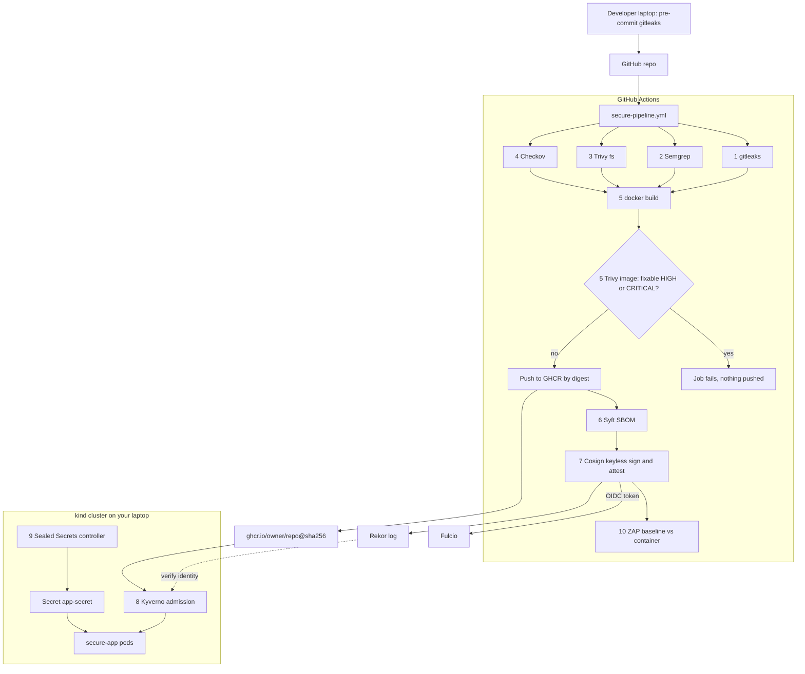

# DevSecOps Hands-on Lab — Secure Pipeline on GitHub Actions, Enforced in Kubernetes

<!-- DEVOPS-SHACK:HEADER -->
<p align="center">
  <a href="https://www.youtube.com/@devopsshack"></a>
  <a href="https://www.youtube.com/@shackverse"></a>
  <a href="https://devopsshack.com"></a>
  <a href="https://www.instagram.com/devopsshack"></a>
  <a href="https://github.com/jaiswaladi246/DevOps-Cloud-Interview-Preparation-by-DevOps-Shack"></a>
</p>
<p align="center"><sub>Part of <b><a href="https://github.com/jaiswaladi246/DevOps-Cloud-Interview-Preparation-by-DevOps-Shack">DevOps &amp; Cloud Interview Preparation</a></b> — created by <b><a href="https://www.youtube.com/@devopsshack">DevOps Shack</a></b>. Free to learn from; please credit DevOps Shack when sharing.</sub></p>
<!-- /DEVOPS-SHACK:HEADER -->

> Build a GitHub Actions pipeline for a small containerised Flask app that runs gitleaks, Semgrep, Trivy, Checkov, Syft and Cosign as real gates, then prove in a kind cluster that Kyverno admits only images signed by that pipeline, blocks privileged pods, and that secrets never touch Git in plaintext. Finish with an OWASP ZAP baseline scan.

[⬅ Back to DevSecOps](./README.md) · [🏠 Home](../README.md)

## Goal

By the end you have:

- A GitHub repo with a small Flask API, a hardened multi-stage Dockerfile, Kubernetes manifests and a scrap of Terraform
- One workflow, `secure-pipeline.yml`, with ten security stages:
  1. **gitleaks** scans the full Git history for secrets
  2. **Semgrep** runs SAST on the Python code and Dockerfile
  3. **Trivy fs** finds vulnerable dependencies (SCA)
  4. **Checkov** scans the Dockerfile, Terraform, Kubernetes YAML and the workflow itself
  5. **Build**, then **Trivy image** fails the job on fixable HIGH or CRITICAL CVEs
  6. **Syft** generates an SPDX SBOM for the pushed image
  7. **Cosign** signs the image keylessly through GitHub OIDC and attests the SBOM
  8. A **kind** cluster where **Kyverno** admits only images signed by this exact workflow and rejects privileged pods
  9. **Sealed Secrets** (or External Secrets with Vault) so the app secret lives in Git only as ciphertext
  10. **OWASP ZAP baseline** DAST against the running app
- A record of each gate failing on purpose, so you know it actually blocks

Stages 1 to 7 and 10 run in GitHub Actions. Stages 8 and 9 run on your machine in kind, because that is where you can watch admission control reject things. Running stage 8 inside CI is assignment 22.

**Cost.** Free. Public GitHub repos get unlimited Actions minutes on standard runners and free GHCR storage for public packages. Everything else runs locally.

## Architecture



| Stage | Tool | Fails the build when |
|-------|------|----------------------|
| 1 | gitleaks 8.x | Any secret pattern matches anywhere in Git history and is not in `.gitleaksignore` |
| 2 | Semgrep | Any finding from the `p/python`, `p/flask`, `p/dockerfile` rulesets that is not suppressed |
| 3 | Trivy fs | A dependency has a HIGH or CRITICAL CVE with a fix available |
| 4 | Checkov 3.x | Any failed check not skipped with a written reason |
| 5 | Trivy image | OS or library package in the image has a fixable HIGH or CRITICAL CVE |
| 6 | Syft | SBOM generation fails (it is an artifact, not a gate) |
| 7 | Cosign | Signing or self-verification fails |
| 8 | Kyverno | Pod image not signed by our workflow on `main`, or any container is privileged |
| 9 | Sealed Secrets | Controller cannot decrypt (wrong cluster, name or namespace) |
| 10 | ZAP baseline | An alert we marked `FAIL` in `.zap/rules.tsv` is raised |

## Prerequisites

- A GitHub account and the GitHub CLI: `gh auth status` must show you logged in with the `repo`, `workflow` and `write:packages` scopes (`gh auth refresh -s write:packages,delete:packages` adds the package scopes).
- Docker (Docker Desktop, OrbStack, Colima or Docker Engine), with at least 4 GB of RAM available.
- `kind` 0.24 or later, `kubectl` 1.30 or later, `helm` 3.x.
- `cosign` 2.x, `syft`, `grype`, `trivy`, `gitleaks` 8.19 or later, `kubeseal`, and optionally `crane`. On macOS or Linux with Homebrew:

```bash
brew install gh kind kubectl helm cosign syft grype trivy gitleaks kubeseal kyverno crane jq
pipx install semgrep && pipx install checkov    # or: pip install --user semgrep checkov
```

- Optional: `pre-commit` (`pipx install pre-commit`), and the Kyverno CLI (`kyverno version`) for offline policy tests.

Check everything in one go:

```bash
for t in gh docker kind kubectl helm cosign syft grype trivy gitleaks kubeseal semgrep checkov jq; do
  printf '%-10s ' "$t"; command -v "$t" >/dev/null && echo ok || echo MISSING
done
docker info --format '{{.ServerVersion}}'
```

Throughout the lab, replace `OWNER` with your GitHub username and `REPO` with the repo name. We use `secure-pipeline-lab`. Image names on GHCR must be lowercase; the workflow lowercases them for you, but in the Kyverno policy you type them by hand.

## Final repository layout

```text
secure-pipeline-lab/
├── .github/workflows/secure-pipeline.yml
├── .checkov.yaml
├── .gitleaks.toml
├── .gitleaksignore
├── .pre-commit-config.yaml
├── .semgrepignore
├── .trivyignore
├── .zap/rules.tsv
├── .dockerignore
├── Dockerfile
├── app/
│   ├── app.py
│   └── requirements.txt
├── infra/terraform/main.tf
├── k8s/
│   ├── namespace.yaml
│   ├── deployment.yaml
│   ├── service.yaml
│   ├── networkpolicy.yaml
│   └── sealed-app-secret.yaml      (created in step 16)
├── policies/kyverno/
│   ├── verify-signed-images.yaml
│   └── disallow-privileged.yaml
└── tests/policy/
    ├── privileged-pod.yaml
    └── unsigned-pod.yaml
```

---

## Step 1. Create the repository

```bash
export OWNER=$(gh api user --jq .login)
export REPO=secure-pipeline-lab
gh repo create "$OWNER/$REPO" --public --clone --description "DevSecOps secure pipeline lab"
cd "$REPO"
git switch -c main 2>/dev/null || git checkout -B main
mkdir -p .github/workflows .zap app infra/terraform k8s policies/kyverno tests/policy
```

Verification:

```bash
gh repo view "$OWNER/$REPO" --json name,visibility,defaultBranchRef --jq '.'
```

You should see `"visibility": "PUBLIC"`. Public matters for three reasons in this lab: free code scanning (SARIF upload), free Actions minutes, and a GHCR package that kind can pull without credentials.

## Step 2. The application

A tiny Flask API with two endpoints. It sets security headers on every response (ZAP checks these in stage 10) and reads its API token from a mounted file, never from an environment variable or the image.

`app/app.py`:

```python
import os
from pathlib import Path

from flask import Flask, jsonify

app = Flask(__name__)

TOKEN_FILE = Path(os.environ.get("API_TOKEN_FILE", "/etc/app/secrets/API_TOKEN"))
VERSION = os.environ.get("APP_VERSION", "dev")


@app.after_request
def security_headers(resp):
    resp.headers["Content-Security-Policy"] = "default-src 'none'; frame-ancestors 'none'"
    resp.headers["X-Content-Type-Options"] = "nosniff"
    resp.headers["X-Frame-Options"] = "DENY"
    resp.headers["Referrer-Policy"] = "no-referrer"
    resp.headers["Permissions-Policy"] = "geolocation=(), camera=(), microphone=()"
    resp.headers["Cross-Origin-Resource-Policy"] = "same-origin"
    resp.headers["Cross-Origin-Opener-Policy"] = "same-origin"
    resp.headers["Cross-Origin-Embedder-Policy"] = "require-corp"
    resp.headers["Cache-Control"] = "no-store"
    return resp


@app.get("/")
def index():
    # Report whether the secret is present, never its value.
    return jsonify(service="secure-app", version=VERSION, token_loaded=TOKEN_FILE.is_file())


@app.get("/healthz")
def healthz():
    return jsonify(status="ok")
```

`app/requirements.txt`, every package pinned including transitive ones, so Trivy fs sees the real versions:

```text
flask==3.1.3
werkzeug==3.1.9
jinja2==3.1.6
markupsafe==3.0.4
itsdangerous==2.2.0
click==8.5.1
blinker==1.9.0
gunicorn==26.2.0
packaging==26.3
```

These were current when the lab was written. If Trivy flags one later, bump it; that is the gate doing its job.

Verification (optional, needs Python 3.10+):

```bash
python3 -m venv .venv && . .venv/bin/activate
pip install -q -r app/requirements.txt
(cd app && gunicorn --bind 127.0.0.1:8080 app:app &) ; sleep 2
curl -si http://127.0.0.1:8080/ | sed -n '1p;/^Content-Security/p;/^{/p'
pkill -f "gunicorn --bind 127.0.0.1:8080"; deactivate
```

Expect `HTTP/1.1 200 OK`, the CSP header and `{"service":"secure-app","token_loaded":false,"version":"dev"}`. Add `.venv/` to `.gitignore`:

```bash
printf '.venv/\n__pycache__/\n*.sarif\nzap-out/\nsbom*.json\n' > .gitignore
```

## Step 3. A hardened Dockerfile

Multi-stage, non-root with a high UID, no build tools in the final image, a health check, and gunicorn writing its heartbeat to `/tmp` so the root filesystem can be read-only in Kubernetes.

`Dockerfile`:

```dockerfile
# syntax=docker/dockerfile:1

FROM python:3.13-slim AS build
ENV PIP_NO_CACHE_DIR=1 PIP_DISABLE_PIP_VERSION_CHECK=1
RUN python -m venv /opt/venv
ENV PATH="/opt/venv/bin:$PATH"
COPY app/requirements.txt /tmp/requirements.txt
RUN pip install -r /tmp/requirements.txt

FROM python:3.13-slim
RUN groupadd --system --gid 10001 app \
 && useradd --system --uid 10001 --gid app --no-create-home --shell /usr/sbin/nologin app
COPY --from=build /opt/venv /opt/venv
COPY app/ /app/
WORKDIR /app
ENV PATH="/opt/venv/bin:$PATH" \
    PYTHONDONTWRITEBYTECODE=1 \
    PYTHONUNBUFFERED=1
USER 10001:10001
EXPOSE 8080
HEALTHCHECK --interval=30s --timeout=3s --retries=3 \
  CMD ["python", "-c", "import urllib.request; urllib.request.urlopen('http://127.0.0.1:8080/healthz', timeout=2)"]
ENTRYPOINT ["gunicorn", "--bind", "0.0.0.0:8080", "--workers", "2", "--worker-tmp-dir", "/tmp", "--access-logfile", "-", "app:app"]
```

`.dockerignore`, so `.git`, local venvs and scan reports never end up in the build context:

```text
.git
.github
.venv
**/__pycache__
*.sarif
zap-out
k8s
policies
tests
infra
```

Verification:

```bash
docker build -t secure-app:local .
docker run --rm -d --name sa -p 8080:8080 secure-app:local
sleep 3; curl -s localhost:8080/healthz; echo
docker exec sa id                      # uid=10001(app) gid=10001(app)
docker inspect --format '{{.State.Health.Status}}' sa   # healthy after ~30s
docker rm -f sa
```

## Step 4. Terraform, Kubernetes manifests and policy test fixtures

The Terraform is never applied in this lab. It exists so Checkov has something real to scan. It describes an ECR repository with immutable tags, scan on push and a customer-managed KMS key.

`infra/terraform/main.tf`:

```hcl
terraform {
  required_version = ">= 1.6"
  required_providers {
    aws = {
      source  = "hashicorp/aws"
      version = ">= 5.0"
    }
  }
}

provider "aws" {
  region = "ap-south-1"
}

data "aws_caller_identity" "current" {}

resource "aws_kms_key" "ecr" {
  description             = "CMK for the secure-app ECR repository"
  enable_key_rotation     = true
  deletion_window_in_days = 7
  policy = jsonencode({
    Version = "2012-10-17"
    Statement = [{
      Sid       = "AccountAdmin"
      Effect    = "Allow"
      Principal = { AWS = "arn:aws:iam::${data.aws_caller_identity.current.account_id}:root" }
      Action    = "kms:*"
      Resource  = "*"
    }]
  })
}

resource "aws_ecr_repository" "app" {
  name                 = "secure-app"
  image_tag_mutability = "IMMUTABLE"

  image_scanning_configuration {
    scan_on_push = true
  }

  encryption_configuration {
    encryption_type = "KMS"
    kms_key         = aws_kms_key.ecr.arn
  }
}

resource "aws_ecr_lifecycle_policy" "app" {
  repository = aws_ecr_repository.app.name
  policy = jsonencode({
    rules = [{
      rulePriority = 1
      description  = "Keep the last 30 images"
      selection = {
        tagStatus   = "any"
        countType   = "imageCountMoreThan"
        countNumber = 30
      }
      action = { type = "expire" }
    }]
  })
}
```

`k8s/namespace.yaml`. Pod Security Admission is set to `warn` and `audit` on `restricted`, not `enforce`, so that the privileged-pod rejection you see in step 15 comes from Kyverno and you can read its message:

```yaml
apiVersion: v1
kind: Namespace
metadata:
  name: secure-app
  labels:
    pod-security.kubernetes.io/warn: restricted
    pod-security.kubernetes.io/audit: restricted
```

`k8s/deployment.yaml`. The image digest is a placeholder you replace in step 15:

```yaml
apiVersion: apps/v1
kind: Deployment
metadata:
  name: secure-app
  namespace: secure-app
  labels:
    app: secure-app
spec:
  replicas: 2
  selector:
    matchLabels:
      app: secure-app
  template:
    metadata:
      labels:
        app: secure-app
    spec:
      automountServiceAccountToken: false
      securityContext:
        runAsNonRoot: true
        runAsUser: 10001
        runAsGroup: 10001
        fsGroup: 10001
        seccompProfile:
          type: RuntimeDefault
      containers:
        - name: app
          image: ghcr.io/OWNER/REPO@sha256:0000000000000000000000000000000000000000000000000000000000000000
          imagePullPolicy: Always
          ports:
            - name: http
              containerPort: 8080
          env:
            - name: APP_VERSION
              value: "lab"
          securityContext:
            privileged: false
            allowPrivilegeEscalation: false
            readOnlyRootFilesystem: true
            capabilities:
              drop: ["ALL"]
          resources:
            requests:
              cpu: 50m
              memory: 64Mi
            limits:
              cpu: 250m
              memory: 128Mi
          readinessProbe:
            httpGet:
              path: /healthz
              port: http
            periodSeconds: 5
          livenessProbe:
            httpGet:
              path: /healthz
              port: http
            initialDelaySeconds: 10
            periodSeconds: 10
          volumeMounts:
            - name: tmp
              mountPath: /tmp
            - name: app-secret
              mountPath: /etc/app/secrets
              readOnly: true
      volumes:
        - name: tmp
          emptyDir:
            medium: Memory
            sizeLimit: 16Mi
        - name: app-secret
          secret:
            secretName: app-secret
            optional: true
```

The secret is mounted as a file, not injected as an environment variable. Environment variables leak into crash dumps, `/proc/<pid>/environ` and child processes, and Checkov flags them (CKV_K8S_35). `optional: true` lets the pod start before step 16 creates the secret.

`k8s/service.yaml`:

```yaml
apiVersion: v1
kind: Service
metadata:
  name: secure-app
  namespace: secure-app
spec:
  selector:
    app: secure-app
  ports:
    - name: http
      port: 80
      targetPort: http
```

`k8s/networkpolicy.yaml`. Ingress only on the app port, and no egress at all, because the app calls nothing:

```yaml
apiVersion: networking.k8s.io/v1
kind: NetworkPolicy
metadata:
  name: secure-app
  namespace: secure-app
spec:
  podSelector:
    matchLabels:
      app: secure-app
  policyTypes: ["Ingress", "Egress"]
  ingress:
    - ports:
        - protocol: TCP
          port: 8080
  egress: []
```

Policy test fixtures. These are deliberately bad and are excluded from Checkov.

`tests/policy/unsigned-pod.yaml`:

```yaml
apiVersion: v1
kind: Pod
metadata:
  name: unsigned
  namespace: secure-app
spec:
  containers:
    - name: nginx
      image: nginx:1.27-alpine
```

`tests/policy/privileged-pod.yaml` (the image line is filled in step 15 with your signed digest, so the only thing wrong with it is `privileged: true`):

```yaml
apiVersion: v1
kind: Pod
metadata:
  name: privileged
  namespace: secure-app
spec:
  containers:
    - name: app
      image: ghcr.io/OWNER/REPO@sha256:0000000000000000000000000000000000000000000000000000000000000000
      securityContext:
        privileged: true
```

Verification:

```bash
kubectl apply --dry-run=client -f k8s/ -f tests/policy/ | sed 's/ (dry run)//'
```

Every object should print `created`. Terraform syntax check, if you have Terraform installed: `terraform -chdir=infra/terraform init -backend=false && terraform -chdir=infra/terraform validate`.

## Step 5. Scanner configuration files

Each scanner gets an explicit config committed to the repo. In an interview, this is the difference between "we run Checkov" and "we run Checkov with these exceptions, each with a reason, reviewed in pull requests".

`.gitleaks.toml`: keep the default rules and allow the Sealed Secrets file, whose `encryptedData` is high-entropy ciphertext that is safe to commit:

```toml
title = "secure-pipeline-lab gitleaks config"

[extend]
useDefault = true

[allowlist]
description = "SealedSecret ciphertext is encrypted with the cluster public key and safe to commit"
paths = [
  '''k8s/sealed-.*\.yaml''',
]
```

`.gitleaksignore`: starts empty. You add finding fingerprints here only after the secret has been rotated (step 7 shows why):

```bash
touch .gitleaksignore
```

`.pre-commit-config.yaml`: the same scanner on the developer's laptop, before the secret ever leaves it:

```yaml
repos:
  - repo: https://github.com/gitleaks/gitleaks
    rev: v8.24.2
    hooks:
      - id: gitleaks
```

`.semgrepignore`:

```text
.venv/
tests/
```

`.trivyignore`: also empty for now. When you must accept a CVE, add it with an expiry date so the exception cannot live forever:

```text
# Format: <CVE-ID> exp:<YYYY-MM-DD>   then a comment with owner and reason
# CVE-2099-00000 exp:2026-12-31  # owner: platform-team, no fix upstream, not reachable
```

`.checkov.yaml`:

```yaml
directory:
  - .
framework:
  - dockerfile
  - terraform
  - kubernetes
  - github_actions
skip-path:
  - tests/policy
  - .venv
compact: true
quiet: true
```

`.zap/rules.tsv` must be tab-separated, so generate it with `printf` rather than typing tabs:

```bash
printf '%s\t%s\t%s\n' \
  10020 FAIL   "Missing anti-clickjacking header" \
  10021 FAIL   "X-Content-Type-Options header missing" \
  10038 FAIL   "Content Security Policy header not set" \
  10035 IGNORE "Strict-Transport-Security: lab runs on plain HTTP" \
  > .zap/rules.tsv
cat -A .zap/rules.tsv | head -2    # tabs show as ^I
```

Rules not listed stay at ZAP's default, `WARN`. The workflow passes `-I` so warnings are reported without failing the build, and only the headers we explicitly decided are mandatory turn the job red.

Verification, all three local scanners should pass on the clean repo:

```bash
git add -A && git commit -qm "app, Dockerfile, manifests, scanner config"
gitleaks git --redact -v .
semgrep scan --config p/python --config p/flask --config p/dockerfile --metrics=off --error
checkov --config-file .checkov.yaml
```

If Checkov reports a failed check you consider acceptable, do not delete the resource or turn the check off globally. Add an inline skip with a reason next to the resource, for example `# checkov:skip=CKV_AWS_136:Encryption is set via KMS above` in Terraform, or an annotation `checkov.io/skip1: CKV_K8S_43=Digest pinned by Kyverno` on a Kubernetes object. Then the exception is visible in code review.

## Step 6. The complete workflow

Here is the whole pipeline in one file. Steps 7 to 13 walk through each stage, run it, verify it and then break it on purpose.

`.github/workflows/secure-pipeline.yml`:

```yaml
name: secure-pipeline

on:
  push:
    branches: [main]
  pull_request:
    branches: [main]
  workflow_dispatch:

# Least privilege by default; each job asks for what it needs.
permissions:
  contents: read

concurrency:
  group: ${{ github.workflow }}-${{ github.ref }}
  cancel-in-progress: true

env:
  GITLEAKS_VERSION: "8.24.2"
  SEMGREP_VERSION: "1.184.0"
  CHECKOV_VERSION: "3.4.3"

jobs:
  # ---------------------------------------------------------------- stage 1
  secrets:
    name: "1 gitleaks"
    runs-on: ubuntu-latest
    permissions:
      contents: read
      security-events: write
    steps:
      - uses: actions/checkout@v4
        with:
          fetch-depth: 0          # full history, or old leaks are invisible

      - name: Install gitleaks (checksum verified)
        run: |
          base="https://github.com/gitleaks/gitleaks/releases/download/v${GITLEAKS_VERSION}"
          curl -sSfLO "${base}/gitleaks_${GITLEAKS_VERSION}_linux_x64.tar.gz"
          curl -sSfLO "${base}/gitleaks_${GITLEAKS_VERSION}_checksums.txt"
          sha256sum --ignore-missing -c "gitleaks_${GITLEAKS_VERSION}_checksums.txt"
          tar -xzf "gitleaks_${GITLEAKS_VERSION}_linux_x64.tar.gz" gitleaks
          sudo install -m 0755 gitleaks /usr/local/bin/gitleaks

      - name: Scan full git history
        run: |
          gitleaks git --redact --verbose --exit-code 1 \
            --report-format sarif --report-path gitleaks.sarif .

      - name: Upload SARIF
        if: always()
        continue-on-error: true
        uses: github/codeql-action/upload-sarif@v3
        with:
          sarif_file: gitleaks.sarif
          category: gitleaks

  # ---------------------------------------------------------------- stage 2
  sast:
    name: "2 Semgrep"
    runs-on: ubuntu-latest
    permissions:
      contents: read
      security-events: write
    steps:
      - uses: actions/checkout@v4
      - uses: actions/setup-python@v5
        with:
          python-version: "3.12"
      - name: Install Semgrep
        run: pip install --quiet "semgrep==${SEMGREP_VERSION}"
      - name: Semgrep scan
        run: |
          semgrep scan \
            --config p/python --config p/flask --config p/dockerfile \
            --metrics=off --error \
            --sarif-output=semgrep.sarif
      - name: Upload SARIF
        if: always()
        continue-on-error: true
        uses: github/codeql-action/upload-sarif@v3
        with:
          sarif_file: semgrep.sarif
          category: semgrep

  # ---------------------------------------------------------------- stage 3
  sca:
    name: "3 Trivy fs"
    runs-on: ubuntu-latest
    steps:
      - uses: actions/checkout@v4
      - name: Trivy filesystem scan (dependencies)
        uses: aquasecurity/trivy-action@0.28.0
        with:
          scan-type: fs
          scan-ref: .
          scanners: vuln
          severity: HIGH,CRITICAL
          ignore-unfixed: true
          exit-code: "1"
          format: table

  # ---------------------------------------------------------------- stage 4
  iac:
    name: "4 Checkov"
    runs-on: ubuntu-latest
    steps:
      - uses: actions/checkout@v4
      - uses: actions/setup-python@v5
        with:
          python-version: "3.12"
      - name: Install Checkov
        run: pip install --quiet "checkov==${CHECKOV_VERSION}"
      - name: Checkov scan
        run: checkov --config-file .checkov.yaml

  # ------------------------------------------------------- stages 5, 6, 7
  build-scan-sign:
    name: "5-7 Build, scan, SBOM, sign"
    needs: [secrets, sast, sca, iac]
    runs-on: ubuntu-latest
    permissions:
      contents: read
      packages: write      # push to GHCR
      id-token: write      # OIDC token for Cosign keyless signing
    outputs:
      image: ${{ steps.meta.outputs.image }}
      digest: ${{ steps.push.outputs.digest }}
    steps:
      - uses: actions/checkout@v4

      - name: Compute image name (GHCR needs lowercase)
        id: meta
        run: echo "image=ghcr.io/${GITHUB_REPOSITORY,,}" >> "$GITHUB_OUTPUT"

      # Stage 5a: build locally, do not push yet
      - name: Build image
        env:
          IMAGE: ${{ steps.meta.outputs.image }}
        run: |
          docker build --pull \
            --label "org.opencontainers.image.source=https://github.com/${GITHUB_REPOSITORY}" \
            --label "org.opencontainers.image.revision=${GITHUB_SHA}" \
            -t "${IMAGE}:${GITHUB_SHA}" .

      # Stage 5b: the image gate
      - name: Trivy image scan (fail on fixable HIGH/CRITICAL)
        uses: aquasecurity/trivy-action@0.28.0
        with:
          scan-type: image
          image-ref: ${{ steps.meta.outputs.image }}:${{ github.sha }}
          severity: HIGH,CRITICAL
          ignore-unfixed: true
          exit-code: "1"
          format: table

      # Everything below only runs for main, never for pull requests
      - name: Log in to GHCR
        if: github.event_name != 'pull_request'
        uses: docker/login-action@v3
        with:
          registry: ghcr.io
          username: ${{ github.actor }}
          password: ${{ secrets.GITHUB_TOKEN }}

      - name: Push and capture digest
        id: push
        if: github.event_name != 'pull_request'
        env:
          IMAGE: ${{ steps.meta.outputs.image }}
        run: |
          docker push "${IMAGE}:${GITHUB_SHA}"
          digest=$(docker inspect --format '{{index .RepoDigests 0}}' "${IMAGE}:${GITHUB_SHA}" | cut -d@ -f2)
          echo "digest=${digest}" >> "$GITHUB_OUTPUT"
          echo "Pushed ${IMAGE}@${digest}" >> "$GITHUB_STEP_SUMMARY"

      # Stage 6: SBOM of exactly what was pushed
      - name: Syft SBOM (SPDX JSON)
        if: github.event_name != 'pull_request'
        uses: anchore/sbom-action@v0
        with:
          image: ${{ steps.meta.outputs.image }}@${{ steps.push.outputs.digest }}
          format: spdx-json
          output-file: sbom.spdx.json
          artifact-name: sbom.spdx.json

      # Stage 7: keyless signing and SBOM attestation
      - name: Install Cosign
        if: github.event_name != 'pull_request'
        uses: sigstore/cosign-installer@v3

      - name: Sign image and attest SBOM
        if: github.event_name != 'pull_request'
        env:
          REF: ${{ steps.meta.outputs.image }}@${{ steps.push.outputs.digest }}
        run: |
          cosign sign --yes "${REF}"
          cosign attest --yes --type spdxjson --predicate sbom.spdx.json "${REF}"

      - name: Verify our own signature
        if: github.event_name != 'pull_request'
        env:
          REF: ${{ steps.meta.outputs.image }}@${{ steps.push.outputs.digest }}
        run: |
          cosign verify "${REF}" \
            --certificate-identity "https://github.com/${GITHUB_WORKFLOW_REF}" \
            --certificate-oidc-issuer "https://token.actions.githubusercontent.com" \
            > /dev/null
          echo "Signed by https://github.com/${GITHUB_WORKFLOW_REF}" >> "$GITHUB_STEP_SUMMARY"

  # --------------------------------------------------------------- stage 10
  dast:
    name: "10 ZAP baseline"
    needs: build-scan-sign
    if: github.event_name != 'pull_request'
    runs-on: ubuntu-latest
    permissions:
      contents: read
      packages: read
    steps:
      - uses: actions/checkout@v4      # for .zap/rules.tsv

      - uses: docker/login-action@v3
        with:
          registry: ghcr.io
          username: ${{ github.actor }}
          password: ${{ secrets.GITHUB_TOKEN }}

      - name: Start the signed image
        env:
          REF: ${{ needs.build-scan-sign.outputs.image }}@${{ needs.build-scan-sign.outputs.digest }}
        run: |
          docker run -d --name app -p 8080:8080 "${REF}"
          for i in $(seq 1 30); do
            curl -fsS http://localhost:8080/healthz && exit 0
            sleep 2
          done
          docker logs app; exit 1

      - name: ZAP baseline scan
        uses: zaproxy/action-baseline@v0.14.0
        with:
          target: http://localhost:8080
          rules_file_name: .zap/rules.tsv
          cmd_options: "-I"
          allow_issue_writing: false
          fail_action: true
          artifact_name: zap-baseline

      - name: App logs
        if: always()
        run: docker logs app
```

Design notes worth saying out loud in an interview:

- **Top-level `permissions: contents: read`.** The default `GITHUB_TOKEN` can be broad. Each job asks only for what it needs: `security-events: write` for SARIF, `packages: write` and `id-token: write` only in the job that pushes and signs.
- **Stages 1 to 4 run in parallel and gate the build** with `needs:`. Cheap checks first, so a leaked secret fails in under a minute and nobody waits for a build.
- **Build, scan, then push.** A vulnerable image never reaches the registry. Pull requests build and scan but never push or sign, so a fork cannot publish anything.
- **Everything after the push uses the digest**, never the tag. Tags are mutable; a signature on a tag means nothing.
- **Untrusted data never goes into `run:` through `${{ }}`.** Values are passed through `env:`, which avoids script injection. Checkov's `github_actions` framework checks for this.
- **Pin actions to full commit SHAs in production.** We use version tags here for readability. A compromised tag on a third-party action is a real supply-chain attack; Dependabot (`package-ecosystem: github-actions`) keeps SHA pins up to date.

Commit and push:

```bash
git add -A && git commit -qm "secure pipeline" && git push -u origin main
gh run watch --exit-status "$(gh run list --workflow secure-pipeline.yml --limit 1 --json databaseId --jq '.[0].databaseId')"
```

Verification. The first run should go green end to end:

```bash
gh run list --workflow secure-pipeline.yml --limit 3
gh run view --json jobs --jq '.jobs[] | [.name, .conclusion] | @tsv'
```

Expect six jobs with `success`. If one fails, `gh run view --log-failed` shows only the failing step, and the [common errors](#common-errors-and-fixes) table at the end covers the usual first-run problems.

Then make the package public so kind can pull it without credentials: on GitHub open your profile, **Packages**, `secure-pipeline-lab`, **Package settings**, **Change visibility** to Public. Check it:

```bash
docker logout ghcr.io
docker pull "ghcr.io/${OWNER,,}/${REPO}:$(git rev-parse HEAD)"
```

Finally, protect `main` so the checks are mandatory, not advisory:

```bash
gh api -X PUT "repos/$OWNER/$REPO/branches/main/protection" --input - <<'JSON'
{
  "required_status_checks": {
    "strict": true,
    "contexts": ["1 gitleaks", "2 Semgrep", "3 Trivy fs", "4 Checkov", "5-7 Build, scan, SBOM, sign"]
  },
  "enforce_admins": true,
  "required_pull_request_reviews": { "required_approving_review_count": 0 },
  "restrictions": null
}
JSON
```

From now on every change goes through a pull request, which is how you will break each gate below.

## Step 7. Stage 1: gitleaks, and why deleting the commit is not the fix

Install the hook locally first:

```bash
pre-commit install
pre-commit run gitleaks --all-files
```

**Verify the gate in CI.** Open the `1 gitleaks` job log for the last run. You should see `no leaks found` and the scan should list the number of commits it read; if it read only one commit, `fetch-depth: 0` is missing.

**Break it.** Generate a fake GitHub personal access token (random, so it is not a real credential) and try to commit it:

```bash
git switch -c leak-test
echo "GH_TOKEN=ghp_$(LC_ALL=C tr -dc 'A-Za-z0-9' </dev/urandom | head -c 36)" > app/settings.env
git add app/settings.env && git commit -m "add settings"
```

The pre-commit hook blocks the commit with `leaks found: 1` and the rule `github-pat`. That is the cheapest place to catch it. Now simulate a developer who skipped the hook:

```bash
git commit --no-verify -m "add settings"
git push -u origin leak-test
gh pr create --fill --base main
```

The `1 gitleaks` check fails on the pull request, and with branch protection the merge button stays disabled. (If GitHub push protection rejects the push first, that is a second layer working. Random tokens usually pass it because GitHub validates the token checksum.)

**The lesson.** Remove the file in a new commit and push again:

```bash
git rm -q app/settings.env && git commit -qm "remove settings" && git push
```

The check is still red, because gitleaks scans history and the secret is still in the earlier commit. This is correct behaviour: once a secret is pushed it must be treated as compromised. The fix is:

1. Rotate the credential at the provider. This is the only step that actually removes the risk.
2. Record the finding as handled by adding its fingerprint to `.gitleaksignore`:

```bash
gitleaks git --redact --report-format json --report-path leak.json . || true
jq -r '.[].Fingerprint' leak.json >> .gitleaksignore
rm leak.json
git add .gitleaksignore && git commit -qm "gitleaks: ignore rotated test token" && git push
```

The check goes green and the ignore file is now an audit trail of rotated leaks. Rewriting history with `git filter-repo` is optional hygiene, never a substitute for rotation, because forks, clones and caches already have the commit.

Clean up the experiment:

```bash
gh pr close leak-test --delete-branch
git switch main && git branch -D leak-test
```

## Step 8. Stage 2: Semgrep SAST

**Verify.** The `2 Semgrep` log ends with `Ran N rules on M files: 0 findings.` and, because the repo is public, the SARIF appears under **Security**, **Code scanning**.

**Break it.** Add a classic command injection to the app:

```bash
git switch -c sast-test
cat >> app/app.py <<'PY'


import subprocess
from flask import request


@app.get("/ping")
def ping():
    host = request.args.get("host", "127.0.0.1")
    out = subprocess.run(f"ping -c 1 {host}", shell=True, capture_output=True, text=True)
    return out.stdout
PY
semgrep scan --config p/python --config p/flask --metrics=off --error app/ ; echo "exit=$?"
```

Semgrep reports findings on the `subprocess.run(..., shell=True)` line, with a rule from `p/python` about `shell=True` and a Flask taint rule tracing `request.args` into a subprocess, and exits `1`. Push the branch and open a pull request: the `2 Semgrep` check fails and the finding is annotated inline on the diff.

**Fix it properly**, which means removing the shell, not silencing the rule:

```python
    out = subprocess.run(["ping", "-c", "1", host], capture_output=True, text=True, timeout=5)
```

Even this still lets a user ping arbitrary hosts. In real code you would validate `host` against an allow-list. If after review a finding is a genuine false positive, suppress it on that line with the rule ID and a reason, `# nosemgrep: <rule-id> -- input is a constant`, so the reviewer sees the decision.

Revert the experiment:

```bash
git checkout main -- app/app.py && git switch main && git branch -D sast-test
```

## Step 9. Stage 3: Trivy fs (SCA)

**Verify.** The `3 Trivy fs` log shows a table for `app/requirements.txt` with `Total: 0 (HIGH: 0, CRITICAL: 0)`.

**Break it.** Add a dependency version with a well-known critical CVE:

```bash
git switch -c sca-test
echo "PyYAML==5.3.1" >> app/requirements.txt
trivy fs --scanners vuln --severity HIGH,CRITICAL --ignore-unfixed --exit-code 1 . ; echo "exit=$?"
```

Trivy lists `pyyaml 5.3.1`, `CVE-2020-14343`, `CRITICAL`, fixed in `5.4`, and exits `1`. Read the columns the way you would in an interview: library, vulnerability ID, severity, installed version, fixed version. The fixed version is your remediation.

**Fix it** by bumping to the fixed version or removing the unused dependency. If there were no fix and the vulnerable function is not reachable from your code, the accepted path is an entry in `.trivyignore` with `exp:` and an owner, not a lower severity threshold for everyone.

```bash
git checkout main -- app/requirements.txt && git switch main && git branch -D sca-test
```

`--ignore-unfixed` is a deliberate choice: failing a build on a CVE nobody can fix yet trains people to ignore the gate. Unfixed findings still go to the dashboard; they just do not block.

## Step 10. Stage 4: Checkov

**Verify.** The `4 Checkov` log prints a summary per framework, for example `dockerfile scan results: Passed checks: N, Failed checks: 0, Skipped checks: 0`, and the same lines for `terraform`, `kubernetes` and `github_actions`.

**Break it twice**, once in Terraform and once in the Dockerfile:

```bash
git switch -c iac-test
sed -i.bak 's/"IMMUTABLE"/"MUTABLE"/' infra/terraform/main.tf
sed -i.bak '/^USER /d' Dockerfile
rm -f infra/terraform/main.tf.bak Dockerfile.bak
checkov --config-file .checkov.yaml ; echo "exit=$?"
```

Checkov fails `CKV_AWS_51` (ECR image tags should be immutable) and `CKV_DOCKER_3` (a user should be created for the container), and exits `1`. Mutable tags let someone overwrite `v1.2.0` with different contents; a container without `USER` runs as root.

```bash
git checkout main -- infra/terraform/main.tf Dockerfile && git switch main && git branch -D iac-test
```

Scan the Terraform **plan** too in real projects (`terraform show -json tfplan > plan.json && checkov -f plan.json`), because values from variables and modules only exist after planning.

## Step 11. Stage 5: build, then Trivy image gate

**Verify.** In the `5-7` job the Trivy step shows two tables: the Debian OS packages of `python:3.13-slim` and the Python packages in `/opt/venv`. Both must show zero fixable HIGH and CRITICAL. Run the same thing locally:

```bash
docker build -t secure-app:local .
trivy image --severity HIGH,CRITICAL --ignore-unfixed --exit-code 1 secure-app:local ; echo "exit=$?"
trivy image --severity HIGH,CRITICAL secure-app:local | tail -5     # without --ignore-unfixed, for comparison
```

The second command usually shows more findings: CVEs in Debian packages with no fixed version yet. That gap is exactly why the gate uses `--ignore-unfixed`.

**Break it.** Point both stages of the Dockerfile at an old, pinned base image that has accumulated fixable CVEs:

```bash
git switch -c image-test
sed -i.bak 's/python:3.13-slim/python:3.11.0-slim/g' Dockerfile && rm Dockerfile.bak
docker build -t secure-app:old . && \
trivy image --severity HIGH,CRITICAL --ignore-unfixed --exit-code 1 secure-app:old | grep -E 'Total|CRITICAL' | head
```

Expect a long list of fixable OS findings (OpenSSL, glibc, zlib and friends) and a non-zero exit. In CI the job stops before `docker login`, so nothing is pushed.

```bash
git checkout main -- Dockerfile && git switch main && git branch -D image-test
```

The real-world fix for base image CVEs is rarely a `.trivyignore` entry. It is rebuilding often (`--pull` in the workflow, a scheduled weekly run), moving to a smaller base (distroless or a Chainguard/Wolfi image has far fewer packages to be vulnerable), and letting Dependabot or Renovate bump the base image digest.

## Step 12. Stage 6: Syft SBOM

**Verify.** On a push to `main` the run has an artifact called `sbom.spdx.json`. Download it and look inside:

```bash
RUN_ID=$(gh run list --workflow secure-pipeline.yml --branch main --limit 1 --json databaseId --jq '.[0].databaseId')
gh run download "$RUN_ID" -n sbom.spdx.json -D sbom
jq -r '.spdxVersion, (.packages | length)' sbom/sbom.spdx.json
jq -r '.packages[] | select(.name=="flask" or .name=="openssl") | "\(.name) \(.versionInfo)"' sbom/sbom.spdx.json
```

You should see `SPDX-2.3`, a package count in the low hundreds (Debian packages plus Python packages), and the versions of Flask and OpenSSL that are actually in the image.

Use the SBOM the way it is meant to be used, as an input to other tools, without pulling the image again:

```bash
grype sbom:sbom/sbom.spdx.json --only-fixed --fail-on high
syft "ghcr.io/${OWNER,,}/${REPO}:$(git rev-parse HEAD)" -o cyclonedx-json=sbom.cdx.json
jq -r '.bomFormat, .specVersion' sbom.cdx.json
```

Grype should agree with Trivy (no fixable HIGH or above). The second command produces the same inventory in CycloneDX, the other standard format. When the next Log4Shell-style advisory lands, a central store of these SBOMs answers "which images contain package X at version Y" with a query instead of a scramble.

## Step 13. Stage 7: Cosign keyless signing and verification

**What happened in CI.** The job requested an OIDC token from GitHub (allowed by `id-token: write`). Cosign sent it to Fulcio, which issued a signing certificate valid for about ten minutes whose subject is the workflow identity, for example `https://github.com/OWNER/REPO/.github/workflows/secure-pipeline.yml@refs/heads/main`. Cosign signed the image digest, stored the signature in GHCR next to the image, and recorded it in the public Rekor transparency log. No private key exists anywhere to steal.

**Verify from your laptop**, exactly as an admission controller will:

```bash
export IMAGE="ghcr.io/${OWNER,,}/${REPO}"
export DIGEST=$(crane digest "$IMAGE:$(git rev-parse HEAD)" 2>/dev/null || \
  docker buildx imagetools inspect "$IMAGE:$(git rev-parse HEAD)" --format '{{json .Manifest}}' | jq -r .digest)
echo "$IMAGE@$DIGEST"

cosign verify "$IMAGE@$DIGEST" \
  --certificate-identity "https://github.com/$OWNER/$REPO/.github/workflows/secure-pipeline.yml@refs/heads/main" \
  --certificate-oidc-issuer "https://token.actions.githubusercontent.com" | jq -r '.[0].optional | .Issuer, .Subject, .githubWorkflowRepository, .githubWorkflowSha'
```

You should see `The following checks were performed on each of these signatures: The cosign claims were validated, Existence of the claims in the transparency log was verified offline, The code-signing certificate was verified using trusted certificate authority certificates`, followed by the issuer, subject, repository and the commit SHA that produced the image.

Verify the SBOM attestation and look at what is attached to the image:

```bash
cosign verify-attestation "$IMAGE@$DIGEST" --type spdxjson \
  --certificate-identity "https://github.com/$OWNER/$REPO/.github/workflows/secure-pipeline.yml@refs/heads/main" \
  --certificate-oidc-issuer "https://token.actions.githubusercontent.com" \
  | jq -r '.payload' | base64 -d | jq -r '.predicateType'
cosign tree "$IMAGE@$DIGEST"
```

The first prints `https://spdx.dev/Document`; the second shows a signature and an attestation hanging off the digest.

**Break it.** Verification is only as strong as the identity you check. Try a different identity, as an attacker who signed with their own workflow would present:

```bash
cosign verify "$IMAGE@$DIGEST" \
  --certificate-identity "https://github.com/attacker/fork/.github/workflows/release.yml@refs/heads/main" \
  --certificate-oidc-issuer "https://token.actions.githubusercontent.com" ; echo "exit=$?"
```

It fails with `none of the expected identities matched what was in the certificate`. Verifying with only `--certificate-identity-regexp '.*'` would have passed, which is the most common keyless mistake: any GitHub user can get a valid Sigstore signature, so the check has to pin the repo, workflow and ref.

If you do not have `crane`, the `docker buildx imagetools` fallback above works, or copy the digest from the `Pushed ...` line in the job summary.

## Step 14. Stage 8a: kind cluster and Kyverno

```bash
kind create cluster --name devsecops
kubectl cluster-info --context kind-devsecops

helm repo add kyverno https://kyverno.github.io/kyverno/
helm repo update
helm install kyverno kyverno/kyverno -n kyverno --create-namespace --wait
```

Verification:

```bash
kubectl get nodes
kubectl -n kyverno get deploy
kubectl get validatingwebhookconfigurations,mutatingwebhookconfigurations | grep kyverno
```

The node should be `Ready`, and four deployments should be available: `kyverno-admission-controller`, `kyverno-background-controller`, `kyverno-cleanup-controller` and `kyverno-reports-controller`. Kyverno registers its webhooks dynamically as you add policies, so there may be few of them until step 15.

A single admission controller replica is fine for a lab. In production run three replicas with a PodDisruptionBudget, because Kyverno's webhooks fail closed: if every replica is down, matching requests are rejected.

## Step 15. Stage 8b: admit only signed images, block privileged pods

`policies/kyverno/verify-signed-images.yaml`. Replace `OWNER` and `REPO` in the subject with your values, keeping the case exactly as it appears in your GitHub URL:

```yaml
apiVersion: kyverno.io/v1
kind: ClusterPolicy
metadata:
  name: verify-signed-images
  annotations:
    policies.kyverno.io/title: Only images signed by our pipeline
    policies.kyverno.io/description: >-
      Every container image in the secure-app namespace must carry a Sigstore
      keyless signature created by the secure-pipeline workflow on main.
spec:
  validationFailureAction: Enforce
  background: false
  webhookTimeoutSeconds: 30
  rules:
    - name: signed-by-secure-pipeline
      match:
        any:
          - resources:
              kinds: ["Pod"]
              namespaces: ["secure-app"]
      verifyImages:
        - imageReferences: ["*"]
          mutateDigest: true
          verifyDigest: true
          required: true
          attestors:
            - entries:
                - keyless:
                    subject: "https://github.com/OWNER/REPO/.github/workflows/secure-pipeline.yml@refs/heads/main"
                    issuer: "https://token.actions.githubusercontent.com"
                    rekor:
                      url: https://rekor.sigstore.dev
```

`imageReferences: ["*"]` is what makes this "only signed images" rather than "our images must be signed". With a narrower pattern such as `ghcr.io/owner/repo*`, an unsigned `nginx` would not match the rule and would be admitted.

`policies/kyverno/disallow-privileged.yaml`:

```yaml
apiVersion: kyverno.io/v1
kind: ClusterPolicy
metadata:
  name: disallow-privileged-containers
  annotations:
    policies.kyverno.io/title: Disallow privileged containers
spec:
  validationFailureAction: Enforce
  background: true
  rules:
    - name: no-privileged
      match:
        any:
          - resources:
              kinds: ["Pod"]
              namespaces: ["secure-app"]
      validate:
        message: >-
          Privileged containers are not allowed in secure-app.
          Remove securityContext.privileged or set it to false.
        pattern:
          spec:
            =(ephemeralContainers):
              - =(securityContext):
                  =(privileged): "false"
            =(initContainers):
              - =(securityContext):
                  =(privileged): "false"
            containers:
              - =(securityContext):
                  =(privileged): "false"
```

The `=()` anchors mean "if this field exists, it must match". A container with no `securityContext` passes, because the default is not privileged. Both policies are scoped to one namespace so the lab cannot lock up `kube-system`; in production you match all namespaces and exclude system ones explicitly.

Kyverno 1.13 and later also accept `failureAction: Enforce` on each rule and print a deprecation warning for the spec-level field. The spec-level form above works on every 1.x release.

Test the privileged policy offline before it touches the cluster:

```bash
kyverno apply policies/kyverno/disallow-privileged.yaml --resource tests/policy/privileged-pod.yaml
```

Expect `pass: 0, fail: 1` and the policy message. This is the same check you can run in CI against every manifest.

Apply the policies and wait for them to be ready:

```bash
kubectl apply -f policies/kyverno/
kubectl get clusterpolicy
```

Both should show `READY True` (the column is `READY` or `STATUS` depending on the Kyverno version).

Point the manifests at your signed digest and deploy:

```bash
sed -i.bak "s#image: ghcr.io/OWNER/REPO@sha256:.*#image: ${IMAGE}@${DIGEST}#" k8s/deployment.yaml tests/policy/privileged-pod.yaml
rm -f k8s/*.bak tests/policy/*.bak
kubectl apply -f k8s/namespace.yaml -f k8s/
kubectl -n secure-app rollout status deploy/secure-app --timeout=180s
```

Verification, the good path:

```bash
kubectl -n secure-app get pods -o wide
kubectl -n secure-app get pod -l app=secure-app -o jsonpath='{.items[0].spec.containers[0].image}{"\n"}'
kubectl -n secure-app get pod -l app=secure-app -o jsonpath='{.items[0].metadata.annotations.kyverno\.io/verify-images}{"\n"}'
```

Two pods `Running`, the image referenced by digest, and the `kyverno.io/verify-images` annotation showing the image with `pass`. That annotation is how Kyverno remembers a verified image so it does not re-verify on every update.

Verification, the bad paths:

```bash
kubectl apply -f tests/policy/unsigned-pod.yaml
kubectl apply -f tests/policy/privileged-pod.yaml
kubectl -n secure-app run tagged --image="${IMAGE}:$(git rev-parse HEAD)"
```

1. The unsigned `nginx` is rejected with `admission webhook "mutate.kyverno.svc-fail" denied the request`, naming the `verify-signed-images` policy and the rule `signed-by-secure-pipeline`, with `failed to verify image docker.io/nginx:1.27-alpine` and a reason along the lines of `no signatures found` or `no matching signatures`.
2. The privileged pod uses your signed image, so it passes signature verification and is then rejected by the validating webhook with the `disallow-privileged-containers` message. You will also see a PSA `Warning: would violate PodSecurity "restricted:latest"` line from the namespace labels.
3. The pod referenced by tag is admitted, but Kyverno verified the signature and rewrote the tag to the digest (`mutateDigest: true`). Check with `kubectl -n secure-app get pod tagged -o jsonpath='{.spec.containers[0].image}'`, then delete it: `kubectl -n secure-app delete pod tagged`.

Blocked requests never become objects, so Kyverno records them as `PolicyViolation` events on the policy, while admitted resources get PolicyReports that auditors can read:

```bash
kubectl get events -A --field-selector reason=PolicyViolation
kubectl -n secure-app get policyreport
```

Commit the policies and the updated manifests through a pull request, since `main` is protected.

## Step 16. Stage 9: secrets with Sealed Secrets

Sealed Secrets lets you keep the secret in Git as ciphertext that only the controller in this cluster can decrypt. Install the controller with the name `kubeseal` expects by default:

```bash
helm repo add sealed-secrets https://bitnami-labs.github.io/sealed-secrets
helm install sealed-secrets sealed-secrets/sealed-secrets -n kube-system \
  --set-string fullnameOverride=sealed-secrets-controller --wait
kubeseal --fetch-cert > /tmp/sealed-secrets-cert.pem && head -1 /tmp/sealed-secrets-cert.pem
```

Expect `-----BEGIN CERTIFICATE-----`. This public certificate is all a developer needs to seal a secret; it can be shared freely or committed.

Create the secret locally, seal it, and never write the plaintext to disk:

```bash
kubectl create secret generic app-secret -n secure-app \
  --from-literal=API_TOKEN="$(openssl rand -hex 24)" \
  --dry-run=client -o yaml \
| kubeseal --format yaml > k8s/sealed-app-secret.yaml

grep -A2 encryptedData k8s/sealed-app-secret.yaml
kubectl apply -f k8s/sealed-app-secret.yaml
```

Verification:

```bash
kubectl -n secure-app get sealedsecret app-secret
kubectl -n secure-app get secret app-secret -o jsonpath='{.data.API_TOKEN}' | wc -c
kubectl -n secure-app rollout restart deploy/secure-app
kubectl -n secure-app rollout status deploy/secure-app
kubectl -n secure-app exec deploy/secure-app -- python -c "import urllib.request;print(urllib.request.urlopen('http://127.0.0.1:8080/').read().decode())"
```

The SealedSecret shows `SYNCED True` (newer controllers) or simply exists with an event `Unsealed`, the Secret has a non-empty value, and the app now returns `"token_loaded":true`. The plaintext token was never printed, never written to a file, and never committed.

Prove the ciphertext is bound to its name and namespace (the default `strict` scope). Copy it to a different namespace and watch it fail:

```bash
kubectl create ns other
sed 's/namespace: secure-app/namespace: other/' k8s/sealed-app-secret.yaml | kubectl apply -f -
sleep 3; kubectl -n other describe sealedsecret app-secret | grep -iE 'error|unseal'
kubectl delete ns other
```

You will see an `ErrUnsealFailed` event with `no key could decrypt secret`. An attacker who can write SealedSecrets in their own namespace cannot replay yours.

Commit `k8s/sealed-app-secret.yaml` through a pull request. gitleaks passes because `.gitleaks.toml` allowlists `k8s/sealed-*.yaml`, a decision we documented in the config itself.

Two operational points to raise in an interview:

- **Back up the controller key.** If the cluster is lost, every SealedSecret in Git is unreadable without it: `kubectl -n kube-system get secret -l sealedsecrets.bitnami.com/sealed-secrets-key -o yaml > sealed-secrets-key.yaml`, then store that file in your password manager or a KMS-encrypted bucket. Never in Git.
- **Rotation is still your job.** The controller renews its sealing key every 30 days by default, but old ciphertext stays decryptable. Rotating the actual secret value means re-sealing and committing.

### Option B: External Secrets Operator with Vault

Use this instead of Sealed Secrets if you want the pattern most companies run: the secret lives in a central store, and ESO syncs it into a Kubernetes Secret. Pick one option; both create a Secret named `app-secret`. If you did option A, remove it first with `kubectl delete -f k8s/sealed-app-secret.yaml`.

```bash
helm repo add hashicorp https://helm.releases.hashicorp.com
helm repo add external-secrets https://charts.external-secrets.io
helm repo update

# Vault in dev mode: in-memory, unsealed, root token "root". Lab only.
helm install vault hashicorp/vault -n vault --create-namespace \
  --set server.dev.enabled=true --set server.dev.devRootToken=root --set injector.enabled=false
kubectl -n vault wait --for=condition=Ready pod/vault-0 --timeout=120s
kubectl -n vault exec vault-0 -- vault kv put secret/secure-app API_TOKEN="$(openssl rand -hex 24)"

helm install external-secrets external-secrets/external-secrets -n external-secrets --create-namespace --wait
kubectl -n secure-app create secret generic vault-token --from-literal=token=root
```

`k8s/external-secret.yaml` (use `external-secrets.io/v1beta1` on ESO releases older than 0.16):

```yaml
apiVersion: external-secrets.io/v1
kind: SecretStore
metadata:
  name: vault
  namespace: secure-app
spec:
  provider:
    vault:
      server: "http://vault.vault.svc:8200"
      path: "secret"
      version: "v2"
      auth:
        tokenSecretRef:
          name: vault-token
          key: token
---
apiVersion: external-secrets.io/v1
kind: ExternalSecret
metadata:
  name: app-secret
  namespace: secure-app
spec:
  refreshInterval: 1m
  secretStoreRef:
    name: vault
    kind: SecretStore
  target:
    name: app-secret
    creationPolicy: Owner
  data:
    - secretKey: API_TOKEN
      remoteRef:
        key: secure-app
        property: API_TOKEN
```

Verification:

```bash
kubectl apply -f k8s/external-secret.yaml
kubectl -n secure-app get secretstore,externalsecret
kubectl -n secure-app rollout restart deploy/secure-app && kubectl -n secure-app rollout status deploy/secure-app
```

The SecretStore shows `Valid` and the ExternalSecret `SecretSynced`. Change the value in Vault with `vault kv put` and the Kubernetes Secret follows within a minute. The token in a Kubernetes Secret is a lab shortcut; in production ESO authenticates to Vault with the Kubernetes auth method or to AWS Secrets Manager with IRSA or Pod Identity, so there is no static credential at all.

## Step 17. Stage 10: OWASP ZAP baseline

**Verify in CI.** On the last `main` run, the `10 ZAP baseline` job is green and has a `zap-baseline` artifact with an HTML report. The log ends with a summary such as `FAIL-NEW: 0 FAIL-INPROG: 0 WARN-NEW: n WARN-INPROG: 0 INFO: 0 IGNORE: 1 PASS: n`. The baseline scan spiders the app for a minute and only passively inspects responses; it sends no attacks, which is why it is safe to run on every build.

**Run it against the app in kind** from your laptop:

```bash
kubectl -n secure-app port-forward svc/secure-app 8080:80 >/dev/null 2>&1 &
PF_PID=$!; sleep 2; curl -s localhost:8080/healthz; echo

mkdir -p zap-out && cp .zap/rules.tsv zap-out/ && chmod 777 zap-out
docker run --rm --network host -v "$PWD/zap-out:/zap/wrk:rw" ghcr.io/zaproxy/zaproxy:stable \
  zap-baseline.py -t http://localhost:8080 -c rules.tsv -I -r zap-report.html
echo "exit=$?"; kill $PF_PID
```

On macOS and Windows, `--network host` does not reach the host's port-forward. Drop `--network host` and use `-t http://host.docker.internal:8080` instead.

Expect `exit=0`, `FAIL-NEW: 0`, and a report at `zap-out/zap-report.html`. ZAP exit codes: `0` clean, `1` at least one `FAIL`, `2` warnings only (suppressed by `-I`), `3` the scan itself errored.

**Break it.** Comment out the anti-clickjacking header and rebuild locally:

```bash
sed -i.bak 's/^    resp.headers\["X-Frame-Options"\]/    # &/; s/^    resp.headers\["Content-Security-Policy"\]/    # &/' app/app.py
docker build -t secure-app:nohdr . && docker run -d --rm --name nohdr -p 8081:8080 secure-app:nohdr
sleep 3
docker run --rm --network host -v "$PWD/zap-out:/zap/wrk:rw" ghcr.io/zaproxy/zaproxy:stable \
  zap-baseline.py -t http://localhost:8081 -c rules.tsv -I ; echo "exit=$?"
docker rm -f nohdr; mv app/app.py.bak app/app.py
```

ZAP reports `FAIL-NEW: [10020] Missing Anti-clickjacking Header` and `[10038] Content Security Policy (CSP) Header Not Set`, and exits `1`. In CI that turns the job red.

Baseline is the floor, not the ceiling. A full active scan (`zap-full-scan.py`) or an API scan against an OpenAPI spec (`zap-api-scan.py -f openapi`) finds injection and auth flaws, but it attacks the target, so it runs against a disposable staging environment on a schedule, never against production without written permission.

---

## Cleanup

```bash
# Local cluster and images
kind delete cluster --name devsecops
docker rmi secure-app:local secure-app:old secure-app:nohdr 2>/dev/null
docker image prune -f
rm -rf zap-out sbom sbom.cdx.json .venv

# GHCR package (needs the delete:packages scope)
gh api -X DELETE "/user/packages/container/${REPO}"

# The repository itself, if you do not want to keep it
gh auth refresh -s delete_repo
gh repo delete "$OWNER/$REPO" --yes
```

Verification:

```bash
kind get clusters                                # devsecops is gone
gh api "/user/packages/container/${REPO}" 2>&1 | grep -q "Not Found" && echo "package deleted"
gh repo view "$OWNER/$REPO" 2>&1 | head -1       # Could not resolve to a Repository
```

One thing you cannot delete: the Rekor transparency log entries. They are append-only by design. Every keyless signature from a public-good Sigstore instance publishes the repo and workflow name, which is why some companies run a private Sigstore stack or use key-based signing with KMS for private code.

---

## What to say in an interview about this project

**The 60-second version.** "I built a secure delivery pipeline on GitHub Actions for a containerised Python service. Secret scanning with gitleaks over full history, Semgrep for SAST, Trivy for dependency CVEs and Checkov for the Dockerfile, Terraform, Kubernetes manifests and the workflow itself all run in parallel and gate the build. The image is built, scanned with Trivy and only pushed if it has no fixable HIGH or CRITICAL vulnerabilities. Then Syft generates an SPDX SBOM, Cosign signs the digest keylessly using GitHub's OIDC token and attests the SBOM, and a ZAP baseline scan runs against the signed image. On the cluster side, Kyverno only admits images whose Sigstore certificate names our workflow on main, and rejects privileged containers. Secrets are sealed with Sealed Secrets so only ciphertext lives in Git. I broke every gate on purpose to prove it blocks."

**Follow-ups you should be ready for:**

- **Why both a CI image scan and admission control?** CI can be bypassed by anyone with registry write access or by a hand-run `kubectl`. The cluster re-verifies what CI claims, at the last point before code runs.
- **What exactly does Kyverno check in a keyless signature?** The certificate chains to Fulcio, the signature is in Rekor, and the certificate's subject (workflow path and ref) and issuer match what we pinned. Pinning only the issuer would accept a signature from any GitHub repo.
- **Why `--ignore-unfixed`?** A gate must be actionable. Unfixed CVEs go to the dashboard with an SLA clock; blocking on them teaches people to disable the gate.
- **A secret was pushed. What do you do?** Rotate it first, then check access logs for use, then add the fingerprint to `.gitleaksignore`. History rewriting is optional and never sufficient.
- **How do you stop the gates from being noisy?** Agreed thresholds, baselines so pull requests only show new findings, inline suppressions with reasons, expiring exceptions in `.trivyignore`, and SARIF in code scanning so findings are tracked, not just printed.
- **What SLSA level is this?** Build L1 to L2 territory: provenance-like metadata and a signature from a hosted builder. Adding `actions/attest-build-provenance` or the SLSA GitHub generator, which runs provenance generation in an isolated reusable workflow, moves it toward Build L3.
- **Sealed Secrets or External Secrets?** Sealed Secrets suits small setups with GitOps and no central store. External Secrets with Vault or a cloud secret manager wins at scale: central rotation, audit logs, dynamic credentials, and no per-cluster keys to back up.
- **What would you add next?** SHA-pinned actions with Dependabot, SLSA provenance verified at admission, Falco for runtime detection, kube-bench in a scheduled job, Kyverno policies tested in CI with `kyverno test`, and DAST full scans on staging nightly.

## Common errors and fixes

| Symptom or error | Likely cause | Fix |
|------------------|--------------|-----|
| gitleaks job passes but reports scanning only `1 commits` | Shallow checkout | `fetch-depth: 0` on `actions/checkout` |
| gitleaks still fails after the secret file was deleted | The secret is in history, which is what gitleaks scans | Rotate the secret, then add the fingerprint to `.gitleaksignore` |
| `sha256sum: WARNING: 1 computed checksum did NOT match` | Corrupt or tampered download, or version variable mismatch | Re-run; check `GITLEAKS_VERSION` matches an existing release |
| `Cannot create auto config when metrics are off` from Semgrep | `--config auto` used with `--metrics=off` | Use explicit rulesets (`p/python`, `p/flask`) as in the workflow |
| SARIF upload: `Resource not accessible by integration` | Job lacks `security-events: write` | Add the permission to that job |
| SARIF upload: `Advanced Security must be enabled for this repository to use code scanning` | Private repo without GitHub Advanced Security | Make the repo public for the lab; the step has `continue-on-error: true` |
| Trivy: `TOOMANYREQUESTS` or `failed to download vulnerability DB` | Registry rate limit on the DB image | Re-run; trivy-action caches the DB; set `TRIVY_DB_REPOSITORY` to a mirror such as `mirror.gcr.io/aquasec/trivy-db` |
| Trivy image fails on OS packages you did not touch | Base image has gained fixable CVEs since it was last built | Rebuild with `--pull`, bump the base, consider distroless; `.trivyignore` with `exp:` only with a reason |
| Checkov `CKV_K8S_43: Image should use digest` | Manifest uses a tag | Reference by digest, or skip with an annotation and a reason |
| `denied: installation not allowed to Write organization package` or `permission_denied: write_package` | Missing `packages: write`, or an existing package not linked to this repo | Add the permission; in package settings grant this repo Actions write access |
| `invalid reference format: repository name must be lowercase` | Mixed-case owner or repo in the image name | Use `${GITHUB_REPOSITORY,,}` as the workflow does |
| Cosign tries to open a browser, or fails to get an OIDC token, in CI | Job lacks `id-token: write` | Add it to the signing job's `permissions` |
| `none of the expected identities matched what was in the certificate` | Identity typo, wrong case, different branch, or run from `workflow_dispatch` on another ref | Compare with `.optional.Subject` from `cosign verify` output; the ref must be `refs/heads/main` |
| Kyverno rejects your own image: `failed to verify image ... no matching signatures` | Subject in the policy does not match, or the image was signed by a run on another branch | Fix the subject; deploy a digest produced by a `main` run |
| Kyverno: `... UNAUTHORIZED` or `401` fetching signatures, pods `ErrImagePull` | GHCR package is private | Make it public, or add an `imagePullSecret` and configure Kyverno `imageRegistryCredentials` |
| `failed calling webhook "mutate.kyverno.svc-fail": context deadline exceeded` | Kyverno not ready yet, or cannot reach GHCR, Rekor or the TUF mirror | Wait for the rollout; check `kubectl -n kyverno logs deploy/kyverno-admission-controller`; raise `webhookTimeoutSeconds` |
| Pods `CrashLoopBackOff` with `OSError: [Errno 30] Read-only file system` | gunicorn cannot write its worker heartbeat | Mount an `emptyDir` at `/tmp` and keep `--worker-tmp-dir /tmp` |
| `error: cannot fetch certificate: services "sealed-secrets-controller" not found` | Controller installed with a different name or namespace | Reinstall with `fullnameOverride=sealed-secrets-controller` in `kube-system`, or pass `--controller-name` and `--controller-namespace` |
| SealedSecret event `ErrUnsealFailed: no key could decrypt secret` | Sealed for another cluster, or name or namespace changed after sealing | Re-seal against this cluster's certificate with the final name and namespace |
| ExternalSecret `SecretSyncedError` with `could not get secret data from provider` | Wrong KV version, path or property | KV v2 needs `version: "v2"`; the key is the path under the mount, without `data/` |
| ZAP: `Permission denied: '/zap/wrk/...'` | Container user cannot write to the mounted directory | `chmod 777 zap-out` or run with `-u $(id -u)` |
| ZAP job fails with exit code `2` | Warnings treated as failures | Pass `-I`; make only chosen rules `FAIL` in `rules.tsv` |
| ZAP: `Failed to access the target` on macOS | `--network host` does not reach the host | Use `http://host.docker.internal:8080` |

## Where to go next

- Run stage 8 inside CI with `helm/kind-action` so admission policies are tested on every pull request (assignment 22)
- Add SLSA provenance and require it in the Kyverno policy (assignment 21)
- Add Falco and kube-bench to the kind cluster (assignments 18 and 24)
- Drill the theory in [concepts](./concepts.md) and [production](./production.md), and the failure modes in [troubleshooting](./troubleshooting.md)
- Keep the [cheatsheet](./cheatsheet.md) open while you work

[⬅ Back to DevSecOps](./README.md) · [🏠 Home](../README.md)

<!-- DEVOPS-SHACK:FOOTER -->
---

<div align="center">

### 🚀 Made with ❤️ by [DevOps Shack](https://www.youtube.com/@devopsshack)

**Learn DevOps, DevSecOps, Cloud and Kubernetes the practical way.**

[▶️ YouTube — DevOps Shack](https://www.youtube.com/@devopsshack) · [▶️ Hindi — @shackverse](https://www.youtube.com/@shackverse) · [🎓 devopsshack.com](https://devopsshack.com) · [📸 Instagram @devopsshack](https://www.instagram.com/devopsshack)

[🏠 Back to Home](../README.md) · [⭐ Star the original repo](https://github.com/jaiswaladi246/DevOps-Cloud-Interview-Preparation-by-DevOps-Shack)

<sub>© DevOps Shack · Licensed CC BY-NC-SA 4.0 · If you found this copy anywhere other than <a href="https://github.com/jaiswaladi246/DevOps-Cloud-Interview-Preparation-by-DevOps-Shack">github.com/jaiswaladi246</a>, the original and latest version is maintained by DevOps Shack.</sub>

</div>
<!-- /DEVOPS-SHACK:FOOTER -->
