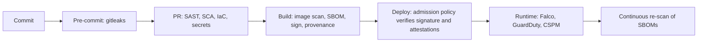
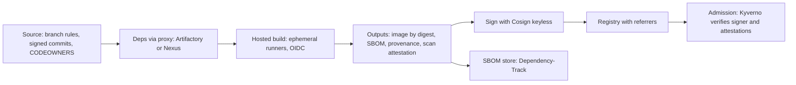
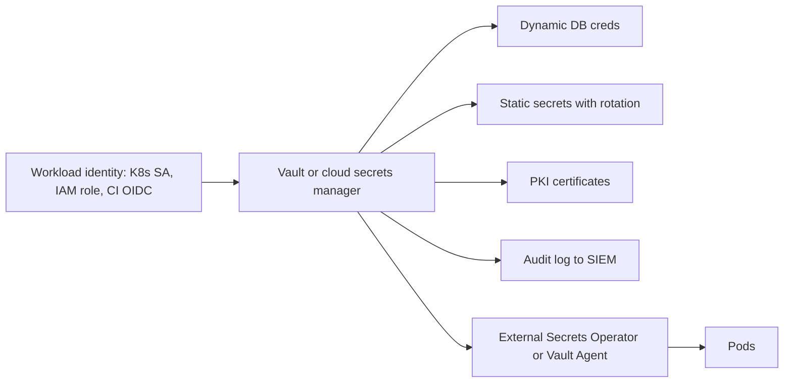
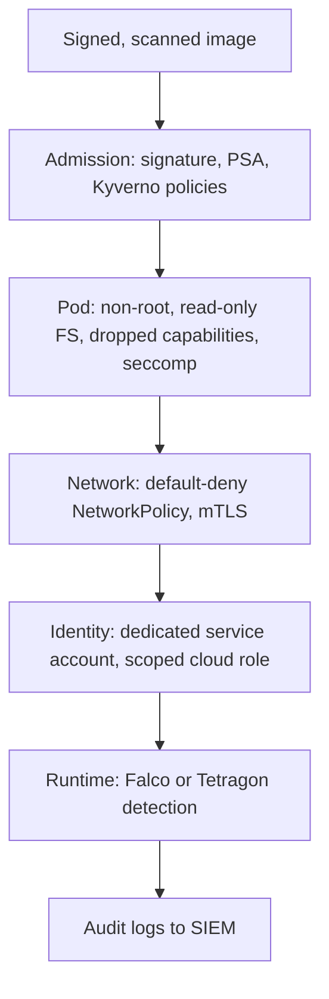
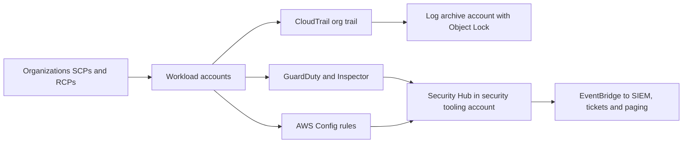

# DevSecOps — Production & Best Practices

<!-- DEVOPS-SHACK:HEADER -->
<p align="center">
  <a href="https://www.youtube.com/@devopsshack"></a>
  <a href="https://www.youtube.com/@shackverse"></a>
  <a href="https://devopsshack.com"></a>
  <a href="https://www.instagram.com/devopsshack"></a>
  <a href="https://github.com/jaiswaladi246/DevOps-Cloud-Interview-Preparation-by-DevOps-Shack"></a>
</p>
<p align="center"><sub>Part of <b><a href="https://github.com/jaiswaladi246/DevOps-Cloud-Interview-Preparation-by-DevOps-Shack">DevOps &amp; Cloud Interview Preparation</a></b> — created by <b><a href="https://www.youtube.com/@devopsshack">DevOps Shack</a></b>. Free to learn from; please credit DevOps Shack when sharing.</sub></p>
<!-- /DEVOPS-SHACK:HEADER -->

> Running DevSecOps for real: program design, gates and SLAs, supply chain at scale, secrets and identity architecture, Kubernetes and cloud posture, compliance as code, incident response, metrics, tool choices and rapid-fire tool questions · 200 questions · 🟢 Beginner 🟡 Intermediate 🔴 Advanced

[⬅ Back to DevSecOps](./README.md) · [🏠 Home](../README.md)

## Table of contents
- [Building a DevSecOps Program](#building-a-devsecops-program) — Q1–Q22
- [Security Gates & Vulnerability Management](#security-gates--vulnerability-management) — Q23–Q48
- [Supply Chain Security at Scale](#supply-chain-security-at-scale) — Q49–Q70
- [Secrets Management Architecture](#secrets-management-architecture) — Q71–Q90
- [Identity, Least Privilege & OIDC for CI](#identity-least-privilege--oidc-for-ci) — Q91–Q108
- [Kubernetes Security Posture](#kubernetes-security-posture) — Q109–Q130
- [Cloud Security Posture](#cloud-security-posture) — Q131–Q148
- [Compliance as Code, Threat Modeling & Incident Response](#compliance-as-code-threat-modeling--incident-response) — Q149–Q170
- [Metrics, Developer Experience & Tool Selection](#metrics-developer-experience--tool-selection) — Q171–Q185
- [Rapid-Fire Tool Questions](#rapid-fire-tool-questions) — Q186–Q200

---

## Building a DevSecOps Program

<!-- DEVOPS-SHACK:SECTION -->
> 🎥 **Learn this hands-on with DevOps Shack** → [YouTube @devopsshack](https://www.youtube.com/@devopsshack) · [Hindi @shackverse](https://www.youtube.com/@shackverse) · [Courses at devopsshack.com](https://devopsshack.com)

### Q1. You join a 300-engineer company with no security program. What do you do in the first 90 days? 🟡

<details>
<summary><b>Answer</b></summary>

Start with visibility, then the highest-risk gaps, then automation. We never begin by buying a scanner and turning on blocking.

1. **Days 1–30:** inventory repos, cloud accounts, clusters and owners; enable org-wide secret scanning and cloud audit logs (CloudTrail org trail, GuardDuty); find the crown jewels.
2. **Days 31–60:** add SCA + secrets + IaC scanning to the shared CI templates in report-only mode; remove static cloud keys from CI in favour of OIDC.
3. **Days 61–90:** publish vulnerability SLAs, turn on blocking for a narrow set (verified secrets, critical with fix, public buckets), and appoint security champions.

Report progress with two or three metrics (coverage, criticals open, MTTR) so leadership sees movement.

</details>

### Q2. What are the building blocks of a mature DevSecOps program? 🟢

<details>
<summary><b>Answer</b></summary>

People, process and platform, in that order of difficulty:

- **People:** a small central AppSec/platform security team, security champions in each squad, training tied to real findings.
- **Process:** threat modeling for significant changes, vulnerability SLAs, an exception process, incident response runbooks.
- **Platform:** paved-road CI templates with scanners built in, centralised findings, policy as code, secrets manager, OIDC for CI, admission control and runtime detection.
- **Measurement:** coverage, MTTR by severity, SLA compliance.

The platform piece is what scales; people and process stop it becoming checkbox security.

</details>

### Q3. Why do we put security controls into shared pipeline templates instead of asking each team to add them? 🟢

<details>
<summary><b>Answer</b></summary>

Because opt-in security gets 20% adoption and opt-out gets 95%. A reusable workflow or CI include means one change rolls out scanning to every repo, versions are pinned centrally and teams cannot quietly drop a step.

```yaml
# .github/workflows/ci.yml in each repo
jobs:
  security:
    uses: acme/platform-workflows/.github/workflows/security.yml@v3
    secrets: inherit
```

We pair this with a rule (GitHub ruleset "required workflows" or a GitLab compliance pipeline) so the security job cannot be removed from the repo side.

</details>

### Q4. How do you sell a DevSecOps program to leadership that sees security as a cost centre? 🟡

<details>
<summary><b>Answer</b></summary>

Speak in risk, revenue and engineering time, not CVE counts.

- **Revenue:** enterprise deals need SOC 2 / ISO 27001 evidence and security questionnaires; automated controls shorten sales cycles.
- **Risk:** map top threats (leaked keys, ransomware, supply-chain compromise) to likely cost; one public S3 incident dwarfs tooling spend.
- **Engineering time:** catching a vuln in a PR costs minutes, catching it in a pen test costs a sprint.

Ask for a phased budget with measurable milestones (for example "100% of prod repos scanned, zero static cloud keys in CI by Q2").

</details>

### Q5. How should a central security team and product teams split responsibilities? 🟡

<details>
<summary><b>Answer</b></summary>

The central team owns the **platform and policy**; product teams own **their findings and fixes**.

| Central security / platform | Product teams |
|---|---|
| Choose and run scanners, maintain templates | Fix findings within SLA |
| Write policies and gate thresholds | Triage false positives with champions |
| Own the findings platform and dashboards | Threat model their own features |
| Run incident response and red teaming | Keep dependencies and base images current |

If security owns fixing, it becomes a bottleneck; if teams own policy, every team has a different bar.

</details>

### Q6. What is a "paved road" in DevSecOps and why does it work better than mandates? 🟢

<details>
<summary><b>Answer</b></summary>

A paved road is the default, supported way to build and ship (golden repo template, base images, CI workflow, Helm chart, Terraform modules) with security already baked in. Teams that use it get scanning, signing, OIDC and hardened defaults for free and pass compliance automatically. Teams can leave the road, but then they own the extra review.

It works because it removes effort instead of adding it: the secure path is also the fastest path.

</details>

### Q7. How do you run a security champions program that does not fade out after three months? 🟡

<details>
<summary><b>Answer</b></summary>

- Give champions real time (10–20% of capacity) agreed with their managers, not "volunteer on top".
- Give them power: they can approve false-positive suppressions and low-risk exceptions for their team.
- Meet monthly with a concrete agenda (new rules, incidents, upcoming policy changes).
- Recognise them in performance reviews and with training budget or certifications.
- Measure their team's MTTR and coverage, not attendance.

Programs die when champions become unpaid ticket routers.

</details>

### Q8. Which security activities do you run on every commit, every release, and periodically? 🟢

<details>
<summary><b>Answer</b></summary>

| Cadence | Activities |
|---|---|
| Every commit / PR | Secrets scan, SAST (diff-aware), SCA, IaC scan, Dockerfile lint |
| Every build / release | Image scan, SBOM, signing, provenance, admission checks on deploy |
| Daily / continuous | Re-scan running images and SBOMs against new CVEs, CSPM, runtime detection |
| Periodic | DAST on staging, pen test (yearly or per major change), threat model review, access reviews, IR tabletop |

Fast and deterministic checks go left; slow or environment-dependent ones run on a schedule.

</details>

### Q9. How do you prioritise which repositories get security controls first? 🟡

<details>
<summary><b>Answer</b></summary>

Risk-rank the inventory: internet-facing services, services handling PII/payment data, anything with production cloud credentials, and shared libraries used by many services come first. Internal tools and archived repos come last.

We tag repos with metadata (owner, data classification, exposure) via a service catalogue such as Backstage and drive rollout waves and SLA tiers from those tags, so "critical" means critical for that asset, not just CVSS 9.0.

</details>

### Q10. What is the role of a service catalogue (for example Backstage) in DevSecOps? 🟡

<details>
<summary><b>Answer</b></summary>

Security tooling is useless if a finding cannot be routed to an owner. A catalogue maps repos, images, cloud accounts and services to teams, on-call rotations and data classification.

```yaml
# catalog-info.yaml
apiVersion: backstage.io/v1alpha1
kind: Component
metadata:
  name: payments-api
  annotations:
    github.com/project-slug: acme/payments-api
  tags: [pci, internet-facing]
spec:
  type: service
  owner: team-payments
  lifecycle: production
```

The findings platform reads this to assign tickets, set SLA tier and show per-team scorecards.

</details>

### Q11. How do you introduce security into a team that already ships 50 times a day without slowing it down? 🔴

<details>
<summary><b>Answer</b></summary>

Respect the flow: every control must be fast, async or pre-approved.

- Run SAST/SCA diff-aware on PRs with a hard time budget (under 3 minutes), full scans nightly.
- Block only on new, high-confidence, fixable issues; everything else becomes a ticket with an SLA.
- Move heavy checks (DAST, full image re-scan) off the critical path to post-deploy or scheduled jobs.
- Use admission policies and runtime detection as a safety net instead of extra manual approvals.
- Pre-approve standard changes (Terraform modules, Helm charts from the paved road) so they skip human review.

Measure deployment frequency and lead time before and after; if they drop, tune the gates.

</details>

### Q12. What does a good secure-by-default golden repository template contain? 🟢

<details>
<summary><b>Answer</b></summary>

- `CODEOWNERS`, branch ruleset (reviews, status checks, no force push)
- Reusable CI workflow call with SAST, SCA, secrets, IaC and image scanning
- Hardened Dockerfile (pinned digest base, non-root user, multi-stage)
- Renovate or Dependabot config with grouping and automerge for patch updates
- `.pre-commit-config.yaml` with gitleaks
- `SECURITY.md` with reporting contact
- Helm chart with `securityContext`, resource limits and a NetworkPolicy
- OIDC-based deploy job, no long-lived secrets

New services start compliant on day one.

</details>

### Q13. How do you handle legacy applications that cannot pass modern security gates? 🟡

<details>
<summary><b>Answer</b></summary>

Do not fail them forever and do not exempt them forever. Baseline current findings, gate only on new ones, and agree a burn-down plan with a date.

Meanwhile add compensating controls around them: WAF in front, network isolation, no direct internet egress, tighter monitoring and runtime detection. Track them on a "legacy risk register" reviewed quarterly so the exception has an owner and an expiry.

</details>

### Q14. How do you budget security tooling licences in a growing company? 🟡

<details>
<summary><b>Answer</b></summary>

Most commercial tools price per contributing developer, per workload or per cloud asset. Model growth for 12–24 months before signing.

- Start with strong open source (Trivy, Semgrep CE, gitleaks, Checkov, Kyverno, Falco) to learn your real needs.
- Pay for what open source does badly at scale: correlation and prioritisation (CNAPP), reachability, developer workflow integration, support.
- Negotiate committer-count definitions (active in 90 days) and avoid overlapping platforms that each cover 60%.

Review usage yearly: unused seats and duplicate scanners are common waste.

</details>

### Q15. What should be in a security policy document that engineers actually read? 🟢

<details>
<summary><b>Answer</b></summary>

Short, specific and linked to automation. For example: "Critical vulns with a fix must be remediated within 7 days; the pipeline blocks new criticals; exceptions via the `security-exception` form, max 90 days."

Each rule states what is required, who owns it, how it is enforced (which gate or policy) and how to request an exception. Long prose policies get ignored; policies that map 1:1 to a gate get followed.

</details>

### Q16. How do you integrate security reviews into an architecture review process? 🟡

<details>
<summary><b>Answer</b></summary>

Add a lightweight security section to the design doc template: data classification, trust boundaries, authn/authz approach, secrets, external dependencies, and a short STRIDE table. A risk-based trigger decides depth:

- New internet-facing service, new data store with PII, new third-party integration → full threat model with AppSec.
- Change inside an existing pattern → champion review only.

This keeps AppSec time for the 10% of designs that need it.

</details>

### Q17. A program has many scanners but breaches still happen. What is usually missing? 🔴

<details>
<summary><b>Answer</b></summary>

Usually the gaps are not in scanning but in **identity, detection and response**:

- Long-lived credentials and over-permissive IAM (most cloud breaches start here).
- No runtime detection or log review, so compromise goes unnoticed for weeks.
- Findings without owners or SLAs, so known vulns stay open for months.
- No asset inventory, so shadow services are never scanned.
- No tested incident response plan.

We rebalance spend toward OIDC, least privilege, CloudTrail/GuardDuty/Falco alerting and tabletop exercises.

</details>

### Q18. How do you roll out a new scanner across 1,000 repositories safely? 🟡

<details>
<summary><b>Answer</b></summary>

1. Run it in audit mode on a sample of 20 repos across languages; measure runtime and false-positive rate.
2. Tune rules and ignore paths (tests, vendored code, generated code).
3. Roll out via the shared template in report-only mode, publishing results to SARIF / the findings platform.
4. Communicate: what it checks, how to suppress, who to ask.
5. After 2–4 weeks enable blocking for new high-confidence findings only.

Rolling out "blocking on day one" is the fastest way to get the tool removed.

</details>

### Q19. How do you decide between build vs buy for internal security tooling? 🔴

<details>
<summary><b>Answer</b></summary>

Build glue, buy engines. We do not write our own SAST engine or vulnerability database; we do build thin layers that are specific to us: findings routing to owners, exception workflow, scorecards, policy bundles and CI templates.

Ask: is this a differentiator? Is there a maintained open-source or commercial option? What is the total cost of ownership (an internal tool needs an on-call owner forever)? If the answer is "it is generic and someone already maintains it", buy or adopt.

</details>

### Q20. What is a security scorecard per team and what should it include? 🟡

<details>
<summary><b>Answer</b></summary>

A per-team dashboard that turns posture into a simple grade:

- Coverage: % of repos on the paved-road pipeline, % images signed
- Open criticals/highs past SLA
- MTTR by severity over the last 90 days
- Secrets found and rotated
- Dependency freshness (median age of dependencies behind latest)

Teams compare themselves to the org median. Keep it about trends and ownership, not public shaming. OpenSSF Scorecard (`scorecard --repo=github.com/acme/app`) covers repo hygiene checks and can feed into it.

</details>

### Q21. What is the difference between DevSecOps maturity models like OWASP SAMM and a simple roadmap, and when do you use SAMM? 🔴

<details>
<summary><b>Answer</b></summary>

SAMM gives a structured assessment across 15 security practices with three maturity levels each, so you can benchmark and pick targets. A roadmap is the concrete list of projects to move from current to target.

We run a SAMM self-assessment once a year (a spreadsheet exercise with team leads), choose two or three practices to raise by one level, and turn those into roadmap items. Running SAMM every quarter is overhead; never running it means you optimise what is visible rather than what is weak.

</details>

### Q22. How do you keep DevSecOps from becoming "the security team owns a Jenkins plugin"? 🟢

<details>
<summary><b>Answer</b></summary>

Make security a property of the delivery platform, owned jointly. Security engineers commit to the platform repos, platform engineers are on the security on-call for pipeline issues, and the findings land in the same backlog as product bugs. If security lives in one person's plugin, it breaks the day they leave.

</details>

---

## Security Gates & Vulnerability Management

<!-- DEVOPS-SHACK:SECTION -->
> 🎥 **Learn this hands-on with DevOps Shack** → [YouTube @devopsshack](https://www.youtube.com/@devopsshack) · [Hindi @shackverse](https://www.youtube.com/@shackverse) · [Courses at devopsshack.com](https://devopsshack.com)

### Q23. How do you design security gate thresholds that protect production without blocking delivery? 🟡

<details>
<summary><b>Answer</b></summary>

Block on findings that are **new, high-confidence, severe and fixable**; report the rest.

| Check | Block when | Otherwise |
|---|---|---|
| Secrets | Verified live secret | Warn on unverified |
| SCA / image | Critical (or KEV-listed) with fix available | Ticket with SLA |
| SAST | New high-severity, high-confidence rule | PR comment |
| IaC | Public exposure, no encryption, wildcard IAM | Warn |

Gate on the delta from the target branch, not on total debt, and review thresholds quarterly using false-positive data.

</details>

### Q24. Sketch where security gates sit in a delivery pipeline. 🟢

<details>
<summary><b>Answer</b></summary>



Each layer catches what the previous one cannot: pre-commit is bypassable, PR gates miss new CVEs, admission catches anything that skipped CI, runtime catches what got through.

</details>

### Q25. What are typical vulnerability remediation SLAs in production? 🟢

<details>
<summary><b>Answer</b></summary>

A common baseline we use:

| Severity | Internet-facing / sensitive | Internal |
|---|---|---|
| Critical or CISA KEV | 72 hours – 7 days | 14 days |
| High | 30 days | 45 days |
| Medium | 90 days | 120 days |
| Low | Best effort / next refresh | Best effort |

Severity is adjusted by context (EPSS, reachability, exposure), and the clock starts when the finding is first detected, not when someone triages it. PCI DSS 4.0 requires critical security patches within one month of release, so PCI scope cannot be looser than that.

</details>

### Q26. How do you run a vulnerability exception (risk acceptance) process? 🟡

<details>
<summary><b>Answer</b></summary>

An exception is a time-boxed, owned, documented decision, never a permanent ignore.

- Request includes: finding ID, asset, justification (not reachable, compensating control, no fix), proposed expiry.
- Approval tier depends on severity: champion for medium, AppSec for high, CISO/risk owner for critical.
- Max duration 30–90 days, then it must be renewed with fresh justification.
- Stored centrally (DefectDojo risk acceptance, or a VEX statement / `.trivyignore` entry with an expiry) so scanners honour it.

```text
# .trivyignore.yaml style entry
vulnerabilities:
  - id: CVE-2025-12345
    paths: ["usr/lib/libfoo.so"]
    statement: "Not reachable: feature disabled, see SEC-482"
    expired_at: 2026-02-01
```

Expired exceptions automatically re-open the finding and the gate.

</details>

### Q27. How do you prioritise vulnerabilities beyond CVSS? 🟡

<details>
<summary><b>Answer</b></summary>

CVSS measures theoretical severity, not risk. We stack signals:

1. **CISA KEV:** actively exploited → top priority regardless of score.
2. **EPSS:** probability of exploitation in the next 30 days.
3. **Reachability:** is the vulnerable function called?
4. **Exposure:** internet-facing, privileged, handles sensitive data?
5. **Fix availability.**

A CVSS 9.8 in an unreachable test dependency can wait; a CVSS 7.5 on KEV in an internet-facing service is a drop-everything item.

</details>

### Q28. Why do you gate on "new findings only" and how is this implemented? 🟡

<details>
<summary><b>Answer</b></summary>

Gating on total findings blocks every PR in a legacy repo for problems the author did not create. Diff-based gating keeps the bar rising without freezing delivery.

Implementations: Semgrep `--baseline-commit`, SonarQube "new code" quality gate, GitHub code scanning alerts only on the PR diff, Trivy/Grype comparisons against the main branch result.

```bash
semgrep ci --baseline-commit "$(git merge-base origin/main HEAD)"
```

Old debt is handled separately with SLAs and burn-down targets.

</details>

### Q29. A gate blocks a release for a CVE with no fix available. What is the right policy? 🟢

<details>
<summary><b>Answer</b></summary>

Do not block on unfixable issues by default (Trivy `--ignore-unfixed`, Grype `--only-fixed`); blocking gives the developer nothing to do. Instead create a tracked finding with SLA, assess exploitability, add compensating controls if exposure is real, and re-evaluate when a fix appears. Exception: if it is on KEV and internet-facing, escalate to mitigation (WAF rule, feature flag off, isolate) rather than silently shipping.

</details>

### Q30. How do you run continuous vulnerability management for images already in production? 🔴

<details>
<summary><b>Answer</b></summary>

CI scans are a snapshot; new CVEs appear daily. We:

1. Store an SBOM per image digest (Dependency-Track or registry attachment).
2. Re-match SBOMs against fresh vulnerability data daily, no rebuild needed.
3. Join with the runtime inventory (what digests are actually running, from the Trivy Operator, an agent or the CNAPP) so we only alert on deployed images.
4. Auto-open tickets for the owning team, and trigger a rebuild PR (Renovate base-image bump) when a fix exists.

This turns "Log4Shell day" from a week of grep into a query.

</details>

### Q31. How do you avoid duplicate tickets when five scanners report the same CVE? 🟡

<details>
<summary><b>Answer</b></summary>

Centralise findings in a platform that deduplicates (DefectDojo, a CNAPP, or GitHub Security overview for code). Dedup key is roughly `CVE + package + version + asset`. Then one ticket per fix action, not per finding: "bump base image to `node:22.11-bookworm-slim`" may close 40 CVEs. Group findings by remediation, route to the owner from the service catalogue, and sync status both ways with Jira.

</details>

### Q32. What is a break-glass bypass for security gates, and how do you make it safe? 🟡

<details>
<summary><b>Answer</b></summary>

A documented way to deploy despite a failed gate during an emergency. Safe means:

- Requires an explicit label or approval from a named group (e.g. `security-override` approved by on-call security lead).
- Every use logs who, why and which findings were bypassed, and pages security.
- Automatically opens a follow-up ticket with a 24–72 hour SLA.
- Usage is reviewed weekly; frequent bypasses mean the gate is miscalibrated.

No break-glass at all leads to people disabling the gate; uncontrolled break-glass makes the gate decorative.

</details>

### Q33. How do you handle vulnerabilities in base images that are owned by the platform team? 🟢

<details>
<summary><b>Answer</b></summary>

The platform team owns a small set of golden base images, rebuilt automatically (nightly or on upstream change), scanned, signed and published with immutable tags plus digests. App teams consume them via Renovate, which opens PRs when a new digest is published. Base-image CVEs are the platform team's SLA; app-level dependencies are the app team's. Minimal bases (distroless, Chainguard/Wolfi, Docker Hardened Images) cut this load dramatically.

</details>

### Q34. How do you define "vulnerability debt" and track it? 🟡

<details>
<summary><b>Answer</b></summary>

Vulnerability debt is the set of open findings past their SLA, ideally weighted by severity and exposure. We track:

- Count of findings past SLA, by severity and team
- Age distribution (p50/p90 days open)
- Trend: are we closing faster than we open (burn-down vs inflow)?

A flat or growing debt line with high inflow means remediation is not resourced; a debt spike after enabling a new scanner is expected and should be baselined.

</details>

### Q35. When should a SAST rule be blocking vs advisory in production pipelines? 🔴

<details>
<summary><b>Answer</b></summary>

A rule earns blocking status only when its measured precision is high (we use above ~90% true positives over the last few hundred findings), the issue is severe (injection, deserialization, hard-coded creds, disabled TLS verification) and the fix is clear. Everything else stays advisory as PR comments.

We track per-rule triage outcomes in the findings platform; a blocking rule whose false-positive rate creeps up is demoted. Semgrep policies or CodeQL query suites let us run different rule sets for "block" and "comment" modes.

</details>

### Q36. Should IaC misconfiguration findings block Terraform applies? 🟡

<details>
<summary><b>Answer</b></summary>

Yes, for a short list of high-impact controls; no for the long tail. We block on public storage, public databases, `0.0.0.0/0` on admin ports, missing encryption on data stores, IAM wildcards on `*` resources, and disabled logging. Lower-severity checks (tagging, descriptions) warn only.

```bash
checkov -d . --framework terraform --check CKV_AWS_20,CKV_AWS_19,CKV_AWS_24,CKV_AWS_17 --compact
```

Plan-time policy (Conftest/OPA or Sentinel on `terraform show -json`) is the strongest gate because it sees resolved values.

</details>

### Q37. How do you handle security findings in third-party or vendor software you cannot patch? 🟡

<details>
<summary><b>Answer</b></summary>

Ask the vendor for a fix date and their VEX/advisory, record a time-boxed exception, and apply compensating controls: network isolation, restricted egress, WAF, least-privilege service accounts, runtime monitoring. Put contractual SLAs for vulnerability fixes into vendor agreements and ask for SBOMs during procurement so you know what you are buying.

</details>

### Q38. How do you prevent "alert fatigue" from killing a vulnerability program? 🔴

<details>
<summary><b>Answer</b></summary>

- Only page on actionable, high-risk items (KEV, exploit in the wild on exposed asset). Everything else is a ticket.
- Suppress noise structurally: ignore unfixed, ignore dev-only dependencies in runtime images, use VEX for not-affected.
- Use minimal base images to remove whole classes of CVEs.
- Group by fix action and auto-generate PRs.
- Review top noisy rules monthly and tune.

The goal is that every alert a developer sees is worth acting on; trust is the scarcest resource in a security program.

</details>

### Q39. What evidence do auditors expect from a vulnerability management process? 🟢

<details>
<summary><b>Answer</b></summary>

- A written policy with SLAs per severity
- Proof scanning runs (scan logs, pipeline history, coverage report)
- Tickets showing findings were tracked and closed within SLA
- Approved exceptions with justification and expiry
- Periodic reports to management and evidence of trend review

Automating the export from the findings platform each quarter saves weeks at audit time.

</details>

### Q40. How do you handle the day a critical, widely exploited library CVE drops (Log4Shell style)? 🔴

<details>
<summary><b>Answer</b></summary>

1. **Scope in minutes:** query the SBOM store for the package and affected versions across all images and repos; join with runtime inventory.
2. **Mitigate first:** WAF rules, config flags (for Log4Shell, disabling lookups), egress blocks to limit exploitation.
3. **Patch in priority order:** internet-facing and sensitive first, using pre-built Renovate PRs and fast-lane deployments.
4. **Detect:** hunt for exploitation indicators in WAF, DNS and egress logs.
5. **Communicate:** status page for internal stakeholders and customers; customer questionnaires will arrive.

Organisations with SBOMs answered "are we affected?" in an hour; others took weeks.

</details>

### Q41. Who should own fixing vulnerabilities in shared internal libraries? 🟢

<details>
<summary><b>Answer</b></summary>

The library's owning team fixes and releases; consuming teams own upgrading within the SLA. The findings platform should route the CVE to the library owner and, once the patched version is released, open upgrade PRs (Renovate) on consumers. Without clear library ownership, CVEs bounce between teams forever.

</details>

### Q42. How do you treat dev-only and test dependencies in vulnerability gates? 🟡

<details>
<summary><b>Answer</b></summary>

Separate them. Runtime image scans should only contain production dependencies, which removes most test-tooling noise. For SCA on manifests, treat dev dependencies with a lower SLA unless they run in CI with credentials (a malicious dev dependency can still steal CI secrets). For malicious packages, there is no "dev only" exception: block them everywhere.

</details>

### Q43. How do you validate that a scanner is not missing things (false negatives)? 🔴

<details>
<summary><b>Answer</b></summary>

- Seed test repos with known-vulnerable code and dependencies (OWASP Benchmark, Juice Shop, deliberately old packages) and check detection.
- Compare two scanners on the same artifacts; investigate disagreements.
- Cross-check against pen test and bug bounty findings: anything found there that scanners missed becomes a new rule or a tool gap.
- Watch vendor database coverage for your languages and OS distros.

A scanner with a perfect pass rate in your pipeline might just not understand your stack.

</details>

### Q44. Should developers be able to suppress findings themselves? 🟡

<details>
<summary><b>Answer</b></summary>

Yes for low and medium with a mandatory reason, visible in code review (`# nosemgrep: rule-id reason`, `#checkov:skip=CKV_AWS_20:reason`). For high and critical, suppressions need a second approver (champion or AppSec) via CODEOWNERS on the ignore files or an approval workflow in the findings tool. We audit suppressions monthly; suppression without a reason fails the build.

</details>

### Q45. What is the difference between a vulnerability SLA and a vulnerability SLO, and why might you use both? 🔴

<details>
<summary><b>Answer</b></summary>

An SLA is a per-finding commitment ("this critical must be fixed in 7 days"). An SLO is an aggregate target ("95% of criticals fixed within SLA over a rolling quarter"). Individual misses happen; the SLO tells you whether the system is healthy and gives an error budget: if a team burns it, it shifts capacity from features to remediation, exactly like reliability SLOs.

</details>

### Q46. How do you make sure container images are rebuilt regularly even when the app code does not change? 🟢

<details>
<summary><b>Answer</b></summary>

Schedule rebuilds. A weekly CI cron rebuilds every service's image on the latest base digest, runs tests and scans, and deploys through the normal pipeline. Combine with Renovate pinning base images by digest so updates arrive as reviewable PRs. Images older than N days (e.g. 30) fail an admission or posture check, so stale images become visible.

</details>

### Q47. How do you report vulnerability posture to executives? 🟢

<details>
<summary><b>Answer</b></summary>

One page, trends not raw counts: critical/high open past SLA (trend), MTTR by severity, coverage of crown-jewel systems, top three risks with owners and dates, and progress on the roadmap. Avoid "we have 14,000 vulnerabilities"; it says nothing about risk and invites panic.

</details>

### Q48. How do you handle security findings found in a pen test versus automated scans? 🟡

<details>
<summary><b>Answer</b></summary>

Pen test findings go into the same findings platform with the same SLAs, but each one also triggers a "why did automation miss this?" review. Business-logic flaws (IDOR, workflow bypass) usually need better threat modeling or authz tests; missing headers or known CVEs mean a scanner gap or misconfiguration. Retest after the fix and attach the retest evidence for auditors.

</details>

---

## Supply Chain Security at Scale

<!-- DEVOPS-SHACK:SECTION -->
> 🎥 **Learn this hands-on with DevOps Shack** → [YouTube @devopsshack](https://www.youtube.com/@devopsshack) · [Hindi @shackverse](https://www.youtube.com/@shackverse) · [Courses at devopsshack.com](https://devopsshack.com)

### Q49. How do you design an end-to-end supply-chain security architecture for 200 services? 🔴

<details>
<summary><b>Answer</b></summary>



Key decisions: one reusable build workflow so every service gets the same provenance; keyless signing tied to the workflow identity; policies that verify *who built it and how*, not just that a signature exists; SBOMs stored centrally for continuous re-scan.

</details>

### Q50. What does it take to reach SLSA Build Level 3 in practice? 🔴

<details>
<summary><b>Answer</b></summary>

SLSA v1.0 Build L3 requires provenance that is generated and signed by a hardened build platform, with builds isolated from each other and signing material inaccessible to user-defined build steps.

In GitHub Actions this means using a trusted reusable workflow to generate provenance (for example `slsa-framework/slsa-github-generator`), because the reusable workflow runs in an isolated job the caller cannot tamper with. On top: ephemeral GitHub-hosted runners, no persistent caches shared across trust levels, and consumers verifying provenance with `slsa-verifier`:

```bash
slsa-verifier verify-image ghcr.io/acme/api@sha256:abc... \
  --source-uri github.com/acme/api --source-tag v1.8.0
```

</details>

### Q51. How do you use GitHub artifact attestations for build provenance, and how do consumers verify them? 🟡

<details>
<summary><b>Answer</b></summary>

GitHub's `actions/attest-build-provenance` creates a Sigstore-signed SLSA provenance attestation for an artifact or image digest and stores it with GitHub (and optionally pushes it to the registry).

```yaml
permissions:
  id-token: write
  attestations: write
  packages: write
steps:
  - uses: actions/attest-build-provenance@v2
    with:
      subject-name: ghcr.io/acme/api
      subject-digest: ${{ steps.push.outputs.digest }}
      push-to-registry: true
```

Verify before deploy:

```bash
gh attestation verify oci://ghcr.io/acme/api@sha256:abc... --owner acme
```

</details>

### Q52. Where and how do you store SBOMs at scale? 🟡

<details>
<summary><b>Answer</b></summary>

Two places, for two purposes:

1. **Next to the artifact** as a signed attestation in the OCI registry (`cosign attest --type cyclonedx`), so anyone with the image can fetch and verify it.
2. **In an SBOM analysis platform** (OWASP Dependency-Track, or a commercial equivalent) for continuous re-matching against new CVEs, licence policy and portfolio-wide search.

```bash
curl -X POST https://dtrack.acme.internal/api/v1/bom \
  -H "X-Api-Key: $DT_API_KEY" \
  -F "projectName=payments-api" -F "projectVersion=1.8.0" -F "autoCreate=true" \
  -F "bom=@sbom.cdx.json"
```

Key SBOMs by image digest and keep them for the lifetime of every deployed version.

</details>

### Q53. What does "sign everything" mean in a mature supply chain? 🟡

<details>
<summary><b>Answer</b></summary>

Every artifact that crosses a trust boundary carries a verifiable signature or attestation: container images, Helm charts (as OCI artifacts), release binaries, SBOMs, provenance, scan results, and ideally commits and tags. Signing only matters if something verifies it: admission controllers for images, `cosign verify-blob` or `gh attestation verify` in release consumers, and branch rules for commits. A signature nobody checks is just metadata.

</details>

### Q54. How do you write an admission policy that verifies both the signer identity and an SBOM attestation? 🔴

<details>
<summary><b>Answer</b></summary>

With Kyverno:

```yaml
apiVersion: kyverno.io/v1
kind: ClusterPolicy
metadata:
  name: verify-acme-images
spec:
  validationFailureAction: Enforce
  webhookTimeoutSeconds: 30
  rules:
    - name: signed-by-ci
      match:
        any:
          - resources:
              kinds: [Pod]
      verifyImages:
        - imageReferences: ["ghcr.io/acme/*"]
          mutateDigest: true
          attestors:
            - entries:
                - keyless:
                    subject: "https://github.com/acme/platform-workflows/.github/workflows/build.yml@refs/heads/main"
                    issuer: "https://token.actions.githubusercontent.com"
          attestations:
            - type: https://cyclonedx.org/bom
              attestors:
                - entries:
                    - keyless:
                        subject: "https://github.com/acme/platform-workflows/.github/workflows/build.yml@refs/heads/main"
                        issuer: "https://token.actions.githubusercontent.com"
```

Pinning the subject to the reusable build workflow means only images built by the paved road are admitted.

</details>

### Q55. Why pin the signer identity to a reusable workflow rather than to each repository? 🔴

<details>
<summary><b>Answer</b></summary>

If the policy trusts "any workflow in org acme", a developer can write a workflow in any repo that signs anything. When all builds go through one reusable workflow, the Fulcio certificate's identity is that reusable workflow file and ref, so the policy says: "only images built by our controlled pipeline". The reusable workflow repo then gets strict protection (CODEOWNERS = platform security, signed tags, required reviews). One tightly protected repo is easier to defend than 500.

</details>

### Q56. How do you roll out image signature enforcement in a large cluster fleet without outages? 🟡

<details>
<summary><b>Answer</b></summary>

1. Start signing in CI for all images while policies are in `Audit` mode.
2. Use policy reports (`kubectl get policyreport -A`) to find unsigned workloads: third-party charts, system images, old deployments.
3. Mirror and re-sign or explicitly allow-list third-party images (vendor signatures where available).
4. Exclude `kube-system` and controllers carefully; never block the CNI or the policy engine itself.
5. Switch namespace by namespace to `Enforce`, starting with new namespaces.

Also plan for webhook failure modes: decide `failurePolicy` per policy and run the controller highly available.

</details>

### Q57. How do you secure the dependency intake path for all package ecosystems? 🟡

<details>
<summary><b>Answer</b></summary>

Route all package downloads through a single proxy (Artifactory, Nexus, or a cloud registry like AWS CodeArtifact) and block direct access to public registries from CI and build networks. On the proxy: block known-malicious packages, quarantine very new releases for a cooling-off period (e.g. 72 hours), reserve internal namespaces to stop dependency confusion, and cache to survive upstream outages. Developers' machines use the same proxy via `.npmrc`, `pip.conf` and `settings.xml` set by the golden template.

</details>

### Q58. What is a dependency cooldown policy and why do teams adopt it? 🟡

<details>
<summary><b>Answer</b></summary>

A rule that newly published package versions are not consumed for a few days. Most malicious releases (compromised maintainer accounts, worm-style npm attacks) are detected and yanked within hours to days, so a delay avoids them at little cost. Renovate supports it directly:

```json
{
  "minimumReleaseAge": "3 days",
  "packageRules": [
    { "matchUpdateTypes": ["patch"], "matchCurrentVersion": "!/^0/", "automerge": true }
  ]
}
```

Security fixes for actively exploited CVEs can bypass the cooldown via a manual fast lane.

</details>

### Q59. How do you protect the build system itself, since it is a high-value target? 🔴

<details>
<summary><b>Answer</b></summary>

- Prefer ephemeral, single-use runners (GitHub-hosted, or self-hosted via Actions Runner Controller with ephemeral pods).
- Separate runner pools by trust level: PRs from forks never share runners with release builds.
- No long-lived credentials on runners; OIDC for cloud, short-lived tokens for registries.
- Restrict egress to known endpoints (proxy, registry, cloud APIs); tools like StepSecurity Harden-Runner can audit and block egress.
- Pin actions by commit SHA and restrict allowed actions at org level.
- Log and alert on workflow file changes and new secrets.

SolarWinds was a build-system compromise; protecting the source alone is not enough.

</details>

### Q60. How do you handle third-party container images (databases, ingress controllers, vendor tools) in a signed-only cluster? 🟡

<details>
<summary><b>Answer</b></summary>

Mirror them into your own registry through a controlled pipeline: pull by digest, verify upstream signature if published (many CNCF projects sign with Cosign), scan, generate SBOM, then sign with your own "mirror" identity. Admission policy trusts two identities: your build workflow and your mirror workflow. Tools like `crane copy` or `skopeo copy` with `--all` preserve multi-arch manifests.

```bash
crane copy registry.k8s.io/ingress-nginx/controller@sha256:abc... ghcr.io/acme/mirror/ingress-nginx-controller@sha256:abc...
```

</details>

### Q61. How do you make SBOMs accurate enough to trust? 🔴

<details>
<summary><b>Answer</b></summary>

- Generate from the **final built image**, not just the source manifest, so OS packages and copied binaries appear.
- Also generate at build time from lockfiles for exact versions of language dependencies (Syft handles both).
- Avoid "SBOM drift": one SBOM per image digest, never per tag.
- Watch for blind spots: statically linked Go/Rust binaries (Syft reads Go build info), vendored code, binaries downloaded with `curl` in Dockerfiles.
- Validate format with a schema check (`cyclonedx validate`) and sign it.

An SBOM that misses `curl`-installed binaries gives false confidence.

</details>

### Q62. How do you sign and verify Helm charts stored as OCI artifacts? 🟡

<details>
<summary><b>Answer</b></summary>

Push the chart to an OCI registry, then sign its digest with Cosign like any image.

```bash
helm package ./chart
helm push api-1.8.0.tgz oci://ghcr.io/acme/charts
cosign sign --yes ghcr.io/acme/charts/api@sha256:abc...
cosign verify ghcr.io/acme/charts/api@sha256:abc... \
  --certificate-identity-regexp '^https://github.com/acme/' \
  --certificate-oidc-issuer https://token.actions.githubusercontent.com
```

GitOps controllers can enforce it: Flux's `OCIRepository` supports `spec.verify.provider: cosign`; for Argo CD, verify in the pipeline that promotes the chart version.

</details>

### Q63. Why does the transparency log (Rekor) matter in keyless signing, and what are the privacy considerations? 🔴

<details>
<summary><b>Answer</b></summary>

Rekor provides a tamper-evident, append-only record that a signature existed at a time when the short-lived Fulcio certificate was valid; that is what lets verifiers trust a signature after the 10-minute certificate expires. It also lets you monitor for unexpected signatures using your identity.

The catch: entries in the public Rekor instance are public, including the certificate identity (repo and workflow path, or an email). For private repos that can leak names. Options: accept it, run a private Sigstore stack (Fulcio, Rekor, CT log), or use key-based signing with KMS (`cosign sign --key awskms:///alias/cosign`) and `--tlog-upload=false`.

</details>

### Q64. How do you implement a policy that only images with zero critical vulnerabilities at build time can be deployed? 🟡

<details>
<summary><b>Answer</b></summary>

Attach the scan result as a signed attestation in CI, then verify it at admission.

```bash
trivy image --format cosign-vuln --output vuln.json ghcr.io/acme/api@sha256:abc...
cosign attest --yes --type vuln --predicate vuln.json ghcr.io/acme/api@sha256:abc...
```

Kyverno's `verifyImages.attestations` with `conditions` can then check the predicate (e.g. no entries with severity CRITICAL) and freshness of the scan timestamp. Pair it with continuous re-scanning, because "zero criticals at build" decays over time.

</details>

### Q65. What controls protect the source code stage of the supply chain? 🟢

<details>
<summary><b>Answer</b></summary>

- Branch rulesets: required PR reviews, CODEOWNERS approval, required status checks, no force push, no deletion
- Signed commits or at least signed release tags
- SSO + phishing-resistant MFA for the VCS org, short-lived PATs (fine-grained tokens with expiry)
- Secret scanning with push protection
- Audit log streaming to the SIEM
- Least-privilege org roles; few admins

SLSA's source track and OpenSSF Scorecard checks give a checklist for this.

</details>

### Q66. How do you prevent a compromised GitHub Action from stealing secrets in your pipelines? 🟡

<details>
<summary><b>Answer</b></summary>

- Pin third-party actions to a full commit SHA (`uses: actions/checkout@<40-char-sha> # v4.2.2`) and let Renovate/Dependabot update the pins.
- Org setting: allow only GitHub-owned, verified-creator and an explicit allow list.
- Default `permissions: contents: read` at workflow level; grant more per job.
- Keep secrets out of jobs that run third-party actions where possible; use environments with required reviewers for deploy secrets.
- Prefer OIDC to static secrets so there is less to steal.

The `tj-actions/changed-files` compromise in March 2025 hit repos using mutable tags; SHA pins were unaffected.

</details>

### Q67. How do you design provenance verification for artifacts deployed outside Kubernetes (Lambda, VMs, binaries)? 🔴

<details>
<summary><b>Answer</b></summary>

Put the verification in the deployment pipeline and, where available, in the platform:

- **Lambda:** AWS Signer with code-signing configurations so Lambda rejects unsigned zips.
- **VMs/AMIs:** build with Packer in a trusted pipeline, record provenance, and restrict launch to approved AMI IDs with SCPs or AWS "allowed AMIs" settings.
- **Binaries:** `cosign verify-blob` or `gh attestation verify ./app --owner acme` in the install script before execution.

The pattern is the same as admission control: verify identity and provenance at the last step before code runs.

</details>

### Q68. How do you keep a reusable build workflow trustworthy when hundreds of repos depend on it? 🟡

<details>
<summary><b>Answer</b></summary>

Treat it as production code: versioned releases with signed tags, callers pin to a major version tag or SHA, CODEOWNERS limited to platform security, two-person review, required tests that run the workflow against sample repos, and audit alerts on any change. Breaking changes ship as a new major version with a migration window. Because admission policies trust this workflow's identity, a malicious change here is equivalent to a cluster-wide compromise.

</details>

### Q69. How do you handle licence compliance at scale alongside vulnerability scanning? 🟢

<details>
<summary><b>Answer</b></summary>

Define an allow/deny list (e.g. allow MIT, Apache-2.0, BSD; review LGPL, MPL; deny AGPL and GPL in distributed products) and enforce it from the same SBOM data. Dependency-Track, Trivy (`trivy fs --scanners license`) or commercial SCA tools flag violations on PR. Legal owns the policy, engineering owns the automation, and exceptions follow the same time-boxed process as vulnerabilities.

</details>

### Q70. How would you respond if your own build pipeline is suspected of being compromised? 🔴

<details>
<summary><b>Answer</b></summary>

1. Freeze releases and disable the affected workflows/runners; revoke OIDC trust and all CI secrets.
2. Identify the window of compromise from audit logs (workflow changes, runner logs, new secrets, unusual egress).
3. Enumerate every artifact built in that window using provenance and the transparency log; treat them as untrusted.
4. Rebuild from verified source on clean runners, re-sign, redeploy; block old digests at admission.
5. Notify downstream consumers and customers with the affected versions.

Having provenance makes step 3 a query instead of guesswork.

</details>

---

## Secrets Management Architecture

<!-- DEVOPS-SHACK:SECTION -->
> 🎥 **Learn this hands-on with DevOps Shack** → [YouTube @devopsshack](https://www.youtube.com/@devopsshack) · [Hindi @shackverse](https://www.youtube.com/@shackverse) · [Courses at devopsshack.com](https://devopsshack.com)

### Q71. How would you design a secrets management architecture for a multi-cloud, multi-cluster company? 🔴

<details>
<summary><b>Answer</b></summary>



Principles: identity-based auth (no secret zero), short-lived dynamic credentials wherever possible, one authoritative store per secret, automated rotation, full audit trail, and break-glass procedures. We often use cloud-native managers inside each cloud and Vault (or OpenBao) where we need cross-cloud, dynamic credentials or PKI.

</details>

### Q72. Vault vs AWS Secrets Manager: how do you choose in production? 🟡

<details>
<summary><b>Answer</b></summary>

| Factor | AWS Secrets Manager | Vault / OpenBao |
|---|---|---|
| Operations | Fully managed | You run HA clusters (or HCP Vault) |
| Scope | AWS-centric | Multi-cloud, on-prem |
| Dynamic secrets | Rotation via Lambda, RDS managed passwords | Native dynamic creds for DBs, cloud, SSH, PKI |
| Auth | IAM | Many methods (Kubernetes, OIDC, AWS, JWT) |
| Cost | Per secret + API calls | Licence (Enterprise) or ops time |

All-in on AWS with a small team: Secrets Manager. Multi-cloud, heavy dynamic credentials or internal PKI: Vault. Many companies run both.

</details>

### Q73. How do you run Vault in production for high availability? 🔴

<details>
<summary><b>Answer</b></summary>

- Integrated storage (Raft) with 5 nodes across 3 availability zones (tolerates 2 failures).
- Auto-unseal with a cloud KMS so nodes recover without humans holding key shares.
- TLS everywhere, the API behind an internal load balancer that health-checks `/v1/sys/health`.
- Automated Raft snapshots (`vault operator raft snapshot save`) to encrypted, versioned storage, with restore drills.
- Audit devices enabled (at least two, so Vault does not block if one fails) shipped to the SIEM.
- Enterprise adds DR and performance replication across regions.

```hcl
seal "awskms" {
  region     = "ap-south-1"
  kms_key_id = "alias/vault-unseal"
}
```

</details>

### Q74. How do you solve the "secret zero" problem? 🟡

<details>
<summary><b>Answer</b></summary>

Do not give workloads a bootstrap secret at all; use an identity the platform already proves. Kubernetes pods authenticate to Vault with their projected service account token (`kubernetes` or `jwt` auth), EC2/Lambda with their IAM role (`aws` auth), CI jobs with OIDC tokens. The secrets manager verifies the identity with the issuer and returns a short-lived token scoped by policy. The only remaining "secret" is the platform's own signing key, which the cloud provider protects.

</details>

### Q75. How do Vault dynamic database credentials work operationally, and what can go wrong? 🔴

<details>
<summary><b>Answer</b></summary>

Vault holds a privileged DB connection and creates a unique user per lease with a TTL, revoking it when the lease expires.

```bash
vault write database/roles/app-ro db_name=orders \
  creation_statements="CREATE ROLE \"{{name}}\" WITH LOGIN PASSWORD '{{password}}' VALID UNTIL '{{expiration}}'; GRANT SELECT ON ALL TABLES IN SCHEMA public TO \"{{name}}\";" \
  default_ttl=1h max_ttl=24h
vault read database/creds/app-ro
```

Gotchas: connection pools keep using credentials past expiry unless the app reloads them; thousands of short leases can stress Vault and the DB user table; if Vault is down, new pods cannot start. Mitigate with sensible TTLs, Vault Agent templating that triggers app reload, and HA Vault.

</details>

### Q76. How does AWS Secrets Manager rotation work under the hood? 🟡

<details>
<summary><b>Answer</b></summary>

A rotation Lambda runs four steps, moving staging labels between versions:

1. `createSecret`: generate a new value as `AWSPENDING`.
2. `setSecret`: apply it to the target (DB user password).
3. `testSecret`: log in with the pending value.
4. `finishSecret`: move `AWSCURRENT` to the new version; the old becomes `AWSPREVIOUS`.

```bash
aws secretsmanager rotate-secret --secret-id prod/orders/db \
  --rotation-rules '{"ScheduleExpression":"rate(30 days)"}'
```

For RDS, prefer `--manage-master-user-password`, which lets RDS and Secrets Manager handle the master password rotation without a custom Lambda.

</details>

### Q77. How do you rotate a secret without downtime? 🟡

<details>
<summary><b>Answer</b></summary>

Use a dual-credential pattern so old and new are both valid during the switch:

1. Create the new credential while the old remains valid (alternating users strategy or two active API keys).
2. Roll the new value out to all consumers (apps re-read from the secrets manager or get restarted).
3. Verify no traffic uses the old credential (DB logs, provider "last used" timestamps).
4. Revoke the old one.

Apps must fetch secrets at runtime with caching and refresh, not bake them in at build time. AWS's "alternating users" rotation strategy implements this for databases.

</details>

### Q78. How do you deliver secrets to Kubernetes pods: env vars, mounted files, or SDK calls? 🟡

<details>
<summary><b>Answer</b></summary>

- **Mounted files** (Secrets Store CSI driver, Vault Agent sidecar, or a Kubernetes Secret volume): good default; can be refreshed without restart and are not visible in `kubectl describe` or process listings.
- **Environment variables:** simple, but static for the pod's lifetime, leak via crash dumps and child processes, and require restarts to rotate.
- **SDK calls:** most flexible and supports dynamic secrets, but couples the app to the secrets backend.

We default to files via External Secrets Operator or CSI, and use SDK calls for dynamic credentials.

</details>

### Q79. What are the security trade-offs of syncing secrets into Kubernetes Secrets with External Secrets Operator? 🔴

<details>
<summary><b>Answer</b></summary>

ESO is operationally simple (apps consume normal Secrets) but the secret now lives in etcd too. So you must:

- Enable etcd encryption at rest with a KMS provider (EKS envelope encryption is on by default for new clusters since 2024 with AWS-owned keys; use a customer-managed key if required).
- Restrict `get/list/watch` on Secrets with RBAC; `list` on secrets reveals every value.
- Scope `SecretStore` per namespace (or use `ClusterSecretStore` with conditions), so a team cannot pull another team's secrets.
- Audit API server access to Secrets.

If secrets must never touch etcd, use the CSI driver without sync or Vault Agent injection instead.

</details>

### Q80. How do you structure Vault policies and paths for hundreds of teams? 🟡

<details>
<summary><b>Answer</b></summary>

Use a predictable path convention and templated policies so you do not write one policy per app by hand.

```hcl
# kv-v2 path: secret/data/<team>/<app>/<env>/*
path "secret/data/{{identity.entity.aliases.auth_kubernetes_abc123.metadata.service_account_namespace}}/*" {
  capabilities = ["read"]
}
```

Manage auth roles, policies and mounts with Terraform (the `vault` provider) through PRs. Enterprise namespaces or separate mounts per business unit give stronger isolation. Never hand out `root` tokens; revoke the initial root token after setup and generate one only for break-glass with `vault operator generate-root`.

</details>

### Q81. How do you handle secrets for local development without leaking production values? 🟢

<details>
<summary><b>Answer</b></summary>

Developers never get production secrets. Local development uses dev-only credentials from a separate secrets path or account, local emulators (LocalStack, Testcontainers), or short-lived dev credentials via SSO (`aws sso login`, `vault login -method=oidc`). `.env` files are gitignored and pre-commit gitleaks catches mistakes. If a developer needs prod data access for debugging, it goes through a just-in-time, audited access flow.

</details>

### Q82. How do you manage TLS certificates and internal PKI at scale? 🟡

<details>
<summary><b>Answer</b></summary>

Automate issuance and renewal; never track expiry in spreadsheets.

- Public certs: cert-manager with ACME (Let's Encrypt) or AWS ACM for load balancers.
- Internal mTLS: a service mesh CA (Istio, Linkerd) or Vault PKI / AWS Private CA with short lifetimes (days to weeks).
- Root CA offline; issue from intermediates.
- Alert on certificates expiring within 14 days (cert-manager metrics, ACM expiry events).

Short-lived certs reduce the need for revocation, which rarely works well in practice.

</details>

### Q83. How do you detect secret misuse after a secret has been distributed? 🔴

<details>
<summary><b>Answer</b></summary>

- Audit logs from the secrets manager (Vault audit device, CloudTrail `GetSecretValue`) alerting on unusual callers, volumes or source IPs.
- Cloud-side detection: GuardDuty findings such as `UnauthorizedAccess:IAMUser/InstanceCredentialExfiltration.OutsideAWS` for credentials used off-instance.
- Canary tokens: fake credentials planted in repos, CI and config that alert when used.
- Provider-side "last used" data for API keys.

Pair detection with fast revocation; detection without the ability to rotate quickly just tells you how bad it is.

</details>

### Q84. What is your break-glass procedure if the secrets manager itself is unavailable? 🔴

<details>
<summary><b>Answer</b></summary>

- Design for it: apps cache secrets with a sensible TTL, and Vault Agent keeps serving the last rendered values.
- HA and multi-AZ by default; DR replication or cross-region secret replication (`aws secretsmanager replicate-secret-to-regions`).
- A sealed, offline break-glass set (recovery keys, root generation process, emergency admin credentials) split among named people using Shamir shares, stored in safes or a separate password manager.
- Documented and rehearsed restore from Raft snapshot.

The test: can you restore Vault from snapshot in a fresh account within your RTO? Run that drill yearly.

</details>

### Q85. How do you stop CI/CD systems from becoming the biggest secret store in the company? 🟡

<details>
<summary><b>Answer</b></summary>

Replace stored CI secrets with federation: OIDC to AWS/GCP/Azure, OIDC to Vault (`jwt` auth), short-lived registry tokens. For the remaining ones (third-party API keys), store them in the secrets manager and fetch at job time using OIDC, scoped to the job's environment. Inventory remaining CI secrets quarterly with a target to drive the number down; every long-lived CI secret is a future incident.

</details>

### Q86. How do you rotate a leaked credential across many services quickly? 🟡

<details>
<summary><b>Answer</b></summary>

This is only fast if secrets are centralised and consumers read them dynamically. Steps: create the new credential, update the single source in the secrets manager, trigger refresh (ESO `refreshInterval`, a rollout restart for env-based apps, or Reloader watching the Secret), verify usage moved, then revoke the old one. If the secret is copied into 30 config files and CI variables, you learn your architecture problem during the incident. Practise rotation of critical secrets as a scheduled exercise.

</details>

### Q87. How do you encrypt application-level sensitive fields (PII) beyond disk encryption? 🔴

<details>
<summary><b>Answer</b></summary>

Use envelope encryption at the application layer: Vault Transit (`vault write transit/encrypt/pii plaintext=$(base64 <<< "data")`) or AWS KMS with the Encryption SDK. The app never handles the master key; keys rotate in the KMS (`vault write -f transit/keys/pii/rotate`) and old ciphertexts stay decryptable. This protects against database dumps, backups and over-privileged DBAs, which disk encryption does not. Trade-offs: searching encrypted fields needs blind indexes or tokenization, and KMS latency/cost on hot paths needs caching of data keys.

</details>

### Q88. How do you audit who accessed which secret? 🟢

<details>
<summary><b>Answer</b></summary>

- Vault: enable audit devices (`vault audit enable file file_path=/vault/audit/audit.log`) and ship logs to the SIEM; values are HMAC'd in logs.
- AWS Secrets Manager: CloudTrail records `GetSecretValue` with caller identity.
- Kubernetes: API server audit policy logging `get` on Secrets at Metadata level.

Build alerts for access outside normal callers and for human access to production secrets.

</details>

### Q89. Should you use SOPS or Sealed Secrets in GitOps repos at scale? 🟡

<details>
<summary><b>Answer</b></summary>

They keep encrypted secrets in Git, which works for small setups but scales poorly: rotation requires a commit per secret, access revocation is hard (anyone with an old key and Git history can decrypt old values), and secrets sprawl across repos. At scale we prefer GitOps for **references** (ExternalSecret manifests pointing at the secrets manager) and keep the values in Vault or a cloud secrets manager. SOPS with KMS remains a good fit for bootstrap or infrastructure config owned by a small platform team.

</details>

### Q90. What is the HashiCorp licence change and why did some teams move to OpenBao? 🟢

<details>
<summary><b>Answer</b></summary>

In August 2023 HashiCorp moved Vault (and Terraform) from MPL 2.0 to the Business Source License, which restricts offering competing products. OpenBao is a Linux Foundation fork of the last MPL version, API-compatible for most use cases. Teams that run Vault internally are generally not affected by the BSL terms, but some organisations moved for open-governance reasons or vendor policy. IBM completed its acquisition of HashiCorp in 2025.

</details>

---

## Identity, Least Privilege & OIDC for CI

<!-- DEVOPS-SHACK:SECTION -->
> 🎥 **Learn this hands-on with DevOps Shack** → [YouTube @devopsshack](https://www.youtube.com/@devopsshack) · [Hindi @shackverse](https://www.youtube.com/@shackverse) · [Courses at devopsshack.com](https://devopsshack.com)

### Q91. How do you design AWS OIDC trust for GitHub Actions so only production deploys can assume the prod role? 🟡

<details>
<summary><b>Answer</b></summary>

Restrict the `sub` claim to an environment, which also lets you put required reviewers on that environment.

```json
{
  "Effect": "Allow",
  "Principal": { "Federated": "arn:aws:iam::111122223333:oidc-provider/token.actions.githubusercontent.com" },
  "Action": "sts:AssumeRoleWithWebIdentity",
  "Condition": {
    "StringEquals": {
      "token.actions.githubusercontent.com:aud": "sts.amazonaws.com",
      "token.actions.githubusercontent.com:sub": "repo:acme/payments-api:environment:production"
    }
  }
}
```

Never use `StringLike` with `repo:acme/*` for a prod role; any repo in the org (or a fork workflow) could then assume it.

</details>

### Q92. What are the common mistakes in OIDC trust policies for CI? 🔴

<details>
<summary><b>Answer</b></summary>

- Missing `sub` condition entirely (any GitHub repo in the world can assume the role).
- Wildcards like `repo:acme/*:*` on privileged roles.
- Trusting `ref:refs/heads/*` instead of a protected branch or environment.
- Using `pull_request` workflows for roles that can deploy.
- One role shared by all repos with admin permissions.
- Forgetting that `sub` formats change if you customise them (GitHub lets orgs customise the OIDC subject template), breaking or widening matches.

Audit trust policies with IAM Access Analyzer and a periodic script that lists roles trusting the GitHub OIDC provider.

</details>

### Q93. How do you configure OIDC for GitLab CI to AWS? 🟡

<details>
<summary><b>Answer</b></summary>

GitLab issues ID tokens per job via `id_tokens` (the old `CI_JOB_JWT` variables were removed in GitLab 17.0).

```yaml
deploy:
  id_tokens:
    AWS_ID_TOKEN:
      aud: sts.amazonaws.com
  script:
    - >
      export $(printf "AWS_ACCESS_KEY_ID=%s AWS_SECRET_ACCESS_KEY=%s AWS_SESSION_TOKEN=%s"
      $(aws sts assume-role-with-web-identity --role-arn "$ROLE_ARN"
      --role-session-name "gl-$CI_JOB_ID" --web-identity-token "$AWS_ID_TOKEN"
      --duration-seconds 3600 --query 'Credentials.[AccessKeyId,SecretAccessKey,SessionToken]' --output text))
    - aws sts get-caller-identity
```

Trust policy conditions on `gitlab.com:sub` like `project_path:acme/payments:ref_type:branch:ref:main`.

</details>

### Q94. How do you get from "everyone has AdministratorAccess" to least privilege without breaking things? 🔴

<details>
<summary><b>Answer</b></summary>

1. Move humans to SSO (IAM Identity Center) with role-based permission sets; remove IAM users.
2. Use CloudTrail data and IAM Access Analyzer policy generation to draft policies from actual usage over 90 days.
3. Use last-accessed information and the unused access analyzer to remove unused services and roles.
4. Introduce guardrails first (SCPs denying dangerous actions) so the blast radius shrinks even before fine-grained policies.
5. Tighten in stages per team, with a fast path to request extra permissions.

Trying to write perfect policies up front stalls; data-driven reduction works.

</details>

### Q95. What SCP guardrails do you apply across an AWS organisation? 🟡

<details>
<summary><b>Answer</b></summary>

Common deny-list SCPs:

- Deny leaving the organisation and disabling CloudTrail, GuardDuty, Config, Security Hub
- Deny regions you do not use (with exceptions for global services)
- Deny root user actions in member accounts
- Deny creating IAM users/access keys (force SSO and roles)
- Deny disabling S3 Block Public Access and EBS default encryption

```json
{
  "Effect": "Deny",
  "Action": ["cloudtrail:StopLogging", "cloudtrail:DeleteTrail", "guardduty:DeleteDetector"],
  "Resource": "*",
  "Condition": { "ArnNotLike": { "aws:PrincipalArn": "arn:aws:iam::*:role/OrgSecurityAdmin" } }
}
```

Resource control policies (RCPs, 2024) add org-wide guardrails on resources, such as blocking access from outside your org.

</details>

### Q96. How do you implement just-in-time (JIT) privileged access for production? 🟡

<details>
<summary><b>Answer</b></summary>

Nobody holds standing admin in production. Engineers request elevated access with a reason and ticket, an approver (or an automated policy for on-call) grants it for 1–4 hours, and the session is logged. Implementations: AWS IAM Identity Center with temporary elevated access tooling (e.g. AWS TEAM, or commercial tools like Teleport, Okta Access Requests, Entra PIM). For Kubernetes, map JIT groups to RBAC via OIDC. Review all elevated sessions weekly.

</details>

### Q97. How do you design IAM for a multi-account AWS landing zone? 🟢

<details>
<summary><b>Answer</b></summary>

- Accounts per environment and per workload, organised in OUs (Security, Infrastructure, Workloads/Prod, Workloads/Non-prod, Sandbox).
- A dedicated security/audit account as delegated admin for GuardDuty, Security Hub, Config, and a log archive account receiving the org CloudTrail.
- Humans log in once via IAM Identity Center and assume permission sets per account.
- Cross-account access via roles with external ID or org conditions, never shared keys.
- SCPs per OU (Control Tower or Terraform-managed).

Accounts are the strongest blast-radius boundary in AWS.

</details>

### Q98. How do you give Kubernetes workloads cloud access with least privilege? 🟡

<details>
<summary><b>Answer</b></summary>

One cloud role per workload (service account), never per node. On EKS use EKS Pod Identity (simpler association API, no OIDC provider per cluster) or IRSA; on GKE, Workload Identity Federation; on AKS, Microsoft Entra Workload ID.

```bash
aws eks create-pod-identity-association --cluster-name prod \
  --namespace payments --service-account payments-api \
  --role-arn arn:aws:iam::111122223333:role/payments-api
```

Block pods from using the node role: require IMDSv2 with hop limit 1 so containers cannot reach node credentials.

</details>

### Q99. Why is IMDSv2 with a hop limit of 1 important for EKS and EC2? 🟢

<details>
<summary><b>Answer</b></summary>

IMDSv2 requires a session token obtained via PUT, which defeats most SSRF attacks that can only make GET requests. A hop limit of 1 means packets from inside containers (an extra network hop) cannot reach the metadata service, so pods cannot steal the node's IAM role.

```bash
aws ec2 modify-instance-metadata-options --instance-id i-0abc \
  --http-tokens required --http-put-response-hop-limit 1
```

Enforce it account-wide with the EC2 IMDS defaults setting and an SCP condition on `ec2:MetadataHttpTokens`.

</details>

### Q100. How do you review and certify access periodically for compliance? 🟢

<details>
<summary><b>Answer</b></summary>

Quarterly access reviews: export who has access to production accounts, Kubernetes admin groups, VCS admin roles and secrets paths; managers or system owners confirm or revoke; evidence (export plus approvals) is stored for auditors. Automate the export from IdP groups (Okta, Entra) and flag stale accounts (no login in 90 days) and leavers. SOC 2 CC6 and ISO 27001 A.5.18 expect this.

</details>

### Q101. How do you manage human access to dozens of AWS accounts in production? 🟢

<details>
<summary><b>Answer</b></summary>

IAM Identity Center federated with the corporate IdP (Okta, Entra ID), with access defined as permission sets assigned to IdP groups per account. No IAM users for humans.

- Permission sets map to job functions: `ReadOnly`, `Developer`, `PlatformAdmin`, `BreakGlass`.
- Session duration 1–4 hours; MFA enforced by the IdP.
- Group membership is managed through joiner/mover/leaver automation (SCIM provisioning), so access disappears when HR offboards someone.
- Assignments live in Terraform (`aws_ssoadmin_account_assignment`) so every change is reviewed.

```bash
aws configure sso   # once per laptop
aws sso login --profile prod-readonly
```

</details>

### Q102. How do you manage Kubernetes access on EKS for humans and CI in a current setup? 🟡

<details>
<summary><b>Answer</b></summary>

Use EKS access entries (cluster authentication mode `API`) instead of editing the `aws-auth` ConfigMap. Access entries are managed through the EKS API, show up in CloudTrail and cannot be broken by a bad YAML edit that locks everyone out.

```bash
aws eks create-access-entry --cluster-name prod \
  --principal-arn arn:aws:iam::111122223333:role/AWSReservedSSO_Developer_abc123
aws eks associate-access-policy --cluster-name prod \
  --principal-arn arn:aws:iam::111122223333:role/AWSReservedSSO_Developer_abc123 \
  --policy-arn arn:aws:eks::aws:cluster-access-policy/AmazonEKSViewPolicy \
  --access-scope type=namespace,namespaces=payments
```

For finer control, map the entry to a Kubernetes group and bind that group with namespaced RoleBindings. Disable `bootstrapClusterCreatorAdminPermissions` in Terraform so the creator role does not keep hidden admin.

</details>

### Q103. SCPs, permission boundaries and session policies: when do you use each? 🔴

<details>
<summary><b>Answer</b></summary>

All three only limit permissions; none of them grant anything. The effective permission is the intersection.

| Control | Scope | Typical production use |
|---|---|---|
| SCP | Whole account or OU | Org guardrails: deny leaving the org, disabling CloudTrail, unapproved regions |
| Permission boundary | A single role or user | Delegated IAM: teams may create roles only if they carry the boundary |
| Session policy | One assumed session | Narrow a broad role for a specific job (e.g. CI step reads one bucket) |

The delegated pattern: allow `iam:CreateRole` only with the condition `iam:PermissionsBoundary` equal to the approved boundary ARN, and deny edits to the boundary itself. That lets teams self-serve roles without being able to create an admin.

</details>

### Q104. How do you use IAM Access Analyzer in production? 🟡

<details>
<summary><b>Answer</b></summary>

Three uses:

1. **External access analyzer** at the org level: flags S3 buckets, KMS keys, roles, queues and secrets shared outside the organization.
2. **Unused access analyzer**: finds unused roles, access keys and permissions, which feeds right-sizing.
3. **Policy generation** from CloudTrail activity, and **policy validation / custom checks** in CI:

```bash
aws accessanalyzer check-no-new-access \
  --new-policy-document file://new.json --existing-policy-document file://old.json \
  --policy-type IDENTITY_POLICY
```

We run `check-no-new-access` on IAM changes in Terraform PRs so a policy cannot quietly widen without an extra review.

</details>

### Q105. What is SPIFFE/SPIRE and when would you adopt it? 🔴

<details>
<summary><b>Answer</b></summary>

SPIFFE is a standard for workload identity: every workload gets an ID like `spiffe://example.org/ns/payments/sa/api` and a short-lived credential (X.509 SVID or JWT SVID). SPIRE is the reference implementation that attests workloads (by Kubernetes service account, node identity, AWS instance identity) and issues SVIDs automatically.

Adopt it when identity must work across platforms (Kubernetes, VMs, multiple clouds) and you want mTLS or federation without cloud-specific mechanisms. Inside a single mesh, Istio already issues SPIFFE-format identities, so SPIRE is often unnecessary. It also lets workloads exchange a JWT SVID for cloud credentials through OIDC federation, removing static keys outside Kubernetes.

</details>

### Q106. How do you secure identity and access in a GitHub organisation? 🟡

<details>
<summary><b>Answer</b></summary>

- Enforce SAML SSO (or Enterprise Managed Users) and require 2FA; prefer passkeys or security keys.
- Teams synced from IdP groups; base permission `Read` or `None`, repo access through teams only.
- Prefer GitHub Apps for automation (short-lived installation tokens, scoped to repos) over personal access tokens.
- Where PATs remain, require fine-grained PATs with an expiry and org approval; block classic PATs via org policy.
- Limit org owners to a handful of people; review the audit log stream in the SIEM.
- Restrict which GitHub Actions and reusable workflows may run (allowlist).

</details>

### Q107. When does attribute-based access control (ABAC) with tags beat role-per-team IAM in AWS? 🔴

<details>
<summary><b>Answer</b></summary>

When teams and projects change often, ABAC avoids writing a new policy per team. One policy compares the caller's tag with the resource tag:

```json
{
  "Effect": "Allow",
  "Action": ["secretsmanager:GetSecretValue"],
  "Resource": "*",
  "Condition": {"StringEquals": {"aws:ResourceTag/team": "${aws:PrincipalTag/team}"}}
}
```

Session tags come from the IdP through Identity Center attributes. The catch: tags become security-critical, so you must deny tag changes (`aws:TagKeys`, `aws:RequestTag`) to everyone except the provisioning pipeline, and not every service supports resource-tag conditions. We use ABAC for data-plane access and keep classic RBAC for admin roles.

</details>

### Q108. How do you design break-glass access when all access goes through SSO? 🟢

<details>
<summary><b>Answer</b></summary>

If the IdP is down, SSO is down. Keep a minimum of emergency access that does not depend on it:

- Two break-glass IAM users (or root in a few critical accounts) with hardware MFA keys stored in separate safes.
- Long random passwords kept in a sealed, audited vault or physical envelope.
- An alarm on any sign-in by these identities (EventBridge on `ConsoleLogin`) that pages security.
- Quarterly test login with a documented procedure, then rotate the password.

Use is always followed by a review explaining why.

</details>

---

## Kubernetes Security Posture

<!-- DEVOPS-SHACK:SECTION -->
> 🎥 **Learn this hands-on with DevOps Shack** → [YouTube @devopsshack](https://www.youtube.com/@devopsshack) · [Hindi @shackverse](https://www.youtube.com/@shackverse) · [Courses at devopsshack.com](https://devopsshack.com)

### Q109. What is your security baseline for a new production EKS cluster? 🟡

<details>
<summary><b>Answer</b></summary>

- Private API endpoint (or public restricted to known CIDRs), access entries for auth, control plane logging (`api`, `audit`, `authenticator`) on.
- Envelope encryption of Secrets with a customer-managed KMS key.
- Managed node groups or Karpenter on Bottlerocket / AL2023, IMDSv2 hop limit 1, nodes in private subnets.
- Pod Identity or IRSA for workload cloud access; no node role permissions beyond the basics.
- Pod Security Admission `restricted` by default, Kyverno or Gatekeeper for org policies.
- Default-deny NetworkPolicies (VPC CNI network policy or Cilium).
- GuardDuty EKS Protection and Runtime Monitoring, or Falco.
- All of it in Terraform, with a supported Kubernetes version and an upgrade cadence.

</details>

### Q110. Draw the layered security controls for workloads on Kubernetes. 🟢

<details>
<summary><b>Answer</b></summary>



Each layer assumes the one before it can fail. Admission keeps bad workloads out, pod hardening limits a compromised container, network and identity limit lateral movement, and runtime detection plus audit logs show what happened.

</details>

### Q111. How do you assign Pod Security Admission levels across namespaces in production? 🟢

<details>
<summary><b>Answer</b></summary>

`restricted` for all application namespaces, `baseline` only where a documented need exists, `privileged` only for system namespaces (CNI, CSI drivers, node agents).

```bash
kubectl label ns payments \
  pod-security.kubernetes.io/enforce=restricted \
  pod-security.kubernetes.io/enforce-version=latest \
  pod-security.kubernetes.io/warn=restricted \
  pod-security.kubernetes.io/audit=restricted
```

Set the labels through the namespace provisioning template, and use a Kyverno policy to stop teams from relabelling their namespace to `privileged`. Pin `enforce-version` if you want upgrades to never tighten rules unexpectedly.

</details>

### Q112. Kyverno, OPA Gatekeeper or ValidatingAdmissionPolicy: how do you choose? 🟡

<details>
<summary><b>Answer</b></summary>

| Option | Strengths | Weak points |
|---|---|---|
| ValidatingAdmissionPolicy (CEL, GA in 1.30) | Built in, no webhook, fast, no extra pods to fail | Validation only, no mutation (MutatingAdmissionPolicy is newer), limited external data |
| Kyverno | YAML policies, validate + mutate + generate + verify images, policy reports | Webhook availability matters; large policy sets cost memory |
| Gatekeeper | Rego, very expressive, shared with other OPA uses | Rego learning curve, validation-focused |

Our default: VAP for simple, high-volume checks; Kyverno where we need mutation, resource generation or image signature verification. Gatekeeper makes sense if the organisation already standardised on Rego.

</details>

### Q113. Show a ValidatingAdmissionPolicy that blocks containers without resource limits. 🔴

<details>
<summary><b>Answer</b></summary>

```yaml
apiVersion: admissionregistration.k8s.io/v1
kind: ValidatingAdmissionPolicy
metadata:
  name: require-limits
spec:
  failurePolicy: Fail
  matchConstraints:
    resourceRules:
    - apiGroups: ["apps"]
      apiVersions: ["v1"]
      operations: ["CREATE", "UPDATE"]
      resources: ["deployments"]
  validations:
  - expression: >-
      object.spec.template.spec.containers.all(c,
        has(c.resources) && has(c.resources.limits) &&
        'memory' in c.resources.limits)
    message: "Every container must set a memory limit."
---
apiVersion: admissionregistration.k8s.io/v1
kind: ValidatingAdmissionPolicyBinding
metadata:
  name: require-limits
spec:
  policyName: require-limits
  validationActions: ["Deny"]
  matchResources:
    namespaceSelector:
      matchLabels: {env: prod}
```

Start the binding with `validationActions: ["Warn", "Audit"]`, check the audit annotations, then switch to `Deny`.

</details>

### Q114. How do you roll out default-deny NetworkPolicies in a running production cluster? 🟡

<details>
<summary><b>Answer</b></summary>

1. Make sure the CNI enforces policies (Cilium, Calico, or VPC CNI with network policy enabled).
2. Observe real traffic first: Cilium Hubble, VPC Flow Logs, or a mesh's telemetry.
3. Write allow policies per app (ingress from its callers, egress to its dependencies and DNS).
4. Apply default-deny per namespace, starting with non-critical ones:

```yaml
apiVersion: networking.k8s.io/v1
kind: NetworkPolicy
metadata: {name: default-deny, namespace: payments}
spec:
  podSelector: {}
  policyTypes: [Ingress, Egress]
```

Always add an explicit DNS egress rule to `kube-system` port 53, or every app breaks. With Cilium, use L7 and FQDN policies for egress to external APIs.

</details>

### Q115. Falco or Tetragon for runtime security: how do you choose and run it? 🔴

<details>
<summary><b>Answer</b></summary>

Both use eBPF. Falco is detection-first, with a mature rule set (shells in containers, sensitive file reads, unexpected outbound connections) and Falcosidekick for routing alerts. Tetragon (Cilium) traces process, file and network events with Kubernetes context and can **enforce** in kernel (kill a process or block a syscall via `TracingPolicy`), which detection-only tools cannot do.

Operational points:
- Run as a DaemonSet with the modern eBPF probe; budget CPU per node.
- Start with default rules in alert-only mode, tune per namespace for two to four weeks.
- Route high-priority alerts to paging, the rest to the SIEM.
- Use enforcement only for narrow, well-understood rules (e.g. no `nc` or `curl` in payment pods).

Managed alternatives: GuardDuty Runtime Monitoring on EKS, or a CNAPP agent.

</details>

### Q116. On self-managed Kubernetes, how do you secure etcd and the control plane? 🔴

<details>
<summary><b>Answer</b></summary>

- etcd reachable only from API servers: separate hosts or firewalled, client and peer TLS with certificate auth (`--client-cert-auth=true`, `--peer-client-cert-auth=true`).
- Encrypt Secrets at rest with a KMS v2 provider (`EncryptionConfiguration`), not just `aescbc` with a key on disk.
- Encrypted etcd backups stored off-cluster; access to backups is as sensitive as cluster-admin.
- API server: `--anonymous-auth=false` where possible, `--authorization-mode=Node,RBAC`, audit logging enabled, admission plugins including `NodeRestriction`.
- Control plane nodes run no workloads (taints) and have restricted SSH.
- Validate with `kube-bench run --targets master,etcd`.

</details>

### Q117. Why do many teams run Bottlerocket or another minimal OS for Kubernetes nodes? 🟡

<details>
<summary><b>Answer</b></summary>

A container-optimised OS reduces the node attack surface: no package manager, read-only root filesystem with dm-verity, SELinux enforcing by default, and atomic image-based updates with rollback.

- Fewer packages means fewer CVEs and less patching work.
- No SSH by default; access is through an admin container or SSM, which is audited.
- Updates replace the whole OS image, so nodes do not drift.

The trade-off is debugging and custom agents: anything that expects to install packages on the host must run as a container instead. Talos Linux and Flatcar fill the same role outside AWS.

</details>

### Q118. How do you harden the kubelet? 🔴

<details>
<summary><b>Answer</b></summary>

The kubelet API on port 10250 can exec into pods, so it must not be open.

```yaml
# KubeletConfiguration
authentication:
  anonymous: {enabled: false}
  webhook: {enabled: true}
authorization:
  mode: Webhook
readOnlyPort: 0
protectKernelDefaults: true
rotateCertificates: true
serverTLSBootstrap: true
```

Also restrict port 10250 to the control plane and monitoring in the node security group, and keep `NodeRestriction` admission on so a node can only modify its own Node object and its pods. Managed services set most of this already; verify with `kube-bench run --targets node`.

</details>

### Q119. How do you design Kubernetes RBAC for many teams? 🟡

<details>
<summary><b>Answer</b></summary>

- Namespaces per team and environment; RoleBindings to IdP groups, never to individual users.
- A small set of standard ClusterRoles reused through namespaced RoleBindings: `team-viewer`, `team-developer` (no `secrets` read, no `pods/exec` in prod), `team-admin`.
- Use aggregated ClusterRoles (`aggregationRule`) so CRD permissions get added automatically.
- Cluster-scoped rights (CRDs, webhooks, nodes) only for the platform team.
- Service accounts per workload with the minimum Role; `automountServiceAccountToken: false` where unused.
- Everything delivered via GitOps from the namespace onboarding template.

</details>

### Q120. Which RBAC permissions do you treat as equivalent to cluster-admin, and how do you find them? 🔴

<details>
<summary><b>Answer</b></summary>

Watch for:
- `escalate` or `bind` on roles/rolebindings (grant yourself more).
- `impersonate` on users, groups or service accounts.
- `create` on `pods` (or workloads) in a namespace with privileged service accounts, or without PSA, since you can mount any service account or the host.
- `get`/`list`/`watch` on `secrets` cluster-wide (service account tokens and credentials).
- `create` on `serviceaccounts/token`, `nodes/proxy`, `certificatesigningrequests/approval`.
- `update` on validating/mutating webhook configurations.

Find them with:

```bash
kubectl auth can-i --list --as=system:serviceaccount:argo:argo-server
kubectl get clusterrolebindings -o json | jq -r '.items[] | select(.roleRef.name=="cluster-admin") | .metadata.name'
```

Tools such as `rbac-tool`, KubiScan or Kubescape report these paths across the cluster.

</details>

### Q121. Do you need a service mesh for mTLS in production, and which model? 🟡

<details>
<summary><b>Answer</b></summary>

You need mTLS when compliance or zero-trust design requires encrypted, authenticated service-to-service traffic. A mesh gives automatic certificate issuance and rotation plus identity-based authorization policies.

- **Istio sidecar:** mature, full L7 features, but a proxy per pod costs memory and adds upgrade work.
- **Istio ambient mode:** per-node ztunnel for L4 mTLS, optional waypoint proxies for L7; much lower overhead.
- **Linkerd:** simple, lightweight sidecars.
- **Cilium:** mutual authentication and WireGuard encryption at the CNI level.

We start with mTLS in `STRICT` mode per namespace after a `PERMISSIVE` phase, then add `AuthorizationPolicy` objects so only expected callers can reach each service.

</details>

### Q122. How do you design the Kubernetes audit policy so it is useful without being enormous? 🟡

<details>
<summary><b>Answer</b></summary>

Log metadata for most things, request bodies for sensitive writes, and nothing for noisy read-only traffic.

```yaml
apiVersion: audit.k8s.io/v1
kind: Policy
omitStages: ["RequestReceived"]
rules:
- level: None
  users: ["system:kube-proxy"]
  verbs: ["watch"]
- level: Metadata
  resources: [{group: "", resources: ["secrets", "configmaps"]}]
- level: RequestResponse
  verbs: ["create", "update", "patch", "delete"]
  resources: [{group: "rbac.authorization.k8s.io"}]
- level: Request
  verbs: ["create"]
  resources: [{group: "", resources: ["pods/exec", "pods/attach", "pods/portforward"]}]
- level: Metadata
```

Never log Secrets at `Request` level, or the audit log becomes a secret store. On EKS the policy is fixed by AWS, so focus on shipping and alerting.

</details>

### Q123. Why do we run a private registry with a pull-through cache for public images? 🟢

<details>
<summary><b>Answer</b></summary>

- One controlled place for images: scan, sign or approve before clusters use them.
- Protection from upstream outages, Docker Hub rate limits and images being deleted or retagged upstream.
- Clusters only need egress to our registry, not to the whole internet.
- An admission policy can then simply require `registry.example.com/` or our ECR prefix.

```bash
aws ecr create-pull-through-cache-rule --ecr-repository-prefix docker-hub \
  --upstream-registry-url registry-1.docker.io \
  --credential-arn arn:aws:secretsmanager:eu-west-1:111122223333:secret:ecr-pullthroughcache/dockerhub
```

</details>

### Q124. Why are ResourceQuotas and LimitRanges a security control, not just a cost control? 🟢

<details>
<summary><b>Answer</b></summary>

A compromised or buggy workload without limits can starve the node (denial of service for neighbours) or scale to mine crypto at our expense. Quotas cap how much a namespace can consume, and LimitRanges give every container default requests and limits.

```yaml
apiVersion: v1
kind: ResourceQuota
metadata: {name: team-quota, namespace: payments}
spec:
  hard:
    requests.cpu: "40"
    limits.memory: 160Gi
    pods: "200"
    services.loadbalancers: "2"
```

Capping `services.loadbalancers` and `services.nodeports` also stops teams from accidentally exposing services publicly.

</details>

### Q125. Why is staying on a supported Kubernetes version a security requirement? 🟢

<details>
<summary><b>Answer</b></summary>

Upstream Kubernetes supports roughly the three latest minor versions, about 14 months each. Outside that window, security fixes stop. Managed providers offer extended support for a fee, but that is a delay, not a strategy.

In production we plan two or three minor upgrades a year: check deprecated APIs with `kubent` or `pluto`, upgrade non-prod first, then prod with surge node replacement. Add-ons (CNI, CSI, ingress, policy engine) must be upgraded along with the cluster, since many CVEs land in those components.

</details>

### Q126. What do Kubernetes user namespaces (`hostUsers: false`) give you? 🔴

<details>
<summary><b>Answer</b></summary>

With user namespaces, root (UID 0) inside the container maps to an unprivileged, high UID on the host. If a container escape happens, the attacker lands as a nobody user on the node instead of root. Several past container breakout CVEs would have been blocked by it.

```yaml
spec:
  hostUsers: false
  containers:
  - name: app
    image: registry.example.com/app@sha256:...
```

The feature has been maturing through recent releases and needs a recent kernel, container runtime and filesystem idmap support. We enable it first for workloads that must run as root inside the container, where the benefit is largest.

</details>

### Q127. A team has `edit` rights in their namespace. Can they read Secrets, and how do you limit that? 🟡

<details>
<summary><b>Answer</b></summary>

Yes. The built-in `edit` role includes reading Secrets, and anyone who can create pods can mount any Secret in that namespace anyway. So "edit but cannot see secrets" is not achievable with RBAC alone.

What we do:
- Use a custom developer role without `secrets` verbs for humans in production; deployments happen through GitOps service accounts.
- Keep real secrets in an external manager and mount them via the Secrets Store CSI driver, with access tied to the workload's service account identity.
- Separate highly sensitive workloads into their own namespaces with tighter bindings.
- Audit `get secrets` events on production namespaces.

</details>

### Q128. How do you secure the ingress controller layer, given recent critical CVEs in ingress controllers? 🔴

<details>
<summary><b>Answer</b></summary>

The ingress controller sits on the internet edge and often has cluster-wide read access to Secrets, so a bug there is severe (for example the 2025 ingress-nginx admission webhook RCE, CVE-2025-1974).

- Patch quickly and track the project's support status; ingress-nginx has announced retirement, so plan a move to a maintained controller or Gateway API implementation.
- Never expose the admission webhook outside the cluster; restrict it with NetworkPolicy to the API server.
- Disable risky features such as user-supplied configuration snippets (`allow-snippet-annotations: false`).
- Scope the controller's RBAC to the namespaces it serves where the controller supports it.
- Put a WAF or CDN in front, and terminate TLS with managed certificates.

</details>

### Q129. Why do bound, projected service account tokens matter, and how do you use them? 🟡

<details>
<summary><b>Answer</b></summary>

Since Kubernetes 1.24, pods receive short-lived tokens through the TokenRequest API, bound to the pod and an audience, instead of non-expiring Secret-based tokens. A stolen token expires and stops working when the pod is deleted.

For integrations that need a token for an external system, request a dedicated audience:

```yaml
volumes:
- name: vault-token
  projected:
    sources:
    - serviceAccountToken:
        audience: vault
        expirationSeconds: 600
        path: token
```

Also find and remove legacy `kubernetes.io/service-account-token` Secrets; Kubernetes now labels unused ones and can clean them up automatically.

</details>

### Q130. Which metrics show Kubernetes security posture over time? 🟢

<details>
<summary><b>Answer</b></summary>

- Percentage of namespaces enforcing PSA `restricted`.
- Percentage of namespaces with default-deny NetworkPolicy.
- Workloads running as root, privileged, or with `hostPath`/`hostNetwork`.
- Images with critical fixable CVEs running in production, and their age.
- Percentage of running images that are signed and verified at admission.
- Count of subjects with cluster-admin, and policy violations in `Audit` mode trending to zero.
- Clusters on a supported Kubernetes version.

Kyverno policy reports and Trivy Operator CRDs export most of this to Prometheus.

</details>

---

## Cloud Security Posture

<!-- DEVOPS-SHACK:SECTION -->
> 🎥 **Learn this hands-on with DevOps Shack** → [YouTube @devopsshack](https://www.youtube.com/@devopsshack) · [Hindi @shackverse](https://www.youtube.com/@shackverse) · [Courses at devopsshack.com](https://devopsshack.com)

### Q131. Sketch how AWS security services fit together in a multi-account organisation. 🟢

<details>
<summary><b>Answer</b></summary>



Prevention comes from SCPs and RCPs at the organisation level. Detection services run in every account but are administered from a delegated security tooling account. Logs land in a separate archive account that workload admins cannot modify.

</details>

### Q132. Which security services do you enable in every AWS account by default? 🟢

<details>
<summary><b>Answer</b></summary>

- CloudTrail through an organisation trail (management events everywhere, data events for sensitive buckets).
- GuardDuty with the protection plans that match the account (S3, EKS, Runtime, RDS, Malware Protection).
- AWS Config recording with conformance packs, aggregated centrally.
- Security Hub with AWS Foundational Security Best Practices and CIS standards.
- IAM Access Analyzer (external and unused access).
- Inspector for EC2, ECR and Lambda.
- S3 account-level Block Public Access and EBS default encryption.

All enabled by the account vending pipeline (Control Tower or Terraform), so a new account is secure before anyone logs in.

</details>

### Q133. Native tools (Security Hub, Prowler) or a commercial CNAPP: how do you choose? 🟡

<details>
<summary><b>Answer</b></summary>

Native and open source: low cost, data stays in your account, good for a single cloud. The gaps are cross-cloud views, attack-path analysis and agentless workload scanning context.

A CNAPP (Wiz, Prisma Cloud, Orca, and others) correlates misconfigurations, vulnerabilities, identities and network exposure into attack paths ("public VM with a critical CVE and an admin role"), covers several clouds, and usually has a better UI for teams.

We choose based on: number of clouds, team size to tune open-source tools, budget (CNAPPs are priced per workload), and whether we need attack-path prioritisation. A common path is Security Hub plus Prowler first, then a CNAPP once the environment and budget grow.

</details>

### Q134. How do you design network security for production workloads in a VPC? 🟡

<details>
<summary><b>Answer</b></summary>

- Three tiers of subnets: public (only load balancers and NAT), private (apps), isolated (databases, no internet route).
- Security groups reference other security groups, not CIDRs, so rules follow the workload.
- VPC endpoints for AWS services (S3, ECR, STS, Secrets Manager), with endpoint policies restricting access to our organisation.
- Centralised egress through AWS Network Firewall or a proxy with domain allowlists for sensitive workloads.
- No SSH or RDP from the internet; access through SSM Session Manager.
- VPC Flow Logs and Route 53 Resolver query logs to the log archive.

</details>

### Q135. How do you structure KMS keys for production? 🟡

<details>
<summary><b>Answer</b></summary>

Use customer-managed keys (CMKs) for sensitive data, so we control the key policy, rotation and audit. AWS-managed keys are fine for low-risk data but their policy cannot be changed.

- Separate keys per environment and per data domain (e.g. `prod-payments`, `prod-logs`), not one key for everything.
- Key policy grants administration and usage to different roles; the root account principal is kept so IAM policies work and the key cannot be orphaned.
- Automatic rotation on (the rotation period is configurable).
- Use encryption context and `kms:ViaService` conditions to bind usage to the expected service.
- Alert on `DisableKey` and `ScheduleKeyDeletion` events.

</details>

### Q136. What is your S3 security baseline? 🟢

<details>
<summary><b>Answer</b></summary>

- Account-level Block Public Access on; public content served through CloudFront with origin access control instead.
- Object Ownership `BucketOwnerEnforced` (ACLs disabled).
- Default encryption (SSE-S3 or SSE-KMS with a CMK for sensitive data, with S3 Bucket Keys to cut KMS cost).
- Bucket policy denying non-TLS requests:

```json
{"Effect": "Deny", "Principal": "*", "Action": "s3:*",
 "Resource": ["arn:aws:s3:::prod-data", "arn:aws:s3:::prod-data/*"],
 "Condition": {"Bool": {"aws:SecureTransport": "false"}}}
```

- Versioning on, Object Lock for backups and logs, lifecycle rules for old versions.
- Access logging or CloudTrail data events for buckets holding customer data.

</details>

### Q137. What is a data perimeter in AWS, and how do resource control policies help build it? 🔴

<details>
<summary><b>Answer</b></summary>

A data perimeter ensures that only trusted identities access trusted resources from expected networks. Three building blocks:

- **Identity perimeter:** resources accept only principals from our organisation (`aws:PrincipalOrgID`).
- **Resource perimeter:** our identities can only access resources in our organisation (`aws:ResourceOrgID`), stopping exfiltration to an attacker's bucket.
- **Network perimeter:** access only from our VPCs or IP ranges (`aws:SourceVpc`, `aws:SourceIp`), with exceptions for AWS services acting on our behalf.

SCPs restrict what our principals can do. RCPs (introduced late 2024) restrict what can be done to our resources, regardless of who calls, for supported services such as S3, KMS, STS, SQS and Secrets Manager. With an RCP denying access from outside the org, one bad bucket policy no longer exposes data.

</details>

### Q138. How do you build cloud threat detection beyond enabling GuardDuty? 🟡

<details>
<summary><b>Answer</b></summary>

GuardDuty covers known patterns; we add detections for our own risk:

- EventBridge rules on CloudTrail for high-risk API calls: `StopLogging`, `DeleteTrail`, `PutBucketPolicy` with a public principal, `CreateUser`, `AttachUserPolicy` with admin, root sign-in.
- SIEM detections correlating identity, network and data events (unusual `GetObject` volume, new region usage).
- Suppression rules for known benign findings so alerts stay meaningful.

```json
{"source": ["aws.cloudtrail"],
 "detail": {"eventName": ["StopLogging", "DeleteTrail", "UpdateTrail"]}}
```

Each detection has an owner, a runbook and a test that triggers it periodically.

</details>

### Q139. How do you protect public-facing applications at the edge? 🟡

<details>
<summary><b>Answer</b></summary>

- CDN in front (CloudFront, Cloudflare) so the origin is not directly reachable; the origin only accepts CDN traffic.
- WAF with managed rule groups (core rule set, known bad inputs, IP reputation, bot control) in count mode first, then block.
- Rate-based rules on login, signup and expensive API paths.
- Shield Standard is automatic; Shield Advanced for critical apps that need DDoS cost protection and the response team.
- TLS 1.2+ only, HSTS, security headers set at the edge.
- WAF logs sent to the SIEM with dashboards for blocked requests.

</details>

### Q140. What is different about securing serverless workloads like Lambda? 🟡

<details>
<summary><b>Answer</b></summary>

No OS to patch, but the risks move to code, dependencies, identity and event inputs.

- One execution role per function, least privilege; no shared "lambda-role".
- Treat every event source (API Gateway, S3, SQS) as untrusted input.
- Secrets from Secrets Manager or Parameter Store (cached via the extension), not environment variables in plain text.
- Scan function packages and container images with Inspector or Trivy; enable code signing for Lambda where deployments come from CI.
- Restrict function URLs and resource policies; set reserved concurrency to cap abuse cost.
- Put functions in a VPC only when they need private resources.

</details>

### Q141. What is your container registry (ECR) security baseline? 🟢

<details>
<summary><b>Answer</b></summary>

- Tag immutability on, so a tag cannot be overwritten with a different image.
- Enhanced scanning with Inspector (continuous rescans when new CVEs appear).
- KMS encryption and repository policies limiting push to CI roles and pull to workload roles in our organisation.
- Lifecycle policies to expire untagged and old images, reducing what must be scanned and patched.
- Pull-through cache for public images.

```bash
aws ecr put-image-tag-mutability --repository-name payments-api --image-tag-mutability IMMUTABLE
```

</details>

### Q142. What does a secure managed database setup look like in production? 🟢

<details>
<summary><b>Answer</b></summary>

- Isolated subnets, no public accessibility, security group allowing only app security groups.
- Encryption at rest with a CMK, TLS enforced (`rds.force_ssl=1` for PostgreSQL).
- IAM database authentication or credentials from Secrets Manager with managed rotation.
- Separate roles for app (DML only), migrations (DDL) and read-only analytics.
- Automated backups, snapshot copies to a separate account, deletion protection on.
- Database audit logs (pgAudit, Database Activity Streams) for sensitive tables.

</details>

### Q143. When should cloud misconfigurations be auto-remediated, and when only alerted? 🔴

<details>
<summary><b>Answer</b></summary>

Auto-remediate when the fix is safe, reversible and the misconfiguration is always wrong: public S3 bucket without an approved tag, security group with `0.0.0.0/0` on port 22, disabled CloudTrail, unencrypted new EBS default setting.

Alert only when the fix could cause an outage or the context matters: IAM permission changes, deleting resources, changing production network routes.

Rules for safe auto-remediation:
- Tag-based exceptions that are approved and expire.
- Notify the owner with what changed and why.
- Run it in dry-run (alert) mode for a few weeks first.
- Prefer prevention (SCPs, Terraform policies) over remediation; remediation means the bad state already existed for some minutes.

</details>

### Q144. Security services are a growing part of the cloud bill. How do you control the cost? 🟡

<details>
<summary><b>Answer</b></summary>

- CloudTrail: one organisation trail for management events; enable data events selectively (sensitive buckets, specific Lambda functions) with advanced event selectors.
- AWS Config: record only the resource types that rules need, or use periodic recording for noisy types.
- GuardDuty: review the per-account cost breakdown; enable protection plans where the workload exists.
- Logs: compress, partition and tier to S3 storage classes; keep only high-value logs in the expensive SIEM tier.
- Fewer findings also means less tooling cost: lifecycle policies on images reduce scan volume.

Never cut the org trail or the log archive; those are what you need in an investigation.

</details>

### Q145. How do GCP organisation policies and VPC Service Controls compare to AWS guardrails? 🔴

<details>
<summary><b>Answer</b></summary>

GCP organisation policies are preventive constraints set on the org, folder or project, similar to SCPs but focused on resource configuration: `iam.disableServiceAccountKeyCreation`, `compute.vmExternalIpAccess`, `gcp.resourceLocations`, `storage.publicAccessPrevention`, `iam.allowedPolicyMemberDomains`.

VPC Service Controls draw a perimeter around Google APIs (BigQuery, Cloud Storage) so data cannot be copied out to a project outside the perimeter, even with valid credentials. The closest AWS equivalent is a data perimeter built from SCPs, RCPs and VPC endpoint policies.

In multi-cloud setups we keep one control catalogue ("no public storage", "no long-lived keys") and implement each control natively per cloud.

</details>

### Q146. How do you secure the Terraform delivery pipeline itself? 🟡

<details>
<summary><b>Answer</b></summary>

- Remote state in an encrypted, versioned bucket with access limited to the pipeline roles; state can hold secrets.
- Separate roles: a read-only role for `plan` on PRs, a write role for `apply` that only the main-branch pipeline in a protected environment can assume (OIDC conditions).
- Policy checks on the plan (Checkov, Trivy, OPA/conftest) before apply.
- Manual approval for production applies; no humans applying from laptops.
- Pin provider and module versions with the lock file; use a private module registry.
- Scheduled `terraform plan` to detect drift.

</details>

### Q147. How do you manage vulnerabilities on EC2 fleets? 🟢

<details>
<summary><b>Answer</b></summary>

- Amazon Inspector for continuous scanning of EC2 (agent via SSM or agentless), with findings in Security Hub.
- Systems Manager Patch Manager with patch baselines and maintenance windows per environment.
- Prefer immutable infrastructure: rebuild golden AMIs weekly with EC2 Image Builder or Packer and roll Auto Scaling groups, instead of patching in place.
- Track AMI age as a metric; alert on instances using AMIs older than 30 days.

```bash
aws ssm send-command --document-name "AWS-RunPatchBaseline" \
  --targets Key=tag:PatchGroup,Values=prod-web --parameters Operation=Install
```

</details>

### Q148. How do you replace bastion hosts and VPN for admin access to servers? 🟡

<details>
<summary><b>Answer</b></summary>

Use AWS Systems Manager Session Manager: no inbound ports, access controlled by IAM, full session logging to S3 or CloudWatch.

```bash
aws ssm start-session --target i-0abc123
aws ssm start-session --target i-0abc123 \
  --document-name AWS-StartPortForwardingSessionToRemoteHost \
  --parameters host=db.internal,portNumber=5432,localPortNumber=5432
```

For web apps and internal tools, use an identity-aware proxy (AWS Verified Access, Cloudflare Access, Google IAP) that checks identity and device posture per request. Both remove the shared network trust that VPNs and bastions create.

</details>

---

## Compliance as Code, Threat Modeling & Incident Response

<!-- DEVOPS-SHACK:SECTION -->
> 🎥 **Learn this hands-on with DevOps Shack** → [YouTube @devopsshack](https://www.youtube.com/@devopsshack) · [Hindi @shackverse](https://www.youtube.com/@shackverse) · [Courses at devopsshack.com](https://devopsshack.com)

### Q149. How do you implement compliance as code across the delivery pipeline? 🟡

<details>
<summary><b>Answer</b></summary>

Express each control as an automated check, run it at every stage, and keep the results as evidence.

- **Code and IaC:** Checkov, Trivy config, or OPA policies tagged with control IDs (e.g. SOC 2 CC6.1, CIS 2.1.1).
- **Deploy:** admission policies (Kyverno, Gatekeeper) for Kubernetes rules.
- **Runtime:** AWS Config conformance packs, Security Hub standards, Prowler.
- **Evidence:** results exported to a compliance platform or an evidence bucket with timestamps.

The mapping table from control to automated check is the key artifact; auditors ask for it first.

</details>

### Q150. How do you automate audit evidence collection? 🟢

<details>
<summary><b>Answer</b></summary>

- Use a compliance automation platform (Vanta, Drata, Secureframe) connected to the cloud, IdP, Git and HR system, for standard SOC 2 / ISO evidence.
- For custom evidence, scheduled jobs export reports (access reviews, scan results, backup tests) to a versioned, write-once S3 bucket.
- Pipelines already produce evidence: PR approvals, CI logs, signed artifacts, deployment records.
- Name and tag evidence by control ID and period so an auditor request becomes a lookup.

The goal: no screenshots collected by hand the week before the audit.

</details>

### Q151. How do you make threat modelling routine for product teams? 🟡

<details>
<summary><b>Answer</b></summary>

Keep it lightweight and tied to design work:

- Trigger: new service, new external integration, new data type, or authentication change. Not every story.
- Format: a data flow diagram plus four questions: what are we building, what can go wrong (STRIDE as prompts), what are we doing about it, did we do a good job.
- 45–60 minutes with the team and a security champion; output is a short list of mitigations turned into tickets.
- Store the model next to the code (`docs/threat-model.md`) and revisit on major changes.

Security engineers facilitate the first ones, then champions take over.

</details>

### Q152. What does "threat model as code" mean, and is it worth it? 🔴

<details>
<summary><b>Answer</b></summary>

The system model (components, data flows, trust boundaries, data classification) is written in a structured format and stored in Git. Tools then generate diagrams and potential threats automatically:

- **OWASP pytm:** Python model, generates DFDs and threat reports.
- **Threagile:** YAML model, risk rules and reports.
- **OWASP Threat Dragon:** diagram-first, models saved as JSON in the repo.

Benefits: reviewable in PRs, versioned with the architecture, diffable. Costs: upfront modelling effort and generic generated threats that still need human judgement. It pays off for platforms with many similar services; for a small team, a diagram plus a markdown file is enough.

</details>

### Q153. How do you serve SOC 2, ISO 27001 and PCI DSS with one control set? 🟡

<details>
<summary><b>Answer</b></summary>

Build one internal control catalogue (e.g. "MFA on all production access", "quarterly access review", "vulnerability SLA") and map each control to the requirements of every framework. One control, one test, many framework references.

- Use a common framework mapping (Secure Controls Framework or the compliance platform's built-in mappings).
- Implement and evidence each control once.
- Track framework-specific extras separately (PCI needs quarterly ASV scans and more rigid segmentation testing).

This avoids three teams collecting the same evidence three times.

</details>

### Q154. Show a conftest policy that checks a Terraform plan for unencrypted S3 buckets. 🔴

<details>
<summary><b>Answer</b></summary>

```rego
# policy/s3.rego
package main
import rego.v1

deny contains msg if {
  rc := input.resource_changes[_]
  rc.type == "aws_s3_bucket"
  rc.change.actions[_] == "create"
  not encrypted(rc.change.after.bucket)
  msg := sprintf("S3 bucket %s has no SSE configuration", [rc.change.after.bucket])
}

encrypted(name) if {
  rc := input.resource_changes[_]
  rc.type == "aws_s3_bucket_server_side_encryption_configuration"
  rc.change.after.bucket == name
}
```

```bash
terraform plan -out tfplan && terraform show -json tfplan > tfplan.json
conftest test tfplan.json --policy policy/
```

Since S3 encrypts by default with SSE-S3, real policies usually require SSE-KMS for buckets tagged as sensitive.

</details>

### Q155. How does GitOps help with change management for audits? 🟢

<details>
<summary><b>Answer</b></summary>

Every production change is a Git commit, merged through a reviewed PR, and applied by an automated controller. That gives auditors:

- Who requested the change (author), who approved it (reviewer), when it was applied (controller sync).
- Segregation of duties enforced by branch protection (author cannot approve their own PR).
- A complete history and easy rollback.

Combine this with removing direct `kubectl` write access in production, so Git is the only path.

</details>

### Q156. How does data classification change your security controls? 🟢

<details>
<summary><b>Answer</b></summary>

Classification (for example Public, Internal, Confidential, Restricted) decides which controls apply, so we do not over-protect a marketing site or under-protect card data.

- Restricted (PII, payment data, health data): CMK encryption, data-access logging, restricted network, JIT access, masking in non-prod.
- Confidential: encryption, access by role, standard logging.
- Internal and Public: baseline controls.

We tag resources with `data-classification`, and policies (Config rules, Kyverno, SCP conditions) enforce the controls based on the tag.

</details>

### Q157. What belongs in a security incident response plan? 🟢

<details>
<summary><b>Answer</b></summary>

- Scope, severity definitions and who can declare an incident.
- Roles: incident commander, technical lead, communications, legal and privacy, scribe.
- Contact list and escalation paths, including outside counsel, cloud provider support and forensics retainer.
- Phases: detection, containment, eradication, recovery, post-incident review.
- Playbooks for common types: leaked credential, compromised host or pod, ransomware, data exposure, DDoS.
- Communication templates and regulatory notification rules.
- Evidence handling guidance and where logs live.
- Testing: tabletop at least yearly, plan reviewed after each real incident.

</details>

### Q158. How do you prepare your cloud environment for incident response before anything happens? 🔴

<details>
<summary><b>Answer</b></summary>

- A dedicated forensics account with tooling (analysis instances, memory tools) and no connectivity to production.
- Pre-created IR roles in every account (read-only investigator, containment role) assumable by the security team, tested regularly.
- Centralised, immutable logs with enough retention.
- Automation to snapshot volumes and share them to the forensics account (`create-snapshot`, `modify-snapshot-attribute`), with KMS key policies that allow it.
- Quarantine security groups and a quarantine NetworkPolicy template ready in each environment.
- Runbooks tested in game days.

Without this preparation, the first hours of an incident are lost to access requests.

</details>

### Q159. How do you automate containment for high-confidence cloud findings? 🔴

<details>
<summary><b>Answer</b></summary>

EventBridge rule on specific GuardDuty finding types triggers a Step Functions or Lambda workflow.

```json
{"source": ["aws.guardduty"],
 "detail-type": ["GuardDuty Finding"],
 "detail": {"type": ["UnauthorizedAccess:IAMUser/InstanceCredentialExfiltration.OutsideAWS",
                     "CryptoCurrency:EC2/BitcoinTool.B!DNS"]}}
```

The workflow: tag the resource, move the instance to a quarantine security group, snapshot volumes, revoke role sessions (deny policy with `aws:TokenIssueTime` condition), open an incident ticket and page on-call.

Only automate for high-confidence finding types and reversible actions. Everything else gets enrichment and a human decision.

</details>

### Q160. How do you run detection as code in production (rule testing, review and deployment)? 🟡

<details>
<summary><b>Answer</b></summary>

Detection rules are written in a standard format, stored in Git, reviewed in PRs, tested and deployed through CI, just like application code.

- Sigma is a vendor-neutral rule format that converts to Splunk, Elastic, Sentinel and other query languages.
- Each rule has metadata: MITRE ATT&CK technique, severity, owner, runbook link.
- CI runs unit tests against sample log events (true positive and true negative).
- Deployment pushes rules to the SIEM via API.

Benefits: version history, peer review, fewer broken detections, and a clear coverage map against ATT&CK.

</details>

### Q161. How do you design security logging so it is useful and affordable? 🟡

<details>
<summary><b>Answer</b></summary>

Split logs by value and query frequency:

- **Hot tier (SIEM):** high-value sources used for detection: IdP sign-ins, CloudTrail management events, Kubernetes audit, GuardDuty and EDR alerts, WAF blocks.
- **Warm/cold tier (S3 + Athena, or a security data lake such as Amazon Security Lake in OCSF format):** high-volume sources like VPC Flow Logs, DNS logs, S3 data events, queried during investigations.
- Normalise fields (OCSF or ECS) so queries work across sources.
- Set retention per source to meet compliance (often 1 year) and investigation needs.

The SIEM bill usually scales with ingestion, so not everything belongs there.

</details>

### Q162. How do you handle communication during a security incident? 🟢

<details>
<summary><b>Answer</b></summary>

- One communications owner; responders do not talk to customers or press directly.
- Internal updates on a fixed schedule in a private channel; a separate summary for leadership.
- Customer statements reviewed by legal; facts only, no speculation about the cause.
- Status page updates for availability impact.
- Regulatory and contractual notifications tracked with deadlines (GDPR 72 hours, customer contracts often 24–72 hours).
- Pre-written templates so the first message does not start from a blank page.

</details>

### Q163. What is security chaos engineering or purple teaming, and how do you run it? 🔴

<details>
<summary><b>Answer</b></summary>

We deliberately simulate attacker behaviour in a controlled way to test whether detections and responses work.

- Purple teaming: red (attack) and blue (defend) work together, running specific ATT&CK techniques and checking detection live.
- Tools: Atomic Red Team for host and container techniques, Stratus Red Team for cloud techniques (e.g. stopping CloudTrail, creating backdoor IAM users).

```bash
stratus detonate aws.defense-evasion.cloudtrail-stop
stratus cleanup aws.defense-evasion.cloudtrail-stop
```

Run in a non-production account first, record which techniques were detected, how fast, and fix the gaps. Repeat after major changes in detection tooling.

</details>

### Q164. How do you run a penetration testing program? 🟢

<details>
<summary><b>Answer</b></summary>

- External pentest at least yearly and after major changes (new product, new auth system); many customers and frameworks expect it.
- Scope defined by risk: internet-facing apps, APIs, cloud configuration, sometimes Kubernetes.
- Provide credentials and architecture docs (grey box) for better coverage in limited time.
- Findings go into the normal vulnerability workflow with SLAs.
- Retest critical and high findings to confirm the fix.
- Rotate vendors every few years for fresh eyes.

</details>

### Q165. How do new EU regulations such as NIS2, DORA and the Cyber Resilience Act affect DevOps teams? 🟡

<details>
<summary><b>Answer</b></summary>

- **NIS2** (applies to essential and important entities): risk management measures, supply chain security, incident reporting with an early warning within 24 hours and a fuller report within 72 hours.
- **DORA** (financial sector, applying since January 2025): ICT risk management, incident reporting, resilience testing, and management of third-party ICT providers.
- **Cyber Resilience Act** (products with digital elements sold in the EU, phased in over the next years): secure-by-design requirements, vulnerability handling, SBOMs and security updates for the product's support period.

For DevOps this means: SBOMs and vulnerability handling become legal obligations, incident detection and reporting must be fast, and supplier risk needs evidence.

</details>

### Q166. What do auditors check in a secure SDLC? 🟢

<details>
<summary><b>Answer</b></summary>

- A written SDLC policy that matches what teams actually do.
- Code review enforced on protected branches; no self-approval.
- Automated security testing (SAST, SCA, secrets, IaC) with results retained.
- Separation of environments and controlled deployment to production.
- Vulnerability remediation within defined SLAs, with exceptions documented.
- Security training for developers.
- Evidence samples: they pick random changes and ask for the PR, review, test results and deployment record.

</details>

### Q167. How do you measure security incident response performance? 🟡

<details>
<summary><b>Answer</b></summary>

- **MTTD (mean time to detect):** from first malicious activity (found later from logs) to detection.
- **MTTA (acknowledge):** from alert to a human working on it.
- **MTTC (contain):** from detection to containment.
- **MTTR (recover):** from detection to normal operation.
- Percentage of incidents detected by our own tooling versus reported externally.
- Post-incident action items closed on time.

The external-versus-internal detection ratio is one of the clearest signs of detection maturity.

</details>

### Q168. What makes a good security runbook? 🟢

<details>
<summary><b>Answer</b></summary>

- Trigger: which alert or situation it covers.
- First five minutes: concrete checks and containment actions with copy-paste commands.
- Decision points: when to escalate, when to declare an incident.
- Access required, so responders know in advance which role to use.
- Evidence to collect before changing anything.
- Links to dashboards and log queries.
- Owner and last-tested date.

A runbook nobody tested is a guess; we exercise key runbooks in game days.

</details>

### Q169. Which tools do you use for container and Kubernetes forensics? 🔴

<details>
<summary><b>Answer</b></summary>

- `kubectl debug` with an ephemeral container to inspect a running pod without changing its image.
- `crictl` on the node: `crictl inspect`, `crictl ps -a`, and exporting the container filesystem.
- Checkpointing a running container through the kubelet checkpoint API (feature gated), which captures memory and state for offline analysis.
- Node volume snapshots analysed in a forensics account.
- Runtime event history from Falco, Tetragon or GuardDuty Runtime Monitoring.
- Kubernetes audit logs and cloud logs to reconstruct the API actions.

Containers are short-lived, so the logs and runtime events collected before the incident are usually more valuable than the pod itself.

</details>

### Q170. How do you make sure post-incident actions actually get done? 🟡

<details>
<summary><b>Answer</b></summary>

- Every action item has an owner, a due date and a ticket in the owning team's backlog, not in a separate document.
- Classify actions: immediate fixes, detection improvements, systemic changes.
- Review open incident actions in a weekly or monthly security review with engineering leadership.
- Report overdue actions on team scorecards.
- Close the loop: verify each fix with a test (e.g. re-run the attack technique and confirm detection).

</details>

---

## Metrics, Developer Experience & Tool Selection

<!-- DEVOPS-SHACK:SECTION -->
> 🎥 **Learn this hands-on with DevOps Shack** → [YouTube @devopsshack](https://www.youtube.com/@devopsshack) · [Hindi @shackverse](https://www.youtube.com/@shackverse) · [Courses at devopsshack.com](https://devopsshack.com)

### Q171. Which DevSecOps metrics matter, and which are vanity metrics? 🟢

<details>
<summary><b>Answer</b></summary>

Useful:
- MTTR for vulnerabilities by severity and SLA compliance.
- Coverage: percentage of repos and images under each control.
- Open critical/high findings in production over time.
- Percentage of deployments with signed artifacts and passing gates.
- False-positive rate per tool.

Vanity:
- Total number of scans run or findings detected (more is not better).
- Number of tools deployed.
- Training completion without any link to fewer findings.

Good metrics show risk going down and speed going up.

</details>

### Q172. How do you measure the friction security tools add for developers? 🟡

<details>
<summary><b>Answer</b></summary>

- Time added to the pipeline by security steps (p50 and p95).
- Percentage of builds blocked by security gates, and how many of those were false positives.
- Time from a finding appearing to a developer fixing or dismissing it.
- Number of bypass and exception requests.
- Developer survey questions on security tooling, twice a year.

If gates block often but rarely catch real issues, thresholds are wrong. We aim for security steps under a few minutes on PRs.

</details>

### Q173. How do you give developers security feedback as early as possible? 🟢

<details>
<summary><b>Answer</b></summary>

- IDE plugins (Semgrep, Snyk, SonarQube for IDE) highlighting issues while coding.
- Pre-commit hooks for secrets and formatting-level checks, fast enough to not annoy.
- PR comments with the finding, the line, and a suggested fix, instead of a link to a dashboard.
- Server-side push protection for secrets, so a leak is blocked before it reaches the remote.

```yaml
# .pre-commit-config.yaml
repos:
- repo: https://github.com/gitleaks/gitleaks
  rev: v8.24.2
  hooks:
  - id: gitleaks
```

</details>

### Q174. Why is SARIF useful, and how do you use it with GitHub code scanning? 🟡

<details>
<summary><b>Answer</b></summary>

SARIF is a standard JSON format for static analysis results. Most scanners can output it, which lets one platform show results from many tools with a consistent UI, deduplication and PR annotations.

```yaml
- run: trivy fs --format sarif --output trivy.sarif .
- uses: github/codeql-action/upload-sarif@v3
  with:
    sarif_file: trivy.sarif
    category: trivy-fs
```

Use a distinct `category` per tool, so uploads do not overwrite each other. The same files can feed DefectDojo or other ASPM tools.

</details>

### Q175. How do you choose a SAST tool for production use? 🟡

<details>
<summary><b>Answer</b></summary>

| Tool | Good at | Watch out for |
|---|---|---|
| Semgrep | Fast, easy custom rules, good PR experience | Cross-file analysis needs the commercial tier |
| CodeQL | Deep dataflow and taint analysis | Slower, needs a build for compiled languages, free mainly for public repos (GitHub Advanced Security otherwise) |
| SonarQube | Code quality plus security hotspots, widely known | Security depth varies by language and edition |
| Commercial (Checkmarx, Veracode, Snyk Code) | Broad language coverage, support | Cost, sometimes slow scans |

Criteria we test in a POC: language coverage, true-positive rate on our own code, scan time on our largest repo, ease of custom rules, and PR integration.

</details>

### Q176. How do you choose an SCA tool? 🟡

<details>
<summary><b>Answer</b></summary>

- **Dependabot / Renovate:** automated update PRs; Renovate is more configurable (grouping, schedules, many ecosystems).
- **OSV-Scanner:** free, uses the OSV database, good for lockfile scanning and CI gates.
- **Trivy:** one tool for filesystem, image and IaC scans; convenient if already used for images.
- **Commercial (Snyk, Mend, Endor Labs, Socket):** reachability analysis, licence policy, malicious package detection, better prioritisation.

We pair a dependency update bot with one scanner for gating. Reachability and malicious package detection are usually the reasons to pay.

</details>

### Q177. Trivy or Grype for container image scanning? 🟢

<details>
<summary><b>Answer</b></summary>

Both are free, fast and accurate for OS and language packages.

- **Trivy:** all-in-one (images, filesystems, IaC, Kubernetes, secrets, licences, SBOM generation), Kubernetes operator, very common in CI.
- **Grype:** focused vulnerability scanner, pairs with Syft for SBOMs, scans SBOMs directly and quickly.

Pick one for consistency. We often use Syft to produce the SBOM at build time and either Grype or Trivy to scan that SBOM again later, so rescans do not require pulling images.

</details>

### Q178. Gitleaks, TruffleHog or GitHub secret scanning? 🟢

<details>
<summary><b>Answer</b></summary>

- **Gitleaks:** fast regex and entropy rules, easy pre-commit and CI use, simple custom rules.
- **TruffleHog:** many detectors with live verification (checks whether the secret actually works), great for triage of large history scans.
- **GitHub secret scanning with push protection:** server-side, blocks pushes containing known token formats, partner programme revokes some leaked tokens automatically.

In production we use push protection as the main guard, Gitleaks in pre-commit and CI, and TruffleHog with `--results=verified` for org-wide history sweeps.

</details>

### Q179. What is ASPM, and when do you need it? 🔴

<details>
<summary><b>Answer</b></summary>

Application Security Posture Management aggregates findings from all scanners (SAST, SCA, secrets, IaC, container, DAST, cloud), deduplicates them, links them to applications and owners, and prioritises by context (exposure, data sensitivity, reachability).

You need it when you have many tools and many teams, and no one can answer "what are the top ten risks for the payments service?". Options range from open-source DefectDojo to commercial platforms (Apiiro, ArmorCode, Cycode, and CNAPP vendors adding ASPM features).

Before buying one, fix ownership data (service catalogue with owners); an ASPM without accurate ownership just moves the noise to a new screen.

</details>

### Q180. How do you compare the total cost of open-source versus commercial security tooling? 🔴

<details>
<summary><b>Answer</b></summary>

Licence cost is only one line. Compare:

- Engineering time to deploy, upgrade, tune rules and maintain integrations (often one or more engineers for a large open-source stack).
- Infrastructure cost (scanners, databases, storage).
- Coverage and accuracy gaps: time spent triaging false positives.
- Support and response during critical CVE events.
- Exit cost: data export, lock-in.

Open source wins when the team has the skills and the scope is narrow. Commercial wins when the team is small, coverage is broad, and time-to-value matters. Mixed setups are common: open-source scanners in CI, a commercial platform for aggregation and prioritisation.

</details>

### Q181. What security risks do AI coding assistants introduce, and how do you manage them? 🟡

<details>
<summary><b>Answer</b></summary>

- Generated code with insecure patterns (string-built SQL, weak crypto, missing authorization checks).
- Hallucinated package names that attackers register ("slopsquatting").
- Sensitive code or secrets sent to external services.
- AI agents with broad tool access acting on untrusted input (prompt injection).

Controls: the same SAST, SCA and review gates apply to all code regardless of author; dependency allowlists or a package proxy that blocks brand-new packages; approved enterprise AI tools with data retention controls; agents run with least-privilege tokens and human approval for sensitive actions.

</details>

### Q182. How do you secure an LLM-powered application in production? 🔴

<details>
<summary><b>Answer</b></summary>

Use the OWASP Top 10 for LLM Applications as a checklist. Key controls:

- **Prompt injection:** treat model output as untrusted; never let it directly run commands or queries without validation.
- **Excessive agency:** tools the model can call get least-privilege credentials and allowlisted actions; sensitive actions need human confirmation.
- **Sensitive data disclosure:** do not put secrets or other users' data in prompts or retrieval indexes without access control per user.
- **Supply chain:** pin and scan model files and libraries; prefer safe formats like safetensors over pickle-based models.
- **Unbounded consumption:** rate limits and token budgets per user.
- Log prompts and responses (with redaction) for abuse detection.

</details>

### Q183. How do you reduce false positives systematically across security tools? 🟡

<details>
<summary><b>Answer</b></summary>

- Track the false-positive rate per rule from developer dismissals.
- Disable or tune rules with high FP rates; keep a reviewed list of changes.
- Add context: VEX for not-affected CVEs, reachability, test-path exclusions.
- Use verified secret detection where possible.
- Deduplicate findings across tools before they reach developers.
- Review the top noisy rules monthly with champions.

Every false positive costs developer trust; the goal is that a blocking finding is almost always real.

</details>

### Q184. How do you make security guidance self-service for developers? 🟢

<details>
<summary><b>Answer</b></summary>

- A short internal security handbook with "how do I…" pages: store a secret, add a dependency, expose a service, request an exception.
- Golden templates and shared pipelines that are secure by default.
- Fix guidance linked from every scanner finding.
- A security channel with a response-time commitment, staffed by rotation.
- Champions in each team as the first point of contact.

Developers should find the secure way faster than the insecure way.

</details>

### Q185. How do you run a proof of concept for a new security tool? 🟡

<details>
<summary><b>Answer</b></summary>

1. Write success criteria first: coverage, accuracy on our code, scan time, integrations (CI, ticketing, SSO), cost.
2. Test on 5–10 representative repos or accounts, including the largest and the messiest.
3. Compare findings against a known baseline (a previous pentest, seeded vulnerabilities) to measure false negatives.
4. Let a few developers use it for two weeks and collect feedback.
5. Check data handling: where code and findings are stored, retention, region.
6. Decide with a scorecard, not a demo.

</details>

---

## Rapid-Fire Tool Questions

<!-- DEVOPS-SHACK:SECTION -->
> 🎥 **Learn this hands-on with DevOps Shack** → [YouTube @devopsshack](https://www.youtube.com/@devopsshack) · [Hindi @shackverse](https://www.youtube.com/@shackverse) · [Courses at devopsshack.com](https://devopsshack.com)

### Q186. Gitleaks command to scan only staged changes before a commit? 🟢

<details>
<summary><b>Answer</b></summary>

```bash
gitleaks git --pre-commit --staged --redact -v
```

Newer Gitleaks versions (8.19+) replaced `detect`/`protect` with `git`, `dir` and `stdin` subcommands. `--redact` hides secret values in output.

</details>

### Q187. Trivy command to fail a build only on fixable critical vulnerabilities? 🟢

<details>
<summary><b>Answer</b></summary>

```bash
trivy image --severity CRITICAL --ignore-unfixed --exit-code 1 registry.example.com/app:1.4.2
```

`--exit-code 1` makes the job fail when findings match the filters.

</details>

### Q188. Generate a CycloneDX SBOM for an image with Syft and scan it with Grype? 🟢

<details>
<summary><b>Answer</b></summary>

```bash
syft registry.example.com/app:1.4.2 -o cyclonedx-json=sbom.cdx.json
grype sbom:sbom.cdx.json --fail-on high
```

</details>

### Q189. Cosign keyless verify command that pins the GitHub Actions workflow identity? 🟡

<details>
<summary><b>Answer</b></summary>

```bash
cosign verify registry.example.com/app@sha256:abc... \
  --certificate-identity-regexp '^https://github.com/acme/app/.github/workflows/release.yml@refs/heads/main$' \
  --certificate-oidc-issuer https://token.actions.githubusercontent.com
```

Without identity and issuer flags, any valid Sigstore signature would pass.

</details>

### Q190. Run Checkov against a Terraform plan instead of raw HCL? 🟢

<details>
<summary><b>Answer</b></summary>

```bash
terraform plan -out tfplan
terraform show -json tfplan > tfplan.json
checkov -f tfplan.json --framework terraform_plan
```

Scanning the plan resolves variables and module values that static HCL scanning cannot see.

</details>

### Q191. Semgrep command to scan with OWASP rules and fail on findings? 🟢

<details>
<summary><b>Answer</b></summary>

```bash
semgrep scan --config p/owasp-top-ten --error --sarif --output semgrep.sarif
```

`--error` returns a non-zero exit code when findings exist. In Semgrep AppSec Platform pipelines, `semgrep ci` uses the policies configured centrally and scans only the diff on PRs.

</details>

### Q192. How do you list everything a service account can do in Kubernetes? 🟡

<details>
<summary><b>Answer</b></summary>

```bash
kubectl auth can-i --list --as=system:serviceaccount:payments:payments-api -n payments
kubectl auth can-i get secrets --as=system:serviceaccount:payments:payments-api -n payments
```

Impersonation requires `impersonate` rights for the person running the command.

</details>

### Q193. How do you run a CIS benchmark check on Kubernetes nodes? 🟡

<details>
<summary><b>Answer</b></summary>

```bash
kubectl apply -f https://raw.githubusercontent.com/aquasecurity/kube-bench/main/job.yaml
kubectl logs job/kube-bench
# or on a node directly
kube-bench run --targets node
```

Use the EKS/GKE/AKS-specific job manifests or benchmarks for managed clusters, since control plane checks do not apply there.

</details>

### Q194. Trivy command for a summary security report of the current Kubernetes cluster? 🟡

<details>
<summary><b>Answer</b></summary>

```bash
trivy k8s --report summary
trivy k8s --include-namespaces payments --severity HIGH,CRITICAL --report all
```

It scans workload images, misconfigurations, RBAC and secrets in the current kubeconfig context.

</details>

### Q195. Read a single field from a Vault KV v2 secret? 🟢

<details>
<summary><b>Answer</b></summary>

```bash
vault kv get -mount=secret -field=password app/db
```

`-mount` avoids confusion with the hidden `data/` prefix used in the KV v2 API paths and policies (`secret/data/app/db`).

</details>

### Q196. How do you test whether an IAM role is allowed an action before deploying? 🔴

<details>
<summary><b>Answer</b></summary>

```bash
aws iam simulate-principal-policy \
  --policy-source-arn arn:aws:iam::111122223333:role/payments-api \
  --action-names s3:GetObject kms:Decrypt \
  --resource-arns arn:aws:s3:::prod-payments/invoices/1.pdf
```

The simulator evaluates identity policies and permission boundaries; SCPs, RCPs and resource policies may still deny in reality, so confirm critical paths in a test account.

</details>

### Q197. How do you run OPA policies against Kubernetes manifests in CI? 🟡

<details>
<summary><b>Answer</b></summary>

```bash
conftest test k8s/*.yaml --policy policy/ --output table
helm template ./chart | conftest test - --policy policy/
```

The `-` reads from stdin, which lets you test rendered Helm output.

</details>

### Q198. OSV-Scanner command to scan a whole repository's lockfiles? 🟡

<details>
<summary><b>Answer</b></summary>

```bash
osv-scanner scan source -r .
osv-scanner scan image registry.example.com/app:1.4.2
```

OSV-Scanner v2 introduced the `scan source` and `scan image` subcommands; `-r` walks directories recursively.

</details>

### Q199. Prowler command to check an AWS account for high and critical findings only? 🟡

<details>
<summary><b>Answer</b></summary>

```bash
prowler aws --severity critical high --output-formats html json-ocsf
prowler aws --list-compliance
```

Use `--compliance <framework>` with a name from the list to produce a framework-specific report for auditors.

</details>

### Q200. Encrypt and decrypt a Kubernetes secret manifest with SOPS and age? 🟢

<details>
<summary><b>Answer</b></summary>

```bash
age-keygen -o key.txt
sops --encrypt --age age1qyx... --encrypted-regex '^(data|stringData)$' secret.yaml > secret.enc.yaml
SOPS_AGE_KEY_FILE=key.txt sops --decrypt secret.enc.yaml
```

`--encrypted-regex` keeps metadata readable in Git diffs while encrypting only the values.

</details>

<!-- DEVOPS-SHACK:FOOTER -->
---

<div align="center">

### 🚀 Made with ❤️ by [DevOps Shack](https://www.youtube.com/@devopsshack)

**Learn DevOps, DevSecOps, Cloud and Kubernetes the practical way.**

[▶️ YouTube — DevOps Shack](https://www.youtube.com/@devopsshack) · [▶️ Hindi — @shackverse](https://www.youtube.com/@shackverse) · [🎓 devopsshack.com](https://devopsshack.com) · [📸 Instagram @devopsshack](https://www.instagram.com/devopsshack)

[🏠 Back to Home](../README.md) · [⭐ Star the original repo](https://github.com/jaiswaladi246/DevOps-Cloud-Interview-Preparation-by-DevOps-Shack)

<sub>© DevOps Shack · Licensed CC BY-NC-SA 4.0 · If you found this copy anywhere other than <a href="https://github.com/jaiswaladi246/DevOps-Cloud-Interview-Preparation-by-DevOps-Shack">github.com/jaiswaladi246</a>, the original and latest version is maintained by DevOps Shack.</sub>

</div>
<!-- /DEVOPS-SHACK:FOOTER -->
