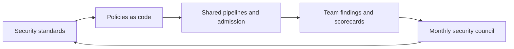

# DevSecOps — Scenario-Based Questions

<!-- DEVOPS-SHACK:HEADER -->
<p align="center">
  <a href="https://www.youtube.com/@devopsshack"></a>
  <a href="https://www.youtube.com/@shackverse"></a>
  <a href="https://devopsshack.com"></a>
  <a href="https://www.instagram.com/devopsshack"></a>
  <a href="https://github.com/jaiswaladi246/DevOps-Cloud-Interview-Preparation-by-DevOps-Shack"></a>
</p>
<p align="center"><sub>Part of <b><a href="https://github.com/jaiswaladi246/DevOps-Cloud-Interview-Preparation-by-DevOps-Shack">DevOps &amp; Cloud Interview Preparation</a></b> — created by <b><a href="https://www.youtube.com/@devopsshack">DevOps Shack</a></b>. Free to learn from; please credit DevOps Shack when sharing.</sub></p>
<!-- /DEVOPS-SHACK:HEADER -->

> Real-world DevSecOps situations and how to reason through them · 200 questions · 🟢 Beginner 🟡 Intermediate 🔴 Advanced

[⬅ Back to DevSecOps](./README.md) · [🏠 Home](../README.md)

## Table of contents
- [Pipeline Security Scanning](#pipeline-security-scanning) — Q1–Q25
- [Container and IaC Security](#container-and-iac-security) — Q26–Q50
- [Supply Chain Security](#supply-chain-security) — Q51–Q75
- [Secrets and Identity Management](#secrets-and-identity-management) — Q76–Q100
- [Kubernetes Security](#kubernetes-security) — Q101–Q125
- [Cloud IAM and Compliance](#cloud-iam-and-compliance) — Q126–Q150
- [Vulnerability Management and OWASP](#vulnerability-management-and-owasp) — Q151–Q175
- [Incident Response and Governance](#incident-response-and-governance) — Q176–Q200

---

## Pipeline Security Scanning

<!-- DEVOPS-SHACK:SECTION -->
> 🎥 **Learn this hands-on with DevOps Shack** → [YouTube @devopsshack](https://www.youtube.com/@devopsshack) · [Hindi @shackverse](https://www.youtube.com/@shackverse) · [Courses at devopsshack.com](https://devopsshack.com)

### Q1. You are asked to add security to an existing CI pipeline. Where do SAST, SCA, secrets scanning and DAST each go? 🟢

<details>
<summary><b>Answer</b></summary>

**Situation read →** Classic "shift left" design question. Each scan type needs a different artifact, so each lands at a different stage.

**What I'd do →**
1. Pre-commit and PR: secrets scan (`gitleaks`) and fast SAST (`semgrep`) on the diff only.
2. Build stage: SCA against lockfiles (`trivy fs`, `osv-scanner`) and IaC scan (`checkov`, `trivy config`).
3. After image build: image scan (`trivy image`), SBOM generation, signing.
4. After deploy to staging: DAST (`ZAP baseline`) against the running app.
5. Production: runtime detection and continuous re-scan of SBOMs.

**Why →** SAST and SCA need only source, so they run before anything is built. DAST needs a running target, so it can only run after deploy.

**Interview tip →** Say "cheap and fast scans block the PR, slow scans run nightly or post-deploy".

</details>

### Q2. Gitleaks flags an AWS access key in a pull request. The developer says it is a test key. What do you do? 🟢

<details>
<summary><b>Answer</b></summary>

**Situation read →** I never trust "it is a test key" until I verify it. Anything shaped like `AKIA...` is live until proven otherwise.

**What I'd do →**
1. Block the merge and keep the PR open.
2. Check whether the key is valid: `aws sts get-caller-identity` with that key from a trusted workstation, or ask the cloud team to look it up in IAM.
3. If live, deactivate it right away: `aws iam update-access-key --access-key-id AKIA... --status Inactive --user-name <user>`.
4. Remove the key from the branch history, not just the last commit, then rotate and move the value to a secret store.
5. Add a fake-looking placeholder or an allowlist entry in `.gitleaks.toml` only if it is truly a dummy.

**Why →** A key pushed to a remote can be scraped within minutes, even on private repos that later get exposed.

**Interview tip →** Mention that rotation matters more than deleting the commit.

</details>

### Q3. Developers fear security scans will slow the pipeline from 6 to 20 minutes. How do you roll them out? 🟢

<details>
<summary><b>Answer</b></summary>

**Situation read →** The real risk is developer pushback, not the tools. Slow gates get bypassed.

**What I'd do →**
1. Run scans in parallel with unit tests, not after them.
2. Scan only changed files on PRs (`semgrep ci` does diff-aware scanning).
3. Cache vulnerability databases (`trivy` `--cache-dir` plus CI cache).
4. Move heavy scans (full DAST, deep CodeQL) to nightly schedules.
5. Publish timing per job and keep the added time under about 2 minutes on PRs.

**Why →** Developers accept gates that are fast and predictable. A 2-minute scan with a clear message wins over a 15-minute scan nobody trusts.

**Interview tip →** Frame it as "security as a quality gate with a time budget".

</details>

### Q4. A SAST tool reports 2,000 findings on a legacy repo the first time you run it. How do you introduce it without freezing delivery? 🟡

<details>
<summary><b>Answer</b></summary>

**Situation read →** Blocking on 2,000 old findings guarantees the tool gets switched off.

**What I'd do →**
1. Baseline: record current findings as accepted debt (`semgrep ci` baseline commit, or CodeQL "new alerts only" on PRs).
2. Gate only on new findings of High/Critical severity.
3. Triage the baseline by exploitability: injection, auth and crypto first, style issues last.
4. Create a burn-down target per sprint, owned by the team that owns the code.
5. Turn off noisy rules with written justification.

**Why →** You stop the bleeding first, then pay down debt at a rate the team can sustain.

**Interview tip →** "Block new, burn down old" is the phrase interviewers like.

</details>

### Q5. A developer insists a scanner finding is a false positive. What is your process? 🟢

<details>
<summary><b>Answer</b></summary>

**Situation read →** Both extremes are bad: ignoring all developer claims, and accepting them without evidence.

**What I'd do →**
1. Ask the developer to explain why in the PR (data flow, sanitisation, unreachable code).
2. A security engineer or champion reviews and confirms.
3. Record the suppression in code with a reason and expiry, for example `// nosemgrep: rule-id -- input validated in X, review 2026-03`.
4. Track suppressions in a report so they can be audited.
5. If a rule is wrong repeatedly, tune or disable the rule centrally.

**Why →** Suppressions without a reason become hidden vulnerabilities.

**Interview tip →** Say "suppression needs a reviewer and an expiry date".

</details>

### Q6. SCA flags a critical CVE in a transitive dependency and no patched version exists. What are your options? 🟡

<details>
<summary><b>Answer</b></summary>

**Situation read →** The question is whether the vulnerable code path is reachable, not just whether the package is present.

**What I'd do →**
1. Check reachability: read the advisory for the affected function and grep your usage. Tools such as `govulncheck` do this for Go.
2. Look for a newer major version or an alternative library; use overrides (`npm overrides`, Maven `dependencyManagement`, `go.mod replace`).
3. Add a compensating control such as a WAF rule or input validation if reachable.
4. If unreachable, document a VEX statement (`not_affected`, `vulnerable_code_not_in_execute_path`) and an expiry.
5. Open an issue upstream and set a review date.

**Why →** You manage risk with evidence instead of blocking the release over a theoretical issue.

**Interview tip →** Mention VEX; most candidates do not.

</details>

### Q7. Developers bypass your pre-commit secret scan with `git commit --no-verify`. How do you close the gap? 🟡

<details>
<summary><b>Answer</b></summary>

**Situation read →** Client-side hooks are advice, not enforcement. They can always be skipped.

**What I'd do →**
1. Keep the pre-commit hook for fast feedback (`pre-commit` framework with gitleaks).
2. Enforce the same scan in CI as a required status check on the protected branch.
3. Turn on server-side push protection (GitHub secret scanning push protection, GitLab push rules).
4. Run a scheduled full-history scan across all repos.

**Why →** Defence in depth: the hook helps the honest developer, the server-side control stops the rest.

**Interview tip →** "Never rely on client-side controls for enforcement."

</details>

### Q8. You must introduce DAST against a staging web app that shares a database with other teams. How do you do it safely? 🟡

<details>
<summary><b>Answer</b></summary>

**Situation read →** Active scans send attack payloads and can create junk data or lock accounts. Shared data makes the blast radius bigger.

**What I'd do →**
1. Start with passive baseline mode: `docker run -t ghcr.io/zaproxy/zaproxy:stable zap-baseline.py -t https://staging.example.com -r report.html`.
2. Get a dedicated test environment or isolated schema for active scans.
3. Use test accounts with an authentication script; exclude logout and destructive URLs.
4. Run active scans (`zap-full-scan.py`) only in a window, with rate limits.
5. Feed results into the same triage queue as SAST.

**Why →** Passive scans find missing headers and cookie flags at no risk. Active scans need a safe sandbox.

**Interview tip →** Say you always get written approval and a scope before active scanning.

</details>

### Q9. A small startup has no security budget. Which free tooling gives the best coverage first? 🟢

<details>
<summary><b>Answer</b></summary>

**Situation read →** Pick open-source tools that cover the most common breaches: leaked secrets, vulnerable dependencies, vulnerable images and misconfigured IaC.

**What I'd do →**
1. `gitleaks` for secrets.
2. `trivy` for dependencies, images, IaC and secrets in one binary.
3. `semgrep` community rules for SAST.
4. `OWASP ZAP` baseline against staging.
5. Enable free platform features: Dependabot, GitHub secret scanning, branch protection, MFA.

**Why →** These five items cover most real-world incidents at zero licence cost.

**Interview tip →** Cost is a design constraint, not an excuse; show you can phase the programme.

</details>

### Q10. A secret exists in the git history of an 8-year-old monorepo with 400 contributors. Do you rewrite history? 🔴

<details>
<summary><b>Answer</b></summary>

**Situation read →** The secret is already compromised. Rewriting history is cleanup, not remediation.

**What I'd do →**
1. Rotate the credential first and confirm the old one is dead.
2. Search access logs for use of the old credential during its exposure window.
3. Decide on rewriting: for an internal repo with a rotated secret, I usually do not rewrite, because it breaks 400 clones and open PRs.
4. If the secret is highly sensitive or the repo is public, rewrite with `git filter-repo --replace-text expressions.txt`, force-push, ask GitHub to purge cached views, and have everyone re-clone.
5. Add scanning to prevent recurrence.

**Why →** Rotation removes the risk. History rewriting reduces noise and future scanner alerts at a high coordination cost.

**Interview tip →** Lead with "rotate first".

</details>

### Q11. How do you decide which findings should block a build and which should only warn? 🟡

<details>
<summary><b>Answer</b></summary>

**Situation read →** A gate policy needs to be simple enough that every developer can predict the result.

**What I'd do →**
1. Block: verified secrets, Critical/High SCA with a fix available, new High SAST findings, Critical IaC misconfigurations (public buckets, open 0.0.0.0/0 on SSH).
2. Warn: Medium and Low, issues with no fix, old baseline findings.
3. Implement with exit codes: `trivy image --severity HIGH,CRITICAL --ignore-unfixed --exit-code 1 app:1.2.3`.
4. Review the policy quarterly with the engineering leads.
5. Provide an exception process with owner and expiry.

**Why →** `--ignore-unfixed` avoids blocking on things nobody can fix today.

**Interview tip →** Mention that policy lives in code, versioned and reviewed.

</details>

### Q12. Renovate or Dependabot floods the team with 60 PRs a week. How do you make it sustainable? 🟡

<details>
<summary><b>Answer</b></summary>

**Situation read →** The tool is working, the configuration is not. Noise causes ignored PRs.

**What I'd do →**
1. Group updates (Renovate `groupName`, Dependabot `groups`) per ecosystem or per week.
2. Auto-merge patch and minor updates when tests pass.
3. Schedule runs, for example Monday morning only.
4. Raise security updates immediately, regular updates weekly.
5. Limit open PRs (`open-pull-requests-limit` in Dependabot, `prConcurrentLimit` in Renovate).

**Why →** Small frequent updates are safer than one big upgrade after two years.

**Interview tip →** Auto-merge needs a solid test suite; say that out loud.

</details>

### Q13. A team writes Python, Go and Java. Which SAST tools do you pick and why? 🟢

<details>
<summary><b>Answer</b></summary>

**Situation read →** Prefer one multi-language tool plus language-specific depth where it pays off.

**What I'd do →**
1. `semgrep` as the common layer across all three languages.
2. `bandit` for Python, `gosec` and `govulncheck` for Go, SpotBugs with the Find Security Bugs plugin for Java.
3. CodeQL if the code is on GitHub (free for public repos, licensed for private).
4. Normalise output as SARIF and upload to one dashboard.

**Why →** One consistent workflow reduces training, while language tools catch idioms generic rules miss.

**Interview tip →** Mention SARIF as the interchange format.

</details>

### Q14. Full SAST on a large monorepo takes 40 minutes. How do you cut it? 🔴

<details>
<summary><b>Answer</b></summary>

**Situation read →** Full scans on every PR are wasteful. Most changes touch a small part of the tree.

**What I'd do →**
1. Diff-aware scans on PRs (`semgrep ci` with `--baseline-commit`).
2. Path filters in the pipeline so only affected services are scanned.
3. Shard by directory in parallel jobs.
4. Run a full scan nightly on the default branch and track new findings there.
5. For CodeQL, use incremental analysis and cache the database where supported.

**Why →** PR scans need speed, nightly scans need completeness. Splitting them keeps both.

**Interview tip →** Tie the answer to developer wait time as a measurable metric.

</details>

### Q15. Findings live in five different tools and nobody has a single view. What do you build? 🟡

<details>
<summary><b>Answer</b></summary>

**Situation read →** Scattered findings mean duplicates, no ownership and no metrics.

**What I'd do →**
1. Standardise on SARIF for code scanners and CycloneDX or SPDX for SBOMs.
2. Import everything into one vulnerability management tool (DefectDojo, or GitHub Advanced Security code scanning for simple setups).
3. Deduplicate by fingerprint and map each finding to a service and a team owner.
4. Auto-create tickets in Jira with SLAs per severity.
5. Build a dashboard: open by severity, age, MTTR, SLA breaches.

**Why →** Without ownership and SLAs, findings are just a list.

**Interview tip →** Mention MTTR as the key metric.

</details>

### Q16. How do you secure a GitHub Actions workflow that uses many third-party actions? 🟡

<details>
<summary><b>Answer</b></summary>

**Situation read →** A compromised action runs with your secrets. Tag references like `@v3` can be moved by the owner or an attacker.

**What I'd do →**
1. Pin third-party actions to a full commit SHA with a comment for the version: `uses: actions/checkout@<40-char-sha> # v4`.
2. Set least-privilege `permissions:` at the workflow top, for example `contents: read`.
3. Allow only approved actions in org settings.
4. Use Dependabot or Renovate to bump the SHAs.
5. Use OIDC to cloud instead of long-lived keys.

**Why →** A SHA is immutable, a tag is not.

**Interview tip →** Cite the tj-actions/changed-files incident of March 2025 as a real example.

</details>

### Q17. A workflow using `pull_request_target` checks out the PR head and runs tests. Why is this dangerous and what do you change? 🔴

<details>
<summary><b>Answer</b></summary>

**Situation read →** `pull_request_target` runs in the context of the base repo with secrets and a write token. Checking out untrusted fork code and executing it hands those to an attacker.

**What I'd do →**
1. Switch to `pull_request` for building and testing fork code; it has no secrets and a read-only token.
2. If you need privileged steps (labeling, comments), split into two workflows: untrusted build uploads an artifact, a second `workflow_run` workflow reads it as data only.
3. Never interpolate PR titles or branch names directly in `run:`; pass them through `env:`.
4. Set `permissions:` to the minimum.

**Why →** Untrusted code plus secrets is the root of most Actions compromises.

**Interview tip →** Name "pwn request" as the attack class.

</details>

### Q18. A critical hotfix is blocked by a security gate at 2 a.m. What is your break-glass process? 🟢

<details>
<summary><b>Answer</b></summary>

**Situation read →** Gates must not become outage amplifiers, but bypasses must be visible.

**What I'd do →**
1. A named on-call lead approves an override through a documented path (a protected label or a manual approval environment).
2. The override is logged automatically with who, why and which finding.
3. The fix ships; a follow-up ticket with a 48-hour SLA closes the finding.
4. Review all overrides weekly.

**Why →** You trade a controlled risk for availability, and you keep an audit trail.

**Interview tip →** "Break-glass, logged, reviewed" is the whole answer.

</details>

### Q19. A licence scan shows a GPL-3.0 library inside your proprietary SaaS product. What now? 🟡

<details>
<summary><b>Answer</b></summary>

**Situation read →** Whether GPL obligations trigger depends on distribution, linking and the exact licence. This is a legal call, but engineering provides facts.

**What I'd do →**
1. Identify how it is used: linked into the shipped binary, a separate process, a build tool only, or never distributed (SaaS).
2. Escalate to legal with the SBOM entry and usage details.
3. Meanwhile, find a permissive alternative (MIT, Apache-2.0) or isolate behind a network boundary.
4. Add a licence policy to CI: `trivy fs --scanners license --severity HIGH .` or `licensee`/`ScanCode`.
5. Keep an allow/deny list owned by legal.

**Why →** AGPL is the one that reaches SaaS; plain GPL generally triggers on distribution.

**Interview tip →** Do not give legal conclusions; say you provide evidence and the policy engine.

</details>

### Q20. How do you add API security testing to a pipeline for a REST service with an OpenAPI spec? 🟡

<details>
<summary><b>Answer</b></summary>

**Situation read →** The spec lets a scanner know every endpoint, so crawling is not needed.

**What I'd do →**
1. Lint the spec for security issues (`spectral` with an OWASP ruleset).
2. Deploy to an ephemeral environment.
3. Run `zap-api-scan.py -t https://api.stg.example.com/openapi.json -f openapi -r api.html` with an auth header.
4. Add contract-based fuzzing (`schemathesis run`) for unexpected inputs.
5. Test authorization separately: two users, check one cannot read the other's object (BOLA).

**Why →** Generic scanners are weak at authorization bugs, so you need explicit tests for them.

**Interview tip →** Say BOLA is the top API risk in the OWASP API Top 10.

</details>

### Q21. How do you harden self-hosted CI runners? 🔴

<details>
<summary><b>Answer</b></summary>

**Situation read →** A persistent runner shared between repos is a lateral-movement path: one bad job can leave malware or steal tokens for the next.

**What I'd do →**
1. Use ephemeral runners (one job per VM or pod, destroyed afterwards), for example Actions Runner Controller on Kubernetes.
2. Never attach self-hosted runners to public repos.
3. Give each runner minimal cloud permissions through short-lived credentials and IMDSv2 with hop limit 1.
4. Network egress allowlist; no access to production networks.
5. Separate runner groups per trust level.
6. Patch the base image regularly and log all job activity.

**Why →** Ephemeral runners remove persistence, which is the main attacker advantage.

**Interview tip →** Mention that docker.sock mounts equal root on the host.

</details>

### Q22. How do you prove to leadership that the DevSecOps programme works? 🟢

<details>
<summary><b>Answer</b></summary>

**Situation read →** Leadership cares about risk reduction and delivery speed, not number of scans.

**What I'd do →**
1. Track mean time to remediate by severity and the share of findings fixed within SLA.
2. Track the count of critical vulnerabilities reaching production.
3. Track coverage: percent of repos with secrets, SAST and SCA enabled.
4. Track pipeline time added and the false-positive rate.
5. Report trends monthly, not snapshots.

**Why →** Trend lines show improvement, and coverage shows blind spots.

**Interview tip →** Include a developer-experience metric; it shows maturity.

</details>

### Q23. Your company bans a specific unsafe internal helper function. How do you enforce it automatically? 🟡

<details>
<summary><b>Answer</b></summary>

**Situation read →** This is a custom SAST rule, which is cheap with Semgrep.

**What I'd do →**
1. Write a rule:
```yaml
rules:
  - id: no-legacy-exec-helper
    languages: [python]
    severity: ERROR
    message: "legacy_exec() is banned, use safe_run() instead"
    pattern: legacy_exec(...)
```
2. Test it with `semgrep --test` using annotated test files.
3. Publish it in a shared rules repo and run it in all pipelines: `semgrep ci --config ./rules`.
4. Announce with a migration guide and an autofix where possible (`fix:`).

**Why →** Codifying lessons from incidents means the same bug cannot return.

**Interview tip →** Mention rules as code with unit tests.

</details>

### Q24. An org-wide secret scan finds 5,000 hits. How do you prioritise? 🔴

<details>
<summary><b>Answer</b></summary>

**Situation read →** Most hits are test fixtures and expired tokens. Treating all as equal burns the team out.

**What I'd do →**
1. Re-run with verification: `trufflehog git file://. --only-verified` to confirm which credentials are live.
2. Rank by blast radius: cloud admin keys, production DB credentials, signing keys, then SaaS tokens.
3. Prioritise public and widely-accessible repos.
4. Rotate first, clean history later.
5. Assign owners through CODEOWNERS and track in tickets with SLAs.
6. Add push protection to stop new ones.

**Why →** Verified live secrets are incidents; unverified ones are hygiene.

**Interview tip →** "Verified first, then by blast radius."

</details>

### Q25. How do you integrate threat modelling into a two-week sprint without slowing the team? 🟡

<details>
<summary><b>Answer</b></summary>

**Situation read →** Heavy threat modelling workshops do not survive agile cadence. It needs to be small and triggered.

**What I'd do →**
1. Trigger it only for changes with new trust boundaries: new service, new data type, new external integration, auth changes.
2. Use a 30-minute session with a simple data flow diagram and STRIDE prompts.
3. Capture threats as backlog tickets with acceptance criteria.
4. Keep diagrams as code (Mermaid or a Threat Dragon file) in the repo.
5. Security champions facilitate so the security team is not a bottleneck.

**Why →** Lightweight, repeated modelling finds design flaws that no scanner will.

**Interview tip →** Say "design flaws need design-time review".

</details>

---

## Container and IaC Security

<!-- DEVOPS-SHACK:SECTION -->
> 🎥 **Learn this hands-on with DevOps Shack** → [YouTube @devopsshack](https://www.youtube.com/@devopsshack) · [Hindi @shackverse](https://www.youtube.com/@shackverse) · [Courses at devopsshack.com](https://devopsshack.com)

### Q26. A team asks whether to use `ubuntu`, `alpine` or a distroless base image. How do you advise? 🟢

<details>
<summary><b>Answer</b></summary>

**Situation read →** Fewer packages means fewer CVEs and less attacker tooling, but also harder debugging.

**What I'd do →**
1. Recommend distroless or a minimal Chainguard/Wolfi-style image for production services in compiled languages.
2. Use Alpine when the team needs a shell and a package manager, and accept musl compatibility quirks.
3. Use Ubuntu or Debian slim only when software needs glibc and many system libraries.
4. Pair with multi-stage builds so compilers never reach the runtime image.
5. Debug with `kubectl debug` ephemeral containers instead of baking in a shell.

**Why →** Attack surface scales with the number of installed packages.

**Interview tip →** Mention that smaller does not mean automatically patched; you still rescan.

</details>

### Q27. `trivy image` shows 300 vulnerabilities in your app image. How do you bring this down? 🟢

<details>
<summary><b>Answer</b></summary>

**Situation read →** Most findings come from the OS layer and unused packages, not your code.

**What I'd do →**
1. Group by layer and package: `trivy image --format table app:1.0`.
2. Switch to a smaller, regularly rebuilt base image.
3. Remove packages you do not need (`apt-get purge`, no curl/wget in final image).
4. Rebuild weekly to pick up base image patches.
5. Filter on actionable items: `--severity HIGH,CRITICAL --ignore-unfixed`.

**Why →** One base image switch often removes 80% of findings.

**Interview tip →** Say you prioritise fixable and exploitable findings, not raw counts.

</details>

### Q28. A Dockerfile runs the app as root. How do you fix it and prove the fix? 🟡

<details>
<summary><b>Answer</b></summary>

**Situation read →** Root in a container increases the impact of any breakout or volume misconfiguration.

**What I'd do →**
1. Create a user and switch to it:
```dockerfile
RUN addgroup -S app && adduser -S app -G app
USER 10001:10001
```
2. Use a numeric UID so Kubernetes `runAsNonRoot` can verify it.
3. Set `securityContext: runAsNonRoot: true, allowPrivilegeEscalation: false, capabilities.drop: [ALL]`.
4. Enforce with Hadolint rule DL3002 and a Kyverno or PSA policy.
5. Verify: `docker run --rm app:1.0 id` shows non-zero uid.

**Why →** Numeric UID matters: kubelet cannot validate a named user.

**Interview tip →** Mention that ports below 1024 need `NET_BIND_SERVICE` or a higher port.

</details>

### Q29. Checkov fails a Terraform PR because an S3 bucket allows public access. What do you change? 🟢

<details>
<summary><b>Answer</b></summary>

**Situation read →** A public bucket is one of the most common causes of data leaks.

**What I'd do →**
1. Add a public access block:
```hcl
resource "aws_s3_bucket_public_access_block" "this" {
  bucket                  = aws_s3_bucket.this.id
  block_public_acls       = true
  block_public_policy     = true
  ignore_public_acls      = true
  restrict_public_buckets = true
}
```
2. Enable default encryption and versioning.
3. If the bucket must serve public web content, use CloudFront with Origin Access Control instead.
4. Enforce account-wide with S3 Block Public Access at account level.

**Why →** Block Public Access overrides any ACL or policy mistake.

**Interview tip →** Mention account-level block as the guardrail behind the resource-level fix.

</details>

### Q30. How do you set up image scanning so nothing vulnerable reaches production? 🟡

<details>
<summary><b>Answer</b></summary>

**Situation read →** Scanning in CI alone is not enough, since images can be pushed from elsewhere and age after the build.

**What I'd do →**
1. Scan in CI and fail on policy: `trivy image --exit-code 1 --severity CRITICAL --ignore-unfixed $IMAGE`.
2. Enable registry scanning (ECR enhanced scanning, Harbor with Trivy) for continuous rescans.
3. Allow only images from your registry via admission policy.
4. Require a signature and attestation of a passed scan at admission (Kyverno `verifyImages`).
5. Alert on new CVEs for images already deployed.

**Why →** The build-time gate stops bad images, admission stops bypasses, continuous scan handles aging.

**Interview tip →** Describe it as three layers: build, registry, cluster.

</details>

### Q31. An image passed scanning three weeks ago and runs in production. A new critical CVE is published today. What happens next? 🟡

<details>
<summary><b>Answer</b></summary>

**Situation read →** Vulnerability data changes daily. A clean scan is a point-in-time statement.

**What I'd do →**
1. Rely on stored SBOMs: query them for the affected package (`grype sbom:./sbom.json` or your inventory DB).
2. List running workloads using the image digest: `kubectl get pods -A -o jsonpath='{..image}'`.
3. Assess exploitability, internet exposure and available fix.
4. Rebuild with the patched base, run tests, and roll out via the normal pipeline.
5. Add temporary mitigation (WAF rule, network restriction) if the fix takes days.

**Why →** SBOM-based lookup answers "are we affected" in minutes instead of hours.

**Interview tip →** Log4Shell is the example everyone remembers.

</details>

### Q32. You find `ENV DB_PASSWORD=...` and `ARG NPM_TOKEN` in a Dockerfile. What is wrong and how do you fix it? 🟢

<details>
<summary><b>Answer</b></summary>

**Situation read →** Values baked into `ENV` ship in every layer's metadata. `ARG` values show in `docker history`.

**What I'd do →**
1. Remove the values and rotate the exposed secrets.
2. Use BuildKit secret mounts for build-time secrets:
```dockerfile
RUN --mount=type=secret,id=npmrc,target=/root/.npmrc npm ci
```
```bash
docker build --secret id=npmrc,src=$HOME/.npmrc -t app:1.0 .
```
3. Inject runtime secrets from Kubernetes Secrets, Vault or Secrets Manager.
4. Scan images for secrets: `trivy image --scanners secret app:1.0`.

**Why →** Secret mounts are not stored in any image layer.

**Interview tip →** Say "build secrets via mounts, runtime secrets via the platform".

</details>

### Q33. Why and how do you use multi-stage builds from a security point of view? 🟡

<details>
<summary><b>Answer</b></summary>

**Situation read →** Build tools, source code and caches in the final image add CVEs and help an attacker.

**What I'd do →**
1. Build in one stage, copy only the artifact to a minimal final stage:
```dockerfile
FROM golang:1.23 AS build
WORKDIR /src
COPY . .
RUN CGO_ENABLED=0 go build -o /out/app ./cmd/app

FROM gcr.io/distroless/static-debian12:nonroot
COPY --from=build /out/app /app
ENTRYPOINT ["/app"]
```
2. Pin base images by digest.
3. Keep `.dockerignore` strict (`.git`, `.env`, `*.pem`).

**Why →** The final image contains only what runs.

**Interview tip →** Mention `.dockerignore` as a common source of leaked files.

</details>

### Q34. How do you reduce the chance of container escape on a shared node pool? 🔴

<details>
<summary><b>Answer</b></summary>

**Situation read →** Containers share the host kernel. Escapes use dangerous capabilities, privileged mode, host mounts or kernel bugs.

**What I'd do →**
1. Forbid `privileged`, `hostPID`, `hostNetwork`, hostPath and dangerous capabilities (PSA `restricted`).
2. Drop all capabilities, add back only what is needed; enable `seccompProfile: RuntimeDefault`.
3. Use read-only root FS and non-root users.
4. Keep the node OS patched, use a container-optimised OS (Bottlerocket, Flatcar).
5. For untrusted workloads use sandboxed runtimes (gVisor, Kata Containers) via `RuntimeClass`.
6. Detect with Falco rules for shell in container and sensitive mounts.

**Why →** Layers: restrict the process, restrict the kernel interface, isolate the kernel when trust is low.

**Interview tip →** Name seccomp, AppArmor and user namespaces.

</details>

### Q35. Terraform state contains database passwords in plain text. How do you handle it? 🟡

<details>
<summary><b>Answer</b></summary>

**Situation read →** State stores resource attributes, including sensitive ones, even if marked `sensitive = true` in outputs.

**What I'd do →**
1. Use a remote backend with encryption and versioning: S3 with SSE-KMS, bucket policy restricting principals, DynamoDB or S3 native lockfile.
2. Restrict read access to state to the CI role and a few admins.
3. Avoid creating secrets in Terraform: use `manage_master_user_password = true` for RDS or reference Secrets Manager.
4. Enable ephemeral resources/values on Terraform 1.10+ where supported.
5. Audit access through CloudTrail data events.

**Why →** State is as sensitive as the secrets inside it.

**Interview tip →** Note that `sensitive = true` hides CLI output only.

</details>

### Q36. How do you enforce "no public RDS, encryption on" for all Terraform changes across teams? 🟡

<details>
<summary><b>Answer</b></summary>

**Situation read →** Per-team review does not scale. Put the rules in code that runs against the plan.

**What I'd do →**
1. Produce a plan JSON: `terraform plan -out tfplan && terraform show -json tfplan > plan.json`.
2. Evaluate with OPA/conftest:
```rego
package terraform
deny[msg] {
  r := input.resource_changes[_]
  r.type == "aws_db_instance"
  r.change.after.publicly_accessible == true
  msg := sprintf("%s must not be public", [r.address])
}
```
3. Run `conftest test plan.json` as a required check.
4. Backstop with AWS SCPs or Config rules for anything created outside Terraform.

**Why →** Plan-time checks give fast feedback, SCPs give hard enforcement.

**Interview tip →** Say "shift-left check plus cloud-side backstop".

</details>

### Q37. A security group allows `0.0.0.0/0` on port 22. How do you fix it properly? 🟢

<details>
<summary><b>Answer</b></summary>

**Situation read →** Internet-exposed SSH is scanned and brute-forced constantly.

**What I'd do →**
1. Remove the rule: `aws ec2 revoke-security-group-ingress --group-id sg-... --protocol tcp --port 22 --cidr 0.0.0.0/0`.
2. Replace admin access with AWS Systems Manager Session Manager (no inbound port, IAM-authenticated, logged).
3. If SSH is unavoidable, restrict to a bastion or VPN CIDR.
4. Add a Config rule `restricted-ssh` and a Checkov check to prevent regressions.

**Why →** No open port means nothing to scan.

**Interview tip →** Session Manager is the answer most interviewers want.

</details>

### Q38. A manifest uses `image: myapp:latest`. Why is this a security problem and what do you use instead? 🟡

<details>
<summary><b>Answer</b></summary>

**Situation read →** `latest` is mutable. You cannot tell what runs, cannot roll back reliably, and cannot link a running pod to a scan or signature.

**What I'd do →**
1. Tag with an immutable version or commit SHA, and enable tag immutability in the registry (ECR `imageTagMutability=IMMUTABLE`).
2. Deploy by digest: `image: registry.example.com/myapp@sha256:...`.
3. Enforce with a Kyverno policy that rejects `:latest` and tags without digest.
4. Let GitOps tooling (Argo CD Image Updater, Renovate) bump digests through PRs.

**Why →** Digests make deployments reproducible and verifiable.

**Interview tip →** Signatures and scan results are tied to digests, not tags.

</details>

### Q39. How do you control which images may run in a cluster of 200 teams? 🔴

<details>
<summary><b>Answer</b></summary>

**Situation read →** You need central policy that does not slow teams down and cannot be bypassed from `kubectl`.

**What I'd do →**
1. Allow only approved registries via admission control (Kyverno or Gatekeeper).
2. Require cosign signatures from the CI identity using keyless verification:
```yaml
verifyImages:
  - imageReferences: ["registry.example.com/*"]
    attestors:
      - entries:
          - keyless:
              issuer: https://token.actions.githubusercontent.com
              subject: https://github.com/example-org/*
```
3. Roll out in `Audit` mode first, publish reports, then switch to `Enforce`.
4. Provide exemptions by namespace label with expiry.

**Why →** Admission is the last gate before execution.

**Interview tip →** Mention audit-before-enforce rollout.

</details>

### Q40. Someone opened a security group manually in the console, bypassing Terraform. How do you detect and prevent it? 🟡

<details>
<summary><b>Answer</b></summary>

**Situation read →** Drift means your reviewed code is no longer the truth.

**What I'd do →**
1. Detect: scheduled `terraform plan -detailed-exitcode` (exit 2 means changes) and AWS Config rules.
2. Alert via CloudTrail and EventBridge on `AuthorizeSecurityGroupIngress` from non-pipeline principals.
3. Remediate: re-apply Terraform, or auto-remediate with Config and SSM Automation.
4. Prevent: remove write permissions from humans, use read-only console roles plus a break-glass role, add SCPs.

**Why →** If humans cannot change prod directly, drift becomes rare.

**Interview tip →** "Detect, remediate, then remove the permission that allowed it."

</details>

### Q41. A developer pulls a random image from Docker Hub for a database tool. How do you decide if it is acceptable? 🟢

<details>
<summary><b>Answer</b></summary>

**Situation read →** Unknown images can contain miners, backdoors or outdated software.

**What I'd do →**
1. Prefer Docker Official Images, Verified Publisher or Docker-Sponsored Open Source.
2. Check the Dockerfile source and update frequency.
3. Scan it: `trivy image publisher/tool:1.2`.
4. Mirror approved images into the internal registry and pin by digest.
5. Block direct pulls from public registries in production.

**Why →** A curated internal registry gives one place for scanning and control.

**Interview tip →** Mention pull-through caches as the practical approach.

</details>

### Q42. A CI job mounts `/var/run/docker.sock` into a container to build images. Is that acceptable? 🟡

<details>
<summary><b>Answer</b></summary>

**Situation read →** Docker socket access equals root on the host. Any process in that container can start a privileged container.

**What I'd do →**
1. Replace with daemonless builders: BuildKit rootless, Kaniko, Buildah or ko.
2. If you must use Docker, run on ephemeral VMs isolated from other workloads.
3. Never share the socket on runners that build untrusted code from forks.
4. Add a policy rule that rejects hostPath mounts of the socket.

**Why →** You remove the privilege instead of trying to monitor it.

**Interview tip →** Note Kaniko is now archived upstream; mention BuildKit or Buildah as current options.

</details>

### Q43. You must run customer-submitted code in your platform. What isolation do you choose? 🔴

<details>
<summary><b>Answer</b></summary>

**Situation read →** Standard containers share a kernel, which is not a strong enough boundary for hostile code.

**What I'd do →**
1. Use microVMs (Firecracker, Kata Containers) or a user-space kernel (gVisor) through a Kubernetes `RuntimeClass`.
2. Place them on a dedicated node pool with taints.
3. Deny egress by default with NetworkPolicy; allow only needed endpoints.
4. Set CPU, memory, pid and time limits; short-lived pods.
5. No cloud credentials: block IMDS and use no service account token (`automountServiceAccountToken: false`).

**Why →** Defence rests on the smallest possible kernel attack surface plus no useful credentials.

**Interview tip →** Compare the trade-off: gVisor has syscall overhead, Kata needs virtualisation.

</details>

### Q44. How do you scan Helm charts and Kubernetes manifests before deployment? 🟡

<details>
<summary><b>Answer</b></summary>

**Situation read →** Misconfigurations like privileged pods and missing limits are easiest to catch before they hit the cluster.

**What I'd do →**
1. Render the chart: `helm template myapp ./chart -f values-prod.yaml > rendered.yaml`.
2. Scan: `trivy config rendered.yaml`, `kubesec scan`, or `checkov -f rendered.yaml`.
3. Validate schema with `kubeconform -strict`.
4. Evaluate custom rules with conftest or Kyverno CLI (`kyverno apply policy.yaml --resource rendered.yaml`).
5. Run on every PR and block on high severity.

**Why →** Scanning rendered output tests what is actually applied, not just templates.

**Interview tip →** Scan with the production values file; defaults can hide problems.

</details>

### Q45. What does Hadolint do and how do you use it in a pipeline? 🟢

<details>
<summary><b>Answer</b></summary>

**Situation read →** Hadolint lints Dockerfiles for bad practices, and embeds ShellCheck for `RUN` lines.

**What I'd do →**
1. Run locally or in CI: `hadolint Dockerfile` or `docker run --rm -i hadolint/hadolint < Dockerfile`.
2. Fail on warnings and above: `hadolint --failure-threshold warning Dockerfile`.
3. Store exceptions in `.hadolint.yaml` with comments.
4. Typical catches: missing `USER` (DL3002), unpinned versions (DL3008), `ADD` instead of `COPY` (DL3020).

**Why →** It is fast and catches issues before the image is even built.

**Interview tip →** Pair it with image scanning; they find different problems.

</details>

### Q46. Checkov reports a failure in a shared Terraform module you cannot change this sprint. How do you handle it? 🟡

<details>
<summary><b>Answer</b></summary>

**Situation read →** Do not disable the whole check. Accept narrowly, with an owner and a date.

**What I'd do →**
1. Suppress inline with a reason: `#checkov:skip=CKV_AWS_144:Cross-region replication not required for logs, ticket SEC-412`.
2. Or use a baseline file: `checkov -d . --create-baseline` then `--baseline .checkov.baseline`.
3. File a ticket against the module owner with a due date.
4. Report skips in a monthly review.

**Why →** Narrow, documented exceptions keep the gate meaningful.

**Interview tip →** Every exception should answer "who owns it and when does it expire".

</details>

### Q47. How do you ensure all new EBS volumes and RDS instances are encrypted, even if a team forgets? 🟡

<details>
<summary><b>Answer</b></summary>

**Situation read →** Rely on defaults and guardrails, not on remembering.

**What I'd do →**
1. Turn on EBS encryption by default per region: `aws ec2 enable-ebs-encryption-by-default`.
2. Use IaC modules where `storage_encrypted = true` is hard-coded.
3. Add an SCP denying `rds:CreateDBInstance` when `rds:StorageEncrypted` is false.
4. Add AWS Config rules (`encrypted-volumes`, `rds-storage-encrypted`) with auto-remediation or alerts.
5. Use customer managed KMS keys for sensitive data with key policies.

**Why →** Preventive controls beat detective ones; you want both.

**Interview tip →** Remember that you cannot encrypt an existing unencrypted RDS instance in place; you restore from an encrypted snapshot copy.

</details>

### Q48. As platform lead, how do you design guardrails so teams can self-serve infrastructure safely? 🔴

<details>
<summary><b>Answer</b></summary>

**Situation read →** You want speed without the security team reviewing every change.

**What I'd do →**
1. Offer golden Terraform modules with secure defaults (encryption, logging, private networking).
2. Enforce policy as code in CI (OPA, Checkov) for custom resources.
3. Apply cloud-level preventive controls: SCPs, permission boundaries, tag policies.
4. Give teams scoped accounts or namespaces; central logging and Security Hub aggregation.
5. Provide paved-road templates with CI, scanning and signing preconfigured.
6. Measure adoption and exception rate.

**Why →** The easiest path should also be the secure path.

**Interview tip →** Use the phrase "paved road" and "guardrails, not gates".

</details>

### Q49. A team wants a privileged container for Docker-in-Docker builds in Kubernetes CI. What do you offer instead? 🟢

<details>
<summary><b>Answer</b></summary>

**Situation read →** Privileged pods can break out to the node. The need is to build images, not to run Docker.

**What I'd do →**
1. Use BuildKit in rootless mode or Buildah in an unprivileged pod.
2. Use a remote builder service (BuildKit daemon, cloud build) outside the cluster.
3. Run builders on a separate, tainted node pool with no production credentials.
4. Block `privileged: true` through admission policy elsewhere.

**Why →** Moving builds off shared nodes isolates the risk.

**Interview tip →** Say you replace the tool instead of granting the privilege.

</details>

### Q50. After enabling `readOnlyRootFilesystem: true`, the app crashes writing to `/tmp`. How do you proceed? 🟡

<details>
<summary><b>Answer</b></summary>

**Situation read →** Read-only root is a good control; the app just needs explicit writable paths.

**What I'd do →**
1. Find the writes: `kubectl logs` shows `Read-only file system` errors with the path.
2. Mount `emptyDir` at the needed paths:
```yaml
volumeMounts:
  - name: tmp
    mountPath: /tmp
volumes:
  - name: tmp
    emptyDir: {}
```
3. Redirect caches and logs to stdout or those mounts.
4. Keep `readOnlyRootFilesystem: true`.

**Why →** An attacker cannot drop binaries into the image filesystem.

**Interview tip →** Do not remove the control to fix the symptom.

</details>

---

## Supply Chain Security

<!-- DEVOPS-SHACK:SECTION -->
> 🎥 **Learn this hands-on with DevOps Shack** → [YouTube @devopsshack](https://www.youtube.com/@devopsshack) · [Hindi @shackverse](https://www.youtube.com/@shackverse) · [Courses at devopsshack.com](https://devopsshack.com)

### Q51. What is an SBOM, and at which point in the pipeline do you generate it? 🟢

<details>
<summary><b>Answer</b></summary>

**Situation read →** An SBOM is an inventory of components in a build artifact. It makes "are we affected by CVE-X" a query instead of an investigation.

**What I'd do →**
1. Generate it from the final image, because that is what ships: `syft app:1.0 -o cyclonedx-json > sbom.cdx.json`.
2. Do it in CI right after the image build, once per release.
3. Store it next to the image in the registry as an attestation (`cosign attest --type cyclonedx`).
4. Index SBOMs centrally (Dependency-Track) for continuous matching.

**Why →** Generating from the built image captures OS packages and copied binaries, not only lockfile entries.

**Interview tip →** An SBOM is data; value comes from continuous matching against new CVEs.

</details>

### Q52. A customer asks for an SBOM for your product. What do you give them? 🟢

<details>
<summary><b>Answer</b></summary>

**Situation read →** Customers want a machine-readable list they can import into their tooling.

**What I'd do →**
1. Provide CycloneDX or SPDX JSON per release, generated by `syft` or `trivy image --format cyclonedx`.
2. Sign it so they can verify authenticity.
3. Include a VEX document to say which listed CVEs do not affect you.
4. Review for internal-only package names or paths before sharing.
5. Publish it through a customer portal or release assets.

**Why →** SBOM plus VEX reduces back-and-forth about scanner noise.

**Interview tip →** Mention that regulations such as US EO 14028 and the EU Cyber Resilience Act push this.

</details>

### Q53. How do you sign container images in GitHub Actions without managing private keys? 🟡

<details>
<summary><b>Answer</b></summary>

**Situation read →** Keyless signing with Sigstore uses the workflow's OIDC identity and a short-lived certificate from Fulcio.

**What I'd do →**
1. Grant the job `id-token: write` and `packages: write`.
2. Install cosign (`sigstore/cosign-installer`) and sign by digest:
```bash
cosign sign --yes ghcr.io/example-org/app@sha256:<digest>
```
3. Record the signature in the Rekor transparency log (automatic).
4. Verify with identity constraints:
```bash
cosign verify ghcr.io/example-org/app@sha256:<digest> \
  --certificate-identity-regexp 'https://github.com/example-org/app/.github/workflows/release.yml@.*' \
  --certificate-oidc-issuer https://token.actions.githubusercontent.com
```

**Why →** No long-lived key means no key to steal.

**Interview tip →** Sign the digest, never the tag.

</details>

### Q54. You signed images in CI. How do you make sure the cluster only runs signed images? 🟡

<details>
<summary><b>Answer</b></summary>

**Situation read →** Signing without verification is decoration. Verification must happen at admission.

**What I'd do →**
1. Deploy Kyverno (`verifyImages`) or the Sigstore policy-controller.
2. Define the trusted identity (issuer and subject) as in the signing pipeline.
3. Start with `validationFailureAction: Audit`, review violations, then `Enforce`.
4. Use `mutateDigest: true` to rewrite tags to digests.
5. Exempt system namespaces with explicit rules.

**Why →** Admission control covers deployments from any source, including manual `kubectl`.

**Interview tip →** Mention that you also verify attestations, such as SBOM and scan results.

</details>

### Q55. Leadership wants "SLSA compliance". What do you propose? 🟡

<details>
<summary><b>Answer</b></summary>

**Situation read →** SLSA is a maturity framework for build integrity. The Build track has levels 1 to 3.

**What I'd do →**
1. Level 1: build is scripted and produces provenance.
2. Level 2: build on a hosted service that signs the provenance (GitHub Actions with `actions/attest-build-provenance`).
3. Level 3: isolated, non-forgeable builds; use reusable workflows or `slsa-github-generator` so the build definition is separated from the project.
4. Verify provenance at deploy with `slsa-verifier` or `gh attestation verify`.
5. Pick one critical service first and expand.

**Why →** Provenance proves what source, builder and inputs produced the artifact.

**Interview tip →** State a realistic target, usually L2 first, L3 for crown jewels.

</details>

### Q56. What is typosquatting and how do you protect developers from it? 🟢

<details>
<summary><b>Answer</b></summary>

**Situation read →** Attackers publish packages with names near popular ones (`reqeusts`, `colourama`) hoping for a typo.

**What I'd do →**
1. Use a private registry proxy and only allow packages through it.
2. Review new dependencies in PRs; require approval for new packages.
3. Use SCA tools that flag new or low-reputation packages (Socket, OpenSSF Scorecard).
4. Install from lockfiles only, with integrity hashes.
5. Train developers to copy names from the official docs.

**Why →** A proxy and review step turns a silent typo into a visible event.

**Interview tip →** Mention install scripts as the typical payload trigger.

</details>

### Q57. Your internal package `acme-utils` exists in a private registry. How do you prevent dependency confusion? 🔴

<details>
<summary><b>Answer</b></summary>

**Situation read →** If the package manager checks a public registry too, an attacker can publish `acme-utils` with a higher version and win resolution.

**What I'd do →**
1. Use scoped or namespaced names: npm `@acme/utils`; register the scope publicly as well.
2. Configure the client to route the scope to the private registry: `@acme:registry=https://npm.acme.internal/`.
3. In pip, avoid `--extra-index-url`; use a single proxy index with exclusion rules.
4. In Maven/Gradle, use repository content filtering for the group.
5. Use lockfiles with hashes and block resolution of internal names from public upstream in Artifactory or Nexus.

**Why →** Namespace ownership and a single resolution path remove the ambiguity.

**Interview tip →** Cite Alex Birsan's 2021 research as the origin.

</details>

### Q58. Why do you use `npm ci` and lockfiles in CI, and what does it protect against? 🟡

<details>
<summary><b>Answer</b></summary>

**Situation read →** `npm install` may update versions, so two builds of the same commit can differ.

**What I'd do →**
1. Commit `package-lock.json`, `poetry.lock`, `go.sum`, `Cargo.lock`.
2. In CI use `npm ci` (fails if the lockfile does not match `package.json`), `pip install --require-hashes -r requirements.txt`, `go mod verify`.
3. Review lockfile diffs in PRs.
4. Block registry-source changes in lockfile with a check.

**Why →** Reproducible installs mean a poisoned new release does not enter automatically.

**Interview tip →** Lockfile integrity hashes also detect tampered tarballs.

</details>

### Q59. Should dependencies be pinned to exact versions or use ranges? 🟢

<details>
<summary><b>Answer</b></summary>

**Situation read →** Ranges give automatic fixes but also automatic breakage and compromise. Pinning gives control but needs update discipline.

**What I'd do →**
1. Pin exact versions via lockfiles for applications.
2. Use ranges in libraries so consumers can resolve.
3. Use Renovate or Dependabot to move pins forward with PRs.
4. Add a cooldown (Renovate `minimumReleaseAge: "3 days"`, Dependabot `cooldown`) so brand-new releases get some time to be flagged.

**Why →** A few days of delay avoids most malicious package windows.

**Interview tip →** Pin plus automated updates, not pin and forget.

</details>

### Q60. A widely used open-source library you depend on appears to have a maintainer-injected backdoor, as in the xz case. How do you respond? 🔴

<details>
<summary><b>Answer</b></summary>

**Situation read →** First establish exposure: which versions, where deployed, whether the malicious path is reachable in your use.

**What I'd do →**
1. Query SBOMs for affected versions across all services and base images.
2. Follow the maintainers and CISA/vendor advisories; pin to a known-good version or roll back.
3. Rebuild images from clean sources and redeploy; invalidate build caches.
4. Hunt for indicators: unexpected processes, outbound connections, modified binaries (via Falco, EDR, file integrity).
5. Rotate credentials accessible from affected hosts if compromise is plausible.
6. Afterwards reduce blast radius: fewer SSH-reachable hosts, minimal images.

**Why →** Inventory plus rollback speed matter more than predicting the attack.

**Interview tip →** xz was caught by a performance anomaly; mention observability as a defence.

</details>

### Q61. How do you attach scan and test results to an image so later stages can verify them? 🟡

<details>
<summary><b>Answer</b></summary>

**Situation read →** Evidence should travel with the artifact and be verifiable, so deploy-time policy can use it.

**What I'd do →**
1. Produce the result predicate: `trivy image --format cosign-vuln -o vuln.json app@sha256:...`.
2. Attach it: `cosign attest --yes --predicate vuln.json --type vuln app@sha256:...`.
3. At admission, Kyverno `attestations` condition checks the attestation was signed by CI and has no critical findings.
4. Do the same for SBOM and provenance.

**Why →** Policy can say "only images with a recent passing scan from our pipeline may run".

**Interview tip →** Attestations are in-toto statements signed with the same identity.

</details>

### Q62. CycloneDX or SPDX: which do you choose? 🟡

<details>
<summary><b>Answer</b></summary>

**Situation read →** Both are accepted standards. The choice depends on consumers.

**What I'd do →**
1. Use CycloneDX for security use cases: native VEX, services, and wide support in Dependency-Track and Grype.
2. Use SPDX where licence compliance or regulatory submissions require it (ISO/IEC 5962).
3. Generate both if needed; `syft app:1.0 -o cyclonedx-json -o spdx-json`.
4. Validate with the format's schema and a tool like `sbomqs`.

**Why →** Pick by consumer requirements, not preference.

**Interview tip →** Both are fine; the real question is completeness and accuracy.

</details>

### Q63. How does a private package proxy (Artifactory, Nexus) improve supply chain security? 🟡

<details>
<summary><b>Answer</b></summary>

**Situation read →** Direct pulls from public registries give no control and no audit.

**What I'd do →**
1. Route all builds through one proxy; block direct egress to public registries from CI.
2. Cache packages so builds survive upstream removals (left-pad type incidents).
3. Add curation: block known-malicious packages, enforce licence rules, hold new versions for a few days.
4. Scan cached artifacts continuously (JFrog Xray, Nexus IQ).
5. Log which build pulled which package for incident response.

**Why →** One chokepoint gives control, caching and an audit trail.

**Interview tip →** Mention egress control, or developers will go around the proxy.

</details>

### Q64. A new npm worm is stealing tokens through install scripts. What do you change in your pipelines right now? 🔴

<details>
<summary><b>Answer</b></summary>

**Situation read →** Install-time scripts execute with the CI job's privileges and secrets. Reduce what they can reach.

**What I'd do →**
1. Disable lifecycle scripts by default: `npm ci --ignore-scripts` (allow explicit exceptions for packages needing builds).
2. Use short-lived tokens; replace long-lived npm publish tokens with trusted publishing (OIDC).
3. Run installs in jobs with no cloud or publish credentials; separate install/build from publish.
4. Check lockfile versions against the advisory; pin and add a release-age cooldown.
5. Search for the published IoCs in repos and runner logs, then rotate any exposed token.

**Why →** If scripts cannot reach secrets, a malicious package has little to steal.

**Interview tip →** Separate "build with untrusted deps" from "publish with trusted credentials".

</details>

### Q65. What does `--ignore-scripts` change, and what breaks when you use it? 🟢

<details>
<summary><b>Answer</b></summary>

**Situation read →** npm runs `preinstall`, `install` and `postinstall` scripts of dependencies by default. They are a popular malware trigger.

**What I'd do →**
1. Run `npm ci --ignore-scripts` or set `ignore-scripts=true` in `.npmrc`.
2. Expect breakage in packages that compile native code or download binaries (`sharp`, `esbuild`, `node-gyp` modules).
3. Explicitly rebuild trusted ones: `npm rebuild esbuild`.
4. Document the allowlist in the repo.

**Why →** You choose which code runs at install time, instead of every package.

**Interview tip →** pnpm 10 disables dependency scripts by default and uses an allowlist.

</details>

### Q66. How do you generate build provenance for a GitHub Actions release? 🟡

<details>
<summary><b>Answer</b></summary>

**Situation read →** Provenance records the repo, commit, workflow and builder identity, signed by the platform.

**What I'd do →**
1. Add permissions `id-token: write`, `attestations: write`, `contents: read`.
2. Use `actions/attest-build-provenance` with the artifact path or image digest:
```yaml
- uses: actions/attest-build-provenance@<sha>
  with:
    subject-name: ghcr.io/example-org/app
    subject-digest: ${{ steps.push.outputs.digest }}
    push-to-registry: true
```
3. Verify before deploy: `gh attestation verify oci://ghcr.io/example-org/app@sha256:... --owner example-org`.

**Why →** Verification links an artifact to a specific repo and workflow.

**Interview tip →** Provenance proves origin, not that the code is free of bugs.

</details>

### Q67. What is a reproducible build and why do security teams care? 🔴

<details>
<summary><b>Answer</b></summary>

**Situation read →** A build is reproducible if independent builders produce bit-identical output from the same source.

**What I'd do →**
1. Pin toolchains and base images by digest; avoid network access during build.
2. Remove nondeterminism: timestamps (`SOURCE_DATE_EPOCH`), file ordering, random IDs, locale.
3. For Go use `-trimpath` and `-buildvcs=false`; for Docker use BuildKit with `--output type=oci,rewrite-timestamp=true`.
4. Rebuild on a second, independent builder and compare digests.

**Why →** Matching hashes show the binary was not tampered with in the build system, which was the SolarWinds failure mode.

**Interview tip →** Say "hermetic plus deterministic".

</details>

### Q68. A Dockerfile downloads a binary with `curl | sh`. How do you make it safe? 🟡

<details>
<summary><b>Answer</b></summary>

**Situation read →** You are executing whatever the server returns at build time. A compromised URL means a compromised image.

**What I'd do →**
1. Pin an explicit version in the URL.
2. Verify a SHA-256 checksum stored in the repo: `echo "<sha256>  tool.tgz" | sha256sum -c -`.
3. Prefer verifying a signature (`cosign verify-blob`, GPG) from the publisher.
4. Better: use a package from your internal proxy, or copy from a pinned image with `COPY --from=`.

**Why →** A checksum committed in the repo ties the build to a reviewed artifact.

**Interview tip →** `curl | sh` in a Dockerfile is a code review red flag.

</details>

### Q69. What branch protection settings do you consider the minimum for production repositories? 🟡

<details>
<summary><b>Answer</b></summary>

**Situation read →** The repo is the root of trust for everything built from it.

**What I'd do →**
1. Require pull requests with at least one approval, and dismiss stale approvals on new commits.
2. Require code owner review for sensitive paths (`.github/workflows/`, `terraform/`).
3. Require status checks: tests, SAST, secrets, SCA.
4. Disallow force pushes and deletions; include administrators.
5. Require signed commits or verified tags for releases where policy needs it.
6. Use rulesets and protected environments for deploy approval.

**Why →** One person alone cannot push code to production.

**Interview tip →** Protect the workflow files with CODEOWNERS; they are code that holds secrets.

</details>

### Q70. Why do some teams require signed git commits, and what does it prove? 🟢

<details>
<summary><b>Answer</b></summary>

**Situation read →** Git author names are free text. Anyone can set `user.name` to your CTO.

**What I'd do →**
1. Sign with SSH, GPG or Sigstore gitsign: `git config commit.gpgsign true` and `git config gpg.format ssh`.
2. Enable "Require signed commits" in branch rules.
3. Register keys on the platform so commits show "Verified".
4. Combine with MFA and short-lived credentials.

**Why →** It proves the commit came from someone holding the key, not just using an email.

**Interview tip →** It proves identity, not that the code is safe; reviews still matter.

</details>

### Q71. Compare key-based and keyless signing for release artifacts. Which would you use? 🔴

<details>
<summary><b>Answer</b></summary>

**Situation read →** Both are valid. The decision depends on environment, trust model and operations burden.

**What I'd do →**
1. Keyless (Sigstore): short-lived certificates bound to OIDC identity, logged in Rekor. Best for public CI such as GitHub Actions. No key rotation.
2. KMS-backed keys (`cosign sign --key awskms:///alias/release`): key never leaves HSM, works air-gapped, good for regulated environments.
3. Self-managed key files: avoid; rotation and storage are painful.
4. For private deployments, run private Fulcio/Rekor or use KMS keys with strict IAM.
5. Verify policy by identity (keyless) or public key (KMS) at admission.

**Why →** Keyless reduces key custody risk; KMS gives control where the public Sigstore infrastructure cannot be used.

**Interview tip →** Mention transparency logs help detect misuse after the fact.

</details>

### Q72. What is a VEX and how does it reduce vulnerability noise? 🟡

<details>
<summary><b>Answer</b></summary>

**Situation read →** SBOM plus scanner gives many CVEs that do not apply to your product. VEX says which actually do.

**What I'd do →**
1. Write VEX statements per CVE and product with status: `not_affected`, `affected`, `fixed`, `under_investigation`, plus a justification.
2. Use CycloneDX VEX or OpenVEX (`vexctl create`).
3. Feed it to scanners: `grype --vex vex.json app:1.0`, `trivy image --vex vex.json app:1.0`.
4. Review statements when code changes.

**Why →** Consumers can suppress findings with evidence from the vendor.

**Interview tip →** Compare it to a documented false-positive that others can trust.

</details>

### Q73. How do you evaluate whether a new open-source dependency is safe enough to adopt? 🟡

<details>
<summary><b>Answer</b></summary>

**Situation read →** Popularity is not safety. Look at project health and security practices.

**What I'd do →**
1. Run OpenSSF Scorecard: `scorecard --repo=github.com/org/project`.
2. Check maintainers, release cadence, open security advisories and bus factor.
3. Review transitive dependency count and install scripts.
4. Check licence compatibility.
5. Wrap the library behind your own interface so you can replace it.
6. Record the decision in an ADR.

**Why →** Cheap vetting up front is better than emergency removal later.

**Interview tip →** Mention Scorecard checks such as branch protection, signed releases and pinned dependencies.

</details>

### Q74. Vendors send you SBOMs for their software. How do you operationalise them? 🔴

<details>
<summary><b>Answer</b></summary>

**Situation read →** SBOMs sitting in email folders protect no one.

**What I'd do →**
1. Ingest into Dependency-Track via its API, tagging vendor, product, version and environment.
2. Enable continuous matching against NVD, OSV and GitHub advisories; notify owners via webhook or Slack.
3. Ask vendors for VEX and for signed SBOMs.
4. Add SBOM delivery to procurement and contract requirements with a remediation SLA.
5. Review vendor risk quarterly.

**Why →** When the next Log4Shell happens, you search by component and know your exposure in minutes.

**Interview tip →** Say "ingest, match, notify, contract".

</details>

### Q75. Why should you "build once, promote the same artifact" across environments? 🟡

<details>
<summary><b>Answer</b></summary>

**Situation read →** Rebuilding per environment means production runs something that was never tested or scanned.

**What I'd do →**
1. Build and push one image tagged with commit SHA, record the digest.
2. Scan, sign and attest it once.
3. Promote by deploying the same digest through dev, staging and prod via GitOps PRs.
4. Keep environment differences in config, not in builds.
5. Admission policy checks the signature in every environment.

**Why →** What you tested and signed is exactly what runs in production.

**Interview tip →** Rebuilding for prod breaks the chain of evidence.

</details>


---

## Secrets and Identity Management

<!-- DEVOPS-SHACK:SECTION -->
> 🎥 **Learn this hands-on with DevOps Shack** → [YouTube @devopsshack](https://www.youtube.com/@devopsshack) · [Hindi @shackverse](https://www.youtube.com/@shackverse) · [Courses at devopsshack.com](https://devopsshack.com)

### Q76. A team stores database passwords in a `.env` file committed to a private repo. How do you migrate them out? 🟢

<details>
<summary><b>Answer</b></summary>

**Situation read →** Private does not mean safe. Every clone, fork, laptop and CI cache now holds production credentials.

**What I'd do →**
1. Treat every value in the file as exposed and plan rotation, not just removal.
2. Create the secrets in a store (AWS Secrets Manager, Vault, Azure Key Vault): `aws secretsmanager create-secret --name prod/orders/db --secret-string file://db.json`.
3. Change the app or deployment to read from the store (External Secrets Operator, CSI driver or SDK call).
4. Rotate each credential, then delete `.env` and add it to `.gitignore`; commit a `.env.example` with placeholders.
5. Add `gitleaks` in pre-commit and CI so it does not come back.

**Why →** Moving the file without rotating leaves the old values valid in git history forever.

**Interview tip →** Always say "rotate first, clean history second".

</details>

### Q77. Your CI pipeline uses long-lived AWS access keys stored as repository secrets. How do you replace them? 🟡

<details>
<summary><b>Answer</b></summary>

**Situation read →** Static keys in CI are the most common cloud breach path. OIDC federation removes them completely.

**What I'd do →**
1. Create a GitHub OIDC identity provider in IAM (`token.actions.githubusercontent.com`).
2. Create a role whose trust policy restricts `sub` to the exact repo and branch or environment:
```json
"Condition": {
  "StringEquals": { "token.actions.githubusercontent.com:aud": "sts.amazonaws.com" },
  "StringLike": { "token.actions.githubusercontent.com:sub": "repo:acme/orders:environment:prod" }
}
```
3. In the workflow add `permissions: id-token: write` and use `aws-actions/configure-aws-credentials` with `role-to-assume`.
4. Run both paths for a week, then delete the IAM user and its keys.

**Why →** Credentials now last about an hour, are scoped to one repo and environment, and nothing exists to leak.

**Interview tip →** Mention the `sub` condition; a wildcard `repo:acme/*` trust is a common mistake.

</details>

### Q78. An auditor asks how often you rotate database credentials. You currently never do. What do you build? 🟡

<details>
<summary><b>Answer</b></summary>

**Situation read →** Manual rotation never happens. It has to be automated and the app has to tolerate it.

**What I'd do →**
1. Turn on managed rotation: `aws secretsmanager rotate-secret --secret-id prod/orders/db --rotation-rules AutomaticallyAfterDays=30`, or RDS-managed master passwords.
2. Use the alternating-users strategy so one credential is always valid during the switch.
3. Make the app re-read the secret on auth failure or on a short cache TTL instead of only at startup.
4. Alert on rotation failures through EventBridge or CloudWatch.
5. Longer term, move to Vault dynamic credentials so each pod gets its own short-lived user.

**Why →** Rotation that breaks the app gets disabled within a week, so app behaviour matters as much as the schedule.

**Interview tip →** Say "rotation is an app-design problem, not a cron job".

</details>

### Q79. Pods need AWS access. A developer mounted an IAM user's keys as a Kubernetes Secret. What do you propose instead? 🟢

<details>
<summary><b>Answer</b></summary>

**Situation read →** Static keys in a Secret are base64, readable by anyone with `get secrets` in that namespace, and never expire.

**What I'd do →**
1. Use EKS Pod Identity (or IRSA on older clusters) to bind an IAM role to a service account.
2. With Pod Identity: `aws eks create-pod-identity-association --cluster-name prod --namespace orders --service-account orders-sa --role-arn arn:aws:iam::111122223333:role/orders-s3`.
3. Set `serviceAccountName: orders-sa` in the deployment; the AWS SDK picks up credentials automatically.
4. Delete the Secret and deactivate the IAM user's keys.

**Why →** Credentials are temporary, rotated by AWS and scoped to one workload.

**Interview tip →** GKE has Workload Identity and AKS has Workload Identity too; same idea everywhere.

</details>

### Q80. Should you use Kubernetes Secrets, Sealed Secrets, External Secrets Operator or the Secrets Store CSI driver? 🟡

<details>
<summary><b>Answer</b></summary>

**Situation read →** They solve different problems: storage, GitOps encryption, or syncing from an external source of truth.

**What I'd do →**
1. If a cloud secret manager exists, use External Secrets Operator to sync into native Secrets. Apps stay unchanged.
2. If secrets must never touch etcd, use the CSI driver to mount them as files directly from the store.
3. Use Sealed Secrets only for small GitOps setups without a secret manager; the encrypted blob lives in git.
4. Whatever I pick, enable etcd encryption at rest and restrict `get/list secrets` in RBAC.

**Why →** The source of truth should be a store with audit logs and rotation, not a YAML file.

**Interview tip →** ESO is the common default in 2025–2026 GitOps stacks.

</details>

### Q81. A Slack webhook URL and a Stripe live key were posted in a public GitHub issue. What is your response sequence? 🟢

<details>
<summary><b>Answer</b></summary>

**Situation read →** Public exposure means bots have already seen it. Speed matters more than root cause right now.

**What I'd do →**
1. Revoke and reissue both: roll the Stripe key in the dashboard, regenerate the Slack webhook.
2. Edit or delete the issue content and ask GitHub support to purge cached versions if needed.
3. Check Stripe logs and Slack audit for usage between post time and revocation.
4. Update consumers with the new values from the secret store.
5. Write a short incident note and enable GitHub push protection and secret scanning alerts org-wide.

**Why →** Deleting the comment does nothing for copies already scraped.

**Interview tip →** Order matters: revoke, then clean, then investigate.

</details>

### Q82. How would you set up HashiCorp Vault so Kubernetes workloads authenticate without any static token? 🔴

<details>
<summary><b>Answer</b></summary>

**Situation read →** The bootstrap secret problem: the app needs a credential to fetch credentials. Kubernetes auth uses the service account token as identity.

**What I'd do →**
1. Enable the auth method:
```bash
vault auth enable kubernetes
vault write auth/kubernetes/config kubernetes_host=https://$K8S_API:443
vault write auth/kubernetes/role/orders \
  bound_service_account_names=orders-sa \
  bound_service_account_namespaces=orders \
  policies=orders-read ttl=1h
```
2. Write a narrow policy: `path "kv/data/orders/*" { capabilities = ["read"] }`.
3. Use the Vault Agent injector or Vault Secrets Operator to deliver secrets to pods.
4. Use projected, audience-bound service account tokens, and enable Vault audit devices.

**Why →** Identity comes from the platform; nothing long-lived is ever written into a manifest.

**Interview tip →** Name it "secret zero" and explain how platform identity solves it.

</details>

### Q83. Engineers share one admin account for the production cloud console. How do you fix access? 🟢

<details>
<summary><b>Answer</b></summary>

**Situation read →** Shared accounts kill accountability; audit logs show one name for everyone.

**What I'd do →**
1. Set up SSO through IAM Identity Center (or Entra ID / Google) federated with the corporate IdP.
2. Create permission sets by job function: read-only, developer, ops-admin.
3. Enforce MFA in the IdP and remove console passwords for IAM users.
4. Lock the root user: hardware MFA, no access keys, credentials in a safe.
5. Rotate the shared password and disable the account once everyone has moved.

**Why →** Individual identities make CloudTrail useful and offboarding instant.

**Interview tip →** Leavers lose cloud access the moment HR disables them in the IdP.

</details>

### Q84. Developers need occasional production database access for debugging. How do you grant it safely? 🟡

<details>
<summary><b>Answer</b></summary>

**Situation read →** Standing access is the risk. Just-in-time, time-boxed, logged access is the goal.

**What I'd do →**
1. No permanent prod DB roles for developers.
2. Access request flow (Teleport, StrongDM, Boundary, or an IAM Identity Center permission set with approval) granting 1–4 hours.
3. Connect through a bastion-less path: SSM Session Manager port forwarding or the access proxy, with session recording.
4. Default to a read-only replica role; writes need a second approver.
5. Use IAM database authentication or Vault dynamic users so credentials expire with the session.

**Why →** Debugging stays possible, but every session has an owner, a reason and an expiry.

**Interview tip →** Use the phrase "zero standing privileges".

</details>

### Q85. A service account token from a GCP project has been found on a public paste site. What do you do? 🟡

<details>
<summary><b>Answer</b></summary>

**Situation read →** A JSON service account key is long-lived. It stays valid until someone deletes it.

**What I'd do →**
1. Identify the key ID from the JSON and delete it: `gcloud iam service-accounts keys delete KEY_ID --iam-account=sa@proj.iam.gserviceaccount.com`.
2. Review Cloud Audit Logs filtered on that principal for the exposure window.
3. Check for persistence: new keys, new service accounts, IAM binding changes, new compute instances.
4. Replace keys with Workload Identity Federation for the system that used it.
5. Enforce the org policy `iam.disableServiceAccountKeyCreation`.

**Why →** Attackers create their own persistence fast, so deleting the leaked key alone is not enough.

**Interview tip →** Always mention hunting for persistence after a credential leak.

</details>

### Q86. How do you inject secrets into a GitHub Actions job without them appearing in logs? 🟢

<details>
<summary><b>Answer</b></summary>

**Situation read →** GitHub masks registered secrets, but transformations (base64, substrings, JSON) can still leak them.

**What I'd do →**
1. Store values as environment-scoped secrets with required reviewers on the `prod` environment.
2. Pass them via `env:` to the specific step, not to the whole job.
3. Mask derived values: `echo "::add-mask::$TOKEN"`.
4. Never `set -x` in steps that touch secrets and never echo them.
5. Better still, fetch at runtime from Vault or a cloud store using OIDC so the value is never a repo secret.

**Why →** Masking is a safety net, not a control. Reduced scope and short life are the real controls.

**Interview tip →** Mention that secrets are not passed to workflows triggered from forks.

</details>

### Q87. A legacy app reads its config only from environment variables, and security says env vars are unsafe. How do you handle it? 🟡

<details>
<summary><b>Answer</b></summary>

**Situation read →** Env vars leak through `/proc/<pid>/environ`, crash dumps, debug pages and child processes. But a rewrite is not happening this quarter.

**What I'd do →**
1. Keep values out of the manifest: source the env vars from a Secret synced by ESO, not from literal YAML.
2. Restrict `pods/exec` and secret read access in RBAC.
3. Disable debug endpoints and error pages that dump the environment.
4. Plan the move to file-mounted secrets read at startup, which also allows hot reload.
5. Make sure log shippers do not capture environment dumps.

**Why →** Pragmatic risk reduction now, cleaner design later.

**Interview tip →** Show you can reduce risk without blocking delivery.

</details>

### Q88. Your company has 300 TLS certificates and two outages last year from expiry. What do you build? 🟡

<details>
<summary><b>Answer</b></summary>

**Situation read →** Expiry outages mean inventory and renewal are manual. Automate issuance and alert on what remains.

**What I'd do →**
1. Inventory: scan endpoints and pull from cloud certificate services and CT logs.
2. In Kubernetes, use cert-manager with an ACME `ClusterIssuer` (Let's Encrypt or internal CA) so certs renew at two-thirds of lifetime.
3. For load balancers, use ACM, which renews automatically for DNS-validated certs.
4. Alert at 30 and 7 days left with blackbox exporter `probe_ssl_earliest_cert_expiry`.
5. Assign an owner to every remaining manual certificate.

**Why →** Public certificate lifetimes are getting shorter, so manual renewal will only get harder.

**Interview tip →** Mention the CA/B Forum plan to cut public cert lifetimes toward 47 days.

</details>

### Q89. Microservices talk over plain HTTP inside the cluster. Security wants service-to-service authentication. What are your options? 🔴

<details>
<summary><b>Answer</b></summary>

**Situation read →** The internal network is not a trust boundary. Each service needs a verifiable identity.

**What I'd do →**
1. Service mesh with mTLS: Istio or Linkerd issue SPIFFE identities per service account and rotate certs automatically.
2. Enforce strict mode, e.g. Istio `PeerAuthentication` with `mtls.mode: STRICT`, after a permissive rollout.
3. Add authorization: Istio `AuthorizationPolicy` allowing only `orders` to call `payments`.
4. Without a mesh: SPIRE for identities plus app-level mTLS, or signed JWTs between services.
5. Keep NetworkPolicies as a second layer.

**Why →** mTLS gives encryption and identity; authorization policies turn identity into least privilege.

**Interview tip →** Roll out permissive first, watch metrics, then switch to strict.

</details>

### Q90. An employee with admin access leaves the company on bad terms today. What is your checklist? 🟢

<details>
<summary><b>Answer</b></summary>

**Situation read →** Act before they are out of the building; assume worst-case intent.

**What I'd do →**
1. Disable the IdP account and kill sessions; this cuts SSO to cloud, GitHub and Slack.
2. Revoke anything not behind SSO: personal access tokens, SSH keys, IAM users, kubeconfig certs, API keys.
3. Rotate shared secrets they could have read (break-glass passwords, CI secrets).
4. Review the last 30 days of audit logs for unusual activity or new access paths.
5. Transfer ownership of their repos, pipelines and on-call duties.

**Why →** SSO coverage decides how fast this is; anything outside SSO is a manual hunt.

**Interview tip →** The real answer is "this is why everything goes through SSO".

</details>

### Q91. A Kubernetes kubeconfig with a client certificate for `system:masters` was copied to a contractor laptop. What now? 🔴

<details>
<summary><b>Answer</b></summary>

**Situation read →** Client certificates cannot be revoked individually in Kubernetes, and `system:masters` bypasses RBAC.

**What I'd do →**
1. On managed clusters, check whether the cert came from the cluster CA; rotating the CA is the only real revocation.
2. Plan a CA rotation: on EKS that means a new cluster or the documented cert rotation path; on kubeadm `kubeadm certs renew` does not revoke, so a CA change is needed.
3. Meanwhile, restrict API endpoint access to known CIDRs or private-only.
4. Review audit logs for that certificate's `CN`.
5. Going forward, give humans access only via OIDC/IAM-mapped identities, never long-lived client certs.

**Why →** You cannot delete a cert from Kubernetes; trust lives in the CA.

**Interview tip →** Knowing "certs cannot be revoked" separates seniors from juniors.

</details>

### Q92. How do you manage SSH access to 500 Linux servers without distributing static keys? 🟡

<details>
<summary><b>Answer</b></summary>

**Situation read →** `authorized_keys` sprawl means nobody knows who can log in where.

**What I'd do →**
1. Replace SSH with SSM Session Manager or an access proxy (Teleport, Boundary) where possible; port 22 closed.
2. Where SSH stays, use short-lived SSH certificates from Vault SSH CA: `vault write ssh-client-signer/sign/ops public_key=@id_ed25519.pub`.
3. Servers trust the CA via `TrustedUserCAKeys` in `sshd_config`; no per-user keys on hosts.
4. Disable password auth and root login.
5. Record sessions and ship logs centrally.

**Why →** Certificates expire on their own, so offboarding is automatic.

**Interview tip →** "SSH certificates, not keys" is the key phrase.

</details>

### Q93. A developer created a GitHub personal access token with full `repo` and `admin:org` scopes for a script. How do you respond? 🟢

<details>
<summary><b>Answer</b></summary>

**Situation read →** A classic PAT with org admin scope, owned by one human, is a huge blast radius.

**What I'd do →**
1. Ask what the script needs, then replace the token with a fine-grained PAT limited to the needed repos and permissions with an expiry.
2. For automation, prefer a GitHub App with installation tokens that last one hour.
3. Revoke the classic token.
4. Set an org policy requiring approval for fine-grained PATs and restricting classic PATs.

**Why →** GitHub Apps are not tied to a person and have scoped, short-lived tokens.

**Interview tip →** Say "automation should never run as a human".

</details>

### Q94. Terraform needs credentials for AWS, Datadog and Cloudflare in CI. How do you supply them securely? 🟡

<details>
<summary><b>Answer</b></summary>

**Situation read →** Multiple providers often means multiple static tokens. Minimise and federate.

**What I'd do →**
1. AWS: OIDC role assumption, separate plan (read) and apply (write) roles.
2. Others: store API tokens in Vault or Secrets Manager, fetch at job start using the AWS role or Vault JWT auth.
3. Pass via env vars (`DD_API_KEY`, `CLOUDFLARE_API_TOKEN`), never in `.tfvars` committed to git.
4. Mark sensitive variables with `sensitive = true` and use `ephemeral` resources/variables (Terraform 1.10+) so values stay out of state where supported.
5. Scope each token to the zones or orgs it manages.

**Why →** One federated identity unlocks the rest, so there is only one trust root to protect.

**Interview tip →** Split plan and apply roles; PRs only ever get the read role.

</details>

### Q95. How do you detect secrets that slipped past scanners and are already in logs or tickets? 🔴

<details>
<summary><b>Answer</b></summary>

**Situation read →** Scanners cover repos; secrets also end up in logs, Jira, Confluence and Slack.

**What I'd do →**
1. Run `trufflehog` with verification on Slack exports, Confluence and Jira where licences allow, or use the vendor's DLP features.
2. Add redaction processors in the log pipeline (Fluent Bit, Vector) for known patterns like `AKIA[0-9A-Z]{16}` and JWTs.
3. Plant canary tokens in sensitive places; any use triggers an alert.
4. Monitor cloud provider leak notifications (AWS quarantine policy events, GitHub partner alerts).
5. Feed every finding to rotation, not just deletion.

**Why →** Logs are often less protected than code and keep data for months.

**Interview tip →** Canary tokens show you think about detection, not only prevention.

</details>

### Q96. A secret manager outage took down all apps because they fetch secrets on every request. How do you redesign? 🔴

<details>
<summary><b>Answer</b></summary>

**Situation read →** The secret store became a hard runtime dependency on the hot path.

**What I'd do →**
1. Fetch at startup and cache in memory with a TTL; refresh in the background.
2. Keep serving with the cached value if refresh fails, and alert.
3. For Kubernetes, sync to native Secrets with ESO so a store outage only blocks updates, not running pods.
4. Use client-side caching libraries (AWS Secrets Manager caching client, Vault Agent cache).
5. Run Vault in HA with replicas across zones, and test failure in game days.

**Why →** Secrets change rarely; there is no need to call the store per request.

**Interview tip →** Balance security (fresh secrets) and availability (cached secrets) out loud.

</details>

### Q97. Your app encrypts customer PII with a key hard-coded in the source. How do you fix the key management? 🟡

<details>
<summary><b>Answer</b></summary>

**Situation read →** Anyone with repo access can decrypt all PII. The key must move to a KMS and data needs re-encryption.

**What I'd do →**
1. Create a KMS key with a key policy limited to the app role.
2. Use envelope encryption: `GenerateDataKey` per record or batch, store the encrypted data key with the ciphertext.
3. Write a migration job that decrypts with the old key and re-encrypts with KMS-derived data keys.
4. Remove the old key from code and history, and treat it as compromised.
5. Enable automatic key rotation and CloudTrail alerts on `Decrypt` spikes.

**Why →** KMS keys never leave the HSM, every use is logged, and access is controlled by IAM.

**Interview tip →** Explain envelope encryption in one sentence; interviewers love it.

</details>

### Q98. Two teams argue: one wants a central Vault cluster, the other wants each team to use cloud-native secret managers. How do you decide? 🔴

<details>
<summary><b>Answer</b></summary>

**Situation read →** It is a trade-off between consistency and operational load.

**What I'd do →**
1. Single cloud: cloud-native managers win; no cluster to run, IAM integration built in.
2. Multi-cloud or on-prem heavy, or need for dynamic DB creds, PKI and SSH CA: Vault (or OpenBao) earns its operational cost.
3. Consider a hybrid: cloud-native as storage, ESO as the uniform interface for Kubernetes.
4. Agree on common standards either way: naming, rotation, audit, access via workload identity.

**Why →** Running Vault well needs a dedicated team; a badly run Vault is worse than a managed service.

**Interview tip →** Mention OpenBao as the open-source fork after Vault's licence change.

</details>

### Q99. How do you verify that no human has standing write access to production cloud accounts? 🟡

<details>
<summary><b>Answer</b></summary>

**Situation read →** Policy says "no standing access"; you need evidence, not belief.

**What I'd do →**
1. List IAM users and access keys: `aws iam generate-credential-report` and check for console passwords or active keys.
2. Review Identity Center assignments for prod accounts; only JIT-elevated permission sets should have write.
3. Use IAM Access Analyzer unused access findings to spot unused roles and permissions.
4. Automate a weekly check (AWS Config rule or a script) that fails on new standing admin assignments.
5. Report results to the security dashboard.

**Why →** Continuous evidence beats a yearly access review spreadsheet.

**Interview tip →** "Evidence over policy" fits every compliance conversation.

</details>

### Q100. A pipeline needs to push images to registries in three clouds. How do you avoid storing three sets of credentials? 🔴

<details>
<summary><b>Answer</b></summary>

**Situation read →** Each cloud supports OIDC federation from CI. Use the CI identity token everywhere.

**What I'd do →**
1. AWS ECR: `configure-aws-credentials` with a role, then `aws ecr get-login-password | docker login`.
2. GCP Artifact Registry: Workload Identity Federation pool trusting GitHub, via `google-github-actions/auth`.
3. Azure ACR: federated credential on an Entra app registration, via `azure/login` with `client-id`, `tenant-id`, `subscription-id`.
4. Restrict each trust to the repo and `refs/heads/main` or an environment.
5. Push once, then replicate with the registries' own replication if possible.

**Why →** Zero stored secrets in CI; all three tokens are short-lived and auditable.

**Interview tip →** Show you know the GCP and Azure equivalents, not just AWS.

</details>

---

## Kubernetes Security

<!-- DEVOPS-SHACK:SECTION -->
> 🎥 **Learn this hands-on with DevOps Shack** → [YouTube @devopsshack](https://www.youtube.com/@devopsshack) · [Hindi @shackverse](https://www.youtube.com/@shackverse) · [Courses at devopsshack.com](https://devopsshack.com)

### Q101. Every developer has `cluster-admin` on the shared cluster "because it is easier". How do you fix RBAC without a revolt? 🟢

<details>
<summary><b>Answer</b></summary>

**Situation read →** `cluster-admin` for everyone means any compromised laptop owns the cluster. Fix it gradually with good defaults.

**What I'd do →**
1. Find who has it: `kubectl get clusterrolebindings -o wide | grep cluster-admin`.
2. Create a namespaced `Role` for app teams (deployments, services, configmaps, pods/log) and bind it per team namespace with a `RoleBinding`.
3. Give a cluster-wide read-only `ClusterRole` for visibility, excluding secrets.
4. Keep `cluster-admin` for a small platform group via JIT elevation.
5. Test with `kubectl auth can-i --list --as=jane@acme.com -n orders` before removing old bindings.

**Why →** Teams keep full control of their own namespaces, so daily work does not change.

**Interview tip →** `kubectl auth can-i` shows you verify RBAC rather than guess.

</details>

### Q102. You must roll out Pod Security Standards on a cluster with 80 existing namespaces. How do you avoid breaking workloads? 🟡

<details>
<summary><b>Answer</b></summary>

**Situation read →** Pod Security Admission can warn and audit before it enforces. Use that.

**What I'd do →**
1. Label all namespaces with warn and audit at `restricted`, enforce at `baseline`:
```bash
kubectl label ns --all \
  pod-security.kubernetes.io/enforce=baseline \
  pod-security.kubernetes.io/warn=restricted \
  pod-security.kubernetes.io/audit=restricted --overwrite
```
2. Dry-run first: `kubectl label --dry-run=server --overwrite ns orders pod-security.kubernetes.io/enforce=restricted` lists violating pods.
3. Fix manifests team by team (runAsNonRoot, drop capabilities, seccomp `RuntimeDefault`).
4. Move namespaces to `enforce=restricted` once clean; keep system namespaces at `privileged` with a documented reason.

**Why →** Warnings in `kubectl` output and audit logs give teams time to fix things before anything is blocked.

**Interview tip →** PodSecurityPolicy was removed in 1.25; PSA is the built-in replacement.

</details>

### Q103. A pentest shows any pod can reach any other pod, including the database. What do you implement? 🟢

<details>
<summary><b>Answer</b></summary>

**Situation read →** Kubernetes networking is flat by default. NetworkPolicies need a CNI that enforces them (Calico, Cilium, or VPC CNI with network policy enabled).

**What I'd do →**
1. Confirm enforcement support in the CNI.
2. Apply default deny in each namespace:
```yaml
apiVersion: networking.k8s.io/v1
kind: NetworkPolicy
metadata: { name: default-deny, namespace: orders }
spec:
  podSelector: {}
  policyTypes: [Ingress, Egress]
```
3. Add allow rules: ingress controller to frontend, frontend to API, API to DB on 5432, and DNS egress to kube-dns on 53.
4. Test with a temporary pod and `nc -zv`.

**Why →** Default deny turns lateral movement from trivial into hard.

**Interview tip →** Forgetting DNS egress is the classic mistake; mention it.

</details>

### Q104. Falco alerts "Terminal shell in container" on a production payments pod at 3 a.m. Walk through your response. 🟡

<details>
<summary><b>Answer</b></summary>

**Situation read →** Could be an engineer debugging or an attacker with RCE. Verify fast, preserve evidence.

**What I'd do →**
1. Check the alert fields: user, command line, parent process, pod and node.
2. Check audit logs for a matching `pods/exec` by a known human: if found, confirm with that person.
3. If no exec in audit logs, the shell came from inside the app: treat it as RCE.
4. Isolate: apply a deny-all NetworkPolicy to the pod label, cordon the node, but do not delete the pod yet.
5. Capture evidence (process list, network connections, container filesystem diff), then rotate the pod's secrets and redeploy from a known-good image.

**Why →** Audit logs tell you if the shell came through the API or from an exploit.

**Interview tip →** "Isolate, don't delete" keeps evidence for forensics.

</details>

### Q105. A cluster's nodes are suddenly at 100% CPU and you find pods running `xmrig` in a namespace nobody owns. How do you respond? 🟡

<details>
<summary><b>Answer</b></summary>

**Situation read →** Cryptomining is often the first visible sign of a compromise. Find the entry point, not just the miner.

**What I'd do →**
1. Save the pod specs: `kubectl get pod -n x -o yaml > evidence.yaml`, note the creator from audit logs (`user.username` on the `create` event).
2. Isolate with a deny-all NetworkPolicy and scale the workloads down; block the mining pool domains at egress.
3. Find the entry point: exposed dashboard, anonymous API access, leaked kubeconfig, vulnerable app with RCE, or a compromised CI token.
4. Revoke the credential used, check for other persistence (DaemonSets, CronJobs, new RBAC bindings, mutating webhooks).
5. Rebuild affected nodes if any pod was privileged or used hostPath.

**Why →** Deleting the miner without closing the hole means it is back in an hour.

**Interview tip →** Mention checking for malicious webhooks and CronJobs as persistence.

</details>

### Q106. The Kubernetes API server endpoint is public. Is that a problem, and what do you do? 🟢

<details>
<summary><b>Answer</b></summary>

**Situation read →** A public endpoint still needs auth, but it exposes the cluster to credential stuffing and zero-day exploits.

**What I'd do →**
1. Prefer a private endpoint; access via VPN, bastion or SSM.
2. If public is needed (for example hosted CI), restrict to known CIDRs: `aws eks update-cluster-config --name prod --resources-vpc-config endpointPublicAccess=true,publicAccessCidrs="203.0.113.0/24",endpointPrivateAccess=true`.
3. Confirm anonymous auth gives nothing useful: `curl -k https://$API/api` should return 401 or 403.
4. Keep the control plane version current.

**Why →** Reducing who can reach the API cuts off whole classes of attacks.

**Interview tip →** Private endpoint plus CI runners inside the VPC is the clean answer.

</details>

### Q107. A team mounts `hostPath: /` into a logging agent. How do you evaluate and constrain this? 🟡

<details>
<summary><b>Answer</b></summary>

**Situation read →** Mounting `/` gives the pod full node access, including kubelet credentials and other pods' data.

**What I'd do →**
1. Ask what it really needs; log agents usually need only `/var/log` and `/var/lib/docker/containers` or `/var/log/pods`.
2. Narrow the mounts and set `readOnly: true`.
3. Run it in a dedicated namespace labelled for an exception, not in app namespaces.
4. Enforce with Kyverno or Gatekeeper: deny `hostPath` except allowlisted paths in allowlisted namespaces.

**Why →** Platform agents sometimes need host access, but each one should get only the paths it uses.

**Interview tip →** Treat every DaemonSet with host mounts as part of the node's trusted base.

</details>

### Q108. How do you stop pods from getting a service account token they never use? 🟢

<details>
<summary><b>Answer</b></summary>

**Situation read →** By default every pod gets a token for its service account. If the app is compromised, that token talks to the API.

**What I'd do →**
1. Set `automountServiceAccountToken: false` on the `default` service account in each namespace and on pod specs that do not call the API.
2. Create dedicated service accounts for workloads that need API access, with minimal Roles.
3. Rely on projected, time-bound tokens (default since 1.22) rather than legacy Secret-based tokens.
4. Audit for leftover legacy token Secrets: `kubectl get secrets -A --field-selector type=kubernetes.io/service-account-token`.

**Why →** Most apps never talk to the Kubernetes API; giving them a token only helps an attacker.

**Interview tip →** Mention the `default` service account; it often has extra permissions someone added.

</details>

### Q109. Security wants to know who deleted a production deployment last Friday. Audit logging was never configured. What do you set up? 🟡

<details>
<summary><b>Answer</b></summary>

**Situation read →** Without audit logs, that question has no answer. Turn them on now and keep them off-cluster.

**What I'd do →**
1. Managed clusters: enable control plane audit logs (`aws eks update-cluster-config --logging '{"clusterLogging":[{"types":["audit"],"enabled":true}]}'`, GKE has Admin Activity on by default).
2. Self-managed: write an audit policy logging `RequestResponse` for secrets metadata only, `Metadata` for most, and drop noisy reads.
3. Ship to a SIEM with retention matching compliance (often 1 year).
4. Alert on high-risk verbs: `delete` on deployments in prod, `create` on clusterrolebindings, `pods/exec`.
5. For Friday's event: check GitOps history and CI logs, which may still show who changed what.

**Why →** Audit logs are the only record of who did what in the cluster.

**Interview tip →** Never log secret values at `RequestResponse` level; use `Metadata` for secrets.

</details>

### Q110. How do you make sure Kubernetes Secrets are encrypted at rest in etcd? 🟡

<details>
<summary><b>Answer</b></summary>

**Situation read →** Secrets are base64, not encrypted. Anyone with an etcd backup can read them unless encryption is configured.

**What I'd do →**
1. Managed: on EKS enable envelope encryption with a KMS key (`aws eks associate-encryption-config`); recent EKS versions encrypt by default, but a customer KMS key gives control and audit.
2. Self-managed: `EncryptionConfiguration` with the `kms` v2 provider, passed via `--encryption-provider-config`.
3. Re-encrypt existing Secrets: `kubectl get secrets -A -o json | kubectl replace -f -`.
4. Protect etcd backups and restrict `get/list` on secrets in RBAC.

**Why →** Encryption at rest protects against stolen disks and backups, not against users who can read secrets through the API.

**Interview tip →** Say clearly that base64 is encoding, not encryption.

</details>

### Q111. Write a policy that rejects any Deployment without CPU and memory limits and without a `team` label. Which tool and how? 🟡

<details>
<summary><b>Answer</b></summary>

**Situation read →** An admission policy engine handles this. Kyverno writes it in YAML, Gatekeeper in Rego, or built-in ValidatingAdmissionPolicy in CEL.

**What I'd do →**
1. Kyverno example:
```yaml
apiVersion: kyverno.io/v1
kind: ClusterPolicy
metadata: { name: require-limits-and-team }
spec:
  validationFailureAction: Audit
  rules:
  - name: check
    match: { any: [ { resources: { kinds: [Deployment] } } ] }
    validate:
      message: "team label and resource limits are required"
      pattern:
        metadata: { labels: { team: "?*" } }
        spec: { template: { spec: { containers: [ { resources: { limits: { cpu: "?*", memory: "?*" } } } ] } } }
```
2. Start in `Audit`, review policy reports, then switch to `Enforce`.
3. Run the same policies in CI with `kyverno apply` so developers see failures before merge.

**Why →** Limits prevent noisy-neighbour denial of service; labels give ownership for incidents.

**Interview tip →** "Audit first, then enforce, and test in CI too."

</details>

### Q112. kube-bench reports 40 CIS benchmark failures on your managed EKS nodes. How do you prioritise? 🟡

<details>
<summary><b>Answer</b></summary>

**Situation read →** Many CIS controls cover the control plane, which the provider manages. Use the right benchmark first.

**What I'd do →**
1. Run the managed profile: `kube-bench run --benchmark eks-1.5.0` (or the current EKS benchmark) instead of the generic one.
2. Separate node findings (kubelet config, file permissions) from things AWS owns.
3. Fix high-impact ones: kubelet `anonymous-auth=false`, `authorization-mode=Webhook`, `protectKernelDefaults`.
4. Bake fixes into the node AMI or Bottlerocket settings, not hand-edits.
5. Document accepted exceptions with reasons.

**Why →** Running the wrong benchmark creates noise and wastes effort on controls you cannot change.

**Interview tip →** Mention shared responsibility for managed Kubernetes.

</details>

### Q113. A critical CVE affects the Kubernetes version running on all your clusters. How do you plan the upgrade under pressure? 🔴

<details>
<summary><b>Answer</b></summary>

**Situation read →** Assess exploitability first, apply mitigations, then upgrade in a controlled order.

**What I'd do →**
1. Read the advisory: which component, what preconditions (feature enabled, specific permissions)? Check if our config is affected.
2. Apply interim mitigations from the advisory (disable a feature gate, restrict RBAC, admission policy).
3. Check API deprecations: `kubent` or `pluto detect-helm`, and add-on compatibility (CNI, CSI, ingress).
4. Upgrade a non-prod cluster, run smoke tests, then prod control plane, then node groups with PDBs respected.
5. Track with a change ticket and report status to security.

**Why →** Rushed upgrades cause outages; mitigations buy time to upgrade safely.

**Interview tip →** Always show you check exploitability before panicking.

</details>

### Q114. Developers want to debug distroless pods that have no shell. How do you allow that securely? 🟢

<details>
<summary><b>Answer</b></summary>

**Situation read →** Adding a shell back to images undoes the hardening. Ephemeral containers give a debug shell only when needed.

**What I'd do →**
1. Use `kubectl debug -it orders-7d9f --image=busybox:1.36 --target=app` to attach a temporary container sharing the process namespace.
2. Allow `pods/ephemeralcontainers` only in non-prod by default; prod via JIT access.
3. Log and alert on ephemeral container creation in prod via audit logs.
4. Keep debug images in the approved registry.

**Why →** Images stay minimal, and debugging is controlled and audited.

**Interview tip →** `kubectl debug` is the modern answer to "but I need a shell".

</details>

### Q115. Five teams share one cluster. How do you design tenant isolation? 🔴

<details>
<summary><b>Answer</b></summary>

**Situation read →** Namespaces are a soft boundary. How far to go depends on trust between tenants.

**What I'd do →**
1. Per-team namespaces with RBAC, ResourceQuota and LimitRange.
2. Default-deny NetworkPolicies; allow only declared dependencies.
3. PSA `restricted` and policy engine rules (no hostPath, no hostNetwork, approved registries only).
4. Node isolation for sensitive tenants: dedicated node pools with taints and tolerations.
5. If tenants are untrusted (customers), use separate clusters, virtual clusters (vcluster) or sandboxed runtimes.

**Why →** Internal teams need guardrails; untrusted tenants need hard boundaries.

**Interview tip →** Say "soft multi-tenancy vs hard multi-tenancy" and when each fits.

</details>

### Q116. A pod needs to bind to port 80 and the team added `NET_ADMIN` and `SYS_ADMIN` capabilities. What do you suggest? 🟢

<details>
<summary><b>Answer</b></summary>

**Situation read →** Binding to a low port needs at most `NET_BIND_SERVICE`. `SYS_ADMIN` is close to full root.

**What I'd do →**
1. Change the app to listen on 8080 and map port 80 in the Service.
2. If it truly must bind 80, use only `NET_BIND_SERVICE`:
```yaml
securityContext:
  runAsNonRoot: true
  allowPrivilegeEscalation: false
  capabilities: { drop: ["ALL"], add: ["NET_BIND_SERVICE"] }
```
3. Block `SYS_ADMIN` and `NET_ADMIN` through PSA `restricted` or a policy.

**Why →** Services already remap ports; capabilities should never be the workaround.

**Interview tip →** "Drop ALL, add back only what you need" is the line to say.

</details>

### Q117. Your Argo CD instance can deploy to every cluster with admin rights. How do you secure the GitOps control plane? 🔴

<details>
<summary><b>Answer</b></summary>

**Situation read →** Argo CD is now the most powerful identity in the estate. Whoever controls it or its repos controls production.

**What I'd do →**
1. SSO for the UI, disable the local `admin` user, RBAC via `argocd-rbac-cm` per team.
2. Use `AppProject` to limit source repos, destination clusters and namespaces, and allowed resource kinds per team.
3. Restrict cluster-scoped resources (`clusterResourceWhitelist`) to platform projects.
4. Protect the config repos: branch protection, CODEOWNERS, signed commits; optionally verify commit signatures in Argo CD.
5. Keep Argo CD patched and its API off the internet.

**Why →** In GitOps, a merge to the config repo is a deploy, so repo access is production access.

**Interview tip →** Mention `AppProject` boundaries; most setups leave the `default` project wide open.

</details>

### Q118. Pods can call the cloud metadata endpoint and grab the node's IAM role credentials. How do you block that? 🟡

<details>
<summary><b>Answer</b></summary>

**Situation read →** If pods can reach `169.254.169.254`, they can act with the node role. That is an SSRF and privilege escalation path.

**What I'd do →**
1. Enforce IMDSv2 with hop limit 1 on nodes: `aws ec2 modify-instance-metadata-options --instance-id i-... --http-tokens required --http-put-response-hop-limit 1`, and set it in the launch template.
2. Give pods their own roles with Pod Identity or IRSA so they do not need node credentials.
3. Add NetworkPolicy egress deny to `169.254.169.254/32` for app namespaces.
4. Keep the node role minimal.

**Why →** Hop limit 1 stops containers that are not using host networking from getting IMDSv2 tokens.

**Interview tip →** Link this to SSRF; the Capital One breach is the reference everyone knows.

</details>

### Q119. How do you control which external domains pods can reach? 🔴

<details>
<summary><b>Answer</b></summary>

**Situation read →** Standard NetworkPolicy works on IPs, not domains. Egress control by domain needs more tooling.

**What I'd do →**
1. Cilium `CiliumNetworkPolicy` with `toFQDNs` rules (for example `matchName: api.stripe.com`) plus DNS visibility.
2. Or an egress gateway or proxy (Istio egress gateway, Squid) that pods must use, with an allowlist.
3. At the VPC level, AWS Network Firewall domain lists or a NAT with filtering.
4. Start in log-only mode to build the allowlist from real traffic.

**Why →** Egress control blocks data exfiltration and command-and-control callbacks.

**Interview tip →** Say you learn real traffic first, then enforce, to avoid breaking apps.

</details>

### Q120. A Helm chart from a vendor creates a ClusterRole with `*` on `*`. The team wants to install it today. What do you do? 🟡

<details>
<summary><b>Answer</b></summary>

**Situation read →** Wildcard RBAC gives the vendor's controller full cluster control. If it is compromised, so is the cluster.

**What I'd do →**
1. Render it: `helm template vendor/chart | yq 'select(.kind == "ClusterRole")'` and list what the operator really needs.
2. Check the chart values for a "namespaced" or "restricted RBAC" mode; many charts have one.
3. If not, write a narrower ClusterRole and disable chart-managed RBAC (`rbac.create=false`).
4. Install into a dedicated namespace and log its API actions.
5. Raise an issue with the vendor.

**Why →** Third-party operators are part of the supply chain and should get least privilege too.

**Interview tip →** "Render before you install" shows good habits.

</details>

### Q121. How do you enforce seccomp and AppArmor profiles across workloads? 🔴

<details>
<summary><b>Answer</b></summary>

**Situation read →** Containers run unconfined by default on many setups. `RuntimeDefault` seccomp blocks a large set of dangerous syscalls with little breakage.

**What I'd do →**
1. Set `seccompProfile: { type: RuntimeDefault }` in pod `securityContext`; PSA `restricted` requires it.
2. Enable kubelet `--seccomp-default` so pods without a profile still get `RuntimeDefault`.
3. For high-risk apps, generate custom profiles with Security Profiles Operator recording mode.
4. AppArmor: use the `appArmorProfile` field (GA in 1.30) with `RuntimeDefault` or a custom loaded profile.

**Why →** Syscall filtering cuts the kernel attack surface that container escapes depend on.

**Interview tip →** Mention the seccomp-default kubelet flag; few candidates know it.

</details>

### Q122. Your private image registry is reachable but pods in some namespaces pull from it with a shared imagePullSecret containing an admin token. What is wrong? 🟢

<details>
<summary><b>Answer</b></summary>

**Situation read →** The pull secret can push and delete images. Anyone who reads it can overwrite production images.

**What I'd do →**
1. Replace it with a read-only pull credential, ideally per namespace or team.
2. Better: use node or workload identity (ECR via the node role, GKE Artifact Registry via Workload Identity) so no pull secret is needed.
3. Rotate the admin token right away.
4. Enable tag immutability on the registry.

**Why →** Pulling and pushing are different trust levels; runtime only needs to pull.

**Interview tip →** Pair this with "deploy by digest" for defence in depth.

</details>

### Q123. An attacker could create pods in one namespace. List the paths they would use to escalate, and how you block each. 🔴

<details>
<summary><b>Answer</b></summary>

**Situation read →** "Create pods" is more powerful than it sounds.

**What I'd do →**
1. Mount any Secret or service account in that namespace via the pod spec: limit what lives there and use separate namespaces for sensitive workloads.
2. Run privileged or with hostPath/hostPID to escape to the node: PSA `restricted` blocks it.
3. Schedule onto control plane or sensitive nodes with tolerations: policy engine restricting tolerations and nodeSelectors.
4. Steal node credentials from IMDS: IMDSv2 hop limit 1 and egress deny.
5. Reach other services: default-deny NetworkPolicies.

**Why →** Each control closes one escalation path; together they contain the attacker in one namespace.

**Interview tip →** Saying "create pod is effectively read all secrets in the namespace" shows depth.

</details>

### Q124. How do you secure the ingress layer of a cluster serving public traffic? 🟡

<details>
<summary><b>Answer</b></summary>

**Situation read →** The ingress controller is the internet-facing entry. Harden it like an edge proxy.

**What I'd do →**
1. Terminate TLS with cert-manager certs, enforce TLS 1.2+ and HSTS.
2. Put a WAF in front (AWS WAF on the ALB, Cloud Armor, or ModSecurity/Coraza rules).
3. Rate limit per client IP and set request size limits.
4. Disable risky annotations: for ingress-nginx, keep `allow-snippet-annotations: false` (snippets enable config injection).
5. Patch the controller quickly; the 2025 "IngressNightmare" CVEs in ingress-nginx showed why.

**Why →** One misconfigured controller exposes every app behind it.

**Interview tip →** Mention IngressNightmare and the admission webhook exposure lesson.

</details>

### Q125. How do you continuously check the security posture of 20 clusters? 🟡

<details>
<summary><b>Answer</b></summary>

**Situation read →** One-off audits go stale. Continuous scanning with central reporting is needed.

**What I'd do →**
1. Deploy Trivy Operator or Kubescape in each cluster to scan workloads, RBAC and configs; export results as CRDs and metrics.
2. Use the same policy engine rules (Kyverno/Gatekeeper) everywhere, rolled out by GitOps.
3. Aggregate into a central dashboard (Grafana or a CNAPP like Wiz, Prisma, Defender for Cloud).
4. Track trends: critical findings per cluster, time to fix.
5. Fail cluster creation pipelines if baseline policies are missing.

**Why →** Consistency across clusters matters more than perfection in one.

**Interview tip →** Talk about posture as a metric over time, not a one-time report.

</details>

---

## Cloud IAM and Compliance

<!-- DEVOPS-SHACK:SECTION -->
> 🎥 **Learn this hands-on with DevOps Shack** → [YouTube @devopsshack](https://www.youtube.com/@devopsshack) · [Hindi @shackverse](https://www.youtube.com/@shackverse) · [Courses at devopsshack.com](https://devopsshack.com)

### Q126. You find an IAM policy with `"Action": "*", "Resource": "*"` attached to an application role. How do you right-size it? 🟢

<details>
<summary><b>Answer</b></summary>

**Situation read →** The app almost certainly uses a handful of APIs. Find out which ones from real usage, then shrink the policy.

**What I'd do →**
1. Check last-accessed data: `aws iam generate-service-last-accessed-details --arn <role-arn>` then `get-service-last-accessed-details`.
2. Use IAM Access Analyzer policy generation from CloudTrail for the role (90 days of activity).
3. Write the new policy with specific actions and resource ARNs, e.g. `s3:GetObject` on `arn:aws:s3:::orders-bucket/*`.
4. Deploy to staging, watch for `AccessDenied` in CloudTrail, adjust, then roll to prod.
5. Add a Checkov or cfn-lint rule to block `*:*` in future IaC.

**Why →** Usage data removes the guesswork that keeps teams from tightening policies.

**Interview tip →** Mention Access Analyzer policy generation by name.

</details>

### Q127. Your company has 40 AWS accounts with no central controls. How do you set up preventive guardrails? 🟡

<details>
<summary><b>Answer</b></summary>

**Situation read →** Multi-account is good for blast radius but needs org-level controls so no account owner can switch off security.

**What I'd do →**
1. Put all accounts in AWS Organizations with OUs (Security, Infrastructure, Workloads-Prod, Workloads-NonProd, Sandbox).
2. Apply SCPs: deny leaving the org, deny disabling CloudTrail/GuardDuty/Config, deny unapproved regions, deny root user actions.
```json
{ "Effect": "Deny", "Action": ["cloudtrail:StopLogging","cloudtrail:DeleteTrail","guardduty:DeleteDetector"], "Resource": "*" }
```
3. Use Control Tower or Account Factory for Terraform for new accounts with baselines.
4. Test SCPs on the Sandbox OU first.

**Why →** SCPs apply even to account admins, so guardrails cannot be removed from inside an account.

**Interview tip →** SCPs never grant permissions; they only set the maximum.

</details>

### Q128. GuardDuty reports `UnauthorizedAccess:IAMUser/InstanceCredentialExfiltration.OutsideAWS`. What happened and what do you do? 🔴

<details>
<summary><b>Answer</b></summary>

**Situation read →** Temporary credentials from an EC2 instance role are being used from an IP outside AWS. Someone stole them, often via SSRF or a compromised host.

**What I'd do →**
1. Identify the instance and role from the finding.
2. Revoke active sessions: in IAM console "Revoke active sessions" on the role, which adds a deny policy on `aws:TokenIssueTime`.
3. Review CloudTrail for actions by that role from the external IP.
4. Isolate the instance (restrictive security group), snapshot disks for forensics.
5. Find the root cause (SSRF, IMDSv1, RCE), enforce IMDSv2, patch, and redeploy from a clean image.

**Why →** Rotating the role does not invalidate issued session tokens; the token-issue-time deny does.

**Interview tip →** Knowing "revoke sessions" works via a date-condition deny is a strong signal.

</details>

### Q129. Your company must pass SOC 2 Type II in six months. What does DevOps own, and how do you automate evidence? 🟡

<details>
<summary><b>Answer</b></summary>

**Situation read →** Type II checks that controls operated over a period, so evidence must be continuous, not screenshots on audit day.

**What I'd do →**
1. Map controls DevOps owns: change management, access control, logging, backups, vulnerability management, incident response.
2. Make the pipeline the evidence: PR reviews, branch protection, CI logs, deployment records all link back to tickets.
3. Automate access reviews and quarterly exports from the IdP.
4. Use a compliance platform (Vanta, Drata, Secureframe) or AWS Audit Manager to collect evidence via APIs.
5. Run a readiness assessment at month two to find gaps early.

**Why →** If evidence collection is manual, the controls will drift during the audit window.

**Interview tip →** Explain the difference between Type I (design at a point) and Type II (operation over time).

</details>

### Q130. A partner needs access to one S3 bucket in your account. How do you set up cross-account access safely? 🟡

<details>
<summary><b>Answer</b></summary>

**Situation read →** Do not create IAM users for partners. Use a role with a trust policy and an external ID.

**What I'd do →**
1. Create a role trusting the partner's account with an `sts:ExternalId` condition:
```json
"Condition": { "StringEquals": { "sts:ExternalId": "c2f1-partner-unique-id" } }
```
2. Attach a policy allowing only the needed actions on that bucket and prefix.
3. Optionally add a bucket policy limiting access to that role.
4. Monitor `AssumeRole` events from the partner account.

**Why →** The external ID prevents the confused deputy problem when a third party serves many customers.

**Interview tip →** Say "confused deputy" when you explain the external ID.

</details>

### Q131. Someone logged in with the AWS root user last night. How do you react, and how should you have known? 🟢

<details>
<summary><b>Answer</b></summary>

**Situation read →** Root use should be almost never. Treat any unplanned root login as an incident until explained.

**What I'd do →**
1. Check CloudTrail for `ConsoleLogin` with `userIdentity.type = Root`, source IP and what actions followed.
2. Confirm with the custodian of the root credentials.
3. If unexplained: reset the password, replace MFA, check for new IAM users, access keys, or changed billing/contact details.
4. Set up detection: EventBridge rule on root `ConsoleLogin` sending to Slack/PagerDuty.
5. With Organizations, use centralised root access management to remove root credentials from member accounts.

**Why →** Root bypasses IAM policies (though not SCPs in member accounts), so it is the highest-value credential.

**Interview tip →** Mention the newer AWS feature to remove member-account root credentials.

</details>

### Q132. How do you collect logs from 40 accounts so an attacker in one account cannot delete them? 🟡

<details>
<summary><b>Answer</b></summary>

**Situation read →** Logs in the same account as the attacker can be wiped. Centralise to a locked-down account.

**What I'd do →**
1. Organization CloudTrail trail writing to an S3 bucket in a dedicated Log Archive account.
2. S3 Object Lock in compliance mode with a retention period, plus versioning.
3. Bucket policy allowing only CloudTrail to write; no human write or delete access.
4. Also centralise VPC Flow Logs, Config, GuardDuty and Security Hub to the Security account via delegated admin.
5. SCP denying changes to the trail from member accounts.

**Why →** Attackers delete logs to hide; immutability preserves evidence.

**Interview tip →** "Separate account, object lock, no human write" is the summary.

</details>

### Q133. Security Hub shows 12,000 findings across accounts. Teams ignore it. How do you make it useful? 🟡

<details>
<summary><b>Answer</b></summary>

**Situation read →** Too many findings with no owners means no action. Filter, prioritise and route.

**What I'd do →**
1. Disable standards and controls that do not apply (for example, controls for services you do not use).
2. Focus on critical and high in production accounts first.
3. Route findings to owning teams by account or tag through EventBridge into Jira, with SLAs.
4. Auto-remediate safe ones (enable S3 block public access, turn on EBS default encryption).
5. Report a trend chart weekly so progress is visible.

**Why →** People act on a short, owned list, not on a dashboard of thousands.

**Interview tip →** Talk about routing to owners; ownership is what fixes findings.

</details>

### Q134. A developer can create IAM roles for their Lambdas. How do you stop them from creating an admin role for themselves? 🔴

<details>
<summary><b>Answer</b></summary>

**Situation read →** `iam:CreateRole` plus `iam:PassRole` or `AttachRolePolicy` is a privilege escalation path. Permission boundaries close it.

**What I'd do →**
1. Create a boundary policy defining the maximum any developer-created role can do.
2. Allow `iam:CreateRole` only when the boundary is attached:
```json
"Condition": { "StringEquals": { "iam:PermissionsBoundary": "arn:aws:iam::111122223333:policy/dev-boundary" } }
```
3. Deny deleting or changing the boundary policy itself and deny `iam:DeleteRolePermissionsBoundary`.
4. Restrict role names to a prefix (`app-*`) so they cannot modify platform roles.

**Why →** Teams self-serve roles, but no role they create can exceed the boundary.

**Interview tip →** Effective permissions = identity policy ∩ boundary ∩ SCP.

</details>

### Q135. The company enters the EU market and must keep customer data in the EU. How do you enforce data residency in the cloud? 🟡

<details>
<summary><b>Answer</b></summary>

**Situation read →** Residency needs prevention (cannot create resources elsewhere) and evidence (where data actually lives).

**What I'd do →**
1. SCP denying actions outside approved regions using `aws:RequestedRegion`, with exceptions for global services (IAM, CloudFront, Route 53).
2. Separate EU accounts or projects for EU customer data.
3. Check replication settings: S3 CRR, DynamoDB global tables, backups and logs must not copy to non-EU regions.
4. Review third-party services (logging, APM, support tools) for where they process data.
5. Keep a data map for the DPO showing systems and regions.

**Why →** Residency breaks most often through backups and SaaS tools, not primary databases.

**Interview tip →** Mention global services exceptions in region-deny SCPs; forgetting them breaks IAM.

</details>

### Q136. PCI DSS applies to your payment flow. How do you reduce the scope of the audit? 🔴

<details>
<summary><b>Answer</b></summary>

**Situation read →** Everything that stores, processes or transmits card data, or can affect its security, is in scope. Shrinking that is the biggest lever.

**What I'd do →**
1. Use a payment provider's hosted fields or redirect (Stripe Elements, Adyen) so card numbers never touch our servers.
2. If card data must be handled, isolate it in a separate account/VPC with strict network segmentation.
3. Tokenise card numbers so downstream systems see tokens only.
4. Keep CI/CD and admin access for the in-scope environment separate and logged.
5. Document data flows and segmentation tests for the QSA.

**Why →** A smaller cardholder data environment means fewer systems to harden, monitor and audit.

**Interview tip →** "The cheapest PCI control is not touching card data."

</details>

### Q137. Developers in a sandbox account accidentally ran a $9,000 GPU instance for two weeks. How do you add guardrails without blocking experimentation? 🟢

<details>
<summary><b>Answer</b></summary>

**Situation read →** Cost is a security concern too (cryptojacking looks the same). Sandboxes need limits, not locks.

**What I'd do →**
1. AWS Budgets with alerts at 50/80/100% and a budget action that applies a deny policy at the limit.
2. SCP on the Sandbox OU denying large or GPU instance types except via approval.
3. Auto-cleanup: nightly job (aws-nuke or Lambda) deleting resources older than N days without a `keep` tag.
4. Cost anomaly detection alerts to the account owner.

**Why →** People can still experiment, but nothing expensive keeps running without anyone noticing.

**Interview tip →** Link cost anomalies to compromised-account detection.

</details>

### Q138. A KMS key policy was edited and now nobody, including admins, can use or manage the key. What do you do? 🔴

<details>
<summary><b>Answer</b></summary>

**Situation read →** Key policies are the primary access control for KMS. If the policy excludes the account root principal, IAM policies cannot help.

**What I'd do →**
1. Check if any principal in the policy still has `kms:PutKeyPolicy`; use it to restore the standard root-account statement.
2. If none, open a case with AWS Support; they can help in some cases but it is slow and not guaranteed.
3. Meanwhile, assess impact: which data and services depend on the key.
4. Prevent: manage key policies in IaC with review, always include `arn:aws:iam::<acct>:root` with `kms:*`, and use the KMS policy lockout safety check (do not bypass it).

**Why →** A locked-out key can mean permanently unreadable data.

**Interview tip →** Mention `BypassPolicyLockoutSafetyCheck` and why you never set it to true casually.

</details>

### Q139. How do you make sure EC2 instances and Lambdas reach S3 and DynamoDB without going over the internet? 🟢

<details>
<summary><b>Answer</b></summary>

**Situation read →** Traffic to AWS APIs via NAT goes over public endpoints. VPC endpoints keep it on the AWS network and let you add policies.

**What I'd do →**
1. Create gateway endpoints for S3 and DynamoDB (free) and interface endpoints for others (ECR, STS, Secrets Manager).
2. Add endpoint policies limiting access to your own buckets.
3. Use bucket policies with `aws:SourceVpce` to deny access not through the endpoint for sensitive buckets.
4. Bonus: lower NAT gateway data costs.

**Why →** Private paths reduce exposure and enable data perimeter controls.

**Interview tip →** Mention "data perimeter" (`aws:ResourceOrgID`, `aws:PrincipalOrgID`) as the bigger pattern.

</details>

### Q140. An auditor asks you to prove that all production changes in the last year were reviewed. How do you produce it? 🟡

<details>
<summary><b>Answer</b></summary>

**Situation read →** If deploys only come from merged PRs, evidence is a query. If people deploy by hand, you have a gap.

**What I'd do →**
1. Export merged PRs to `main` with approvers via GitHub API: `gh pr list --state merged --base main --limit 1000 --json number,mergedAt,reviews`.
2. Match deployments (Argo CD history, CI deploy jobs) to PR commits.
3. Show branch protection settings and their history (audit log) to prove no bypass.
4. List exceptions (break-glass deploys) with their post-review tickets.
5. Show CloudTrail to prove there were no console changes outside the pipeline, or explain the ones found.

**Why →** A control is only as good as its evidence trail.

**Interview tip →** Say "every prod change maps to a PR, an approver and a pipeline run".

</details>

### Q141. Your team uses Azure and AWS. How do you keep IAM consistent across both? 🔴

<details>
<summary><b>Answer</b></summary>

**Situation read →** Different models (AWS IAM policies vs Azure RBAC role assignments), but the same principles.

**What I'd do →**
1. One IdP (Entra ID or Okta) as the source of identity for both; groups drive access.
2. Map job functions to AWS permission sets and Azure built-in or custom roles.
3. Manage both in Terraform from one repo, with review.
4. Use workload identity in both: IRSA/Pod Identity and Azure Workload Identity; no secrets.
5. Run a CSPM across both clouds and run access reviews from the IdP.

**Why →** The IdP group is the common layer, so access reviews and offboarding work the same way in both clouds.

**Interview tip →** Show you know the equivalents: SCP vs Azure Policy, IAM role vs managed identity.

</details>

### Q142. A CloudTrail trail was stopped in one account for six hours. How do you detect this next time in minutes? 🟢

<details>
<summary><b>Answer</b></summary>

**Situation read →** Disabling logging is a classic attacker step. It should be both prevented and detected.

**What I'd do →**
1. Prevent with an SCP denying `cloudtrail:StopLogging`, `DeleteTrail`, `UpdateTrail` for non-security roles.
2. Detect with an EventBridge rule on those API calls routing to the on-call channel.
3. Use an organization trail, which member accounts cannot modify.
4. GuardDuty also raises `Stealth:IAMUser/CloudTrailLoggingDisabled`.

**Why →** Six hours without logs is six hours you cannot investigate.

**Interview tip →** Pair prevention (SCP) with detection (EventBridge) every time.

</details>

### Q143. How do you implement compliance as code for a framework like CIS AWS Foundations? 🟡

<details>
<summary><b>Answer</b></summary>

**Situation read →** Manual checklists drift. Codify the checks so they run continuously and in pipelines.

**What I'd do →**
1. Runtime: enable the CIS standard in Security Hub, or AWS Config conformance packs.
2. Pre-deploy: Checkov or Trivy config scans on Terraform with CIS-mapped checks.
3. Ad-hoc: `prowler aws --compliance cis_3.0_aws` for full reports.
4. Store exceptions in code with expiry dates and approvers.
5. Report compliance score per account over time.

**Why →** The same control checked before deploy and at runtime catches both new and drifted issues.

**Interview tip →** Mention Prowler; it is a well known open-source tool.

</details>

### Q144. A data scientist uploaded a customer CSV with PII to a public GitHub gist "for a quick share". What do you do? 🟢

<details>
<summary><b>Answer</b></summary>

**Situation read →** This is a data breach, not just a security mistake. Legal and privacy must be involved.

**What I'd do →**
1. Delete the gist right away and ask GitHub support to purge caches.
2. Notify security and the privacy/legal team; they decide on regulatory notification (GDPR has a 72-hour window to notify the authority).
3. Record what data, how many records, how long it was public, and whether it was accessed.
4. Provide a safe sharing option (internal storage with access control) and DLP alerts.
5. Run a blameless review.

**Why →** Legal deadlines start when you become aware, so escalation must be fast.

**Interview tip →** Mention GDPR's 72-hour notification timeline.

</details>

### Q145. Teams keep launching untagged resources and nobody knows who owns what during incidents. How do you enforce tagging? 🟢

<details>
<summary><b>Answer</b></summary>

**Situation read →** Ownership tags are security metadata. Without them, findings and incidents have no owner.

**What I'd do →**
1. Define required tags (`team`, `env`, `data-classification`) in AWS Organizations tag policies.
2. Enforce in IaC: Terraform `default_tags` in the provider and a Checkov/OPA check in CI.
3. Optionally deny creation without tags via SCP with `aws:RequestTag` conditions for key services.
4. Report untagged resources weekly and auto-notify account owners.

**Why →** Tags let you route findings, calculate costs and answer "who owns this?" quickly in an incident.

**Interview tip →** `default_tags` in the Terraform AWS provider is a quick win to mention.

</details>

### Q146. How do you detect and stop an IAM privilege escalation via `iam:PassRole`? 🔴

<details>
<summary><b>Answer</b></summary>

**Situation read →** A user who can pass a powerful role to EC2 or Lambda, then run code there, gains that role's permissions.

**What I'd do →**
1. Scope `iam:PassRole` to specific role ARNs and use the `iam:PassedToService` condition (e.g. only `lambda.amazonaws.com`).
2. Find risky combinations with tools like PMapper or Cloudsplaining.
3. Alert on `PassRole` of admin roles in CloudTrail (it shows up on the service API call, such as `RunInstances` or `CreateFunction`).
4. Keep admin roles not passable by default.

**Why →** PassRole is the most common path from limited to full access in AWS.

**Interview tip →** Name the pattern: "PassRole plus compute create equals escalation".

</details>

### Q147. A healthcare customer requires HIPAA compliance. What changes for your cloud platform? 🟡

<details>
<summary><b>Answer</b></summary>

**Situation read →** HIPAA protects PHI. In the cloud it starts with a BAA and using only eligible services.

**What I'd do →**
1. Sign the BAA with the cloud provider and use only HIPAA-eligible services for PHI.
2. Encrypt PHI at rest (KMS) and in transit (TLS everywhere, including internal).
3. Strict access control, MFA, and audit logs of PHI access kept for six years where policy requires.
4. Keep PHI out of logs, traces and error messages; add redaction.
5. Backups and DR plans documented and tested.

**Why →** Many HIPAA findings come from PHI ending up in logs or tools that are not covered by the BAA.

**Interview tip →** Mention "BAA" and "HIPAA-eligible services" early.

</details>

### Q148. A CSPM flags 200 IAM users with access keys older than 365 days. What is your plan? 🟢

<details>
<summary><b>Answer</b></summary>

**Situation read →** Old static keys are a top breach cause. Most are probably unused or replaceable.

**What I'd do →**
1. Pull the credential report and sort by `access_key_1_last_used_date`.
2. Deactivate keys unused for 90+ days, with a notice to owners; delete after 30 more days.
3. For active keys, move workloads to roles (OIDC for CI, instance or pod roles for apps).
4. For the few that must stay, set up rotation and an owner.
5. Add a Config rule (`access-keys-rotated`) to alert going forward.

**Why →** Deactivating first is reversible, which reduces fear of breaking something.

**Interview tip →** "Deactivate, wait, delete" is the safe pattern.

</details>

### Q149. Leadership asks for ISO 27001 certification. What parts land on the DevOps team? 🟡

<details>
<summary><b>Answer</b></summary>

**Situation read →** ISO 27001 is a management system with Annex A controls. DevOps owns many technical controls.

**What I'd do →**
1. Map Annex A technological controls to our setup: access control, logging and monitoring, secure development, configuration management, backup, vulnerability management.
2. Document processes we already follow (change management via PRs, incident response runbooks).
3. Produce evidence automatically from tools: IaC repos, CI logs, scan reports, access reviews.
4. Feed the risk register with technical risks and treatments.
5. Prepare for internal audit before the certification audit.

**Why →** Many controls already exist in good DevOps practice; the gap is usually documentation and evidence.

**Interview tip →** The 2022 revision grouped controls into four themes; mention "technological controls".

</details>

### Q150. How do you give engineers read-only access to production for troubleshooting without exposing sensitive data? 🔴

<details>
<summary><b>Answer</b></summary>

**Situation read →** AWS `ReadOnlyAccess` includes reading S3 objects, secrets metadata and DynamoDB items. That is data access, not just config visibility.

**What I'd do →**
1. Start from `ViewOnlyAccess` or a custom role that covers describe/list actions.
2. Explicitly deny data-plane reads: `s3:GetObject`, `dynamodb:GetItem`, `dynamodb:Scan`, `secretsmanager:GetSecretValue`, `kms:Decrypt`.
3. Give logs and metrics access through the observability platform with PII redaction.
4. Data access needs a JIT request with justification.

**Why →** Being able to see the infrastructure is different from being able to read customer data.

**Interview tip →** Contrasting `ReadOnlyAccess` with `ViewOnlyAccess` is a strong detail.

</details>

---

## Vulnerability Management and OWASP

<!-- DEVOPS-SHACK:SECTION -->
> 🎥 **Learn this hands-on with DevOps Shack** → [YouTube @devopsshack](https://www.youtube.com/@devopsshack) · [Hindi @shackverse](https://www.youtube.com/@shackverse) · [Courses at devopsshack.com](https://devopsshack.com)

### Q151. A pentest report shows SQL injection in a search endpoint of a Java service. How do you handle it end to end? 🟢

<details>
<summary><b>Answer</b></summary>

**Situation read →** Confirmed injection (OWASP A03) in production code. Fix the code, check whether it was exploited, and stop the same class of bug from coming back.

**What I'd do →**
1. Reproduce from the report in staging and confirm the vulnerable query.
2. Replace string concatenation with a parameterised query:
   ```java
   PreparedStatement ps = conn.prepareStatement(
       "SELECT id, name FROM products WHERE name LIKE ?");
   ps.setString(1, "%" + term + "%");
   ```
3. Search access and database logs for injection payloads (`' OR 1=1`, `UNION SELECT`, `sleep(`) to see if it was already abused.
4. Add a Semgrep or CodeQL rule for string-built SQL so the pattern fails in PR.
5. Make sure the app's DB user has no DDL rights, so the next bug has a smaller blast radius.

**Why →** One fix closes one hole; the rule closes the class; least-privilege DB access limits what an attacker can do with the next one.

**Interview tip →** Always mention checking logs for prior exploitation, not just patching.

</details>

### Q152. A scanner reports 4,000 open CVEs across 300 images. The team can fix maybe 100 a month. How do you prioritise? 🟡

<details>
<summary><b>Answer</b></summary>

**Situation read →** CVSS alone will make everything look urgent. We need to rank by real risk.

**What I'd do →**
1. Drop CVEs in images that are not running anywhere (join scan data with what is deployed).
2. Put anything in the CISA KEV catalogue at the top, then sort by EPSS score.
3. Weight by exposure: internet-facing and data-holding services first.
4. Use reachability (Snyk, Endor Labs, govulncheck for Go) or VEX to mark packages that are present but never loaded.
5. Group by fix: one base image bump often closes hundreds of CVEs at once.
   ```bash
   trivy image --severity CRITICAL,HIGH --ignore-unfixed --format json app:1.4 \
     | jq '[.Results[].Vulnerabilities[]?.PkgName] | group_by(.) | map({pkg: .[0], n: length}) | sort_by(-.n)'
   ```

**Why →** KEV plus EPSS plus exposure is a defensible ranking; base image rebuilds give the biggest win per hour.

**Interview tip →** Say "fix by package, not by CVE".

</details>

### Q153. A user reports they can see another customer's invoice by changing the ID in the URL. What do you do? 🟢

<details>
<summary><b>Answer</b></summary>

**Situation read →** This is an IDOR, part of Broken Access Control (OWASP A01), and it is a data breach in progress.

**What I'd do →**
1. Treat it as a security incident: page the owning team and AppSec.
2. Hot-fix the handler to check ownership on the server side, not just authentication:
   ```python
   invoice = Invoice.get(invoice_id)
   if invoice.tenant_id != current_user.tenant_id:
       abort(404)
   ```
3. Query access logs for requests where the user's tenant differs from the invoice's tenant to measure exposure.
4. Involve legal and privacy; exposed personal data may trigger notification duties.
5. Audit other endpoints that take object IDs and add authorization tests to CI.

**Why →** Sequential IDs make enumeration trivial. Returning 404 instead of 403 also avoids confirming that the object exists.

**Interview tip →** UUIDs reduce guessing but are not access control.

</details>

### Q154. A webhook feature lets users enter a URL, and a pentester used it to read the cloud metadata endpoint. How do you fix it? 🔴

<details>
<summary><b>Answer</b></summary>

**Situation read →** Classic SSRF (OWASP A10). The server fetched `http://169.254.169.254/` on behalf of the attacker and could leak instance credentials.

**What I'd do →**
1. Rotate the instance role credentials immediately and check CloudTrail for their use from outside our IPs.
2. Enforce IMDSv2 with hop limit 1 so a plain GET cannot read credentials.
3. In code: resolve the hostname, reject private, loopback, link-local and metadata ranges, then connect to the resolved IP (prevents DNS rebinding). Disable redirects or re-check each hop.
4. Route outbound webhook calls through an egress proxy that only allows public destinations.
5. Run the webhook sender in an isolated network segment with no internal access.

**Why →** Blocklists in code alone get bypassed (decimal IPs, IPv6, redirects). Network isolation and IMDSv2 are the backstops.

**Interview tip →** Mention DNS rebinding; it shows you know why "validate the URL string" is not enough.

</details>

### Q155. A team still runs Log4j 2.14 in an internal service and says it is not internet-facing. How do you respond? 🟡

<details>
<summary><b>Answer</b></summary>

**Situation read →** Log4Shell (CVE-2021-44228) is in CISA KEV and triggers on any logged attacker-controlled string, including data that arrives through queues or internal APIs.

**What I'd do →**
1. Check whether any user-controlled input reaches its logs (headers, payloads forwarded by other services).
2. Upgrade to a current 2.x release (2.17.1 or later for Java 8+); it is usually a drop-in change.
3. If the upgrade is blocked, remove the `JndiLookup` class from the jar as a temporary measure:
   ```bash
   zip -q -d log4j-core-2.14.1.jar org/apache/logging/log4j/core/lookup/JndiLookup.class
   ```
4. Block outbound LDAP/RMI egress from the service.
5. Set a hard deadline; "internal" is not an accepted risk for a KEV entry.

**Why →** Internal services get reached through lateral movement and data pipelines. Exploited CVEs are not negotiable.

**Interview tip →** Note that the old `formatMsgNoLookups` flag was found to be incomplete.

</details>

### Q156. A security review finds passwords stored as unsalted MD5 hashes. How do you migrate without forcing every user to reset? 🔴

<details>
<summary><b>Answer</b></summary>

**Situation read →** Cryptographic failure (OWASP A02). Unsalted MD5 cracks in seconds with GPUs and rainbow tables.

**What I'd do →**
1. Wrap existing hashes now: store `argon2id(md5_hash)` for every user in one migration, so no plain MD5 remains at rest.
2. On next successful login, verify via the wrapped path, then re-hash the plain password with Argon2id (or bcrypt cost 12+) directly and mark the record upgraded.
3. After a fixed period, force reset for accounts that never logged in.
4. Treat the old database dumps and backups as compromised data; check who had access.
5. Add a test or lint rule blocking `md5`/`sha1` for password handling.

**Why →** Wrapping protects everyone today, not only those who log in again.

**Interview tip →** "Wrap, then upgrade on login" is the textbook migration pattern.

</details>

### Q157. Your DAST scan in staging finds reflected XSS in a React app. The developers say React escapes everything. Who is right? 🟡

<details>
<summary><b>Answer</b></summary>

**Situation read →** React escapes values rendered in JSX, but there are known escape hatches.

**What I'd do →**
1. Look for `dangerouslySetInnerHTML`, `href={userInput}` (allows `javascript:` URLs), direct DOM writes (`innerHTML`, `document.write`) and server-rendered templates outside React.
2. Fix the source: sanitise HTML with DOMPurify, validate URL schemes to `http`/`https`.
3. Add a strict Content Security Policy as defence in depth:
   ```
   Content-Security-Policy: default-src 'self'; script-src 'self' 'nonce-r4nd0m'; object-src 'none'; base-uri 'none'
   ```
4. Add a Semgrep rule (`react-dangerouslysetinnerhtml`) to PR scanning.

**Why →** Frameworks reduce XSS a lot but do not eliminate it. The DAST hit is real until proven otherwise.

**Interview tip →** Name the escape hatches; it shows you have actually read React code.

</details>

### Q158. A critical CVE in OpenSSL is announced. How do you find every affected place within an hour? 🟡

<details>
<summary><b>Answer</b></summary>

**Situation read →** OpenSSL lives in base images, statically linked binaries and VM AMIs. We need inventory, not grep.

**What I'd do →**
1. Query the stored SBOMs (Dependency-Track, or Grype against SBOM files) for the affected package and version range:
   ```bash
   for f in sboms/*.cdx.json; do grype sbom:$f --only-fixed -q | grep -i openssl && echo "$f"; done
   ```
2. Cross-reference with what is running: Kubernetes image list, ECR scan results, AWS Inspector for EC2.
3. Check managed services and vendors separately (load balancers, appliances).
4. Rank by exposure: TLS-terminating edge services first.
5. Rebuild base images once, then trigger rebuilds of dependent images.

**Why →** If SBOMs are generated at build time and stored, this is a query. Without them it becomes a week of guessing.

**Interview tip →** This is the best answer to "why do SBOMs matter?"

</details>

### Q159. Security wants all critical CVEs fixed in 7 days, but some base image CVEs have no upstream fix. How do you report this honestly? 🟢

<details>
<summary><b>Answer</b></summary>

**Situation read →** An SLA that cannot be met by anyone becomes ignored. Unfixable findings need a separate track.

**What I'd do →**
1. Split the metric: "fixable and overdue" versus "no fix available".
2. For no-fix items, record a risk acceptance with an expiry and a compensating control (not reachable, network-restricted).
3. Run scanners with `--ignore-unfixed` for gating, but keep full data for reporting.
4. Re-check daily; when a fix appears, the SLA clock starts.
5. Where possible, switch to a minimal base (distroless, Chainguard, Alpine) that does not contain the package at all.

**Why →** Leadership trusts metrics that separate what we can act on from what we cannot.

**Interview tip →** "The SLA clock starts when a fix exists" is a common, reasonable policy.

</details>

### Q160. A developer uses `pickle.loads()` on data received from an API. What is the risk and what do you recommend? 🟡

<details>
<summary><b>Answer</b></summary>

**Situation read →** Insecure deserialization (now folded into OWASP A08, Software and Data Integrity Failures). Unpickling attacker data gives remote code execution.

**What I'd do →**
1. Replace pickle with a data-only format: JSON with schema validation (pydantic), or protobuf.
2. If pickle is unavoidable between trusted services, sign the payload with HMAC and verify before loading.
3. Search the codebase for similar sinks: `pickle.loads`, `yaml.load` without `SafeLoader`, Java `ObjectInputStream`, `Marshal.load` in Ruby.
4. Enable Bandit rules B301 and B506 in CI.
   ```bash
   bandit -r src/ -t B301,B506
   ```

**Why →** Deserialisers that build arbitrary objects execute code during loading; validation afterwards is too late.

**Interview tip →** `yaml.safe_load` versus `yaml.load` is a frequent follow-up.

</details>

### Q161. An API lets users update their profile with a JSON body, and a tester set `"role": "admin"` successfully. What went wrong? 🟢

<details>
<summary><b>Answer</b></summary>

**Situation read →** Mass assignment, listed in the OWASP API Top 10 as Broken Object Property Level Authorization. The handler bound the whole request body to the user model.

**What I'd do →**
1. Revert the escalated accounts and check logs for `role` or `is_admin` in update payloads.
2. Use an explicit allowlist DTO for the endpoint:
   ```python
   class ProfileUpdate(BaseModel):
       display_name: str | None = None
       avatar_url: HttpUrl | None = None
       model_config = {"extra": "forbid"}
   ```
3. Move role changes to a separate admin-only endpoint with its own authorization check.
4. Add an API test that sends forbidden fields and expects a 4xx.

**Why →** Binding whole objects is convenient and dangerous; allowlists make the attack surface explicit.

**Interview tip →** Reference the OWASP API Security Top 10 (2023), not only the web Top 10.

</details>

### Q162. A login endpoint has no rate limit, and you see 50,000 failed logins from 3,000 IPs in an hour. What do you do? 🟡

<details>
<summary><b>Answer</b></summary>

**Situation read →** Credential stuffing with leaked password lists, spread across IPs to dodge simple limits (OWASP A07).

**What I'd do →**
1. Turn on WAF rate-based rules and bot control at the edge (AWS WAF, Cloudflare), keyed on IP and on username.
2. Add progressive delays and CAPTCHA after a few failures per account.
3. Check for successful logins from the same IPs; force reset and revoke sessions for those accounts.
4. Check passwords against breached lists at sign-up and change (HIBP k-anonymity API).
5. Push MFA adoption, starting with high-value accounts.

**Why →** Per-IP limits fail against distributed attacks; per-account signals and MFA stop the actual takeover.

**Interview tip →** Distinguish brute force (one account, many passwords) from stuffing (many accounts, leaked pairs).

</details>

### Q163. How do you run a bug bounty or vulnerability disclosure programme without overwhelming the team? 🟡

<details>
<summary><b>Answer</b></summary>

**Situation read →** External reports are valuable but noisy. Start small and build triage capacity first.

**What I'd do →**
1. Publish a `security.txt` and a disclosure policy with scope, safe harbour and response times:
   ```
   Contact: mailto:security@example.com
   Policy: https://example.com/security-policy
   Expires: 2027-06-30T00:00:00.000Z
   ```
2. Start with a private, invite-only programme on a platform (HackerOne, Bugcrowd, Intigriti) that handles first-level triage.
3. Define scope tightly (one or two domains), exclude DoS and social engineering.
4. Route valid reports into the normal vulnerability workflow with severity-based SLAs.
5. Go public only when mean time to triage is consistently low.

**Why →** A public programme with no triage capacity burns researcher goodwill and team time.

**Interview tip →** A VDP (no rewards) usually comes before a paid bounty.

</details>

### Q164. A new CVE with CVSS 9.8 hits a library you use, but only in a function you never call. Do you still patch urgently? 🔴

<details>
<summary><b>Answer</b></summary>

**Situation read →** CVSS scores the vulnerability, not our exposure. Reachability matters, but we must prove it, not assume it.

**What I'd do →**
1. Verify reachability with a tool that does call-graph analysis (govulncheck for Go, Snyk or Endor reachability for Java/JS) and a code search for the vulnerable function.
   ```bash
   govulncheck ./...
   ```
2. Check transitive callers: a framework we use may call the function for us.
3. If not reachable, publish a VEX statement (`not_affected`, justification `vulnerable_code_not_in_execute_path`) and move it to the normal patch cycle.
4. If it is in KEV or has a public exploit, patch anyway; the cost of being wrong is high.
5. Schedule the bump in the next dependency update batch either way.

**Why →** Reachability-based triage cuts noise by a large factor, but the decision must be documented.

**Interview tip →** "Deprioritise with evidence, never ignore" is the right tone.

</details>

### Q165. Developers keep asking why the same CVE shows up as Critical in one scanner and Medium in another. How do you explain and handle it? 🟢

<details>
<summary><b>Answer</b></summary>

**Situation read →** Scanners pull severity from different sources: NVD CVSS, the distro's own advisory, or GitHub Advisory Database.

**What I'd do →**
1. Explain that distro vendors (Debian, Red Hat, Ubuntu) rescore based on how the package is built and used in their distro.
2. Pick one source of truth per finding type: for OS packages use the vendor severity, for language packages use GHSA/NVD.
3. Configure the aggregator (DefectDojo, Security Hub) to normalise severity and deduplicate by CVE + package + asset.
4. Document the policy so audit questions have one answer.

**Why →** Consistent severity makes SLAs enforceable and avoids arguments in every PR.

**Interview tip →** Trivy shows `SeveritySource` in its JSON output; mentioning it is a nice detail.

</details>

### Q166. A pentester found your app's admin panel exposed at `/admin` on the public domain. What do you change? 🟢

<details>
<summary><b>Answer</b></summary>

**Situation read →** Security misconfiguration (OWASP A05). Admin interfaces should not share the public attack surface.

**What I'd do →**
1. Block `/admin` at the ingress or WAF for public traffic immediately.
2. Move admin to a separate hostname reachable only through VPN, zero-trust access (Cloudflare Access, AWS Verified Access, IAP) or the internal network.
3. Require SSO with MFA for admin users.
4. Add the check to DAST and an external attack-surface scan so it is caught next time.

**Why →** Even with strong authentication, exposing admin surfaces invites brute force and exploit attempts against the framework.

**Interview tip →** Defence in depth: network restriction plus strong authentication.

</details>

### Q167. A team stores user uploads in S3 and serves them from the main domain. A tester uploaded an HTML file that ran JavaScript. What do you do? 🔴

<details>
<summary><b>Answer</b></summary>

**Situation read →** Stored XSS through file upload, running in the main app's origin, so it can read session data.

**What I'd do →**
1. Serve user content from a separate, cookieless domain (for example `usercontent-example.com`), so scripts cannot reach app cookies or storage.
2. Set `Content-Disposition: attachment` and the correct `Content-Type` on objects; add `X-Content-Type-Options: nosniff`.
3. Validate file types by content (magic bytes), not by extension, and limit allowed types.
4. Scan uploads for malware (S3 malware protection in GuardDuty, or ClamAV in a Lambda).
5. Use presigned URLs with short expiry for private files.

**Why →** Origin isolation is the strongest fix; that is why large providers host user content on separate domains.

**Interview tip →** Mention the separate-domain pattern; it shows real-world experience.

</details>

### Q168. Your Node.js service uses JWTs, and a tester forged a token with `"alg": "none"`. How do you fix it? 🟡

<details>
<summary><b>Answer</b></summary>

**Situation read →** The verification code accepted whatever algorithm the token declared. Anyone can mint admin tokens.

**What I'd do →**
1. Pin allowed algorithms in verification:
   ```javascript
   jwt.verify(token, publicKey, { algorithms: ['RS256'], issuer: 'https://auth.example.com', audience: 'api' });
   ```
2. Upgrade the JWT library; current versions reject `none` by default.
3. Validate `exp`, `iss` and `aud`, and keep access tokens short-lived (5–15 minutes).
4. Rotate the signing key and invalidate active sessions if forged tokens were used.
5. Look for the related key-confusion bug (RS256 public key used as HS256 secret).

**Why →** Never let the token tell the server how to verify it.

**Interview tip →** "Algorithm allowlist" is the key phrase.

</details>

### Q169. Leadership asks you to measure how quickly vulnerabilities get fixed. Which metrics do you set up? 🟢

<details>
<summary><b>Answer</b></summary>

**Situation read →** We need metrics that show speed and backlog without encouraging gaming.

**What I'd do →**
1. Mean time to remediate (MTTR) by severity, from first detection to fix deployed.
2. SLA compliance: percentage of findings fixed inside the SLA window.
3. Open findings by age bucket (0–30, 31–90, 90+ days), split by fixable and not fixable.
4. New versus closed per month (are we keeping up?).
5. Percentage of exceptions that expired without renewal.

**Why →** MTTR alone hides a growing backlog; age buckets and burn-down show the trend.

**Interview tip →** Measure from detection, not from ticket creation.

</details>

### Q170. A legacy PHP app cannot be patched for months, and it has known vulnerabilities. How do you protect it in the meantime? 🔴

<details>
<summary><b>Answer</b></summary>

**Situation read →** We need compensating controls around an app we cannot fix, and a plan to retire or rewrite it.

**What I'd do →**
1. Put it behind a WAF with managed rule sets (OWASP CRS, AWS managed rules) and virtual patches for the known CVEs.
2. Restrict access: IP allowlist, VPN or identity-aware proxy if users allow it.
3. Isolate the host: separate subnet, no outbound internet except required endpoints, minimal IAM.
4. Read-only filesystem where possible; file integrity monitoring on the web root.
5. Extra logging and alerting on that app; record a formal risk acceptance with a retirement date.

**Why →** Virtual patching buys time; isolation limits the damage if it is still exploited.

**Interview tip →** Always tie compensating controls to a deadline, or they become permanent.

</details>

### Q171. An AppSec engineer wants to run OWASP ZAP full scans against production nightly. Do you agree? 🟡

<details>
<summary><b>Answer</b></summary>

**Situation read →** Active scans submit forms and fuzz inputs. In production they can create junk data, send emails and trigger alerts.

**What I'd do →**
1. Run full active scans in a production-like staging environment with seeded test data.
2. In production, run only the passive baseline scan, which does not attack:
   ```bash
   docker run --rm -t ghcr.io/zaproxy/zaproxy:stable zap-baseline.py -t https://app.example.com -r report.html
   ```
3. Whitelist the scanner's IP with the WAF and SOC so alerts are expected.
4. Use authenticated scans in staging to cover pages behind login.

**Why →** Production safety beats coverage; staging scans find the same code bugs.

**Interview tip →** Know the difference between `zap-baseline.py` and `zap-full-scan.py`.

</details>

### Q172. How do you handle a zero-day in a product you use (for example a VPN appliance) where the vendor has no patch yet? 🔴

<details>
<summary><b>Answer</b></summary>

**Situation read →** Edge appliances are a top target in recent years. With no patch, we reduce exposure and hunt for compromise.

**What I'd do →**
1. Apply the vendor's published mitigation or workaround immediately.
2. Restrict the management interface to internal networks only.
3. Run the vendor's integrity checker and hunt for published IOCs in logs.
4. Consider temporarily shutting the service or routing users to an alternative (zero-trust access) if exploitation is active.
5. Patch on day zero of the fix; plan to replace the appliance class if it keeps happening.

**Why →** Appliances often lack EDR, so assume compromise is possible and look for evidence.

**Interview tip →** Mention following CISA advisories and the vendor PSIRT feed.

</details>

### Q173. Developers ask for a list of the OWASP Top 10 risks that DevOps can actually help with. What do you tell them? 🟢

<details>
<summary><b>Answer</b></summary>

**Situation read →** Several Top 10 (2021) categories are infrastructure and pipeline problems, not only code.

**What I'd do →**
1. **A05 Security Misconfiguration:** IaC scanning, hardened defaults, CSPM.
2. **A06 Vulnerable and Outdated Components:** SCA, image scanning, Renovate.
3. **A08 Software and Data Integrity Failures:** signed artifacts, protected CI, provenance.
4. **A09 Security Logging and Monitoring Failures:** central logs, alerting, retention.
5. **A02 Cryptographic Failures:** TLS everywhere, KMS-managed keys, cert-manager.
6. **A10 SSRF:** IMDSv2, egress controls.

**Why →** It shows that DevSecOps owns real Top 10 risk, not only CI plugins.

**Interview tip →** Mention that OWASP published a 2025 update; know the 2021 list well and what changed.

</details>

### Q174. A vulnerability is found in an internal shared library used by 60 services. How do you get it fixed everywhere quickly? 🟡

<details>
<summary><b>Answer</b></summary>

**Situation read →** The fix is one change; the hard part is rolling it into 60 repos and deploying.

**What I'd do →**
1. Release a patched library version with a clear security advisory.
2. Use Renovate or Dependabot with a grouped, high-priority rule to open PRs in all consumers at once.
3. Track adoption with SBOM queries or a dashboard of version per service.
4. Escalate remaining repos after the SLA; for unowned ones, the platform team merges.
5. Optionally block old versions at build time with a policy in the shared pipeline.

**Why →** Automated PRs plus tracking turn a 60-team coordination problem into a dashboard.

**Interview tip →** A central dependency bot is the key enabler.

</details>

### Q175. A customer security questionnaire asks how you prevent the OWASP Top 10 in your SDLC. How do you answer credibly? 🟡

<details>
<summary><b>Answer</b></summary>

**Situation read →** Customers want evidence of process, not a list of tools.

**What I'd do →**
1. Map each category to a control: design (threat modelling), code (SAST, peer review), dependencies (SCA), deploy (IaC scanning, signed images), runtime (WAF, monitoring).
2. Provide evidence: SOC 2 report, pentest summary letter, SDLC policy.
3. State SLAs for remediation and the frequency of external pentests.
4. Keep a maintained answer library (Vanta, Drata, a trust centre) so answers stay consistent.

**Why →** Consistent, evidence-backed answers speed up sales and survive follow-up questions.

**Interview tip →** A trust centre page saves weeks of questionnaires.

</details>

---

## Incident Response and Governance

<!-- DEVOPS-SHACK:SECTION -->
> 🎥 **Learn this hands-on with DevOps Shack** → [YouTube @devopsshack](https://www.youtube.com/@devopsshack) · [Hindi @shackverse](https://www.youtube.com/@shackverse) · [Courses at devopsshack.com](https://devopsshack.com)

### Q176. You find a ransom note in an S3 bucket and most objects have been deleted. What do you do in the first hour? 🔴

<details>
<summary><b>Answer</b></summary>

**Situation read →** Cloud ransomware usually means stolen credentials with `s3:DeleteObject` or `s3:PutObject` rights. Contain the identity first, then recover data.

**What I'd do →**
1. Find the principal in CloudTrail data events (or S3 server access logs):
   ```bash
   aws cloudtrail lookup-events --lookup-attributes AttributeKey=EventName,AttributeValue=DeleteObjects \
     --start-time 2026-11-08T00:00:00Z --max-results 50
   ```
2. Disable that access key or attach a deny-all policy to the role; revoke active sessions.
3. Add a bucket policy denying writes and deletes to everyone except the IR role.
4. Recover: if versioning was on, remove delete markers; otherwise restore from AWS Backup or the replicated bucket.
5. Check for exfiltration (`GetObject` volume) because that changes the notification duties.
6. Do not pay or contact the attacker without legal and leadership involvement.

**Why →** Versioning, Object Lock and cross-account backups decide whether this is a bad day or a business-ending one.

**Interview tip →** Mention S3 Object Lock in compliance mode for critical data.

</details>

### Q177. Your company has its first real security incident and people are all talking at once in Slack. How do you organise the response? 🟢

<details>
<summary><b>Answer</b></summary>

**Situation read →** Without roles, people duplicate work, destroy evidence and leak details. Structure first.

**What I'd do →**
1. Name an incident commander who coordinates but does not do hands-on work.
2. Assign roles: technical lead, scribe (timeline), communications lead (internal, customers), and a legal/privacy contact.
3. Open a private incident channel, separate from the general one, and a running timeline doc.
4. Follow the phases: identify, contain, eradicate, recover, lessons learned.
5. Schedule regular status updates (every 30–60 minutes) so leadership stops interrupting responders.

**Why →** A clear commander and timeline make decisions faster and keep evidence for later.

**Interview tip →** Reference NIST SP 800-61 for the incident handling lifecycle.

</details>

### Q178. An EC2 instance is confirmed compromised. A colleague wants to terminate it immediately. What do you do instead? 🟡

<details>
<summary><b>Answer</b></summary>

**Situation read →** Terminating destroys memory and disk evidence. We need to contain without losing forensics.

**What I'd do →**
1. Isolate: replace its security groups with an empty "quarantine" group and detach it from the load balancer and Auto Scaling group.
   ```bash
   aws autoscaling detach-instances --instance-ids i-0abc --auto-scaling-group-name web --should-decrement-desired-capacity
   aws ec2 modify-instance-attribute --instance-id i-0abc --groups sg-0quarantine
   ```
2. Enable termination protection and tag it `incident=IR-2026-014`.
3. Capture memory (if tooling is available, e.g. AVML) and snapshot all EBS volumes.
4. Detach or revoke the instance profile credentials (revoke older sessions on the role).
5. Analyse snapshots in a separate forensics account, never on the live host.

**Why →** Evidence tells us how they got in and what they touched; without it we cannot be sure the fix is complete.

**Interview tip →** Note that changing security groups does not cut already-tracked connections; NACLs do.

</details>

### Q179. Falco reports a reverse shell from a pod in EKS. How do you contain it while keeping evidence? 🔴

<details>
<summary><b>Answer</b></summary>

**Situation read →** Deleting the pod loses everything. We isolate it at the network level and capture its state.

**What I'd do →**
1. Label the pod and apply a deny-all NetworkPolicy that selects that label:
   ```bash
   kubectl label pod api-7d9f -n prod quarantine=true
   kubectl apply -f - <<'YAML'
   apiVersion: networking.k8s.io/v1
   kind: NetworkPolicy
   metadata: {name: quarantine, namespace: prod}
   spec:
     podSelector: {matchLabels: {quarantine: "true"}}
     policyTypes: [Ingress, Egress]
   YAML
   ```
2. Remove app labels so the Service stops routing to it; the ReplicaSet creates a clean replacement.
3. Cordon the node; snapshot its volume; capture container filesystem with `kubectl cp` or the runtime.
4. Check the pod's service account permissions and cloud role usage in audit logs and CloudTrail.
5. Find the entry point (vulnerable dependency, exposed endpoint) and patch before scaling back.

**Why →** Relabelling detaches the pod from traffic and its controller without killing it.

**Interview tip →** The "remove labels so the ReplicaSet orphans it" trick impresses interviewers.

</details>

### Q180. After a security incident, leadership wants to know who to blame. How do you run the post-incident review? 🟢

<details>
<summary><b>Answer</b></summary>

**Situation read →** Blame makes people hide mistakes next time. We look for system causes.

**What I'd do →**
1. Write a factual timeline: detection, decisions, actions, with timestamps.
2. Ask "why was this possible?" repeatedly to find contributing factors (missing control, unclear ownership, alert ignored).
3. Separate what went well from what did not, including detection time.
4. Create action items with owners and dates, tracked like any other work.
5. Share a redacted version widely so other teams learn.

**Why →** Blameless reviews produce honest data, and honest data produces real fixes.

**Interview tip →** Report time to detect and time to contain as headline numbers.

</details>

### Q181. You are asked to run a security tabletop exercise for the engineering team. How do you design it? 🟡

<details>
<summary><b>Answer</b></summary>

**Situation read →** A tabletop tests people and process without touching systems. A realistic scenario matters most.

**What I'd do →**
1. Pick a likely scenario: leaked CI token pushing a malicious image, or ransomware in the main AWS account.
2. Invite responders plus legal, comms and a senior leader.
3. Reveal the scenario in stages ("injects"): first alert, then evidence of exfiltration, then a journalist calls.
4. At each stage ask: who decides, what do you check, what tool, where is the runbook?
5. Record gaps (missing access, unknown owners, no log retention) and turn them into tickets.

**Why →** It is cheap and surfaces gaps like "nobody has break-glass access" before a real incident does.

**Interview tip →** Run one at least yearly; many compliance frameworks expect it.

</details>

### Q182. A developer's GitHub account was compromised and the attacker pushed a commit to `main` that adds a postinstall script. What now? 🔴

<details>
<summary><b>Answer</b></summary>

**Situation read →** Source compromise. The malicious code may have been built, published and deployed already.

**What I'd do →**
1. Suspend the user in the org, revoke their sessions, PATs, SSH keys and OAuth app grants.
2. Revert the commit, and stop CI and deployments for affected repos.
3. Identify every artifact built from the bad commit (CI run logs, image digests, published packages) and block or unpublish them.
4. Roll back deployments to the last known good digest; rotate secrets that the CI job could read.
5. Review the org audit log for other actions by that account (new deploy keys, webhooks, branch protection changes).
6. Close the gap: require PRs with review on `main`, signed commits, and phishing-resistant MFA (passkeys).

**Why →** The commit is the smallest part; the artifacts it produced and the access it used are the real exposure.

**Interview tip →** Mention auditing the GitHub org audit log for persistence.

</details>

### Q183. Customer personal data of EU users was exposed. How fast must you act, and who is involved? 🟡

<details>
<summary><b>Answer</b></summary>

**Situation read →** Under GDPR, the controller must notify the supervisory authority within 72 hours of becoming aware of a personal data breach, unless it is unlikely to result in risk to individuals.

**What I'd do →**
1. Bring in the DPO and legal immediately; the 72-hour clock has started.
2. Determine scope: data categories, number of records and people, time window, whether data was encrypted.
3. Contain and preserve evidence in parallel.
4. Legal decides on authority notification and whether individuals must be told (high risk).
5. Document everything, including decisions not to notify; GDPR requires a breach record.

**Why →** Engineers provide facts fast; legal makes notification decisions. Good logs make the scoping possible.

**Interview tip →** Other regimes (state laws in the US, sector rules) have their own timelines; legal tracks them.

</details>

### Q184. You discover 40 security exceptions that expired months ago and nobody acted. How do you fix the process? 🟢

<details>
<summary><b>Answer</b></summary>

**Situation read →** Exceptions without enforcement are permanent ignores.

**What I'd do →**
1. Review each expired exception with the owner: fix, renew with fresh justification, or escalate.
2. Make expiry machine-enforced: scanners stop honouring the suppression after its date. For Trivy:
   ```yaml
   # .trivyignore.yaml
   vulnerabilities:
     - id: CVE-2025-12345
       expired_at: 2026-12-31
       statement: "Not reachable; tracked in SEC-482"
   ```
3. Send reminders 14 days before expiry to the owner and their manager.
4. Report expired exceptions on the team security scorecard.

**Why →** Automation removes the dependency on someone remembering.

**Interview tip →** "Exceptions must expire on their own" is the key line.

</details>

### Q185. AWS sends an abuse notice saying one of your EC2 instances is scanning other hosts on the internet. What do you do? 🟢

<details>
<summary><b>Answer</b></summary>

**Situation read →** The instance is almost certainly compromised (or an unapproved tool is running). AWS may restrict the account if we do not respond.

**What I'd do →**
1. Isolate the instance with a quarantine security group and snapshot volumes for forensics.
2. Check GuardDuty findings and VPC Flow Logs for the outbound traffic pattern.
3. Find the entry point: exposed SSH, unpatched service, leaked key.
4. Rebuild from a clean AMI rather than cleaning the host.
5. Reply to the AWS abuse case with what you found and the actions taken.

**Why →** A compromised host cannot be trusted after cleanup; rebuild is the safe option.

**Interview tip →** Always respond to the abuse report; ignoring it can lead to account suspension.

</details>

### Q186. An S3 bucket with customer files was public for three weeks. How do you work out what was actually accessed? 🟡

<details>
<summary><b>Answer</b></summary>

**Situation read →** The answer depends entirely on which logs existed during those three weeks.

**What I'd do →**
1. Block public access on the bucket now (`aws s3api put-public-access-block`).
2. Check sources: S3 server access logs, CloudTrail data events (if enabled for the bucket), CloudFront logs if fronted.
3. Query with Athena for `GET` requests from principals outside our accounts:
   ```sql
   SELECT remoteip, key, requestdatetime FROM s3_access_logs
   WHERE operation = 'REST.GET.OBJECT' AND requester = '-' ORDER BY requestdatetime;
   ```
4. If no logs exist, legal must assume all objects were exposed.
5. Enable account-level Block Public Access and access logging for all data buckets.

**Why →** Without data-access logs, you cannot prove a negative, and the breach scope becomes "everything".

**Interview tip →** This is the best argument for turning on data-event logging for sensitive buckets.

</details>

### Q187. Your public API is hit by a layer 7 DDoS at 2 million requests per minute. How do you respond? 🟡

<details>
<summary><b>Answer</b></summary>

**Situation read →** Application-layer floods look like real traffic, so network-level DDoS protection alone does not stop them.

**What I'd do →**
1. Identify patterns in edge logs: path, user agent, ASN, country, header fingerprints (JA3/JA4).
2. Add WAF rules: rate limits per IP and per path, block or challenge matching signatures, geo rules if justified.
3. Cache what can be cached at the CDN; serve static error pages from the edge.
4. Protect the origin: allow traffic only from the CDN (origin access control or header secret).
5. Engage the provider's DDoS response team if subscribed (AWS Shield Advanced SRT, Cloudflare).

**Why →** Pushing the decision to the edge stops the load before it reaches compute and databases.

**Interview tip →** Mention that autoscaling during an attack mostly scales the bill.

</details>

### Q188. A product manager wants to ship a feature with a known high-severity vulnerability because of a customer deadline. How do you handle it? 🟢

<details>
<summary><b>Answer</b></summary>

**Situation read →** This is a business risk decision, not a technical one. Our job is to make the risk clear and get the right person to own it.

**What I'd do →**
1. Explain the risk in business terms: what an attacker could do and the likely impact.
2. Offer options: ship with a compensating control (feature flag, WAF rule, limited rollout), or delay a few days.
3. If they still want to ship, record a formal risk acceptance signed by the accountable owner, with a fix date.
4. Track the fix like any SLA item.

**Why →** Security advises; the business owner accepts risk. Documented decisions protect everyone.

**Interview tip →** Avoid being "the department of no"; present options.

</details>

### Q189. Your CI/CD SaaS provider announces a breach and advises customers to rotate all secrets. What is your plan? 🔴

<details>
<summary><b>Answer</b></summary>

**Situation read →** Every secret stored in that provider, and every token it could mint, must be treated as compromised.

**What I'd do →**
1. Export the inventory of secrets: org, project and context variables, SSH deploy keys, cloud integrations.
2. Rotate in risk order: cloud credentials, production database, signing keys, then third-party API tokens.
3. Review cloud audit logs (CloudTrail, GCP audit) for use of those credentials from unknown IPs since the breach window.
4. Check for persistence: new IAM users, keys, roles, or modified CI configs.
5. Long-term: replace stored cloud keys with OIDC federation so there is nothing to steal.

**Why →** Rotation without log review misses attackers who already used the keys to create their own access.

**Interview tip →** Cite OIDC as the structural fix; it shrinks the blast radius of the next provider breach.

</details>

### Q190. Security asks which logs you must keep to investigate an incident months later. What do you set up? 🟡

<details>
<summary><b>Answer</b></summary>

**Situation read →** Many breaches are discovered months after initial access. Short retention means no answers.

**What I'd do →**
1. Control plane: CloudTrail (all regions, org trail), Kubernetes API audit logs, IdP sign-in logs, GitHub audit log.
2. Network: VPC Flow Logs, DNS query logs (Route 53 Resolver), load balancer and WAF logs.
3. Data access: S3 data events and database audit logs for sensitive stores.
4. Store in a separate log archive account with Object Lock, 1 year hot and longer in cold storage as required.
5. Make them searchable (Athena, a SIEM) and test a query quarterly.

**Why →** Immutable, central logs with long retention are the base of every investigation.

**Interview tip →** PCI DSS asks for 12 months of audit logs with 3 months immediately available.

</details>

### Q191. You notice your GitHub Actions minutes doubled and many runs come from PRs by unknown forks. What is happening? 🟡

<details>
<summary><b>Answer</b></summary>

**Situation read →** Likely abuse of public CI for crypto mining, or probes trying to reach secrets through PR workflows.

**What I'd do →**
1. Check the runs: workflow files modified in the PR, unusual binaries, long run times.
2. Require approval for workflow runs from outside contributors (repository Actions settings).
3. Make sure untrusted PR workflows use `pull_request`, not `pull_request_target`, and have no secrets.
4. Set `permissions: read-all` or narrower as the default `GITHUB_TOKEN` scope.
5. Never run public fork PRs on self-hosted runners.

**Why →** Public repos invite free compute abuse; approvals and least-privilege tokens remove the payoff.

**Interview tip →** Self-hosted runners on public repos are a well-known escalation path.

</details>

### Q192. Database audit logs show an engineer exported 2 million customer records to their laptop late at night. How do you proceed? 🔴

<details>
<summary><b>Answer</b></summary>

**Situation read →** Could be a legitimate task or insider data theft. This needs care, discretion and HR/legal from the start.

**What I'd do →**
1. Do not confront the person directly; escalate to security leadership, HR and legal.
2. Preserve evidence: database audit logs, VPN logs, EDR data from the laptop, DLP alerts.
3. Check for a business justification (ticket, manager request).
4. If not justified, legal decides on access suspension and next steps; IT restricts access in coordination.
5. Fix the control gap: no bulk exports from production without approval, data masked in non-prod, JIT DB access.

**Why →** Insider cases have legal and HR implications; acting alone can ruin the investigation.

**Interview tip →** Highlight least privilege and JIT access as the prevention.

</details>

### Q193. Teams complain that the platform team changes Kyverno policies without warning and breaks deployments. How do you govern policy changes? 🟡

<details>
<summary><b>Answer</b></summary>

**Situation read →** Policies are code that affects every team. They need the same change process as code.

**What I'd do →**
1. Keep policies in Git with PR review, including a reviewer from consuming teams for major changes.
2. Test policies in CI against sample manifests (`kyverno test`) and a dry run against live resources.
   ```bash
   kyverno apply policies/ --cluster --policy-report
   ```
3. Roll out every new policy in `Audit` mode first, publish the violations, then switch to `Enforce` on an announced date.
4. Publish a changelog and a channel for policy announcements.

**Why →** Audit-first rollout turns surprises into planned migrations.

**Interview tip →** "Audit, communicate, enforce" is the rollout pattern.

</details>

### Q194. An engineer entered their SSO password and MFA code into a fake login page. What do you do? 🟢

<details>
<summary><b>Answer</b></summary>

**Situation read →** Real-time phishing proxies can capture both the password and the session cookie, so MFA codes do not stop it.

**What I'd do →**
1. Reset the password and revoke all sessions and tokens in the IdP.
2. Review IdP logs for sign-ins from new IPs or devices, and downstream app logs (GitHub, AWS, Slack).
3. Check for persistence: new MFA devices, OAuth grants, API tokens.
4. Block the phishing domain in DNS filtering and report it.
5. Move to phishing-resistant MFA (FIDO2 security keys or passkeys) for everyone with production access.

**Why →** OTP codes can be relayed; FIDO2 is bound to the real domain.

**Interview tip →** Thank the reporter; fast reporting is what you want to encourage.

</details>

### Q195. Your company acquires a startup with 12 AWS accounts and unknown security posture. How do you integrate them? 🔴

<details>
<summary><b>Answer</b></summary>

**Situation read →** Unknown accounts may contain old keys, public resources or an existing compromise. Assess before connecting networks.

**What I'd do →**
1. Get read access and run an assessment: Security Hub/Prowler, IAM credential report, public resources, CloudTrail status.
2. Look for signs of compromise before integration (GuardDuty history, unknown IAM users).
3. Invite the accounts into our AWS Organization under a quarantine OU with baseline SCPs.
4. Enable org CloudTrail, GuardDuty and Config; move users to our IdP; remove IAM users.
5. Only then connect networks (Transit Gateway) with restricted routes.

**Why →** Connecting first imports their risk into our environment.

**Interview tip →** "Assess, quarantine, baseline, then connect" is a strong sequence.

</details>

### Q196. Security alerts go to an email inbox that nobody reads. How do you design security on-call? 🟡

<details>
<summary><b>Answer</b></summary>

**Situation read →** Alerts without owners are the same as no alerts.

**What I'd do →**
1. Route high-severity findings (GuardDuty high, Falco critical, root login) to a paging tool with an on-call rotation.
2. Send medium findings to a ticket queue with an SLA; low findings to dashboards only.
3. Write a runbook link into every alert.
4. Tune weekly: alerts with no action taken get fixed or deleted.
5. Track pages per week to keep on-call sustainable.

**Why →** Routing by severity keeps urgent signals visible and the rotation humane.

**Interview tip →** Every page should be actionable; otherwise it is noise.

</details>

### Q197. A developer pushed an image with an embedded `.env` file to a public Docker Hub repository. How do you respond? 🟢

<details>
<summary><b>Answer</b></summary>

**Situation read →** Public images are scraped by bots quickly. Treat every secret in it as leaked.

**What I'd do →**
1. Rotate every credential in the `.env` file first.
2. Make the repository private or delete the tag; deletion does not undo downloads.
3. Check logs of the affected services for use of the leaked credentials.
4. Add a `.dockerignore` with `.env`, and scan images for secrets in CI:
   ```bash
   trivy image --scanners secret myorg/app:1.2.0
   ```
5. Restrict who can push to public namespaces.

**Why →** Rotation is the only real fix; removal only limits further exposure.

**Interview tip →** Say "rotate first, clean up second" clearly.

</details>

### Q198. A security researcher reports they took over `promo.example.com`, which pointed to a deleted cloud resource. What happened? 🟡

<details>
<summary><b>Answer</b></summary>

**Situation read →** Subdomain takeover through a dangling DNS record. The CNAME still pointed to a deleted resource (S3 website, Azure app, Heroku), and the attacker claimed that name.

**What I'd do →**
1. Delete the dangling DNS record immediately.
2. Check whether cookies scoped to `.example.com` could have been read by the attacker's page.
3. Scan all DNS zones for CNAMEs pointing to non-existent resources (tools like `dnsReaper`, or a script comparing records to cloud inventory).
4. Manage DNS in Terraform together with the resource it points to, so they are created and destroyed together.

**Why →** Takeovers enable phishing and cookie theft on a trusted domain.

**Interview tip →** "DNS and the resource it points to should share a lifecycle" is the lesson.

</details>

### Q199. Every incident gets labelled "critical" and the team is exhausted. How do you build a security severity matrix? 🟢

<details>
<summary><b>Answer</b></summary>

**Situation read →** Without clear definitions, severity reflects who shouts loudest.

**What I'd do →**
1. Define levels with concrete criteria:
   - **SEV1:** confirmed data breach, active attacker in production, or production credentials actively abused.
   - **SEV2:** confirmed compromise with limited scope, or exploitable critical vulnerability on an internet-facing system.
   - **SEV3:** suspicious activity under investigation, or a policy violation without exposure.
   - **SEV4:** informational.
2. Attach expectations to each: page or not, response time, who is notified.
3. Allow upgrading or downgrading as facts change.
4. Review severity choices in post-incident reviews.

**Why →** Clear criteria make paging fair and save energy for real emergencies.

**Interview tip →** Severity drives response; priority drives order of work.

</details>

### Q200. You are asked to design the DevSecOps governance model for 50 product teams. What does it look like? 🔴

<details>
<summary><b>Answer</b></summary>

**Situation read →** Governance must set clear rules and ownership without making security a bottleneck.

**What I'd do →**
1. **Ownership (RACI):** product teams own fixing their findings; platform owns pipelines, base images and policies; security owns standards, tooling choices and risk decisions.
2. **Policies as code:** gates, admission policies and SCPs live in Git with review and audit-first rollout.
3. **Exceptions:** time-boxed, owned, approved by severity tier, enforced by tooling.
4. **Metrics:** per-team scorecard (SLA compliance, MTTR, coverage), reviewed monthly with engineering leads.
5. **Forum:** a monthly security council with champions to change standards and resolve disputes.



**Why →** Rules enforced by platforms, plus clear ownership and feedback loops, scale far better than manual reviews.

**Interview tip →** Show the loop: standards, enforcement, measurement, review.

</details>

<!-- DEVOPS-SHACK:FOOTER -->
---

<div align="center">

### 🚀 Made with ❤️ by [DevOps Shack](https://www.youtube.com/@devopsshack)

**Learn DevOps, DevSecOps, Cloud and Kubernetes the practical way.**

[▶️ YouTube — DevOps Shack](https://www.youtube.com/@devopsshack) · [▶️ Hindi — @shackverse](https://www.youtube.com/@shackverse) · [🎓 devopsshack.com](https://devopsshack.com) · [📸 Instagram @devopsshack](https://www.instagram.com/devopsshack)

[🏠 Back to Home](../README.md) · [⭐ Star the original repo](https://github.com/jaiswaladi246/DevOps-Cloud-Interview-Preparation-by-DevOps-Shack)

<sub>© DevOps Shack · Licensed CC BY-NC-SA 4.0 · If you found this copy anywhere other than <a href="https://github.com/jaiswaladi246/DevOps-Cloud-Interview-Preparation-by-DevOps-Shack">github.com/jaiswaladi246</a>, the original and latest version is maintained by DevOps Shack.</sub>

</div>
<!-- /DEVOPS-SHACK:FOOTER -->
