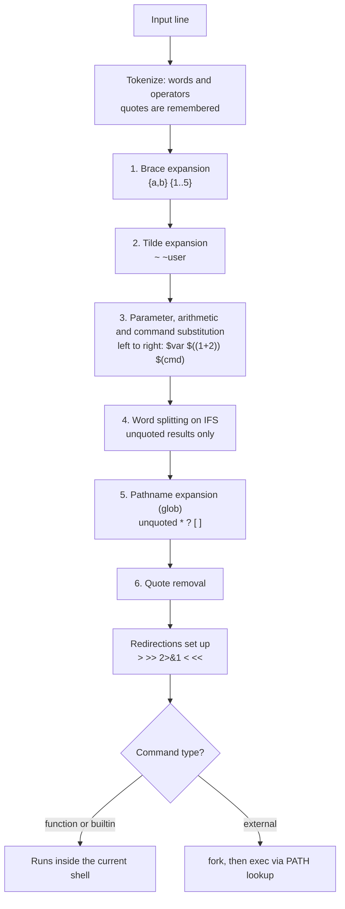
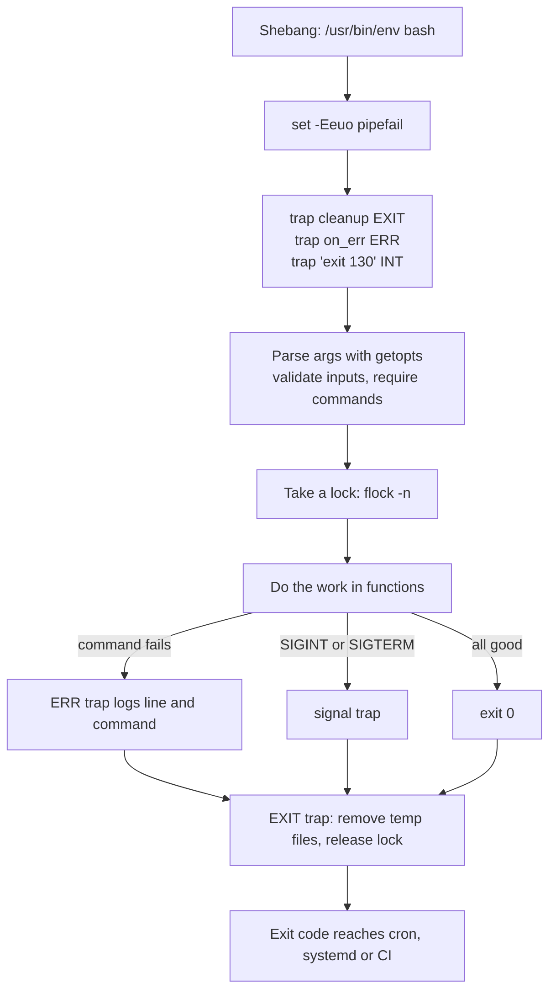
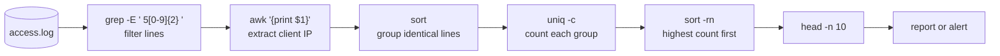
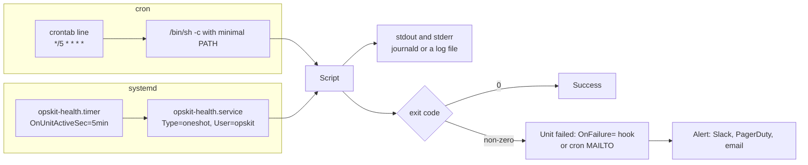
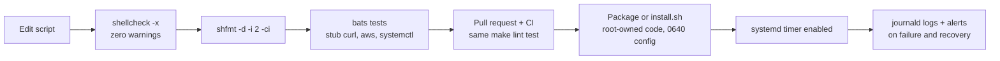

# Shell Scripting (Bash) for DevOps

<!-- DEVOPS-SHACK:HEADER -->

  
  
  
  
  

Part of <b><a href="https://github.com/jaiswaladi246/DevOps-Cloud-Interview-Preparation-by-DevOps-Shack">DevOps &amp; Cloud Interview Preparation</a></b> — created by <b><a href="https://www.youtube.com/@devopsshack">DevOps Shack</a></b>. Free to learn from; please credit DevOps Shack when sharing.

<!-- /DEVOPS-SHACK:HEADER -->

> Write Bash the way production teams do: strict mode, quoted everything, real exit codes, traps that clean up, text pipelines that survive odd input, and scripts that run unattended from systemd timers, pass ShellCheck and carry tests. Everything an interviewer asks about shell, from `$@` vs `$*` to a backup job that pages you correctly at 3 AM.

[🏠 Home](../README.md)

## What you'll master

- How Bash actually reads a line: tokenizing, the seven expansions in order, word splitting, globbing and quote removal
- Variables, quoting rules, parameter expansion (`${var:-default}`, `${var%.*}`, `${var//a/b}`), indexed and associative arrays
- Conditionals (`[[ ]]` vs `[ ]` vs `(( ))`), loops that do not break on spaces, functions, `local`, return values vs output
- Exit codes and error handling: `set -euo pipefail` and every place it does not protect you, `trap` on `EXIT`/`ERR`/signals
- Argument parsing with `getopts`, here-docs, process substitution, subshells, file descriptors and redirection
- Text processing for operations work: `grep`, `sed`, `awk`, `cut`, `sort`, `uniq`, `xargs`, `find`, plus `jq` and `yq` for JSON and YAML
- Scheduling: cron syntax and its environment traps, systemd services and timers, locking with `flock`
- Real automation: log rotation, backups to S3, health checks, deployment scripts, user management, disk and memory alerts
- Quality and safety: ShellCheck, `shfmt`, bats tests, debugging with `bash -x` and `PS4`, `sh` vs `bash` portability, injection and temp-file security

---

## How Bash processes a command line

Almost every "weird" shell bug is an expansion-order bug. Bash splits the line into tokens, performs expansions in a fixed order, then sets up redirections and finally runs a builtin, a function or an external program (fork + exec). Word splitting and globbing only happen to **unquoted** results, which is the single reason we quote every expansion.

Process substitution `<(cmd)` happens alongside step 3 on systems that support it. The practical rule: `"$var"`, `"$(cmd)"` and `"${arr[@]}"` are safe; bare `$var` is a bug waiting for a filename with a space or a `*`.

## Lifecycle of a robust script

A production script fails loudly and cleans up after itself. Strict mode turns silent failures into exits, the `ERR` trap tells you where it failed, and the `EXIT` trap always runs, whether the script finished, failed or was interrupted with Ctrl+C.

`SIGKILL` (`kill -9`, the OOM killer) cannot be trapped, so design for it: write to a temp file and `mv` it into place, so a killed run never leaves a half-written artifact.

## A text-processing pipeline, step by step

The classic interview task "top 10 IPs returning 5xx in the last log file" is a pipeline of small tools. Each stage reads stdin and writes stdout; the shell connects them with pipes and runs them **concurrently**.

`uniq` only collapses **adjacent** duplicates, which is why `sort` comes first. With `set -o pipefail`, the pipeline's exit status is the last non-zero status of any stage, so a missing log file is not hidden by a successful `head`. For anything beyond a few stages, a single `awk` program is usually faster and clearer.

## Scheduling: cron and systemd timers

Unattended scripts run in a stripped-down environment: no login profile, a minimal `PATH`, no terminal. systemd timers add logging to the journal, dependency ordering, catch-up of missed runs (`Persistent=true`), randomized delays, resource limits and sandboxing, which is why we prefer them on modern Linux.

The two traps that cause most "works by hand, fails in cron" incidents: `PATH` (use absolute paths or set `PATH` at the top) and `%` in a crontab line, which cron turns into a newline unless escaped as `\%`.

## From laptop to server: the production workflow

Shell scripts deserve the same pipeline as application code. A script that only exists on one server, unlinted and untested, is an outage with a delay timer.

---

## Core concepts in 10 minutes

### 1. The shebang and how a script runs

`#!/usr/bin/env bash` tells the kernel which interpreter to run, finding `bash` on `PATH` (useful on macOS where a newer Bash lives in `/opt/homebrew/bin`). `./script.sh` needs the execute bit and uses the shebang; `bash script.sh` ignores the shebang; `source script.sh` (or `. script.sh`) runs it **in the current shell**, so its `cd`, variables and `exit` affect your session. If the shebang says `/bin/sh`, on Debian and Ubuntu you get `dash`, which has no arrays, no `[[ ]]` and no `<( )`.

### 2. Quoting is the whole game

Double quotes keep a value as one word and still allow `$var`, `$(cmd)` and `\` escapes. Single quotes are fully literal. `"$@"` expands to each argument as a separate, intact word; `$*` and unquoted `$@` re-split them. ShellCheck's most common warning (SC2086, "Double quote to prevent globbing and word splitting") exists because an unquoted `rm -rf $DIR/*` with an empty `DIR` becomes `rm -rf /*`.

### 3. Parameter expansion replaces most `sed` and `basename` calls

`${var:-default}` (use default if unset or empty), `${var:?message}` (abort if unset), `${#var}` (length), `${path##*/}` (basename), `${path%/*}` (dirname), `${file%.tar.gz}` (strip suffix), `${var//old/new}` (replace all), `${var^^}` (uppercase, Bash 4+). These run inside the shell with no fork, which matters in loops over thousands of lines.

### 4. Tests and conditionals

`[ ]` is the POSIX `test` command, so its arguments go through word splitting: always quote. `[[ ]]` is Bash syntax: no splitting or globbing inside, supports `&&`, `||`, pattern matching (`[[ $f == *.log ]]`) and regex (`[[ $v =~ ^[0-9]+$ ]]`, captures in `BASH_REMATCH`). `(( ))` is arithmetic: `(( count > 10 ))`. `if` tests a command's exit status, so `if grep -q ERROR file; then` needs no brackets at all.

### 5. Loops that do not break on real data

Read files line by line with `while IFS= read -r line; do ...; done < file`: `IFS=` keeps leading spaces, `-r` keeps backslashes. Never `for line in $(cat file)`, which splits on every space and globs. Iterate files with a glob (`for f in /var/log/app/*.log`) plus `shopt -s nullglob`, or with `find ... -print0 | while IFS= read -r -d '' f`. A `cmd | while read` loop runs in a subshell, so variables set inside are lost; feed it with `< <(cmd)` instead.

### 6. Exit codes

Every command returns 0 for success and 1 to 255 for failure. `$?` holds the last status, `$PIPESTATUS` holds each stage of the last pipeline. Conventions worth knowing: 1 general error, 2 misuse (bad option), 126 found but not executable, 127 command not found, 128+N killed by signal N (130 is Ctrl+C, 137 is SIGKILL, 143 is SIGTERM). Monitoring plugins use 0 OK, 1 WARNING, 2 CRITICAL, 3 UNKNOWN.

### 7. Strict mode and its limits

`set -e` exits on an unhandled failing command, `set -u` errors on unset variables, `set -o pipefail` fails a pipeline if any stage fails, and `set -E` makes the `ERR` trap fire inside functions. `set -e` is ignored in `if`/`while` conditions, on the left of `&&`/`||`, after `!`, and in functions called from those contexts. `local x=$(cmd)` hides the failure of `cmd` because `local` itself succeeds. `((i++))` returns 1 when `i` was 0 and kills the script. Know these, because interviewers do.

### 8. Functions

Functions take arguments as `$1..$n`, return a status with `return N` (0 to 255) and "return" data by printing it (`result=$(myfunc)`). Variables are global unless declared `local`, and Bash scoping is **dynamic**: a called function sees its caller's locals. Keep a `main "$@"` at the bottom so the whole file is parsed before anything runs, which also protects a script that is being edited while it runs.

### 9. Traps and signals

`trap 'rm -rf "$tmpdir"' EXIT` guarantees cleanup. `trap on_err ERR` (with `set -E`) reports failures with `$LINENO` and `$BASH_COMMAND`. `trap 'exit 143' TERM` lets a long job stop cleanly when systemd or Kubernetes asks it to. Traps cannot catch `SIGKILL` or `SIGSTOP`. Use single quotes in trap strings so variables expand when the trap runs, not when it is set.

### 10. Text tools in one paragraph each

`grep -E` filters lines (`-v` invert, `-c` count, `-o` only match, `-r` recursive, `-q` quiet for `if`). `sed` edits streams (`sed -i.bak 's/old/new/g'`, `sed -n '10,20p'`). `awk` is a small language for columns (`awk -F: '$3 >= 1000 {print $1}' /etc/passwd`). `cut -d, -f2` picks fields, `sort -k2,2n -t,` sorts by a numeric column, `uniq -c` counts adjacent duplicates, `xargs -0 -n1 -P4` turns input into arguments in parallel, `find /var/log -name '*.gz' -mtime +14 -delete` selects files by metadata. `jq -r '.items[].metadata.name'` and `yq '.spec.replicas = 3' -i` do the same for JSON and YAML.

### 11. Scheduling

cron fields are minute, hour, day of month, month, day of week. cron runs `/bin/sh` with `PATH=/usr/bin:/bin`, no profile and mails output to `MAILTO` (or drops it). systemd timers pair a `.timer` (`OnCalendar=*-*-* 02:30:00`, `OnUnitActiveSec=5min`, `Persistent=true`, `RandomizedDelaySec=`) with a `Type=oneshot` `.service`, log to the journal and can run sandboxed as a dedicated user. Either way, guard against overlapping runs with `flock -n`.

### 12. Security and portability

Never `eval` user input, never build commands by string concatenation, and pass `--` before user-supplied filenames (`rm -- "$f"`). Create temp files with `mktemp`, not `/tmp/myscript.$$`. Validate inputs with an allow-list regex. Keep secrets out of argv (visible in `ps`) and out of `set -x` output. If you need POSIX `sh` (Alpine images, `dash`, embedded systems), drop arrays, `[[ ]]`, `$'...'`, `${var//a/b}` and process substitution (and treat `local` as a widely supported extension, not POSIX), then check with `shellcheck -s sh` and `checkbashisms`.

---

## Question banks

Three banks with collapsible answers: 200 concepts, 100 scenarios and 100 troubleshooting drills, tagged 🟢 Beginner, 🟡 Intermediate, 🔴 Advanced.

| Bank | Questions | What it covers |
|------|-----------|----------------|
| [Concepts](./concepts.md) | 200 | Expansion order, quoting, parameter expansion, arrays, conditionals, loops, functions, exit codes, strict mode, traps, `getopts`, here-docs, process substitution, subshells, grep/sed/awk/sort/xargs/find, jq and yq, cron and systemd timers, ShellCheck, portability, security, best practices and rapid-fire commands |
| [Scenarios](./scenarios.md) | 100 | "What would you do" situations with a step-by-step approach |
| [Troubleshooting](./troubleshooting.md) | 100 | Real error messages: likely causes, diagnosis commands, fix and prevention |

## Learning path

Work through these in order. Tick each one only when you can do it without notes.

**Beginner**
- [ ] Write a script with a shebang, make it executable, and explain `./s.sh` vs `bash s.sh` vs `source s.sh`
- [ ] Explain single vs double quotes and why `"$var"` and `"$@"` are quoted
- [ ] Use `if`, `[[ ]]`, `case`, `for` and `while read` correctly on filenames with spaces
- [ ] Write functions with `local` variables and meaningful return codes
- [ ] Read `$?`, use `&&` and `||`, and know exit codes 0, 1, 2, 126, 127, 130, 137
- [ ] Filter and summarize a log with `grep`, `cut`, `sort`, `uniq -c` and `awk`
- [ ] Schedule a script in cron with absolute paths and logging
- [ ] Do the first 10 [assignments](./assignments.md)

**Intermediate**
- [ ] Start every script with `set -Eeuo pipefail` and list five cases where `-e` does not fire
- [ ] Clean up with `trap ... EXIT` and report failures with an `ERR` trap
- [ ] Parse options with `getopts`, including missing-argument and unknown-option errors
- [ ] Use parameter expansion, indexed and associative arrays, here-docs and process substitution
- [ ] Query and modify JSON with `jq` and YAML with `yq` inside a script
- [ ] Replace a cron job with a systemd service and timer, and read its logs with `journalctl`
- [ ] Make every script pass `shellcheck` with zero findings
- [ ] Complete the [hands-on lab](./hands-on-lab.md) end to end

**Advanced**
- [ ] Explain the expansion order and predict the output of tricky quoting puzzles
- [ ] Debug with `bash -x`, a custom `PS4`, and `BASH_XTRACEFD`
- [ ] Write bats tests that stub external commands and run them in CI
- [ ] Prevent concurrent runs with `flock` and make jobs idempotent and atomic
- [ ] Harden scripts against injection, unsafe temp files and secrets in argv or traces
- [ ] Port a Bash script to POSIX `sh` and explain what had to change
- [ ] Decide when a task has outgrown Bash and should move to Python or Go
- [ ] Finish all 25 assignments and answer 150 of the 200 questions in each bank unaided

## Study materials

- [Hands-on lab: production server ops toolkit](./hands-on-lab.md) — health checks, S3 backups and deduplicated Slack alerts, scheduled by systemd timers (with a cron fallback), logging to journald, ShellCheck clean and covered by 28 bats tests
- [Assignments](./assignments.md) — 25 graded exercises (10 beginner, 10 intermediate, 5 advanced)
- [Cheatsheet](./cheatsheet.md) — syntax, expansions, test operators, text tools, jq/yq, cron and timers, and the top 15 interview one-liners

[🏠 Home](../README.md)

<!-- DEVOPS-SHACK:FOOTER -->
---

### 🚀 Made with ❤️ by [DevOps Shack](https://www.youtube.com/@devopsshack)

**Learn DevOps, DevSecOps, Cloud and Kubernetes the practical way.**

[▶️ YouTube — DevOps Shack](https://www.youtube.com/@devopsshack) · [▶️ Hindi — @shackverse](https://www.youtube.com/@shackverse) · [🎓 devopsshack.com](https://devopsshack.com) · [📸 Instagram @devopsshack](https://www.instagram.com/devopsshack)

[🏠 Back to Home](../README.md) · [⭐ Star the original repo](https://github.com/jaiswaladi246/DevOps-Cloud-Interview-Preparation-by-DevOps-Shack)

© DevOps Shack · Licensed CC BY-NC-SA 4.0 · If you found this copy anywhere other than <a href="https://github.com/jaiswaladi246/DevOps-Cloud-Interview-Preparation-by-DevOps-Shack">github.com/jaiswaladi246</a>, the original and latest version is maintained by DevOps Shack.

<!-- /DEVOPS-SHACK:FOOTER -->
