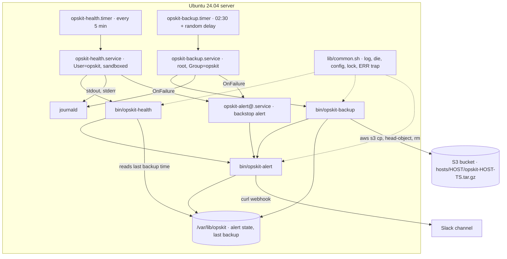
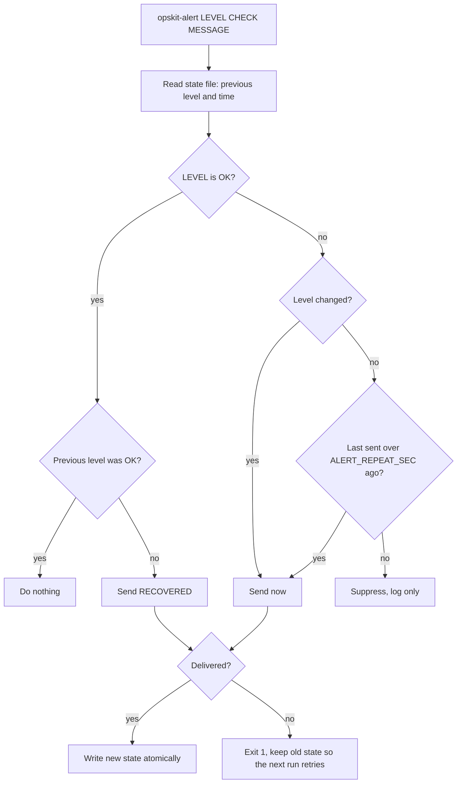

# Shell Scripting — Hands-on Lab: Production Server Ops Toolkit (`opskit`)

<!-- DEVOPS-SHACK:HEADER -->
<p align="center">
  <a href="https://www.youtube.com/@devopsshack"></a>
  <a href="https://www.youtube.com/@shackverse"></a>
  <a href="https://devopsshack.com"></a>
  <a href="https://www.instagram.com/devopsshack"></a>
  <a href="https://github.com/jaiswaladi246/DevOps-Cloud-Interview-Preparation-by-DevOps-Shack"></a>
</p>
<p align="center"><sub>Part of <b><a href="https://github.com/jaiswaladi246/DevOps-Cloud-Interview-Preparation-by-DevOps-Shack">DevOps &amp; Cloud Interview Preparation</a></b> — created by <b><a href="https://www.youtube.com/@devopsshack">DevOps Shack</a></b>. Free to learn from; please credit DevOps Shack when sharing.</sub></p>
<!-- /DEVOPS-SHACK:HEADER -->

> One end-to-end project: build the three scripts every ops team ends up writing (host health checks, backups to S3 with rotation, and deduplicated alerting), schedule them with systemd timers (with a cron fallback), log to journald, keep them ShellCheck clean and cover them with 28 bats tests.

[⬅ Back to Shell Scripting](./README.md) · [🏠 Home](../README.md)

## Goal

By the end you will have a small Git repository, `opskit`, installed on an Ubuntu 24.04 server, where:

- `opskit-health` checks disk blocks and inodes, memory, systemd services, HTTP endpoints and backup freshness, and exits with monitoring-plugin codes (0 OK, 1 WARNING, 2 CRITICAL, 3 UNKNOWN)
- `opskit-backup` builds a `tar.gz` of configured paths, verifies it, uploads it to S3 with a SHA-256 checksum, checks the uploaded size, rotates local copies and S3 objects (with a minimum-copies safety net), and records the time of the last success
- `opskit-alert` sends Slack messages with **deduplication**: a new problem or an escalation is sent at once, an unchanged problem is repeated at most once an hour, and a recovery sends a single `RECOVERED` message
- All three share one library: strict mode, `ERR` trap, structured logs, config loading, `flock` locking
- systemd timers run them (health every 5 minutes, backup nightly with a random delay), units are sandboxed, and a failed unit triggers a backstop alert through `OnFailure=`
- `make check` runs ShellCheck with zero findings and 28 bats tests that stub `aws`, `curl`, `df` and `systemctl`, locally and in CI

This is the same shape we use in production: small scripts with one job each, one shared library, state on disk, systemd for scheduling and logging, and tests that run without touching real infrastructure.

## Architecture



How the pieces fit:

- **Scripts never alert directly.** They call `opskit-alert` with a level and a check name, and the alert script decides whether this is news. That is what stops the "disk 81%, 79%, 81%" Slack storm.
- **Health and backup are linked through state.** The backup writes a timestamp on success; the health check turns "no successful backup in 26 hours" into a CRITICAL. A backup job that silently stopped running is caught, not just a backup job that failed.
- **systemd is the safety net.** If a script cannot even start (`203/EXEC`, missing user, `SIGKILL` by the OOM killer), its own traps never run, so `OnFailure=` raises the alert instead.

The alert decision for one check looks like this:



## Prerequisites

- An Ubuntu 24.04 server or VM with systemd and `sudo` (a local VM, an EC2 instance, or a container with systemd for the timer steps). Debian 12 and Rocky Linux 9 work with the same steps; package names are noted where they differ.
- A Linux workstation (or WSL2) to develop and test on. The scripts target Linux servers: they pin a Linux `PATH` and use GNU `stat`, `date -d` and `flock`. On macOS, run the checks in a container (shown below).
- An AWS account with permission to create an S3 bucket and an IAM role or user. Cost for this lab is a few cents.
- Optional: a Slack incoming webhook URL. Without it, alerts are written to the journal only, which is enough to complete the lab.
- Tools: `bash` 5.x, `shellcheck` (0.9 or newer), `bats` (1.5 or newer), `jq`, `curl`, AWS CLI v2, `make`, `git`.

```bash
# Ubuntu 24.04 (server and workstation)
sudo apt-get update
sudo apt-get install -y shellcheck bats jq curl make git unzip
curl -fsSL "https://awscli.amazonaws.com/awscli-exe-linux-x86_64.zip" -o /tmp/awscliv2.zip
unzip -q /tmp/awscliv2.zip -d /tmp && sudo /tmp/aws/install
# macOS workstation: run lint and tests inside an Ubuntu container instead
# docker run --rm -v "$PWD":/w -w /w ubuntu:24.04 bash -c \
#   'apt-get update -qq && apt-get install -y -qq shellcheck bats jq make >/dev/null && make check'

bash --version | head -1; shellcheck --version | sed -n 2p; bats --version; jq --version; aws --version
```

The final repository layout:

```text
opskit/
├── .shellcheckrc
├── Makefile
├── install.sh
├── bin/
│   ├── opskit-alert
│   ├── opskit-backup
│   └── opskit-health
├── lib/
│   └── common.sh
├── etc/
│   └── opskit.conf.example
├── systemd/
│   ├── opskit-alert@.service
│   ├── opskit-backup.service
│   ├── opskit-backup.timer
│   ├── opskit-health.service
│   └── opskit-health.timer
├── cron/
│   └── opskit
├── test/
│   ├── test_helper.bash
│   ├── common.bats
│   ├── alert.bats
│   ├── health.bats
│   ├── backup.bats
│   └── stubs/
│       ├── aws
│       ├── curl
│       ├── df
│       └── systemctl
└── .github/workflows/opskit.yml
```

---

## Step 1. Create the repository and the ShellCheck config

```bash
mkdir -p ~/opskit/{bin,lib,etc,systemd,cron,test/stubs,.github/workflows}
cd ~/opskit
git init -b main
printf '*.sh text eol=lf\nbin/* text eol=lf\ntest/** text eol=lf\n' > .gitattributes
```

The `.gitattributes` line forces LF endings, so nobody on Windows can commit a script that fails with `/bin/bash^M: bad interpreter`.

Create `.shellcheckrc` so ShellCheck follows `source` statements relative to each script's own directory:

```text
source-path=SCRIPTDIR
external-sources=true
```

**Verify:** `git status` shows the two dotfiles, and `shellcheck --version` prints 0.9 or newer.

## Step 2. Write the shared library

Every script sources one library instead of copy-pasting helpers. It pins `PATH` (cron and sudo give you a different one), sets `LC_ALL=C` so sorting and character classes behave identically everywhere, sets a restrictive `umask`, and provides logging, config loading, locking and the `ERR` trap handler.

`lib/common.sh`:

```bash
# shellcheck shell=bash
# lib/common.sh - shared helpers for opskit scripts. Source it, do not execute it.

[[ -n ${_OPSKIT_COMMON_LOADED:-} ]] && return 0
_OPSKIT_COMMON_LOADED=1

# Never trust the caller's PATH (cron gives /usr/bin:/bin, sudo resets it).
# OPSKIT_PATH_PREFIX exists so tests can put stub commands first.
PATH="${OPSKIT_PATH_PREFIX:+$OPSKIT_PATH_PREFIX:}/usr/local/sbin:/usr/local/bin:/usr/sbin:/usr/bin:/sbin:/bin"
export PATH
export LC_ALL=C
umask 027

OPSKIT_NAME=${OPSKIT_NAME:-${0##*/}}

# log LEVEL MESSAGE... -> stderr. Under systemd, stderr goes to the journal.
log() {
  local level=$1 ts
  shift
  if [[ $level == DEBUG && ${OPSKIT_DEBUG:-0} != 1 ]]; then return 0; fi
  printf -v ts '%(%Y-%m-%dT%H:%M:%S%z)T' -1
  printf '%s %-5s %s[%d]: %s\n' "$ts" "$level" "$OPSKIT_NAME" "$$" "$*" >&2
}

# die MESSAGE [EXIT_CODE]
die() {
  log ERROR "$1"
  exit "${2:-1}"
}

# require_cmd CMD... -> exit 127 if any command is missing
require_cmd() {
  local c
  for c in "$@"; do
    command -v "$c" >/dev/null 2>&1 || die "required command not found: $c" 127
  done
}

# load_config: source the config file (it is code, so it must not be world-writable)
load_config() {
  local conf=${OPSKIT_CONF:-/etc/opskit/opskit.conf}
  [[ -r $conf ]] || die "config file not readable: $conf"
  if [[ -n $(find "$conf" -maxdepth 0 -perm -o+w 2>/dev/null) ]]; then
    die "refusing to load world-writable config: $conf"
  fi
  # shellcheck source=../etc/opskit.conf.example
  source "$conf"
  OPSKIT_STATE_DIR=${OPSKIT_STATE_DIR:-/var/lib/opskit}
  OPSKIT_RUN_DIR=${OPSKIT_RUN_DIR:-/run/opskit}
}

# acquire_lock NAME: one run at a time; a second run exits 0 quietly
acquire_lock() {
  local lockfile="$OPSKIT_RUN_DIR/$1.lock"
  mkdir -p -- "$OPSKIT_RUN_DIR"
  exec 9>"$lockfile"
  if ! flock -n 9; then
    log WARN "another $1 run holds $lockfile, exiting"
    exit 0
  fi
}

# on_err: installed as the ERR trap (needs set -E to fire inside functions)
on_err() {
  local rc=$?
  log ERROR "'${BASH_COMMAND}' exited ${rc} at ${BASH_SOURCE[1]:-main}:${BASH_LINENO[0]}"
}
```

Design decisions worth being able to explain:

- **`OPSKIT_PATH_PREFIX`** is the single test seam: tests put a directory of stub commands in front of the pinned `PATH`. Production never sets it.
- **`log` uses `printf '%(...)T'`**, a Bash builtin, so logging never forks `date`. Output goes to stderr; under systemd that lands in the journal with the unit name attached, and under cron we redirect it to a file.
- **`load_config` refuses a world-writable file.** The config is `source`d, which means it is executed as code. A writable config is a root shell for anyone on the box.
- **`acquire_lock` exits 0 when busy.** A second health check starting while the first is still running is not an error; it should quietly step aside, not page anyone.
- **The lock is on fd 9 and lives as long as the process.** It is released automatically when the script exits, even on `kill -9`, because the kernel closes the descriptor.

**Verify:**
```bash
shellcheck -x lib/common.sh && echo "lint OK"
bash -c 'OPSKIT_NAME=demo; source lib/common.sh; log INFO "hello from the library"'
# 2026-11-09T10:15:02+0000 INFO  demo[48211]: hello from the library
```

## Step 3. Write the configuration file

One file holds every setting. It is plain `KEY=value` Bash, owned by `root:opskit` with mode `0640` on the server, because it contains the Slack webhook.

`etc/opskit.conf.example`:

```bash
# shellcheck shell=bash
# /etc/opskit/opskit.conf - sourced by every opskit script.
# Owner root:opskit, mode 0640. It is executed as Bash, so keep it to KEY=value lines.
# shellcheck disable=SC2034  # variables are used by the scripts that source this file

# State lives in /var/lib/opskit and locks in /run/opskit by default.
# Override with OPSKIT_STATE_DIR / OPSKIT_RUN_DIR in the environment (units, tests).

# Health checks
DISK_MOUNTS="/ /var"
DISK_WARN=80
DISK_CRIT=90
MEM_WARN=85
MEM_CRIT=95
SERVICES="ssh cron"
HTTP_CHECKS="http://127.0.0.1/healthz"
BACKUP_MAX_AGE_HOURS=26

# Backups
BACKUP_PATHS="/etc /var/www"
BACKUP_STAGING=/var/backups/opskit
BACKUP_KEEP_LOCAL=3
S3_BUCKET=""                     # e.g. acme-backups-prod
S3_PREFIX="hosts"
S3_STORAGE_CLASS=STANDARD       # STANDARD_IA bills a 30-day minimum: only worth it with S3_KEEP_DAYS >= 30
S3_KEEP_DAYS=14
S3_KEEP_MIN=3

# Alerting
SLACK_WEBHOOK=""                 # empty = log only
ALERT_REPEAT_SEC=3600            # re-notify an unchanged problem at most once an hour
```

State and lock locations are deliberately **not** in this file. They default to `/var/lib/opskit` and `/run/opskit` and are overridden by the environment (systemd units and tests set them), which keeps tests from having to rewrite the config.

## Step 4. Write the alerting script

`opskit-alert` is the only component that talks to Slack. It keeps one small state file per check (`LEVEL EPOCH`) and implements the decision flow from the diagram above.

`bin/opskit-alert`:

```bash
#!/usr/bin/env bash
# opskit-alert - send a deduplicated alert to Slack.
#
#   opskit-alert [-n] LEVEL CHECK MESSAGE
#
# LEVEL is OK, WARNING, CRITICAL or UNKNOWN. State per CHECK is kept in
# $OPSKIT_STATE_DIR/alerts, so an unchanged problem is re-sent at most every
# ALERT_REPEAT_SEC, a level change is sent at once, and OK after a problem
# sends a single RECOVERED message.
# Exit: 0 sent or suppressed, 1 delivery failed (state untouched, so the next
# run retries), 2 usage error.
set -Eeuo pipefail
shopt -s inherit_errexit

OPSKIT_HOME=$(cd -- "$(dirname -- "${BASH_SOURCE[0]}")/.." && pwd -P)
# shellcheck source=../lib/common.sh
source "$OPSKIT_HOME/lib/common.sh"
trap on_err ERR

usage() {
  echo "usage: ${0##*/} [-n] OK|WARNING|CRITICAL|UNKNOWN CHECK MESSAGE" >&2
  exit 2
}

send_slack() {
  local text=$1 payload
  if [[ -z ${SLACK_WEBHOOK:-} ]]; then
    log INFO "SLACK_WEBHOOK not set, alert logged only: $text"
    return 0
  fi
  payload=$(jq -cn --arg text "$text" '{text: $text}')
  if (( dry_run )); then
    log INFO "dry run, would send: $payload"
    return 0
  fi
  # The webhook is a secret: pass it through a config fd, never in argv (visible in ps).
  curl -fsS --max-time 10 --retry 3 --retry-delay 2 \
    -H 'Content-Type: application/json' \
    --config <(printf 'url = "%s"\n' "$SLACK_WEBHOOK") \
    --data "$payload" >/dev/null
}

write_state() {
  local tmp
  tmp=$(mktemp "$state_file.XXXXXX")
  printf '%s %s\n' "$1" "$2" > "$tmp"
  mv -f -- "$tmp" "$state_file"
}

main() {
  dry_run=0
  local opt
  while getopts ':nh' opt; do
    case $opt in
      n) dry_run=1 ;;
      h) usage ;;
      :) echo "option -$OPTARG needs a value" >&2; usage ;;
      *) echo "unknown option -$OPTARG" >&2; usage ;;
    esac
  done
  shift $((OPTIND - 1))
  (( $# == 3 )) || usage

  local level=$1 check=$2 message=$3
  [[ $level =~ ^(OK|WARNING|CRITICAL|UNKNOWN)$ ]] || { echo "invalid level: $level" >&2; usage; }
  [[ -n $check ]] || usage

  load_config
  require_cmd jq curl
  local repeat=${ALERT_REPEAT_SEC:-3600}
  local host=${OPSKIT_HOST:-$(hostname -s)}
  local now=${OPSKIT_NOW:-}
  [[ -n $now ]] || printf -v now '%(%s)T' -1

  local dir="$OPSKIT_STATE_DIR/alerts"
  mkdir -p -- "$dir"
  state_file="$dir/${check//[^A-Za-z0-9_.-]/_}.state"

  local prev_level=OK prev_ts=0
  if [[ -r $state_file ]]; then
    read -r prev_level prev_ts < "$state_file" || true
  fi

  local action
  if [[ $level == OK ]]; then
    if [[ $prev_level == OK ]]; then
      action=none
    else
      action=recovered
    fi
  elif [[ $level != "$prev_level" ]]; then
    action=send
  elif (( now - prev_ts >= repeat )); then
    action=resend
  else
    action=suppress
  fi

  case $action in
    none)
      return 0
      ;;
    suppress)
      log INFO "suppressed $level $check (unchanged, last sent $(( now - prev_ts ))s ago)"
      return 0
      ;;
    recovered)
      send_slack ":white_check_mark: RECOVERED [$host] $check: $message" \
        || { log ERROR "alert delivery failed for $check"; return 1; }
      log INFO "recovered $check (was $prev_level)"
      ;;
    send|resend)
      local icon=":warning:"
      [[ $level == CRITICAL ]] && icon=":rotating_light:"
      send_slack "$icon $level [$host] $check: $message" \
        || { log ERROR "alert delivery failed for $check"; return 1; }
      log INFO "sent $level $check ($action)"
      ;;
  esac
  (( dry_run )) || write_state "$level" "$now"
}

main "$@"
```

Details that matter in production:

- **The webhook never appears in `argv`.** Anything on a command line is visible to every user through `ps` and `/proc/PID/cmdline`. We hand curl its URL through `--config <(...)`, a process-substitution file descriptor.
- **The JSON payload is built with `jq --arg`**, so a message containing quotes, backslashes or newlines cannot break the JSON or inject fields.
- **State is written atomically** (`mktemp` in the same directory, then `mv`), so a crash mid-write never leaves a truncated state file.
- **Failed delivery does not update state.** If Slack is down, the next run (5 minutes later) sees the level as still "new" and tries again, instead of believing the alert went out.
- **Check names are sanitised** into file names (`disk:/var` becomes `disk__var.state`), so a check name can never escape the state directory.
- **`OPSKIT_NOW`** lets tests control time, so the repeat-window logic is testable without sleeping for an hour.

```bash
chmod +x bin/opskit-alert
```

**Verify** with a throwaway config and state directory (no webhook set, so it only logs):
```bash
export OPSKIT_CONF=$PWD/etc/opskit.conf.example OPSKIT_STATE_DIR=/tmp/opskit-state
bin/opskit-alert CRITICAL disk:/var "93% used"
# ... INFO  opskit-alert[...]: SLACK_WEBHOOK not set, alert logged only: :rotating_light: CRITICAL [myhost] disk:/var: 93% used
# ... INFO  opskit-alert[...]: sent CRITICAL disk:/var (send)
bin/opskit-alert CRITICAL disk:/var "93% used"
# ... INFO  opskit-alert[...]: suppressed CRITICAL disk:/var (unchanged, last sent 2s ago)
bin/opskit-alert OK disk:/var "61% used"
# ... recovered disk:/var (was CRITICAL)
cat /tmp/opskit-state/alerts/disk__var.state     # OK 1762683302
bin/opskit-alert PANIC disk:/var "x"; echo "exit=$?"   # invalid level: PANIC ... exit=2
```

## Step 5. Write the health-check script

`opskit-health` runs every check, prints one line per result, hands every result (including OK, so recoveries work) to `opskit-alert`, and exits with the worst level.

`bin/opskit-health`:

```bash
#!/usr/bin/env bash
# opskit-health - host health checks: disk (blocks and inodes), memory,
# systemd services, HTTP endpoints and backup freshness.
#
#   opskit-health [-n] [-h]
#     -n  dry run: report only, do not call opskit-alert
#
# Exit codes follow the monitoring-plugin convention:
#   0 OK, 1 WARNING, 2 CRITICAL, 3 UNKNOWN (the script itself could not run)
set -Eeuo pipefail
shopt -s inherit_errexit

OPSKIT_HOME=$(cd -- "$(dirname -- "${BASH_SOURCE[0]}")/.." && pwd -P)
# shellcheck source=../lib/common.sh
source "$OPSKIT_HOME/lib/common.sh"
trap on_err ERR

declare -A RANK=([OK]=0 [WARNING]=1 [CRITICAL]=2 [UNKNOWN]=3)
worst=0
dry_run=0

usage() {
  echo "usage: ${0##*/} [-n] [-h]" >&2
  exit 3
}

# report LEVEL CHECK MESSAGE: print, track the worst level, hand off to opskit-alert
report() {
  local level=$1 check=$2 message=$3
  printf '%-8s %-24s %s\n' "$level" "$check" "$message"
  (( RANK[$level] > worst )) && worst=${RANK[$level]}
  if (( ! dry_run )); then
    "$OPSKIT_HOME/bin/opskit-alert" "$level" "$check" "$message" \
      || log WARN "opskit-alert failed for $check, will retry next run"
  fi
  return 0
}

# level_for VALUE WARN CRIT -> prints OK, WARNING or CRITICAL
level_for() {
  if (( $1 >= $3 )); then echo CRITICAL
  elif (( $1 >= $2 )); then echo WARNING
  else echo OK
  fi
}

check_disk() {
  local mount pct ipct
  for mount in $DISK_MOUNTS; do
    if ! pct=$(df -P -- "$mount" 2>/dev/null | awk 'NR==2 {sub(/%/, "", $5); print $5}'); then
      report UNKNOWN "disk:$mount" "df failed"
      continue
    fi
    ipct=$(df -P -i -- "$mount" 2>/dev/null | awk 'NR==2 {sub(/%/, "", $5); print ($5 == "-" ? 0 : $5)}') || ipct=0
    if [[ ! $pct =~ ^[0-9]+$ ]]; then
      report UNKNOWN "disk:$mount" "could not parse df output"
      continue
    fi
    report "$(level_for "$pct" "$DISK_WARN" "$DISK_CRIT")" "disk:$mount" "${pct}% blocks used"
    report "$(level_for "${ipct:-0}" "$DISK_WARN" "$DISK_CRIT")" "inodes:$mount" "${ipct:-0}% inodes used"
  done
}

check_memory() {
  local meminfo=${OPSKIT_MEMINFO:-/proc/meminfo} used
  used=$(awk '/^MemTotal:/ {t=$2} /^MemAvailable:/ {a=$2}
              END { if (t > 0) printf "%d", 100 - (a * 100 / t) }' "$meminfo")
  if [[ ! $used =~ ^[0-9]+$ ]]; then
    report UNKNOWN memory "cannot read $meminfo"
    return 0
  fi
  report "$(level_for "$used" "$MEM_WARN" "$MEM_CRIT")" memory "${used}% used (MemAvailable based)"
}

check_services() {
  local svc
  for svc in $SERVICES; do
    if systemctl is-active --quiet -- "$svc"; then
      report OK "service:$svc" "active"
    else
      report CRITICAL "service:$svc" "not active ($(systemctl is-active -- "$svc" 2>/dev/null || true))"
    fi
  done
}

check_http() {
  local url code
  for url in $HTTP_CHECKS; do
    if code=$(curl -sS -o /dev/null --max-time 5 -w '%{http_code}' "$url" 2>/dev/null) \
        && [[ $code =~ ^[23][0-9][0-9]$ ]]; then
      report OK "http:$url" "HTTP $code"
    else
      report CRITICAL "http:$url" "HTTP ${code:-000} (request failed or non-2xx/3xx)"
    fi
  done
}

check_backup_age() {
  local stamp="$OPSKIT_STATE_DIR/backup.last_success" last now age_h
  if [[ ! -r $stamp ]]; then
    report CRITICAL backup-freshness "no successful backup recorded"
    return 0
  fi
  read -r last < "$stamp" || true
  printf -v now '%(%s)T' -1
  age_h=$(( (now - ${last:-0}) / 3600 ))
  if (( age_h >= BACKUP_MAX_AGE_HOURS )); then
    report CRITICAL backup-freshness "last successful backup ${age_h}h ago (limit ${BACKUP_MAX_AGE_HOURS}h)"
  else
    report OK backup-freshness "last successful backup ${age_h}h ago"
  fi
}

main() {
  local opt
  while getopts ':nh' opt; do
    case $opt in
      n) dry_run=1 ;;
      *) usage ;;
    esac
  done
  shift $((OPTIND - 1))

  load_config
  require_cmd df awk curl systemctl flock
  acquire_lock health

  check_disk
  check_memory
  check_services
  check_http
  check_backup_age

  log INFO "health run finished, worst level $worst"
}

# If the script dies before finishing (bad config, missing command, a bug),
# report UNKNOWN (3), never a misleading OK/WARNING/CRITICAL.
finished=0
# shellcheck disable=SC2329  # called by the EXIT trap; ShellCheck 0.11 misses trap handlers in scripts that call exit
on_exit() {
  local rc=$?
  (( finished )) || rc=3
  exit "$rc"
}
trap on_exit EXIT
main "$@"
finished=1
exit "$worst"
```

Why it is built this way:

- **Memory uses `MemAvailable`, not `MemFree`.** Linux uses free memory for page cache; `MemFree` near zero is normal and healthy. `MemAvailable` is the kernel's estimate of what can be allocated without swapping.
- **Inodes are checked next to blocks**, because "No space left on device" with 40% free blocks is an inode problem (millions of small session or cache files).
- **Every external call has a timeout** (`curl --max-time 5`), so one hung endpoint cannot make the check run forever and pile up.
- **A crash is UNKNOWN (3), never OK or CRITICAL.** The `EXIT` trap converts any exit that did not reach the end of the script into 3. A broken config is a problem with the monitor, not with the host, and the alert should say so.
- **`-n` (dry run)** prints results without alerting, which is what you want while tuning thresholds.
- **Exit codes 1 and 2 are not unit failures.** The script already alerted with deduplication; the systemd unit treats them as success (`SuccessExitStatus=1 2`, Step 12), so `OnFailure=` only fires when the monitor itself is broken.

```bash
chmod +x bin/opskit-health
```

**Verify** on your workstation in dry-run mode (some checks will fail there; that is the point):
```bash
OPSKIT_RUN_DIR=/tmp/opskit-run bin/opskit-health -n; echo "exit=$?"
```
Sample output from a host whose disks are at 84% and that has never completed a backup:
```text
WARNING  disk:/                   84% blocks used
OK       inodes:/                 5% inodes used
WARNING  disk:/var                84% blocks used
OK       inodes:/var              5% inodes used
OK       memory                   9% used (MemAvailable based)
OK       service:nginx            active
OK       service:ssh              active
OK       http:http://127.0.0.1/healthz HTTP 200
CRITICAL backup-freshness         no successful backup recorded
2026-11-09T04:56:16+0000 INFO  opskit-health[10875]: health run finished, worst level 2
exit=2
```

## Step 6. Prepare the S3 bucket and the IAM permissions

Create a private, versioned bucket with a lifecycle rule as a backstop. The script does day-to-day rotation; the lifecycle rule guarantees nothing lives forever even if a host is decommissioned without cleanup, and it cleans up failed multipart uploads.

```bash
export AWS_REGION=ap-south-1
BUCKET="acme-backups-prod-$(aws sts get-caller-identity --query Account --output text)"

aws s3api create-bucket --bucket "$BUCKET" --region "$AWS_REGION" \
  --create-bucket-configuration LocationConstraint="$AWS_REGION"
aws s3api put-public-access-block --bucket "$BUCKET" --public-access-block-configuration \
  BlockPublicAcls=true,IgnorePublicAcls=true,BlockPublicPolicy=true,RestrictPublicBuckets=true
aws s3api put-bucket-versioning --bucket "$BUCKET" --versioning-configuration Status=Enabled
aws s3api put-bucket-encryption --bucket "$BUCKET" --server-side-encryption-configuration \
  '{"Rules":[{"ApplyServerSideEncryptionByDefault":{"SSEAlgorithm":"AES256"}}]}'

cat > /tmp/lifecycle.json <<'JSON'
{
  "Rules": [
    {
      "ID": "opskit-backstop",
      "Filter": { "Prefix": "hosts/" },
      "Status": "Enabled",
      "Expiration": { "Days": 90 },
      "NoncurrentVersionExpiration": { "NoncurrentDays": 30 },
      "AbortIncompleteMultipartUpload": { "DaysAfterInitiation": 7 }
    }
  ]
}
JSON
aws s3api put-bucket-lifecycle-configuration --bucket "$BUCKET" --lifecycle-configuration file:///tmp/lifecycle.json
```

Give the server only what the script needs, scoped to the `hosts/` prefix. On EC2, attach this to the **instance role** so no keys exist on disk:

```json
{
  "Version": "2012-10-17",
  "Statement": [
    {
      "Sid": "ListHostsPrefix",
      "Effect": "Allow",
      "Action": "s3:ListBucket",
      "Resource": "arn:aws:s3:::acme-backups-prod-123456789012",
      "Condition": { "StringLike": { "s3:prefix": ["hosts/*"] } }
    },
    {
      "Sid": "ReadWriteHostsObjects",
      "Effect": "Allow",
      "Action": ["s3:PutObject", "s3:GetObject", "s3:DeleteObject"],
      "Resource": "arn:aws:s3:::acme-backups-prod-123456789012/hosts/*"
    }
  ]
}
```

Because the bucket is versioned, a `DeleteObject` from the script (or from an attacker who owns the host) only adds a delete marker; the previous version is kept for 30 days by the lifecycle rule. For stricter environments, remove `s3:DeleteObject`, let the lifecycle rule do all expiry, and consider S3 Object Lock.

**Verify:**
```bash
aws s3api get-bucket-versioning --bucket "$BUCKET"                 # "Status": "Enabled"
aws s3api get-public-access-block --bucket "$BUCKET" --query 'PublicAccessBlockConfiguration'
echo test | aws s3 cp - "s3://$BUCKET/hosts/connectivity-test.txt" && aws s3 rm "s3://$BUCKET/hosts/connectivity-test.txt"
```

## Step 7. Write the backup script

`opskit-backup` does one backup run end to end. The order of operations is the important part: build into a temp file, verify, rename into place, upload, confirm the upload, and only then rotate old copies and record success.

`bin/opskit-backup`:

```bash
#!/usr/bin/env bash
# opskit-backup - tar.gz the configured paths, verify, upload to S3, rotate
# local copies and S3 objects, record success, alert on failure and recovery.
#
#   opskit-backup [-n] [-h]
#     -n  dry run: build and verify the archive, print aws commands instead of running them
#
# S3 layout: s3://$S3_BUCKET/$S3_PREFIX/<host>/opskit-<host>-<UTC timestamp>.tar.gz (+ .sha256)
set -Eeuo pipefail
shopt -s inherit_errexit nullglob

OPSKIT_HOME=$(cd -- "$(dirname -- "${BASH_SOURCE[0]}")/.." && pwd -P)
# shellcheck source=../lib/common.sh
source "$OPSKIT_HOME/lib/common.sh"
trap on_err ERR

dry_run=0
tmp_archive=""
succeeded=0

usage() {
  echo "usage: ${0##*/} [-n] [-h]" >&2
  exit 2
}

# aws wrapper: honours dry run, never retries silently
run_aws() {
  if (( dry_run )); then
    log INFO "dry run: aws $*"
    return 0
  fi
  aws "$@"
}

alert() {
  local -a flags=()
  (( dry_run )) && flags=(-n)
  # ${arr[@]+...} keeps an empty array safe under set -u on Bash < 4.4
  "$OPSKIT_HOME/bin/opskit-alert" ${flags[@]+"${flags[@]}"} "$@" || log WARN "alert delivery failed"
}

cleanup() {
  local rc=$?
  [[ -n $tmp_archive ]] && rm -f -- "$tmp_archive"
  if (( succeeded )); then
    alert OK backup "backup completed"
  else
    alert CRITICAL backup "backup failed with exit $rc, see: journalctl -u opskit-backup"
  fi
  exit "$rc"
}

create_archive() {
  local -a rel=()
  local p
  for p in $BACKUP_PATHS; do
    [[ -e $p ]] || die "backup path does not exist: $p"
    rel+=("${p#/}")
  done

  tmp_archive=$(mktemp "$BACKUP_STAGING/.${archive_name}.XXXXXX")
  local rc=0
  tar -C / --create --gzip --file "$tmp_archive" -- "${rel[@]}" || rc=$?
  # GNU tar exits 1 for "file changed as we read it": warn, keep the archive
  if (( rc == 1 )); then
    log WARN "tar reported files changing during backup (exit 1), archive kept"
  elif (( rc > 1 )); then
    die "tar failed with exit $rc"
  fi

  [[ -s $tmp_archive ]] || die "archive is empty: $tmp_archive"
  gzip -t -- "$tmp_archive" || die "archive failed gzip integrity test"
  tar -tzf "$tmp_archive" >/dev/null || die "archive cannot be listed"

  mv -f -- "$tmp_archive" "$archive"
  tmp_archive=""
  (cd -- "$BACKUP_STAGING" && sha256sum -- "$archive_name" > "$archive_name.sha256")
  log INFO "created $archive ($(stat -c %s -- "$archive") bytes)"
}

upload() {
  local key="$s3_dir/$archive_name" size remote_size sum
  sum=$(cut -d' ' -f1 < "$archive.sha256")
  run_aws s3 cp "$archive" "s3://$S3_BUCKET/$key" --only-show-errors \
    --storage-class "${S3_STORAGE_CLASS:-STANDARD}" --sse AES256 --metadata "sha256=$sum"
  run_aws s3 cp "$archive.sha256" "s3://$S3_BUCKET/$key.sha256" --only-show-errors --sse AES256
  (( dry_run )) && return 0

  size=$(stat -c %s -- "$archive")
  remote_size=$(aws s3api head-object --bucket "$S3_BUCKET" --key "$key" \
    --query ContentLength --output text)
  [[ $remote_size == "$size" ]] || die "size mismatch after upload: local $size, s3 $remote_size"
  log INFO "uploaded s3://$S3_BUCKET/$key ($size bytes, sha256 $sum)"
}

rotate_local() {
  local keep=${BACKUP_KEEP_LOCAL:-3}
  local -a archives=("$BACKUP_STAGING"/opskit-"$host"-*.tar.gz)   # glob sorts by name = by time
  local n=${#archives[@]} i
  (( n > keep )) || return 0
  for (( i = 0; i < n - keep; i++ )); do
    if (( dry_run )); then
      log INFO "dry run: would delete ${archives[i]}"
    else
      rm -f -- "${archives[i]}" "${archives[i]}.sha256"
      log INFO "rotated local ${archives[i]##*/}"
    fi
  done
}

rotate_s3() {
  local keep_days=${S3_KEEP_DAYS:-14} keep_min=${S3_KEEP_MIN:-3} cutoff key
  cutoff=$(date -u -d "$keep_days days ago" +%Y%m%d)

  local -a keys=() old=()
  mapfile -t keys < <(aws s3api list-objects-v2 --bucket "$S3_BUCKET" --prefix "$s3_dir/" \
    --query 'Contents[].Key' --output json | jq -r '.[]? | select(endswith(".tar.gz"))' | sort)

  for key in "${keys[@]}"; do
    if [[ $key =~ -([0-9]{8})T[0-9]{6}Z\.tar\.gz$ ]] && [[ ${BASH_REMATCH[1]} < $cutoff ]]; then
      old+=("$key")
    fi
  done

  # Never let retention leave fewer than keep_min archives, whatever their age
  local max_delete=$(( ${#keys[@]} - keep_min ))
  (( max_delete > 0 )) || { log INFO "s3 retention: ${#keys[@]} archives, minimum $keep_min, nothing to prune"; return 0; }
  (( ${#old[@]} < max_delete )) && max_delete=${#old[@]}

  local i
  for (( i = 0; i < max_delete; i++ )); do
    run_aws s3 rm "s3://$S3_BUCKET/${old[i]}" --only-show-errors
    run_aws s3 rm "s3://$S3_BUCKET/${old[i]}.sha256" --only-show-errors
    log INFO "rotated s3 ${old[i]}"
  done
}

main() {
  local opt
  while getopts ':nh' opt; do
    case $opt in
      n) dry_run=1 ;;
      *) usage ;;
    esac
  done
  shift $((OPTIND - 1))

  load_config
  : "${S3_BUCKET:?S3_BUCKET must be set in ${OPSKIT_CONF:-/etc/opskit/opskit.conf}}"
  : "${BACKUP_PATHS:?BACKUP_PATHS must be set}"
  require_cmd tar gzip sha256sum aws jq flock stat
  acquire_lock backup
  trap cleanup EXIT

  host=${OPSKIT_HOST:-$(hostname -s)}
  local ts=${OPSKIT_TS:-$(date -u +%Y%m%dT%H%M%SZ)}
  archive_name="opskit-$host-$ts.tar.gz"
  BACKUP_STAGING=${BACKUP_STAGING:-/var/backups/opskit}
  archive="$BACKUP_STAGING/$archive_name"
  s3_dir="${S3_PREFIX:-hosts}/$host"
  mkdir -p -- "$BACKUP_STAGING" "$OPSKIT_STATE_DIR"

  # We hold the lock, so any temp archive left here is from a run that was
  # SIGKILLed (OOM killer, timeout) and could not run its EXIT trap.
  find "$BACKUP_STAGING" -maxdepth 1 -type f -name '.opskit-*' -print -delete \
    | while IFS= read -r stale; do log WARN "removed stale temp file $stale"; done

  create_archive
  upload
  rotate_local
  (( dry_run )) || rotate_s3

  if (( ! dry_run )); then
    printf '%(%s)T\n' -1 > "$OPSKIT_STATE_DIR/backup.last_success"
  fi
  succeeded=1
  log INFO "backup finished: $archive_name"
}

main "$@"
```

What to notice:

- **`tar` exit 1 is a warning, not a failure.** GNU tar returns 1 for "file changed as we read it", which is normal on a live system. Exit 2 and above is fatal.
- **The archive is verified twice before upload**: `gzip -t` checks the compressed stream and `tar -tzf` checks the archive structure. An empty or corrupt archive never reaches S3.
- **Upload is confirmed** by comparing `ContentLength` from `head-object` with the local size, and the SHA-256 is stored both as object metadata and as a sidecar `.sha256` file for restore-time verification.
- **Rotation never deletes the last good copies.** S3 pruning deletes only archives older than `S3_KEEP_DAYS` and never leaves fewer than `S3_KEEP_MIN`, so a host that has been failing for three weeks does not quietly delete its last good backups. Local rotation keeps the newest `BACKUP_KEEP_LOCAL` archives; timestamped names make the glob order equal to time order.
- **The `EXIT` trap is the single place where the outcome is reported**: CRITICAL on any failure, OK on success (which produces RECOVERED only if the previous run had failed).
- **Stale temp files from a `kill -9`** are removed at the start of the next run. That is safe only because we hold the lock, so no other run can own them.
- **`-n` dry run** builds and verifies the archive but prints the `aws` commands instead of running them, and passes `-n` to the alert script as well.

```bash
chmod +x bin/opskit-backup
```

**Verify** a dry run, then a real run against your bucket, from a config copy:
```bash
cp etc/opskit.conf.example /tmp/opskit.conf
sed -i "s|^S3_BUCKET=.*|S3_BUCKET=$BUCKET|; s|^BACKUP_PATHS=.*|BACKUP_PATHS=\"/etc/default /etc/hosts\"|; s|^BACKUP_STAGING=.*|BACKUP_STAGING=/tmp/opskit-staging|" /tmp/opskit.conf
export OPSKIT_CONF=/tmp/opskit.conf OPSKIT_STATE_DIR=/tmp/opskit-state OPSKIT_RUN_DIR=/tmp/opskit-run

bin/opskit-backup -n
# ... INFO  opskit-backup[...]: created /tmp/opskit-staging/opskit-myhost-20261109T045633Z.tar.gz (1881 bytes)
# ... INFO  opskit-backup[...]: dry run: aws s3 cp /tmp/opskit-staging/opskit-myhost-... s3://acme-backups-prod-.../hosts/myhost/... --only-show-errors --storage-class STANDARD --sse AES256 --metadata sha256=9405db6d...
bin/opskit-backup; echo "exit=$?"
aws s3 ls "s3://$BUCKET/hosts/$(hostname -s)/"
aws s3api head-object --bucket "$BUCKET" --key "hosts/$(hostname -s)/$(ls /tmp/opskit-staging | grep -m1 'tar.gz$')" --query Metadata
cat /tmp/opskit-state/backup.last_success
```

Test a restore now, not during an incident. A backup you have never restored is a hope, not a backup:
```bash
key=$(aws s3 ls "s3://$BUCKET/hosts/$(hostname -s)/" | awk '/tar.gz$/ {print $4}' | tail -n 1)
mkdir -p /tmp/restore && cd /tmp/restore
aws s3 cp "s3://$BUCKET/hosts/$(hostname -s)/$key" . --only-show-errors
aws s3 cp "s3://$BUCKET/hosts/$(hostname -s)/$key.sha256" . --only-show-errors
sha256sum -c "$key.sha256" && tar -xzf "$key" && ls etc/
cd ~/opskit
```

## Step 8. Lint everything

```bash
shellcheck -x bin/* lib/common.sh && echo "ShellCheck: zero findings"
```

ShellCheck is the cheapest code review you will ever get. While building this project it flagged `source` paths it could not follow (SC1091, fixed with `source-path=SCRIPTDIR` in `.shellcheckrc`), a variable it considered unused because it was only read inside a single-quoted trap string (SC2034, fixed by moving the logic into a function), and a trap handler it could not see being called (SC2329, a false positive in ShellCheck 0.11 for scripts that call `exit`). The two remaining `disable` directives (that one, and SC2016 in `common.bats`) carry their reason on the same line. That is our rule: no suppression without a written reason.

## Step 9. Build the test harness: stubs and helper

Tests must never call real AWS, real Slack or the real `systemctl`. Each stub is a tiny script placed first on `PATH` (through `OPSKIT_PATH_PREFIX`). Stubs record every call into `$STUB_LOG` and return canned output controlled by environment variables, so each test sets up exactly the world it needs.

`test/stubs/aws`:

```bash
#!/usr/bin/env bash
# aws stub: records calls, remembers uploaded sizes for head-object,
# returns $AWS_LIST_JSON for list-objects-v2, fails uploads when AWS_FAIL_CP=1.
echo "aws $*" >> "$STUB_LOG"
arg_after() {   # arg_after FLAG ARGS... -> value following FLAG
  local flag=$1; shift
  while (( $# )); do
    if [[ $1 == "$flag" ]]; then echo "$2"; return 0; fi
    shift
  done
}
case "$1 $2" in
  "s3 cp")
    if [[ ${AWS_FAIL_CP:-0} == 1 ]]; then
      echo "upload failed: $3 to $4 An error occurred (AccessDenied) when calling the PutObject operation: Access Denied" >&2
      exit 1
    fi
    [[ -f $3 ]] && stat -c %s -- "$3" > "$STUB_STATE/size.${4##*/}"
    ;;
  "s3api head-object")
    key=$(arg_after --key "$@")
    cat "$STUB_STATE/size.${key##*/}"
    ;;
  "s3api list-objects-v2")
    if [[ -n ${AWS_LIST_JSON:-} ]]; then cat "$AWS_LIST_JSON"; else echo null; fi
    ;;
  "s3 rm") ;;
  *) echo "aws stub: unhandled: $*" >&2; exit 2 ;;
esac
```

`test/stubs/curl`:

```bash
#!/usr/bin/env bash
# curl stub. Alert mode (--config given): record config and payload, fail if CURL_FAIL=1.
# Health mode: print an HTTP code for -w, 503 for $CURL_FAIL_URL, 200 otherwise.
echo "curl $*" >> "$STUB_LOG"
config="" data="" url=""
while (( $# )); do
  case $1 in
    --config) config=$2; shift 2 ;;
    --data) data=$2; shift 2 ;;
    -o|-w|-H|--max-time|--retry|--retry-delay) shift 2 ;;
    -*) shift ;;
    *) url=$1; shift ;;
  esac
done
if [[ -n $config ]]; then
  echo "config: $(<"$config")" >> "$STUB_LOG"
  echo "data: $data" >> "$STUB_LOG"
  if [[ ${CURL_FAIL:-0} == 1 ]]; then
    echo "curl: (7) Failed to connect to hooks.slack.com port 443 after 3 ms: Couldn't connect to server" >&2
    exit 7
  fi
  exit 0
fi
if [[ -n ${CURL_FAIL_URL:-} && $url == "$CURL_FAIL_URL" ]]; then
  printf '503'
else
  printf '200'
fi
```

`test/stubs/df`:

```bash
#!/usr/bin/env bash
# df stub: DF_PCT for blocks, DF_IPCT for inodes (-i)
echo "df $*" >> "$STUB_LOG"
pct=${DF_PCT:-42}
[[ " $* " == *" -i "* ]] && pct=${DF_IPCT:-5}
echo "Filesystem 1024-blocks Used Available Capacity Mounted on"
echo "/dev/nvme0n1p1 100000 $((pct * 1000)) $(((100 - pct) * 1000)) ${pct}% /"
```

`test/stubs/systemctl`:

```bash
#!/usr/bin/env bash
# systemctl stub: services listed in SVC_DOWN are inactive
echo "systemctl $*" >> "$STUB_LOG"
svc=${!#}
if [[ " ${SVC_DOWN:-} " == *" $svc "* ]]; then
  [[ " $* " == *" --quiet "* ]] || echo failed
  exit 3
fi
[[ " $* " == *" --quiet "* ]] || echo active
exit 0
```

`test/test_helper.bash` gives every test its own config, state, lock directory and fake `/proc/meminfo` inside `$BATS_TEST_TMPDIR`, which bats creates fresh for each test and deletes afterwards:

```bash
# shellcheck shell=bash
# test/test_helper.bash - isolated environment for every test: stubs first on PATH,
# state, locks and config inside $BATS_TEST_TMPDIR, fixed host name.

setup_opskit() {
  OPSKIT_ROOT=$(cd "$BATS_TEST_DIRNAME/.." && pwd)
  export OPSKIT_ROOT
  export OPSKIT_PATH_PREFIX="$BATS_TEST_DIRNAME/stubs"
  export STUB_LOG="$BATS_TEST_TMPDIR/stub.log"
  export STUB_STATE="$BATS_TEST_TMPDIR/stub-state"
  export OPSKIT_STATE_DIR="$BATS_TEST_TMPDIR/state"
  export OPSKIT_RUN_DIR="$BATS_TEST_TMPDIR/run"
  export OPSKIT_CONF="$BATS_TEST_TMPDIR/opskit.conf"
  export OPSKIT_MEMINFO="$BATS_TEST_TMPDIR/meminfo"
  export OPSKIT_HOST=testhost
  mkdir -p "$STUB_STATE" "$OPSKIT_STATE_DIR" "$BATS_TEST_TMPDIR/data/etc" "$BATS_TEST_TMPDIR/staging"
  : > "$STUB_LOG"
  echo "server_name example;" > "$BATS_TEST_TMPDIR/data/etc/app.conf"
  write_meminfo 16000000 8000000
  cat > "$OPSKIT_CONF" <<CONF
DISK_MOUNTS="/"
DISK_WARN=80
DISK_CRIT=90
MEM_WARN=85
MEM_CRIT=95
SERVICES="nginx ssh"
HTTP_CHECKS="http://127.0.0.1/healthz"
BACKUP_MAX_AGE_HOURS=26
BACKUP_PATHS="$BATS_TEST_TMPDIR/data"
BACKUP_STAGING="$BATS_TEST_TMPDIR/staging"
BACKUP_KEEP_LOCAL=3
S3_BUCKET=acme-backups-test
S3_PREFIX=hosts
S3_KEEP_DAYS=14
S3_KEEP_MIN=3
SLACK_WEBHOOK="https://hooks.slack.com/services/T000/B000/TESTSECRET"
ALERT_REPEAT_SEC=3600
CONF
  chmod 0640 "$OPSKIT_CONF"
}

# write_meminfo TOTAL_KB AVAILABLE_KB
write_meminfo() {
  printf 'MemTotal:       %s kB\nMemFree:        1000 kB\nMemAvailable:   %s kB\n' "$1" "$2" > "$OPSKIT_MEMINFO"
}

# s3_key DAYS_AGO -> an archive key with a timestamp DAYS_AGO days in the past
s3_key() {
  echo "hosts/testhost/opskit-testhost-$(date -u -d "$1 days ago" +%Y%m%d)T023000Z.tar.gz"
}
```

```bash
chmod +x test/stubs/*
shellcheck -x test/stubs/* test/test_helper.bash && echo "stubs lint OK"
```

## Step 10. Write the bats tests

Four files, 28 tests. Each test reads as a sentence describing behaviour we rely on in production.

`test/common.bats` (6 tests):

```bash
#!/usr/bin/env bats
# shellcheck disable=SC2016  # the single-quoted bash -c bodies expand $1 in the child shell
# Tests for lib/common.sh

bats_require_minimum_version 1.5.0

setup() {
  load test_helper
  setup_opskit
  LIB="$OPSKIT_ROOT/lib/common.sh"
}

@test "log writes timestamp, level and program name to stderr" {
  run bash -c 'OPSKIT_NAME=unit; source "$1"; log WARN "disk is filling" 2>&1 >/dev/null' _ "$LIB"
  [ "$status" -eq 0 ]
  [[ $output =~ ^[0-9]{4}-[0-9]{2}-[0-9]{2}T[0-9:]{8}[+-][0-9]{4}\ WARN\ +unit\[[0-9]+\]:\ disk\ is\ filling$ ]]
}

@test "die exits with the given code and logs ERROR" {
  run bash -c 'source "$1"; die "boom" 4' _ "$LIB"
  [ "$status" -eq 4 ]
  [[ $output == *"ERROR"*"boom"* ]]
}

@test "require_cmd exits 127 and names the missing command" {
  run -127 bash -c 'source "$1"; require_cmd bash no-such-tool-xyz' _ "$LIB"
  [[ $output == *"required command not found: no-such-tool-xyz"* ]]
}

@test "load_config fails when the config file is missing" {
  OPSKIT_CONF="$BATS_TEST_TMPDIR/missing.conf" run bash -c 'source "$1"; load_config' _ "$LIB"
  [ "$status" -eq 1 ]
  [[ $output == *"config file not readable"* ]]
}

@test "load_config refuses a world-writable config" {
  chmod 0666 "$OPSKIT_CONF"
  run bash -c 'source "$1"; load_config' _ "$LIB"
  [ "$status" -eq 1 ]
  [[ $output == *"refusing to load world-writable config"* ]]
}

@test "acquire_lock exits 0 with a warning when another run holds the lock" {
  mkdir -p "$OPSKIT_RUN_DIR"
  flock "$OPSKIT_RUN_DIR/health.lock" sleep 5 3>&- &
  holder=$!
  sleep 0.3
  run bash -c 'source "$1"; load_config; acquire_lock health; echo "should not get here"' _ "$LIB"
  kill "$holder" 2>/dev/null || true
  [ "$status" -eq 0 ]
  [[ $output == *"another health run holds"* ]]
  [[ $output != *"should not get here"* ]]
}
```

`test/alert.bats` (9 tests):

```bash
#!/usr/bin/env bats
# Tests for bin/opskit-alert: deduplication, recovery, delivery failures, secret handling

setup() {
  load test_helper
  setup_opskit
  ALERT="$OPSKIT_ROOT/bin/opskit-alert"
  STATE="$OPSKIT_STATE_DIR/alerts/disk__var.state"  # "disk:/var" sanitised
}

slack_calls() { grep -c '^curl ' "$STUB_LOG" || true; }

@test "rejects an invalid level with exit 2" {
  run "$ALERT" PANIC disk:/var "full"
  [ "$status" -eq 2 ]
  [[ $output == *"invalid level: PANIC"* ]]
}

@test "first CRITICAL is sent to Slack and recorded in state" {
  OPSKIT_NOW=1000 run "$ALERT" CRITICAL disk:/var "97% used"
  [ "$status" -eq 0 ]
  [ "$(slack_calls)" -eq 1 ]
  grep -q 'CRITICAL \[testhost\] disk:/var: 97% used' "$STUB_LOG"
  [ "$(cat "$STATE")" = "CRITICAL 1000" ]
}

@test "identical CRITICAL inside the repeat window is suppressed" {
  OPSKIT_NOW=1000 "$ALERT" CRITICAL disk:/var "97% used"
  OPSKIT_NOW=1600 run "$ALERT" CRITICAL disk:/var "97% used"
  [ "$status" -eq 0 ]
  [[ $output == *"suppressed CRITICAL disk:/var"* ]]
  [ "$(slack_calls)" -eq 1 ]
}

@test "identical CRITICAL after the repeat window is sent again" {
  OPSKIT_NOW=1000 "$ALERT" CRITICAL disk:/var "97% used"
  OPSKIT_NOW=4600 run "$ALERT" CRITICAL disk:/var "98% used"
  [ "$status" -eq 0 ]
  [ "$(slack_calls)" -eq 2 ]
  [ "$(cat "$STATE")" = "CRITICAL 4600" ]
}

@test "escalation from WARNING to CRITICAL is sent immediately" {
  OPSKIT_NOW=1000 "$ALERT" WARNING disk:/var "85% used"
  OPSKIT_NOW=1060 run "$ALERT" CRITICAL disk:/var "91% used"
  [ "$status" -eq 0 ]
  [ "$(slack_calls)" -eq 2 ]
}

@test "OK after CRITICAL sends one RECOVERED message" {
  OPSKIT_NOW=1000 "$ALERT" CRITICAL disk:/var "97% used"
  OPSKIT_NOW=1300 run "$ALERT" OK disk:/var "61% used"
  [ "$status" -eq 0 ]
  grep -q 'RECOVERED \[testhost\] disk:/var: 61% used' "$STUB_LOG"
  OPSKIT_NOW=1600 run "$ALERT" OK disk:/var "60% used"
  [ "$(slack_calls)" -eq 2 ]
}

@test "OK with no previous problem sends nothing" {
  run "$ALERT" OK disk:/var "40% used"
  [ "$status" -eq 0 ]
  [ "$(slack_calls)" -eq 0 ]
}

@test "delivery failure exits 1 and keeps old state so the next run retries" {
  OPSKIT_NOW=1000 "$ALERT" WARNING disk:/var "85% used"
  CURL_FAIL=1 OPSKIT_NOW=1060 run "$ALERT" CRITICAL disk:/var "91% used"
  [ "$status" -eq 1 ]
  [[ $output == *"alert delivery failed for disk:/var"* ]]
  [ "$(cat "$STATE")" = "WARNING 1000" ]
}

@test "webhook is passed through --config, never on the command line" {
  run "$ALERT" CRITICAL disk:/var "97% used"
  [ "$status" -eq 0 ]
  [ "$(grep '^curl ' "$STUB_LOG" | grep -c TESTSECRET)" -eq 0 ]
  grep -q '^config: url = "https://hooks.slack.com/services/T000/B000/TESTSECRET"' "$STUB_LOG"
}
```

`test/health.bats` (7 tests):

```bash
#!/usr/bin/env bats
# Tests for bin/opskit-health: thresholds, exit codes, alert hand-off

setup() {
  load test_helper
  setup_opskit
  HEALTH="$OPSKIT_ROOT/bin/opskit-health"
  date +%s > "$OPSKIT_STATE_DIR/backup.last_success"
}

@test "all checks OK exits 0 and sends no alerts" {
  run "$HEALTH"
  [ "$status" -eq 0 ]
  [[ $output == *"OK       disk:/"* ]]
  [[ $output == *"OK       backup-freshness"* ]]
  [ "$(grep -c -- '--config' "$STUB_LOG")" -eq 0 ]
}

@test "disk above DISK_WARN exits 1 with WARNING" {
  DF_PCT=85 run "$HEALTH" -n
  [ "$status" -eq 1 ]
  [[ $output == *"WARNING  disk:/"*"85% blocks used"* ]]
}

@test "disk above DISK_CRIT exits 2 with CRITICAL" {
  DF_PCT=93 run "$HEALTH" -n
  [ "$status" -eq 2 ]
  [[ $output == *"CRITICAL disk:/"*"93% blocks used"* ]]
}

@test "low MemAvailable is CRITICAL" {
  write_meminfo 16000000 400000
  run "$HEALTH" -n
  [ "$status" -eq 2 ]
  [[ $output == *"CRITICAL memory"*"97% used"* ]]
}

@test "an inactive service is CRITICAL and named in the output" {
  SVC_DOWN=nginx run "$HEALTH" -n
  [ "$status" -eq 2 ]
  [[ $output == *"CRITICAL service:nginx"*"not active (failed)"* ]]
  [[ $output == *"OK       service:ssh"* ]]
}

@test "a non-2xx HTTP response is CRITICAL" {
  CURL_FAIL_URL="http://127.0.0.1/healthz" run "$HEALTH" -n
  [ "$status" -eq 2 ]
  [[ $output == *"CRITICAL http:http://127.0.0.1/healthz"*"HTTP 503"* ]]
}

@test "a missing config exits 3 (UNKNOWN), not OK or CRITICAL" {
  OPSKIT_CONF="$BATS_TEST_TMPDIR/nope.conf" run "$HEALTH" -n
  [ "$status" -eq 3 ]
  [[ $output == *"config file not readable"* ]]
}
```

`test/backup.bats` (6 tests):

```bash
#!/usr/bin/env bats
# Tests for bin/opskit-backup: archive, upload, local and S3 rotation, failure handling

setup() {
  load test_helper
  setup_opskit
  BACKUP="$OPSKIT_ROOT/bin/opskit-backup"
  STAGING="$BATS_TEST_TMPDIR/staging"
}

@test "creates a verified archive, uploads it and removes stale temp files" {
  touch "$STAGING/.opskit-testhost-20261108T023000Z.tar.gz.Ab12Cd"   # left by a killed run
  OPSKIT_TS=20261109T023000Z run "$BACKUP"
  [ "$status" -eq 0 ]
  archive="$STAGING/opskit-testhost-20261109T023000Z.tar.gz"
  tar -tzf "$archive" | grep -q 'data/etc/app.conf'
  (cd "$STAGING" && sha256sum -c "${archive##*/}.sha256")
  grep -q "aws s3 cp $archive s3://acme-backups-test/hosts/testhost/opskit-testhost-20261109T023000Z.tar.gz .*--metadata sha256=" "$STUB_LOG"
  grep -q 'aws s3api head-object' "$STUB_LOG"
  [ -s "$OPSKIT_STATE_DIR/backup.last_success" ]
  [[ $output == *"removed stale temp file"* ]]
  [ ! -e "$STAGING/.opskit-testhost-20261108T023000Z.tar.gz.Ab12Cd" ]
}

@test "local rotation keeps only BACKUP_KEEP_LOCAL archives" {
  for d in 01 02 03 04; do
    touch "$STAGING/opskit-testhost-202611${d}T023000Z.tar.gz" "$STAGING/opskit-testhost-202611${d}T023000Z.tar.gz.sha256"
  done
  OPSKIT_TS=20261109T023000Z run "$BACKUP"
  [ "$status" -eq 0 ]
  run bash -c "ls '$STAGING'/*.tar.gz | xargs -n1 basename"
  [ "${lines[0]}" = "opskit-testhost-20261103T023000Z.tar.gz" ]
  [ "${#lines[@]}" -eq 3 ]
  [ ! -e "$STAGING/opskit-testhost-20261101T023000Z.tar.gz.sha256" ]
}

@test "S3 rotation deletes archives older than S3_KEEP_DAYS" {
  jq -n --arg a "$(s3_key 30)" --arg b "$(s3_key 20)" --arg c "$(s3_key 3)" \
        --arg d "$(s3_key 2)" --arg e "$(s3_key 1)" '[$a, ($a + ".sha256"), $b, $c, $d, $e]' \
        > "$BATS_TEST_TMPDIR/list.json"
  AWS_LIST_JSON="$BATS_TEST_TMPDIR/list.json" run "$BACKUP"
  [ "$status" -eq 0 ]
  grep -q "aws s3 rm s3://acme-backups-test/$(s3_key 30) " "$STUB_LOG"
  grep -q "aws s3 rm s3://acme-backups-test/$(s3_key 20) " "$STUB_LOG"
  grep -q "aws s3 rm s3://acme-backups-test/$(s3_key 30).sha256" "$STUB_LOG"
  [ "$(grep -c "aws s3 rm .*$(s3_key 3)" "$STUB_LOG")" -eq 0 ]
}

@test "S3 rotation never leaves fewer than S3_KEEP_MIN archives" {
  jq -n --arg a "$(s3_key 40)" --arg b "$(s3_key 39)" --arg c "$(s3_key 38)" --arg d "$(s3_key 37)" \
        '[$a, $b, $c, $d]' > "$BATS_TEST_TMPDIR/list.json"
  AWS_LIST_JSON="$BATS_TEST_TMPDIR/list.json" run "$BACKUP"
  [ "$status" -eq 0 ]
  [ "$(grep -c '^aws s3 rm .*\.tar\.gz ' "$STUB_LOG")" -eq 1 ]
  grep -q "aws s3 rm s3://acme-backups-test/$(s3_key 40) " "$STUB_LOG"
}

@test "upload failure exits non-zero, raises CRITICAL and records no success" {
  AWS_FAIL_CP=1 run "$BACKUP"
  [ "$status" -ne 0 ]
  [[ $output == *"AccessDenied"* ]]
  grep -q 'CRITICAL \[testhost\] backup: backup failed with exit 1' "$STUB_LOG"
  [ ! -e "$OPSKIT_STATE_DIR/backup.last_success" ]
  [ -z "$(compgen -G "$STAGING/.opskit-*")" ]   # temp archive cleaned up
}

@test "missing S3_BUCKET fails before doing any work" {
  sed -i 's/^S3_BUCKET=.*/S3_BUCKET=""/' "$OPSKIT_CONF"
  run "$BACKUP"
  [ "$status" -ne 0 ]
  [[ $output == *"S3_BUCKET must be set"* ]]
  [ ! -s "$STUB_LOG" ]
}
```

A bats trap worth knowing: a bare `! command` in the middle of a test **does not fail the test**, because Bash's `set -e` ignores negated commands. That is why negative assertions here are written as counts (`[ "$(grep -c ... )" -eq 0 ]`) or with `run -127` and an explicit status check.

**Verify:**
```bash
bats test/
```
```text
common.bats
 ✓ log writes timestamp, level and program name to stderr
 ✓ die exits with the given code and logs ERROR
 ...
backup.bats
 ✓ creates a verified archive, uploads it and removes stale temp files
 ✓ local rotation keeps only BACKUP_KEEP_LOCAL archives
 ✓ S3 rotation deletes archives older than S3_KEEP_DAYS
 ✓ S3 rotation never leaves fewer than S3_KEEP_MIN archives
 ✓ upload failure exits non-zero, raises CRITICAL and records no success
 ✓ missing S3_BUCKET fails before doing any work

28 tests, 0 failures
```

Prove the tests can fail: change `S3_KEEP_MIN` handling in `rotate_s3` (for example delete the `max_delete` guard), run `bats test/backup.bats`, watch the minimum-copies test fail, then revert. A test you have never seen fail is not protecting you.

## Step 11. Add the Makefile and CI

`Makefile` (recipe lines must start with a **tab**, not spaces):

```makefile
SCRIPTS := bin/opskit-alert bin/opskit-backup bin/opskit-health lib/common.sh install.sh
UNITS   := systemd/opskit-health.service systemd/opskit-health.timer \
           systemd/opskit-backup.service systemd/opskit-backup.timer

.PHONY: lint test check verify-units

lint:
	shellcheck -x $(SCRIPTS) test/stubs/* test/test_helper.bash test/*.bats

test:
	bats test/

check: lint test

verify-units:
	systemd-analyze verify $(UNITS)
```

`.github/workflows/opskit.yml`:

```yaml
name: opskit
on:
  push:
    branches: [main]
  pull_request:

jobs:
  check:
    runs-on: ubuntu-24.04
    steps:
      - uses: actions/checkout@v4
      - name: Install tools
        run: sudo apt-get update && sudo apt-get install -y shellcheck bats jq
      - name: Lint and test
        run: make check
```

**Verify:**
```bash
make check
git add -A && git commit -m "opskit: health, backup and alert scripts with tests"
```
Push to GitHub and confirm the workflow is green. From now on, a pull request that adds an unquoted variable or breaks the dedup logic cannot be merged.

## Step 12. Write the systemd units and timers

Each job is a `Type=oneshot` service started by a timer. The service defines **how** it runs (user, sandbox, environment, limits); the timer defines **when**.

`systemd/opskit-health.service`:

```ini
[Unit]
Description=opskit host health checks
Wants=network-online.target
After=network-online.target
OnFailure=opskit-alert@%n.service

[Service]
Type=oneshot
User=opskit
Group=opskit
ExecStart=/opt/opskit/bin/opskit-health
# 1 = WARNING and 2 = CRITICAL are results the script already alerted on (deduplicated).
# Only 3 = UNKNOWN or a crash marks the unit failed and triggers OnFailure=.
SuccessExitStatus=1 2
SyslogIdentifier=opskit-health
Environment=OPSKIT_RUN_DIR=/run/opskit-health
RuntimeDirectory=opskit-health
TimeoutStartSec=2min
Nice=10
# Sandboxing: read-only OS, writable state only
NoNewPrivileges=yes
ProtectSystem=strict
ReadWritePaths=/var/lib/opskit
ProtectHome=read-only
PrivateTmp=yes
ProtectKernelTunables=yes
ProtectKernelModules=yes
ProtectControlGroups=yes
RestrictSUIDSGID=yes
```

`systemd/opskit-health.timer`:

```ini
[Unit]
Description=Run opskit health checks every 5 minutes

[Timer]
# OnBootSec gives OnUnitActiveSec a starting point on a fresh boot
OnBootSec=2min
OnUnitActiveSec=5min
AccuracySec=30s

[Install]
WantedBy=timers.target
```

`systemd/opskit-backup.service`:

```ini
[Unit]
Description=opskit backup to S3
Wants=network-online.target
After=network-online.target
OnFailure=opskit-alert@%n.service

[Service]
Type=oneshot
# root to read every file under /etc; group opskit so health can read the success stamp
User=root
Group=opskit
ExecStart=/opt/opskit/bin/opskit-backup
SyslogIdentifier=opskit-backup
Environment=OPSKIT_RUN_DIR=/run/opskit-backup
EnvironmentFile=-/etc/opskit/aws.env
RuntimeDirectory=opskit-backup
TimeoutStartSec=2h
# Be a good neighbour to production workloads
Nice=19
IOSchedulingClass=idle
MemoryMax=1G
NoNewPrivileges=yes
ProtectSystem=strict
ReadWritePaths=/var/backups/opskit /var/lib/opskit
ProtectHome=read-only
PrivateTmp=yes
```

`systemd/opskit-backup.timer`:

```ini
[Unit]
Description=Nightly opskit backup

[Timer]
OnCalendar=*-*-* 02:30:00
# Spread 500 hosts over 20 minutes instead of hitting S3 at the same second
RandomizedDelaySec=20min
# Run at next boot if the host was down at 02:30
Persistent=true

[Install]
WantedBy=timers.target
```

`systemd/opskit-alert@.service` (the backstop, a template unit; `%i` is the name of the unit that failed):

```ini
[Unit]
Description=opskit alert for failed unit %i

[Service]
Type=oneshot
User=opskit
Group=opskit
ExecStart=/opt/opskit/bin/opskit-alert CRITICAL unit:%i "systemd unit %i failed on %H, see: journalctl -u %i"
SyslogIdentifier=opskit-alert
```

Choices to be able to defend:

- **Health runs as `opskit`, backup as `root` with `Group=opskit`.** Health needs no privileges. Backup must read every file under `/etc` (including `/etc/shadow`), and the `opskit` group lets the health check read the success timestamp it writes.
- **`ProtectSystem=strict` plus `ReadWritePaths=`** makes the entire filesystem read-only for the job except the directories it must write. A bug that would `rm -rf` the wrong path fails with `Read-only file system` instead.
- **`OnBootSec=` next to `OnUnitActiveSec=`.** Without it, a freshly installed timer has no previous activation to count from and never fires.
- **`RandomizedDelaySec=20min` and `Persistent=true`** on the backup: 500 hosts do not hit S3 at the same second, and a host that was powered off at 02:30 catches up at boot.
- **Separate `RuntimeDirectory=` per unit** gives each job its own lock directory under `/run`, created and owned correctly by systemd on every start.
- **`Nice=19`, `IOSchedulingClass=idle`, `MemoryMax=1G`** keep the backup from hurting the production workload and make a memory blow-up fail predictably.

**Verify** the unit files. Run this on the server after Step 13; on a workstation, `verify` also warns that `/opt/opskit/bin/...` is not executable, because the scripts are not installed there yet:
```bash
systemd-analyze verify systemd/opskit-health.service systemd/opskit-health.timer \
  systemd/opskit-backup.service systemd/opskit-backup.timer
systemd-analyze calendar '*-*-* 02:30:00' --iterations=3
```

## Step 13. Write the installer and deploy to the server

`install.sh`:

```bash
#!/usr/bin/env bash
# install.sh - install opskit on this host. Run as root from the repository root.
set -Eeuo pipefail

[[ $EUID -eq 0 ]] || { echo "install.sh must run as root" >&2; exit 1; }
cd -- "$(dirname -- "${BASH_SOURCE[0]}")"

if ! id opskit >/dev/null 2>&1; then
  useradd --system --user-group --home-dir /var/lib/opskit --shell /usr/sbin/nologin opskit
fi

# Code is root-owned and not writable by the service user
install -d -m 0755 -o root -g root /opt/opskit/bin /opt/opskit/lib
install -m 0755 -o root -g root bin/opskit-alert bin/opskit-backup bin/opskit-health /opt/opskit/bin/
install -m 0644 -o root -g root lib/common.sh /opt/opskit/lib/

# Config holds the webhook: readable by the service group only, never overwritten
install -d -m 0750 -o root -g opskit /etc/opskit
if [[ ! -e /etc/opskit/opskit.conf ]]; then
  install -m 0640 -o root -g opskit etc/opskit.conf.example /etc/opskit/opskit.conf
fi

# setgid state dirs: files root creates there stay readable by group opskit
install -d -m 2770 -o opskit -g opskit /var/lib/opskit /var/lib/opskit/alerts
install -d -m 0750 -o root -g root /var/backups/opskit
install -d -m 0750 -o opskit -g opskit /var/log/opskit

install -m 0644 -o root -g root systemd/opskit-health.service systemd/opskit-health.timer \
  systemd/opskit-backup.service systemd/opskit-backup.timer systemd/opskit-alert@.service \
  /etc/systemd/system/
systemctl daemon-reload
systemctl enable --now opskit-health.timer opskit-backup.timer
echo "opskit installed. Edit /etc/opskit/opskit.conf, then: systemctl start opskit-health.service"
```

Copy the repository to the server and install:

```bash
rsync -a --exclude .git ~/opskit/ ubuntu@server:/tmp/opskit/
ssh ubuntu@server
cd /tmp/opskit && sudo ./install.sh
```

Edit the real config on the server (bucket, services to watch, HTTP endpoints, webhook):

```bash
sudo editor /etc/opskit/opskit.conf
sudo ls -l /etc/opskit/opskit.conf          # -rw-r----- 1 root opskit ...
# Only if the host has no instance role:
# printf 'AWS_REGION=ap-south-1\n' | sudo install -m 0640 -o root -g opskit /dev/stdin /etc/opskit/aws.env
```

**Verify:**
```bash
systemctl list-timers 'opskit-*'
# NEXT                        LEFT     LAST  PASSED  UNIT                  ACTIVATES
# Mon 2026-11-09 10:32:00 UTC 1min 4s  -     -       opskit-health.timer   opskit-health.service
# Tue 2026-11-10 02:41:17 UTC 16h      -     -       opskit-backup.timer   opskit-backup.service

sudo systemctl start opskit-health.service
systemctl status opskit-health.service --no-pager      # "status=0/SUCCESS" or 1/2 (results, still success)
journalctl -u opskit-health -n 20 --no-pager

sudo systemctl start opskit-backup.service
journalctl -u opskit-backup -n 20 --no-pager           # created ... uploaded ... backup finished
sudo cat /var/lib/opskit/backup.last_success
systemd-analyze security opskit-health.service | tail -1   # exposure score, lower is better
```

## Step 14. Add the cron fallback for hosts without systemd

Some environments (older appliances, minimal containers, a legacy fleet) have cron but no timers. The scripts do not care who starts them; only the schedule file and logging differ.

`cron/opskit`:

```text
# /etc/cron.d/opskit - fallback for hosts without systemd timers.
# Fields: minute hour day-of-month month day-of-week USER command
SHELL=/bin/bash
PATH=/usr/local/sbin:/usr/local/bin:/usr/sbin:/usr/bin:/sbin:/bin
MAILTO=""
OPSKIT_RUN_DIR=/var/lib/opskit

*/5 * * * * opskit /opt/opskit/bin/opskit-health >>/var/log/opskit/health.log 2>&1
30 2 * * *  root   sleep $((RANDOM \% 1200)); /opt/opskit/bin/opskit-backup >>/var/log/opskit/backup.log 2>&1
```

Notes on this file, because each line exists to avoid a classic cron incident:

- It is a **system** crontab (`/etc/cron.d`), so it has a **user column**.
- `PATH` is set explicitly, and the scripts set it again themselves.
- `\%` is escaped, because an unescaped `%` in a crontab ends the command.
- `SHELL=/bin/bash` is required for `$RANDOM`; cron's default `/bin/sh` is `dash` on Ubuntu.
- The file must end with a newline, or cron ignores the whole file.

Install it, plus log rotation for the two log files:

```bash
sudo install -m 0644 -o root -g root cron/opskit /etc/cron.d/opskit
sudo tee /etc/logrotate.d/opskit > /dev/null <<'CONF'
/var/log/opskit/*.log {
    weekly
    rotate 8
    compress
    delaycompress
    missingok
    notifempty
    create 0640 opskit opskit
}
CONF
sudo logrotate -d /etc/logrotate.d/opskit 2>&1 | tail -3
```

Use cron **or** the timers on a given host, never both, or every job runs twice (the locks would stop overlap, but you would get double the alerts and backups).

**Verify** (on a cron-only host): wait five minutes, then `tail /var/log/opskit/health.log` and `grep CRON /var/log/syslog | tail -3`.

## Step 15. Run failure drills

A monitoring system you have not watched fail is not tested. Run each drill on the server and confirm what Slack (or the journal) shows.

**Drill 1: disk filling, deduplication and recovery**
```bash
df -h /var
sudo fallocate -l 4G /var/tmp/opskit-fill.img          # pick a size that crosses DISK_WARN
sudo systemctl start opskit-health.service              # Slack: WARNING [host] disk:/var: 86% blocks used
sudo systemctl start opskit-health.service              # journal: suppressed WARNING disk:/var (unchanged ...)
sudo rm /var/tmp/opskit-fill.img
sudo systemctl start opskit-health.service              # Slack: RECOVERED [host] disk:/var: 41% blocks used
journalctl -u opskit-health --since "-10min" | grep -E 'sent|suppressed|recovered'
```

**Drill 2: a service goes down**
```bash
sudo systemctl stop cron
sudo systemctl start opskit-health.service              # CRITICAL service:cron not active (inactive)
sudo systemctl start cron && sudo systemctl start opskit-health.service   # RECOVERED
```

**Drill 3: the backup cannot reach S3**
```bash
sudo sed -i 's/^S3_BUCKET=.*/S3_BUCKET=bucket-that-does-not-exist-opskit/' /etc/opskit/opskit.conf
sudo systemctl start opskit-backup.service
systemctl status opskit-backup --no-pager | grep -E 'Active|status='     # failed, status=1/FAILURE
journalctl -u opskit-backup -n 15 --no-pager            # NoSuchBucket / AccessDenied, then CRITICAL backup
journalctl -u 'opskit-alert@*' -n 5 --no-pager          # backstop: unit:opskit-backup.service failed
# restore the real bucket name, rerun, and confirm RECOVERED
```
You get two messages for this failure: the script's own (with the reason) and the systemd backstop. That is deliberate for a CRITICAL backup failure; the backstop is the only alert you get when the script cannot run at all.

**Drill 4: the backup is killed mid-run**
```bash
sudo systemctl start --no-block opskit-backup.service; sleep 1
sudo systemctl kill -s KILL opskit-backup.service
sudo ls -la /var/backups/opskit/                        # a hidden .opskit-...XXXXXX temp may remain, never a final archive
sudo systemctl start opskit-backup.service
journalctl -u opskit-backup -n 10 --no-pager | grep -E 'stale|finished'
```

**Drill 5: backups silently stop**
```bash
sudo systemctl stop opskit-backup.timer
echo $(( $(date +%s) - 30*3600 )) | sudo tee /var/lib/opskit/backup.last_success
sudo systemctl start opskit-health.service              # CRITICAL backup-freshness: last successful backup 30h ago
sudo systemctl start opskit-backup.timer opskit-backup.service
```

**Drill 6: the monitor itself is broken**
```bash
sudo chmod o+w /etc/opskit/opskit.conf
sudo systemctl start opskit-health.service; echo "exit=$?"
journalctl -u opskit-health -n 3 --no-pager             # refusing to load world-writable config
systemctl status opskit-health --no-pager | grep status= # status=3, unit failed, backstop alert fired
sudo chmod o-w /etc/opskit/opskit.conf
```

## Final end-to-end checklist

- [ ] `make check` passes locally and in CI: ShellCheck zero findings, 28 bats tests green
- [ ] `systemctl list-timers 'opskit-*'` shows both timers with a NEXT time
- [ ] `journalctl -u opskit-health` shows a run every 5 minutes
- [ ] A backup object and its `.sha256` exist in S3 under `hosts/<host>/`, and a restore has been tested
- [ ] `/var/lib/opskit/backup.last_success` is under 26 hours old
- [ ] Drills 1 to 6 produced the expected alerts, suppressions and recoveries
- [ ] `/etc/opskit/opskit.conf` is `root:opskit 0640`, and the webhook does not appear in `ps aux` during a run

## Cleanup

```bash
# On the server
sudo systemctl disable --now opskit-health.timer opskit-backup.timer
sudo rm -f /etc/systemd/system/opskit-{health,backup}.{service,timer} /etc/systemd/system/opskit-alert@.service
sudo systemctl daemon-reload && sudo systemctl reset-failed
sudo rm -f /etc/cron.d/opskit /etc/logrotate.d/opskit
sudo rm -rf /opt/opskit /etc/opskit /var/lib/opskit /var/backups/opskit /var/log/opskit
sudo userdel opskit

# In AWS: empty the versioned bucket (all versions and delete markers), then delete it
for kind in Versions DeleteMarkers; do
  aws s3api list-object-versions --bucket "$BUCKET" --output json \
    --query "{Objects: ${kind}[].{Key: Key, VersionId: VersionId}}" > /tmp/del.json
  if jq -e '.Objects | length > 0' /tmp/del.json >/dev/null; then
    aws s3api delete-objects --bucket "$BUCKET" --delete file:///tmp/del.json
  fi
done
aws s3api delete-bucket --bucket "$BUCKET"
# Detach and delete the IAM policy you created in Step 6
```
`delete-objects` accepts up to 1,000 keys per call; for a bucket with more objects, loop, or use a lifecycle rule that expires everything and wait a day.

## What to say in an interview about this project

> "I built a small ops toolkit in Bash for our servers: a health check, an S3 backup with rotation, and an alerting script, sharing one library. Everything runs under strict mode with an `ERR` trap and an `EXIT` trap. The health check uses monitoring-plugin exit codes and turns its own crashes into UNKNOWN, so a broken monitor never looks like a healthy host. Alerting is deduplicated with a small state file per check: new problems and escalations go out immediately, unchanged ones repeat hourly, recoveries send one message, and a failed Slack delivery does not update state, so it retries. The backup verifies the archive before upload, confirms the uploaded size, stores a SHA-256, and its retention never drops below a minimum number of copies, so a host failing for weeks does not delete its last good backups. It writes a success timestamp that the health check alerts on, which catches a job that silently stopped running. Scheduling is systemd timers with sandboxed units and an `OnFailure=` backstop for cases where the script cannot even start, with a cron file for legacy hosts. The repo has ShellCheck at zero findings and 28 bats tests that stub `aws`, `curl`, `df` and `systemctl`, running in GitHub Actions."

Follow-up questions to be ready for:

- **Why Bash and not Python?** These jobs glue together system tools (`tar`, `df`, `systemctl`, `aws`) with little data manipulation, they run on every host with no runtime to install, and each script is under 200 lines. When a script needs real data structures, API pagination or concurrency, we move it to Python.
- **How do you stop alert storms?** Per-check state, change-based sending, a repeat window, and recovery messages. Thresholds with hysteresis are the next step if a value flaps around one threshold.
- **What happens if the backup is `kill -9`ed?** No trap runs, but the final archive is only created by an atomic `mv`, so there is never a half-written backup; the next run removes the stale temp file under the lock, and the unit failure fires the backstop alert.
- **How do you know backups work?** Verification before upload, size check after upload, checksum on restore, a freshness alert, and a scheduled restore test.
- **How would you scale this to 500 hosts?** The same scripts, shipped as a package or by Ansible, with randomized timers; per-host S3 prefixes and IAM conditions; and alert routing by severity (Slack for warnings, PagerDuty for critical).

## Common errors and fixes

| Symptom | Cause | Fix |
|---|---|---|
| `status=203/EXEC` when starting a unit | Script not executable, CRLF shebang, or wrong `ExecStart=` path | `chmod 0755 /opt/opskit/bin/*`, `sed -i 's/\r$//'`, check the path with `systemctl cat` |
| `status=217/USER` | The `opskit` user does not exist | Run `install.sh` (it creates the user) before enabling timers |
| Timer enabled but `NEXT` is `-` | Monotonic timer with no reference point, or the `.service` was enabled instead of the `.timer` | Keep `OnBootSec=` next to `OnUnitActiveSec=`; `systemctl enable --now opskit-health.timer` |
| `tar: ...: Cannot open: Read-only file system` | `ProtectSystem=strict` without the path in `ReadWritePaths=` | Add the directory to `ReadWritePaths=`, `daemon-reload`, restart |
| `Unable to locate credentials` | No instance role and no `AWS_*` settings for the unit | Attach the IAM role, or set `AWS_REGION`/profile in `/etc/opskit/aws.env` |
| `config file not readable: /etc/opskit/opskit.conf` from health | Config is `root:root 0600`, health runs as `opskit` | `chown root:opskit` and `chmod 0640` the config |
| `refusing to load world-writable config` | Someone ran `chmod 666` on the config | `chmod 0640 /etc/opskit/opskit.conf`, then find out who and why |
| Health check reads `mkdir: cannot create directory '/var/lib/opskit/alerts': Permission denied` | State directory created by root without the setgid group setup | `install -d -m 2770 -o opskit -g opskit /var/lib/opskit /var/lib/opskit/alerts` |
| Slack receives nothing, journal says `alert delivery failed` | Wrong webhook, egress blocked, or proxy needed | `curl -v` the webhook from the host; set `https_proxy` in the unit with `Environment=` |
| `another backup run holds /run/opskit-backup/backup.lock` every night | A child process inherited fd 9 and is still running | `fuser -v` the lock file to find it; start long-lived children with `9>&-` |
| `bats: command not found` in CI, or `BW02` warnings | bats not installed, or an old version | `apt-get install bats` (Ubuntu 24.04 ships 1.10); the tests require 1.5 or newer |
| A test with `! grep ...` passes when it should fail | Bash ignores `set -e` for negated commands, so bats does not see the failure | Assert counts (`[ "$(grep -c x f)" -eq 0 ]`) or use `run !` |
| `SC1091: Not following: ../lib/common.sh` | ShellCheck resolves `source` paths relative to the current directory | Keep `source-path=SCRIPTDIR` in `.shellcheckrc` and run with `-x` |
| Every job runs twice | Both the cron file and the timers are installed | Choose one per host: remove `/etc/cron.d/opskit` or disable the timers |

[⬅ Back to Shell Scripting](./README.md) · [🏠 Home](../README.md)

<!-- DEVOPS-SHACK:FOOTER -->
---

<div align="center">

### 🚀 Made with ❤️ by [DevOps Shack](https://www.youtube.com/@devopsshack)

**Learn DevOps, DevSecOps, Cloud and Kubernetes the practical way.**

[▶️ YouTube — DevOps Shack](https://www.youtube.com/@devopsshack) · [▶️ Hindi — @shackverse](https://www.youtube.com/@shackverse) · [🎓 devopsshack.com](https://devopsshack.com) · [📸 Instagram @devopsshack](https://www.instagram.com/devopsshack)

[🏠 Back to Home](../README.md) · [⭐ Star the original repo](https://github.com/jaiswaladi246/DevOps-Cloud-Interview-Preparation-by-DevOps-Shack)

<sub>© DevOps Shack · Licensed CC BY-NC-SA 4.0 · If you found this copy anywhere other than <a href="https://github.com/jaiswaladi246/DevOps-Cloud-Interview-Preparation-by-DevOps-Shack">github.com/jaiswaladi246</a>, the original and latest version is maintained by DevOps Shack.</sub>

</div>
<!-- /DEVOPS-SHACK:FOOTER -->
