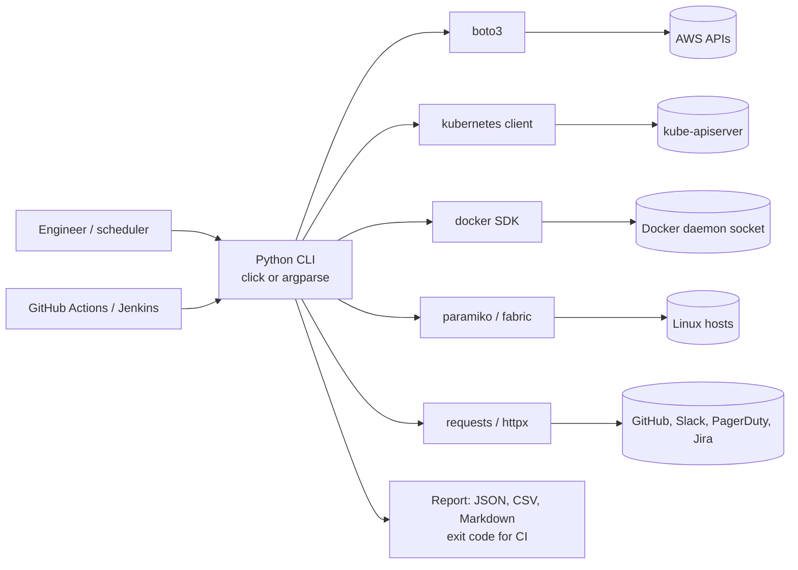
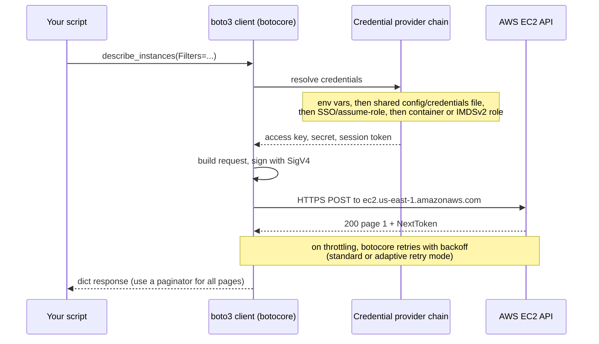
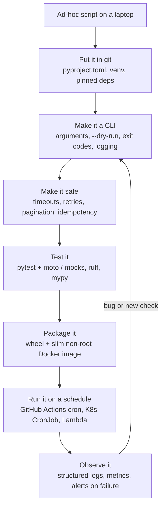
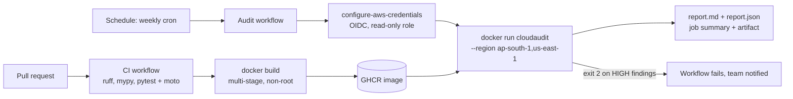
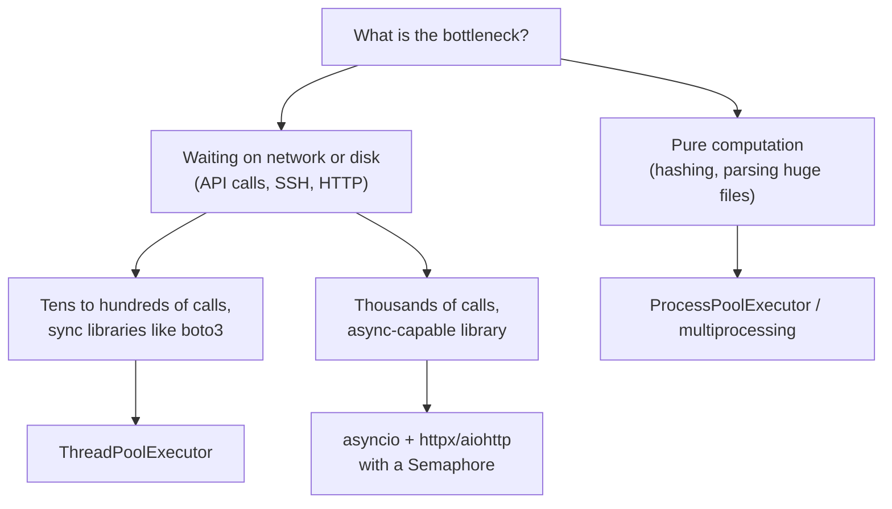

# Python for DevOps

<!-- DEVOPS-SHACK:HEADER -->

  
  
  
  
  

Part of <b><a href="https://github.com/jaiswaladi246/DevOps-Cloud-Interview-Preparation-by-DevOps-Shack">DevOps &amp; Cloud Interview Preparation</a></b> — created by <b><a href="https://www.youtube.com/@devopsshack">DevOps Shack</a></b>. Free to learn from; please credit DevOps Shack when sharing.

<!-- /DEVOPS-SHACK:HEADER -->

> Write the automation that production teams actually trust: CLIs with real exit codes, boto3 scripts that paginate and retry, tested with pytest and moto, packaged, containerized and scheduled. Everything an interviewer can ask about Python in a DevOps, SRE or Cloud role.

[🏠 Home](../README.md)

## What you'll master

- The Python that matters for automation: data types, mutability, comprehensions, functions, `*args`/`**kwargs`, closures, decorators, generators
- Exceptions done right: specific `except`, `raise ... from`, context managers, `finally`, and why bare `except:` is a bug
- File I/O, `pathlib`, `os`, `shutil`, and running commands safely with `subprocess.run` (no `shell=True` with user input)
- Parsing JSON, YAML (`yaml.safe_load`, never `yaml.load`) and CSV, and calling REST APIs with `requests`, timeouts, retries and exponential backoff
- Reproducible environments: `venv`, `pip`, `requirements.txt` vs lock files, `pyproject.toml`, `pipx` and `uv`
- Building CLIs with `argparse` and `click`: subcommands, env-var defaults, exit codes, stdout vs stderr
- Structured `logging` instead of `print`, log levels, and logging that works in containers
- Cloud and infra SDKs: `boto3` (sessions, clients, paginators, waiters, `ClientError`), the `kubernetes` client, the Docker SDK, `paramiko` and `fabric`
- Concurrency: the GIL, `ThreadPoolExecutor` for I/O, `multiprocessing` for CPU, and `asyncio` with `aiohttp`/`httpx`
- Testing with `pytest`: fixtures, parametrize, `monkeypatch`, mocking, and `moto` for AWS
- Type hints, `mypy`, `ruff`, packaging a wheel, and shipping the tool in a slim, non-root Docker image
- Small services: Flask/FastAPI health and webhook endpoints, and exposing Prometheus metrics with `prometheus_client`

---

## Where Python sits in a DevOps toolchain

Python is the glue language. Terraform builds the infrastructure, Kubernetes runs the workloads, CI/CD moves the code, and Python fills every gap between them: audit scripts, custom controllers, release tooling, webhook receivers, ChatOps bots, and data shuffling between APIs that were never designed to talk to each other.

Every one of these libraries is a thin, typed wrapper over an API. If you understand the underlying API (AWS Query/JSON, Kubernetes REST, Docker Engine API, SSH), the Python is easy, and when it breaks you know whether to blame your code or the service.

## How a boto3 call actually travels

A favourite interview probe is "what happens when you call `ec2.describe_instances()`?" The answer explains credential errors, throttling, and why pagination matters.

Two things trip people up. Errors come back as `botocore.exceptions.ClientError` with the AWS code in `e.response["Error"]["Code"]`, not as distinct Python exception classes per error (although `client.exceptions.NoSuchKey` style aliases exist for modelled errors). And every list API is paginated, so a script that ignores `NextToken` silently audits only the first page.

## Lifecycle of a production automation script

Most scripts start as a 20-line file on someone's laptop. The ones that survive follow the same path from quick hack to owned, tested, scheduled tool.

The jump from step A to step C is where most interviews focus. A script that prints a stack trace and exits 0 will be happily marked green by CI. A CLI that writes the report to stdout, diagnostics to stderr and exits non-zero on findings can gate a pipeline.

## Workflow: the cloud-ops CLI we build in the lab

The [hands-on lab](./hands-on-lab.md) builds `cloudaudit`, a CLI that audits an AWS account for untagged and idle EC2 instances, security groups open to the internet, and old EBS snapshots. It is tested offline with moto, shipped as a Docker image and run weekly by GitHub Actions using OIDC, with no long-lived keys anywhere.

## Concurrency: picking the right tool

The GIL lets only one thread execute Python bytecode at a time, but it is released while a thread waits on I/O. That is why threads speed up "call 300 AWS APIs" and do nothing for "hash 300 GB of files". (Free-threaded builds of CPython 3.13+ remove the GIL experimentally, but production DevOps code still assumes it.)

---

## Core concepts in 10 minutes

### 1. Types and mutability

`list`, `dict`, `set` and most objects are mutable; `int`, `float`, `str`, `tuple`, `frozenset` and `bytes` are immutable. Assignment never copies, it binds another name to the same object. The classic bug is a mutable default argument: `def add(tag, tags=[])` shares one list across every call. Use `tags=None` and create the list inside. Dicts preserve insertion order (guaranteed since 3.7), and only hashable (immutable) values can be dict keys or set members.

### 2. Comprehensions and generators

`[i["InstanceId"] for i in instances if i["State"]["Name"] == "running"]` is the idiomatic filter-and-map. Dict and set comprehensions work the same way. Swap the brackets for parentheses and you get a generator expression that yields lazily, which is how you process a 10 GB log file in constant memory. A function with `yield` is a generator too, ideal for wrapping paginated APIs.

### 3. Functions, closures and decorators

Functions are objects. `*args` collects positional arguments, `**kwargs` keyword arguments, and a bare `*` forces the rest to be keyword-only (`def deploy(env, *, dry_run=False)`), which makes call sites readable. A decorator is a function that takes a function and returns a wrapped one; retry, timing and auth checks are the usual DevOps uses. Always use `functools.wraps` so the wrapped function keeps its name and docstring.

### 4. Exceptions and context managers

Catch the narrowest exception you can handle, add context, and re-raise with `raise NewError(...) from exc` so the original traceback survives. `try / except / else / finally`: `else` runs only if nothing was raised, `finally` always runs. `with` statements guarantee cleanup (files, locks, temp dirs, SSH connections) even on errors, and `contextlib.contextmanager` turns a generator into your own context manager.

### 5. Files, paths and processes

Use `pathlib.Path` for paths (`Path("/etc") / "app" / "config.yaml"`, `.read_text()`, `.glob("*.log")`), always pass `encoding="utf-8"`, and write config atomically (write a temp file in the same directory, then `os.replace`). For external commands use `subprocess.run(["kubectl", "get", "pods"], check=True, capture_output=True, text=True, timeout=30)` with a list, not a string. `shell=True` plus untrusted input is command injection.

### 6. Environments and dependencies

Never `pip install` into the system Python (PEP 668 now blocks it on Debian/Ubuntu with `externally-managed-environment`). Create a venv per project: `python3 -m venv .venv && . .venv/bin/activate`. Declare dependencies in `pyproject.toml`, pin exact versions in a lock or `requirements.txt` generated by `pip-tools`/`uv pip compile`, and install with `--require-hashes` in CI for supply-chain safety. `pipx` installs CLI tools in isolated venvs. `uv` is a fast drop-in for most of this.

### 7. CLIs, exit codes and logging

`argparse` is in the standard library; `click` and `typer` give you decorators, subcommands, env-var defaults and a test runner. Results go to stdout, diagnostics to stderr, and the exit code tells the caller what happened (0 success, 1 error, 2 usage error or "findings" by convention). Use `logging.getLogger(__name__)` in modules and configure handlers once in the entry point. In containers, log to stdout/stderr, ideally as JSON, and let the platform ship the logs.

### 8. Data formats and HTTP

`json.loads`/`json.dumps`, `yaml.safe_load` (plain `yaml.load` can construct arbitrary objects), and `csv.DictReader`/`DictWriter`. For HTTP, use a `requests.Session` (connection pooling), always pass `timeout=(connect, read)` because the default is to wait forever, call `raise_for_status()`, and mount an `HTTPAdapter` with `urllib3.util.Retry` for backoff on 429/5xx. Only retry idempotent requests unless the API supports idempotency keys.

### 9. boto3 essentials

A `Session` holds credentials and region; clients are low-level, one-to-one with the API, and thread-safe; resources are a higher-level object layer that AWS has feature-frozen. Use paginators for every list call, waiters instead of `sleep` loops, `botocore.config.Config(retries={"mode": "adaptive"})` for throttling, and catch `ClientError` and inspect the error code. In CI and on AWS compute, credentials should come from OIDC, instance profiles, IRSA or Pod Identity, never from access keys in code.

### 10. Other infra clients

The `kubernetes` package loads credentials with `config.load_kube_config()` locally or `config.load_incluster_config()` in a pod and exposes typed APIs (`CoreV1Api().list_namespaced_pod(...)`) plus `watch.Watch()` for event streams. The Docker SDK (`docker.from_env()`) talks to the Engine API over the socket. `paramiko` is a raw SSH client; `fabric` wraps it with `Connection("host").run("uptime")` and `.put()`/`.get()`. Prefer Ansible for fleet configuration; use these for targeted automation.

### 11. Concurrency

Threads for I/O-bound work (`concurrent.futures.ThreadPoolExecutor`), processes for CPU-bound work, `asyncio` for very high fan-out with async libraries. Bound concurrency deliberately (`max_workers`, `asyncio.Semaphore`) so you do not trigger API throttling or exhaust file descriptors. Never call blocking functions (`time.sleep`, `requests.get`, boto3) directly inside a coroutine; that freezes the event loop. Use `asyncio.to_thread` if you must.

### 12. Testing, typing and packaging

`pytest` discovers `test_*.py`, uses plain `assert`, and gives you fixtures (`tmp_path`, `monkeypatch`, `capsys`) and `@pytest.mark.parametrize`. Mock at the boundary: `moto`'s `mock_aws` fakes AWS in-process, `responses`/`respx` fake HTTP, `unittest.mock.patch` patches where a name is looked up. Type hints plus `mypy` catch whole classes of bugs before runtime, and `ruff` replaces flake8, isort and most of pylint. Build a wheel with `python -m build`, expose a console script in `[project.scripts]`, and ship it in a multi-stage, non-root image.

### 13. Small services and metrics

A Flask or FastAPI app with `/healthz` (liveness: the process is alive) and `/readyz` (readiness: dependencies are reachable) is the standard sidecar or webhook pattern. Verify webhook signatures (for example GitHub's `X-Hub-Signature-256` HMAC) with `hmac.compare_digest`. Run under gunicorn or uvicorn, not the dev server. `prometheus_client` gives you `Counter`, `Gauge`, `Histogram` and `Summary`; expose them on `/metrics`, keep label cardinality low, and use the multiprocess mode when running several gunicorn workers.

---

## Question banks

Three banks with collapsible answers: 200 concepts, 100 scenarios and 100 troubleshooting drills, tagged 🟢 Beginner, 🟡 Intermediate, 🔴 Advanced.

| Bank | Questions | What it covers |
|------|-----------|----------------|
| [Concepts](./concepts.md) | 200 | Language essentials, exceptions, file I/O, venv and packaging, os/pathlib/subprocess, JSON/YAML/CSV, requests and retries, boto3, kubernetes/docker/paramiko clients, concurrency, pytest and moto, Flask/FastAPI, Prometheus metrics, best practices and rapid-fire commands |
| [Scenarios](./scenarios.md) | 100 | "What would you do" situations with a step-by-step approach |
| [Troubleshooting](./troubleshooting.md) | 100 | Real error messages: likely causes, diagnosis commands, fix and prevention |

## Learning path

Work through these in order. Tick each one only when you can do it without notes.

**Beginner**
- [ ] Explain mutable vs immutable types and fix a mutable-default-argument bug
- [ ] Write list, dict and set comprehensions and a generator that reads a large file line by line
- [ ] Create a venv, install packages, freeze them and recreate the environment elsewhere
- [ ] Read and write JSON, YAML and CSV files with `pathlib` and explicit encodings
- [ ] Run a shell command with `subprocess.run` and handle a non-zero exit code
- [ ] Write a CLI with `argparse` that has `--dry-run` and returns proper exit codes
- [ ] Replace `print` with `logging` and control the level from a flag
- [ ] Do the first 10 [assignments](./assignments.md)

**Intermediate**
- [ ] Call a REST API with a `requests.Session`, timeouts, and retries with exponential backoff
- [ ] List every EC2 instance in every region with boto3 paginators and handle `ClientError`
- [ ] List pods and their restart counts with the `kubernetes` Python client
- [ ] Parallelize 200 API calls with `ThreadPoolExecutor` and bound the concurrency
- [ ] Write pytest tests with fixtures, parametrize, `monkeypatch` and `moto`
- [ ] Add type hints and get `mypy --strict` clean on a small module
- [ ] Build a FastAPI or Flask service with `/healthz`, `/readyz` and `/metrics`
- [ ] Complete the [hands-on lab](./hands-on-lab.md) end to end

**Advanced**
- [ ] Explain the GIL, when threads help, and what free-threaded CPython changes
- [ ] Write an `asyncio` fan-out with a semaphore, timeouts and cancellation handling
- [ ] Build a Kubernetes watch loop that survives `410 Gone` and reconnects with `resourceVersion`
- [ ] Package a tool as a wheel with a console script and ship it in a non-root multi-stage image
- [ ] Verify a signed webhook (HMAC) and make the handler idempotent
- [ ] Run a scheduled audit from CI using OIDC with a least-privilege, read-only role
- [ ] Use Prometheus multiprocess mode correctly under gunicorn
- [ ] Finish all 25 assignments and answer 150 of the 200 questions in each bank unaided

## Study materials

- [Hands-on lab: build a cloud-ops audit CLI](./hands-on-lab.md) — boto3, click, pytest + moto, Docker, GitHub Actions on a schedule with OIDC
- [Assignments](./assignments.md) — 25 graded exercises (10 beginner, 10 intermediate, 5 advanced)
- [Cheatsheet](./cheatsheet.md) — language idioms, stdlib for ops, boto3, kubernetes, requests, pytest and packaging reference, plus the top 15 interview one-liners

[🏠 Home](../README.md)

<!-- DEVOPS-SHACK:FOOTER -->
---

### 🚀 Made with ❤️ by [DevOps Shack](https://www.youtube.com/@devopsshack)

**Learn DevOps, DevSecOps, Cloud and Kubernetes the practical way.**

[▶️ YouTube — DevOps Shack](https://www.youtube.com/@devopsshack) · [▶️ Hindi — @shackverse](https://www.youtube.com/@shackverse) · [🎓 devopsshack.com](https://devopsshack.com) · [📸 Instagram @devopsshack](https://www.instagram.com/devopsshack)

[🏠 Back to Home](../README.md) · [⭐ Star the original repo](https://github.com/jaiswaladi246/DevOps-Cloud-Interview-Preparation-by-DevOps-Shack)

© DevOps Shack · Licensed CC BY-NC-SA 4.0 · If you found this copy anywhere other than <a href="https://github.com/jaiswaladi246/DevOps-Cloud-Interview-Preparation-by-DevOps-Shack">github.com/jaiswaladi246</a>, the original and latest version is maintained by DevOps Shack.

<!-- /DEVOPS-SHACK:FOOTER -->
