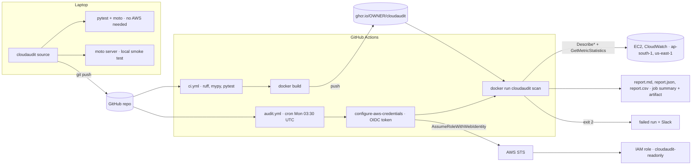
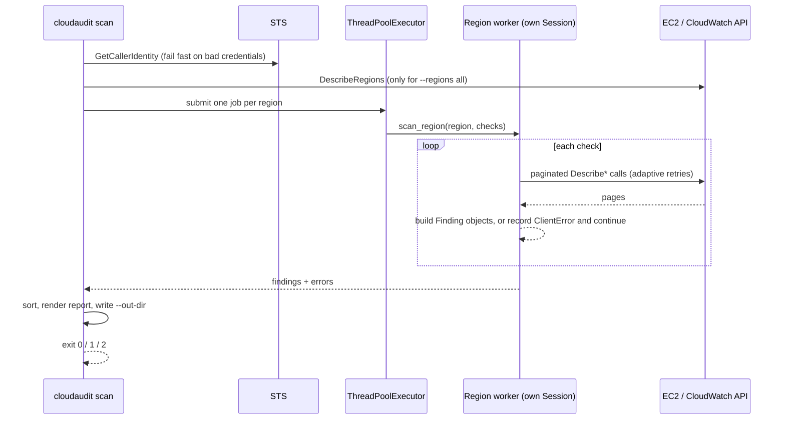

# Hands-on Lab: cloudaudit, a Python CLI That Audits AWS

<!-- DEVOPS-SHACK:HEADER -->
<p align="center">
  <a href="https://www.youtube.com/@devopsshack"></a>
  <a href="https://www.youtube.com/@shackverse"></a>
  <a href="https://devopsshack.com"></a>
  <a href="https://www.instagram.com/devopsshack"></a>
  <a href="https://github.com/jaiswaladi246/DevOps-Cloud-Interview-Preparation-by-DevOps-Shack"></a>
</p>
<p align="center"><sub>Part of <b><a href="https://github.com/jaiswaladi246/DevOps-Cloud-Interview-Preparation-by-DevOps-Shack">DevOps &amp; Cloud Interview Preparation</a></b> — created by <b><a href="https://www.youtube.com/@devopsshack">DevOps Shack</a></b>. Free to learn from; please credit DevOps Shack when sharing.</sub></p>
<!-- /DEVOPS-SHACK:HEADER -->

> Build the kind of tool platform teams actually run every week: a read-only Python CLI that finds untagged and idle EC2 instances, security groups open to the internet, and old or orphaned EBS snapshots. It paginates and retries properly, writes JSON, Markdown and CSV reports, exits non-zero on serious findings, is tested offline with pytest and moto, ships as a slim non-root Docker image, and runs every Monday from GitHub Actions using OIDC with no stored AWS keys.

[⬅ Back to Python for DevOps](./README.md) · [🏠 Home](../README.md)

## Goal

By the end you will have a Git repository called `cloudaudit` with:

- A Python package with a `click` CLI: `cloudaudit scan` and `cloudaudit checks`
- Four checks: `ec2-untagged`, `ec2-idle` (CloudWatch CPU), `sg-open` (0.0.0.0/0 and ::/0) and `ebs-snapshot-old` (age, orphaned source volume, AMI-backed)
- Paginators on every list call, adaptive retries, one boto3 session per worker thread, and a scan that survives a denied API in one region
- Reports in four formats, logs on stderr (plain or JSON lines), and meaningful exit codes: `0` clean, `1` error, `2` findings at or above `--fail-on`
- 35 pytest tests running against moto's in-memory AWS, with `ruff`, `mypy --strict` and a coverage gate
- A multi-stage Docker image that runs as UID 10001
- A CI workflow (lint, type check, test on 3.11 to 3.13, build and push to GHCR) and a scheduled audit workflow that assumes a read-only IAM role through OIDC, publishes the report as a job summary and an artifact, and fails (with an optional Slack ping) on HIGH findings

Time: about 3 hours. Cost: effectively free. The tests and the local smoke test need no AWS account at all. The optional live steps only call read-only Describe APIs and create one empty security group.

## Architecture



Inside the CLI, the flow for one scan looks like this:



## Prerequisites

| Tool | Version | Check |
|------|---------|-------|
| Python | 3.11 or newer (the lab was verified on 3.13) | `python3 --version` |
| Git | any recent | `git --version` |
| Docker | 24+ with BuildKit | `docker version` |
| AWS CLI v2 | optional, for the live steps | `aws --version` |
| GitHub account | for CI, GHCR and the scheduled run | |
| AWS account | optional; use a sandbox, never production, for your first run | `aws sts get-caller-identity` |

You should be comfortable with a virtual environment, basic boto3 calls and reading a GitHub Actions YAML file. Everything else is explained as we go.

The finished layout:

```text
cloudaudit/
├── .dockerignore
├── .gitignore
├── .github/workflows/
│   ├── ci.yml
│   └── audit.yml
├── Dockerfile
├── iam/
│   ├── audit-policy.json
│   └── trust-policy.json
├── pyproject.toml
├── src/cloudaudit/
│   ├── __init__.py
│   ├── __main__.py
│   ├── aws.py
│   ├── cli.py
│   ├── logging_setup.py
│   ├── models.py
│   ├── py.typed
│   ├── report.py
│   ├── scanner.py
│   └── checks/
│       ├── __init__.py
│       ├── ec2.py
│       ├── security_groups.py
│       └── snapshots.py
└── tests/
    ├── __init__.py
    ├── conftest.py
    ├── test_cli.py
    ├── test_ec2.py
    ├── test_report.py
    ├── test_scanner.py
    ├── test_security_groups.py
    └── test_snapshots.py
```

We use the `src/` layout on purpose: tests import the installed package, not whatever happens to be in the current directory, so "works on my machine because of a stray file" bugs cannot happen.

---

## Step 1. Create the repository and a virtual environment

```bash
mkdir cloudaudit && cd cloudaudit
git init -b main
mkdir -p src/cloudaudit/checks tests iam .github/workflows

python3 -m venv .venv
. .venv/bin/activate
python -m pip install --upgrade pip
```

Never install into the system Python. On Debian 12+ and Ubuntu 23.04+ a bare `pip install` fails with `error: externally-managed-environment` (PEP 668), and that is the OS protecting itself.

Create `.gitignore`:

```text
.venv/
__pycache__/
*.egg-info/
.pytest_cache/
.mypy_cache/
.ruff_cache/
.coverage
dist/
build/
reports/
```

**Verify:** `which python` prints a path ending in `cloudaudit/.venv/bin/python`.

## Step 2. Declare the project in pyproject.toml

One file holds the package metadata, runtime and dev dependencies, the console-script entry point, and the config for pytest, ruff and mypy.

```toml
[build-system]
requires = ["setuptools>=69", "wheel"]
build-backend = "setuptools.build_meta"

[project]
name = "cloudaudit"
version = "0.1.0"
description = "Audit an AWS account for untagged/idle EC2, open security groups and old EBS snapshots"
requires-python = ">=3.11"
dependencies = [
    "boto3>=1.35",
    "click>=8.1",
]

[project.optional-dependencies]
dev = [
    "moto[ec2,cloudwatch,sts]>=5.0",
    "pytest>=8.0",
    "pytest-cov>=5.0",
    "ruff>=0.6",
    "mypy>=1.11",
    "boto3-stubs[ec2,cloudwatch,sts]>=1.35",
]

[project.scripts]
cloudaudit = "cloudaudit.cli:main"

[tool.setuptools.packages.find]
where = ["src"]

[tool.pytest.ini_options]
testpaths = ["tests"]
addopts = "-ra --strict-markers"

[tool.ruff]
line-length = 100
target-version = "py311"

[tool.ruff.lint]
select = ["E", "F", "W", "I", "B", "UP", "S", "SIM"]

[tool.ruff.lint.per-file-ignores]
"tests/*" = ["S101", "S105", "S106"]

[tool.mypy]
python_version = "3.11"
strict = true
files = ["src"]
```

Key decisions:

- Runtime dependencies are only `boto3` and `click`. Everything for testing and linting lives in the `dev` extra, so the Docker image stays small.
- `[project.scripts]` creates a `cloudaudit` executable on install. No `python cli.py` wrappers.
- Lower bounds here, exact pins in a lock file. For a deployable tool, generate one with `uv pip compile pyproject.toml -o requirements.lock` (or `pip-compile`) and install from it in CI with `--require-hashes` if you want supply-chain guarantees.
- Ruff's `S` rules (flake8-bandit) catch things like `subprocess` with `shell=True` and hard-coded secrets.

Create the package marker files:

```python
"""cloudaudit: a small, read-only AWS hygiene auditor."""

__version__ = "0.1.0"
```

`src/cloudaudit/__main__.py` makes `python -m cloudaudit` work:

```python
from cloudaudit.cli import main

main()
```

And an empty `src/cloudaudit/py.typed` tells mypy and other consumers that the package ships type hints:

```bash
touch src/cloudaudit/py.typed tests/__init__.py
```

## Step 3. The data model

Every check returns the same `Finding` object, which keeps reports and exit-code logic independent of the checks. `Severity` is an `IntEnum`, so `Severity.HIGH > Severity.MEDIUM` works and `--fail-on` is a single comparison.

`src/cloudaudit/models.py`:

```python
"""Data model shared by every check and every report format."""

from __future__ import annotations

from dataclasses import asdict, dataclass, field
from enum import IntEnum
from typing import Any


class Severity(IntEnum):
    """Ordered so that comparisons work: Severity.HIGH > Severity.LOW."""

    INFO = 0
    LOW = 1
    MEDIUM = 2
    HIGH = 3

    @classmethod
    def parse(cls, value: str) -> Severity:
        try:
            return cls[value.upper()]
        except KeyError as exc:
            valid = ", ".join(s.name for s in cls)
            raise ValueError(f"unknown severity {value!r}, expected one of: {valid}") from exc


@dataclass(frozen=True)
class Finding:
    check: str
    severity: Severity
    region: str
    resource_id: str
    message: str
    details: dict[str, Any] = field(default_factory=dict)

    def to_dict(self) -> dict[str, Any]:
        data = asdict(self)
        data["severity"] = self.severity.name
        return data
```

`frozen=True` makes findings immutable and hashable. `raise ... from exc` keeps the original `KeyError` in the traceback while giving the user a useful message.

## Step 4. boto3 session and client helpers

`src/cloudaudit/aws.py`:

```python
"""boto3 session and client helpers.

boto3 sessions are not thread-safe, so every worker thread builds its own
session through new_session(). Clients created from a session are safe to use
from the thread that created them.
"""

from __future__ import annotations

import logging
from typing import Any

import boto3
from botocore.config import Config

log = logging.getLogger(__name__)

# Adaptive retry mode adds client-side rate limiting on top of exponential
# backoff, which is what you want when one scan fires hundreds of Describe calls.
BOTO_CONFIG = Config(
    retries={"max_attempts": 10, "mode": "adaptive"},
    connect_timeout=5,
    read_timeout=30,
    user_agent_extra="cloudaudit/0.1.0",
)


def new_session(profile: str | None = None, region: str | None = None) -> boto3.session.Session:
    return boto3.session.Session(profile_name=profile, region_name=region)


def client(session: boto3.session.Session, service: str, region: str) -> Any:
    # service is a plain str here, so the typed overloads in boto3-stubs cannot match.
    return session.client(service, region_name=region, config=BOTO_CONFIG)  # type: ignore[call-overload]


def whoami(session: boto3.session.Session) -> str:
    """Return the caller ARN. Fails fast with a clear error if there are no credentials."""
    sts = client(session, "sts", session.region_name or "us-east-1")
    arn: str = sts.get_caller_identity()["Arn"]
    return arn


def resolve_regions(session: boto3.session.Session, requested: list[str]) -> list[str]:
    """Expand 'all' into every region enabled for this account."""
    if requested != ["all"]:
        return requested
    ec2 = client(session, "ec2", session.region_name or "us-east-1")
    regions = sorted(r["RegionName"] for r in ec2.describe_regions()["Regions"])
    log.info("resolved 'all' to %d enabled regions", len(regions))
    return regions
```

What to notice:

- **Retries.** `adaptive` mode is exponential backoff plus client-side rate limiting. With `standard` mode, a scan of 300 instances can still hit `RequestLimitExceeded` storms; adaptive slows the client down instead.
- **Timeouts.** botocore's default read timeout is 60 seconds. Explicit, shorter timeouts mean a hung connection fails and gets retried instead of stalling a scheduled job.
- **Credentials.** We never pass keys. The default provider chain finds env vars, `--profile`/SSO, or the OIDC credentials that GitHub Actions exports. The same code runs on a laptop, in CI and on an EC2 instance profile.
- **`whoami()` first.** `GetCallerIdentity` needs no IAM permission, so it is the cheapest way to fail fast with "no credentials" before spawning threads.

## Step 5. EC2 checks: missing tags and idle instances

`src/cloudaudit/checks/ec2.py`:

```python
"""EC2 instance checks: missing tags and idle instances."""

from __future__ import annotations

import logging
from collections.abc import Iterator
from datetime import UTC, datetime, timedelta
from typing import TYPE_CHECKING, Any

import boto3

from cloudaudit.aws import client
from cloudaudit.models import Finding, Severity

if TYPE_CHECKING:
    from cloudaudit.checks import Settings

log = logging.getLogger(__name__)


def iter_instances(ec2: Any, states: list[str]) -> Iterator[dict[str, Any]]:
    """Yield every instance across every page. Never call describe_instances without a paginator."""
    paginator = ec2.get_paginator("describe_instances")
    pages = paginator.paginate(Filters=[{"Name": "instance-state-name", "Values": states}])
    for page in pages:
        for reservation in page["Reservations"]:
            yield from reservation["Instances"]


def tags_to_dict(tags: list[dict[str, str]] | None) -> dict[str, str]:
    return {t["Key"]: t["Value"] for t in tags or []}


def check_untagged_instances(
    session: boto3.session.Session, region: str, settings: Settings
) -> list[Finding]:
    ec2 = client(session, "ec2", region)
    findings: list[Finding] = []
    for inst in iter_instances(ec2, ["pending", "running", "stopping", "stopped"]):
        tags = tags_to_dict(inst.get("Tags"))
        # A tag that exists but is blank is as useless as a missing one.
        missing = [k for k in settings.required_tags if not tags.get(k, "").strip()]
        if missing:
            findings.append(
                Finding(
                    check="ec2-untagged",
                    severity=Severity.MEDIUM,
                    region=region,
                    resource_id=inst["InstanceId"],
                    message=f"missing required tags: {', '.join(missing)}",
                    details={
                        "name": tags.get("Name", ""),
                        "instance_type": inst["InstanceType"],
                        "state": inst["State"]["Name"],
                        "missing_tags": missing,
                    },
                )
            )
    log.info("%s: ec2-untagged found %d", region, len(findings))
    return findings


def daily_cpu(cw: Any, instance_id: str, days: int, now: datetime) -> list[dict[str, Any]]:
    resp = cw.get_metric_statistics(
        Namespace="AWS/EC2",
        MetricName="CPUUtilization",
        Dimensions=[{"Name": "InstanceId", "Value": instance_id}],
        StartTime=now - timedelta(days=days),
        EndTime=now,
        Period=86400,
        Statistics=["Average", "Maximum"],
    )
    points: list[dict[str, Any]] = resp["Datapoints"]
    return points


def check_idle_instances(
    session: boto3.session.Session,
    region: str,
    settings: Settings,
    now: datetime | None = None,
) -> list[Finding]:
    now = now or datetime.now(UTC)
    ec2 = client(session, "ec2", region)
    cw = client(session, "cloudwatch", region)
    findings: list[Finding] = []
    # Require nearly full coverage so a 2-day-old instance is not called idle.
    min_points = max(1, settings.idle_days - 1)

    for inst in iter_instances(ec2, ["running"]):
        iid = inst["InstanceId"]
        points = daily_cpu(cw, iid, settings.idle_days, now)
        if len(points) < min_points:
            log.debug("%s: %s has %d datapoints, skipping", region, iid, len(points))
            continue
        peak_daily_avg = max(p["Average"] for p in points)
        peak = max(p["Maximum"] for p in points)
        if peak_daily_avg < settings.idle_cpu_percent:
            findings.append(
                Finding(
                    check="ec2-idle",
                    severity=Severity.LOW,
                    region=region,
                    resource_id=iid,
                    message=(
                        f"daily average CPU below {settings.idle_cpu_percent}% "
                        f"for {settings.idle_days} days (highest daily avg "
                        f"{peak_daily_avg:.1f}%, peak {peak:.1f}%)"
                    ),
                    details={
                        "name": tags_to_dict(inst.get("Tags")).get("Name", ""),
                        "instance_type": inst["InstanceType"],
                        "peak_daily_avg_cpu": round(peak_daily_avg, 2),
                        "peak_cpu": round(peak, 2),
                        "datapoints": len(points),
                    },
                )
            )
    log.info("%s: ec2-idle found %d", region, len(findings))
    return findings
```

Design notes:

- `iter_instances` is a generator over a paginator. `describe_instances` returns at most 1,000 instances per page, and the classic bug is auditing only page one. With a generator, memory stays flat even for very large accounts.
- A tag that exists but is blank counts as missing. People do `Owner=" "` to get past a policy.
- **Idle** means the highest daily average CPU across the window is under the threshold, and we demand `idle_days - 1` datapoints so a two-day-old instance is not called idle. One CloudWatch call per instance with `Period=86400` returns at most `idle_days` datapoints, far below the 1,440 datapoint limit.
- `now` is a parameter so tests control the clock. Injecting time is cleaner than patching `datetime`.
- CPU alone is a heuristic. A memory-bound or network-bound box can sit at 2% CPU and be busy. The finding is LOW severity for that reason, and the details carry the numbers so a human can judge.

## Step 6. Security group check

`src/cloudaudit/checks/security_groups.py`:

```python
"""Security groups with ingress open to the whole internet."""

from __future__ import annotations

import logging
from typing import TYPE_CHECKING, Any

import boto3

from cloudaudit.aws import client
from cloudaudit.models import Finding, Severity

if TYPE_CHECKING:
    from cloudaudit.checks import Settings

log = logging.getLogger(__name__)

OPEN_V4 = "0.0.0.0/0"
OPEN_V6 = "::/0"

# Ports that should never be reachable from the internet.
SENSITIVE_PORTS = {
    22: "SSH",
    3389: "RDP",
    3306: "MySQL",
    5432: "PostgreSQL",
    1433: "MSSQL",
    6379: "Redis",
    9200: "Elasticsearch",
    27017: "MongoDB",
    2375: "Docker API",
    10250: "kubelet",
}


def open_sources(rule: dict[str, Any]) -> list[str]:
    sources = [r["CidrIp"] for r in rule.get("IpRanges", []) if r.get("CidrIp") == OPEN_V4]
    sources += [r["CidrIpv6"] for r in rule.get("Ipv6Ranges", []) if r.get("CidrIpv6") == OPEN_V6]
    return sources


def classify(rule: dict[str, Any], allowed: frozenset[int]) -> tuple[Severity, str] | None:
    """Return (severity, port description) for an open rule, or None if it is acceptable."""
    proto = rule["IpProtocol"]
    if proto == "-1":
        return Severity.HIGH, "all traffic"
    if proto in ("icmp", "icmpv6", "1", "58"):
        return Severity.LOW, f"{proto}"
    start, end = rule.get("FromPort", 0), rule.get("ToPort", 65535)
    label = f"{proto}/{start}" if start == end else f"{proto}/{start}-{end}"
    exposed = [name for port, name in SENSITIVE_PORTS.items() if start <= port <= end]
    if exposed:
        return Severity.HIGH, f"{label} ({', '.join(exposed)})"
    if start == end and start in allowed:
        return None
    return Severity.MEDIUM, label


def check_open_security_groups(
    session: boto3.session.Session, region: str, settings: Settings
) -> list[Finding]:
    ec2 = client(session, "ec2", region)
    findings: list[Finding] = []
    for page in ec2.get_paginator("describe_security_groups").paginate():
        for sg in page["SecurityGroups"]:
            for rule in sg.get("IpPermissions", []):
                sources = open_sources(rule)
                if not sources:
                    continue
                verdict = classify(rule, settings.allowed_public_ports)
                if verdict is None:
                    continue
                severity, ports = verdict
                findings.append(
                    Finding(
                        check="sg-open",
                        severity=severity,
                        region=region,
                        resource_id=sg["GroupId"],
                        message=f"{ports} open to {', '.join(sources)}",
                        details={
                            "group_name": sg["GroupName"],
                            "vpc_id": sg.get("VpcId", ""),
                            "protocol": rule["IpProtocol"],
                            "from_port": rule.get("FromPort"),
                            "to_port": rule.get("ToPort"),
                        },
                    )
                )
    log.info("%s: sg-open found %d", region, len(findings))
    return findings
```

The classification rules:

| Rule | Severity |
|------|----------|
| All traffic (`IpProtocol: "-1"`) from 0.0.0.0/0 or ::/0 | HIGH |
| A port range that includes a sensitive port (22, 3389, 3306, 5432, 6379, 27017, 2375, 10250 …) | HIGH |
| Any other open TCP/UDP port or range | MEDIUM |
| ICMP open to the world | LOW |
| A single port in `allowed_public_ports` (80, 443) | not reported |
| Anything restricted to a narrower CIDR or another security group | not reported |

Checking ranges matters: a rule for `tcp/3000-4000` exposes MySQL and RDP even though neither port appears in the rule text. IPv6 matters too: many audits only look at `IpRanges` and miss `Ipv6Ranges` with `::/0`.

## Step 7. Snapshot check

`src/cloudaudit/checks/snapshots.py`:

```python
"""EBS snapshots that are old, orphaned, or both."""

from __future__ import annotations

import logging
from datetime import UTC, datetime
from typing import TYPE_CHECKING, Any

import boto3

from cloudaudit.aws import client
from cloudaudit.models import Finding, Severity

if TYPE_CHECKING:
    from cloudaudit.checks import Settings

log = logging.getLogger(__name__)

# Standard-tier snapshot storage, USD per GB-month (us-east-1). Order of magnitude
# is what matters for the report; check current pricing for your region.
SNAPSHOT_USD_PER_GB_MONTH = 0.05


def existing_volume_ids(ec2: Any) -> set[str]:
    ids: set[str] = set()
    for page in ec2.get_paginator("describe_volumes").paginate():
        ids.update(v["VolumeId"] for v in page["Volumes"])
    return ids


def ami_snapshot_map(ec2: Any) -> dict[str, str]:
    """Map snapshot ID -> AMI ID for every AMI this account owns."""
    mapping: dict[str, str] = {}
    for page in ec2.get_paginator("describe_images").paginate(Owners=["self"]):
        for image in page["Images"]:
            for bdm in image.get("BlockDeviceMappings", []):
                snap_id = bdm.get("Ebs", {}).get("SnapshotId")
                if snap_id:
                    mapping[snap_id] = image["ImageId"]
    return mapping


def check_old_snapshots(
    session: boto3.session.Session,
    region: str,
    settings: Settings,
    now: datetime | None = None,
) -> list[Finding]:
    """`now` is injectable so tests can age snapshots without sleeping for 90 days."""
    now = now or datetime.now(UTC)
    ec2 = client(session, "ec2", region)
    volumes = existing_volume_ids(ec2)
    amis = ami_snapshot_map(ec2)
    findings: list[Finding] = []

    # OwnerIds=["self"] matters: without it you page through every public snapshot in AWS.
    for page in ec2.get_paginator("describe_snapshots").paginate(OwnerIds=["self"]):
        for snap in page["Snapshots"]:
            age_days = (now - snap["StartTime"]).days
            if age_days < settings.snapshot_max_age_days:
                continue
            size = snap.get("VolumeSize", 0)
            ami_id = amis.get(snap["SnapshotId"])
            if ami_id:
                # Cannot be deleted while the AMI exists; that is an AMI clean-up decision.
                findings.append(
                    Finding(
                        check="ebs-snapshot-old",
                        severity=Severity.INFO,
                        region=region,
                        resource_id=snap["SnapshotId"],
                        message=f"{age_days} days old, {size} GiB, backs {ami_id}",
                        details={"age_days": age_days, "size_gib": size, "ami_id": ami_id},
                    )
                )
                continue
            orphaned = snap.get("VolumeId", "") not in volumes
            findings.append(
                Finding(
                    check="ebs-snapshot-old",
                    severity=Severity.MEDIUM if orphaned else Severity.LOW,
                    region=region,
                    resource_id=snap["SnapshotId"],
                    message=(
                        f"{age_days} days old, {size} GiB"
                        + (", source volume no longer exists" if orphaned else "")
                    ),
                    details={
                        "age_days": age_days,
                        "size_gib": size,
                        "volume_id": snap.get("VolumeId", ""),
                        "orphaned": orphaned,
                        "est_monthly_usd": round(size * SNAPSHOT_USD_PER_GB_MONTH, 2),
                        "description": snap.get("Description", ""),
                    },
                )
            )
    log.info("%s: ebs-snapshot-old found %d", region, len(findings))
    return findings
```

Three outcomes for a snapshot older than the threshold:

- **Backs one of our AMIs** → INFO. You cannot delete it without deregistering the AMI first (`InvalidSnapshot.InUse`), so it is an AMI clean-up decision, not a snapshot one.
- **Source volume still exists** → LOW. Probably an old backup; check retention policy (or move it to the archive tier).
- **Source volume is gone** → MEDIUM. Orphaned snapshots are the classic forgotten cost.

`OwnerIds=["self"]` is essential. Without it, `describe_snapshots` lists every public snapshot in the region, which is a very slow way to audit someone else's account.

## Step 8. The check registry and settings

`src/cloudaudit/checks/__init__.py`:

```python
"""Check registry.

Every check has the same signature: (session, region, settings) -> list[Finding].
Adding a check means writing one function and adding one line to CHECKS.
"""

from __future__ import annotations

from collections.abc import Callable
from dataclasses import dataclass, field

import boto3

from cloudaudit.checks.ec2 import check_idle_instances, check_untagged_instances
from cloudaudit.checks.security_groups import check_open_security_groups
from cloudaudit.checks.snapshots import check_old_snapshots
from cloudaudit.models import Finding


@dataclass(frozen=True)
class Settings:
    required_tags: tuple[str, ...] = ("Owner", "Environment", "CostCenter")
    idle_days: int = 14
    idle_cpu_percent: float = 5.0
    snapshot_max_age_days: int = 90
    allowed_public_ports: frozenset[int] = field(default_factory=lambda: frozenset({80, 443}))


CheckFn = Callable[[boto3.session.Session, str, Settings], list[Finding]]

CHECKS: dict[str, tuple[CheckFn, str]] = {
    "ec2-untagged": (check_untagged_instances, "EC2 instances missing required tags"),
    "ec2-idle": (check_idle_instances, "Running EC2 instances with low CPU for N days"),
    "sg-open": (check_open_security_groups, "Security groups open to 0.0.0.0/0 or ::/0"),
    "ebs-snapshot-old": (check_old_snapshots, "EBS snapshots older than N days or orphaned"),
}
```

Every check has the same signature, so the scanner and the CLI never need to change when you add a fifth check. `Settings` is a frozen dataclass passed into every check instead of global variables, which is what makes the checks easy to test with different thresholds.

The `TYPE_CHECKING` import in each check module avoids a circular import: the registry imports the checks, and the checks only need `Settings` for type hints.

## Step 9. Scan regions in parallel

`src/cloudaudit/scanner.py`:

```python
"""Run checks across regions in parallel.

The work is I/O-bound (waiting on AWS APIs), so threads are the right tool
despite the GIL. Each region gets its own boto3 session.
"""

from __future__ import annotations

import logging
from concurrent.futures import ThreadPoolExecutor, as_completed
from dataclasses import dataclass, field

from botocore.exceptions import BotoCoreError, ClientError

from cloudaudit.aws import new_session
from cloudaudit.checks import CHECKS, Settings
from cloudaudit.models import Finding

log = logging.getLogger(__name__)


@dataclass
class ScanResult:
    findings: list[Finding] = field(default_factory=list)
    errors: list[str] = field(default_factory=list)


def scan_region(
    region: str, check_names: list[str], settings: Settings, profile: str | None
) -> ScanResult:
    session = new_session(profile=profile, region=region)
    result = ScanResult()
    for name in check_names:
        fn, _ = CHECKS[name]
        try:
            result.findings.extend(fn(session, region, settings))
        except ClientError as exc:
            # One denied API or disabled region must not kill the whole scan.
            code = exc.response.get("Error", {}).get("Code", "Unknown")
            msg = f"{region}/{name}: {code}: {exc}"
            log.error(msg)
            result.errors.append(msg)
        except BotoCoreError as exc:
            msg = f"{region}/{name}: {exc}"
            log.error(msg)
            result.errors.append(msg)
    return result


def scan(
    regions: list[str],
    check_names: list[str],
    settings: Settings,
    profile: str | None = None,
    max_workers: int = 8,
) -> ScanResult:
    total = ScanResult()
    with ThreadPoolExecutor(max_workers=min(max_workers, len(regions))) as pool:
        futures = {pool.submit(scan_region, r, check_names, settings, profile): r for r in regions}
        for fut in as_completed(futures):
            part = fut.result()
            total.findings.extend(part.findings)
            total.errors.extend(part.errors)
    # Stable, readable order: worst first, then region, check, resource.
    total.findings.sort(key=lambda f: (-f.severity, f.region, f.check, f.resource_id))
    return total
```

Why it looks like this:

- **Threads, not processes or asyncio.** The work is waiting on HTTPS responses, and the GIL is released during network I/O. boto3 is synchronous, so asyncio would need `to_thread` everywhere anyway.
- **One session per thread.** boto3 `Session` objects are not thread-safe. Clients are, but creating clients from a shared session concurrently is not. Building a session inside `scan_region` sidesteps the whole question.
- **Bounded workers.** `max_workers=8` keeps the API call rate predictable. Thirty regions times four checks at full fan-out is how you earn throttling.
- **Partial failure is data.** A Service Control Policy that denies `ec2:DescribeSnapshots` in one region becomes an entry in `errors` and the report, not a crashed scan.

## Step 10. Reports

`src/cloudaudit/report.py`:

```python
"""Render findings as JSON, Markdown, CSV or a plain-text table."""

from __future__ import annotations

import csv
import io
import json
from collections import Counter
from datetime import UTC, datetime
from typing import Any

from cloudaudit.models import Finding, Severity


def summary(findings: list[Finding]) -> dict[str, int]:
    counts = Counter(f.severity.name for f in findings)
    return {s.name: counts.get(s.name, 0) for s in sorted(Severity, reverse=True)}


def to_json(findings: list[Finding], meta: dict[str, Any]) -> str:
    doc = {
        "generated_at": datetime.now(UTC).isoformat(timespec="seconds"),
        **meta,
        "summary": summary(findings),
        "findings": [f.to_dict() for f in findings],
    }
    return json.dumps(doc, indent=2, default=str)


def _md_escape(text: str) -> str:
    return text.replace("|", "\\|").replace("\n", " ")


def to_markdown(findings: list[Finding], meta: dict[str, Any]) -> str:
    lines = [
        "# cloudaudit report",
        "",
        f"Account: `{meta.get('account', 'unknown')}` · "
        f"Regions: {', '.join(meta.get('regions', []))} · "
        f"Generated: {datetime.now(UTC):%Y-%m-%d %H:%M} UTC",
        "",
        "| Severity | Count |",
        "|----------|------:|",
    ]
    lines += [f"| {sev} | {n} |" for sev, n in summary(findings).items()]
    lines.append("")
    if not findings:
        lines.append("No findings. :tada:")
    else:
        lines += [
            "| Severity | Check | Region | Resource | Message |",
            "|----------|-------|--------|----------|---------|",
        ]
        lines += [
            f"| {f.severity.name} | {f.check} | {f.region} | `{f.resource_id}` | "
            f"{_md_escape(f.message)} |"
            for f in findings
        ]
    errors = meta.get("errors") or []
    if errors:
        lines += ["", "## Errors", ""] + [f"- {_md_escape(e)}" for e in errors]
    return "\n".join(lines) + "\n"


def to_csv(findings: list[Finding]) -> str:
    buf = io.StringIO()
    writer = csv.DictWriter(
        buf,
        fieldnames=["severity", "check", "region", "resource_id", "message"],
        lineterminator="\n",
    )
    writer.writeheader()
    for f in findings:
        writer.writerow(
            {
                "severity": f.severity.name,
                "check": f.check,
                "region": f.region,
                "resource_id": f.resource_id,
                "message": f.message,
            }
        )
    return buf.getvalue()


def to_table(findings: list[Finding]) -> str:
    if not findings:
        return "No findings.\n"
    rows = [("SEVERITY", "CHECK", "REGION", "RESOURCE", "MESSAGE")]
    rows += [(f.severity.name, f.check, f.region, f.resource_id, f.message) for f in findings]
    widths = [max(len(r[i]) for r in rows) for i in range(4)]
    out = []
    for r in rows:
        out.append("  ".join(r[i].ljust(widths[i]) for i in range(4)) + "  " + r[4])
    return "\n".join(out) + "\n"
```

JSON is for machines (dashboards, diffing week over week, feeding a ticketing bot). Markdown is for humans and drops straight into `$GITHUB_STEP_SUMMARY`. CSV is for whoever opens it in a spreadsheet. The Markdown renderer escapes `|` because a security group description with a pipe in it would otherwise break the table.

## Step 11. Logging that works in containers

`src/cloudaudit/logging_setup.py`:

```python
"""Logging to stderr, plain text for humans or JSON lines for log pipelines."""

from __future__ import annotations

import json
import logging
import sys
from datetime import UTC, datetime


class JsonFormatter(logging.Formatter):
    def format(self, record: logging.LogRecord) -> str:
        payload = {
            "ts": datetime.fromtimestamp(record.created, UTC).isoformat(timespec="milliseconds"),
            "level": record.levelname,
            "logger": record.name,
            "msg": record.getMessage(),
        }
        if record.exc_info:
            payload["exc"] = self.formatException(record.exc_info)
        return json.dumps(payload)


def configure(level: str = "INFO", json_logs: bool = False) -> None:
    handler = logging.StreamHandler(sys.stderr)  # stdout is reserved for the report
    if json_logs:
        handler.setFormatter(JsonFormatter())
    else:
        handler.setFormatter(logging.Formatter("%(asctime)s %(levelname)-7s %(name)s: %(message)s"))
    root = logging.getLogger()
    root.handlers[:] = [handler]
    root.setLevel(level.upper())
    # botocore is very chatty at DEBUG; keep it at WARNING unless asked.
    for noisy in ("botocore", "boto3", "urllib3"):
        logging.getLogger(noisy).setLevel(logging.WARNING)
```

Logs go to **stderr**, the report goes to **stdout**. That separation is what lets you run `cloudaudit scan --format json | jq '.summary'` without log lines corrupting the JSON. In containers, JSON lines on stderr are picked up as-is by CloudWatch Logs, Loki or Datadog.

## Step 12. The CLI

`src/cloudaudit/cli.py`:

```python
"""Command-line entry point.

Exit codes:
  0  scan completed, nothing at or above --fail-on
  1  error (no credentials, every region failed, bad config)
  2  scan completed, findings at or above --fail-on
     (click also uses 2 for usage errors; both should fail a CI job)
"""

from __future__ import annotations

import logging
import sys
from pathlib import Path

import click
from botocore.exceptions import BotoCoreError, ClientError, NoCredentialsError

from cloudaudit import __version__, report
from cloudaudit.aws import new_session, resolve_regions, whoami
from cloudaudit.checks import CHECKS, Settings
from cloudaudit.logging_setup import configure
from cloudaudit.models import Severity
from cloudaudit.scanner import scan

log = logging.getLogger("cloudaudit")

EXIT_OK, EXIT_ERROR, EXIT_FINDINGS = 0, 1, 2


def _csv(value: str) -> list[str]:
    return [v.strip() for v in value.split(",") if v.strip()]


@click.group(context_settings={"help_option_names": ["-h", "--help"]})
@click.version_option(__version__, prog_name="cloudaudit")
@click.option(
    "--log-level",
    default="INFO",
    envvar="CLOUDAUDIT_LOG_LEVEL",
    type=click.Choice(["DEBUG", "INFO", "WARNING", "ERROR"], case_sensitive=False),
    show_default=True,
)
@click.option(
    "--json-logs",
    is_flag=True,
    envvar="CLOUDAUDIT_JSON_LOGS",
    help="Emit logs as JSON lines on stderr.",
)
def cli(log_level: str, json_logs: bool) -> None:
    """Read-only AWS hygiene audit: tags, idle EC2, open security groups, old snapshots."""
    configure(log_level, json_logs)


@cli.command("checks")
def list_checks() -> None:
    """List available checks."""
    for name, (_, description) in CHECKS.items():
        click.echo(f"{name:<18} {description}")


@cli.command("scan")
@click.option("--profile", envvar="AWS_PROFILE", default=None, help="AWS profile name.")
@click.option(
    "--regions",
    envvar="CLOUDAUDIT_REGIONS",
    default="us-east-1",
    show_default=True,
    help="Comma-separated regions, or 'all' for every enabled region.",
)
@click.option(
    "--checks",
    "checks_opt",
    envvar="CLOUDAUDIT_CHECKS",
    default=",".join(CHECKS),
    show_default=True,
    help="Comma-separated checks to run.",
)
@click.option(
    "--required-tags",
    envvar="CLOUDAUDIT_REQUIRED_TAGS",
    default="Owner,Environment,CostCenter",
    show_default=True,
)
@click.option("--idle-days", type=click.IntRange(1, 90), default=14, show_default=True)
@click.option(
    "--idle-cpu",
    type=click.FloatRange(0, 100),
    default=5.0,
    show_default=True,
    help="Daily average CPU %% below which an instance counts as idle.",
)
@click.option(
    "--snapshot-age",
    type=click.IntRange(1),
    default=90,
    show_default=True,
    help="Flag snapshots older than this many days.",
)
@click.option(
    "--format",
    "fmt",
    type=click.Choice(["table", "json", "markdown", "csv"]),
    default="table",
    show_default=True,
    help="Format written to stdout.",
)
@click.option(
    "--out-dir",
    type=click.Path(file_okay=False, path_type=Path),
    default=None,
    help="Also write report.json, report.md and report.csv here.",
)
@click.option(
    "--fail-on",
    type=click.Choice([s.name for s in Severity], case_sensitive=False),
    default="HIGH",
    show_default=True,
    help="Exit 2 if any finding is at or above this severity.",
)
@click.option("--max-workers", type=click.IntRange(1, 32), default=8, show_default=True)
def scan_cmd(
    profile: str | None,
    regions: str,
    checks_opt: str,
    required_tags: str,
    idle_days: int,
    idle_cpu: float,
    snapshot_age: int,
    fmt: str,
    out_dir: Path | None,
    fail_on: str,
    max_workers: int,
) -> None:
    """Run the audit and print a report."""
    selected = _csv(checks_opt)
    unknown = sorted(set(selected) - set(CHECKS))
    if unknown:
        raise click.BadParameter(f"unknown check(s): {', '.join(unknown)}", param_hint="--checks")

    settings = Settings(
        required_tags=tuple(_csv(required_tags)),
        idle_days=idle_days,
        idle_cpu_percent=idle_cpu,
        snapshot_max_age_days=snapshot_age,
    )

    requested = _csv(regions)
    # 'all' is not a region; STS and DescribeRegions need a real one to start from.
    home_region = "us-east-1" if requested == ["all"] else requested[0]
    try:
        session = new_session(profile=profile, region=home_region)
        caller = whoami(session)
        region_list = resolve_regions(session, requested)
    except NoCredentialsError:
        log.error("no AWS credentials found (env vars, profile, SSO, or instance/OIDC role)")
        sys.exit(EXIT_ERROR)
    except (ClientError, BotoCoreError) as exc:
        log.error("cannot start scan: %s", exc)
        sys.exit(EXIT_ERROR)

    account = caller.split(":")[4]
    log.info("scanning account %s as %s in %s", account, caller, ", ".join(region_list))
    result = scan(region_list, selected, settings, profile=profile, max_workers=max_workers)

    meta = {"account": account, "regions": region_list, "checks": selected, "errors": result.errors}
    renderers = {
        "table": lambda: report.to_table(result.findings),
        "json": lambda: report.to_json(result.findings, meta),
        "markdown": lambda: report.to_markdown(result.findings, meta),
        "csv": lambda: report.to_csv(result.findings),
    }
    click.echo(renderers[fmt](), nl=False)

    if out_dir:
        out_dir.mkdir(parents=True, exist_ok=True)
        (out_dir / "report.json").write_text(renderers["json"](), encoding="utf-8")
        (out_dir / "report.md").write_text(renderers["markdown"](), encoding="utf-8")
        (out_dir / "report.csv").write_text(renderers["csv"](), encoding="utf-8")
        log.info("reports written to %s", out_dir.resolve())

    counts = report.summary(result.findings)
    log.info("summary: %s", ", ".join(f"{k}={v}" for k, v in counts.items()))

    total_units = len(region_list) * len(selected)
    if result.errors and len(result.errors) >= total_units:
        log.error("every check failed in every region; treating the scan as failed")
        sys.exit(EXIT_ERROR)
    threshold = Severity.parse(fail_on)
    if any(f.severity >= threshold for f in result.findings):
        sys.exit(EXIT_FINDINGS)
    sys.exit(EXIT_OK)


def main() -> None:
    cli(prog_name="cloudaudit")


if __name__ == "__main__":
    main()
```

Points interviewers like to probe:

- **Exit codes are the API for CI.** `0` clean, `1` the tool could not do its job, `2` it did its job and found problems at or above `--fail-on`. A script that prints a traceback and exits `0` gets marked green.
- **Every option has an env-var twin** (`CLOUDAUDIT_REGIONS`, `CLOUDAUDIT_CHECKS` …), so the same image is configured by flags locally and by environment in a scheduler.
- **Validation at the edge.** `click.IntRange`, `click.Choice` and the unknown-check check turn bad input into a clean usage error with exit `2` instead of a stack trace three functions deep.
- **"Everything failed" is an error**, not a clean report. If every region and every check returned `AccessDenied`, an empty findings list would be a lie.

Install the package in editable mode with the dev extras and try it:

```bash
pip install -e ".[dev]"
cloudaudit --version
cloudaudit checks
cloudaudit scan --help
```

**Verify:**

```text
cloudaudit, version 0.1.0
ec2-untagged       EC2 instances missing required tags
ec2-idle           Running EC2 instances with low CPU for N days
sg-open            Security groups open to 0.0.0.0/0 or ::/0
ebs-snapshot-old   EBS snapshots older than N days or orphaned
```

## Step 13. Write the tests with pytest and moto

moto's `mock_aws()` intercepts botocore requests in-process and answers them from an in-memory fake of AWS. The code under test makes real boto3 calls with real request validation, so the tests catch wrong parameter names, missing pagination and bad response parsing, which `MagicMock` never would.

`tests/conftest.py`:

```python
"""Shared fixtures. Every test runs against moto's in-memory AWS, never a real account."""

from __future__ import annotations

from collections.abc import Iterator

import boto3
import pytest
from moto import mock_aws

from cloudaudit.checks import Settings

REGION = "us-east-1"
# moto ships a fixed set of AMI IDs; this one exists in every moto region.
AMI = "ami-12c6146b"


@pytest.fixture(autouse=True)
def aws_credentials(monkeypatch: pytest.MonkeyPatch) -> None:
    """Fake credentials so a test can never reach a real account by accident."""
    for key, value in {
        "AWS_ACCESS_KEY_ID": "testing",
        "AWS_SECRET_ACCESS_KEY": "testing",
        "AWS_SECURITY_TOKEN": "testing",
        "AWS_SESSION_TOKEN": "testing",
        "AWS_DEFAULT_REGION": REGION,
    }.items():
        monkeypatch.setenv(key, value)
    monkeypatch.delenv("AWS_PROFILE", raising=False)
    # moto pre-loads ~1,300 public AMIs and their snapshots; keep the fake account empty.
    monkeypatch.setenv("MOTO_EC2_LOAD_DEFAULT_AMIS", "false")


@pytest.fixture
def aws() -> Iterator[boto3.session.Session]:
    with mock_aws():
        yield boto3.session.Session(region_name=REGION)


@pytest.fixture
def ec2(aws: boto3.session.Session):  # type: ignore[no-untyped-def]
    return aws.client("ec2", region_name=REGION)


@pytest.fixture
def settings() -> Settings:
    return Settings()


def tag_list(tags: dict[str, str]) -> list[dict[str, str]]:
    return [{"Key": k, "Value": v} for k, v in tags.items()]


def run_instance(ec2, tags: dict[str, str] | None = None) -> str:  # type: ignore[no-untyped-def]
    kwargs = {"ImageId": AMI, "InstanceType": "t3.micro", "MinCount": 1, "MaxCount": 1}
    if tags:
        kwargs["TagSpecifications"] = [{"ResourceType": "instance", "Tags": tag_list(tags)}]
    instance_id: str = ec2.run_instances(**kwargs)["Instances"][0]["InstanceId"]
    return instance_id
```

Two fixtures carry the safety: `aws_credentials` is `autouse`, so every test runs with fake keys and no profile and cannot touch a real account even if someone forgets `mock_aws`. `MOTO_EC2_LOAD_DEFAULT_AMIS=false` stops moto from pre-loading about 1,300 public AMIs and their snapshots, which would otherwise show up as "your" snapshots.

`tests/test_ec2.py`:

```python
from __future__ import annotations

from datetime import UTC, datetime, timedelta

import pytest

from cloudaudit.checks import Settings
from cloudaudit.checks.ec2 import check_idle_instances, check_untagged_instances
from tests.conftest import REGION, run_instance

FULL_TAGS = {"Owner": "platform", "Environment": "prod", "CostCenter": "cc-42", "Name": "web"}


def test_fully_tagged_instance_is_clean(aws, ec2, settings):
    run_instance(ec2, FULL_TAGS)
    assert check_untagged_instances(aws, REGION, settings) == []


@pytest.mark.parametrize(
    ("tags", "missing"),
    [
        (None, ["Owner", "Environment", "CostCenter"]),
        ({"Owner": "platform"}, ["Environment", "CostCenter"]),
        ({**FULL_TAGS, "CostCenter": "   "}, ["CostCenter"]),  # blank counts as missing
    ],
)
def test_missing_tags_are_reported(aws, ec2, settings, tags, missing):
    iid = run_instance(ec2, tags)
    findings = check_untagged_instances(aws, REGION, settings)
    assert len(findings) == 1
    assert findings[0].resource_id == iid
    assert findings[0].details["missing_tags"] == missing


def test_required_tags_are_configurable(aws, ec2):
    run_instance(ec2, {"team": "sre"})
    assert check_untagged_instances(aws, REGION, Settings(required_tags=("team",))) == []


def test_terminated_instances_are_ignored(aws, ec2, settings):
    iid = run_instance(ec2)
    ec2.terminate_instances(InstanceIds=[iid])
    assert check_untagged_instances(aws, REGION, settings) == []


def test_pagination_covers_every_instance(aws, ec2, settings):
    # 30 single-instance reservations; MaxResults is small enough to force several pages.
    for _ in range(30):
        run_instance(ec2)
    assert len(check_untagged_instances(aws, REGION, settings)) == 30


def put_daily_cpu(cw, instance_id: str, values: list[float], now: datetime) -> None:  # type: ignore[no-untyped-def]
    for days_ago, value in enumerate(values, start=1):
        cw.put_metric_data(
            Namespace="AWS/EC2",
            MetricData=[
                {
                    "MetricName": "CPUUtilization",
                    "Dimensions": [{"Name": "InstanceId", "Value": instance_id}],
                    "Timestamp": now - timedelta(days=days_ago, hours=-1),
                    "Value": value,
                    "Unit": "Percent",
                }
            ],
        )


def test_idle_instance_is_flagged_and_busy_one_is_not(aws, ec2, settings):
    now = datetime.now(UTC)
    cw = aws.client("cloudwatch", region_name=REGION)
    idle = run_instance(ec2, FULL_TAGS)
    busy = run_instance(ec2, FULL_TAGS)
    put_daily_cpu(cw, idle, [1.0] * 14, now)
    put_daily_cpu(cw, busy, [1.0] * 13 + [60.0], now)

    findings = check_idle_instances(aws, REGION, settings, now=now)

    assert [f.resource_id for f in findings] == [idle]
    assert findings[0].details["peak_daily_avg_cpu"] == 1.0


def test_new_instance_without_enough_data_is_not_idle(aws, ec2, settings):
    now = datetime.now(UTC)
    cw = aws.client("cloudwatch", region_name=REGION)
    iid = run_instance(ec2, FULL_TAGS)
    put_daily_cpu(cw, iid, [0.5, 0.5], now)  # only two days of history
    assert check_idle_instances(aws, REGION, settings, now=now) == []
```

`tests/test_security_groups.py`:

```python
from __future__ import annotations

import pytest

from cloudaudit.checks.security_groups import check_open_security_groups
from cloudaudit.models import Severity
from tests.conftest import REGION


def make_sg(ec2, name: str, permissions: list[dict]) -> str:  # type: ignore[no-untyped-def]
    vpc_id = ec2.describe_vpcs()["Vpcs"][0]["VpcId"]
    gid: str = ec2.create_security_group(GroupName=name, Description=name, VpcId=vpc_id)["GroupId"]
    ec2.authorize_security_group_ingress(GroupId=gid, IpPermissions=permissions)
    return gid


def tcp(port: int, cidr: str = "0.0.0.0/0", to_port: int | None = None) -> dict:
    rule: dict = {"IpProtocol": "tcp", "FromPort": port, "ToPort": to_port or port}
    if ":" in cidr:
        rule["Ipv6Ranges"] = [{"CidrIpv6": cidr}]
    else:
        rule["IpRanges"] = [{"CidrIp": cidr}]
    return rule


@pytest.mark.parametrize(
    ("rule", "severity"),
    [
        (tcp(22), Severity.HIGH),
        (tcp(3389, "::/0"), Severity.HIGH),
        (tcp(7000, to_port=7100), Severity.MEDIUM),
        (tcp(3000, to_port=4000), Severity.HIGH),  # range includes 3306 and 3389
        (tcp(8080), Severity.MEDIUM),
        ({"IpProtocol": "-1", "IpRanges": [{"CidrIp": "0.0.0.0/0"}]}, Severity.HIGH),
    ],
)
def test_open_rules_are_classified(aws, ec2, settings, rule, severity):
    gid = make_sg(ec2, "open", [rule])
    findings = [
        f for f in check_open_security_groups(aws, REGION, settings) if f.resource_id == gid
    ]
    assert len(findings) == 1
    assert findings[0].severity is severity


@pytest.mark.parametrize("rule", [tcp(443), tcp(80), tcp(22, "10.0.0.0/8")])
def test_acceptable_rules_are_ignored(aws, ec2, settings, rule):
    gid = make_sg(ec2, "fine", [rule])
    assert not [
        f for f in check_open_security_groups(aws, REGION, settings) if f.resource_id == gid
    ]


def test_default_security_group_is_clean(aws, settings):
    # The default SG only allows traffic from itself, never from the internet.
    assert check_open_security_groups(aws, REGION, settings) == []
```

`tests/test_snapshots.py`:

```python
from __future__ import annotations

from datetime import UTC, datetime, timedelta

from cloudaudit.checks.snapshots import check_old_snapshots
from cloudaudit.models import Severity
from tests.conftest import REGION, run_instance


def make_snapshot(ec2, size: int = 8, delete_volume: bool = False) -> str:  # type: ignore[no-untyped-def]
    vol = ec2.create_volume(AvailabilityZone=f"{REGION}a", Size=size)["VolumeId"]
    snap: str = ec2.create_snapshot(VolumeId=vol, Description="nightly")["SnapshotId"]
    if delete_volume:
        ec2.delete_volume(VolumeId=vol)
    return snap


def test_fresh_snapshot_is_ignored(aws, ec2, settings):
    make_snapshot(ec2)
    assert check_old_snapshots(aws, REGION, settings) == []


def test_old_snapshot_is_low_and_orphaned_one_is_medium(aws, ec2, settings):
    kept = make_snapshot(ec2, size=100)
    orphan = make_snapshot(ec2, size=20, delete_volume=True)
    future = datetime.now(UTC) + timedelta(days=120)  # pretend 120 days have passed

    findings = {f.resource_id: f for f in check_old_snapshots(aws, REGION, settings, now=future)}

    assert findings[kept].severity is Severity.LOW
    assert findings[kept].details["est_monthly_usd"] == 5.0
    assert findings[orphan].severity is Severity.MEDIUM
    assert findings[orphan].details["orphaned"] is True


def test_snapshot_backing_an_ami_is_info_only(aws, ec2, settings):
    iid = run_instance(ec2)
    ami = ec2.create_image(InstanceId=iid, Name="golden-2024-01")["ImageId"]
    future = datetime.now(UTC) + timedelta(days=365)

    findings = check_old_snapshots(aws, REGION, settings, now=future)

    assert len(findings) == 1
    assert findings[0].severity is Severity.INFO
    assert findings[0].details["ami_id"] == ami
```

`tests/test_report.py`:

```python
from __future__ import annotations

import csv
import io
import json

from cloudaudit import report
from cloudaudit.models import Finding, Severity

FINDINGS = [
    Finding("sg-open", Severity.HIGH, "us-east-1", "sg-1", "tcp/22 (SSH) open to 0.0.0.0/0"),
    Finding("ec2-idle", Severity.LOW, "us-east-1", "i-1", "pipe | in message"),
]
META = {"account": "123456789012", "regions": ["us-east-1"], "errors": []}


def test_summary_counts_every_severity():
    assert report.summary(FINDINGS) == {"HIGH": 1, "MEDIUM": 0, "LOW": 1, "INFO": 0}


def test_json_is_valid_and_complete():
    doc = json.loads(report.to_json(FINDINGS, META))
    assert doc["account"] == "123456789012"
    assert doc["findings"][0]["severity"] == "HIGH"
    assert len(doc["findings"]) == 2


def test_markdown_escapes_pipes():
    md = report.to_markdown(FINDINGS, META)
    assert "pipe \\| in message" in md
    assert "| HIGH | 1 |" in md


def test_csv_round_trips():
    rows = list(csv.DictReader(io.StringIO(report.to_csv(FINDINGS))))
    assert rows[1]["resource_id"] == "i-1"


def test_empty_report():
    assert "No findings" in report.to_markdown([], META)
    assert report.to_table([]) == "No findings.\n"
```

`tests/test_scanner.py` uses `monkeypatch` to swap the check registry for two fake checks, one that always raises `ClientError`:

```python
"""The scanner must survive a failing check and keep going."""

from __future__ import annotations

from botocore.exceptions import ClientError

from cloudaudit import scanner
from cloudaudit.models import Finding, Severity


def denied(session, region, settings):  # type: ignore[no-untyped-def]
    raise ClientError(
        {"Error": {"Code": "UnauthorizedOperation", "Message": "not allowed"}},
        "DescribeSnapshots",
    )


def one_finding(session, region, settings):  # type: ignore[no-untyped-def]
    return [Finding("fake", Severity.HIGH, region, "r-1", "boom")]


def test_one_failing_check_does_not_stop_the_scan(aws, settings, monkeypatch):
    monkeypatch.setattr(
        scanner, "CHECKS", {"bad": (denied, "always denied"), "good": (one_finding, "ok")}
    )
    result = scanner.scan(["us-east-1", "eu-west-1"], ["bad", "good"], settings)

    assert len(result.findings) == 2
    assert len(result.errors) == 2
    assert all("UnauthorizedOperation" in e for e in result.errors)
    assert [f.region for f in result.findings] == ["eu-west-1", "us-east-1"]  # sorted
```

`tests/test_cli.py` drives the real CLI through click's `CliRunner`, including exit codes:

```python
"""End-to-end CLI tests: real click parsing, real boto3 calls, fake AWS."""

from __future__ import annotations

import json

from click.testing import CliRunner

from cloudaudit.cli import cli
from tests.conftest import run_instance

TAGS = {"Owner": "a", "Environment": "b", "CostCenter": "c"}


def invoke(*args: str):  # type: ignore[no-untyped-def]
    return CliRunner().invoke(cli, ["scan", "--regions", "us-east-1", *args])


def test_clean_account_exits_zero(aws):
    result = invoke("--format", "json")
    assert result.exit_code == 0, result.output
    assert json.loads(result.stdout)["findings"] == []


def test_high_finding_exits_two(aws, ec2):
    vpc = ec2.describe_vpcs()["Vpcs"][0]["VpcId"]
    gid = ec2.create_security_group(GroupName="ssh", Description="ssh", VpcId=vpc)["GroupId"]
    ec2.authorize_security_group_ingress(
        GroupId=gid,
        IpPermissions=[
            {
                "IpProtocol": "tcp",
                "FromPort": 22,
                "ToPort": 22,
                "IpRanges": [{"CidrIp": "0.0.0.0/0"}],
            }
        ],
    )
    result = invoke()
    assert result.exit_code == 2
    assert gid in result.stdout


def test_fail_on_threshold(aws, ec2):
    run_instance(ec2)  # untagged: MEDIUM
    assert invoke().exit_code == 0  # default --fail-on HIGH
    assert invoke("--fail-on", "medium").exit_code == 2


def test_out_dir_writes_all_formats(aws, ec2, tmp_path):
    run_instance(ec2, TAGS)
    result = invoke("--out-dir", str(tmp_path / "out"))
    assert result.exit_code == 0
    assert {p.name for p in (tmp_path / "out").iterdir()} == {
        "report.json",
        "report.md",
        "report.csv",
    }


def test_regions_all_expands_to_every_enabled_region(aws):
    result = CliRunner().invoke(
        cli, ["scan", "--regions", "all", "--checks", "sg-open", "--format", "json"]
    )
    assert result.exit_code == 0, result.output
    regions = json.loads(result.stdout)["regions"]
    assert "us-east-1" in regions and "eu-west-1" in regions


def test_unknown_check_is_a_usage_error(aws):
    result = invoke("--checks", "ec2-untagged,nope")
    assert result.exit_code == 2
    assert "unknown check(s): nope" in result.output


def test_no_credentials_exits_one(monkeypatch):
    # No mock_aws here, and no credentials anywhere: must fail fast with exit 1.
    for var in (
        "AWS_ACCESS_KEY_ID",
        "AWS_SECRET_ACCESS_KEY",
        "AWS_SESSION_TOKEN",
        "AWS_SECURITY_TOKEN",
    ):
        monkeypatch.delenv(var, raising=False)
    monkeypatch.setenv("AWS_SHARED_CREDENTIALS_FILE", "/nonexistent")
    monkeypatch.setenv("AWS_CONFIG_FILE", "/nonexistent")
    monkeypatch.setenv("AWS_EC2_METADATA_DISABLED", "true")
    result = invoke()
    assert result.exit_code == 1
```

Run the whole quality gate:

```bash
ruff check .
ruff format --check .
mypy
pytest --cov=cloudaudit --cov-report=term-missing
```

**Verify:** ruff prints `All checks passed!`, mypy prints `Success: no issues found in 12 source files`, and pytest ends with `35 passed` and total coverage around 93%. If `ruff format --check` lists files, run `ruff format .` and commit the result.

## Step 14. Smoke-test the CLI against a local moto server

Unit tests prove the logic. Before pointing the tool at a real account, run the actual CLI process against moto in **server mode**, which speaks the AWS wire protocol on a local port. boto3 1.28+ honours `AWS_ENDPOINT_URL`, so no code changes are needed.

```bash
pip install "moto[server]"
moto_server -p 5000 > /tmp/moto.log 2>&1 &

export AWS_ENDPOINT_URL=http://localhost:5000
export AWS_ACCESS_KEY_ID=testing AWS_SECRET_ACCESS_KEY=testing AWS_DEFAULT_REGION=us-east-1

# Seed a bad security group and an untagged instance
python - <<'PY'
import boto3
ec2 = boto3.client("ec2")
vpc = ec2.describe_vpcs()["Vpcs"][0]["VpcId"]
sg = ec2.create_security_group(GroupName="legacy-ssh", Description="legacy", VpcId=vpc)["GroupId"]
ec2.authorize_security_group_ingress(GroupId=sg, IpPermissions=[{
    "IpProtocol": "tcp", "FromPort": 22, "ToPort": 22, "IpRanges": [{"CidrIp": "0.0.0.0/0"}]}])
ec2.run_instances(ImageId="ami-12c6146b", InstanceType="t3.micro", MinCount=1, MaxCount=1)
print("seeded", sg)
PY

cloudaudit scan --regions us-east-1 --checks ec2-untagged,sg-open; echo "exit=$?"
```

**Verify:** the table shows one HIGH and one MEDIUM finding and the exit code is 2 (your resource IDs will differ):

```text
SEVERITY  CHECK         REGION     RESOURCE              MESSAGE
HIGH      sg-open       us-east-1  sg-81826e00461bf2402  tcp/22 (SSH) open to 0.0.0.0/0
MEDIUM    ec2-untagged  us-east-1  i-8003f2b40adf7c2aa   missing required tags: Owner, Environment, CostCenter
exit=2
```

Now try the other outputs and the piping guarantee:

```bash
cloudaudit --log-level WARNING scan --regions all --checks sg-open --format markdown
cloudaudit scan --regions us-east-1 --format json 2>/dev/null | python -m json.tool | head -20
cloudaudit --json-logs scan --regions us-east-1 --out-dir reports --format csv
ls reports/        # report.csv  report.json  report.md
cloudaudit scan --regions us-east-1 --fail-on MEDIUM >/dev/null 2>&1; echo "exit=$?"   # 2
cloudaudit scan --checks nope; echo "exit=$?"                                           # 2, usage error
```

When you are done, stop the server and clear the variables, or later commands will keep talking to moto:

```bash
kill %1
unset AWS_ENDPOINT_URL AWS_ACCESS_KEY_ID AWS_SECRET_ACCESS_KEY AWS_DEFAULT_REGION
```

## Step 15. (Optional) Run it against a real sandbox account

Use a sandbox account and a profile with read access (the policy in Step 17 is enough). Create one deliberately bad security group so you can see a real HIGH finding:

```bash
export AWS_PROFILE=sandbox
aws sts get-caller-identity

VPC_ID=$(aws ec2 describe-vpcs --region ap-south-1 --filters Name=is-default,Values=true \
  --query 'Vpcs[0].VpcId' --output text)
SG_ID=$(aws ec2 create-security-group --region ap-south-1 --vpc-id "$VPC_ID" \
  --group-name cloudaudit-demo-open-ssh --description "cloudaudit demo, delete me" \
  --query GroupId --output text)
aws ec2 authorize-security-group-ingress --region ap-south-1 --group-id "$SG_ID" \
  --protocol tcp --port 22 --cidr 0.0.0.0/0

cloudaudit scan --regions ap-south-1,us-east-1 --out-dir reports; echo "exit=$?"
```

**Verify:** `cloudaudit-demo-open-ssh` appears as `HIGH  sg-open  ap-south-1  sg-…  tcp/22 (SSH) open to 0.0.0.0/0`, the run exits 2, and `reports/report.md` renders as a table. The security group has no attached interfaces, so it is harmless while it exists, but delete it in the cleanup section.

## Step 16. Package it as a slim, non-root Docker image

`Dockerfile`:

```dockerfile
# syntax=docker/dockerfile:1

# ---- build stage: build a wheel, install it into a self-contained venv ----
FROM python:3.12-slim AS build
ENV PIP_NO_CACHE_DIR=1 PIP_DISABLE_PIP_VERSION_CHECK=1
WORKDIR /src
# Build tooling stays in this stage; it never reaches the runtime image.
RUN pip install build
COPY pyproject.toml ./
COPY src ./src
RUN python -m build --wheel --outdir /dist \
 && python -m venv /opt/venv \
 && /opt/venv/bin/pip install /dist/*.whl

# ---- runtime stage: only the venv, no compilers, no source, non-root ----
FROM python:3.12-slim AS runtime
LABEL org.opencontainers.image.title="cloudaudit" \
      org.opencontainers.image.description="Read-only AWS hygiene audit CLI"
ENV PATH=/opt/venv/bin:$PATH \
    PYTHONDONTWRITEBYTECODE=1 \
    PYTHONUNBUFFERED=1
RUN groupadd --system --gid 10001 audit \
 && useradd --system --uid 10001 --gid audit --no-create-home --shell /usr/sbin/nologin audit
COPY --from=build /opt/venv /opt/venv
# Numeric UID:GID so Kubernetes runAsNonRoot can verify it without reading /etc/passwd.
USER 10001:10001
WORKDIR /work
ENTRYPOINT ["cloudaudit"]
CMD ["--help"]
```

`.dockerignore`:

```text
.git
.github
.venv
**/__pycache__
**/*.pyc
.pytest_cache
.mypy_cache
.ruff_cache
.coverage
htmlcov
dist
build
*.egg-info
tests
reports
```

Why two stages: the build stage has `build`, setuptools and the source tree; the runtime stage gets only `/opt/venv` with the installed wheel. A venv copies cleanly between stages because both use the same base image and the same Python path. The container runs as UID 10001 with no shell and no home directory, and `ENTRYPOINT` makes the image behave exactly like the CLI.

```bash
docker build -t cloudaudit:dev .
docker image ls cloudaudit:dev
docker run --rm cloudaudit:dev --version
docker run --rm --entrypoint id cloudaudit:dev
```

**Verify:** the version prints, `id` shows `uid=10001(audit) gid=10001(audit) groups=10001(audit)`, and the image is roughly 170 to 200 MB. About 125 MB of that is `python:3.12-slim`; the venv adds about 50 MB, most of it botocore's service models.

Run the image against the moto server from Step 14 (restart it if you stopped it), writing reports to the host:

```bash
mkdir -p reports
docker run --rm --network host --user "$(id -u):$(id -g)" \
  -e AWS_ENDPOINT_URL=http://localhost:5000 \
  -e AWS_ACCESS_KEY_ID=testing -e AWS_SECRET_ACCESS_KEY=testing -e AWS_DEFAULT_REGION=us-east-1 \
  -v "$PWD/reports:/work/reports" \
  cloudaudit:dev scan --regions us-east-1 --out-dir reports
echo "exit=$?"
```

`--network host` is Linux only. On Docker Desktop use `-e AWS_ENDPOINT_URL=http://host.docker.internal:5000` instead. `--user` makes the container write files owned by you rather than by UID 10001.

## Step 17. Create the read-only IAM role for GitHub OIDC

GitHub Actions can exchange a short-lived OIDC token for temporary AWS credentials. No access keys are stored anywhere, and the trust policy pins exactly which repository and branch may assume the role.

`iam/trust-policy.json` (replace `ACCOUNT_ID` and `GITHUB_OWNER`):

```json
{
  "Version": "2012-10-17",
  "Statement": [
    {
      "Sid": "GitHubActionsOIDC",
      "Effect": "Allow",
      "Principal": {
        "Federated": "arn:aws:iam::ACCOUNT_ID:oidc-provider/token.actions.githubusercontent.com"
      },
      "Action": "sts:AssumeRoleWithWebIdentity",
      "Condition": {
        "StringEquals": {
          "token.actions.githubusercontent.com:aud": "sts.amazonaws.com",
          "token.actions.githubusercontent.com:sub": "repo:GITHUB_OWNER/cloudaudit:ref:refs/heads/main"
        }
      }
    }
  ]
}
```

`iam/audit-policy.json`, least privilege for exactly the calls the tool makes:

```json
{
  "Version": "2012-10-17",
  "Statement": [
    {
      "Sid": "CloudAuditReadOnly",
      "Effect": "Allow",
      "Action": [
        "ec2:DescribeRegions",
        "ec2:DescribeInstances",
        "ec2:DescribeSecurityGroups",
        "ec2:DescribeVolumes",
        "ec2:DescribeSnapshots",
        "ec2:DescribeImages",
        "cloudwatch:GetMetricStatistics"
      ],
      "Resource": "*"
    }
  ]
}
```

Create the OIDC provider (once per account) and the role:

```bash
ACCOUNT_ID=$(aws sts get-caller-identity --query Account --output text)
GITHUB_OWNER=your-github-user-or-org

# Skip this if the provider already exists:
#   aws iam list-open-id-connect-providers
# AWS validates GitHub's certificate chain itself; the thumbprint is kept for older API versions.
aws iam create-open-id-connect-provider \
  --url https://token.actions.githubusercontent.com \
  --client-id-list sts.amazonaws.com \
  --thumbprint-list 6938fd4d98bab03faadb97b34396831e3780aea1

sed -e "s/ACCOUNT_ID/${ACCOUNT_ID}/" -e "s/GITHUB_OWNER/${GITHUB_OWNER}/" \
  iam/trust-policy.json > /tmp/trust.json

aws iam create-role --role-name cloudaudit-readonly \
  --assume-role-policy-document file:///tmp/trust.json \
  --max-session-duration 3600

aws iam put-role-policy --role-name cloudaudit-readonly \
  --policy-name cloudaudit-readonly \
  --policy-document file://iam/audit-policy.json

aws iam get-role --role-name cloudaudit-readonly --query Role.Arn --output text
```

**Verify:** the last command prints `arn:aws:iam::<account>:role/cloudaudit-readonly`. Save it.

The `sub` condition is the important line. `repo:OWNER/cloudaudit:ref:refs/heads/main` means only workflows running on `main` of that one repo can assume the role. Scheduled runs always use the default branch, so they match. A `StringLike` on `repo:OWNER/*` would let every repository in the org audit your account, and a missing `sub` condition would let any GitHub repository on the planet try.

## Step 18. The CI workflow

`.github/workflows/ci.yml`:

```yaml
name: ci

on:
  pull_request:
  push:
    branches: [main]

permissions:
  contents: read

concurrency:
  group: ci-${{ github.ref }}
  cancel-in-progress: true

jobs:
  test:
    runs-on: ubuntu-latest
    strategy:
      matrix:
        python-version: ["3.11", "3.12", "3.13"]
    steps:
      - uses: actions/checkout@v4

      - uses: actions/setup-python@v5
        with:
          python-version: ${{ matrix.python-version }}
          cache: pip
          cache-dependency-path: pyproject.toml

      - name: Install
        run: |
          python -m pip install --upgrade pip
          pip install -e ".[dev]"

      - name: Lint and format check
        run: |
          ruff check .
          ruff format --check .

      - name: Type check
        run: mypy

      - name: Test
        run: pytest --cov=cloudaudit --cov-report=term-missing --cov-fail-under=85

  image:
    needs: test
    runs-on: ubuntu-latest
    permissions:
      contents: read
      packages: write
    steps:
      - uses: actions/checkout@v4

      - uses: docker/setup-buildx-action@v3

      - name: Log in to GHCR
        if: github.event_name == 'push'
        uses: docker/login-action@v3
        with:
          registry: ghcr.io
          username: ${{ github.actor }}
          password: ${{ secrets.GITHUB_TOKEN }}

      - id: meta
        uses: docker/metadata-action@v5
        with:
          images: ghcr.io/${{ github.repository_owner }}/cloudaudit
          tags: |
            type=sha,format=long
            type=raw,value=latest,enable={{is_default_branch}}

      - name: Build (and push on main)
        uses: docker/build-push-action@v6
        with:
          context: .
          push: ${{ github.event_name == 'push' }}
          tags: ${{ steps.meta.outputs.tags }}
          labels: ${{ steps.meta.outputs.labels }}
          cache-from: type=gha
          cache-to: type=gha,mode=max

      - name: Smoke-test the image
        if: github.event_name == 'push'
        run: docker run --rm "ghcr.io/${GITHUB_REPOSITORY_OWNER,,}/cloudaudit:sha-${GITHUB_SHA}" --version
```

What it enforces: the same gate you ran locally (ruff, format, mypy, pytest with an 85% coverage floor) on three Python versions, then a Docker build on every PR and a push to GHCR only from `main`. Images are tagged with the full commit SHA plus `latest` on the default branch. `GITHUB_TOKEN` with `packages: write` is all GHCR needs; there is no registry password to rotate. The `${GITHUB_REPOSITORY_OWNER,,}` bash expansion lowercases the owner because image references must be lowercase.

## Step 19. The scheduled audit workflow

`.github/workflows/audit.yml`:

```yaml
name: weekly-aws-audit

on:
  schedule:
    - cron: "30 3 * * 1" # Mondays 03:30 UTC. Schedules only run from the default branch.
  workflow_dispatch:
    inputs:
      regions:
        description: "Comma-separated regions, or 'all'"
        default: "ap-south-1,us-east-1"
      fail_on:
        description: "Fail the run on findings at or above"
        type: choice
        options: [HIGH, MEDIUM, LOW, INFO]
        default: HIGH

permissions:
  contents: read
  id-token: write # lets the job request an OIDC token for AWS
  packages: read # pull the image from GHCR

concurrency:
  group: weekly-aws-audit
  cancel-in-progress: false

env:
  REGIONS: ${{ inputs.regions || 'ap-south-1,us-east-1' }}
  FAIL_ON: ${{ inputs.fail_on || 'HIGH' }}

jobs:
  audit:
    runs-on: ubuntu-latest
    timeout-minutes: 20
    env:
      SLACK_WEBHOOK_URL: ${{ secrets.SLACK_WEBHOOK_URL }} # optional; step is skipped if unset
    steps:
      - name: Configure AWS credentials (OIDC, no stored keys)
        uses: aws-actions/configure-aws-credentials@v4
        with:
          role-to-assume: ${{ vars.AUDIT_ROLE_ARN }}
          role-session-name: cloudaudit-${{ github.run_id }}
          aws-region: ap-south-1

      - name: Log in to GHCR
        uses: docker/login-action@v3
        with:
          registry: ghcr.io
          username: ${{ github.actor }}
          password: ${{ secrets.GITHUB_TOKEN }}

      - name: Run cloudaudit
        id: audit
        run: |
          IMAGE="ghcr.io/${GITHUB_REPOSITORY_OWNER,,}/cloudaudit:latest"
          mkdir -p reports
          set +e
          docker run --rm \
            --user "$(id -u):$(id -g)" \
            -e AWS_ACCESS_KEY_ID -e AWS_SECRET_ACCESS_KEY -e AWS_SESSION_TOKEN -e AWS_REGION \
            -e CLOUDAUDIT_JSON_LOGS=1 \
            -v "$PWD/reports:/work/reports" \
            "$IMAGE" scan --regions "$REGIONS" --fail-on "$FAIL_ON" --out-dir reports
          code=$?
          set -e
          echo "exit_code=$code" >> "$GITHUB_OUTPUT"
          echo "cloudaudit exited with $code"

      - name: Publish job summary
        if: always()
        run: |
          if [ -f reports/report.md ]; then
            cat reports/report.md >> "$GITHUB_STEP_SUMMARY"
          else
            echo "No report produced, see the logs." >> "$GITHUB_STEP_SUMMARY"
          fi

      - name: Upload report artifact
        if: always()
        uses: actions/upload-artifact@v4
        with:
          name: cloudaudit-report-${{ github.run_id }}
          path: reports/
          if-no-files-found: warn
          retention-days: 30

      - name: Fail on findings or errors
        if: steps.audit.outputs.exit_code != '0'
        run: |
          case "${{ steps.audit.outputs.exit_code }}" in
            2) echo "::error::cloudaudit found issues at or above $FAIL_ON" ;;
            *) echo "::error::cloudaudit failed to run (exit ${{ steps.audit.outputs.exit_code }})" ;;
          esac
          exit 1

      - name: Notify Slack
        if: failure() && env.SLACK_WEBHOOK_URL != ''
        run: |
          url="${GITHUB_SERVER_URL}/${GITHUB_REPOSITORY}/actions/runs/${GITHUB_RUN_ID}"
          curl -fsS -X POST -H 'Content-Type: application/json' \
            --data "{\"text\":\"cloudaudit: weekly AWS audit failed. Report: ${url}\"}" \
            "$SLACK_WEBHOOK_URL"
```

The exit-code handling is the part people get wrong. GitHub's default shell runs with `-e`, so a non-zero `docker run` would end the step before we record anything. We turn `-e` off around the run, store the code as a step output, always publish the summary and the artifact, and only then fail the job with a message that distinguishes "found problems" (2) from "could not run" (anything else).

Push everything and configure the repo:

```bash
git add .
git commit -m "cloudaudit: AWS hygiene audit CLI with tests, image and scheduled run"
git remote add origin git@github.com:${GITHUB_OWNER}/cloudaudit.git
git push -u origin main

# Store the role ARN as a repository variable (not a secret; it is not sensitive)
gh variable set AUDIT_ROLE_ARN --body "arn:aws:iam::${ACCOUNT_ID}:role/cloudaudit-readonly"
# Optional Slack incoming webhook
gh secret set SLACK_WEBHOOK_URL --body "https://hooks.slack.com/services/XXX/YYY/ZZZ"
```

**Verify:** the `ci` workflow goes green on `main`, and the package `cloudaudit` appears under your profile's Packages tab with tags `latest` and `sha-<commit>`.

## Step 20. Trigger the audit and read the result

Do not wait for Monday:

```bash
gh workflow run weekly-aws-audit -f regions=ap-south-1,us-east-1 -f fail_on=HIGH
sleep 10
gh run list --workflow weekly-aws-audit --limit 1
gh run watch "$(gh run list --workflow weekly-aws-audit --limit 1 --json databaseId -q '.[0].databaseId')"
gh run download --name "cloudaudit-report-<run-id>" --dir ./downloaded-report
```

**Verify:**

- The "Configure AWS credentials" step logs that it assumed `cloudaudit-readonly`. No access keys exist in the repo settings.
- With the demo security group from Step 15 still present, the run **fails**, the job summary shows the Markdown report with `cloudaudit-demo-open-ssh` as HIGH, and the artifact contains all three report files.
- Delete the demo group (cleanup below), re-run, and the workflow goes green with the same report minus that finding.

---

## Cleanup

```bash
# AWS: demo security group, role, and (if nothing else uses it) the OIDC provider
aws ec2 delete-security-group --region ap-south-1 --group-id "$SG_ID"
aws iam delete-role-policy --role-name cloudaudit-readonly --policy-name cloudaudit-readonly
aws iam delete-role --role-name cloudaudit-readonly
aws iam delete-open-id-connect-provider \
  --open-id-connect-provider-arn "arn:aws:iam::${ACCOUNT_ID}:oidc-provider/token.actions.githubusercontent.com"

# GitHub: stop the schedule, or delete the repo and the package
gh workflow disable weekly-aws-audit
# gh repo delete ${GITHUB_OWNER}/cloudaudit --yes   (then delete the package from the Packages tab)

# Local
docker image rm cloudaudit:dev
deactivate && rm -rf .venv reports
```

Only delete the OIDC provider if no other role trusts it; other pipelines in the account may depend on it.

## What to say in an interview about this project

Keep it to about 90 seconds, then let them dig in.

> "I wrote a read-only audit CLI in Python for our AWS accounts. It checks four things that kept costing us money or showing up in security reviews: instances missing our required tags, instances with under 5% daily CPU for two weeks, security groups open to the internet with sensitive ports classified as HIGH, and snapshots that are old, orphaned or pinned by an AMI.
>
> It is built with boto3 and click. Every list call goes through a paginator, the client uses adaptive retries with explicit timeouts, and regions are scanned in parallel with a thread pool, one boto3 session per thread because sessions are not thread-safe. If one region denies an API, that becomes an error in the report rather than a crashed run.
>
> The output contract is designed for CI: the report on stdout in table, JSON, Markdown or CSV, logs on stderr as JSON lines, and exit codes of 0 for clean, 1 for 'could not run' and 2 for findings above a threshold.
>
> It is tested offline with pytest and moto, 35 tests including the CLI exit codes and the partial-failure path, plus ruff and mypy strict in CI. It ships as a multi-stage, non-root image on GHCR, and a scheduled GitHub Actions workflow assumes a read-only role through OIDC, so there are no long-lived keys. The Markdown report lands in the job summary and the run fails and pings Slack when there are HIGH findings."

Follow-up questions to be ready for:

- **Why moto instead of `unittest.mock`?** Mocks return whatever you tell them, so they cannot catch a wrong parameter name or missing pagination. moto validates requests through real botocore models and keeps state, so "create a security group, then describe it" behaves like AWS.
- **Why threads and not asyncio?** boto3 is synchronous and the work is I/O-bound; the GIL is released while waiting on sockets. aioboto3 exists, but threads gave the speed-up with far less complexity.
- **How do you stop it from being throttled?** Bounded `max_workers`, adaptive retry mode, paginators instead of tight loops, and one CloudWatch call per instance with a daily period rather than per-minute data.
- **How does OIDC work here?** The job requests a JWT from GitHub with `id-token: write`, `configure-aws-credentials` calls `AssumeRoleWithWebIdentity`, and the trust policy checks `aud` and `sub` so only `main` of this repo can assume the role. Credentials expire after an hour.
- **How would you run it across an AWS Organization?** Run from a security tooling account, list accounts with `organizations:ListAccounts`, assume a read-only role in each member account with `sts.assume_role`, and fan out per account and region with the same scanner. Or deploy the role with a CloudFormation StackSet.
- **What would you add next?** Auto-remediation behind a `--fix` flag with `--dry-run` as the default, unattached EBS volumes and unused Elastic IPs, Prometheus metrics (or CloudWatch custom metrics) for trend lines, and a suppression file for accepted exceptions with an expiry date.

## Common errors and fixes

| Symptom | Cause | Fix |
|---------|-------|-----|
| `error: externally-managed-environment` on `pip install` | Installing into the OS Python (PEP 668) | Create and activate `.venv` first (Step 1) |
| `ModuleNotFoundError: No module named 'cloudaudit'` when running pytest | Package not installed in the active venv, or a different venv is active | `pip install -e ".[dev]"`; check `which python` |
| `botocore.exceptions.NoCredentialsError: Unable to locate credentials` (or the tool's own "no AWS credentials found" with exit 1) | No env vars, profile or role in the chain | `aws sso login --profile X` and pass `--profile X`, or export credentials; in Actions check the OIDC step ran |
| Tests suddenly hit real AWS or fail with `ExpiredToken` | A test created a client outside `mock_aws`, or `AWS_PROFILE` leaked in | Keep the `autouse` credentials fixture; create clients only inside fixtures that use `mock_aws()` |
| Snapshot tests see about 1,300 snapshots you never created | moto pre-loads its default AMIs and their backing snapshots | `MOTO_EC2_LOAD_DEFAULT_AMIS=false` (set in `conftest.py`) |
| `An error occurred (UnauthorizedOperation) when calling the DescribeSnapshots operation` in the report's Errors section | Role lacks the permission, or an SCP denies it in that region | Compare against `iam/audit-policy.json`; check SCPs with your org admin |
| `An error occurred (AuthFailure) ... was not able to validate the provided access credentials` for some regions with `--regions all` | Region is listed but your credentials or SCPs do not allow it | Pass an explicit region list, or treat these as accepted errors |
| `ThrottlingException` / `RequestLimitExceeded` in debug logs | Too many concurrent calls | Lower `--max-workers`; adaptive retries usually absorb it |
| `Could not connect to the endpoint URL: "https://ec2.all.amazonaws.com/"` | `all` was used as a region name when creating the session | Start from a real home region and expand `all` with `DescribeRegions`, as `cli.py` does with `home_region` |
| Docker: `PermissionError: [Errno 13] Permission denied: 'reports/report.json'` | Container UID 10001 cannot write to the bind-mounted directory | Add `--user "$(id -u):$(id -g)"` |
| Actions: `Error: Could not assume role with OIDC: Not authorized to perform sts:AssumeRoleWithWebIdentity` | `sub` mismatch (wrong owner, repo name case, branch, or the job uses an `environment:`) | Print the claim with a debug step or check CloudTrail; fix the trust policy `sub` |
| Actions: `Credentials could not be loaded, please check your action inputs: Could not load credentials from any providers` | Missing `permissions: id-token: write` | Add it at workflow or job level |
| Actions: `Error response from daemon: denied` or `manifest unknown` pulling from GHCR | Package not linked to the repo, `packages: read` missing, or `latest` not pushed yet | Let `ci.yml` push once from `main`; in package settings grant the repo access |
| Actions: `repository name must be lowercase` | Owner has capitals | Use `${GITHUB_REPOSITORY_OWNER,,}` as in the workflows |
| The weekly run never fires | Schedules only run from the default branch, and GitHub disables them after 60 days without repo activity on public repos | Merge to the default branch; re-enable with `gh workflow enable weekly-aws-audit` |
| The job is green although the report shows HIGH findings | Exit code swallowed (for example `docker run ... || true`) | Capture the code as in Step 19 and fail in a later step |

## Extension ideas

- Add checks for unattached EBS volumes (`status=available`), unassociated Elastic IPs, and gp2 volumes that should be gp3
- Support a `cloudaudit.yaml` suppression file loaded with `yaml.safe_load`, with an owner and expiry date per exception
- Scan every account in an AWS Organization by assuming a member-account role per account
- Push the summary counts to CloudWatch with `put_metric_data` or expose them with `prometheus_client` for trend graphs
- Add a `--fix` mode (default dry-run) that tags non-compliant instances with `cloudaudit:flagged=<date>` instead of deleting anything
- Run it as a Kubernetes CronJob with IRSA or EKS Pod Identity instead of GitHub Actions

[⬅ Back to Python for DevOps](./README.md) · [🏠 Home](../README.md)

<!-- DEVOPS-SHACK:FOOTER -->
---

<div align="center">

### 🚀 Made with ❤️ by [DevOps Shack](https://www.youtube.com/@devopsshack)

**Learn DevOps, DevSecOps, Cloud and Kubernetes the practical way.**

[▶️ YouTube — DevOps Shack](https://www.youtube.com/@devopsshack) · [▶️ Hindi — @shackverse](https://www.youtube.com/@shackverse) · [🎓 devopsshack.com](https://devopsshack.com) · [📸 Instagram @devopsshack](https://www.instagram.com/devopsshack)

[🏠 Back to Home](../README.md) · [⭐ Star the original repo](https://github.com/jaiswaladi246/DevOps-Cloud-Interview-Preparation-by-DevOps-Shack)

<sub>© DevOps Shack · Licensed CC BY-NC-SA 4.0 · If you found this copy anywhere other than <a href="https://github.com/jaiswaladi246/DevOps-Cloud-Interview-Preparation-by-DevOps-Shack">github.com/jaiswaladi246</a>, the original and latest version is maintained by DevOps Shack.</sub>

</div>
<!-- /DEVOPS-SHACK:FOOTER -->
