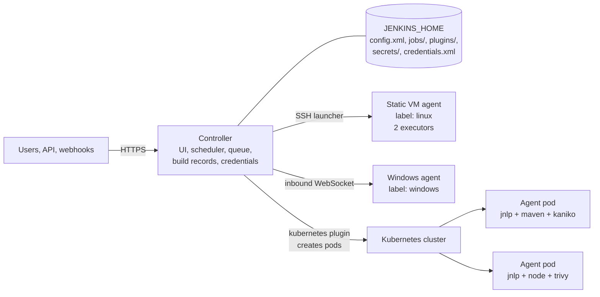
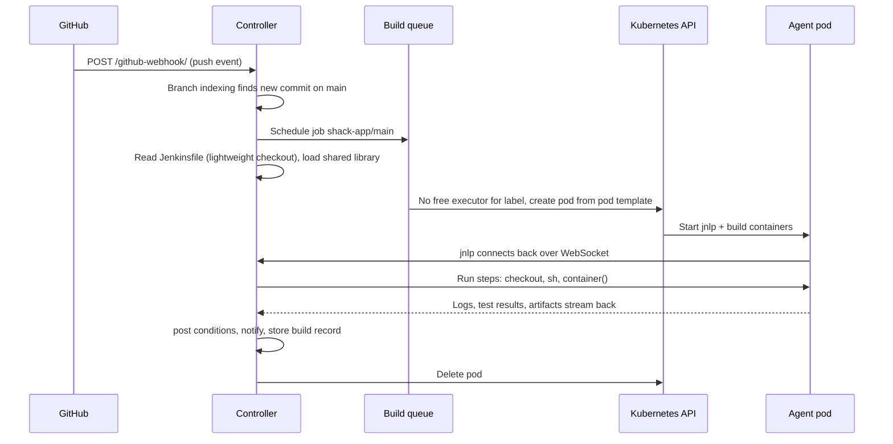
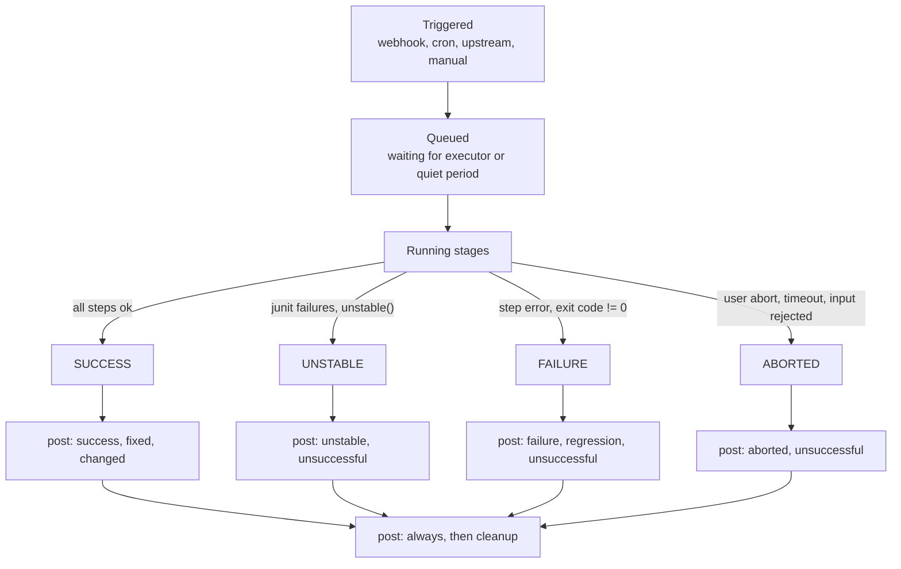
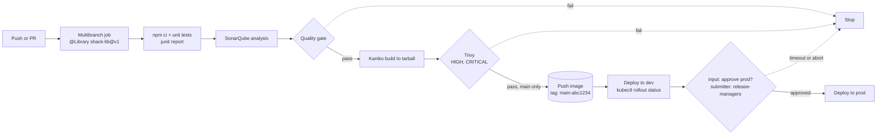
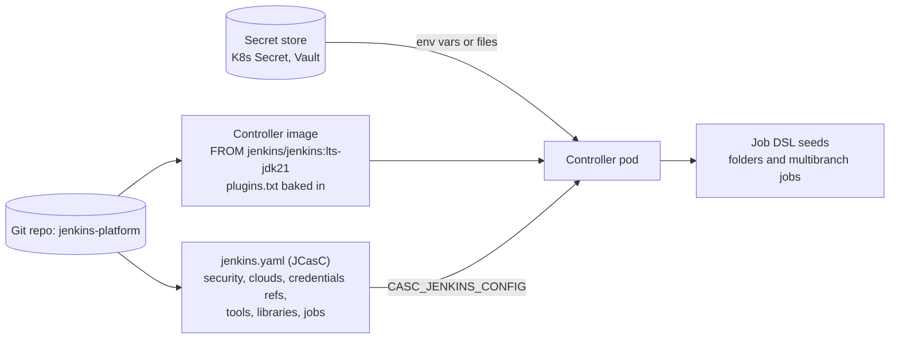

# Jenkins

<!-- DEVOPS-SHACK:HEADER -->

  
  
  
  
  

Part of <b><a href="https://github.com/jaiswaladi246/DevOps-Cloud-Interview-Preparation-by-DevOps-Shack">DevOps &amp; Cloud Interview Preparation</a></b> — created by <b><a href="https://www.youtube.com/@devopsshack">DevOps Shack</a></b>. Free to learn from; please credit DevOps Shack when sharing.

<!-- /DEVOPS-SHACK:HEADER -->

> Run Jenkins the way platform teams do in 2025–2026: a controller with zero executors, ephemeral Kubernetes agents, everything in code (Jenkinsfile, shared libraries, JCasC), locked-down credentials, and pipelines that build, scan, push and deploy with a human gate in front of production. Everything an interviewer can ask about Jenkins, from `agent any` to CPS internals.

[🏠 Home](../README.md)

> The generic CI/CD topic (pipeline theory, GitHub Actions, GitLab CI, deployment strategies) lives in [06 · CI/CD](../06-cicd/README.md). This topic goes deep on Jenkins only.

## What you'll master

- Jenkins architecture: controller, agents, executors, the build queue, remoting, and what lives in `JENKINS_HOME`
- Declarative pipeline syntax end to end: `agent`, `stages`, `steps`, `post`, `when`, `parallel`, `matrix`, `options`, `environment`, `credentials()`, `input`, `parameters`, `triggers`, `tools`
- Scripted pipeline, Groovy, the CPS engine, serialization and `@NonCPS`, and why the sandbox exists
- Shared libraries (`vars/`, `src/`, `resources/`), versioning, testing, implicit vs explicit loading, trusted vs untrusted libraries
- Multibranch pipelines, organization folders, branch sources, PR builds, webhooks and branch indexing
- Plugin management with `plugins.txt` and `jenkins-plugin-cli`, Configuration as Code (JCasC), Job DSL seeding
- Jenkins on Kubernetes: the kubernetes plugin, pod templates, `container()` steps, WebSocket agents, RBAC
- Credentials and security: credential types, scopes and folders, matrix and role-based authorization, script approval, CSRF crumbs, agent-to-controller security
- Operations: backups, disaster recovery, HA options, upgrades, JVM tuning, performance and observability
- Integrations: SonarQube quality gates, Nexus and Artifactory, Docker and Kaniko builds, Trivy scanning, and the errors you hit with each

---

## Jenkins architecture

The controller is a Java web application that holds configuration, schedules work, stores build records and serves the UI and API. Agents execute builds. Each agent offers a number of executors, and each executor runs one build (or one `node {}` block) at a time. In production the controller has **0 executors**, so no user code ever runs on the machine that holds every credential.

Agents talk to the controller over the **remoting** channel. Inbound agents connect to the controller (WebSocket over port 8080/443, or the legacy TCP port 50000). SSH agents are launched by the controller connecting out over SSH. The kubernetes plugin creates a pod per build, the pod's `jnlp` container connects back, runs the build, and the pod is deleted.

## What happens when a build runs

The Jenkinsfile itself is executed **on the controller** by the CPS engine. Only `sh`, `bat` and similar steps run on the agent. That is why heavy Groovy logic (parsing large JSON in a loop, for example) loads the controller even when the agent is idle.

## Pipeline lifecycle and post conditions

`post` blocks run in a fixed order: `always`, `changed`, `fixed`, `regression`, `aborted`, `failure`, `success`, `unstable`, `unsuccessful`, and finally `cleanup`. Put notifications in `failure` and `fixed`, and workspace cleanup in `cleanup`.

## Production delivery workflow

This is the pipeline we build in the [hands-on lab](./hands-on-lab.md): a multibranch job that loads a versioned shared library, builds in a Kubernetes pod, gates on SonarQube and Trivy, pushes only from `main`, and waits for a human before production.

## Configuration as Code: how a controller is built

With an image, a JCasC file and a secret store, the controller is disposable: rebuild it from Git and only build history needs restoring from backup.

---

## Core concepts in 10 minutes

### 1. Controller, agents, executors

The controller schedules and records; agents execute. A **node** is any machine that can run builds (the controller is the "built-in node"). An **executor** is a slot for one build on a node. A **label** is a tag on nodes (`linux`, `docker`, `gpu`) and jobs request label expressions such as `linux && docker`. Set the built-in node to 0 executors; builds on the controller can read `JENKINS_HOME/secrets`.

### 2. JENKINS_HOME

Everything Jenkins knows is files under `JENKINS_HOME` (`/var/jenkins_home` in the container image): `config.xml` (global config), `jobs/<name>/config.xml` and `jobs/<name>/builds/<n>/` (build records and logs), `plugins/`, `nodes/`, `users/`, `credentials.xml`, and `secrets/` (`master.key`, `hudson.util.Secret`) which encrypt the credentials. Lose `secrets/` and every stored credential becomes unreadable.

### 3. Declarative vs scripted

Declarative (`pipeline { }`) is a structured, validated syntax with `agent`, `stages`, `post`, `when`, `options` and friends, and it gives you restart-from-stage and clean visualization. Scripted (`node { }`) is plain Groovy executed by CPS, maximally flexible and easy to turn into an unmaintainable mess. In production we write declarative and push logic into shared libraries; `script { }` blocks are small and rare.

### 4. CPS and serialization

Pipeline Groovy is transformed into continuation-passing style so the program state can be saved to disk and resumed after a controller restart. Every local variable must therefore be `Serializable`. Non-serializable objects (`Matcher`, `JsonSlurper` lazy maps, iterators) cause `NotSerializableException`. Methods marked `@NonCPS` run as normal Groovy, cannot call pipeline steps, and must not keep non-serializable results in pipeline variables.

### 5. Shared libraries

A shared library is a Git repo with `vars/` (global steps such as `vars/kanikoBuild.groovy` with a `call()` method), `src/` (Groovy classes in packages) and `resources/` (files loaded with `libraryResource`). Load it with `@Library('shack-lib@v1.4.0') _`. Libraries configured globally by an admin are **trusted** and run outside the sandbox, so treat changes to them like production code: PR review, tags, tests.

### 6. Multibranch and organization folders

A multibranch pipeline scans a repo, creates one child job per branch, PR and tag that contains a `Jenkinsfile`, and deletes jobs for removed branches according to the orphaned item strategy. An organization folder does the same across every repo in a GitHub org or Bitbucket project. Webhooks trigger re-indexing and builds instantly; periodic scans are the safety net.

### 7. Plugins

Almost everything is a plugin, including Pipeline itself, Git, credentials and the kubernetes cloud. Plugins have dependencies and minimum core versions, so we pin them in `plugins.txt`, install with `jenkins-plugin-cli` at image build time, upgrade them on a staging controller first, and keep the count low. Each plugin is attack surface; check the security advisories.

### 8. Configuration as Code (JCasC)

The `configuration-as-code` plugin reads YAML (from `CASC_JENKINS_CONFIG`) and applies it at startup: security realm, authorization, clouds, tools, global libraries, credentials (with secrets injected from env vars or files, never committed), and seed jobs via Job DSL. The UI becomes read-only in practice; any change goes through Git.

### 9. Jenkins on Kubernetes

The kubernetes plugin turns a cluster into an elastic agent pool. A pod template defines containers (always a `jnlp` container plus tool containers such as `maven`, `node`, `kaniko`, `trivy`). In a pipeline, `container('maven') { sh 'mvn -B verify' }` runs the command in that container with the shared workspace volume. Pods are created per build and deleted after, so every build starts clean.

### 10. Credentials

Store secrets in the credentials store (or an external provider such as Vault or AWS Secrets Manager) and bind them only where needed: `environment { TOKEN = credentials('sonar-token') }` or `withCredentials([...])`. Jenkins masks bound values in the log. Use single quotes so the shell, not Groovy, expands the secret. Scope credentials to folders so team A cannot use team B's deploy key.

### 11. Security model

Authentication comes from a security realm (LDAP, SAML, OIDC, GitHub OAuth). Authorization comes from a strategy: matrix (global and project-based) or role-based (role-strategy plugin). Other layers: CSRF protection via crumbs, the Groovy sandbox and script approval for untrusted pipeline code, agent-to-controller access control, and markup formatting that blocks stored XSS. Never use "Anyone can do anything" or "Logged-in users can do anything" outside a laptop.

### 12. Operations

Back up `JENKINS_HOME` (excluding workspaces and caches), keep config in Git, and test restores. Jenkins core has no active-active HA; the pragmatic answer is a fast-recovering single controller (Kubernetes StatefulSet with a persistent volume, or a warm standby), plus splitting load across multiple controllers per team. Upgrade on the LTS line, plugins first in staging. Tune the JVM (heap sized to the workload, G1GC), discard old builds, and watch queue length and executor usage with the Prometheus plugin.

---

## Question banks

Three banks with collapsible answers: 200 concepts, 100 scenarios and 100 troubleshooting drills, tagged 🟢 Beginner, 🟡 Intermediate, 🔴 Advanced.

| Bank | Questions | What it covers |
|------|-----------|----------------|
| [Concepts](./concepts.md) | 200 | Architecture and `JENKINS_HOME`, declarative and scripted syntax, CPS, shared libraries, multibranch, plugins, JCasC, Kubernetes agents, security, operations, integrations, best practices and rapid-fire commands |
| [Scenarios](./scenarios.md) | 100 | "What would you do" situations with a step-by-step approach |
| [Troubleshooting](./troubleshooting.md) | 100 | Real error messages: likely causes, diagnosis commands, fix and prevention |

## Learning path

Work through these in order. Tick each one only when you can do it without notes.

**Beginner**
- [ ] Run Jenkins in Docker, unlock it, and explain what is inside `/var/jenkins_home`
- [ ] Explain controller, agent, executor, node and label in one sentence each
- [ ] Write a declarative Jenkinsfile with `agent`, three `stages`, and a `post` block
- [ ] Use `parameters`, `environment` and `when { branch 'main' }`
- [ ] Bind a username/password credential and prove it is masked in the log
- [ ] Publish JUnit results and archive an artifact
- [ ] Add an SSH or inbound agent and move the controller to 0 executors
- [ ] Do the first 10 [assignments](./assignments.md)

**Intermediate**
- [ ] Use `parallel`, `matrix`, `options { timeout(); retry(); disableConcurrentBuilds() }` and `input`
- [ ] Create a multibranch pipeline with a GitHub webhook and PR discovery
- [ ] Write a shared library with one `vars/` step, one `src/` class and one `resources/` file, and load it by tag
- [ ] Install plugins from `plugins.txt` in a custom controller image
- [ ] Configure security, credentials and a global library entirely through JCasC
- [ ] Run builds in Kubernetes pods with multiple containers using the kubernetes plugin
- [ ] Wire SonarQube with `withSonarQubeEnv` and `waitForQualityGate`
- [ ] Complete the [hands-on lab](./hands-on-lab.md) end to end

**Advanced**
- [ ] Explain CPS, why `NotSerializableException` happens, and when `@NonCPS` is safe
- [ ] Explain trusted vs untrusted libraries and how the sandbox and script approval interact
- [ ] Seed folders and jobs with Job DSL from JCasC, and make the controller fully disposable
- [ ] Design folder-scoped credentials and RBAC for 20 teams on one or several controllers
- [ ] Plan and execute an LTS upgrade with a plugin compatibility check and rollback path
- [ ] Diagnose a slow controller from a thread dump, GC logs and the queue
- [ ] Unit test a shared library with JenkinsPipelineUnit
- [ ] Finish all 25 assignments and answer 150 of the 200 questions in each bank unaided

## Study materials

- [Hands-on lab: Jenkins on Kubernetes with JCasC, a shared library and a multibranch pipeline](./hands-on-lab.md) — Node.js app, Kubernetes pod agents, SonarQube, Kaniko, Trivy, dev deploy and approved prod deploy
- [Assignments](./assignments.md) — 25 graded exercises (10 beginner, 10 intermediate, 5 advanced)
- [Cheatsheet](./cheatsheet.md) — Jenkinsfile syntax, CLI and REST API, JCasC snippets, Kubernetes agents, paths, errors, and the top 15 interview one-liners

[🏠 Home](../README.md)

<!-- DEVOPS-SHACK:FOOTER -->
---

### 🚀 Made with ❤️ by [DevOps Shack](https://www.youtube.com/@devopsshack)

**Learn DevOps, DevSecOps, Cloud and Kubernetes the practical way.**

[▶️ YouTube — DevOps Shack](https://www.youtube.com/@devopsshack) · [▶️ Hindi — @shackverse](https://www.youtube.com/@shackverse) · [🎓 devopsshack.com](https://devopsshack.com) · [📸 Instagram @devopsshack](https://www.instagram.com/devopsshack)

[🏠 Back to Home](../README.md) · [⭐ Star the original repo](https://github.com/jaiswaladi246/DevOps-Cloud-Interview-Preparation-by-DevOps-Shack)

© DevOps Shack · Licensed CC BY-NC-SA 4.0 · If you found this copy anywhere other than <a href="https://github.com/jaiswaladi246/DevOps-Cloud-Interview-Preparation-by-DevOps-Shack">github.com/jaiswaladi246</a>, the original and latest version is maintained by DevOps Shack.

<!-- /DEVOPS-SHACK:FOOTER -->
