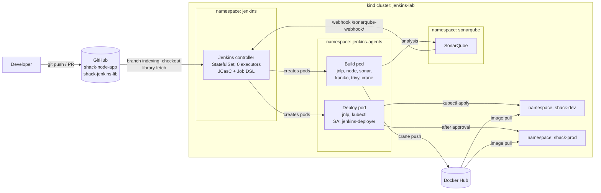
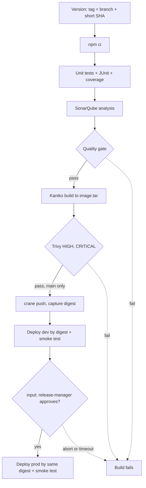

# Hands-on Lab: Jenkins on Kubernetes with JCasC, a Shared Library and a Multibranch Pipeline

<!-- DEVOPS-SHACK:HEADER -->
<p align="center">
  <a href="https://www.youtube.com/@devopsshack"></a>
  <a href="https://www.youtube.com/@shackverse"></a>
  <a href="https://devopsshack.com"></a>
  <a href="https://www.instagram.com/devopsshack"></a>
  <a href="https://github.com/jaiswaladi246/DevOps-Cloud-Interview-Preparation-by-DevOps-Shack"></a>
</p>
<p align="center"><sub>Part of <b><a href="https://github.com/jaiswaladi246/DevOps-Cloud-Interview-Preparation-by-DevOps-Shack">DevOps &amp; Cloud Interview Preparation</a></b> — created by <b><a href="https://www.youtube.com/@devopsshack">DevOps Shack</a></b>. Free to learn from; please credit DevOps Shack when sharing.</sub></p>
<!-- /DEVOPS-SHACK:HEADER -->

> Stand up a fully code-defined Jenkins controller on Kubernetes, write a versioned shared library, and ship a Node.js app through a multibranch pipeline: unit tests, SonarQube quality gate, Kaniko image build, Trivy scan, push to Docker Hub, deploy to a dev namespace, and a human-approved deploy to prod.

[⬅ Back to Jenkins](./README.md) · [🏠 Home](../README.md)

## Goal

By the end you will have:

- A custom Jenkins controller image with plugins baked in from `plugins.txt`
- A controller running as a StatefulSet on a local kind cluster, configured 100% by JCasC: security, users, credentials, the Kubernetes cloud, SonarQube, the global shared library, and the multibranch job itself (via Job DSL)
- Zero executors on the controller; every build runs in an ephemeral pod in the `jenkins-agents` namespace
- A shared library (`shack-jenkins-lib`) with `vars/` steps, a `src/` class and a `resources/` script, tagged `v1`
- A multibranch pipeline for a Node.js app that builds PRs and branches, and only on `main` pushes the image, deploys to `shack-dev`, and waits for a release manager before deploying to `shack-prod`
- Negative tests proving each gate (tests, quality gate, Trivy, approval) actually blocks

Time: about 3 to 4 hours. Cost: free (local cluster, free Docker Hub and GitHub accounts).

## Architecture



The pipeline flow we build in steps 12 to 16:



## Prerequisites

- Docker Engine 26+ or Docker Desktop with at least **4 CPUs and 8 GB RAM** allocated (SonarQube and Jenkins are both Java)
- `kind` 0.24+ and `kubectl` 1.30+
- Node.js 20+ and npm locally, only to generate `package-lock.json`
- `git`, `curl`, `jq`
- A GitHub account and a **classic personal access token** with the `repo` scope (we use a token for simplicity; in production use a GitHub App)
- A Docker Hub account and an **access token** with Read & Write permission
- Optional: `ngrok` if you want real GitHub webhooks into your laptop (step 17)

Throughout the lab replace `YOUR_GH_USER` and `YOUR_DOCKERHUB_USER` with your own usernames. Export them once:

```bash
export GH_USER=YOUR_GH_USER
export DH_USER=YOUR_DOCKERHUB_USER
export GH_TOKEN=ghp_xxx           # GitHub classic PAT, repo scope
export DH_TOKEN=dckr_pat_xxx      # Docker Hub access token
```

Image tags used below were current when written. Pin what you test with, and bump deliberately.

---

## Step 1. Create the cluster and namespaces

```bash
mkdir -p ~/jenkins-lab/platform && cd ~/jenkins-lab
kind create cluster --name jenkins-lab
kubectl cluster-info --context kind-jenkins-lab

for ns in jenkins jenkins-agents sonarqube shack-dev shack-prod; do
  kubectl create namespace "$ns"
done
kubectl get ns
```

**Verify:** `kubectl get nodes` shows `jenkins-lab-control-plane` as `Ready`, and `kubectl get storageclass` shows `standard (default)`, which the controller's PVC will use.

## Step 2. Run SonarQube

Create `platform/sonarqube.yaml`:

```yaml
apiVersion: apps/v1
kind: Deployment
metadata:
  name: sonarqube
  namespace: sonarqube
spec:
  replicas: 1
  selector:
    matchLabels: { app: sonarqube }
  template:
    metadata:
      labels: { app: sonarqube }
    spec:
      containers:
        - name: sonarqube
          image: sonarqube:community
          ports:
            - containerPort: 9000
          env:
            # lab only: avoid the vm.max_map_count host requirement of embedded Elasticsearch
            - name: SONAR_SEARCH_JAVAADDITIONALOPTS
              value: "-Dnode.store.allow_mmap=false"
            - name: SONAR_ES_BOOTSTRAP_CHECKS_DISABLE
              value: "true"
          resources:
            requests: { cpu: "500m", memory: "2Gi" }
            limits: { memory: "3Gi" }
          readinessProbe:
            httpGet: { path: /api/system/status, port: 9000 }
            initialDelaySeconds: 60
            periodSeconds: 10
---
apiVersion: v1
kind: Service
metadata:
  name: sonarqube
  namespace: sonarqube
spec:
  selector: { app: sonarqube }
  ports:
    - port: 9000
      targetPort: 9000
```

```bash
cd ~/jenkins-lab && kubectl apply -f platform/sonarqube.yaml
kubectl -n sonarqube rollout status deploy/sonarqube --timeout=10m
kubectl -n sonarqube port-forward svc/sonarqube 9000:9000 >/dev/null 2>&1 &
sleep 5; curl -s localhost:9000/api/system/status
```

**Verify:** the last command eventually prints `{"id":"...","version":"...","status":"UP"}`. Startup can take 2 to 3 minutes.

## Step 3. Configure SonarQube: password, token, webhook

SonarQube forces a password change for `admin/admin`. Do it, generate an analysis token for Jenkins, and register the webhook that tells Jenkins the quality gate result.

```bash
export SONAR_PASS='Shack-Sonar-2026!'
curl -s -u admin:admin -X POST "localhost:9000/api/users/change_password" \
  -d login=admin -d previousPassword=admin -d password="$SONAR_PASS"

export SONAR_TOKEN=$(curl -s -u admin:"$SONAR_PASS" -X POST "localhost:9000/api/user_tokens/generate" \
  -d name=jenkins -d type=GLOBAL_ANALYSIS_TOKEN | jq -r .token)
echo "$SONAR_TOKEN" | cut -c1-8

curl -s -u admin:"$SONAR_PASS" -X POST "localhost:9000/api/webhooks/create" \
  -d name=jenkins -d url="http://jenkins.jenkins.svc.cluster.local:8080/sonarqube-webhook/"
```

**Verify:** the token prefix starts with `sqa_`, and `curl -s -u admin:"$SONAR_PASS" localhost:9000/api/webhooks/list | jq` lists the `jenkins` webhook. The URL uses the in-cluster Service name we create in step 7, and the trailing slash is required.

## Step 4. Create the GitHub repositories

Create two **empty** repositories on GitHub (no README): `shack-jenkins-lib` and `shack-node-app`. They can be public or private; Jenkins uses your token either way.

```bash
mkdir -p ~/jenkins-lab && cd ~/jenkins-lab
git clone https://github.com/$GH_USER/shack-jenkins-lib.git
git clone https://github.com/$GH_USER/shack-node-app.git
```

**Verify:** both folders exist and `git -C shack-node-app remote -v` points to your account.

## Step 5. Build the controller image

Plugins are installed at image build time, never through the UI. Run `mkdir -p ~/jenkins-lab/platform/controller ~/jenkins-lab/platform/casc`, then create `platform/controller/plugins.txt`:

```text
configuration-as-code
job-dsl
workflow-aggregator
pipeline-graph-view
git
github-branch-source
kubernetes
credentials-binding
matrix-auth
sonar
junit
timestamper
ws-cleanup
pipeline-utility-steps
```

And `platform/controller/Dockerfile`:

```dockerfile
FROM jenkins/jenkins:lts-jdk21
COPY --chown=jenkins:jenkins plugins.txt /usr/share/jenkins/ref/plugins.txt
RUN jenkins-plugin-cli --plugin-file /usr/share/jenkins/ref/plugins.txt --verbose
```

```bash
cd ~/jenkins-lab
docker build -t shack-jenkins:1.0 platform/controller
kind load docker-image shack-jenkins:1.0 --name jenkins-lab

# freeze exact versions for reproducibility (commit this as plugins.lock.txt)
docker run --rm --entrypoint jenkins-plugin-cli shack-jenkins:1.0 --list 2>/dev/null | head -40
docker run --rm --entrypoint java shack-jenkins:1.0 -jar /usr/share/jenkins/jenkins.war --version
```

**Verify:** the build ends without `Plugin prerequisite not met` errors, and `--version` prints the LTS version you got. In a real platform repo, replace the bare names with `name:version` pins from that list so the next build is identical.

## Step 6. Write the JCasC file

This single file defines the entire controller. Secrets are `${VARIABLES}` resolved from environment variables at startup. Create `platform/casc/jenkins.yaml`:

```yaml
jenkins:
  systemMessage: "DevOps Shack lab controller. Configured by JCasC: UI changes are overwritten."
  numExecutors: 0
  mode: EXCLUSIVE
  slaveAgentPort: -1            # no TCP agent port; agents use WebSocket
  securityRealm:
    local:
      allowsSignup: false
      users:
        - id: admin
          password: "${JENKINS_ADMIN_PASSWORD}"
        - id: release-manager
          password: "${RELEASE_MANAGER_PASSWORD}"
        - id: developer
          password: "${DEVELOPER_PASSWORD}"
  authorizationStrategy:
    globalMatrix:
      entries:
        - user:
            name: admin
            permissions:
              - "Overall/Administer"
        - user:
            name: release-manager
            permissions: ["Overall/Read", "Job/Read", "Job/Build", "Job/Cancel"]
        - user:
            name: developer
            permissions: ["Overall/Read", "Job/Read", "Job/Build", "Job/Cancel"]
  crumbIssuer:
    standard:
      excludeClientIPFromCrumb: true
  clouds:
    - kubernetes:
        name: kubernetes
        namespace: jenkins-agents
        jenkinsUrl: "http://jenkins.jenkins.svc.cluster.local:8080/"
        webSocket: true
        containerCapStr: "6"

credentials:
  system:
    domainCredentials:
      - credentials:
          - usernamePassword:
              scope: GLOBAL
              id: github-token
              username: "${GITHUB_USER}"
              password: "${GITHUB_TOKEN}"
              description: "GitHub PAT for checkout, indexing and the shared library"
          - usernamePassword:
              scope: GLOBAL
              id: dockerhub
              username: "${DOCKERHUB_USER}"
              password: "${DOCKERHUB_TOKEN}"
              description: "Docker Hub push token"
          - string:
              scope: GLOBAL
              id: sonar-token
              secret: "${SONAR_TOKEN}"
              description: "SonarQube analysis token"

unclassified:
  location:
    url: "http://localhost:8080/"
  sonarGlobalConfiguration:
    buildWrapperEnabled: true
    installations:
      - name: sonarqube
        serverUrl: "http://sonarqube.sonarqube.svc.cluster.local:9000"
        credentialsId: sonar-token
  globalLibraries:
    libraries:
      - name: shack-lib
        defaultVersion: v1
        allowVersionOverride: false
        implicit: false
        retriever:
          modernSCM:
            scm:
              git:
                remote: "https://github.com/${GITHUB_USER}/shack-jenkins-lib.git"
                credentialsId: github-token

jobs:
  - script: |
      multibranchPipelineJob('shack-node-app') {
        displayName('shack-node-app')
        description('Seeded by JCasC + Job DSL')
        branchSources {
          branchSource {
            source {
              github {
                id('shack-node-app')
                repoOwner('${GITHUB_USER}')
                repository('shack-node-app')
                repositoryUrl('https://github.com/${GITHUB_USER}/shack-node-app')
                configuredByUrl(true)
                credentialsId('github-token')
                traits {
                  gitHubBranchDiscovery { strategyId(1) }
                  gitHubPullRequestDiscovery { strategyId(1) }
                }
              }
            }
          }
        }
        orphanedItemStrategy {
          discardOldItems { numToKeep(10) }
        }
        triggers {
          periodicFolderTrigger { interval('5m') }
        }
      }
```

Things worth noticing:

- `${GITHUB_USER}` inside the Job DSL script is substituted by JCasC before Groovy sees it, so the Groovy strings are single-quoted on purpose.
- `strategyId(1)` for branches means "exclude branches that are also filed as PRs"; for PRs it means "merge with the target branch".
- The 5-minute periodic scan replaces webhooks in a laptop lab. Step 17 shows real webhooks.
- `allowVersionOverride: false`: Jenkinsfiles cannot load an unreviewed branch of the trusted library.

## Step 7. Kubernetes manifests for the controller

Create `platform/jenkins.yaml`:

```yaml
apiVersion: v1
kind: ServiceAccount
metadata:
  name: jenkins
  namespace: jenkins
---
# The controller creates and manages agent pods in jenkins-agents
apiVersion: rbac.authorization.k8s.io/v1
kind: Role
metadata:
  name: jenkins-agent-manager
  namespace: jenkins-agents
rules:
  - apiGroups: [""]
    resources: ["pods", "pods/exec"]
    verbs: ["create", "delete", "get", "list", "patch", "update", "watch"]
  - apiGroups: [""]
    resources: ["pods/log", "events"]
    verbs: ["get", "list", "watch"]
---
apiVersion: rbac.authorization.k8s.io/v1
kind: RoleBinding
metadata:
  name: jenkins-agent-manager
  namespace: jenkins-agents
roleRef:
  apiGroup: rbac.authorization.k8s.io
  kind: Role
  name: jenkins-agent-manager
subjects:
  - kind: ServiceAccount
    name: jenkins
    namespace: jenkins
---
# Identity used only by deploy pods
apiVersion: v1
kind: ServiceAccount
metadata:
  name: jenkins-deployer
  namespace: jenkins-agents
---
apiVersion: rbac.authorization.k8s.io/v1
kind: RoleBinding
metadata:
  name: jenkins-deployer
  namespace: shack-dev
roleRef:
  apiGroup: rbac.authorization.k8s.io
  kind: ClusterRole
  name: edit
subjects:
  - kind: ServiceAccount
    name: jenkins-deployer
    namespace: jenkins-agents
---
apiVersion: rbac.authorization.k8s.io/v1
kind: RoleBinding
metadata:
  name: jenkins-deployer
  namespace: shack-prod
roleRef:
  apiGroup: rbac.authorization.k8s.io
  kind: ClusterRole
  name: edit
subjects:
  - kind: ServiceAccount
    name: jenkins-deployer
    namespace: jenkins-agents
---
apiVersion: v1
kind: Service
metadata:
  name: jenkins
  namespace: jenkins
spec:
  selector: { app: jenkins }
  ports:
    - name: http
      port: 8080
      targetPort: 8080
---
apiVersion: apps/v1
kind: StatefulSet
metadata:
  name: jenkins
  namespace: jenkins
spec:
  serviceName: jenkins
  replicas: 1
  selector:
    matchLabels: { app: jenkins }
  template:
    metadata:
      labels: { app: jenkins }
    spec:
      serviceAccountName: jenkins
      securityContext:
        runAsUser: 1000
        runAsGroup: 1000
        fsGroup: 1000
      terminationGracePeriodSeconds: 60
      containers:
        - name: jenkins
          image: docker.io/library/shack-jenkins:1.0
          imagePullPolicy: IfNotPresent
          ports:
            - containerPort: 8080
          env:
            - name: JAVA_OPTS
              value: "-Djenkins.install.runSetupWizard=false -XX:MaxRAMPercentage=75 -XX:+UseG1GC"
            - name: CASC_JENKINS_CONFIG
              value: /var/jenkins_config/jenkins.yaml
          envFrom:
            - secretRef:
                name: jenkins-secrets
          resources:
            requests: { cpu: "500m", memory: "2Gi" }
            limits: { memory: "3Gi" }
          startupProbe:
            httpGet: { path: /login, port: 8080 }
            periodSeconds: 10
            failureThreshold: 60
          livenessProbe:
            httpGet: { path: /login, port: 8080 }
            periodSeconds: 20
            failureThreshold: 5
          readinessProbe:
            httpGet: { path: /login, port: 8080 }
            periodSeconds: 10
          volumeMounts:
            - name: jenkins-home
              mountPath: /var/jenkins_home
            - name: casc
              mountPath: /var/jenkins_config
              readOnly: true
      volumes:
        - name: casc
          configMap:
            name: jenkins-casc
  volumeClaimTemplates:
    - metadata:
        name: jenkins-home
      spec:
        accessModes: ["ReadWriteOnce"]
        resources:
          requests:
            storage: 10Gi
```

The controller only gets pod permissions in `jenkins-agents`. Deploy rights live on a separate service account that only deploy pods use, and only in the two app namespaces.

## Step 8. Create secrets and the JCasC ConfigMap, then deploy Jenkins

Secrets are created imperatively from your shell, never committed:

```bash
cd ~/jenkins-lab
kubectl -n jenkins create secret generic jenkins-secrets \
  --from-literal=JENKINS_ADMIN_PASSWORD='Admin-Lab-2026!' \
  --from-literal=RELEASE_MANAGER_PASSWORD='Release-Lab-2026!' \
  --from-literal=DEVELOPER_PASSWORD='Dev-Lab-2026!' \
  --from-literal=GITHUB_USER="$GH_USER" \
  --from-literal=GITHUB_TOKEN="$GH_TOKEN" \
  --from-literal=DOCKERHUB_USER="$DH_USER" \
  --from-literal=DOCKERHUB_TOKEN="$DH_TOKEN" \
  --from-literal=SONAR_TOKEN="$SONAR_TOKEN"

kubectl -n jenkins create configmap jenkins-casc --from-file=jenkins.yaml=platform/casc/jenkins.yaml
kubectl apply -f platform/jenkins.yaml
kubectl -n jenkins rollout status statefulset/jenkins --timeout=10m
kubectl -n jenkins port-forward svc/jenkins 8080:8080 >/dev/null 2>&1 &
```

**Verify:**

```bash
kubectl -n jenkins logs jenkins-0 | grep -E "Jenkins is fully up and running|ConfiguratorException|SEVERE"
curl -s -o /dev/null -w '%{http_code}\n' localhost:8080/login            # 200
curl -s -u admin:'Admin-Lab-2026!' localhost:8080/whoAmI/api/json | jq .name
```

Then open `http://localhost:8080`, log in as `admin`, and check:

- **Manage Jenkins > Nodes**: Built-In Node has 0 executors
- **Manage Jenkins > Clouds > kubernetes > Test Connection**: `Connected to Kubernetes ...`
- **Manage Jenkins > Credentials**: `github-token`, `dockerhub`, `sonar-token` exist (values hidden)
- **Manage Jenkins > Configuration as Code**: shows `/var/jenkins_config/jenkins.yaml`
- A `shack-node-app` multibranch job exists on the dashboard (empty for now: the repo has no branches yet)

If you see `ConfiguratorException` in the log, fix the YAML, recreate the ConfigMap (`kubectl -n jenkins create configmap jenkins-casc --from-file=jenkins.yaml=platform/casc/jenkins.yaml --dry-run=client -o yaml | kubectl apply -f -`), and restart: `kubectl -n jenkins delete pod jenkins-0`.

## Step 9. Write the shared library

```bash
cd ~/jenkins-lab/shack-jenkins-lib
mkdir -p vars src/com/devopsshack resources/scripts
```

`src/com/devopsshack/ImageTag.groovy` builds a registry-safe tag from the branch and commit:

```groovy
package com.devopsshack

class ImageTag implements Serializable {
  static String forBranch(String branch, String commit) {
    if (!branch || !commit) {
      throw new IllegalArgumentException('branch and commit are required')
    }
    String safe = branch.replaceAll('[^A-Za-z0-9_.-]', '-').toLowerCase()
    if (safe.length() > 100) { safe = safe.substring(0, 100) }
    return "${safe}-${commit.take(7)}"
  }
}
```

`vars/kanikoBuild.groovy` builds the image into a tarball without pushing, so nothing reaches the registry before it is scanned:

```groovy
// kanikoBuild(image: 'docker.io/user/app:tag', dockerfile: 'Dockerfile', context: '.', tar: 'image.tar')
def call(Map args = [:]) {
  Map cfg = [dockerfile: 'Dockerfile', context: '.', tar: 'image.tar'] + args
  if (!cfg.image) { error "kanikoBuild: 'image' is required" }
  container('kaniko') {
    withEnv(["IMAGE_REF=${cfg.image}", "DOCKERFILE=${cfg.dockerfile}", "CTX=${cfg.context}", "TAR=${cfg.tar}"]) {
      sh '''
        /kaniko/executor \
          --context "dir://${WORKSPACE}/${CTX}" \
          --dockerfile "${DOCKERFILE}" \
          --destination "${IMAGE_REF}" \
          --no-push \
          --tar-path "${TAR}"
        ls -lh "${TAR}"
      '''
    }
  }
}
```

`vars/trivyScan.groovy` fails the build on fixable HIGH or CRITICAL findings and archives the report either way:

```groovy
// trivyScan(input: 'image.tar', severity: 'HIGH,CRITICAL', ignoreUnfixed: true)
def call(Map args = [:]) {
  Map cfg = [input: 'image.tar', severity: 'HIGH,CRITICAL', ignoreUnfixed: true] + args
  try {
    container('trivy') {
      withEnv(["TAR=${cfg.input}", "SEV=${cfg.severity}", "UNFIXED=${cfg.ignoreUnfixed ? '--ignore-unfixed' : ''}"]) {
        sh '''
          set +e
          trivy image --input "$TAR" --severity "$SEV" $UNFIXED \
            --exit-code 1 --no-progress --format table --output trivy-report.txt
          rc=$?
          cat trivy-report.txt
          exit $rc
        '''
      }
    }
  } finally {
    archiveArtifacts artifacts: 'trivy-report.txt', allowEmptyArchive: true
  }
}
```

`vars/pushImage.groovy` pushes the scanned tarball and returns the immutable digest:

```groovy
// def digest = pushImage(image: 'docker.io/user/app:tag', credentialsId: 'dockerhub')
def call(Map args = [:]) {
  Map cfg = [tar: 'image.tar', credentialsId: 'dockerhub', registry: 'index.docker.io'] + args
  if (!cfg.image) { error "pushImage: 'image' is required" }
  container('crane') {
    withCredentials([usernamePassword(credentialsId: cfg.credentialsId, usernameVariable: 'REG_USER', passwordVariable: 'REG_PASS')]) {
      withEnv(["IMAGE_REF=${cfg.image}", "TAR=${cfg.tar}", "REGISTRY=${cfg.registry}"]) {
        sh '''
          echo "$REG_PASS" | crane auth login "$REGISTRY" -u "$REG_USER" --password-stdin
          crane push "$TAR" "$IMAGE_REF"
          crane digest "$IMAGE_REF" > image.digest
        '''
      }
    }
  }
  return readFile('image.digest').trim()
}
```

`vars/k8sDeploy.groovy` applies the manifest with the image injected, waits for the rollout and rolls back automatically if it fails:

```groovy
// k8sDeploy(namespace: 'shack-dev', deployment: 'shack-node-app', image: 'repo@sha256:...')
def call(Map args = [:]) {
  Map cfg = [manifest: 'k8s/app.yaml', timeout: '180s'] + args
  for (String key : ['namespace', 'deployment', 'image']) {
    if (!cfg[key]) { error "k8sDeploy: '${key}' is required" }
  }
  container('kubectl') {
    withEnv(["NS=${cfg.namespace}", "DEPLOY=${cfg.deployment}", "IMAGE_REF=${cfg.image}",
             "MANIFEST=${cfg.manifest}", "TIMEOUT=${cfg.timeout}"]) {
      sh '''
        sed "s|IMAGE_PLACEHOLDER|${IMAGE_REF}|g" "$MANIFEST" | kubectl -n "$NS" apply -f -
        kubectl -n "$NS" annotate deployment "$DEPLOY" kubernetes.io/change-cause="${BUILD_URL}" --overwrite
        if ! kubectl -n "$NS" rollout status deployment/"$DEPLOY" --timeout="$TIMEOUT"; then
          echo "Rollout failed in $NS, rolling back"
          kubectl -n "$NS" rollout undo deployment/"$DEPLOY"
          exit 1
        fi
      '''
    }
  }
}
```

`resources/scripts/smoke.sh` and `vars/smokeTest.groovy` show the `resources/` + `libraryResource` pattern:

```bash
#!/bin/sh
# usage: smoke.sh <url> [attempts]
URL="$1"; ATTEMPTS="${2:-10}"
i=1
while [ "$i" -le "$ATTEMPTS" ]; do
  if curl -fsS --max-time 5 "$URL"; then echo; echo "Smoke test passed: $URL"; exit 0; fi
  echo "Attempt $i/$ATTEMPTS failed, retrying in 3s"; i=$((i + 1)); sleep 3
done
echo "Smoke test FAILED: $URL"; exit 1
```

```groovy
// smokeTest(url: 'http://svc.ns.svc.cluster.local/healthz')
def call(Map args = [:]) {
  if (!args.url) { error "smokeTest: 'url' is required" }
  writeFile file: '.ci/smoke.sh', text: libraryResource('scripts/smoke.sh')
  container('kubectl') {
    withEnv(["SMOKE_URL=${args.url}"]) {
      sh 'sh .ci/smoke.sh "$SMOKE_URL" 10'
    }
  }
}
```

Commit and tag. The moving `v1` tag is what pipelines load; `v1.0.0` is the immutable release.

```bash
git add . && git commit -m "shack-lib v1.0.0: kaniko, trivy, push, deploy, smoke steps"
git branch -M main && git push -u origin main
git tag v1.0.0 && git tag v1
git push origin v1.0.0 v1
```

**Verify:** on GitHub, the repo shows `vars/`, `src/`, `resources/` at the root and both tags exist. Releasing a fix later means: tag `v1.0.1`, then `git tag -f v1 && git push -f origin v1`.

## Step 10. Write the application

```bash
cd ~/jenkins-lab/shack-node-app
mkdir -p src test ci k8s
```

`package.json`:

```json
{
  "name": "shack-node-app",
  "version": "1.0.0",
  "private": true,
  "main": "src/server.js",
  "scripts": {
    "start": "node src/server.js",
    "test": "jest --ci --coverage --reporters=default --reporters=jest-junit"
  },
  "dependencies": {
    "express": "^4.21.2"
  },
  "devDependencies": {
    "jest": "^29.7.0",
    "jest-junit": "^16.0.0",
    "supertest": "^7.0.0"
  },
  "jest": {
    "testEnvironment": "node",
    "coverageReporters": ["lcov", "text-summary"]
  },
  "jest-junit": {
    "outputDirectory": "reports",
    "outputName": "junit.xml"
  }
}
```

`src/app.js`:

```js
const express = require('express');

const app = express();
const startedAt = new Date().toISOString();

app.get('/healthz', (req, res) => res.json({ status: 'ok' }));

app.get('/', (req, res) => {
  res.json({ app: 'shack-node-app', message: 'Hello from DevOps Shack', startedAt });
});

app.get('/api/sum', (req, res) => {
  const a = Number(req.query.a);
  const b = Number(req.query.b);
  if (Number.isNaN(a) || Number.isNaN(b)) {
    return res.status(400).json({ error: 'a and b must be numbers' });
  }
  return res.json({ result: a + b });
});

module.exports = app;
```

`src/server.js`:

```js
const app = require('./app');

const port = process.env.PORT || 3000;
const server = app.listen(port, '0.0.0.0', () => console.log(`listening on ${port}`));

process.on('SIGTERM', () => {
  console.log('SIGTERM received, closing server');
  server.close(() => process.exit(0));
});
```

`test/app.test.js`:

```js
const request = require('supertest');
const app = require('../src/app');

describe('shack-node-app', () => {
  test('GET /healthz returns ok', async () => {
    const res = await request(app).get('/healthz');
    expect(res.status).toBe(200);
    expect(res.body.status).toBe('ok');
  });

  test('GET / returns app name', async () => {
    const res = await request(app).get('/');
    expect(res.body.app).toBe('shack-node-app');
  });

  test('GET /api/sum adds numbers', async () => {
    const res = await request(app).get('/api/sum?a=2&b=3');
    expect(res.body.result).toBe(5);
  });

  test('GET /api/sum rejects bad input', async () => {
    const res = await request(app).get('/api/sum?a=x&b=3');
    expect(res.status).toBe(400);
  });
});
```

`Dockerfile` (multi-stage, non-root, and without npm/yarn in the runtime image, which removes most scanner findings in Node base images):

```dockerfile
FROM node:22-alpine AS deps
WORKDIR /app
COPY package.json package-lock.json ./
RUN npm ci --omit=dev --no-audit --no-fund

FROM node:22-alpine
ENV NODE_ENV=production
WORKDIR /app
RUN rm -rf /usr/local/lib/node_modules/npm /usr/local/bin/npm /usr/local/bin/npx /opt/yarn* /usr/local/bin/yarn /usr/local/bin/yarnpkg
COPY --from=deps /app/node_modules ./node_modules
COPY package.json ./
COPY src ./src
USER node
EXPOSE 3000
CMD ["node", "src/server.js"]
```

`.dockerignore`:

```text
node_modules
coverage
reports
.scannerwork
image.tar
.git
```

`sonar-project.properties`:

```properties
sonar.projectKey=shack-node-app
sonar.projectName=shack-node-app
sonar.sources=src
sonar.tests=test
sonar.javascript.lcov.reportPaths=coverage/lcov.info
sonar.sourceEncoding=UTF-8
```

Generate the lockfile and run the tests locally once:

```bash
npm install
npm test
```

**Verify:** 4 tests pass, `reports/junit.xml` and `coverage/lcov.info` exist. Add a `.gitignore` with `node_modules`, `coverage`, `reports`.

## Step 11. Pod templates and Kubernetes manifests

The build pod has one container per tool. They all share the workspace, so each stage just switches container. `ci/build-pod.yaml`:

```yaml
apiVersion: v1
kind: Pod
metadata:
  labels:
    app: shack-ci
spec:
  containers:
    - name: node
      image: node:22-alpine
      command: ["sleep"]
      args: ["infinity"]
      resources:
        requests: { cpu: "500m", memory: "512Mi" }
        limits: { memory: "1Gi" }
    - name: sonar
      image: sonarsource/sonar-scanner-cli:11
      command: ["sleep"]
      args: ["infinity"]
      resources:
        requests: { cpu: "250m", memory: "512Mi" }
        limits: { memory: "1Gi" }
    - name: kaniko
      image: gcr.io/kaniko-project/executor:v1.23.2-debug
      command: ["/busybox/sleep"]
      args: ["infinity"]
      resources:
        requests: { cpu: "500m", memory: "512Mi" }
        limits: { memory: "2Gi" }
    - name: trivy
      image: aquasec/trivy:0.58.1
      command: ["sleep"]
      args: ["infinity"]
      resources:
        requests: { cpu: "250m", memory: "512Mi" }
        limits: { memory: "1Gi" }
    - name: crane
      image: gcr.io/go-containerregistry/crane:debug
      command: ["/busybox/sleep"]
      args: ["infinity"]
```

The deploy pod uses the `jenkins-deployer` service account, so `kubectl` authenticates with its token automatically. `ci/deploy-pod.yaml`:

```yaml
apiVersion: v1
kind: Pod
metadata:
  labels:
    app: shack-deploy
spec:
  serviceAccountName: jenkins-deployer
  containers:
    - name: kubectl
      image: alpine/k8s:1.31.4
      command: ["sleep"]
      args: ["infinity"]
      resources:
        requests: { cpu: "100m", memory: "128Mi" }
        limits: { memory: "256Mi" }
```

`k8s/app.yaml`, the app manifest with a placeholder the library replaces with `repo@sha256:...`:

```yaml
apiVersion: apps/v1
kind: Deployment
metadata:
  name: shack-node-app
  labels: { app: shack-node-app }
spec:
  replicas: 2
  selector:
    matchLabels: { app: shack-node-app }
  template:
    metadata:
      labels: { app: shack-node-app }
    spec:
      securityContext:
        runAsNonRoot: true
        runAsUser: 1000
      containers:
        - name: app
          image: IMAGE_PLACEHOLDER
          ports:
            - containerPort: 3000
          readinessProbe:
            httpGet: { path: /healthz, port: 3000 }
            periodSeconds: 5
          livenessProbe:
            httpGet: { path: /healthz, port: 3000 }
            periodSeconds: 10
          resources:
            requests: { cpu: "50m", memory: "64Mi" }
            limits: { memory: "128Mi" }
          securityContext:
            allowPrivilegeEscalation: false
            readOnlyRootFilesystem: true
            capabilities: { drop: ["ALL"] }
---
apiVersion: v1
kind: Service
metadata:
  name: shack-node-app
spec:
  selector: { app: shack-node-app }
  ports:
    - port: 80
      targetPort: 3000
```

## Step 12. Write the Jenkinsfile

Replace `YOUR_DOCKERHUB_USER`. The file stays short because the logic lives in the library.

```groovy
@Library('shack-lib@v1') import com.devopsshack.ImageTag

pipeline {
  agent none

  options {
    timeout(time: 60, unit: 'MINUTES')
    buildDiscarder(logRotator(numToKeepStr: '20'))
    disableConcurrentBuilds(abortPrevious: true)
    timestamps()
  }

  environment {
    IMAGE_REPO = 'docker.io/YOUR_DOCKERHUB_USER/shack-node-app'
  }

  stages {
    stage('CI') {
      agent {
        kubernetes {
          yamlFile 'ci/build-pod.yaml'
          defaultContainer 'node'
        }
      }
      stages {
        stage('Version') {
          steps {
            script {
              env.IMAGE_TAG = ImageTag.forBranch(env.BRANCH_NAME, env.GIT_COMMIT)
              env.IMAGE_REF = "${env.IMAGE_REPO}:${env.IMAGE_TAG}"
              currentBuild.displayName = "#${env.BUILD_NUMBER} ${env.IMAGE_TAG}"
            }
            echo "Image will be ${env.IMAGE_REF}"
          }
        }
        stage('Install') {
          steps { sh 'npm ci --no-audit --no-fund' }
        }
        stage('Unit tests') {
          steps { sh 'npm test' }
          post { always { junit 'reports/junit.xml' } }
        }
        stage('SonarQube') {
          steps {
            container('sonar') {
              withSonarQubeEnv('sonarqube') {
                sh 'sonar-scanner'
              }
            }
          }
        }
        stage('Quality gate') {
          steps {
            timeout(time: 5, unit: 'MINUTES') {
              waitForQualityGate abortPipeline: true
            }
          }
        }
        stage('Build image') {
          steps { kanikoBuild(image: env.IMAGE_REF) }
        }
        stage('Trivy scan') {
          steps { trivyScan(input: 'image.tar', severity: 'HIGH,CRITICAL') }
        }
        stage('Push image') {
          when { branch 'main' }
          steps {
            script {
              env.IMAGE_DIGEST = pushImage(image: env.IMAGE_REF, credentialsId: 'dockerhub')
              currentBuild.description = "${env.IMAGE_REPO}@${env.IMAGE_DIGEST}"
            }
          }
        }
      }
    }

    stage('Deploy dev') {
      when { beforeAgent true; branch 'main' }
      agent {
        kubernetes {
          yamlFile 'ci/deploy-pod.yaml'
          defaultContainer 'kubectl'
        }
      }
      steps {
        k8sDeploy(namespace: 'shack-dev', deployment: 'shack-node-app', image: "${env.IMAGE_REPO}@${env.IMAGE_DIGEST}")
        smokeTest(url: 'http://shack-node-app.shack-dev.svc.cluster.local/healthz')
      }
    }

    stage('Approve prod') {
      when { beforeInput true; branch 'main' }
      options { timeout(time: 30, unit: 'MINUTES') }
      input {
        message 'Deploy this build to production?'
        ok 'Deploy to prod'
        submitter 'release-manager,admin'
        submitterParameter 'APPROVER'
      }
      steps {
        echo "Production deploy of ${env.IMAGE_TAG} approved by ${APPROVER}"
      }
    }

    stage('Deploy prod') {
      when { beforeAgent true; branch 'main' }
      agent {
        kubernetes {
          yamlFile 'ci/deploy-pod.yaml'
          defaultContainer 'kubectl'
        }
      }
      steps {
        k8sDeploy(namespace: 'shack-prod', deployment: 'shack-node-app', image: "${env.IMAGE_REPO}@${env.IMAGE_DIGEST}")
        smokeTest(url: 'http://shack-node-app.shack-prod.svc.cluster.local/healthz')
      }
    }
  }

  post {
    success { echo "SUCCESS: ${env.JOB_NAME} #${env.BUILD_NUMBER} ${env.IMAGE_TAG ?: ''}" }
    failure { echo "FAILED: ${env.JOB_NAME} #${env.BUILD_NUMBER}, see ${env.BUILD_URL}" }
  }
}
```

Design decisions you should be able to defend:

| Decision | Why |
|----------|-----|
| `agent none` at the top | The approval stage holds no pod while it waits |
| Nested stages under `CI` | One pod and one workspace for all CI steps, no stashing |
| `when { beforeAgent true }` | Non-main branches skip deploy stages without creating pods |
| `when { beforeInput true }` | PR builds never show an approval prompt |
| Build to tarball, scan, then push | Nothing unscanned ever reaches the registry |
| Deploy by digest | Dev and prod run byte-for-byte the same image |
| Separate deploy pod with its own service account | Build containers (which run third-party code) never hold deploy rights |

## Step 13. Push and run the first `main` build

```bash
cd ~/jenkins-lab/shack-node-app
cat > .gitignore <<'GITIGNORE'
node_modules
coverage
reports
.scannerwork
GITIGNORE
git add . && git commit -m "shack-node-app: app, tests, Dockerfile, Jenkinsfile, pod templates"
git branch -M main && git push -u origin main
```

Create an API token for `admin` in the UI (**admin > Security > API Token > Add new token**) and export it, then trigger a scan instead of waiting 5 minutes:

```bash
export JT=11aa...your-token
curl -s -X POST -u admin:$JT localhost:8080/job/shack-node-app/build?delay=0
sleep 20
curl -s -u admin:$JT "localhost:8080/job/shack-node-app/api/json?tree=jobs[name,color]" | jq
```

Watch the agent pod appear and the build progress:

```bash
kubectl -n jenkins-agents get pods -w        # a pod with 6 containers (jnlp + 5 tools) starts
curl -s -u admin:$JT localhost:8080/job/shack-node-app/job/main/lastBuild/consoleText | tail -40
```

**Verify:**

- The scan log (**shack-node-app > Scan Repository Log**) shows `Checking branch main` and `‘Jenkinsfile’ found`.
- The console shows `Loading library shack-lib@v1`, 4 passing tests, `ANALYSIS SUCCESSFUL`, `Checking status of SonarQube task ... Quality Gate is OK` (or similar), Kaniko's `Saving image to tarball image.tar`, a Trivy table with no fixable HIGH/CRITICAL findings, and a `sha256:` digest from crane.
- The build then pauses at **Approve prod** after `Smoke test passed`.
- `kubectl -n shack-dev get deploy,pods` shows 2 ready pods running `docker.io/<you>/shack-node-app@sha256:...`.
- SonarQube (`http://localhost:9000`) shows the `shack-node-app` project with coverage.
- Docker Hub shows the `main-<sha>` tag.

## Step 14. Approve the production deploy

1. Open the paused build in a private browser window and log in as `developer` / `Dev-Lab-2026!`. Click **Deploy to prod**: Jenkins refuses because `developer` is not a listed submitter.
2. Log in as `release-manager` / `Release-Lab-2026!` and click **Deploy to prod**.

**Verify:**

```bash
kubectl -n shack-prod get deploy shack-node-app -o jsonpath='{.spec.template.spec.containers[0].image}{"\n"}'
kubectl -n shack-dev  get deploy shack-node-app -o jsonpath='{.spec.template.spec.containers[0].image}{"\n"}'
kubectl -n shack-prod rollout history deploy/shack-node-app
```

Both images print the **same digest**. The console shows `approved by release-manager`, and the rollout history change-cause is the Jenkins build URL.

Check how many pods waited during the approval: `kubectl -n jenkins-agents get pods` returned nothing while the build was paused, which is the point of `agent none` plus the `input` directive.

## Step 15. Open a pull request and see the PR pipeline

```bash
cd ~/jenkins-lab/shack-node-app
git checkout -b feature/multiply
```

Add an endpoint to `src/app.js` before `module.exports`:

```js
app.get('/api/multiply', (req, res) => {
  const a = Number(req.query.a);
  const b = Number(req.query.b);
  if (Number.isNaN(a) || Number.isNaN(b)) {
    return res.status(400).json({ error: 'a and b must be numbers' });
  }
  return res.json({ result: a * b });
});
```

And a test to `test/app.test.js` inside the `describe` block:

```js
  test('GET /api/multiply multiplies numbers', async () => {
    const res = await request(app).get('/api/multiply?a=4&b=5');
    expect(res.body.result).toBe(20);
  });
```

```bash
npm test
git commit -am "feat: multiply endpoint" && git push -u origin feature/multiply
```

Open a PR on GitHub from `feature/multiply` to `main`, then trigger a scan (or wait for the periodic scan).

**Verify:**

- A child job `PR-1` appears; there is **no** `feature/multiply` branch job, because branch discovery excludes branches filed as PRs.
- `PR-1` runs Version through Trivy, then shows **Push image**, **Deploy dev**, **Approve prod** and **Deploy prod** as skipped. No deploy pod is created.
- The image tag in the display name is `pr-1-<sha>`.
- The GitHub PR shows the `continuous-integration/jenkins/pr-merge` status check.

Merge the PR. The next scan builds `main` again and goes all the way to the approval gate. `PR-1` is removed later by the orphaned item strategy.

## Step 16. Prove the gates work (negative tests)

Run each on its own branch with a PR, observe, then close the PR without merging.

**A failing unit test**

```bash
git checkout main && git pull && git checkout -b test/broken-test
sed -i.bak 's/toBe(5)/toBe(6)/' test/app.test.js && rm test/app.test.js.bak
git commit -am "test: break a test" && git push -u origin test/broken-test
```

Expected: the build **FAILS** at **Unit tests** (jest exits non-zero, so the `sh` step fails), the `post { always { junit } }` block still publishes the report showing 1 failed test, and no later stage runs.

**A failing quality gate**

```bash
curl -s -u admin:"$SONAR_PASS" -X POST localhost:9000/api/qualitygates/create -d name=strict-lab
curl -s -u admin:"$SONAR_PASS" -X POST localhost:9000/api/qualitygates/create_condition \
  -d gateName=strict-lab -d metric=coverage -d op=LT -d error=100
curl -s -u admin:"$SONAR_PASS" -X POST localhost:9000/api/qualitygates/select \
  -d gateName=strict-lab -d projectKey=shack-node-app
```

Re-run any PR build. Expected: `Pipeline aborted due to quality gate failure: ERROR` at **Quality gate** (`src/server.js` has no test coverage, so overall coverage is below 100%). Undo it:

```bash
curl -s -u admin:"$SONAR_PASS" -X POST localhost:9000/api/qualitygates/deselect -d projectKey=shack-node-app
```

**A vulnerable base image**

```bash
git checkout main && git checkout -b test/old-base
sed -i.bak '0,/^FROM node:22-alpine$/!{s/^FROM node:22-alpine$/FROM node:16.13.0-alpine/}' Dockerfile && rm Dockerfile.bak
grep '^FROM' Dockerfile     # second FROM is now node:16.13.0-alpine
git commit -am "test: old runtime base" && git push -u origin test/old-base
```

Expected: **Trivy scan** fails with a table of fixable HIGH/CRITICAL CVEs, `trivy-report.txt` is archived on the build, and nothing is pushed. (On macOS, use GNU sed or edit the second `FROM` line by hand.)

**A rejected approval**

On a `main` build waiting at **Approve prod**, click **Abort** as `release-manager`. Expected: the build ends **ABORTED**, `shack-prod` keeps the previous digest.

## Step 17. Optional: real GitHub webhooks with ngrok

```bash
ngrok http 8080
# Forwarding  https://abcd-1234.ngrok-free.app -> http://localhost:8080
```

In GitHub, **shack-node-app > Settings > Webhooks > Add webhook**:

- Payload URL: `https://abcd-1234.ngrok-free.app/github-webhook/` (trailing slash)
- Content type: `application/json`
- Events: **Pushes** and **Pull requests**

Push an empty commit (`git commit --allow-empty -m "ci: webhook test" && git push`).

**Verify:** GitHub's **Recent Deliveries** shows `200`, and the build starts within seconds, with the cause `Push event to branch main`. Now relax the periodic scan to a daily safety net in step 18.

## Step 18. Change the platform through code: JCasC reload and a library release

**JCasC change.** In `platform/casc/jenkins.yaml`, change `interval('5m')` to `interval('1d')` and `containerCapStr: "6"` to `"8"`, then:

```bash
cd ~/jenkins-lab
kubectl -n jenkins create configmap jenkins-casc --from-file=jenkins.yaml=platform/casc/jenkins.yaml \
  --dry-run=client -o yaml | kubectl apply -f -
sleep 60    # the kubelet syncs ConfigMap volumes within about a minute
kubectl -n jenkins exec jenkins-0 -- grep -n "interval\|containerCapStr" /var/jenkins_config/jenkins.yaml
curl -s -X POST -u admin:$JT localhost:8080/configuration-as-code/reload
```

**Verify:** **Manage Jenkins > Clouds > kubernetes** shows concurrency limit 8, and the multibranch job's configuration shows the 1-day scan interval. Now try changing the cloud limit in the UI, then reload again: your UI change is gone. That is the behaviour you want on a production controller.

**Library release.** Add documentation for one step, release `v1.1.0`, and move `v1`:

```bash
cd ~/jenkins-lab/shack-jenkins-lib
cat > vars/trivyScan.txt <<'DOC'
trivyScan(input: 'image.tar', severity: 'HIGH,CRITICAL', ignoreUnfixed: true)
Scans an image tarball inside the 'trivy' container. Fails the build on matching findings and archives trivy-report.txt.
DOC
git add . && git commit -m "docs: trivyScan help" && git push
git tag v1.1.0 && git tag -f v1 && git push origin v1.1.0 && git push -f origin v1
```

**Verify:** the next build logs `Loading library shack-lib@v1` and **Pipeline Syntax > Global Variables Reference** in the job shows the `trivyScan` help text. Rolling back is `git tag -f v1 v1.0.0 && git push -f origin v1`.

## Step 19. Inspect what you built

```bash
# controller state on disk
kubectl -n jenkins exec jenkins-0 -- ls /var/jenkins_home
kubectl -n jenkins exec jenkins-0 -- ls /var/jenkins_home/jobs/shack-node-app/branches
kubectl -n jenkins exec jenkins-0 -- ls /var/jenkins_home/secrets

# nothing runs on the controller
curl -s -u admin:$JT "localhost:8080/computer/api/json?tree=computer[displayName,numExecutors]" | jq

# installed plugins as a plugins.txt
curl -s -u admin:$JT "localhost:8080/pluginManager/api/json?depth=1&tree=plugins[shortName,version]" \
  | jq -r '.plugins[] | "\(.shortName):\(.version)"' | sort | head

# export the live config as YAML and diff it with Git
curl -s -u admin:$JT -X POST localhost:8080/configuration-as-code/export > live-casc.yaml
```

**Verify:** `numExecutors` for the built-in node is 0; `branches/` contains `main` and any open PR jobs; `secrets/` contains `master.key` (the file your backups must include).

---

## Cleanup

```bash
pkill -f "port-forward svc/jenkins" ; pkill -f "port-forward svc/sonarqube"
kind delete cluster --name jenkins-lab
docker rmi shack-jenkins:1.0
```

Then delete the `shack-node-app` repository on Docker Hub, revoke the Docker Hub access token and the GitHub personal access token, and delete the GitHub webhook if you created one. Keep the two GitHub repos as portfolio material if you like.

## What to say in an interview about this project

Keep it to a 90-second story, then let them dig in.

> "I built a Jenkins platform on Kubernetes where nothing is configured by hand. The controller is a custom image with plugins pinned in `plugins.txt`, and everything else, security realm, matrix authorization, credentials, the Kubernetes cloud, the SonarQube server, the global shared library and even the multibranch job, comes from a JCasC file with secrets injected from a Kubernetes Secret. The controller has zero executors; every build runs in an ephemeral pod in a separate namespace, and the controller's service account can only manage pods there.
>
> The app's Jenkinsfile stays short and declarative because the logic lives in a versioned shared library: steps for Kaniko builds, Trivy scans, pushing with crane, deploying with automatic rollback, and smoke tests. Apps pin `@Library('shack-lib@v1')`, and I release the library with semver tags and a moving major tag, so a bad change can be rolled back by moving one tag.
>
> On every PR the pipeline runs unit tests with JUnit reporting, SonarQube with a blocking quality gate via webhook, builds the image into a tarball and scans it with Trivy before anything is pushed. Only `main` pushes, and it deploys by digest, so dev and prod run the identical image. Deploys use a separate service account that only has `edit` in the two app namespaces, and production needs approval from a release manager through an `input` directive that holds no agent while waiting. I proved every gate with negative tests: broken test, failing quality gate, vulnerable base image and a rejected approval."

Follow-up questions to be ready for:

- Why is the approval stage outside any agent? (A waiting build would keep a pod and its resource requests for hours; the `input` directive is evaluated before agent allocation.)
- Why build to a tarball and push with crane instead of letting Kaniko push? (Scan before push: an image that fails Trivy never exists in the registry.)
- What happens if the controller pod dies? (StatefulSet recreates it with the same PVC; config comes back from image + JCasC; running builds try to resume; agent pods that lost their controller fail and are retried.)
- How would you take this to production? (GitHub App instead of a PAT, SSO with groups instead of local users, Ingress with TLS, external secret store, backups of the PVC, a staging controller for plugin upgrades, and GitOps with Argo CD instead of `kubectl` from Jenkins for prod.)
- How do you stop a developer from editing the Jenkinsfile in a PR to deploy to prod? (Deploy stages are gated to `main`, branch protection requires review, and the deploy service account is only usable through the deploy pod template; in production I would move prod deploys to a separate job or to GitOps so app repos cannot reach prod credentials at all.)
- Why `allowVersionOverride: false` on the library? (The global library is trusted and runs outside the sandbox; letting any Jenkinsfile load an arbitrary branch would bypass review.)

## Common errors and fixes

| Symptom | Cause | Fix |
|---------|-------|-----|
| Controller log: `io.jenkins.plugins.casc.ConfiguratorException: Invalid configuration elements for type ...` | Typo or attribute not supported by the installed plugin version | Compare with **Manage Jenkins > Configuration as Code > Documentation**, fix YAML, recreate the ConfigMap, delete `jenkins-0` |
| Credentials or library URL contain literal `${GITHUB_USER}` | Variable missing from `jenkins-secrets` | `kubectl -n jenkins get secret jenkins-secrets -o jsonpath='{.data}' \| jq 'keys'`, add the key, restart the pod |
| `pods is forbidden: User "system:serviceaccount:jenkins:jenkins" cannot create resource "pods" ... in the namespace "jenkins-agents"` | Role or RoleBinding not applied, or wrong namespace in the cloud config | `kubectl auth can-i create pods -n jenkins-agents --as system:serviceaccount:jenkins:jenkins`; re-apply `platform/jenkins.yaml` |
| Build stuck on `Waiting for agent to connect` | `jnlp` container cannot reach `jenkinsUrl` | `kubectl -n jenkins-agents logs <pod> -c jnlp`; the URL must be `http://jenkins.jenkins.svc.cluster.local:8080/` and `webSocket: true` |
| `ERROR: Could not find any definition of libraries [shack-lib]` | Global library not configured (JCasC section failed) | Check the JCasC log lines for `globalLibraries`; check **Manage Jenkins > System > Global Trusted Pipeline Libraries** |
| `ERROR: Library shack-lib expected to contain at least one of src or vars directories` | Tag `v1` not pushed, or the library repo is empty | `git ls-remote --tags origin` in the library repo; push `v1` |
| `No such DSL method 'withSonarQubeEnv'` | `sonar` plugin missing from the image | Add it to `plugins.txt`, rebuild, `kind load`, delete `jenkins-0` |
| Quality gate step ends with `Timeout has been exceeded` | SonarQube webhook missing or pointing to the wrong URL | `curl -s -u admin:"$SONAR_PASS" localhost:9000/api/webhooks/list`; URL must end with `/sonarqube-webhook/` |
| `ERROR: Not authorized. Analyzing this project requires authentication.` | Sonar token wrong or revoked | Generate a new token, update `SONAR_TOKEN` in the Secret, restart the controller |
| `process apparently never started in .../durable-...` | Tool container lacks a shell, or exited | Use `:debug` variants for Kaniko and crane, keep `sleep infinity` commands |
| Kaniko: `toomanyrequests: You have reached your unauthenticated pull rate limit` | Docker Hub anonymous pull limit while pulling `node:22-alpine` | Wait, or mount a Docker config with credentials into the kaniko container, or use a registry mirror |
| Trivy fails on `main` with base image CVEs | New CVEs published for the base | Bump the `node:22-alpine` digest, keep npm removed, or add a reviewed `.trivyignore` entry with an expiry |
| crane: `UNAUTHORIZED: authentication required` | Docker Hub token lacks write scope, or wrong username | Create a token with Read & Write, update `DOCKERHUB_TOKEN`, restart controller |
| Dev pods in `ImagePullBackOff` | Docker Hub repository is private | Make the repo public for the lab, or add an `imagePullSecret` to the namespaces |
| `deployments.apps "shack-node-app" is forbidden: User "system:serviceaccount:jenkins-agents:jenkins-deployer" cannot get resource "deployments"` | RoleBinding missing in that namespace | Re-apply `platform/jenkins.yaml`; check `kubectl -n shack-prod get rolebinding jenkins-deployer` |
| Smoke test fails with `Could not resolve host` | Service not created or wrong namespace in the URL | `kubectl -n shack-dev get svc shack-node-app` |
| `Failed to pull image "alpine/k8s:1.31.4"` | That tag is not available | Pick an existing tag from Docker Hub for `alpine/k8s` (any image with `kubectl`, `curl` and a shell works) |
| Controller pod restarts with `OOMKilled` | 3 Gi limit too low with many builds | Raise the limit to 4 Gi; heap follows via `MaxRAMPercentage` |

## Extension ideas

- Replace the PAT with a GitHub App credential and switch to an organization folder
- Replace local users with Keycloak via the OpenID Connect plugin and grant permissions to groups
- Add JenkinsPipelineUnit tests and a Jenkinsfile to the library repo itself
- Sign the pushed image with cosign and enforce signatures in `shack-prod` with Kyverno
- Replace the prod `kubectl` deploy with a commit to a GitOps repo watched by Argo CD
- Add the Prometheus plugin and a Grafana dashboard for queue time and executor usage
- Back up the `jenkins-home` PVC with Velero and practise a full restore into a new cluster

[⬅ Back to Jenkins](./README.md) · [🏠 Home](../README.md)

<!-- DEVOPS-SHACK:FOOTER -->
---

<div align="center">

### 🚀 Made with ❤️ by [DevOps Shack](https://www.youtube.com/@devopsshack)

**Learn DevOps, DevSecOps, Cloud and Kubernetes the practical way.**

[▶️ YouTube — DevOps Shack](https://www.youtube.com/@devopsshack) · [▶️ Hindi — @shackverse](https://www.youtube.com/@shackverse) · [🎓 devopsshack.com](https://devopsshack.com) · [📸 Instagram @devopsshack](https://www.instagram.com/devopsshack)

[🏠 Back to Home](../README.md) · [⭐ Star the original repo](https://github.com/jaiswaladi246/DevOps-Cloud-Interview-Preparation-by-DevOps-Shack)

<sub>© DevOps Shack · Licensed CC BY-NC-SA 4.0 · If you found this copy anywhere other than <a href="https://github.com/jaiswaladi246/DevOps-Cloud-Interview-Preparation-by-DevOps-Shack">github.com/jaiswaladi246</a>, the original and latest version is maintained by DevOps Shack.</sub>

</div>
<!-- /DEVOPS-SHACK:FOOTER -->
