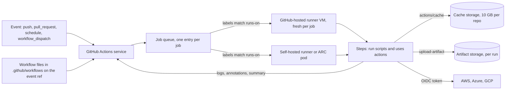
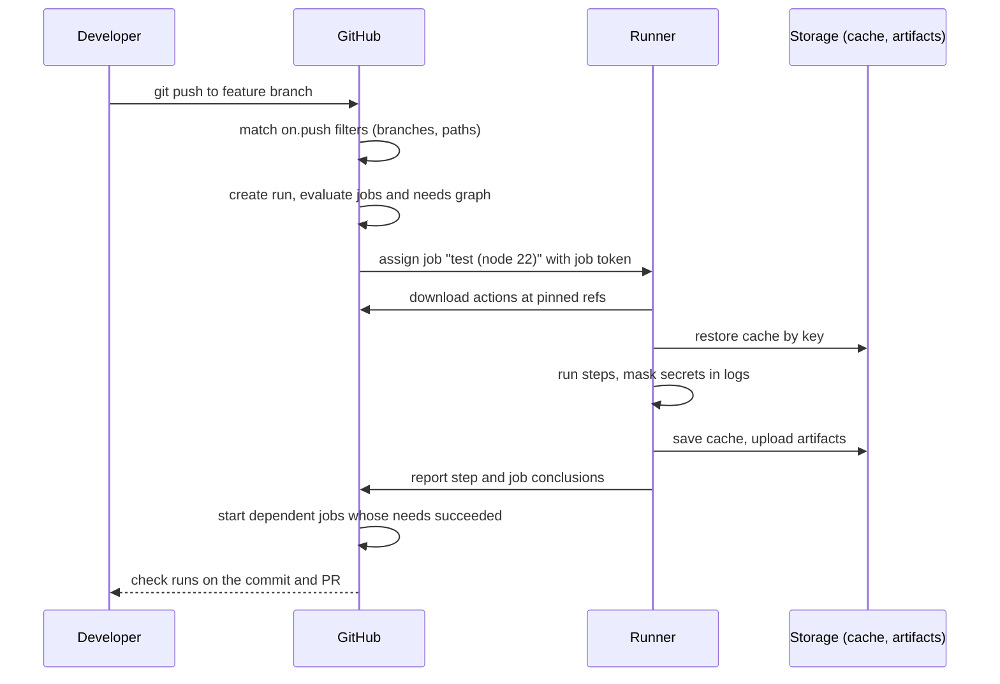
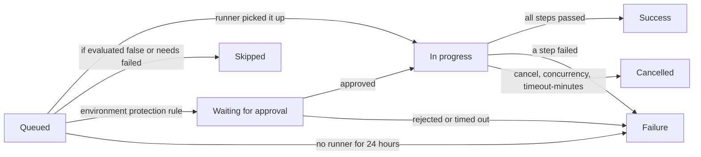
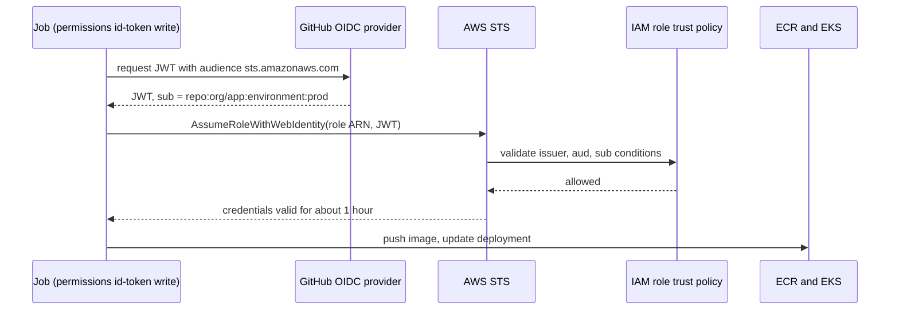
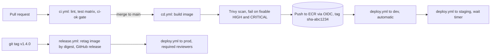
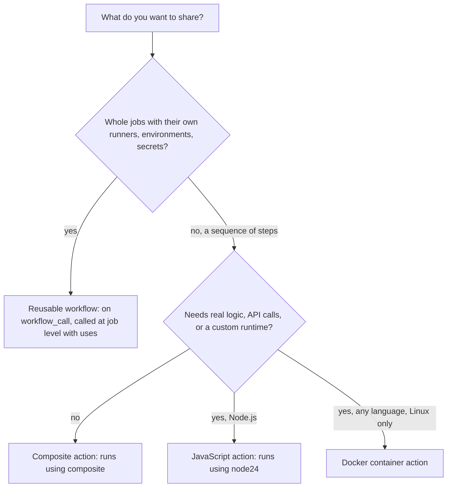

# GitHub Actions

<!-- DEVOPS-SHACK:HEADER -->

  
  
  
  
  

Part of <b><a href="https://github.com/jaiswaladi246/DevOps-Cloud-Interview-Preparation-by-DevOps-Shack">DevOps &amp; Cloud Interview Preparation</a></b> — created by <b><a href="https://www.youtube.com/@devopsshack">DevOps Shack</a></b>. Free to learn from; please credit DevOps Shack when sharing.

<!-- /DEVOPS-SHACK:HEADER -->

> Go past "it has a YAML file": triggers and their security traps, matrices and concurrency, contexts and expressions, reusable workflows and custom actions, OIDC to every cloud, hardened tokens, self-hosted runners on Kubernetes with ARC, and a full build-scan-deploy-release pipeline to EKS.

[🏠 Home](../README.md)

The generic CI/CD topic lives in [06 · CI/CD](../06-cicd/README.md). This topic goes deep on GitHub Actions only: the exact syntax, the platform's behaviour at the edges, and the questions interviewers ask when your resume says "built CI/CD on GitHub Actions".

## What you'll master

- Workflow syntax end to end: `on`, `jobs`, `steps`, `needs`, `if`, `strategy.matrix`, `concurrency`, `permissions`, `env`, `defaults`, job and step `outputs`
- Every trigger that matters: `push`, `pull_request`, `pull_request_target`, `workflow_dispatch`, `schedule`, `workflow_call`, `workflow_run`, `repository_dispatch`, `merge_group`, `release`, and why some of them are dangerous
- Contexts (`github`, `env`, `vars`, `secrets`, `inputs`, `needs`, `matrix`, `steps`, `runner`, `job`) and the expression language: functions, status checks, `fromJSON`, `hashFiles`, object filters
- Secrets, configuration variables, and environments with required reviewers, wait timers, branch and tag policies
- Reusable workflows vs composite actions, and writing JavaScript and Docker container actions that others can consume
- Caching (`actions/cache`, setup-* built-in caches, BuildKit `type=gha`) and artifacts v4 semantics
- GitHub-hosted, larger and self-hosted runners, runner groups, ephemeral and JIT runners, and Actions Runner Controller (ARC) scale sets on Kubernetes
- OIDC federation to AWS, Azure and GCP with tight `sub` claim conditions, so no cloud keys live in GitHub
- Hardening: SHA pinning, least-privilege `GITHUB_TOKEN`, script injection, `pull_request_target` and `workflow_run` "pwn requests", allow-lists, artifact attestations
- Debugging with `ACTIONS_STEP_DEBUG`, controlling minutes and cost, monorepo path filters and dynamic matrices, and automated releases

---

## Architecture: how a workflow run is executed

An event on GitHub (a push, a PR, a cron tick, a button click) is matched against every workflow file in `.github/workflows/` on the relevant ref. Each matching workflow becomes a **run**; each job in the run is queued separately and assigned to a runner whose labels match `runs-on`. The runner application (the open-source `actions/runner`) long-polls GitHub for jobs, downloads the actions it needs, executes steps, streams logs back, and uploads artifacts and caches to GitHub's storage.

The important consequences: jobs do not share a filesystem (pass data with outputs or artifacts), every hosted job starts from a clean VM, and a self-hosted runner is a machine that executes code from whoever can trigger a workflow, so it must be treated as untrusted infrastructure.

## The life of a run: event to finished job

Every job receives its own short-lived `GITHUB_TOKEN`, scoped by the `permissions` key, which expires when the job finishes. Dependent jobs start only when all jobs in their `needs` list finished successfully, unless an `if` expression with a status function says otherwise.

## Job lifecycle and conclusions

`continue-on-error: true` turns a failing step or job into a pass for the purpose of `needs`. A cancelled job is not a failure: `failure()` is false and `cancelled()` is true, which is why cleanup steps use `if: always()` and deploy steps use `if: success()` (the default) or `!cancelled()`.

## Keyless cloud access with OIDC

The trust policy is where security lives. Pin `sub` to a repository and to a branch, tag or environment. A trust policy that only checks `aud` lets any GitHub repository on the planet assume your role.

## Production workflow: the pipeline we build in the lab

One reusable deploy workflow serves three environments. The image is built once and promoted by digest, never rebuilt. Approvals, branch restrictions and environment-scoped secrets come from GitHub environments, and each environment assumes its own IAM role with access to its own namespace only.

## Reusable workflows vs composite actions

A reusable workflow appears in the caller as a job (`jobs.deploy.uses: org/repo/.github/workflows/deploy.yml@ref`) and can declare `environment`, `runs-on`, `permissions` and secrets. A composite action is a step (`steps[*].uses`) that runs inside the caller's job and shares its workspace and runner.

---

## Core concepts in 10 minutes

### 1. Files, triggers and filters

Workflows are YAML files in `.github/workflows/`. The `on` key lists events, with optional filters: `branches`, `branches-ignore`, `tags`, `paths`, `paths-ignore`, and activity `types` (`pull_request: types: [opened, synchronize, reopened]` is the default set). For `push` and `pull_request`, GitHub reads the workflow file from the commit being built, so a branch can change its own CI. For `schedule`, it always uses the default branch.

### 2. Jobs, steps and the dependency graph

Jobs run in parallel unless `needs` creates an edge. Steps in a job run sequentially on the same runner and share the workspace. A step either runs a shell command (`run`) or calls an action (`uses`). `if` works at job and step level, `timeout-minutes` defaults to 360 for a job, and `continue-on-error` lets a job or step fail without failing the run.

### 3. Matrix and concurrency

`strategy.matrix` expands one job definition into many (up to 256 per workflow run), with `include`, `exclude`, `fail-fast` and `max-parallel`. `concurrency` serializes runs or jobs that share a group key: at most one running and one pending, and `cancel-in-progress: true` cancels the running one. We use `group: ${{ github.workflow }}-${{ github.ref }}` with cancel for PRs, and `group: deploy-prod` without cancel for deployments.

### 4. Contexts and expressions

`${{ }}` expressions are evaluated by GitHub before the step reaches the runner. Contexts expose data: `github.sha`, `github.ref_name`, `github.event.*`, `inputs.*`, `vars.*`, `secrets.*`, `needs.<job>.outputs.*`, `steps.<id>.outputs.*`, `matrix.*`, `runner.os`. Functions include `contains`, `startsWith`, `format`, `join`, `toJSON`, `fromJSON`, `hashFiles` and the status functions `success()`, `failure()`, `cancelled()`, `always()`. Because expressions are substituted into the script text, untrusted values inside `run:` cause script injection.

### 5. Passing data

Inside a job: write `name=value` to `$GITHUB_OUTPUT` (step outputs), `$GITHUB_ENV` (env for later steps), `$GITHUB_PATH` (PATH entries) and markdown to `$GITHUB_STEP_SUMMARY`. Between jobs: map step outputs to job `outputs` and read them through `needs`. Between runs or for files: artifacts. `set-output` and `set-env` workflow commands are deprecated or disabled.

### 6. Secrets, variables and environments

Secrets (repo, environment, organization) are encrypted, masked in logs, and not passed to workflows triggered from forks. Configuration variables (`vars`) are plain text for non-sensitive config. An **environment** groups secrets and variables with protection rules: required reviewers, prevent self-review, wait timer, allowed branches and tags, and custom protection rules from GitHub Apps. A job that names `environment: prod` waits for approval before it gets prod secrets.

### 7. `GITHUB_TOKEN` and permissions

Each job gets an installation token for the repo. Set `permissions: contents: read` at the top of every workflow and grant more per job (`packages: write`, `id-token: write`, `pull-requests: write`). Any permission not listed becomes `none`. Events created with `GITHUB_TOKEN` do not start new workflow runs (except `workflow_dispatch` and `repository_dispatch`), which prevents loops and is why release bots use a GitHub App token.

### 8. Reuse: reusable workflows and custom actions

`on: workflow_call` makes a workflow callable with typed `inputs`, `secrets` (or `secrets: inherit`) and `outputs`. Custom actions are defined by `action.yml`: composite (steps), JavaScript (`runs.using: node24`, bundled with dependencies), or Docker (Linux runners only). Version them with tags and consumers pin by SHA.

### 9. Cache vs artifacts

Cache is for speed: dependency directories keyed by `hashFiles` of lockfiles, restored with `restore-keys` fallbacks, scoped to branch with read access to the default branch, evicted after 7 days unused or over the repository quota. Artifacts are for outputs: build results, reports and binaries tied to a run, immutable in v4, retained 90 days by default.

### 10. Runners

Hosted runners are fresh VMs (Ubuntu, Windows, macOS, Linux arm64), billed per minute with OS multipliers in private repos. Self-hosted runners register with a token, carry labels and runner groups, and should be ephemeral (one job then gone). ARC runs ephemeral runners as pods: a controller plus one **runner scale set** per `runs-on` name, scaling from `minRunners` to `maxRunners` based on queued jobs.

### 11. OIDC and hardening

Grant `id-token: write`, then exchange the GitHub OIDC JWT for cloud credentials (AWS `configure-aws-credentials`, Azure `azure/login`, GCP `google-github-actions/auth`). Restrict trust by `sub`. Pin third-party actions to a full commit SHA, keep them updated with Dependabot, never run untrusted PR code with secrets (`pull_request_target`), pass untrusted strings via `env`, and restrict which actions are allowed at org level.

### 12. Debugging and cost

Re-run with debug logging, or set the `ACTIONS_STEP_DEBUG` and `ACTIONS_RUNNER_DEBUG` secrets or variables to `true`. Use `::group::`, annotations and step summaries for readable logs. Control cost with path filters, `concurrency` cancellation, caching, `timeout-minutes`, smaller matrices on PRs, Linux over Windows and macOS (2x and 10x multipliers), and artifact retention.

---

## Question banks

Two banks of 200 questions each, with collapsible answers. 400 questions in total, tagged 🟢 Beginner, 🟡 Intermediate, 🔴 Advanced.

| Bank | Questions | What it covers |
|------|-----------|----------------|
| [Concepts](./concepts.md) | 200 | Syntax, triggers, matrix and concurrency, contexts and expressions, secrets and environments, reusable workflows and custom actions, cache and artifacts, runners and ARC, OIDC, hardening, cost, releases, and rapid-fire commands |
| [Scenarios & Troubleshooting](./scenarios-and-troubleshooting.md) | 200 | 100 "what would you do" design scenarios and 100 real failures with the exact error text: workflows that never start, OIDC denials, `Resource not accessible by integration`, cache misses, stuck runners, ARC issues, blocked deployments |

## Learning path

Tick each item only when you can do it without notes.

**Beginner**
- [ ] Explain workflow, run, job, step, action and runner, and where each is defined
- [ ] Write a workflow triggered by `push` and `pull_request` with branch and path filters
- [ ] Use `actions/checkout` and `actions/setup-node` with the built-in npm cache
- [ ] Add a `workflow_dispatch` trigger with typed inputs and run it from the UI and with `gh workflow run`
- [ ] Create a repo secret and a variable, and use both correctly
- [ ] Upload and download an artifact between two jobs
- [ ] Read a failing log, re-run failed jobs, and enable debug logging
- [ ] Do the first 10 [assignments](./assignments.md)

**Intermediate**
- [ ] Build a matrix with `include` and `exclude`, and a fan-in "all checks passed" job
- [ ] Pass outputs between steps and jobs, and parse JSON with `fromJSON`
- [ ] Add `concurrency` to cancel superseded PR runs and to serialize deployments
- [ ] Set top-level `permissions: contents: read` and grant per-job extras
- [ ] Create environments with required reviewers and branch policies
- [ ] Write a composite action and a reusable workflow, and explain when to use each
- [ ] Configure OIDC to AWS with a trust policy pinned to repo and environment
- [ ] Complete the [hands-on lab](./hands-on-lab.md) end to end

**Advanced**
- [ ] Explain and demonstrate a `pull_request_target` pwn request and a script injection, then fix both
- [ ] Write and publish a JavaScript action with tests and a bundled `dist/`
- [ ] Run ARC on Kubernetes with an ephemeral runner scale set and scale it under load
- [ ] Configure OIDC for Azure and GCP as well as AWS, and explain the `sub` claim variants
- [ ] Build a monorepo pipeline with path-based dynamic matrices and a single required check
- [ ] Automate releases with versioning, changelogs, signed provenance and promotion by digest
- [ ] Enforce org-wide policy: allowed actions, SHA pinning, required workflows through rulesets
- [ ] Finish all 25 assignments and answer 150 of the 200 questions in each bank unaided

## Study materials

- [Hands-on lab: test matrix, OIDC to ECR, Trivy, reusable deploy to EKS dev/staging/prod with approvals, release workflow](./hands-on-lab.md)
- [Assignments](./assignments.md) — 25 graded exercises (10 beginner, 10 intermediate, 5 advanced)
- [Cheatsheet](./cheatsheet.md) — syntax, contexts, expressions, workflow commands, `gh` CLI, OIDC snippets and the top 15 interview one-liners

[🏠 Home](../README.md)

<!-- DEVOPS-SHACK:FOOTER -->
---

### 🚀 Made with ❤️ by [DevOps Shack](https://www.youtube.com/@devopsshack)

**Learn DevOps, DevSecOps, Cloud and Kubernetes the practical way.**

[▶️ YouTube — DevOps Shack](https://www.youtube.com/@devopsshack) · [▶️ Hindi — @shackverse](https://www.youtube.com/@shackverse) · [🎓 devopsshack.com](https://devopsshack.com) · [📸 Instagram @devopsshack](https://www.instagram.com/devopsshack)

[🏠 Back to Home](../README.md) · [⭐ Star the original repo](https://github.com/jaiswaladi246/DevOps-Cloud-Interview-Preparation-by-DevOps-Shack)

© DevOps Shack · Licensed CC BY-NC-SA 4.0 · If you found this copy anywhere other than <a href="https://github.com/jaiswaladi246/DevOps-Cloud-Interview-Preparation-by-DevOps-Shack">github.com/jaiswaladi246</a>, the original and latest version is maintained by DevOps Shack.

<!-- /DEVOPS-SHACK:FOOTER -->
