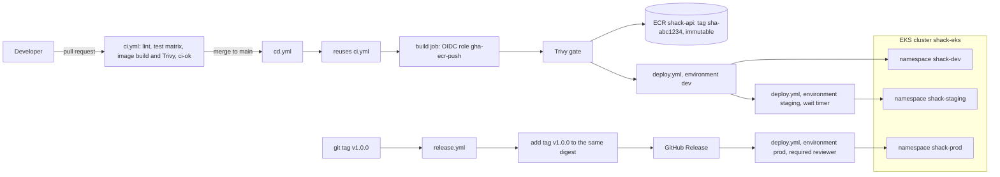
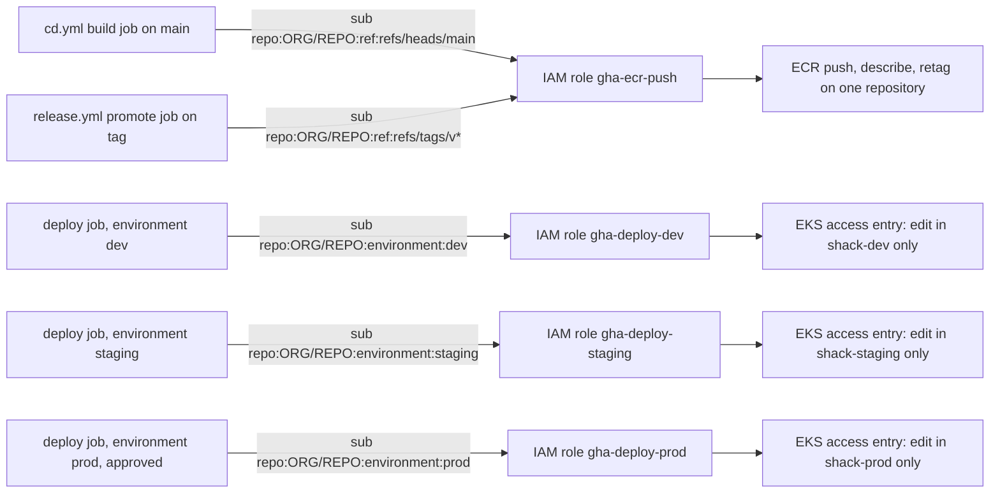
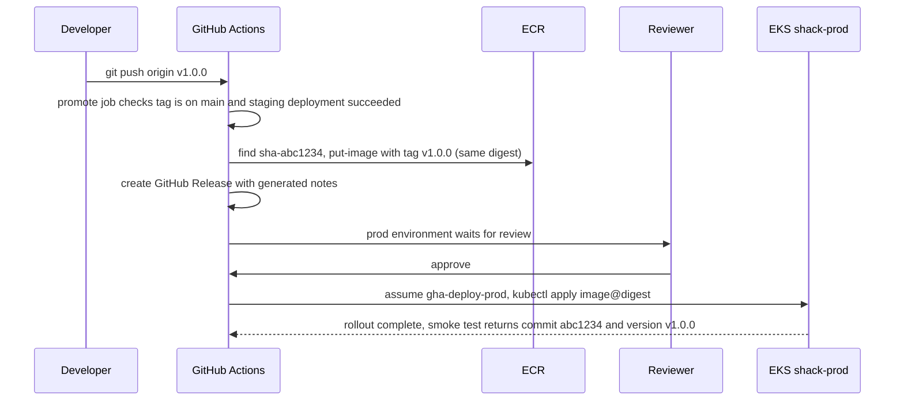

# Hands-on Lab: Production CI/CD with GitHub Actions, OIDC, Trivy and EKS

<!-- DEVOPS-SHACK:HEADER -->
<p align="center">
  <a href="https://www.youtube.com/@devopsshack"></a>
  <a href="https://www.youtube.com/@shackverse"></a>
  <a href="https://devopsshack.com"></a>
  <a href="https://www.instagram.com/devopsshack"></a>
  <a href="https://github.com/jaiswaladi246/DevOps-Cloud-Interview-Preparation-by-DevOps-Shack"></a>
</p>
<p align="center"><sub>Part of <b><a href="https://github.com/jaiswaladi246/DevOps-Cloud-Interview-Preparation-by-DevOps-Shack">DevOps &amp; Cloud Interview Preparation</a></b> — created by <b><a href="https://www.youtube.com/@devopsshack">DevOps Shack</a></b>. Free to learn from; please credit DevOps Shack when sharing.</sub></p>
<!-- /DEVOPS-SHACK:HEADER -->

> Build the pipeline teams actually run: a PR test matrix, an image built once and pushed to Amazon ECR with OIDC (no AWS keys anywhere), a Trivy gate, one reusable deploy workflow that serves dev, staging and prod environments with approvals, and a tag-driven release workflow that promotes the tested image by digest.

[⬅ Back to GitHub Actions](./README.md) · [🏠 Home](../README.md)

## Goal

By the end you will have a repository `shack-gha-pipeline` with:

- `ci.yml`: lint, a Node.js 20/22/24 test matrix, a Docker build with a Trivy scan, and a single `ci-ok` gate used by branch protection. Also callable as a reusable workflow.
- `cd.yml`: on every merge to `main`, reuses CI, builds the image once, scans it, pushes it to ECR via OIDC, then deploys automatically to **dev** and to **staging** (after a wait timer).
- `deploy.yml`: a reusable (and manually dispatchable) deploy workflow bound to a GitHub environment, assuming a per-environment IAM role with access to one Kubernetes namespace only, with rollout checks, a smoke test that proves the right commit is running, and automatic rollback.
- `release.yml`: on a `v*.*.*` tag, verifies the commit is on `main` and passed staging, adds the version tag to the existing ECR image without rebuilding, publishes a GitHub Release, and deploys to **prod** after a required reviewer approves.
- A composite action, Dependabot for actions, SHA-pinned actions, read-only default token, CODEOWNERS on `.github/`.

Time: 3 to 4 hours. Cost: a small EKS cluster for a few hours (roughly a few US dollars if you delete it the same day). GitHub features used here are free on a **public** repository; required reviewers on private repositories need a paid plan.

## Architecture



The identity chain is the heart of the design. Every privileged job proves who it is with a GitHub OIDC token, and AWS only trusts the exact `sub` claim for that job:



The release path, end to end:



## Prerequisites

- An AWS account and AWS CLI v2 configured with admin-level credentials **on your laptop only** (the pipeline itself never gets keys)
- An EKS cluster you can administer, Kubernetes 1.30 or newer, with authentication mode `API` or `API_AND_CONFIG_MAP` (Step 5 shows how to create or check one)
- `kubectl`, `eksctl` (only if creating the cluster), `jq`, `git`, Node.js 22 and npm
- GitHub CLI `gh` 2.50+ logged in (`gh auth login`) with `repo` and `workflow` scopes
- Docker locally (optional, to test the image before pushing)

Set these once in your terminal and keep it open for the whole lab:

```bash
export AWS_REGION=ap-south-1
export AWS_ACCOUNT_ID=$(aws sts get-caller-identity --query Account --output text)
export GH_ORG=your-github-username        # or your organization
export GH_REPO=shack-gha-pipeline
export CLUSTER_NAME=shack-eks
export ECR_REPO=shack-api
export ECR_REGISTRY=${AWS_ACCOUNT_ID}.dkr.ecr.${AWS_REGION}.amazonaws.com
echo "$AWS_ACCOUNT_ID $GH_ORG/$GH_REPO $ECR_REGISTRY"
```

---

## Step 1. Create the repository and the application

```bash
gh repo create "$GH_ORG/$GH_REPO" --public --clone --description "GitHub Actions production pipeline lab"
cd "$GH_REPO"
mkdir -p app/src app/test k8s/base k8s/overlays/{dev,staging,prod} .github/{workflows,actions/setup-app} infra
```

`app/src/app.js`:

```js
const express = require('express');

const app = express();
const version = process.env.APP_VERSION || 'dev';
const commit = process.env.GIT_SHA || 'local';

app.get('/healthz', (req, res) => res.json({ status: 'ok' }));

app.get('/api/version', (req, res) => res.json({ version, commit }));

app.get('/api/hello', (req, res) => {
  const name = String(req.query.name || 'DevOps Shack').slice(0, 50);
  res.json({ message: `Hello, ${name}!` });
});

module.exports = app;
```

`app/src/server.js`:

```js
const app = require('./app');

const port = Number(process.env.PORT || 3000);
const server = app.listen(port, () => console.log(`listening on ${port}`));

function shutdown(signal) {
  console.log(`${signal} received, closing server`);
  server.close(() => process.exit(0));
  setTimeout(() => process.exit(1), 10000).unref();
}

process.on('SIGTERM', () => shutdown('SIGTERM'));
process.on('SIGINT', () => shutdown('SIGINT'));
```

`app/test/app.test.js` (uses the built-in Node test runner):

```js
const test = require('node:test');
const assert = require('node:assert/strict');
const request = require('supertest');
const app = require('../src/app');

test('GET /healthz returns ok', async () => {
  const res = await request(app).get('/healthz');
  assert.equal(res.status, 200);
  assert.equal(res.body.status, 'ok');
});

test('GET /api/version returns version and commit', async () => {
  const res = await request(app).get('/api/version');
  assert.equal(res.status, 200);
  assert.ok(res.body.version);
  assert.ok(res.body.commit);
});

test('GET /api/hello greets and truncates long names', async () => {
  const res = await request(app).get('/api/hello').query({ name: 'x'.repeat(80) });
  assert.equal(res.status, 200);
  assert.equal(res.body.message, `Hello, ${'x'.repeat(50)}!`);
});
```

`app/eslint.config.js`:

```js
const js = require('@eslint/js');
const globals = require('globals');

module.exports = [
  js.configs.recommended,
  {
    files: ['**/*.js'],
    languageOptions: {
      ecmaVersion: 2023,
      sourceType: 'commonjs',
      globals: { ...globals.node },
    },
  },
];
```

Create `package.json` and the lockfile:

```bash
cd app
npm init -y >/dev/null
npm pkg set name=shack-api version=1.0.0 private=true \
  scripts.start="node src/server.js" \
  scripts.test="node --test test/*.test.js" \
  scripts.lint="eslint ."
npm install express@5
npm install -D eslint@9 @eslint/js@9 globals supertest
cd ..
```

**Verify:**

```bash
(cd app && npm run lint && npm test)
```

You should see `# pass 3` and `# fail 0`. The committed `package-lock.json` is what makes `npm ci` and cache keys work in CI.

---

## Step 2. Dockerfile

`app/Dockerfile`:

```dockerfile
# syntax=docker/dockerfile:1
FROM node:22-alpine AS deps
WORKDIR /app
COPY package.json package-lock.json ./
RUN --mount=type=cache,target=/root/.npm npm ci --omit=dev

FROM node:22-alpine
ENV NODE_ENV=production
WORKDIR /app
COPY --from=deps /app/node_modules ./node_modules
COPY package.json ./
COPY src ./src
ARG GIT_SHA=local
ENV GIT_SHA=${GIT_SHA}
USER node
EXPOSE 3000
CMD ["node", "src/server.js"]
```

`app/.dockerignore`:

```text
node_modules
test
npm-debug.log
.eslintcache
```

The commit SHA is baked in at build time (it is a fact about the image). The version label is injected at deploy time through a ConfigMap, because a release adds a tag to an existing image without rebuilding it.

**Verify (optional, needs Docker):**

```bash
docker build -t shack-api:local --build-arg GIT_SHA=$(git rev-parse HEAD 2>/dev/null || echo local) app
docker run --rm -d -p 3000:3000 --name shack shack-api:local
curl -s localhost:3000/api/version; docker rm -f shack
```

---

## Step 3. Kubernetes manifests with Kustomize

`k8s/base/deployment.yaml`:

```yaml
apiVersion: apps/v1
kind: Deployment
metadata:
  name: shack-api
  labels:
    app: shack-api
spec:
  replicas: 2
  revisionHistoryLimit: 5
  selector:
    matchLabels:
      app: shack-api
  template:
    metadata:
      labels:
        app: shack-api
    spec:
      securityContext:
        runAsNonRoot: true
        runAsUser: 1000
        runAsGroup: 1000
      containers:
        - name: api
          image: shack-api
          ports:
            - containerPort: 3000
          envFrom:
            - configMapRef:
                name: shack-api-config
          readinessProbe:
            httpGet: { path: /healthz, port: 3000 }
            periodSeconds: 5
          livenessProbe:
            httpGet: { path: /healthz, port: 3000 }
            initialDelaySeconds: 10
            periodSeconds: 10
          resources:
            requests: { cpu: 50m, memory: 64Mi }
            limits: { memory: 128Mi }
          securityContext:
            allowPrivilegeEscalation: false
            readOnlyRootFilesystem: true
            capabilities:
              drop: ["ALL"]
```

`k8s/base/service.yaml`:

```yaml
apiVersion: v1
kind: Service
metadata:
  name: shack-api
spec:
  selector:
    app: shack-api
  ports:
    - port: 80
      targetPort: 3000
```

`k8s/base/kustomization.yaml`:

```yaml
apiVersion: kustomize.config.k8s.io/v1beta1
kind: Kustomization
resources:
  - deployment.yaml
  - service.yaml
configMapGenerator:
  - name: shack-api-config
    literals:
      - APP_VERSION=dev
      - LOG_LEVEL=info
```

Overlays only set the namespace and replica count. They deliberately contain no `images` or `configMapGenerator` keys, because the deploy workflow appends those at deploy time.

```bash
for env in dev staging prod; do
  case $env in dev) r=1 ;; staging) r=2 ;; prod) r=3 ;; esac
  cat > k8s/overlays/$env/kustomization.yaml <<KUST
apiVersion: kustomize.config.k8s.io/v1beta1
kind: Kustomization
namespace: shack-$env
resources:
  - ../../base
patches:
  - target:
      kind: Deployment
      name: shack-api
    patch: |-
      - op: replace
        path: /spec/replicas
        value: $r
KUST
done
```

**Verify:**

```bash
kubectl kustomize k8s/overlays/prod | grep -E 'namespace:|replicas:|name: shack-api-config'
```

You should see `namespace: shack-prod`, `replicas: 3`, and a hashed ConfigMap name like `shack-api-config-7g9k2h5f4m`. The hash suffix means a config change rolls the pods.

---

## Step 4. Commit the skeleton

```bash
cat > .gitignore <<'IGN'
node_modules/
infra/*.json
IGN
git add .
git commit -m "feat: shack-api app, Dockerfile and Kustomize manifests"
git push -u origin main
```

`infra/*.json` is ignored because Step 5 and 6 generate policy files containing your account ID. They are not secret, but they are environment-specific.

---

## Step 5. AWS: EKS cluster, ECR repository

If you do not have a cluster, create a small one (about 15 to 20 minutes):

```bash
eksctl create cluster --name "$CLUSTER_NAME" --region "$AWS_REGION" \
  --version 1.33 --managed --nodes 2 --node-type t3.medium
```

Check the authentication mode supports access entries, and switch if needed:

```bash
aws eks describe-cluster --name "$CLUSTER_NAME" --query cluster.accessConfig.authenticationMode --output text
# If it prints CONFIG_MAP:
aws eks update-cluster-config --name "$CLUSTER_NAME" --access-config authenticationMode=API_AND_CONFIG_MAP
```

Create the ECR repository with immutable tags and scan on push, plus a lifecycle rule for untagged images:

```bash
aws ecr create-repository --repository-name "$ECR_REPO" \
  --image-tag-mutability IMMUTABLE \
  --image-scanning-configuration scanOnPush=true \
  --region "$AWS_REGION"

aws ecr put-lifecycle-policy --repository-name "$ECR_REPO" --lifecycle-policy-text '{
  "rules": [{
    "rulePriority": 1,
    "description": "expire untagged after 7 days",
    "selection": { "tagStatus": "untagged", "countType": "sinceImagePushed", "countUnit": "days", "countNumber": 7 },
    "action": { "type": "expire" }
  }]
}'
```

**Verify:**

```bash
aws ecr describe-repositories --repository-names "$ECR_REPO" \
  --query 'repositories[0].[repositoryUri,imageTagMutability]' --output text
kubectl get nodes
```

---

## Step 6. AWS: GitHub OIDC provider and the ECR push role

Create the OIDC provider once per AWS account (skip if `list-open-id-connect-providers` already shows `token.actions.githubusercontent.com`):

```bash
aws iam list-open-id-connect-providers
aws iam create-open-id-connect-provider \
  --url https://token.actions.githubusercontent.com \
  --client-id-list sts.amazonaws.com \
  --thumbprint-list 6938fd4d98bab03faadb97b34396831e3780aea1
```

AWS validates GitHub's certificate through its own trusted CA store for this issuer, so the thumbprint is not used for validation; it is included only because some CLI versions still require the parameter.

Trust policy: only pushes to `main` and `v*` tags of this exact repository can assume the role.

```bash
cat > infra/trust-ecr-push.json <<JSON
{
  "Version": "2012-10-17",
  "Statement": [{
    "Effect": "Allow",
    "Principal": { "Federated": "arn:aws:iam::${AWS_ACCOUNT_ID}:oidc-provider/token.actions.githubusercontent.com" },
    "Action": "sts:AssumeRoleWithWebIdentity",
    "Condition": {
      "StringEquals": { "token.actions.githubusercontent.com:aud": "sts.amazonaws.com" },
      "StringLike": {
        "token.actions.githubusercontent.com:sub": [
          "repo:${GH_ORG}/${GH_REPO}:ref:refs/heads/main",
          "repo:${GH_ORG}/${GH_REPO}:ref:refs/tags/v*"
        ]
      }
    }
  }]
}
JSON

cat > infra/policy-ecr-push.json <<JSON
{
  "Version": "2012-10-17",
  "Statement": [
    { "Sid": "EcrAuth", "Effect": "Allow", "Action": "ecr:GetAuthorizationToken", "Resource": "*" },
    {
      "Sid": "PushDescribeRetag",
      "Effect": "Allow",
      "Action": [
        "ecr:BatchCheckLayerAvailability", "ecr:InitiateLayerUpload", "ecr:UploadLayerPart",
        "ecr:CompleteLayerUpload", "ecr:PutImage", "ecr:BatchGetImage", "ecr:DescribeImages"
      ],
      "Resource": "arn:aws:ecr:${AWS_REGION}:${AWS_ACCOUNT_ID}:repository/${ECR_REPO}"
    }
  ]
}
JSON

aws iam create-role --role-name gha-ecr-push \
  --assume-role-policy-document file://infra/trust-ecr-push.json \
  --description "GitHub Actions: push and retag ${ECR_REPO} from ${GH_ORG}/${GH_REPO}"
aws iam put-role-policy --role-name gha-ecr-push \
  --policy-name ecr-push --policy-document file://infra/policy-ecr-push.json
```

**Verify:**

```bash
aws iam get-role --role-name gha-ecr-push --query 'Role.AssumeRolePolicyDocument.Statement[0].Condition' --output json
```

Note what is **not** allowed: pull requests, feature branches and other repositories get `AccessDenied`.

---

## Step 7. AWS: per-environment deploy roles, namespaces and EKS access entries

Each environment gets its own role, trusted only for jobs bound to that GitHub environment, and mapped into the cluster with edit rights in exactly one namespace.

```bash
for env in dev staging prod; do
  cat > infra/trust-deploy-$env.json <<JSON
{
  "Version": "2012-10-17",
  "Statement": [{
    "Effect": "Allow",
    "Principal": { "Federated": "arn:aws:iam::${AWS_ACCOUNT_ID}:oidc-provider/token.actions.githubusercontent.com" },
    "Action": "sts:AssumeRoleWithWebIdentity",
    "Condition": {
      "StringEquals": {
        "token.actions.githubusercontent.com:aud": "sts.amazonaws.com",
        "token.actions.githubusercontent.com:sub": "repo:${GH_ORG}/${GH_REPO}:environment:${env}"
      }
    }
  }]
}
JSON
  cat > infra/policy-deploy-$env.json <<JSON
{
  "Version": "2012-10-17",
  "Statement": [
    { "Effect": "Allow", "Action": "eks:DescribeCluster",
      "Resource": "arn:aws:eks:${AWS_REGION}:${AWS_ACCOUNT_ID}:cluster/${CLUSTER_NAME}" },
    { "Effect": "Allow", "Action": "ecr:DescribeImages",
      "Resource": "arn:aws:ecr:${AWS_REGION}:${AWS_ACCOUNT_ID}:repository/${ECR_REPO}" }
  ]
}
JSON
  aws iam create-role --role-name gha-deploy-$env \
    --assume-role-policy-document file://infra/trust-deploy-$env.json
  aws iam put-role-policy --role-name gha-deploy-$env \
    --policy-name deploy --policy-document file://infra/policy-deploy-$env.json

  kubectl create namespace shack-$env

  aws eks create-access-entry --cluster-name "$CLUSTER_NAME" \
    --principal-arn arn:aws:iam::${AWS_ACCOUNT_ID}:role/gha-deploy-$env --type STANDARD
  aws eks associate-access-policy --cluster-name "$CLUSTER_NAME" \
    --principal-arn arn:aws:iam::${AWS_ACCOUNT_ID}:role/gha-deploy-$env \
    --policy-arn arn:aws:eks::aws:cluster-access-policy/AmazonEKSEditPolicy \
    --access-scope type=namespace,namespaces=shack-$env
done
```

**Verify:**

```bash
aws eks list-access-entries --cluster-name "$CLUSTER_NAME" --output text | grep gha-deploy
aws eks list-associated-access-policies --cluster-name "$CLUSTER_NAME" \
  --principal-arn arn:aws:iam::${AWS_ACCOUNT_ID}:role/gha-deploy-prod \
  --query 'associatedAccessPolicies[0].accessScope'
kubectl get ns | grep shack-
```

The prod role's scope must show `"type": "namespace"` and `["shack-prod"]`. A compromised dev pipeline cannot touch staging or prod.

---

## Step 8. GitHub: environments, protection rules, variables, token defaults

Environments with deployment branch policies:

```bash
MY_ID=$(gh api user --jq .id)

# dev: deploy from main only, no approval
gh api -X PUT repos/$GH_ORG/$GH_REPO/environments/dev --input - <<'JSON'
{ "deployment_branch_policy": { "protected_branches": false, "custom_branch_policies": true } }
JSON
gh api -X POST repos/$GH_ORG/$GH_REPO/environments/dev/deployment-branch-policies -f name=main -f type=branch

# staging: main only, 2 minute wait timer (use 10+ in real life)
gh api -X PUT repos/$GH_ORG/$GH_REPO/environments/staging --input - <<'JSON'
{ "wait_timer": 2, "deployment_branch_policy": { "protected_branches": false, "custom_branch_policies": true } }
JSON
gh api -X POST repos/$GH_ORG/$GH_REPO/environments/staging/deployment-branch-policies -f name=main -f type=branch

# prod: required reviewer, main and v* tags only
gh api -X PUT repos/$GH_ORG/$GH_REPO/environments/prod --input - <<JSON
{
  "wait_timer": 0,
  "prevent_self_review": false,
  "reviewers": [ { "type": "User", "id": $MY_ID } ],
  "deployment_branch_policy": { "protected_branches": false, "custom_branch_policies": true }
}
JSON
gh api -X POST repos/$GH_ORG/$GH_REPO/environments/prod/deployment-branch-policies -f name=main -f type=branch
gh api -X POST repos/$GH_ORG/$GH_REPO/environments/prod/deployment-branch-policies -f name='v*' -f type=tag
```

In a team, set `prevent_self_review` to `true` and use a team as reviewer. It is `false` here only because you are the sole reviewer of your own lab.

Repository and environment variables (none of these are secrets, and the lab uses **zero** repository secrets):

```bash
gh variable set AWS_REGION        --body "$AWS_REGION"
gh variable set ECR_REGISTRY      --body "$ECR_REGISTRY"
gh variable set ECR_REPOSITORY    --body "$ECR_REPO"
gh variable set EKS_CLUSTER       --body "$CLUSTER_NAME"
gh variable set ECR_PUSH_ROLE_ARN --body "arn:aws:iam::${AWS_ACCOUNT_ID}:role/gha-ecr-push"
for env in dev staging prod; do
  gh variable set DEPLOY_ROLE_ARN --env $env --body "arn:aws:iam::${AWS_ACCOUNT_ID}:role/gha-deploy-$env"
done
```

Read-only default token for every workflow in this repo:

```bash
gh api -X PUT repos/$GH_ORG/$GH_REPO/actions/permissions/workflow \
  -f default_workflow_permissions=read -F can_approve_pull_request_reviews=false
```

**Verify:**

```bash
gh api repos/$GH_ORG/$GH_REPO/environments --jq '.environments[] | {name, rules: [.protection_rules[].type]}'
gh variable list
gh variable list --env prod
```

Expected: prod shows `required_reviewers` and `branch_policy`, staging shows `wait_timer` and `branch_policy`.

---

## Step 9. Composite action: shared setup

`.github/actions/setup-app/action.yml`:

```yaml
name: Setup shack-api
description: Install Node.js with npm cache and install dependencies with npm ci
inputs:
  node-version:
    description: Node.js version
    default: "22"
  working-directory:
    description: Directory containing package-lock.json
    default: app
runs:
  using: composite
  steps:
    - uses: actions/setup-node@v4
      with:
        node-version: ${{ inputs.node-version }}
        cache: npm
        cache-dependency-path: ${{ inputs.working-directory }}/package-lock.json
    - name: npm ci
      shell: bash
      working-directory: ${{ inputs.working-directory }}
      run: npm ci --prefer-offline --no-audit --no-fund
```

Every `run` step inside a composite action must declare `shell`. The action runs inside the caller's job, so it shares the caller's workspace and runner.

---

## Step 10. `ci.yml`: lint, test matrix, image scan, single gate

`.github/workflows/ci.yml`:

```yaml
name: CI

on:
  pull_request:
  merge_group:
  workflow_call:

permissions:
  contents: read

concurrency:
  group: ci-${{ github.event_name }}-${{ github.event.pull_request.number || github.ref }}
  cancel-in-progress: ${{ github.event_name == 'pull_request' }}

defaults:
  run:
    shell: bash

jobs:
  lint:
    name: lint
    runs-on: ubuntu-24.04
    timeout-minutes: 10
    steps:
      - uses: actions/checkout@v4
        with:
          persist-credentials: false
      - uses: ./.github/actions/setup-app
      - run: npm run lint
        working-directory: app

  test:
    name: test (node ${{ matrix.node }})
    runs-on: ubuntu-24.04
    timeout-minutes: 10
    strategy:
      fail-fast: false
      matrix:
        node: [20, 22, 24]
    steps:
      - uses: actions/checkout@v4
        with:
          persist-credentials: false
      - uses: ./.github/actions/setup-app
        with:
          node-version: ${{ matrix.node }}
      - name: Unit tests
        working-directory: app
        run: npm test 2>&1 | tee test-output.txt
      - name: Test summary
        if: ${{ !cancelled() }}
        working-directory: app
        env:
          NODE_MAJOR: ${{ matrix.node }}
        run: |
          {
            echo "### Unit tests on Node $NODE_MAJOR"
            echo "~~~"
            tail -n 9 test-output.txt
            echo "~~~"
          } >> "$GITHUB_STEP_SUMMARY"

  image-scan:
    name: image build and scan
    runs-on: ubuntu-24.04
    timeout-minutes: 15
    env:
      TRIVY_DB_REPOSITORY: public.ecr.aws/aquasecurity/trivy-db:2
    steps:
      - uses: actions/checkout@v4
        with:
          persist-credentials: false
      - uses: docker/setup-buildx-action@v3
      - name: Build (no push)
        uses: docker/build-push-action@v6
        with:
          context: app
          load: true
          push: false
          tags: shack-api:ci
          build-args: GIT_SHA=${{ github.sha }}
          cache-from: type=gha,scope=shack-api
      - name: Trivy gate
        uses: aquasecurity/trivy-action@0.28.0
        with:
          image-ref: shack-api:ci
          severity: CRITICAL,HIGH
          ignore-unfixed: true
          exit-code: "1"
          format: table

  ci-ok:
    name: ci-ok
    if: always()
    needs: [lint, test, image-scan]
    runs-on: ubuntu-24.04
    timeout-minutes: 5
    steps:
      - name: All required jobs succeeded
        env:
          NEEDS: ${{ toJSON(needs) }}
        run: |
          echo "$NEEDS" | jq -r 'to_entries[] | "\(.key): \(.value.result)"'
          echo "$NEEDS" | jq -e 'all(.[]; .result == "success")' > /dev/null
```

Design points worth saying out loud in an interview:

- `shell: bash` as default turns on `pipefail`, so `npm test | tee` fails when tests fail. Under the implicit default shell it would pass.
- PR runs **read** the Docker layer cache but never write it (`cache-from` only). Only `main` writes cache in `cd.yml`, so PRs cannot poison it and do not churn the 10 GB quota.
- The concurrency group includes the event name, so the CI run that `cd.yml` calls on `main` never collides with a PR group, and `cancel-in-progress` is on for PRs only.
- `ci-ok` is the only check branch protection needs. Adding Node 26 to the matrix later does not require touching protection settings.

---

## Step 11. `deploy.yml`: one reusable deploy for every environment

`.github/workflows/deploy.yml`:

```yaml
name: Deploy

on:
  workflow_call:
    inputs:
      environment:
        description: dev, staging or prod
        type: string
        required: true
      image-digest:
        description: Image digest, sha256:...
        type: string
        required: true
      version:
        description: Version label shown by /api/version
        type: string
        required: true
      git-sha:
        description: Full commit SHA the image was built from
        type: string
        required: true
    outputs:
      image:
        description: Image reference that was deployed
        value: ${{ jobs.deploy.outputs.image }}
  workflow_dispatch:
    inputs:
      environment:
        type: environment
        required: true
      image-digest:
        description: Image digest to deploy or roll back to, sha256:...
        type: string
        required: true
      version:
        description: Version label, for example v1.0.0 or sha-abc1234
        type: string
        required: true
      git-sha:
        description: Full commit SHA the image was built from
        type: string
        required: true

permissions:
  contents: read
  id-token: write

jobs:
  deploy:
    name: deploy (${{ inputs.environment }})
    runs-on: ubuntu-24.04
    timeout-minutes: 15
    environment:
      name: ${{ inputs.environment }}
    concurrency:
      group: deploy-${{ inputs.environment }}
      cancel-in-progress: false
    outputs:
      image: ${{ steps.render.outputs.image }}
    env:
      ENVIRONMENT: ${{ inputs.environment }}
      NAMESPACE: shack-${{ inputs.environment }}
      DIGEST: ${{ inputs.image-digest }}
      VERSION: ${{ inputs.version }}
      EXPECTED_SHA: ${{ inputs.git-sha }}
      ECR_REPOSITORY: ${{ vars.ECR_REPOSITORY }}
      IMAGE_REPO: ${{ vars.ECR_REGISTRY }}/${{ vars.ECR_REPOSITORY }}
      EKS_CLUSTER: ${{ vars.EKS_CLUSTER }}
    defaults:
      run:
        shell: bash
    steps:
      - name: Validate inputs
        run: |
          [[ "$ENVIRONMENT" =~ ^(dev|staging|prod)$ ]] || { echo "::error::Unknown environment '$ENVIRONMENT'"; exit 1; }
          [[ "$DIGEST" =~ ^sha256:[a-f0-9]{64}$ ]] || { echo "::error::image-digest must be sha256:<64 hex chars>"; exit 1; }
          [[ "$EXPECTED_SHA" =~ ^[a-f0-9]{40}$ ]] || { echo "::error::git-sha must be a full 40 character SHA"; exit 1; }
          [[ "$VERSION" =~ ^[A-Za-z0-9._-]{1,64}$ ]] || { echo "::error::Invalid version label"; exit 1; }

      - name: Check out the manifests that match the image
        uses: actions/checkout@v4
        with:
          ref: ${{ inputs.git-sha }}
          persist-credentials: false

      - name: Configure AWS credentials (OIDC, environment role)
        uses: aws-actions/configure-aws-credentials@v4
        with:
          role-to-assume: ${{ vars.DEPLOY_ROLE_ARN }}
          role-session-name: gha-deploy-${{ inputs.environment }}-${{ github.run_id }}
          aws-region: ${{ vars.AWS_REGION }}

      - name: Confirm the digest exists in ECR
        run: |
          aws ecr describe-images --repository-name "$ECR_REPOSITORY" \
            --image-ids imageDigest="$DIGEST" --query 'imageDetails[0].imageTags' --output text

      - name: Get cluster credentials
        run: |
          echo "KUBECONFIG=$RUNNER_TEMP/kubeconfig" >> "$GITHUB_ENV"
          aws eks update-kubeconfig --name "$EKS_CLUSTER" --region "$AWS_REGION" --kubeconfig "$RUNNER_TEMP/kubeconfig"
          KUBECONFIG="$RUNNER_TEMP/kubeconfig" kubectl auth can-i patch deployments -n "$NAMESPACE"

      - name: Render manifests (image by digest, version label)
        id: render
        run: |
          overlay="k8s/overlays/$ENVIRONMENT"
          cat >> "$overlay/kustomization.yaml" <<KUSTOMIZE
          images:
            - name: shack-api
              newName: $IMAGE_REPO
              digest: $DIGEST
          configMapGenerator:
            - name: shack-api-config
              behavior: merge
              literals:
                - APP_VERSION=$VERSION
          KUSTOMIZE
          kubectl kustomize "$overlay" > rendered.yaml
          grep -n 'image:' rendered.yaml
          echo "image=$IMAGE_REPO@$DIGEST" >> "$GITHUB_OUTPUT"

      - name: Keep rendered manifests
        uses: actions/upload-artifact@v4
        with:
          name: manifests-${{ inputs.environment }}
          path: rendered.yaml
          retention-days: 7

      - name: Apply
        id: apply
        run: kubectl apply -f rendered.yaml

      - name: Wait for rollout
        run: kubectl -n "$NAMESPACE" rollout status deployment/shack-api --timeout=180s

      - name: Smoke test (right commit, right version)
        run: |
          for i in 1 2 3 4 5; do
            body=$(kubectl -n "$NAMESPACE" run "smoke-${GITHUB_RUN_ID}-${GITHUB_RUN_ATTEMPT}-$i" \
                     --rm -i --restart=Never --quiet --image=curlimages/curl:8.11.1 -- \
                     curl -fsS --max-time 5 http://shack-api/api/version 2>/dev/null | grep -o '{.*}' | tail -n 1) || body=""
            echo "attempt $i: ${body:-no response}"
            if echo "$body" | jq -e --arg sha "$EXPECTED_SHA" --arg v "$VERSION" \
                 '.commit == $sha and .version == $v' >/dev/null 2>&1; then
              exit 0
            fi
            sleep 5
          done
          echo "::error::Smoke test did not see commit $EXPECTED_SHA and version $VERSION"
          exit 1

      - name: Diagnostics and automatic rollback
        if: failure() && steps.apply.outcome == 'success'
        run: |
          kubectl -n "$NAMESPACE" get pods -l app=shack-api -o wide || true
          kubectl -n "$NAMESPACE" get events --sort-by=.lastTimestamp | tail -n 25 || true
          if kubectl -n "$NAMESPACE" rollout undo deployment/shack-api; then
            kubectl -n "$NAMESPACE" rollout status deployment/shack-api --timeout=180s || true
            echo "::error::Deployment to $ENVIRONMENT failed and was rolled back"
          else
            echo "::error::Deployment to $ENVIRONMENT failed and there is no previous revision to roll back to"
          fi

      - name: Summary
        if: success()
        run: |
          {
            echo "### Deployed to \`$ENVIRONMENT\`"
            echo ""
            echo "| Field | Value |"
            echo "|---|---|"
            echo "| Namespace | \`$NAMESPACE\` |"
            echo "| Image | \`$IMAGE_REPO@$DIGEST\` |"
            echo "| Version | \`$VERSION\` |"
            echo "| Commit | \`$EXPECTED_SHA\` |"
          } >> "$GITHUB_STEP_SUMMARY"
```

Why it is built this way:

- **One file, three environments.** `environment: ${{ inputs.environment }}` pulls in that environment's protection rules and its `DEPLOY_ROLE_ARN` variable, and changes the OIDC `sub` to `environment:<name>`, which is the only subject each role trusts.
- **Inputs are validated** before being written into YAML or shell. A crafted `version` value cannot inject Kustomize fields.
- **Checkout at `git-sha`**, not at the branch tip, so a rollback to an older digest also uses that version's manifests.
- **Deploy by digest.** Every release changes the pod spec, so a rollout always happens and a tag can never be swapped under you.
- **The smoke test proves identity**, not just liveness: the running pods must report the expected commit and version, through the Service (only Ready endpoints receive traffic).
- **`concurrency` per environment without cancellation**: two deploys to prod queue, they never run at once and never get killed halfway.
- The `workflow_dispatch` trigger doubles as the **rollback button**: pick an environment, paste an older digest and its commit.

---

## Step 12. `cd.yml`: reuse CI, build once, push, deploy dev then staging

`.github/workflows/cd.yml`:

```yaml
name: CD

on:
  push:
    branches: [main]
    paths-ignore:
      - "**.md"

permissions:
  contents: read

jobs:
  ci:
    name: ci
    uses: ./.github/workflows/ci.yml

  build:
    name: build, scan, push
    needs: ci
    runs-on: ubuntu-24.04
    timeout-minutes: 20
    permissions:
      contents: read
      id-token: write
      security-events: write
      actions: read
    outputs:
      digest: ${{ steps.result.outputs.digest }}
      tag: ${{ steps.meta.outputs.tag }}
    env:
      ECR_REPOSITORY: ${{ vars.ECR_REPOSITORY }}
      IMAGE: ${{ vars.ECR_REGISTRY }}/${{ vars.ECR_REPOSITORY }}
      TRIVY_DB_REPOSITORY: public.ecr.aws/aquasecurity/trivy-db:2
    defaults:
      run:
        shell: bash
    steps:
      - uses: actions/checkout@v4
        with:
          persist-credentials: false

      - name: Compute image tag
        id: meta
        run: echo "tag=sha-${GITHUB_SHA::7}" >> "$GITHUB_OUTPUT"

      - name: Configure AWS credentials (OIDC)
        uses: aws-actions/configure-aws-credentials@v4
        with:
          role-to-assume: ${{ vars.ECR_PUSH_ROLE_ARN }}
          role-session-name: gha-build-${{ github.run_id }}
          aws-region: ${{ vars.AWS_REGION }}

      - name: Log in to ECR
        uses: aws-actions/amazon-ecr-login@v2

      - name: Skip if this commit is already in ECR (idempotent re-runs)
        id: existing
        env:
          TAG: ${{ steps.meta.outputs.tag }}
        run: |
          if digest=$(aws ecr describe-images --repository-name "$ECR_REPOSITORY" \
                --image-ids imageTag="$TAG" --query 'imageDetails[0].imageDigest' --output text 2>/dev/null); then
            echo "found=true" >> "$GITHUB_OUTPUT"
            echo "digest=$digest" >> "$GITHUB_OUTPUT"
            echo "::notice::$TAG already exists ($digest), skipping build"
          else
            echo "found=false" >> "$GITHUB_OUTPUT"
          fi

      - uses: docker/setup-buildx-action@v3
        if: steps.existing.outputs.found == 'false'

      - name: Build image locally
        if: steps.existing.outputs.found == 'false'
        uses: docker/build-push-action@v6
        with:
          context: app
          load: true
          push: false
          tags: ${{ env.IMAGE }}:${{ steps.meta.outputs.tag }}
          build-args: GIT_SHA=${{ github.sha }}
          cache-from: type=gha,scope=shack-api
          cache-to: type=gha,mode=max,scope=shack-api

      - name: Trivy report (SARIF)
        if: steps.existing.outputs.found == 'false'
        uses: aquasecurity/trivy-action@0.28.0
        with:
          image-ref: ${{ env.IMAGE }}:${{ steps.meta.outputs.tag }}
          format: sarif
          output: trivy.sarif
          severity: CRITICAL,HIGH,MEDIUM
          exit-code: "0"

      - name: Upload SARIF to code scanning
        if: steps.existing.outputs.found == 'false'
        continue-on-error: true
        uses: github/codeql-action/upload-sarif@v3
        with:
          sarif_file: trivy.sarif
          category: trivy-image

      - name: Trivy gate (fixable HIGH and CRITICAL)
        if: steps.existing.outputs.found == 'false'
        uses: aquasecurity/trivy-action@0.28.0
        with:
          image-ref: ${{ env.IMAGE }}:${{ steps.meta.outputs.tag }}
          format: table
          severity: CRITICAL,HIGH
          ignore-unfixed: true
          exit-code: "1"

      - name: Push image
        id: push
        if: steps.existing.outputs.found == 'false'
        env:
          REF: ${{ env.IMAGE }}:${{ steps.meta.outputs.tag }}
        run: |
          docker push "$REF"
          digest=$(docker inspect --format '{{index .RepoDigests 0}}' "$REF" | cut -d@ -f2)
          echo "digest=$digest" >> "$GITHUB_OUTPUT"

      - name: Resolve digest
        id: result
        env:
          EXISTING: ${{ steps.existing.outputs.digest }}
          PUSHED: ${{ steps.push.outputs.digest }}
          TAG: ${{ steps.meta.outputs.tag }}
        run: |
          digest="${PUSHED:-$EXISTING}"
          [[ "$digest" =~ ^sha256:[a-f0-9]{64}$ ]] || { echo "::error::No valid digest resolved"; exit 1; }
          echo "digest=$digest" >> "$GITHUB_OUTPUT"
          echo "### Image \`$IMAGE:$TAG\`" >> "$GITHUB_STEP_SUMMARY"
          echo "Digest: \`$digest\`" >> "$GITHUB_STEP_SUMMARY"

  deploy-dev:
    name: dev
    needs: build
    permissions:
      contents: read
      id-token: write
    uses: ./.github/workflows/deploy.yml
    with:
      environment: dev
      image-digest: ${{ needs.build.outputs.digest }}
      version: ${{ needs.build.outputs.tag }}
      git-sha: ${{ github.sha }}

  deploy-staging:
    name: staging
    needs: [build, deploy-dev]
    permissions:
      contents: read
      id-token: write
    uses: ./.github/workflows/deploy.yml
    with:
      environment: staging
      image-digest: ${{ needs.build.outputs.digest }}
      version: ${{ needs.build.outputs.tag }}
      git-sha: ${{ github.sha }}
```

Notes:

- The image is scanned **before** it is pushed. A vulnerable image never reaches the registry, so nothing can deploy it by accident.
- The calling jobs grant `id-token: write`. A reusable workflow can only keep or reduce the caller's permissions, never raise them.
- Only the job output `digest` crosses into the deploy jobs. The registry name comes from a variable, so the AWS account ID never travels through job outputs (where masking could drop it).
- Re-running a failed deploy does not rebuild: the existence check finds the immutable `sha-` tag and reuses its digest.

---

## Step 13. `release.yml`: promote by digest, release notes, prod with approval

`.github/workflows/release.yml`:

```yaml
name: Release

on:
  push:
    tags: ["v*.*.*"]

permissions:
  contents: read

jobs:
  promote:
    name: promote image
    runs-on: ubuntu-24.04
    timeout-minutes: 10
    permissions:
      contents: read
      id-token: write
      deployments: read
    outputs:
      digest: ${{ steps.retag.outputs.digest }}
    env:
      TAG: ${{ github.ref_name }}
      ECR_REPOSITORY: ${{ vars.ECR_REPOSITORY }}
    defaults:
      run:
        shell: bash
    steps:
      - name: Validate tag format
        run: |
          [[ "$TAG" =~ ^v[0-9]+\.[0-9]+\.[0-9]+(-[0-9A-Za-z.]+)?$ ]] || { echo "::error::$TAG is not a semver tag"; exit 1; }

      - uses: actions/checkout@v4
        with:
          fetch-depth: 0
          persist-credentials: false

      - name: Tag must point to a commit on main
        run: |
          git merge-base --is-ancestor "$GITHUB_SHA" origin/main \
            || { echo "::error::$TAG points to $GITHUB_SHA, which is not on main"; exit 1; }

      - name: Commit must have a successful staging deployment
        env:
          GH_TOKEN: ${{ github.token }}
        run: |
          id=$(gh api "repos/$GITHUB_REPOSITORY/deployments?environment=staging&sha=$GITHUB_SHA" --jq '.[0].id // empty')
          [[ -n "$id" ]] || { echo "::error::No staging deployment found for $GITHUB_SHA"; exit 1; }
          state=$(gh api "repos/$GITHUB_REPOSITORY/deployments/$id/statuses" --jq '.[0].state')
          [[ "$state" == "success" ]] || { echo "::error::Latest staging deployment state is '$state'"; exit 1; }

      - name: Configure AWS credentials (OIDC, tag ref)
        uses: aws-actions/configure-aws-credentials@v4
        with:
          role-to-assume: ${{ vars.ECR_PUSH_ROLE_ARN }}
          role-session-name: gha-release-${{ github.run_id }}
          aws-region: ${{ vars.AWS_REGION }}

      - name: Add the release tag to the tested image (no rebuild)
        id: retag
        run: |
          src="sha-${GITHUB_SHA::7}"
          digest=$(aws ecr describe-images --repository-name "$ECR_REPOSITORY" --image-ids imageTag="$src" \
                     --query 'imageDetails[0].imageDigest' --output text 2>/dev/null) \
            || { echo "::error::Image $src not found. Did CD succeed on main for this commit?"; exit 1; }
          if aws ecr describe-images --repository-name "$ECR_REPOSITORY" --image-ids imageTag="$TAG" >/dev/null 2>&1; then
            echo "::notice::$TAG already exists in ECR, not retagging"
          else
            manifest=$(aws ecr batch-get-image --repository-name "$ECR_REPOSITORY" --image-ids imageDigest="$digest" \
                         --query 'images[0].imageManifest' --output text)
            media=$(aws ecr batch-get-image --repository-name "$ECR_REPOSITORY" --image-ids imageDigest="$digest" \
                      --query 'images[0].imageManifestMediaType' --output text)
            aws ecr put-image --repository-name "$ECR_REPOSITORY" --image-tag "$TAG" \
              --image-manifest "$manifest" --image-manifest-media-type "$media" > /dev/null
          fi
          echo "digest=$digest" >> "$GITHUB_OUTPUT"
          echo "Promoted \`$src\` to \`$TAG\` at \`$digest\`" >> "$GITHUB_STEP_SUMMARY"

  github-release:
    name: GitHub release
    needs: promote
    runs-on: ubuntu-24.04
    timeout-minutes: 5
    permissions:
      contents: write
    steps:
      - uses: actions/checkout@v4
        with:
          persist-credentials: false
      - name: Create release with generated notes
        env:
          GH_TOKEN: ${{ github.token }}
          TAG: ${{ github.ref_name }}
          IMAGE_REF: ${{ vars.ECR_REGISTRY }}/${{ vars.ECR_REPOSITORY }}@${{ needs.promote.outputs.digest }}
        run: |
          if gh release view "$TAG" >/dev/null 2>&1; then
            echo "::notice::Release $TAG already exists"; exit 0
          fi
          echo "$IMAGE_REF" > image-ref.txt
          flags=(--generate-notes --verify-tag)
          [[ "$TAG" == *-* ]] && flags+=(--prerelease)
          gh release create "$TAG" image-ref.txt "${flags[@]}"

  deploy-prod:
    name: prod
    needs: [promote, github-release]
    if: ${{ !contains(github.ref_name, '-') }}
    permissions:
      contents: read
      id-token: write
    uses: ./.github/workflows/deploy.yml
    with:
      environment: prod
      image-digest: ${{ needs.promote.outputs.digest }}
      version: ${{ github.ref_name }}
      git-sha: ${{ github.sha }}
```

What this buys you:

- Prod receives the **same digest** that passed the Trivy gate and the staging smoke test. The release tag is just another name on that manifest.
- Two automated guards before a human is even asked: the tag is on `main`, and the commit has a **successful staging deployment** (read from the GitHub deployments API that environments populate automatically).
- Pre-release tags like `v1.1.0-rc.1` produce a pre-release on GitHub and stop before prod.
- Prod approval happens in the `prod` environment. The job holds no AWS credentials until a reviewer approves, because only an approved environment job can mint a token whose `sub` matches `gha-deploy-prod`.

---

## Step 14. Harden: pin actions to SHAs, Dependabot, CODEOWNERS

Resolve each action tag to its full commit SHA with the GitHub API:

```bash
pin() {
  local full=${1%@*} ref=${1#*@}
  local repo=$(echo "$full" | cut -d/ -f1,2)
  local sha=$(gh api "repos/$repo/commits/$ref" --jq .sha)
  echo "$full@$sha # $ref"
}
for a in actions/checkout@v4 actions/setup-node@v4 actions/upload-artifact@v4 \
         docker/setup-buildx-action@v3 docker/build-push-action@v6 \
         aws-actions/configure-aws-credentials@v4 aws-actions/amazon-ecr-login@v2 \
         aquasecurity/trivy-action@0.28.0 github/codeql-action/upload-sarif@v3; do
  pin "$a"
done
```

Replace every `uses: owner/action@tag` line in `.github/workflows/*.yml` and `.github/actions/setup-app/action.yml` with the printed `owner/action@<sha> # tag` form. Tools such as `pinact` or `ratchet` automate this across many repositories. Local references (`./.github/...`) stay as they are.

Keep pins fresh. `.github/dependabot.yml`:

```yaml
version: 2
updates:
  - package-ecosystem: github-actions
    directories:
      - "/"
      - "/.github/actions/setup-app"
    schedule:
      interval: weekly
    groups:
      actions:
        patterns: ["*"]
  - package-ecosystem: npm
    directory: "/app"
    schedule:
      interval: weekly
```

Dependabot understands the `@<sha> # vX.Y.Z` comment and updates both the SHA and the comment.

`.github/CODEOWNERS` (replace with your username or team):

```text
/.github/   @your-github-username
/k8s/       @your-github-username
```

Run the linters locally before committing workflow changes:

```bash
# actionlint: https://github.com/rhysd/actionlint (brew install actionlint, or download a release)
actionlint
# zizmor: security audit for workflows (pipx install zizmor, or brew install zizmor)
zizmor .github/workflows/
```

Fix anything they report, then commit everything from Steps 9 to 14 on a branch:

```bash
git switch -c feat/pipeline
git add .github
git commit -m "ci: CI, CD, reusable deploy and release workflows with OIDC and Trivy"
git push -u origin feat/pipeline
gh pr create --fill --base main
```

---

## Step 15. Protect `main` and the release tags

Require the single `ci-ok` check on `main`:

```bash
gh api -X PUT repos/$GH_ORG/$GH_REPO/branches/main/protection --input - <<'JSON'
{
  "required_status_checks": { "strict": true, "contexts": ["ci-ok"] },
  "enforce_admins": false,
  "required_pull_request_reviews": null,
  "restrictions": null,
  "allow_force_pushes": false,
  "allow_deletions": false
}
JSON
```

Make release tags immutable once created (no moving, no deleting), using a tag ruleset:

```bash
gh api -X POST repos/$GH_ORG/$GH_REPO/rulesets --input - <<'JSON'
{
  "name": "immutable-release-tags",
  "target": "tag",
  "enforcement": "active",
  "conditions": { "ref_name": { "include": ["refs/tags/v*"], "exclude": [] } },
  "rules": [ { "type": "update" }, { "type": "deletion" }, { "type": "non_fast_forward" } ]
}
JSON
```

In a team you would also require one approving review and Code Owner review on `main`. They are left out here so you can merge your own PRs.

**Verify:**

```bash
gh api repos/$GH_ORG/$GH_REPO/branches/main/protection/required_status_checks --jq .contexts
gh api repos/$GH_ORG/$GH_REPO/rulesets --jq '.[] | {name, target, enforcement}'
```

---

## Step 16. Run the pipeline: PR, merge, dev and staging

Watch the PR checks you opened in Step 14:

```bash
gh pr checks --watch
```

Expected checks: `lint`, `test (node 20)`, `test (node 22)`, `test (node 24)`, `image build and scan`, `ci-ok`. Open the run page and look at the step summary for each Node version.

Merge and follow the CD run:

```bash
gh pr merge --squash --delete-branch
sleep 10
gh run watch $(gh run list --workflow cd.yml --limit 1 --json databaseId -q '.[0].databaseId')
```

The graph shows `ci / lint`, `ci / test (node 20)` and so on (the reused CI), then `build, scan, push`, then `dev / deploy (dev)`, then `staging / deploy (staging)` after the 2 minute wait timer.

**Verify:**

```bash
git switch main && git pull
SHORT=$(git rev-parse --short=7 HEAD)
aws ecr describe-images --repository-name "$ECR_REPO" \
  --query 'imageDetails[].{tags:imageTags,digest:imageDigest}' --output table

for env in dev staging; do
  echo "== $env"
  kubectl -n shack-$env get deploy shack-api -o jsonpath='{.spec.template.spec.containers[0].image}{"\n"}'
  kubectl -n shack-$env get pods -l app=shack-api
done

kubectl -n shack-staging run check --rm -i --restart=Never --quiet \
  --image=curlimages/curl:8.11.1 -- curl -s http://shack-api/api/version
```

The image in both namespaces is `...shack-api@sha256:...` (a digest, not a tag), and `/api/version` returns `{"version":"sha-<short>","commit":"<full sha>"}`. On the repository's **Environments** page, dev and staging each show an active deployment linked to the commit.

---

## Step 17. Release to prod: tag, approve, verify

```bash
git tag -a v1.0.0 -m "v1.0.0"
git push origin v1.0.0
sleep 10
RUN_ID=$(gh run list --workflow release.yml --limit 1 --json databaseId -q '.[0].databaseId')
gh run view "$RUN_ID"
```

`promote image` and `GitHub release` run immediately; `prod / deploy (prod)` shows **Waiting for review**. Approve in the UI (Review deployments, tick prod, Approve) or from the CLI:

```bash
ENV_ID=$(gh api repos/$GH_ORG/$GH_REPO/environments/prod --jq .id)
gh api -X POST repos/$GH_ORG/$GH_REPO/actions/runs/$RUN_ID/pending_deployments \
  -F "environment_ids[]=$ENV_ID" -f state=approved -f comment="Approve v1.0.0"
gh run watch "$RUN_ID"
```

**Verify:**

```bash
aws ecr describe-images --repository-name "$ECR_REPO" --image-ids imageTag=v1.0.0 \
  --query 'imageDetails[0].{tags:imageTags,digest:imageDigest}'
kubectl -n shack-prod get deploy shack-api -o jsonpath='{.spec.replicas} {.spec.template.spec.containers[0].image}{"\n"}'
kubectl -n shack-prod run check --rm -i --restart=Never --quiet \
  --image=curlimages/curl:8.11.1 -- curl -s http://shack-api/api/version
gh release view v1.0.0
```

The ECR image now carries both `sha-<short>` and `v1.0.0` on **one digest**, prod runs 3 replicas of that digest, `/api/version` reports `v1.0.0` with the same commit staging reported, and the release has generated notes plus `image-ref.txt`.

---

## Step 18. Prove the gates work (negative tests)

A pipeline is only as good as the failures it catches. Do each of these on a branch and watch it fail for the right reason.

1. **Failing test blocks the merge.** Change the greeting in `app/src/app.js` to `Hi, ${name}!`, push, open a PR. `test (node *)` fails, `ci-ok` fails, and `gh pr merge` refuses because the required check is failing. Close the PR.

2. **Vulnerable dependency blocks the image.** In `app/`, run `npm install lodash@4.17.20` (a runtime dependency with the fixable HIGH CVE-2021-23337), push a PR. `image build and scan` fails with a Trivy table listing `lodash` and the fixed version `4.17.21`. Close the PR.

3. **Prod is unreachable from a feature branch.**
   ```bash
   DIGEST=$(aws ecr describe-images --repository-name "$ECR_REPO" --image-ids imageTag=v1.0.0 --query 'imageDetails[0].imageDigest' --output text)
   git switch -c feat/sneaky && git push -u origin feat/sneaky
   gh workflow run deploy.yml --ref feat/sneaky -f environment=prod \
     -f image-digest="$DIGEST" -f version=v1.0.0 -f git-sha="$(git rev-parse v1.0.0^{commit})"
   ```
   The run fails with `Branch "feat/sneaky" is not allowed to deploy to prod due to environment protection rules.` No AWS call is ever made.

4. **OIDC denies PR code.** On a branch, temporarily add this job to `ci.yml`, open a PR, then delete it:
   ```yaml
   steal:
     runs-on: ubuntu-24.04
     permissions:
       id-token: write
       contents: read
     steps:
       - uses: aws-actions/configure-aws-credentials@v4
         with:
           role-to-assume: ${{ vars.ECR_PUSH_ROLE_ARN }}
           aws-region: ${{ vars.AWS_REGION }}
   ```
   It fails with `Not authorized to perform sts:AssumeRoleWithWebIdentity`, because the PR token's `sub` is `repo:ORG/REPO:pull_request`, which the role does not trust.

5. **Broken rollout rolls back by itself.** On a branch, change the readiness probe path in `k8s/base/deployment.yaml` to `/nope`, merge it. The dev deploy waits, `rollout status` times out, the diagnostics step prints pod events (`Readiness probe failed: HTTP probe failed with statuscode: 404`), runs `rollout undo`, and dev keeps serving the previous version. Staging never runs. Revert the change with a new PR.

6. **Garbage input is rejected.** `gh workflow run deploy.yml --ref main -f environment=dev -f image-digest=latest -f version=x -f git-sha=abc` fails at **Validate inputs** before touching AWS.

---

## Step 19. Rollback and debug drills

**Rollback prod to a known digest** (same approvals, same checks, just an older digest):

```bash
aws ecr describe-images --repository-name "$ECR_REPO" \
  --query 'sort_by(imageDetails,&imagePushedAt)[].{tags:imageTags,digest:imageDigest}' --output table
gh workflow run deploy.yml --ref main -f environment=prod \
  -f image-digest="<older sha256:...>" -f version="<its tag>" -f git-sha="<its full commit sha>"
```

Approve it like Step 17. Because deploy checks out `git-sha`, the manifests also roll back to that version.

**Debug logging drill:**

```bash
gh run rerun "$RUN_ID" --debug          # one-off debug re-run
gh variable set ACTIONS_STEP_DEBUG --body true
# push any commit, open the logs and expand "##[debug]Evaluating condition for step" lines
gh variable delete ACTIONS_STEP_DEBUG
```

Look for how GitHub evaluated `steps.existing.outputs.found == 'false'` in the build job; this is how you debug "why was my step skipped?".

---

## Cleanup

```bash
kubectl delete namespace shack-dev shack-staging shack-prod

for env in dev staging prod; do
  aws eks delete-access-entry --cluster-name "$CLUSTER_NAME" \
    --principal-arn arn:aws:iam::${AWS_ACCOUNT_ID}:role/gha-deploy-$env
  aws iam delete-role-policy --role-name gha-deploy-$env --policy-name deploy
  aws iam delete-role --role-name gha-deploy-$env
done

aws iam delete-role-policy --role-name gha-ecr-push --policy-name ecr-push
aws iam delete-role --role-name gha-ecr-push
aws ecr delete-repository --repository-name "$ECR_REPO" --force

# Only if no other repository in this account uses GitHub OIDC:
aws iam delete-open-id-connect-provider \
  --open-id-connect-provider-arn arn:aws:iam::${AWS_ACCOUNT_ID}:oidc-provider/token.actions.githubusercontent.com

# If you created the cluster for this lab:
eksctl delete cluster --name "$CLUSTER_NAME" --region "$AWS_REGION"

# Optional: delete the GitHub repo (needs the delete_repo scope: gh auth refresh -s delete_repo)
gh repo delete "$GH_ORG/$GH_REPO" --yes
```

---

## What to say in an interview about this project

> "I built a GitHub Actions delivery pipeline for a containerized Node.js service on EKS with no long-lived credentials anywhere. Pull requests run lint, a Node 20, 22 and 24 test matrix, and a Docker build with a Trivy gate, and a fan-in `ci-ok` job is the only required check, so matrix changes never break branch protection. On merge, the CD workflow reuses CI as a reusable workflow, builds the image once with BuildKit's GitHub cache, scans it before it is pushed, and pushes to an immutable ECR repository by assuming an IAM role through OIDC. That role only trusts `main` and `v*` tags of that repository. Deployment is one reusable workflow bound to GitHub environments: dev is automatic, staging has a wait timer, prod needs a reviewer. Each environment assumes its own role, trusted only for the `environment:<name>` subject, and mapped through EKS access entries to edit rights in one namespace. We deploy by digest, verify with a smoke test that the pods report the expected commit and version, and roll back automatically if the rollout fails. Releases are tag-driven: the release workflow checks the tag is on `main` and that the commit has a successful staging deployment, adds the semver tag to the same ECR manifest without rebuilding, publishes a GitHub Release with generated notes, then deploys that exact digest to prod after approval. All actions are pinned to SHAs and kept current by Dependabot, the default token is read-only with per-job grants, and I verified every gate with negative tests."

Follow-up questions to be ready for: why scan before push, why per-environment roles instead of one deploy role, what the `sub` claim looks like for each job, why `ci-ok` uses `if: always()`, what happens when two merges land within a minute (deploy concurrency, one running and one pending), how you would add canary releases (Argo Rollouts or Flagger driven by the same workflow), and how you would scale this to 50 services (move `deploy.yml` and the CI blocks to a central platform repo with semver tags).

---

## Common errors and fixes

| Symptom | Cause | Fix |
|---|---|---|
| `Could not assume role with OIDC: Not authorized to perform sts:AssumeRoleWithWebIdentity` in a deploy job | Trust policy expects `ref:` form but environment jobs send `repo:ORG/REPO:environment:<env>`; or `GH_ORG`/`GH_REPO` casing differs | Use the environment subject (Step 7); compare with decoded token claims |
| `Unable to get ACTIONS_ID_TOKEN_REQUEST_URL env variable` inside `deploy.yml` | Calling job in `cd.yml` or `release.yml` did not grant `id-token: write` | Add `permissions: id-token: write` (and `contents: read`) on the calling job |
| `Credentials could not be loaded` | `vars.DEPLOY_ROLE_ARN` empty because the variable was set at repo level only or for the wrong environment | `gh variable list --env dev` and set it per environment |
| `error: You must be logged in to the server (Unauthorized)` | No EKS access entry for the role, or cluster auth mode is `CONFIG_MAP` | Step 5 auth mode, Step 7 access entries |
| `... cannot patch resource "deployments" ... in the namespace "shack-staging"` | Access policy scoped to a different namespace | `aws eks list-associated-access-policies`, fix the scope |
| `tag invalid: The image tag 'sha-abc1234' already exists ... cannot be overwritten` | Old workflow version without the existence check, or a manual push | Keep the "Skip if this commit is already in ECR" step |
| `Image sha-abc1234 not found. Did CD succeed on main for this commit?` | Tag pushed on a commit that CD skipped (docs-only change) or that failed | Tag a commit that went through CD and staging |
| `No staging deployment found for <sha>` | Staging deploy failed or has not finished | Wait for CD, fix staging, then re-run the release workflow |
| `Branch "main" is not allowed to deploy to prod` on a tag run | Prod branch policy missing the `v*` tag rule | Step 8: add the `type=tag` policy |
| `Error: container has runAsNonRoot and image has non-numeric user (node), cannot verify user is non-root` | Pod `securityContext` lacks a numeric `runAsUser` | Keep `runAsUser: 1000` in the Deployment (Step 3) |
| Trivy `TOOMANYREQUESTS` downloading the DB | Rate limit on the default DB registry | `TRIVY_DB_REPOSITORY: public.ecr.aws/aquasecurity/trivy-db:2` (already set) |
| Upload SARIF fails with `Resource not accessible by integration` | Private repo without code scanning, or missing `security-events: write` | Lab marks it `continue-on-error`; make the repo public or enable code scanning |
| `ci-ok` "Expected — Waiting for status to be reported" | Protection requires `ci-ok` but the workflow did not run (for example, `[skip ci]`) | Push a new commit; avoid path filters on `ci.yml` |
| Smoke test `attempt 5: no response` | Pods not Ready, Service selector mismatch, or Docker Hub pull of `curlimages/curl` blocked | `kubectl get endpoints shack-api -n <ns>`; mirror the curl image to ECR if egress is restricted |

---

## Extension ideas

- Attest build provenance (`actions/attest-build-provenance`) for the pushed digest and enforce it in-cluster with Kyverno `verifyImages`.
- Replace the hand-made tags with release-please: a release PR maintains `CHANGELOG.md`, merging it creates the tag through a GitHub App token.
- Move `deploy.yml` and the CI jobs into a central `platform-workflows` repository, version it with semver, and call it from several services.
- Add per-PR preview environments in a `preview-pr-<n>` namespace, torn down on PR close.
- Run the CI jobs on ARC runners in the cluster (`runs-on: arc-linux`) and compare cost and queue time.
- Switch from push-based deploys to GitOps: the deploy workflow commits the digest to a manifests repo and Argo CD syncs it.

[⬅ Back to GitHub Actions](./README.md) · [🏠 Home](../README.md)

<!-- DEVOPS-SHACK:FOOTER -->
---

<div align="center">

### 🚀 Made with ❤️ by [DevOps Shack](https://www.youtube.com/@devopsshack)

**Learn DevOps, DevSecOps, Cloud and Kubernetes the practical way.**

[▶️ YouTube — DevOps Shack](https://www.youtube.com/@devopsshack) · [▶️ Hindi — @shackverse](https://www.youtube.com/@shackverse) · [🎓 devopsshack.com](https://devopsshack.com) · [📸 Instagram @devopsshack](https://www.instagram.com/devopsshack)

[🏠 Back to Home](../README.md) · [⭐ Star the original repo](https://github.com/jaiswaladi246/DevOps-Cloud-Interview-Preparation-by-DevOps-Shack)

<sub>© DevOps Shack · Licensed CC BY-NC-SA 4.0 · If you found this copy anywhere other than <a href="https://github.com/jaiswaladi246/DevOps-Cloud-Interview-Preparation-by-DevOps-Shack">github.com/jaiswaladi246</a>, the original and latest version is maintained by DevOps Shack.</sub>

</div>
<!-- /DEVOPS-SHACK:FOOTER -->
