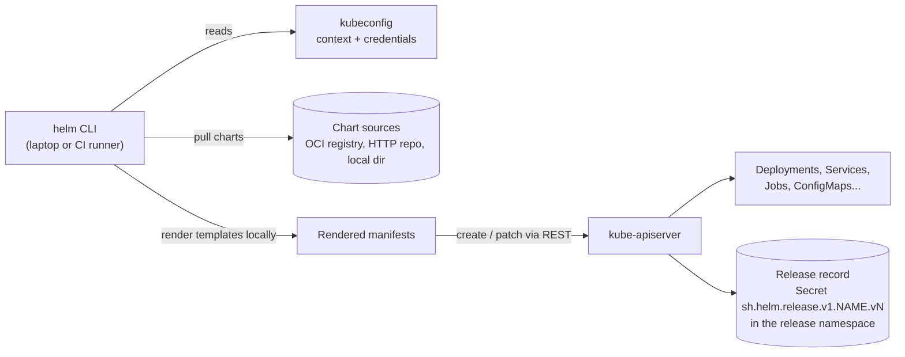
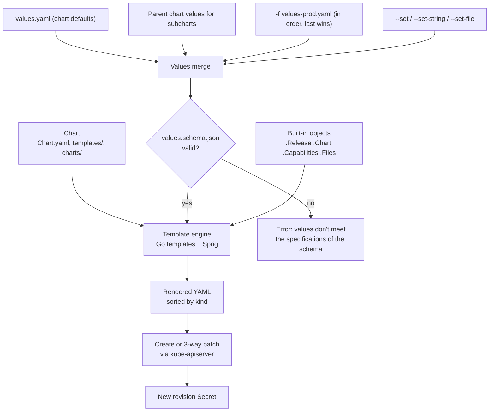
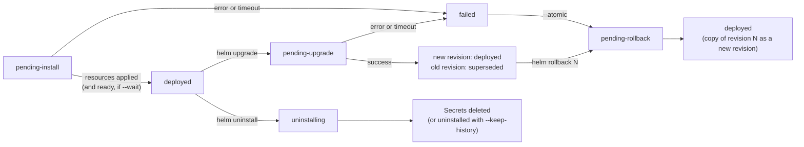
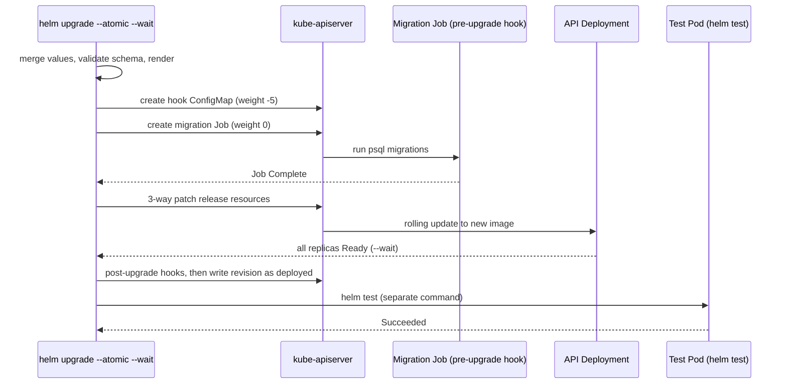

# ⎈ Helm

<!-- DEVOPS-SHACK:HEADER -->
<p align="center">
  <a href="https://www.youtube.com/@devopsshack"></a>
  <a href="https://www.youtube.com/@shackverse"></a>
  <a href="https://devopsshack.com"></a>
  <a href="https://www.instagram.com/devopsshack"></a>
  <a href="https://github.com/jaiswaladi246/DevOps-Cloud-Interview-Preparation-by-DevOps-Shack"></a>
</p>
<p align="center"><sub>Part of <b><a href="https://github.com/jaiswaladi246/DevOps-Cloud-Interview-Preparation-by-DevOps-Shack">DevOps &amp; Cloud Interview Preparation</a></b> — created by <b><a href="https://www.youtube.com/@devopsshack">DevOps Shack</a></b>. Free to learn from; please credit DevOps Shack when sharing.</sub></p>
<!-- /DEVOPS-SHACK:HEADER -->

> Package, configure, release and roll back Kubernetes applications the way production teams do: clean charts, validated values, ordered hooks, versioned OCI artifacts, and upgrades that either succeed or put things back. Everything an interviewer can ask about Helm, from `helm install` to GitOps with Argo CD.

[🏠 Home](../README.md)

## What you'll master

- Helm 3 architecture: a client-only binary, no Tiller, releases stored as Secrets in the release namespace, and the three-way merge on upgrade
- Chart anatomy: `Chart.yaml`, `values.yaml`, `templates/`, `_helpers.tpl`, `charts/`, `crds/`, `NOTES.txt`, `.helmignore`
- The template language: Go templates plus Sprig, `include` vs `template`, `tpl`, `range`/`with`, `required`, `default`, `toYaml | nindent`, whitespace control
- Values precedence (`values.yaml` < `-f` files < `--set`), `--set-string`, `--set-file`, `--reuse-values` traps, and `values.schema.json`
- Dependencies, subcharts, `global` values, aliases, conditions and library charts
- Hooks and hook weights, delete policies, `helm test`, and running database migrations safely
- `helm lint`, `helm template`, `--dry-run=server`, and the `helm diff` plugin as a pre-merge gate
- `upgrade --install --atomic --wait`, history, rollback, and what rollback does not undo
- Chart `version` vs `appVersion`, packaging, and pushing charts to OCI registries (ECR, GHCR)
- Helmfile for multi-release environments, Helm under Argo CD, and secrets with helm-secrets and SOPS
- Fixing the classics: `another operation (install/upgrade/rollback) is in progress` and `rendered manifests contain a resource that already exists`

---

## Architecture of Helm 3

Helm 3 is a single client binary. It reads your kubeconfig, renders templates locally, and talks straight to the Kubernetes API server with your own credentials, so RBAC is whatever your user or CI service account is allowed to do. Helm 2 had an in-cluster server called Tiller with cluster-admin rights; it was removed in Helm 3 because it was a security hole and a single point of failure.



Every install, upgrade and rollback writes a new revision Secret of type `helm.sh/release.v1`. It holds the gzipped, base64-encoded release: chart, merged values, rendered manifest, hooks and status. `helm list`, `helm history` and `helm rollback` read only these Secrets, which is why deleting them makes Helm forget a release while the workloads keep running.

## From chart to running objects

Helm merges values from several sources, feeds them with the built-in objects (`.Release`, `.Chart`, `.Capabilities`, `.Files`) into the Go template engine, sorts the output by kind, and applies it. On upgrade it computes a three-way patch between the previous release manifest, the live object and the new manifest.



`helm template` stops after "Rendered YAML" and never touches the cluster. `helm install --dry-run=server` goes one step further and lets the API server validate the objects without persisting them.

## Release lifecycle and statuses



A release stuck in any `pending-*` state blocks every further operation with `another operation (install/upgrade/rollback) is in progress`. This almost always means a Helm process was killed mid-operation, typically a cancelled CI job. Rollback never rewrites history: rolling back to revision 3 creates revision 6 with revision 3's content.

## Hook order during an upgrade

This is the flow we build in the [hands-on lab](./hands-on-lab.md): a schema-validated upgrade that runs a database migration Job as a `pre-upgrade` hook before the new API pods roll out.



If the Job fails or the rollout misses `--timeout`, `--atomic` rolls the release back to the last deployed revision. It does not roll back the database. Migrations must be backward compatible (expand, then contract) for that reason.

## Production workflow

```mermaid
flowchart LR
    PR["Pull request<br/>chart change"] --> LINT["helm lint --strict<br/>per-env values"]
    LINT --> TPL["helm template + kubeconform"]
    TPL --> DIFF["helm diff upgrade<br/>posted to the PR"]
    DIFF -->|"merge"| PKG["helm package<br/>bump chart version"]
    PKG --> PUSH[("helm push<br/>oci://ECR or GHCR")]
    PUSH --> GITOPS["Bump version in<br/>Helmfile or Argo CD Application"]
    GITOPS --> DEP["upgrade --install --atomic<br/>or Argo CD sync"]
    DEP --> TEST["helm test / smoke tests"]
    TEST -.->|"failure"| RB["helm rollback<br/>or git revert"]
```



---

## Core concepts in 10 minutes

### 1. Chart, release, revision, repository

A **chart** is a versioned package of templates and default values. A **release** is one installation of a chart in a namespace under a name, so the same chart can be installed many times (`shop-dev`, `shop-staging`). Each change to a release creates a **revision**. A **repository** is where charts live: a classic HTTP repo with an `index.yaml`, or an OCI registry. In 2025–2026 most teams publish charts as OCI artifacts next to their images.

### 2. Chart anatomy

```text
shop/
  Chart.yaml            # apiVersion: v2, name, version (chart SemVer), appVersion, type, dependencies
  values.yaml           # defaults, the chart's public API
  values.schema.json    # optional JSON Schema for values
  charts/               # packaged dependencies (filled by helm dependency build)
  crds/                 # CRDs, installed once, never upgraded or deleted by Helm
  templates/
    _helpers.tpl        # named templates, never rendered as a manifest
    deployment.yaml
    NOTES.txt           # printed after install/upgrade
    tests/              # helm test Pods
  .helmignore           # files excluded from the package
```

### 3. Version vs appVersion

`version` is the chart's own SemVer and must change every time you publish a different chart. `appVersion` is the version of the software inside, informational, usually used as the default image tag: `{{ .Values.image.tag | default .Chart.AppVersion }}`. A template fix bumps `version` only; a new app release bumps both.

### 4. Templates

Templates are Go `text/template` with the Sprig function library and Helm extras (`include`, `tpl`, `required`, `toYaml`, `lookup`). The current context is `.`; `$` always means the root. `with` and `range` change `.`, which is the most common source of `nil pointer` and `can't evaluate field` errors. `{{-` and `-}}` trim whitespace. Use `toYaml .Values.resources | nindent 12` to inject blocks, never hand-indented strings.

### 5. Named templates and helpers

`define` creates a named template in `_helpers.tpl` (files starting with `_` are not rendered as manifests). Call it with `include "shop.labels" .` because `include` returns a string you can pipe into `nindent`; the `template` action cannot be piped. Template names are global across the chart and its subcharts, so always prefix them with the chart name.

### 6. Values and precedence

Lowest to highest: the chart's `values.yaml`, the parent chart's values for a subchart, `-f` files in the order given, then `--set`, `--set-string`, `--set-file` and `--set-json`. `--set` guesses types (`true`, `1234`); `--set-string` forces strings, which matters for image tags like `1.10` and for annotations. Setting a key to `null` removes a default.

### 7. Dependencies and subcharts

Dependencies are declared in `Chart.yaml` and vendored into `charts/` with `helm dependency update` (writes `Chart.lock`) or `helm dependency build` (uses the lock). The parent configures a subchart under a key named after it (or its `alias`), can toggle it with `condition: postgres.enabled`, and shares settings with all subcharts through `global`. A subchart cannot see its parent's values. A **library chart** (`type: library`) only provides named templates and cannot be installed.

### 8. Hooks and tests

Hooks are resources annotated with `helm.sh/hook` (`pre-install`, `post-install`, `pre-upgrade`, `post-upgrade`, `pre-rollback`, `post-rollback`, `pre-delete`, `post-delete`, `test`). They are ordered by `helm.sh/hook-weight` (ascending, a string) and cleaned up according to `helm.sh/hook-delete-policy` (`before-hook-creation` is the default, plus `hook-succeeded` and `hook-failed`). Helm waits for hook Jobs to complete. Hook resources are not part of the release manifest, so `helm uninstall` does not delete them.

### 9. Safe releases

`helm upgrade --install` is idempotent and is what CI should call. `--wait` blocks until workloads are ready, `--timeout` bounds it (default `5m0s`), `--atomic` rolls back on failure (and implies `--wait`), and `--history-max` caps stored revisions. `helm rollback shop 4` re-applies revision 4 as a new revision. `helm diff upgrade` shows exactly what will change before you do it.

### 10. Validation

`helm lint --strict` catches chart structure and template problems. `helm template` renders offline so you can run kubeconform or policy checks. `--dry-run=server` validates against the real API server and lets `lookup` work. `values.schema.json` rejects bad values before anything renders, for example a string where `replicaCount` should be an integer, or a missing database password.

### 11. Distribution through OCI

`helm package` creates `shop-1.4.0.tgz`. `helm registry login` then `helm push shop-1.4.0.tgz oci://123456789012.dkr.ecr.ap-south-1.amazonaws.com/charts` publishes it as an OCI artifact (ECR repository `charts/shop`, tag `1.4.0`). Install with `helm install shop oci://.../charts/shop --version 1.4.0`. There is no `helm repo add` and no `index.yaml` for OCI.

### 12. Helm in GitOps and secrets

Argo CD renders charts with the equivalent of `helm template` and applies the output itself, so the release does not appear in `helm list`, `lookup` returns nothing, and hooks are mapped to Argo CD sync phases. Helmfile declares many releases and environments in one file and drives `helm diff` and `helm upgrade`. Secrets go into Git encrypted with SOPS (age or cloud KMS) and are decrypted at deploy time by helm-secrets, or they stay out of Helm entirely through External Secrets Operator.

> **Helm 4 note.** Helm 4 was released in November 2025. Chart `apiVersion: v2` charts keep working; the notable changes are server-side apply for new releases, a reworked plugin system, and renamed flags (for example `--atomic` became `--rollback-on-failure`, with the old names deprecated). The commands in this module use Helm 3.17+ syntax, which most clusters and interviewers still assume.

---

## Question banks

Two banks of 200 questions each, with collapsible answers. 400 questions in total, tagged 🟢 Beginner, 🟡 Intermediate, 🔴 Advanced.

| Bank | Questions | What it covers |
|------|-----------|----------------|
| [Concepts](./concepts.md) | 200 | Architecture and release storage, chart structure, templating, values precedence, dependencies and library charts, hooks and tests, release lifecycle, OCI, schema, Helmfile, Argo CD, secrets, best practices and rapid-fire commands |
| [Scenarios & Troubleshooting](./scenarios-and-troubleshooting.md) | 200 | 100 "what would you do" scenarios (chart design, environments, migrations, rollbacks, GitOps, secrets) and 100 real error messages with diagnosis and fixes |

## Learning path

Work through these in order. Tick each one only when you can do it without notes.

**Beginner**
- [ ] Explain chart vs release vs revision, and why Helm 3 removed Tiller
- [ ] Add a repository, search it, `helm show values`, and install a chart into a new namespace
- [ ] Override values with `-f` and `--set`, then inspect them with `helm get values`
- [ ] Scaffold a chart with `helm create` and explain every file it generated
- [ ] Render a chart offline with `helm template` and lint it with `helm lint`
- [ ] Upgrade a release, read `helm history`, and roll back
- [ ] Find and decode the release Secret for a revision
- [ ] Do the first 10 [assignments](./assignments.md)

**Intermediate**
- [ ] Write helpers in `_helpers.tpl` for names, labels and selector labels
- [ ] Use `with`, `range`, `$`, `default`, `required`, `toYaml | nindent` and whitespace control correctly
- [ ] Add a subchart dependency with a condition, an alias and `global` values
- [ ] Write `values.schema.json` that rejects bad values on install
- [ ] Run a database migration as a hook with weights and a delete policy
- [ ] Add a `helm test` and run it after every upgrade
- [ ] Use `upgrade --install --atomic --wait --timeout` in CI and gate merges with `helm diff`
- [ ] Package a chart and push it to an OCI registry, then install from it
- [ ] Complete the [hands-on lab](./hands-on-lab.md) end to end

**Advanced**
- [ ] Explain the three-way merge and why manual `kubectl edit` changes may survive an upgrade
- [ ] Build a library chart and consume it from two application charts
- [ ] Recover a release stuck in `pending-upgrade` without losing history
- [ ] Adopt existing resources into a release and fix `invalid ownership metadata`
- [ ] Run charts through Argo CD and explain how hooks, `lookup` and random values behave there
- [ ] Manage a multi-environment platform with Helmfile and helm-secrets plus SOPS
- [ ] Migrate a release off removed Kubernetes APIs with the mapkubeapis plugin
- [ ] Finish all 25 assignments and answer 150 of the 200 questions in each bank unaided

## Study materials

- [Hands-on lab: production Helm chart for a 3-tier app](./hands-on-lab.md) — frontend, Node.js API, Postgres subchart, helpers, schema, migration hooks, per-env values, OCI push, upgrade and rollback on kind
- [Assignments](./assignments.md) — 25 graded exercises (10 beginner, 10 intermediate, 5 advanced)
- [Cheatsheet](./cheatsheet.md) — commands, template functions, Chart.yaml and hook reference, common errors, and the top 15 interview one-liners

[🏠 Home](../README.md)

<!-- DEVOPS-SHACK:FOOTER -->
---

<div align="center">

### 🚀 Made with ❤️ by [DevOps Shack](https://www.youtube.com/@devopsshack)

**Learn DevOps, DevSecOps, Cloud and Kubernetes the practical way.**

[▶️ YouTube — DevOps Shack](https://www.youtube.com/@devopsshack) · [▶️ Hindi — @shackverse](https://www.youtube.com/@shackverse) · [🎓 devopsshack.com](https://devopsshack.com) · [📸 Instagram @devopsshack](https://www.instagram.com/devopsshack)

[🏠 Back to Home](../README.md) · [⭐ Star the original repo](https://github.com/jaiswaladi246/DevOps-Cloud-Interview-Preparation-by-DevOps-Shack)

<sub>© DevOps Shack · Licensed CC BY-NC-SA 4.0 · If you found this copy anywhere other than <a href="https://github.com/jaiswaladi246/DevOps-Cloud-Interview-Preparation-by-DevOps-Shack">github.com/jaiswaladi246</a>, the original and latest version is maintained by DevOps Shack.</sub>

</div>
<!-- /DEVOPS-SHACK:FOOTER -->
