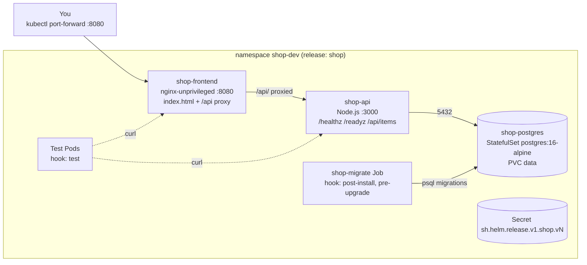
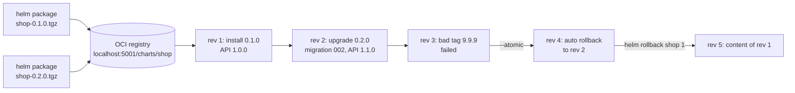

# Hands-on Lab: A Production Helm Chart for a 3-Tier App

<!-- DEVOPS-SHACK:HEADER -->
<p align="center">
  <a href="https://www.youtube.com/@devopsshack"></a>
  <a href="https://www.youtube.com/@shackverse"></a>
  <a href="https://devopsshack.com"></a>
  <a href="https://www.instagram.com/devopsshack"></a>
  <a href="https://github.com/jaiswaladi246/DevOps-Cloud-Interview-Preparation-by-DevOps-Shack"></a>
</p>
<p align="center"><sub>Part of <b><a href="https://github.com/jaiswaladi246/DevOps-Cloud-Interview-Preparation-by-DevOps-Shack">DevOps &amp; Cloud Interview Preparation</a></b> — created by <b><a href="https://www.youtube.com/@devopsshack">DevOps Shack</a></b>. Free to learn from; please credit DevOps Shack when sharing.</sub></p>
<!-- /DEVOPS-SHACK:HEADER -->

> Build a production-grade Helm chart for a frontend, a Node.js API and a Postgres dependency: helpers, a values schema, migration hooks, per-environment values and tests. Package it, push it to an OCI registry, then install, upgrade, break and roll it back on a local kind cluster.

[⬅ Back to Helm](./README.md) · [🏠 Home](../README.md)

## Goal

By the end you will have:

- A parent chart `shop` with an nginx frontend and a Node.js API, plus a local subchart `shop-postgres` wired in as a dependency with an alias and a condition
- `_helpers.tpl` with name, label, selector, image and database helpers, including a multi-parameter helper called with `dict`
- `values.schema.json` that rejects bad values (wrong types, missing database password) before anything renders
- Database migrations shipped with `.Files.Glob` and run by a hook Job with weights and delete policies, timed correctly for install and upgrade
- `values-dev.yaml` and `values-prod.yaml` (HPA, PDB, Ingress, bigger resources)
- `helm test` Pods that verify each hop of the request path
- Chart versions `0.1.0` and `0.2.0` pushed to an OCI registry, installed from it, upgraded with `helm diff` and `--atomic`, a failed upgrade rolled back automatically, and a manual `helm rollback`

Time: about 2 to 3 hours. Cost: free (everything runs locally).

## Architecture

Everything runs in one kind cluster. Only the frontend is meant to be exposed; the API and Postgres are ClusterIP services. The migration Job exists only while a hook runs.



The release path we follow in steps 15 to 19:



## Prerequisites

- Docker Engine 26+ or Docker Desktop
- kind 0.24+ (`kind version`) and kubectl matching a recent Kubernetes version
- Helm 3.17+ (`helm version`); everything here also works on Helm 4 with the flag renames noted in the [README](./README.md)
- The helm-diff plugin: `helm plugin install https://github.com/databus23/helm-diff`
- `curl`, `jq` and optionally `yq`
- Ports 5001 and 8080 free on your machine

Check your tools:

```bash
docker version --format '{{.Server.Version}}'
kind version
kubectl version --client
helm version --short
helm plugin list | grep diff
```

---

## Step 1. Create the project layout, the kind cluster and a local OCI registry

```bash
mkdir -p helm-lab/{api,charts,deploy} && cd helm-lab
kind create cluster --name helm-lab
kubectl cluster-info --context kind-helm-lab
kubectl get nodes
```

Run a local OCI registry for charts. Only the Helm client on your machine talks to it (images are loaded into kind directly in step 2), so it can stay on plain HTTP bound to localhost.

```bash
docker run -d --restart=always -p 127.0.0.1:5001:5000 --name helm-lab-registry registry:2
curl -s http://localhost:5001/v2/_catalog
# {"repositories":[]}
```

Final layout after all steps:

```text
helm-lab/
├── api/
│   ├── Dockerfile
│   ├── package.json
│   └── server.js
├── charts/
│   ├── shop/                       # parent application chart
│   │   ├── Chart.yaml
│   │   ├── Chart.lock
│   │   ├── values.yaml
│   │   ├── values.schema.json
│   │   ├── .helmignore
│   │   ├── migrations/
│   │   │   ├── 001_init.sql
│   │   │   └── 002_add_price.sql   # added in step 17
│   │   ├── charts/                 # filled by helm dependency update
│   │   └── templates/
│   │       ├── _helpers.tpl
│   │       ├── NOTES.txt
│   │       ├── api-deployment.yaml
│   │       ├── services.yaml
│   │       ├── ingress.yaml
│   │       ├── frontend-configmap.yaml
│   │       ├── frontend-deployment.yaml
│   │       ├── migrations-hook.yaml
│   │       ├── hpa.yaml
│   │       ├── pdb.yaml
│   │       └── tests/
│   │           └── test-connections.yaml
│   └── shop-postgres/              # local subchart
│       ├── Chart.yaml
│       ├── values.yaml
│       └── templates/
│           ├── _helpers.tpl
│           ├── secret.yaml
│           ├── service.yaml
│           └── statefulset.yaml
└── deploy/
    ├── values-dev.yaml
    └── values-prod.yaml
```

The environment values live in `deploy/`, outside the chart, so they are never packaged into the chart artifact.

## Step 2. Build the API images and load them into kind

The API exposes `/healthz` (liveness, no dependencies), `/readyz` (runs `SELECT 1`), `/api/version` and `/api/items`. It reads the standard libpq variables (`PGHOST`, `PGUSER`, `PGPASSWORD`, `PGDATABASE`), which node-postgres picks up automatically.

`api/package.json`:

```json
{
  "name": "shop-api",
  "version": "1.0.0",
  "private": true,
  "main": "server.js",
  "dependencies": {
    "pg": "^8.13.1"
  }
}
```

`api/server.js`:

```js
const http = require('http');
const { Pool } = require('pg');

const pool = new Pool({ max: 5 });
const VERSION = process.env.APP_VERSION || 'dev';
const PORT = parseInt(process.env.PORT || '3000', 10);

const send = (res, code, body) => {
  res.writeHead(code, { 'Content-Type': 'application/json' });
  res.end(JSON.stringify(body));
};

const server = http.createServer(async (req, res) => {
  try {
    if (req.url === '/healthz') return send(res, 200, { status: 'ok' });
    if (req.url === '/readyz') {
      await pool.query('SELECT 1');
      return send(res, 200, { status: 'ready' });
    }
    if (req.url === '/api/version') return send(res, 200, { version: VERSION });
    if (req.url === '/api/items') {
      const { rows } = await pool.query('SELECT * FROM items ORDER BY id');
      return send(res, 200, rows);
    }
    send(res, 404, { error: 'not found' });
  } catch (err) {
    console.error(err.message);
    send(res, 503, { error: err.message });
  }
});

server.listen(PORT, '0.0.0.0', () => console.log(`shop-api ${VERSION} listening on ${PORT}`));

process.on('SIGTERM', () => {
  console.log('SIGTERM received, shutting down');
  server.close(() => pool.end().then(() => process.exit(0)));
});
```

`api/Dockerfile`:

```dockerfile
FROM node:22-alpine
WORKDIR /app
COPY package.json ./
RUN npm install --omit=dev && npm cache clean --force
COPY server.js ./
ARG APP_VERSION=dev
ENV APP_VERSION=$APP_VERSION NODE_ENV=production
USER 1000
EXPOSE 3000
CMD ["node", "server.js"]
```

`USER 1000` is numeric on purpose: with `runAsNonRoot: true`, Kubernetes can only verify a numeric user. Build two versions and load them into the kind node:

```bash
docker build -t shack-shop-api:1.0.0 --build-arg APP_VERSION=1.0.0 ./api
docker build -t shack-shop-api:1.1.0 --build-arg APP_VERSION=1.1.0 ./api
kind load docker-image shack-shop-api:1.0.0 shack-shop-api:1.1.0 --name helm-lab
```

Verify the images are on the node:

```bash
docker exec helm-lab-control-plane crictl images | grep shack-shop-api
```

## Step 3. Write the Postgres subchart

A small, self-contained subchart: a Secret, a headless Service and a StatefulSet with a PVC. It works standalone, which is the test of a good subchart.

`charts/shop-postgres/Chart.yaml`:

```yaml
apiVersion: v2
name: shop-postgres
description: Single-instance PostgreSQL for the Shack Shop (dev and lab use)
type: application
version: 0.1.0
appVersion: "16"
```

`charts/shop-postgres/values.yaml`:

```yaml
# -- Override the generated name (<release>-<chart name or alias>)
fullnameOverride: ""

image:
  repository: postgres
  tag: "16-alpine"
  pullPolicy: IfNotPresent

auth:
  database: app
  username: app
  # -- Required. Only applied when the data directory is initialized for the first time.
  password: ""

persistence:
  enabled: true
  size: 1Gi
  # -- Empty uses the cluster's default StorageClass
  storageClass: ""

resources:
  requests:
    cpu: 100m
    memory: 128Mi
  limits:
    memory: 256Mi
```

`charts/shop-postgres/templates/_helpers.tpl`:

```yaml
{{/* Name is <release>-<chart>, where chart is the alias when the parent sets one */}}
{{- define "shop-postgres.fullname" -}}
{{- if .Values.fullnameOverride }}
{{- .Values.fullnameOverride | trunc 63 | trimSuffix "-" }}
{{- else }}
{{- printf "%s-%s" .Release.Name .Chart.Name | trunc 63 | trimSuffix "-" }}
{{- end }}
{{- end }}

{{- define "shop-postgres.selectorLabels" -}}
app.kubernetes.io/name: {{ .Chart.Name }}
app.kubernetes.io/instance: {{ .Release.Name }}
app.kubernetes.io/component: database
{{- end }}

{{- define "shop-postgres.labels" -}}
helm.sh/chart: {{ printf "%s-%s" .Chart.Name .Chart.Version | replace "+" "_" | trunc 63 | trimSuffix "-" }}
{{ include "shop-postgres.selectorLabels" . }}
app.kubernetes.io/version: {{ .Chart.AppVersion | quote }}
app.kubernetes.io/managed-by: {{ .Release.Service }}
{{- end }}
```

`charts/shop-postgres/templates/secret.yaml`:

```yaml
apiVersion: v1
kind: Secret
metadata:
  name: {{ include "shop-postgres.fullname" . }}
  labels:
    {{- include "shop-postgres.labels" . | nindent 4 }}
type: Opaque
stringData:
  POSTGRES_DB: {{ .Values.auth.database | quote }}
  POSTGRES_USER: {{ .Values.auth.username | quote }}
  POSTGRES_PASSWORD: {{ required "auth.password is required for shop-postgres" .Values.auth.password | quote }}
```

`charts/shop-postgres/templates/service.yaml`:

```yaml
apiVersion: v1
kind: Service
metadata:
  name: {{ include "shop-postgres.fullname" . }}
  labels:
    {{- include "shop-postgres.labels" . | nindent 4 }}
spec:
  clusterIP: None
  ports:
    - name: postgres
      port: 5432
      targetPort: postgres
  selector:
    {{- include "shop-postgres.selectorLabels" . | nindent 4 }}
```

`charts/shop-postgres/templates/statefulset.yaml`:

```yaml
apiVersion: apps/v1
kind: StatefulSet
metadata:
  name: {{ include "shop-postgres.fullname" . }}
  labels:
    {{- include "shop-postgres.labels" . | nindent 4 }}
spec:
  serviceName: {{ include "shop-postgres.fullname" . }}
  replicas: 1
  selector:
    matchLabels:
      {{- include "shop-postgres.selectorLabels" . | nindent 6 }}
  template:
    metadata:
      labels:
        {{- include "shop-postgres.labels" . | nindent 8 }}
      annotations:
        checksum/secret: {{ include (print $.Template.BasePath "/secret.yaml") . | sha256sum }}
    spec:
      automountServiceAccountToken: false
      securityContext:
        runAsNonRoot: true
        runAsUser: 70        # the postgres user in the alpine image
        runAsGroup: 70
        fsGroup: 70
        seccompProfile:
          type: RuntimeDefault
      containers:
        - name: postgres
          image: "{{ .Values.image.repository }}:{{ .Values.image.tag }}"
          imagePullPolicy: {{ .Values.image.pullPolicy }}
          ports:
            - name: postgres
              containerPort: 5432
          envFrom:
            - secretRef:
                name: {{ include "shop-postgres.fullname" . }}
          env:
            - name: PGDATA
              value: /var/lib/postgresql/data/pgdata
          readinessProbe:
            exec:
              command: ["sh", "-c", "pg_isready -U \"$POSTGRES_USER\" -d \"$POSTGRES_DB\""]
            periodSeconds: 5
          livenessProbe:
            exec:
              command: ["sh", "-c", "pg_isready -U \"$POSTGRES_USER\" -d \"$POSTGRES_DB\""]
            initialDelaySeconds: 30
            periodSeconds: 10
          securityContext:
            allowPrivilegeEscalation: false
            capabilities:
              drop: ["ALL"]
          resources:
            {{- toYaml .Values.resources | nindent 12 }}
          volumeMounts:
            - name: data
              mountPath: /var/lib/postgresql/data
      {{- if not .Values.persistence.enabled }}
      volumes:
        - name: data
          emptyDir: {}
      {{- end }}
  {{- if .Values.persistence.enabled }}
  volumeClaimTemplates:
    - metadata:
        name: data
      spec:
        accessModes: ["ReadWriteOnce"]
        {{- with .Values.persistence.storageClass }}
        storageClassName: {{ . }}
        {{- end }}
        resources:
          requests:
            storage: {{ .Values.persistence.size }}
  {{- end }}
```

Verify the subchart renders standalone and fails without a password:

```bash
helm lint charts/shop-postgres --set auth.password=lab-password-123
helm template db charts/shop-postgres --set auth.password=lab-password-123 | grep -E '^kind:|name: db-'
helm template db charts/shop-postgres 2>&1 | grep -o 'auth.password is required for shop-postgres'
# auth.password is required for shop-postgres   (from "Error: execution error at (shop-postgres/templates/secret.yaml:...)")
```

## Step 4. Create the `shop` chart metadata and dependency

```bash
mkdir -p charts/shop/{templates/tests,migrations}
```

`charts/shop/Chart.yaml`:

```yaml
apiVersion: v2
name: shop
description: Shack Shop - nginx frontend, Node.js API and PostgreSQL
type: application
version: 0.1.0
appVersion: "1.0.0"
kubeVersion: ">=1.27.0-0"
maintainers:
  - name: DevOps Shack
    url: https://devopsshack.com
dependencies:
  - name: shop-postgres
    version: "0.1.x"
    repository: "file://../shop-postgres"
    alias: postgres
    condition: postgres.enabled
```

The `alias` makes the subchart's values key `postgres` and its resource names `<release>-postgres`. The `condition` lets prod switch to an external database.

`charts/shop/.helmignore`:

```text
.git/
.DS_Store
*.swp
*.bak
*.tmp
*.orig
tests-output/
```

Vendor the dependency and check it:

```bash
helm dependency update charts/shop
helm dependency list charts/shop
# NAME           VERSION  REPOSITORY                STATUS
# shop-postgres  0.1.x    file://../shop-postgres   ok
ls charts/shop/charts/ && cat charts/shop/Chart.lock
```

In a real repository commit `Chart.lock` and add `charts/shop/charts/*.tgz` to `.gitignore`; CI runs `helm dependency build`.

## Step 5. Write `values.yaml`

This is the chart's public API. Defaults are safe (non-root, read-only filesystem, resources set) and environment-agnostic.

`charts/shop/values.yaml`:

```yaml
# -- Override the chart name part of resource names
nameOverride: ""
# -- Override the full resource name prefix
fullnameOverride: ""

# -- Pod-level security settings shared by frontend, API and migration pods
podSecurityContext:
  runAsNonRoot: true
  seccompProfile:
    type: RuntimeDefault

# -- Container-level security settings shared by all app containers
containerSecurityContext:
  allowPrivilegeEscalation: false
  readOnlyRootFilesystem: true
  capabilities:
    drop: ["ALL"]

api:
  # -- Ignored when api.autoscaling.enabled is true
  replicaCount: 1
  port: 3000
  runAsUser: 1000
  image:
    repository: shack-shop-api
    # -- Defaults to .Chart.AppVersion when empty
    tag: ""
    pullPolicy: IfNotPresent
  # -- Extra environment variables as a map (merges across values files)
  extraEnv: {}
  podAnnotations: {}
  resources:
    requests:
      cpu: 50m
      memory: 64Mi
    limits:
      memory: 128Mi
  autoscaling:
    enabled: false
    minReplicas: 2
    maxReplicas: 5
    targetCPUUtilizationPercentage: 70

frontend:
  replicaCount: 1
  port: 8080
  runAsUser: 101
  title: "Shack Shop"
  image:
    repository: nginxinc/nginx-unprivileged
    tag: "1.27-alpine"
    pullPolicy: IfNotPresent
  resources:
    requests:
      cpu: 20m
      memory: 32Mi
    limits:
      memory: 64Mi

service:
  type: ClusterIP

ingress:
  enabled: false
  className: nginx
  host: shop.local

podDisruptionBudget:
  enabled: false
  minAvailable: 1

migrations:
  enabled: true
  image: postgres:16-alpine
  backoffLimit: 1
  activeDeadlineSeconds: 300

tests:
  image: curlimages/curl:8.10.1

# -- Used only when postgres.enabled is false
externalDatabase:
  host: ""
  # -- Secret with keys POSTGRES_DB, POSTGRES_USER, POSTGRES_PASSWORD
  existingSecret: ""

# -- Values for the shop-postgres subchart (alias: postgres)
postgres:
  enabled: true
  auth:
    database: shop
    username: shop
    # -- Required when postgres.enabled is true; supply per environment, never commit prod values
    password: ""
  persistence:
    enabled: true
    size: 1Gi
```

## Step 6. Write `_helpers.tpl`

Every helper is prefixed with `shop.` because template names are global across the parent and its subcharts.

`charts/shop/templates/_helpers.tpl`:

```yaml
{{/* Chart name, overridable */}}
{{- define "shop.name" -}}
{{- default .Chart.Name .Values.nameOverride | trunc 63 | trimSuffix "-" }}
{{- end }}

{{/* Fully qualified prefix: release name, plus chart name unless the release already contains it */}}
{{- define "shop.fullname" -}}
{{- if .Values.fullnameOverride }}
{{- .Values.fullnameOverride | trunc 63 | trimSuffix "-" }}
{{- else }}
{{- $name := default .Chart.Name .Values.nameOverride }}
{{- if contains $name .Release.Name }}
{{- .Release.Name | trunc 63 | trimSuffix "-" }}
{{- else }}
{{- printf "%s-%s" .Release.Name $name | trunc 63 | trimSuffix "-" }}
{{- end }}
{{- end }}
{{- end }}

{{- define "shop.chart" -}}
{{- printf "%s-%s" .Chart.Name .Chart.Version | replace "+" "_" | trunc 63 | trimSuffix "-" }}
{{- end }}

{{/* Stable labels only: these go into immutable selectors */}}
{{- define "shop.selectorLabels" -}}
app.kubernetes.io/name: {{ include "shop.name" . }}
app.kubernetes.io/instance: {{ .Release.Name }}
{{- end }}

{{/* All labels for metadata */}}
{{- define "shop.labels" -}}
helm.sh/chart: {{ include "shop.chart" . }}
{{ include "shop.selectorLabels" . }}
app.kubernetes.io/version: {{ .Chart.AppVersion | quote }}
app.kubernetes.io/managed-by: {{ .Release.Service }}
app.kubernetes.io/part-of: shack-shop
{{- end }}

{{/* Component variants. Call with: (dict "root" $ "component" "api") */}}
{{- define "shop.componentLabels" -}}
{{ include "shop.labels" .root }}
app.kubernetes.io/component: {{ .component }}
{{- end }}

{{- define "shop.componentSelectorLabels" -}}
{{ include "shop.selectorLabels" .root }}
app.kubernetes.io/component: {{ .component }}
{{- end }}

{{/* Image reference. Call with: (dict "image" .Values.api.image "root" $) */}}
{{- define "shop.image" -}}
{{- $tag := .image.tag | default .root.Chart.AppVersion | toString -}}
{{- printf "%s:%s" .image.repository $tag -}}
{{- end }}

{{/* Database host: the subchart Service, or an external host */}}
{{- define "shop.dbHost" -}}
{{- if .Values.postgres.enabled -}}
{{- .Values.postgres.fullnameOverride | default (printf "%s-postgres" .Release.Name) | trunc 63 | trimSuffix "-" -}}
{{- else -}}
{{- required "externalDatabase.host is required when postgres.enabled=false" .Values.externalDatabase.host -}}
{{- end -}}
{{- end }}

{{/* Secret holding POSTGRES_DB, POSTGRES_USER, POSTGRES_PASSWORD */}}
{{- define "shop.dbSecretName" -}}
{{- if .Values.postgres.enabled -}}
{{- include "shop.dbHost" . -}}
{{- else -}}
{{- required "externalDatabase.existingSecret is required when postgres.enabled=false" .Values.externalDatabase.existingSecret -}}
{{- end -}}
{{- end }}

{{/* libpq environment for any container that talks to the database */}}
{{- define "shop.dbEnv" -}}
- name: PGHOST
  value: {{ include "shop.dbHost" . | quote }}
- name: PGPORT
  value: "5432"
- name: PGDATABASE
  valueFrom:
    secretKeyRef:
      name: {{ include "shop.dbSecretName" . }}
      key: POSTGRES_DB
- name: PGUSER
  valueFrom:
    secretKeyRef:
      name: {{ include "shop.dbSecretName" . }}
      key: POSTGRES_USER
- name: PGPASSWORD
  valueFrom:
    secretKeyRef:
      name: {{ include "shop.dbSecretName" . }}
      key: POSTGRES_PASSWORD
{{- end }}

{{/* Shared Service template. Call with: (dict "root" $ "component" "api" "port" 3000) */}}
{{- define "shop.service" -}}
apiVersion: v1
kind: Service
metadata:
  name: {{ include "shop.fullname" .root }}-{{ .component }}
  labels:
    {{- include "shop.componentLabels" (dict "root" .root "component" .component) | nindent 4 }}
spec:
  type: {{ .root.Values.service.type }}
  ports:
    - name: http
      port: {{ .port }}
      targetPort: http
  selector:
    {{- include "shop.componentSelectorLabels" (dict "root" .root "component" .component) | nindent 4 }}
{{- end }}
```

Note the split between `shop.labels` (includes the chart version, changes every release) and `shop.selectorLabels` (stable). Only the latter goes into `spec.selector`, because selectors are immutable.

## Step 7. The API Deployment

`charts/shop/templates/api-deployment.yaml`:

```yaml
apiVersion: apps/v1
kind: Deployment
metadata:
  name: {{ include "shop.fullname" . }}-api
  labels:
    {{- include "shop.componentLabels" (dict "root" . "component" "api") | nindent 4 }}
spec:
  {{- if not .Values.api.autoscaling.enabled }}
  replicas: {{ .Values.api.replicaCount }}
  {{- end }}
  revisionHistoryLimit: 5
  strategy:
    type: RollingUpdate
    rollingUpdate:
      maxUnavailable: 0
      maxSurge: 1
  selector:
    matchLabels:
      {{- include "shop.componentSelectorLabels" (dict "root" . "component" "api") | nindent 6 }}
  template:
    metadata:
      labels:
        {{- include "shop.componentLabels" (dict "root" . "component" "api") | nindent 8 }}
      {{- with .Values.api.podAnnotations }}
      annotations:
        {{- toYaml . | nindent 8 }}
      {{- end }}
    spec:
      automountServiceAccountToken: false
      terminationGracePeriodSeconds: 30
      securityContext:
        runAsUser: {{ .Values.api.runAsUser }}
        runAsGroup: {{ .Values.api.runAsUser }}
        {{- toYaml .Values.podSecurityContext | nindent 8 }}
      containers:
        - name: api
          image: {{ include "shop.image" (dict "image" .Values.api.image "root" .) | quote }}
          imagePullPolicy: {{ .Values.api.image.pullPolicy }}
          ports:
            - name: http
              containerPort: {{ .Values.api.port | int }}
          env:
            - name: PORT
              value: {{ .Values.api.port | quote }}
            {{- include "shop.dbEnv" . | nindent 12 }}
            {{- range $key, $value := .Values.api.extraEnv }}
            - name: {{ $key }}
              value: {{ $value | quote }}
            {{- end }}
          readinessProbe:
            httpGet:
              path: /readyz
              port: http
            periodSeconds: 5
            failureThreshold: 3
          livenessProbe:
            httpGet:
              path: /healthz
              port: http
            initialDelaySeconds: 5
            periodSeconds: 10
          lifecycle:
            preStop:
              exec:
                command: ["sleep", "5"]
          securityContext:
            {{- toYaml .Values.containerSecurityContext | nindent 12 }}
          resources:
            {{- toYaml .Values.api.resources | nindent 12 }}
```

What to notice:

- `replicas` is omitted when the HPA owns scaling, so upgrades never fight the autoscaler.
- `maxUnavailable: 0` plus a readiness probe means a broken new version never takes old pods out of service (you will see this in step 18).
- `extraEnv` is a map rendered with `range`, so environment files can merge keys instead of replacing a list.
- Values that must be strings (`PORT`, env values) are quoted; `containerPort` is forced to an integer.

Render just this file to check it:

```bash
helm template shop charts/shop -f /dev/null --set postgres.auth.password=lab-password-123 -s templates/api-deployment.yaml
```

## Step 8. Services and Ingress

Both Services come from the single `shop.service` helper, called with a `dict` of parameters.

`charts/shop/templates/services.yaml`:

```yaml
{{ include "shop.service" (dict "root" . "component" "api" "port" .Values.api.port) }}
---
{{ include "shop.service" (dict "root" . "component" "frontend" "port" .Values.frontend.port) }}
```

`charts/shop/templates/ingress.yaml`:

```yaml
{{- if .Values.ingress.enabled }}
apiVersion: networking.k8s.io/v1
kind: Ingress
metadata:
  name: {{ include "shop.fullname" . }}
  labels:
    {{- include "shop.labels" . | nindent 4 }}
spec:
  ingressClassName: {{ .Values.ingress.className }}
  rules:
    - host: {{ .Values.ingress.host | lower | quote }}
      http:
        paths:
          - path: /
            pathType: Prefix
            backend:
              service:
                name: {{ include "shop.fullname" . }}-frontend
                port:
                  name: http
{{- end }}
```

## Step 9. The frontend: ConfigMap and Deployment

nginx serves a small page and proxies `/api/` to the API Service. The page title comes from values, so dev and prod look different.

`charts/shop/templates/frontend-configmap.yaml`:

```yaml
apiVersion: v1
kind: ConfigMap
metadata:
  name: {{ include "shop.fullname" . }}-frontend
  labels:
    {{- include "shop.componentLabels" (dict "root" . "component" "frontend") | nindent 4 }}
data:
  default.conf: |
    server {
      listen {{ .Values.frontend.port }};
      server_name _;

      location = /healthz {
        access_log off;
        return 200 "ok\n";
      }

      location /api/ {
        proxy_pass http://{{ include "shop.fullname" . }}-api:{{ .Values.api.port }};
        proxy_set_header Host $host;
        proxy_set_header X-Request-Id $request_id;
      }

      location / {
        root  /usr/share/nginx/html;
        index index.html;
      }
    }
  index.html: |
    <!doctype html>
    <html>
    <head><meta charset="utf-8"><title>{{ .Values.frontend.title | html }}</title></head>
    <body>
      <h1>{{ .Values.frontend.title | html }}</h1>
      <p>API version: <span id="version">loading...</span></p>
      <ul id="items"></ul>
      <script>
        fetch('/api/version').then(r => r.json()).then(d => {
          document.getElementById('version').textContent = d.version;
        });
        fetch('/api/items').then(r => r.json()).then(rows => {
          const ul = document.getElementById('items');
          rows.forEach(i => {
            const li = document.createElement('li');
            li.textContent = i.name + (i.price !== undefined ? ' - Rs ' + i.price : '');
            ul.appendChild(li);
          });
        });
      </script>
    </body>
    </html>
```

`charts/shop/templates/frontend-deployment.yaml`:

```yaml
apiVersion: apps/v1
kind: Deployment
metadata:
  name: {{ include "shop.fullname" . }}-frontend
  labels:
    {{- include "shop.componentLabels" (dict "root" . "component" "frontend") | nindent 4 }}
spec:
  replicas: {{ .Values.frontend.replicaCount }}
  revisionHistoryLimit: 5
  strategy:
    type: RollingUpdate
    rollingUpdate:
      maxUnavailable: 0
      maxSurge: 1
  selector:
    matchLabels:
      {{- include "shop.componentSelectorLabels" (dict "root" . "component" "frontend") | nindent 6 }}
  template:
    metadata:
      labels:
        {{- include "shop.componentLabels" (dict "root" . "component" "frontend") | nindent 8 }}
      annotations:
        checksum/config: {{ include (print $.Template.BasePath "/frontend-configmap.yaml") . | sha256sum }}
    spec:
      automountServiceAccountToken: false
      securityContext:
        runAsUser: {{ .Values.frontend.runAsUser }}
        runAsGroup: {{ .Values.frontend.runAsUser }}
        {{- toYaml .Values.podSecurityContext | nindent 8 }}
      containers:
        - name: nginx
          image: {{ include "shop.image" (dict "image" .Values.frontend.image "root" .) | quote }}
          imagePullPolicy: {{ .Values.frontend.image.pullPolicy }}
          ports:
            - name: http
              containerPort: {{ .Values.frontend.port | int }}
          readinessProbe:
            httpGet:
              path: /healthz
              port: http
            periodSeconds: 5
          livenessProbe:
            httpGet:
              path: /healthz
              port: http
            periodSeconds: 10
          securityContext:
            {{- toYaml .Values.containerSecurityContext | nindent 12 }}
          resources:
            {{- toYaml .Values.frontend.resources | nindent 12 }}
          volumeMounts:
            - name: conf
              mountPath: /etc/nginx/conf.d
              readOnly: true
            - name: html
              mountPath: /usr/share/nginx/html
              readOnly: true
            - name: tmp
              mountPath: /tmp
      volumes:
        - name: conf
          configMap:
            name: {{ include "shop.fullname" . }}-frontend
            items:
              - key: default.conf
                path: default.conf
        - name: html
          configMap:
            name: {{ include "shop.fullname" . }}-frontend
            items:
              - key: index.html
                path: index.html
        - name: tmp
          emptyDir: {}
```

The `checksum/config` annotation changes whenever the rendered ConfigMap changes, which rolls the frontend pods. The unprivileged nginx image keeps its pid and temp files in `/tmp`, so an `emptyDir` there is all it needs with a read-only root filesystem.

## Step 10. Database migrations as hooks

Migrations ship inside the chart under `migrations/` and are loaded with `.Files.Glob`. They must be idempotent and backward compatible, because a Helm rollback never undoes them.

`charts/shop/migrations/001_init.sql`:

```sql
CREATE TABLE IF NOT EXISTS items (
  id   SERIAL PRIMARY KEY,
  name TEXT NOT NULL UNIQUE
);

INSERT INTO items (name)
VALUES ('Docker course'), ('Kubernetes course'), ('Helm course')
ON CONFLICT (name) DO NOTHING;
```

`charts/shop/templates/migrations-hook.yaml`:

```yaml
{{- if .Values.migrations.enabled }}
# The SQL is itself a hook (weight -5): on pre-upgrade, regular ConfigMaps still hold
# the OLD content, so a non-hook ConfigMap would feed the Job last release's migrations.
apiVersion: v1
kind: ConfigMap
metadata:
  name: {{ include "shop.fullname" . }}-migrations
  labels:
    {{- include "shop.componentLabels" (dict "root" . "component" "migrate") | nindent 4 }}
  annotations:
    "helm.sh/hook": post-install,pre-upgrade
    "helm.sh/hook-weight": "-5"
    "helm.sh/hook-delete-policy": before-hook-creation
data:
  {{- (.Files.Glob "migrations/*.sql").AsConfig | nindent 2 }}
---
# post-install: the database subchart exists before this runs (pre-install would fail).
# pre-upgrade: the schema is migrated before new API pods roll out.
apiVersion: batch/v1
kind: Job
metadata:
  name: {{ include "shop.fullname" . }}-migrate
  labels:
    {{- include "shop.componentLabels" (dict "root" . "component" "migrate") | nindent 4 }}
  annotations:
    "helm.sh/hook": post-install,pre-upgrade
    "helm.sh/hook-weight": "0"
    "helm.sh/hook-delete-policy": before-hook-creation,hook-succeeded
spec:
  backoffLimit: {{ .Values.migrations.backoffLimit }}
  activeDeadlineSeconds: {{ .Values.migrations.activeDeadlineSeconds }}
  template:
    metadata:
      labels:
        {{- include "shop.componentSelectorLabels" (dict "root" . "component" "migrate") | nindent 8 }}
    spec:
      restartPolicy: Never
      automountServiceAccountToken: false
      securityContext:
        runAsUser: 70
        runAsGroup: 70
        {{- toYaml .Values.podSecurityContext | nindent 8 }}
      initContainers:
        - name: wait-for-db
          image: {{ .Values.migrations.image | quote }}
          command: ["sh", "-c", "until pg_isready -h \"$PGHOST\" -p \"$PGPORT\"; do echo waiting for database; sleep 2; done"]
          env:
            {{- include "shop.dbEnv" . | nindent 12 }}
          securityContext:
            {{- toYaml .Values.containerSecurityContext | nindent 12 }}
      containers:
        - name: migrate
          image: {{ .Values.migrations.image | quote }}
          command: ["sh", "-c"]
          args:
            - |
              set -e
              for f in /migrations/*.sql; do
                echo "applying $f"
                psql -v ON_ERROR_STOP=1 -f "$f"
              done
              echo "migrations complete"
          env:
            {{- include "shop.dbEnv" . | nindent 12 }}
          securityContext:
            {{- toYaml .Values.containerSecurityContext | nindent 12 }}
          volumeMounts:
            - name: migrations
              mountPath: /migrations
              readOnly: true
      volumes:
        - name: migrations
          configMap:
            name: {{ include "shop.fullname" . }}-migrations
{{- end }}
```

Decisions worth defending in an interview:

- **Timing:** `post-install,pre-upgrade`. On first install, Helm creates the database (and, with `--wait`, waits for it) before running `post-install` hooks. On upgrades, the database already exists and the schema changes before new code arrives.
- **Weights:** the ConfigMap (`-5`) is created before the Job (`0`).
- **Delete policy:** `before-hook-creation` lets the next run recreate the Job; `hook-succeeded` cleans up on success; there is deliberately no `hook-failed`, so a failed Job stays for `kubectl logs`.
- **Safety:** `ON_ERROR_STOP=1`, `backoffLimit: 1` and `activeDeadlineSeconds` stop a broken migration from looping. The API's readiness check only needs the database connection, so API pods can become Ready before the `post-install` migration runs.

## Step 11. HPA, PDB, NOTES.txt and tests

`charts/shop/templates/hpa.yaml`:

```yaml
{{- if .Values.api.autoscaling.enabled }}
{{- if gt (int .Values.api.autoscaling.minReplicas) (int .Values.api.autoscaling.maxReplicas) }}
{{- fail "api.autoscaling.minReplicas cannot be greater than api.autoscaling.maxReplicas" }}
{{- end }}
apiVersion: autoscaling/v2
kind: HorizontalPodAutoscaler
metadata:
  name: {{ include "shop.fullname" . }}-api
  labels:
    {{- include "shop.componentLabels" (dict "root" . "component" "api") | nindent 4 }}
spec:
  scaleTargetRef:
    apiVersion: apps/v1
    kind: Deployment
    name: {{ include "shop.fullname" . }}-api
  minReplicas: {{ .Values.api.autoscaling.minReplicas }}
  maxReplicas: {{ .Values.api.autoscaling.maxReplicas }}
  metrics:
    - type: Resource
      resource:
        name: cpu
        target:
          type: Utilization
          averageUtilization: {{ .Values.api.autoscaling.targetCPUUtilizationPercentage }}
{{- end }}
```

`charts/shop/templates/pdb.yaml`:

```yaml
{{- if .Values.podDisruptionBudget.enabled }}
{{- range $component := list "api" "frontend" }}
---
apiVersion: policy/v1
kind: PodDisruptionBudget
metadata:
  name: {{ include "shop.fullname" $ }}-{{ $component }}
  labels:
    {{- include "shop.componentLabels" (dict "root" $ "component" $component) | nindent 4 }}
spec:
  minAvailable: {{ $.Values.podDisruptionBudget.minAvailable }}
  selector:
    matchLabels:
      {{- include "shop.componentSelectorLabels" (dict "root" $ "component" $component) | nindent 6 }}
{{- end }}
{{- end }}
```

Inside `range`, `.` is the component string, so every root reference uses `$`.

`charts/shop/templates/NOTES.txt`:

```text
Shack Shop {{ .Chart.AppVersion }} (chart {{ .Chart.Version }}) is deployed as release "{{ .Release.Name }}", revision {{ .Release.Revision }}, in namespace {{ .Release.Namespace }}.

Open the app:
  kubectl -n {{ .Release.Namespace }} port-forward svc/{{ include "shop.fullname" . }}-frontend 8080:{{ .Values.frontend.port }}
  curl http://localhost:8080/api/items
{{- if .Values.ingress.enabled }}

Ingress host: http://{{ .Values.ingress.host }}
{{- end }}
{{- if .Values.api.autoscaling.enabled }}

The API is autoscaled between {{ .Values.api.autoscaling.minReplicas }} and {{ .Values.api.autoscaling.maxReplicas }} replicas.
{{- end }}

Verify the release:
  helm test {{ .Release.Name }} -n {{ .Release.Namespace }} --logs
```

`charts/shop/templates/tests/test-connections.yaml`:

```yaml
{{- $fullname := include "shop.fullname" . }}
apiVersion: v1
kind: Pod
metadata:
  name: {{ $fullname }}-test-api
  labels:
    {{- include "shop.componentLabels" (dict "root" . "component" "test") | nindent 4 }}
  annotations:
    "helm.sh/hook": test
    "helm.sh/hook-weight": "0"
    "helm.sh/hook-delete-policy": before-hook-creation
spec:
  restartPolicy: Never
  automountServiceAccountToken: false
  securityContext:
    runAsUser: 100
    {{- toYaml .Values.podSecurityContext | nindent 4 }}
  containers:
    - name: curl
      image: {{ .Values.tests.image | quote }}
      command: ["sh", "-c"]
      args:
        - |
          set -e
          echo "API readiness (API -> Postgres):"
          curl -fsS http://{{ $fullname }}-api:{{ .Values.api.port }}/readyz; echo
          echo "API version:"
          curl -fsS http://{{ $fullname }}-api:{{ .Values.api.port }}/api/version; echo
      securityContext:
        {{- toYaml .Values.containerSecurityContext | nindent 8 }}
---
apiVersion: v1
kind: Pod
metadata:
  name: {{ $fullname }}-test-frontend
  labels:
    {{- include "shop.componentLabels" (dict "root" . "component" "test") | nindent 4 }}
  annotations:
    "helm.sh/hook": test
    "helm.sh/hook-weight": "1"
    "helm.sh/hook-delete-policy": before-hook-creation
spec:
  restartPolicy: Never
  automountServiceAccountToken: false
  securityContext:
    runAsUser: 100
    {{- toYaml .Values.podSecurityContext | nindent 4 }}
  containers:
    - name: curl
      image: {{ .Values.tests.image | quote }}
      command: ["sh", "-c"]
      args:
        - |
          set -e
          echo "Frontend page:"
          curl -fsS http://{{ $fullname }}-frontend:{{ .Values.frontend.port }}/ | grep -q '<h1>'
          echo "Frontend -> API -> Postgres (migrations applied):"
          curl -fsS http://{{ $fullname }}-frontend:{{ .Values.frontend.port }}/api/items | tee /dev/stderr | grep -q '"name"'
          echo "all checks passed"
      securityContext:
        {{- toYaml .Values.containerSecurityContext | nindent 8 }}
```

Each test Pod checks one hop of the request path. `restartPolicy: Never` is required, otherwise a test Pod never reaches `Succeeded`.

## Step 12. `values.schema.json`

The schema rejects bad input before rendering: wrong types, a typo inside `image`, unknown pull policies, and a missing or short database password when the bundled database is enabled.

`charts/shop/values.schema.json`:

```json
{
  "$schema": "https://json-schema.org/draft-07/schema#",
  "title": "Values for the shop chart",
  "type": "object",
  "required": ["api", "frontend", "postgres"],
  "properties": {
    "nameOverride": { "type": "string" },
    "fullnameOverride": { "type": "string" },
    "api": {
      "type": "object",
      "required": ["image", "port", "replicaCount"],
      "properties": {
        "replicaCount": { "type": "integer", "minimum": 1 },
        "port": { "type": "integer", "minimum": 1024, "maximum": 65535 },
        "runAsUser": { "type": "integer", "minimum": 1 },
        "image": { "$ref": "#/definitions/image" },
        "extraEnv": {
          "type": "object",
          "additionalProperties": { "type": ["string", "number", "boolean"] }
        },
        "podAnnotations": {
          "type": "object",
          "additionalProperties": { "type": "string" }
        },
        "resources": { "type": "object" },
        "autoscaling": {
          "type": "object",
          "properties": {
            "enabled": { "type": "boolean" },
            "minReplicas": { "type": "integer", "minimum": 1 },
            "maxReplicas": { "type": "integer", "minimum": 1 },
            "targetCPUUtilizationPercentage": { "type": "integer", "minimum": 1, "maximum": 100 }
          }
        }
      }
    },
    "frontend": {
      "type": "object",
      "required": ["image", "port"],
      "properties": {
        "replicaCount": { "type": "integer", "minimum": 1 },
        "port": { "type": "integer", "minimum": 1024, "maximum": 65535 },
        "runAsUser": { "type": "integer", "minimum": 1 },
        "title": { "type": "string", "minLength": 1 },
        "image": { "$ref": "#/definitions/image" },
        "resources": { "type": "object" }
      }
    },
    "service": {
      "type": "object",
      "properties": {
        "type": { "enum": ["ClusterIP", "NodePort", "LoadBalancer"] }
      }
    },
    "ingress": {
      "type": "object",
      "properties": {
        "enabled": { "type": "boolean" },
        "className": { "type": "string" },
        "host": { "type": "string", "pattern": "^[a-z0-9]([-a-z0-9.]*[a-z0-9])?$" }
      }
    },
    "podDisruptionBudget": {
      "type": "object",
      "properties": {
        "enabled": { "type": "boolean" },
        "minAvailable": { "type": ["integer", "string"] }
      }
    },
    "migrations": {
      "type": "object",
      "properties": {
        "enabled": { "type": "boolean" },
        "image": { "type": "string", "minLength": 1 },
        "backoffLimit": { "type": "integer", "minimum": 0 },
        "activeDeadlineSeconds": { "type": "integer", "minimum": 30 }
      }
    },
    "externalDatabase": {
      "type": "object",
      "properties": {
        "host": { "type": "string" },
        "existingSecret": { "type": "string" }
      }
    },
    "postgres": {
      "type": "object",
      "properties": {
        "enabled": { "type": "boolean" },
        "auth": {
          "type": "object",
          "properties": {
            "database": { "type": "string", "minLength": 1 },
            "username": { "type": "string", "minLength": 1 },
            "password": { "type": "string" }
          }
        }
      },
      "if": { "properties": { "enabled": { "const": true } } },
      "then": {
        "required": ["auth"],
        "properties": {
          "auth": {
            "required": ["password"],
            "properties": { "password": { "minLength": 12 } }
          }
        }
      }
    }
  },
  "definitions": {
    "image": {
      "type": "object",
      "required": ["repository"],
      "additionalProperties": false,
      "properties": {
        "repository": { "type": "string", "minLength": 1 },
        "tag": { "type": "string" },
        "pullPolicy": { "enum": ["Always", "IfNotPresent", "Never"] }
      }
    }
  }
}
```

The root object does not use `additionalProperties: false`, because Helm injects `global` and the subchart key into the values it validates. Strictness is applied where it pays off, on `image`.

## Step 13. Per-environment values

`deploy/values-dev.yaml`:

```yaml
api:
  replicaCount: 1
  extraEnv:
    LOG_LEVEL: debug

frontend:
  title: "Shack Shop (dev)"

postgres:
  auth:
    # Dev-only throwaway value. Real environments use helm-secrets (SOPS) or an external secret.
    password: "dev-only-change-me"
  persistence:
    size: 1Gi
```

`deploy/values-prod.yaml`:

```yaml
api:
  autoscaling:
    enabled: true
    minReplicas: 2
    maxReplicas: 5
    targetCPUUtilizationPercentage: 70
  resources:
    requests:
      cpu: 100m
      memory: 128Mi
    limits:
      memory: 256Mi
  extraEnv:
    LOG_LEVEL: info

frontend:
  replicaCount: 2

podDisruptionBudget:
  enabled: true
  minAvailable: 1

ingress:
  enabled: true
  className: nginx
  host: shop.example.com

postgres:
  persistence:
    size: 5Gi
  # postgres.auth.password is supplied at deploy time from a secret source, never from this file
```

Each file contains only overrides of chart defaults, so the difference between dev and prod is obvious in review.

## Step 14. Lint, render and prove the guardrails

```bash
helm lint charts/shop -f deploy/values-dev.yaml --strict
helm lint charts/shop -f deploy/values-prod.yaml --set-string postgres.auth.password=prod-lab-password-1 --strict
# 1 chart(s) linted, 0 chart(s) failed
```

Render both environments and compare what each produces (`helm template` also prints hooks and test Pods):

```bash
helm template shop charts/shop -n shop-dev -f deploy/values-dev.yaml | grep '^kind:' | sort | uniq -c
#   2 kind: ConfigMap      (frontend + migrations hook)
#   2 kind: Deployment
#   1 kind: Job
#   2 kind: Pod            (tests)
#   1 kind: Secret
#   3 kind: Service
#   1 kind: StatefulSet

helm template shop charts/shop -n shop-prod -f deploy/values-prod.yaml \
  --set-string postgres.auth.password=prod-lab-password-1 | grep '^kind:' | sort | uniq -c
# adds: 1 HorizontalPodAutoscaler, 1 Ingress, 2 PodDisruptionBudget
```

Confirm the HPA-related behavior: no `replicas` on the API Deployment in prod, one replica in dev.

```bash
helm template shop charts/shop -f deploy/values-prod.yaml --set-string postgres.auth.password=prod-lab-password-1 \
  -s templates/api-deployment.yaml | grep -c 'replicas:'     # 0
helm template shop charts/shop -f deploy/values-dev.yaml -s templates/api-deployment.yaml | grep 'replicas:'
#   replicas: 1
```

Now break things on purpose. Exact wording differs slightly between Helm versions; the field names are what matter.

```bash
# Wrong type: --set guesses "two" is a string
helm template shop charts/shop -f deploy/values-dev.yaml --set api.replicaCount=two
# Error: values don't meet the specifications of the schema(s) in the following chart(s):
# shop:
# - api.replicaCount: Invalid type. Expected: integer, given: string

# No password: the chart default is "" and the dev file is not passed
helm template shop charts/shop
# ... postgres.auth.password: String length must be greater than or equal to 12

# Typo inside image (additionalProperties: false)
helm template shop charts/shop -f deploy/values-dev.yaml --set api.image.tga=1.0.0
# ... api.image: Additional property tga is not allowed

# External database selected but not configured: caught by required in shop.dbHost
helm template shop charts/shop -f deploy/values-dev.yaml --set postgres.enabled=false
# Error: execution error at (shop/templates/api-deployment.yaml:...): externalDatabase.host is required when postgres.enabled=false

# Invalid combination: caught by fail in hpa.yaml
helm template shop charts/shop -f deploy/values-prod.yaml --set-string postgres.auth.password=prod-lab-password-1 \
  --set api.autoscaling.minReplicas=6
# Error: execution error at (shop/templates/hpa.yaml:...): api.autoscaling.minReplicas cannot be greater than api.autoscaling.maxReplicas
```

If you have kubeconform installed, validate the rendered output against Kubernetes schemas:

```bash
helm template shop charts/shop -f deploy/values-prod.yaml --set-string postgres.auth.password=prod-lab-password-1 \
  | kubeconform -strict -summary -ignore-missing-schemas
```

## Step 15. Package version 0.1.0 and push it to the OCI registry

The chart artifact is what gets promoted between environments, never the source folder. Rebuild the dependency from `Chart.lock`, package, and check the archive contents before pushing.

```bash
helm dependency build charts/shop
helm package charts/shop -d dist/
# Successfully packaged chart and saved it to: dist/shop-0.1.0.tgz

tar -tzf dist/shop-0.1.0.tgz | sort
# shop/.helmignore
# shop/Chart.lock
# shop/Chart.yaml
# shop/charts/shop-postgres-0.1.0.tgz
# shop/migrations/001_init.sql
# shop/templates/...
# shop/values.schema.json
# shop/values.yaml
```

`deploy/` is not in the archive, which is the point: environment values travel with the deployment, not with the chart. Push it. The registry is plain HTTP on localhost, so pass `--plain-http` (Helm 3.13+). OCI needs no `helm repo add`; the path `oci://localhost:5001/charts` becomes the repository `charts/shop` and the chart version becomes the tag.

```bash
helm push dist/shop-0.1.0.tgz oci://localhost:5001/charts --plain-http
# Pushed: localhost:5001/charts/shop:0.1.0
# Digest: sha256:...

curl -s http://localhost:5001/v2/charts/shop/tags/list
# {"name":"charts/shop","tags":["0.1.0"]}

helm show chart oci://localhost:5001/charts/shop --version 0.1.0 --plain-http
```

Against a real registry the only differences are the login and the URL:

```bash
# Amazon ECR (create the repository "charts/shop" first)
aws ecr get-login-password --region ap-south-1 | \
  helm registry login --username AWS --password-stdin 123456789012.dkr.ecr.ap-south-1.amazonaws.com
helm push dist/shop-0.1.0.tgz oci://123456789012.dkr.ecr.ap-south-1.amazonaws.com/charts

# GitHub Container Registry
echo "$GITHUB_TOKEN" | helm registry login ghcr.io --username "$GITHUB_ACTOR" --password-stdin
helm push dist/shop-0.1.0.tgz oci://ghcr.io/<org>/charts
```

## Step 16. Install revision 1 from the registry

This is the exact command a CI job would run. `upgrade --install` is idempotent, `--atomic` uninstalls a failed first install (and rolls back a failed upgrade), and it implies `--wait`.

```bash
helm upgrade --install shop oci://localhost:5001/charts/shop --version 0.1.0 --plain-http \
  -n shop-dev --create-namespace \
  -f deploy/values-dev.yaml \
  --atomic --wait --timeout 5m
```

What happens, in order: values from the chart, then `values-dev.yaml`, are merged and validated against the schema; templates render; the Secret, Services, Deployments and StatefulSet are created; Helm waits until they are ready; then the `post-install` hooks run (migrations ConfigMap at weight -5, the Job at weight 0); only then is revision 1 marked `deployed` and `NOTES.txt` printed.

Verify the release and the workloads:

```bash
helm list -n shop-dev
# NAME  NAMESPACE  REVISION  UPDATED  STATUS    CHART       APP VERSION
# shop  shop-dev   1         ...      deployed  shop-0.1.0  1.0.0

kubectl -n shop-dev get pods,svc,pvc
# shop-api-...         1/1 Running
# shop-frontend-...    1/1 Running
# shop-postgres-0      1/1 Running
# The migrate Job is gone: hook-succeeded deleted it.

helm get values shop -n shop-dev          # only the user-supplied values
helm get values shop -n shop-dev --all    # merged values, including chart defaults
helm get hooks shop -n shop-dev | grep -E '^kind:|helm.sh/hook'
```

Check the app end to end, then run the chart's own tests:

```bash
kubectl -n shop-dev port-forward svc/shop-frontend 8080:8080 >/dev/null 2>&1 &
sleep 2
curl -s localhost:8080/api/version
# {"version":"1.0.0"}
curl -s localhost:8080/api/items | jq -c '.[]'
# {"id":1,"name":"Docker course"}
# {"id":2,"name":"Kubernetes course"}
# {"id":3,"name":"Helm course"}

helm test shop -n shop-dev --logs
# TEST SUITE:     shop-test-api
# Phase:          Succeeded
# TEST SUITE:     shop-test-frontend
# Phase:          Succeeded
# POD LOGS: shop-test-frontend
# ... all checks passed
```

The release name `shop` already contains the chart name, so `shop.fullname` produces `shop-api`, not `shop-shop-api`.

## Step 17. Ship version 0.2.0: a new migration and API 1.1.0

A product change needs a new column. Add it as an expand-only migration: nullable, idempotent, and harmless to the old API (which runs `SELECT *` and simply gets one more field).

`charts/shop/migrations/002_add_price.sql`:

```sql
ALTER TABLE items ADD COLUMN IF NOT EXISTS price INTEGER;

UPDATE items SET price = 499 WHERE name = 'Docker course'     AND price IS NULL;
UPDATE items SET price = 799 WHERE name = 'Kubernetes course' AND price IS NULL;
UPDATE items SET price = 599 WHERE name = 'Helm course'       AND price IS NULL;
```

Bump both versions in `charts/shop/Chart.yaml`: the templates did not change, but the chart content did (new file), and the default image tag moves to the new app release.

```yaml
version: 0.2.0
appVersion: "1.1.0"
```

```bash
# GNU sed shown; on macOS use sed -i ''
sed -i 's/^version: 0.1.0$/version: 0.2.0/; s/^appVersion: "1.0.0"$/appVersion: "1.1.0"/' charts/shop/Chart.yaml
grep -E '^(version|appVersion):' charts/shop/Chart.yaml

helm lint charts/shop -f deploy/values-dev.yaml --strict
helm package charts/shop -d dist/
helm push dist/shop-0.2.0.tgz oci://localhost:5001/charts --plain-http
curl -s http://localhost:5001/v2/charts/shop/tags/list
# {"name":"charts/shop","tags":["0.1.0","0.2.0"]}
```

Before upgrading, look at exactly what will change. Diff against the archive you just pushed (it is byte-for-byte the same artifact):

```bash
helm diff upgrade shop dist/shop-0.2.0.tgz -n shop-dev -f deploy/values-dev.yaml
```

Expect `helm.sh/chart: shop-0.1.0` to become `shop-0.2.0` and `app.kubernetes.io/version` to become `"1.1.0"` on every `shop` resource, and the API image to change from `shack-shop-api:1.0.0` to `shack-shop-api:1.1.0`. The Postgres resources do not change, because they carry the subchart's own version labels. Because the full label set is in the pod templates, every chart bump rolls the frontend pods too; that is a conscious trade-off for traceability.

Upgrade. Watch the pods in a second terminal with `kubectl -n shop-dev get pods -w` to see the hook Job run before the API pods roll.

```bash
helm upgrade --install shop oci://localhost:5001/charts/shop --version 0.2.0 --plain-http \
  -n shop-dev -f deploy/values-dev.yaml \
  --atomic --wait --timeout 5m
```

Verify:

```bash
helm history shop -n shop-dev
# REVISION  STATUS      CHART       APP VERSION  DESCRIPTION
# 1         superseded  shop-0.1.0  1.0.0        Install complete
# 2         deployed    shop-0.2.0  1.1.0        Upgrade complete

# restart the port-forward: the old frontend pod it pointed at is gone
pkill -f 'port-forward svc/shop-frontend'; kubectl -n shop-dev port-forward svc/shop-frontend 8080:8080 >/dev/null 2>&1 &
sleep 2
curl -s localhost:8080/api/version                 # {"version":"1.1.0"}
curl -s localhost:8080/api/items | jq -c '.[0]'    # {"id":1,"name":"Docker course","price":499}

helm test shop -n shop-dev --logs
```

Note that the `pre-upgrade` hook ConfigMap was rebuilt from the 0.2.0 chart, so the Job saw both SQL files. Had the SQL lived in a normal ConfigMap, the Job would have read the 0.1.0 content, because normal resources are only updated after `pre-upgrade` hooks finish.

## Step 18. Break an upgrade and let `--atomic` roll it back

Simulate a bad release: an image tag that does not exist. A short timeout keeps the lab quick.

```bash
helm upgrade --install shop oci://localhost:5001/charts/shop --version 0.2.0 --plain-http \
  -n shop-dev -f deploy/values-dev.yaml \
  --set-string api.image.tag=9.9.9 \
  --atomic --wait --timeout 90s
```

In the watch terminal you will see one new API pod go to `ErrImagePull` then `ImagePullBackOff`, while the old pod stays `Running` and Ready. That is `maxUnavailable: 0` doing its job: users never noticed. After 90 seconds:

```text
Error: UPGRADE FAILED: release shop failed, and has been rolled back due to atomic being set: context deadline exceeded
```

Verify what Helm recorded:

```bash
helm history shop -n shop-dev
# 1  superseded  shop-0.1.0  1.0.0  Install complete
# 2  superseded  shop-0.2.0  1.1.0  Upgrade complete
# 3  failed      shop-0.2.0  1.1.0  Upgrade "shop" failed: context deadline exceeded
# 4  deployed    shop-0.2.0  1.1.0  Rollback to 2

kubectl -n shop-dev get deploy shop-api -o jsonpath='{.spec.template.spec.containers[0].image}{"\n"}'
# shack-shop-api:1.1.0
kubectl -n shop-dev get pods -l app.kubernetes.io/component=api
# only the 1.1.0 pod, the broken ReplicaSet was scaled down by the rollback
```

Two things to notice. First, the failed revision still ran the `pre-upgrade` migration Job; it was harmless only because the migrations are idempotent. Second, the failing command passed `-f deploy/values-dev.yaml` again instead of `--reuse-values`, so the next good upgrade starts from a known values set, not from whatever revision 3 left behind.

## Step 19. Roll back manually to revision 1

Now pretend version 0.2.0 has a business bug and you need to go back to the 0.1.0 chart with API 1.0.0.

```bash
helm rollback shop 1 -n shop-dev --wait --timeout 3m
# Rollback was a success! Happy Helming!

helm history shop -n shop-dev --max 3
# 3  failed      shop-0.2.0  1.1.0  Upgrade "shop" failed: context deadline exceeded
# 4  superseded  shop-0.2.0  1.1.0  Rollback to 2
# 5  deployed    shop-0.1.0  1.0.0  Rollback to 1
```

Rollback did not rewrite history: revision 5 is a copy of revision 1's chart, values and manifest. Verify the app and the database:

```bash
pkill -f 'port-forward svc/shop-frontend'; kubectl -n shop-dev port-forward svc/shop-frontend 8080:8080 >/dev/null 2>&1 &
sleep 2
curl -s localhost:8080/api/version                 # {"version":"1.0.0"}
curl -s localhost:8080/api/items | jq -c '.[0]'    # {"id":1,"name":"Docker course","price":499}
```

The `price` column is still there. A Helm rollback re-applies Kubernetes objects and runs only `pre-rollback`/`post-rollback` hooks; it never ran our migration hook in reverse, and it cannot. This is the reason migrations must be expand-then-contract: the old code has to work against the new schema. Dropping a column belongs in a later release, after no running version reads it.

## Step 20. Look under the hood: release storage and drift

Every revision is a Secret in the release namespace, labelled with its status:

```bash
kubectl -n shop-dev get secrets -l owner=helm -L status,version
# NAME                         TYPE                 DATA  AGE  STATUS      VERSION
# sh.helm.release.v1.shop.v1   helm.sh/release.v1   1     ...  superseded  1
# ...
# sh.helm.release.v1.shop.v5   helm.sh/release.v1   1     ...  deployed    5

# The payload is base64 (Secret) of base64 (Helm) of gzip of JSON
kubectl -n shop-dev get secret sh.helm.release.v1.shop.v5 -o jsonpath='{.data.release}' \
  | base64 -d | base64 -d | gunzip | jq '{status: .info.status, chart: .chart.metadata.version, app: .chart.metadata.appVersion}'
# {"status":"deployed","chart":"0.1.0","app":"1.0.0"}

helm get manifest shop -n shop-dev --revision 2 | grep 'image:'
```

If a release is ever stuck in `pending-upgrade` (a CI job killed mid-upgrade), these labels are how you find the culprit: `kubectl -n shop-dev get secrets -l owner=helm,status=pending-upgrade`. Roll back to the last good revision with `helm rollback`, or, if that is not possible, delete only that one pending Secret.

Now see the three-way merge. Change the live state behind Helm's back, then run the same upgrade again:

```bash
kubectl -n shop-dev scale deploy shop-api --replicas=3
kubectl -n shop-dev annotate deploy shop-api team=payments

helm upgrade shop oci://localhost:5001/charts/shop --version 0.1.0 --plain-http \
  -n shop-dev -f deploy/values-dev.yaml --atomic --wait --history-max 10

kubectl -n shop-dev get deploy shop-api -o jsonpath='{.spec.replicas} {.metadata.annotations.team}{"\n"}'
# 1 payments
```

`replicas` is set by the chart, so Helm compared the new manifest with the live object and put it back to 1. The `team` annotation is not in the chart at all, so it survives: Helm only corrects drift on fields it manages. `--history-max 10` caps the number of stored revision Secrets (CI should always set it).

---

## Verification checklist

Run through this at the end. Every line should be true.

| Check | Command | Expected |
|-------|---------|----------|
| Chart lints in both environments | `helm lint charts/shop -f deploy/values-dev.yaml --strict` | `0 chart(s) failed` |
| Schema blocks bad input | `helm template shop charts/shop --set api.replicaCount=two -f deploy/values-dev.yaml` | `Invalid type. Expected: integer` |
| Both versions are in the registry | `curl -s localhost:5001/v2/charts/shop/tags/list` | `0.1.0` and `0.2.0` |
| Release is healthy | `helm status shop -n shop-dev` | `STATUS: deployed` |
| History tells the story | `helm history shop -n shop-dev` | install, upgrade, failed, rollback to 2, rollback to 1, upgrade |
| Tests pass | `helm test shop -n shop-dev --logs` | both suites `Succeeded` |
| No leftover hook Jobs | `kubectl -n shop-dev get jobs` | `No resources found` |
| Migration survived the rollback | `curl -s localhost:8080/api/items` | items still have `price` |

## Cleanup

```bash
pkill -f 'port-forward svc/shop-frontend'
helm uninstall shop -n shop-dev
# Hook resources are not part of the release: remove the leftover migrations ConfigMap
kubectl -n shop-dev delete configmap shop-migrations --ignore-not-found
# StatefulSet PVCs are never deleted by Helm or Kubernetes automatically
kubectl -n shop-dev delete pvc -l app.kubernetes.io/instance=shop
kubectl delete namespace shop-dev

kind delete cluster --name helm-lab
docker rm -f helm-lab-registry
docker rmi shack-shop-api:1.0.0 shack-shop-api:1.1.0
cd .. && rm -rf helm-lab
```

The two manual deletes are interview material on their own: hook resources outlive `helm uninstall`, and PVCs created from `volumeClaimTemplates` are not owned by the release.

---

## What to say in an interview about this project

A 60-second version you can adapt:

> "I built a production-style Helm chart for a three-tier app: an nginx frontend, a Node.js API and Postgres as a local subchart wired in with an alias and a condition, so prod can switch to RDS through `externalDatabase`. Names and labels come from prefixed helpers, with stable selector labels kept separate from versioned labels because selectors are immutable. A `values.schema.json` rejects wrong types, typos in the image block and a missing database password before anything renders, and `required` and `fail` catch invalid combinations the schema can't express.
>
> Migrations ship inside the chart with `.Files.Glob` and run as a hook Job: `post-install` so the database exists first, `pre-upgrade` so the schema moves before new code, with the SQL itself as a lower-weight hook ConfigMap so the Job never reads the previous release's files. Failed Jobs are kept for debugging.
>
> The chart is packaged and pushed to an OCI registry with the version as the tag, and CI deploys with `helm upgrade --install --atomic --wait --timeout` after a `helm diff` review. I demonstrated a broken image tag being rolled back automatically with zero downtime thanks to `maxUnavailable: 0`, and a manual rollback, and I can explain why the rollback didn't undo the schema change and why migrations have to be expand-then-contract."

Follow-up questions to be ready for:

- **Why is the migration `post-install` and not `pre-install`?** On first install the database subchart does not exist yet during `pre-install`; the Job would wait forever. On upgrades it exists, so `pre-upgrade` is right.
- **What does `--atomic` not protect you from?** Anything outside Kubernetes objects: database changes, messages sent, external DNS. It also cannot help if the new version is Ready but wrong; that is what `helm test` and smoke tests are for.
- **Why are environment values outside the chart?** One immutable artifact is promoted through environments; only the values differ, and they are reviewed in Git.
- **How would this run under Argo CD?** Argo CD renders with `helm template` and applies itself. Hooks map to sync phases (`pre-upgrade` becomes `PreSync`, but `post-install` becomes `PostSync`, which also runs on every sync), so for GitOps I would switch the Job to native `argocd.argoproj.io/hook: PreSync` with a database wait, and `helm list` would show nothing.
- **How do you handle the database password in prod?** It is never in a values file in plain text: helm-secrets with SOPS and KMS for encrypted values in Git, or External Secrets Operator creating the Secret and the chart pointing at it with `externalDatabase.existingSecret`.
- **Why `--set-string` for the image tag?** `--set` would turn a tag like `1.10` into the float `1.1`, and the schema expects a string.

---

## Common errors and fixes

**1. `Error: failed to do request: Head "https://localhost:5001/v2/charts/shop/manifests/0.1.0": http: server gave HTTP response to HTTPS client`**
Helm defaults to HTTPS for OCI. Add `--plain-http` to `push`, `install`, `upgrade`, `show` and `pull` for the local registry. Never use plain HTTP for a real registry.

**2. `Error: found in Chart.yaml, but missing in charts/ directory: shop-postgres`**
The subchart archive was not vendored (fresh clone, or `charts/*.tgz` is gitignored). Run `helm dependency build charts/shop` (uses `Chart.lock`) or `helm dependency update charts/shop` (re-resolves and rewrites the lock). `helm package --dependency-update` also works.

**3. `Error: values don't meet the specifications of the schema(s) in the following chart(s): shop: - postgres.auth.password: ...`**
The schema did its job. Pass the environment file (`-f deploy/values-dev.yaml`) or supply the password with `--set-string postgres.auth.password=...` from your secret store. If you see it for `replicaCount`, you passed a string; check for quotes in the values file.

**4. API pods in `ErrImagePull` / `ImagePullBackOff` for `shack-shop-api`**
The image only exists on your machine. Re-run `kind load docker-image shack-shop-api:1.0.0 shack-shop-api:1.1.0 --name helm-lab` and confirm with `crictl images` inside the node. Also check the cluster name matches (`kind get clusters`).

**5. `Error: INSTALLATION FAILED: failed post-install: ... job shop-migrate failed: BackoffLimitExceeded`**
The migration failed. The Job is kept on failure, so read it: `kubectl -n shop-dev logs job/shop-migrate -c migrate` (and `-c wait-for-db`). Usual causes are SQL errors or the wrong `PGHOST`. With `--atomic` the install is removed; reinstall without `--atomic` while debugging so the pods stay around.

**6. `/api/items` returns `{"error":"relation \"items\" does not exist"}`**
Migrations never ran: `migrations.enabled=false`, the hook failed, or the release was rendered by a tool that skips hooks (`helm install --no-hooks`, or `helm template | kubectl apply`). Check `helm get hooks shop -n shop-dev` and the Job events.

**7. `Error: UPGRADE FAILED: another operation (install/upgrade/rollback) is in progress`**
A previous command was killed mid-operation and the latest revision is stuck in `pending-*`. Check `helm history shop -n shop-dev`. Prefer `helm rollback shop <last-deployed-revision> -n shop-dev`; as a last resort delete only the pending revision Secret found with `kubectl -n shop-dev get secrets -l owner=helm,status=pending-upgrade`.

**8. `Error: INSTALLATION FAILED: cannot re-use a name that is still in use`**
A release named `shop` already exists in that namespace, possibly in `failed` or `uninstalled` (kept with `--keep-history`) state. Use `helm upgrade --install`, which handles both cases, or `helm list -n shop-dev -a` to see it.

**9. `Error: rendered manifests contain a resource that already exists. Unable to continue with install: Service "shop-api" in namespace "shop-dev" exists and cannot be imported into the current release: invalid ownership metadata; label validation error: missing key "app.kubernetes.io/managed-by": must be set to "Helm"; annotation validation error: missing key "meta.helm.sh/release-name": must be set to "shop"; annotation validation error: missing key "meta.helm.sh/release-namespace": must be set to "shop-dev"`**
Someone created the object with `kubectl`. Either delete it or adopt it by adding the label `app.kubernetes.io/managed-by=Helm` and the two `meta.helm.sh/*` annotations, then rerun the install.

**10. `Error: UPGRADE FAILED: cannot patch "shop-api" with kind Deployment: Deployment.apps "shop-api" is invalid: spec.selector: Invalid value: ...: field is immutable`**
A selector label changed, usually because a versioned label (`helm.sh/chart`, `app.kubernetes.io/version`) was put into `shop.selectorLabels`, or `nameOverride` changed. Keep selectors stable. If a change is unavoidable, delete the Deployment with `--cascade=orphan` and upgrade again, or rename the resource.

**11. `Error: YAML parse error on shop/templates/api-deployment.yaml: error converting YAML to JSON: yaml: line 42: did not find expected key`**
Indentation from a helper or `toYaml` is wrong. Check the `nindent` number matches the column where the block starts, and that the line starts with `{{-` so the newline before it is trimmed. Render just that file with `helm template ... -s templates/api-deployment.yaml --debug` to see the broken output.

**12. `Error: template: shop/templates/pdb.yaml:7:20: executing "shop/templates/pdb.yaml" at <include "shop.fullname" .>: error calling include: ... nil pointer evaluating interface {}.fullnameOverride`**
Inside `range` (or `with`), `.` is no longer the root context. Use `$`, as in `include "shop.fullname" $` and `$.Values...`.

**13. `Error: UPGRADE FAILED: release shop failed, and has been rolled back due to atomic being set: context deadline exceeded`**
Something did not become Ready within `--timeout`. `--atomic` already restored the previous revision, so find the cause from the events: `kubectl -n shop-dev get events --sort-by=.lastTimestamp | tail -20`, then `kubectl describe pod` on the failing pod. Typical causes: bad image tag, failing readiness probe, insufficient resources, or a PVC that cannot bind.

**14. `helm test` fails with `Error: 1 error occurred: * pod shop-test-frontend failed`**
Run `helm test shop -n shop-dev --logs` to see which curl failed. A failing `/readyz` points at the database; a failing `/api/items` through the frontend points at the nginx proxy (`proxy_pass` host or port). Test Pods are kept until the next run (`before-hook-creation`), so `kubectl logs` works too.

**15. Pushing an existing version to ECR fails with `tag invalid: The image tag '0.2.0' already exists ... and cannot be overwritten because the repository is immutable`**
Correct behavior: a chart version must never be reused. Bump `version` in `Chart.yaml`. The local `registry:2` silently overwrites tags, which is why you should not rely on it to catch this.

[⬅ Back to Helm](./README.md) · [🏠 Home](../README.md)

<!-- DEVOPS-SHACK:FOOTER -->
---

<div align="center">

### 🚀 Made with ❤️ by [DevOps Shack](https://www.youtube.com/@devopsshack)

**Learn DevOps, DevSecOps, Cloud and Kubernetes the practical way.**

[▶️ YouTube — DevOps Shack](https://www.youtube.com/@devopsshack) · [▶️ Hindi — @shackverse](https://www.youtube.com/@shackverse) · [🎓 devopsshack.com](https://devopsshack.com) · [📸 Instagram @devopsshack](https://www.instagram.com/devopsshack)

[🏠 Back to Home](../README.md) · [⭐ Star the original repo](https://github.com/jaiswaladi246/DevOps-Cloud-Interview-Preparation-by-DevOps-Shack)

<sub>© DevOps Shack · Licensed CC BY-NC-SA 4.0 · If you found this copy anywhere other than <a href="https://github.com/jaiswaladi246/DevOps-Cloud-Interview-Preparation-by-DevOps-Shack">github.com/jaiswaladi246</a>, the original and latest version is maintained by DevOps Shack.</sub>

</div>
<!-- /DEVOPS-SHACK:FOOTER -->
