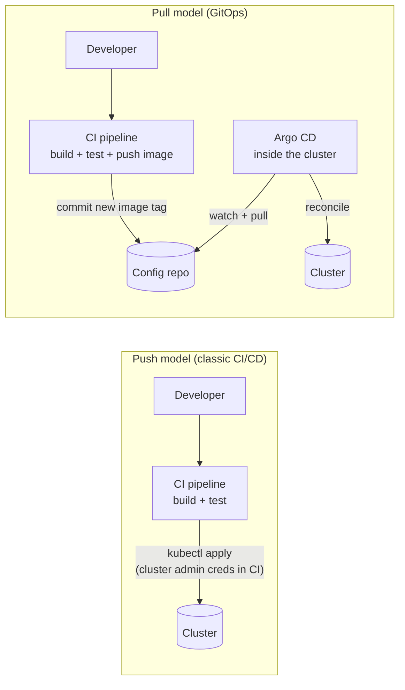
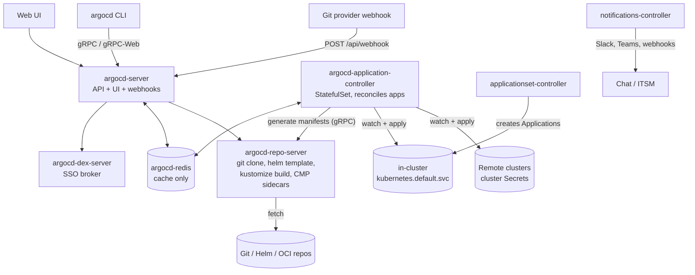
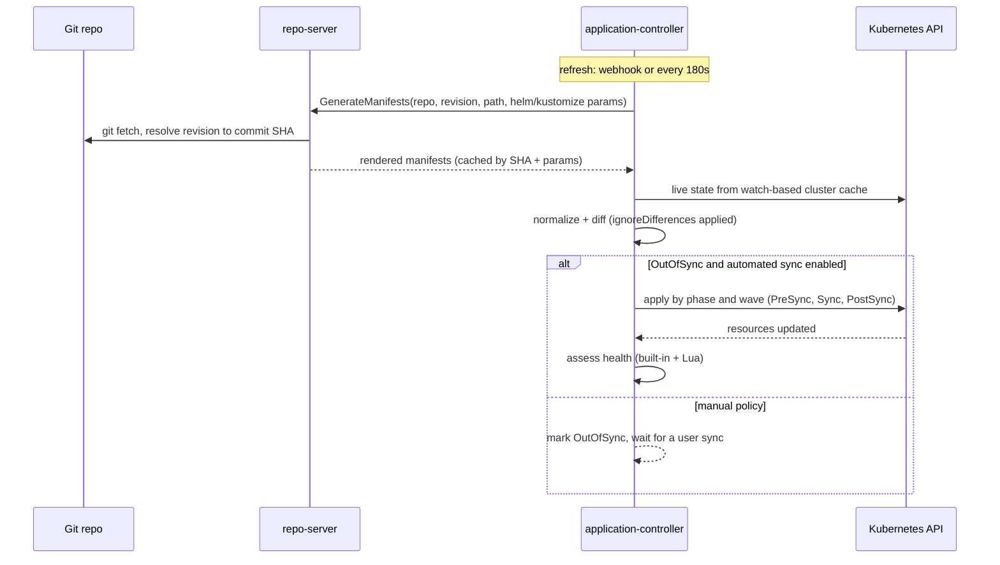
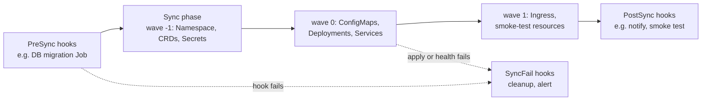
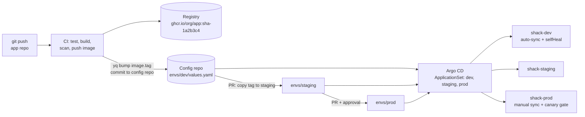
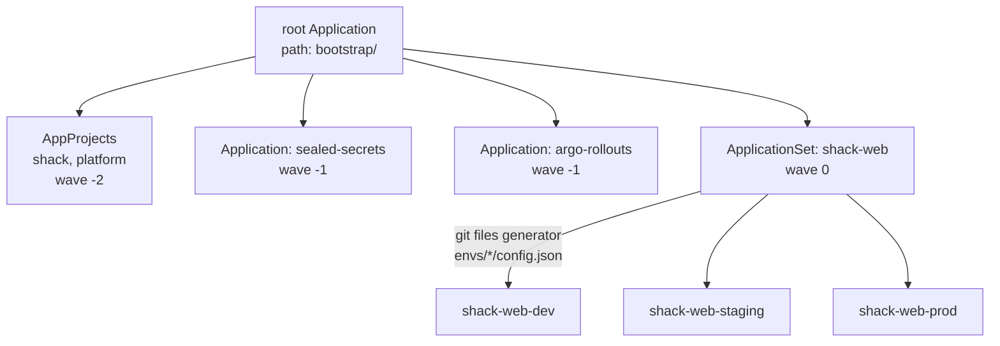
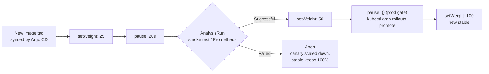

# GitOps & ArgoCD

<!-- DEVOPS-SHACK:HEADER -->

  
  
  
  
  

Part of <b><a href="https://github.com/jaiswaladi246/DevOps-Cloud-Interview-Preparation-by-DevOps-Shack">DevOps &amp; Cloud Interview Preparation</a></b> — created by <b><a href="https://www.youtube.com/@devopsshack">DevOps Shack</a></b>. Free to learn from; please credit DevOps Shack when sharing.

<!-- /DEVOPS-SHACK:HEADER -->

> Make Git the single source of truth for what runs in your clusters. Argo CD pulls, renders, diffs and reconciles; Argo Rollouts ships it safely; Sealed Secrets and External Secrets keep credentials out of plain text. Everything an interviewer can ask about GitOps, from the four OpenGitOps principles to sharding the application controller across 300 clusters.

[🏠 Home](../README.md)

## What you'll master

- The four OpenGitOps principles and why pull-based delivery beats `kubectl apply` from CI
- Argo CD internals: api-server, repo-server, application-controller, Redis, Dex, the ApplicationSet and notifications controllers, and what each does on every reconcile
- The `Application` CRD field by field: sources, destinations, sync policies (automated, prune, selfHeal), sync options, retries, finalizers
- Sync waves, resource hooks (`PreSync`, `Sync`, `PostSync`, `SyncFail`, `PostDelete`), health checks and custom health in Lua
- Diffing internals and `ignoreDifferences`, and how to stop endless `OutOfSync` loops
- Multi-tenancy with `AppProject`, RBAC, SSO through Dex or OIDC, and sync windows
- ApplicationSets with list, cluster, git and matrix generators; the app-of-apps pattern; multi-cluster fleets
- Helm, Kustomize and multiple sources (`$values` references) in one Application
- Progressive delivery with Argo Rollouts (canary, blue-green, AnalysisTemplates), Argo CD Image Updater and notifications
- Secrets in GitOps: Sealed Secrets, External Secrets Operator and SOPS, with honest trade-offs
- Repo layout (app repo vs config repo), environment promotion, Flux vs Argo CD
- Operating Argo CD at scale: HA, controller sharding, repo-server tuning, disaster recovery and the errors you will meet in production

---

## Push vs pull deployment

In a push model, CI holds cluster credentials and runs `kubectl apply` or `helm upgrade`. In a pull model, an agent inside the cluster watches Git and applies changes itself. The pull model removes cluster credentials from CI, gives you continuous drift correction, and makes Git history the audit log.

The interview soundbite: in push, the pipeline is the source of truth for the last deploy; in pull, Git is the source of truth for the current state, and the cluster is continuously made to match it.

## Argo CD architecture

Argo CD is a set of Kubernetes controllers and services, usually in the `argocd` namespace. The `argocd` CLI and the web UI both talk to `argocd-server`. Only the application controller writes to target clusters, and only the repo-server touches Git and Helm repositories.

State lives in Kubernetes objects (Applications, AppProjects, Secrets, ConfigMaps), not in Redis. Lose Redis and Argo CD rebuilds its cache; lose the `argocd` namespace and you rebuild from Git plus a backup of cluster and repo credentials.

## The reconciliation loop

Every Application is reconciled on a timer (`timeout.reconciliation`, 180 seconds by default) or immediately when a webhook arrives. The controller compares the rendered desired state with the live state it caches from a watch on the cluster, then syncs if the policy says so.

Two different statuses come out of this loop, and interviewers love to mix them up. **Sync status** (`Synced`, `OutOfSync`, `Unknown`) answers "does live match Git?". **Health status** (`Healthy`, `Progressing`, `Degraded`, `Suspended`, `Missing`, `Unknown`) answers "is it actually working?". An app can be Synced and Degraded at the same time.

## Sync phases, waves and hooks

A sync runs in phases. Inside each phase, resources are applied in ascending `argocd.argoproj.io/sync-wave` order, and Argo CD waits for every resource in a wave to be healthy before moving to the next.

Hooks are resources (usually Jobs) annotated with `argocd.argoproj.io/hook`. Their cleanup is controlled with `argocd.argoproj.io/hook-delete-policy` (`BeforeHookCreation`, `HookSucceeded`, `HookFailed`). Helm hooks such as `pre-install` and `pre-upgrade` are mapped to Argo CD `PreSync`.

## The GitOps delivery workflow

This is the flow we build in the [hands-on lab](./hands-on-lab.md): CI never touches the cluster. It builds the image, then commits the new tag to the config repo. Promotion to staging and production is a reviewed pull request that changes one line.

## App-of-apps and ApplicationSets

One root Application points at a folder of Application, AppProject and ApplicationSet manifests. Bootstrapping a new cluster becomes a single `kubectl apply` of the root app.

## Argo Rollouts canary lifecycle

A `Rollout` replaces a `Deployment` and adds steps: shift a slice of traffic, pause, run an analysis, and either continue or abort and scale the canary down automatically.

---

## Core concepts in 10 minutes

### 1. The four OpenGitOps principles

The CNCF OpenGitOps project defines GitOps with four principles. **Declarative**: the desired state is expressed declaratively. **Versioned and immutable**: that state is stored in a way that keeps complete version history. **Pulled automatically**: agents pull the desired state from the source. **Continuously reconciled**: agents observe actual state and work to apply the desired state. If any one is missing (for example CI pushing with `kubectl`), it is CI/CD with YAML in Git, not GitOps.

### 2. Applications are the unit of deployment

An `Application` says: take this `source` (repo URL, revision, path, plus Helm or Kustomize options) and make it true in this `destination` (cluster and namespace), under this `project`. `targetRevision` can be a branch, tag, commit SHA or, for Helm charts, a semver range. Pin tags or SHAs in production; tracking `HEAD` is fine for dev.

### 3. Sync policy decides who presses the button

Without `syncPolicy.automated`, Argo CD only reports `OutOfSync`. With `automated`, it syncs on every new commit. `prune: true` deletes resources that were removed from Git (off by default, deliberately). `selfHeal: true` reverts manual changes made directly in the cluster. `allowEmpty: true` permits a sync that would delete every resource. Use sync options for behaviour like `CreateNamespace=true`, `ServerSideApply=true`, `PruneLast=true` and `ApplyOutOfSyncOnly=true`.

### 4. Diffing, drift and `ignoreDifferences`

Argo CD normalizes both sides and diffs them. Fields that controllers legitimately change (HPA-managed `replicas`, injected sidecars, webhook `caBundle`) cause permanent `OutOfSync` unless you either stop declaring them or ignore them with `ignoreDifferences` (JSON pointers, jq expressions or `managedFieldsManagers`). Add `RespectIgnoreDifferences=true` so a sync does not overwrite the ignored fields too. Server-side diff (`ServerSideDiff=true`) uses the API server's dry-run and removes most false positives from defaulting and webhooks.

### 5. Health is pluggable

Built-in health exists for core kinds (Deployment, StatefulSet, Pod, PVC, Ingress, Service of type LoadBalancer, Job) and many popular CRDs, including Argo Rollouts. For anything else, write a Lua script under `resource.customizations.health.<group>_<kind>` in `argocd-cm` that reads `obj` and returns a status and message. Waves only work if health is meaningful, so this is not optional for operators and CRDs that your later waves depend on.

### 6. AppProjects are the security boundary

An `AppProject` restricts which repos an app may pull from (`sourceRepos`), where it may deploy (`destinations`), and which kinds it may create (`clusterResourceWhitelist`, `namespaceResourceBlacklist`). It also holds project roles with JWT tokens for CI, and sync windows. Never let teams use the `default` project: it allows everything everywhere.

### 7. RBAC and SSO

Argo CD RBAC is Casbin policy in `argocd-rbac-cm`: `p, role:dev, applications, sync, team-a/*, allow` and `g, my-org:team-a, role:dev`. Users come from Dex (GitHub, LDAP, SAML connectors) or direct OIDC (`oidc.config`), and groups map to roles. Set `policy.default: role:readonly` or empty, disable the local `admin` once SSO works, and test with `argocd admin settings rbac can`.

### 8. ApplicationSets generate Applications

An `ApplicationSet` combines generators with a template. The **list** generator iterates fixed elements, **cluster** iterates registered cluster Secrets (filtered by labels), **git** iterates directories or config files in a repo, and **matrix** or **merge** combine two generators. Add `goTemplate: true` with `missingkey=error` so typos fail loudly instead of producing apps called `app-<no value>`. Use `preserveResourcesOnDeletion` and the `applicationsSync` policy to control what happens when an element disappears.

### 9. Helm and Kustomize without the CLIs' state

Argo CD renders Helm with `helm template`; there is no Helm release Secret, so `helm list` shows nothing and `lookup` returns empty. Kustomize is run with `kustomize build`. With multiple `sources`, you can pull a chart from a Helm repo and its values file from your Git repo using `ref: values` and `$values/envs/prod/values.yaml`.

### 10. Repo structure and promotion

Keep application source and deployment config in separate repos (or at least separate paths): CI commits to the config repo, and app-repo commits do not trigger reconciles for unrelated services. Model environments as folders (`envs/dev`, `envs/staging`, `envs/prod`) on one branch, not as long-lived branches. Promotion is a PR that copies a tag forward; tools like Kargo or Image Updater automate parts of it.

### 11. Secrets never go into Git in plain text

**Sealed Secrets** encrypts with the controller's public key; only that cluster can decrypt. **External Secrets Operator** stores a reference in Git and syncs the value from AWS Secrets Manager, Vault, GCP or Azure. **SOPS** encrypts values in place with age, PGP or KMS and needs a plugin (KSOPS or helm-secrets) in Argo CD. In production we prefer External Secrets: rotation happens in the secret manager without a Git commit.

### 12. Progressive delivery

Argo CD syncs the new spec; Argo Rollouts decides how fast it becomes live. Canary steps shift weight (by replica count, or precisely through NGINX, Istio, ALB or Gateway API), pause, and run `AnalysisTemplate` metrics against Prometheus, Datadog, a web endpoint or a Job. A failed analysis aborts the rollout and keeps the stable version serving. Blue-green keeps two ReplicaSets and flips the active Service after pre-promotion analysis.

### 13. Scaling and disaster recovery

The application controller is a StatefulSet; shard it across clusters by raising replicas and setting `ARGOCD_CONTROLLER_REPLICAS` (algorithms: `legacy`, `round-robin`, `consistent-hashing`). Raise `controller.status.processors` and `controller.operation.processors` for many apps, scale the repo-server for heavy Helm rendering, and exclude high-churn resources. For DR, everything declarative lives in Git; back up the rest with `argocd admin export`, plus the Sealed Secrets private keys.

---

## Question banks

Two banks of 200 questions each, with collapsible answers. 400 questions in total, tagged 🟢 Beginner, 🟡 Intermediate, 🔴 Advanced.

| Bank | Questions | What it covers |
|------|-----------|----------------|
| [Concepts](./concepts.md) | 200 | OpenGitOps principles, Argo CD architecture, the Application CRD, sync policies, waves, hooks, health and Lua, diffing, AppProjects and RBAC, ApplicationSets, Helm and Kustomize sources, Rollouts, Image Updater, notifications, secrets, Flux comparison, scaling, DR, and rapid-fire CLI questions |
| [Scenarios & Troubleshooting](./scenarios-and-troubleshooting.md) | 200 | 100 "what would you do" scenarios (repo design, promotion, multi-cluster, tenancy, canaries, upgrades, DR) and 100 real failures with exact error text (`OutOfSync` loops, `ComparisonError`, `permission denied`, project restrictions, stuck hooks, analysis failures, sealed secret decryption) |

## Learning path

Work through these in order. Tick each one only when you can do it without notes.

**Beginner**
- [ ] State the four OpenGitOps principles and explain push vs pull with a diagram
- [ ] Install Argo CD on kind, get the initial admin password, and log in with the CLI and UI
- [ ] Create an Application from a Git path, sync it manually, and read its sync and health status
- [ ] Turn on automated sync with prune and selfHeal and watch it revert a `kubectl edit`
- [ ] Explain what each Argo CD component does and which one talks to Git
- [ ] Deploy a Helm chart and a Kustomize overlay as Applications
- [ ] Roll back with `argocd app history` and `argocd app rollback`, then explain why Git revert is better
- [ ] Do the first 10 [assignments](./assignments.md)

**Intermediate**
- [ ] Order resources with sync waves and run a database migration as a `PreSync` hook
- [ ] Fix an `OutOfSync` loop with `ignoreDifferences` and `RespectIgnoreDifferences=true`
- [ ] Write a Lua health check for a CRD and test it with `argocd admin settings resource-overrides health`
- [ ] Create an AppProject per team with restricted repos, destinations and kinds, and RBAC mapped to SSO groups
- [ ] Generate dev, staging and prod apps with an ApplicationSet and bootstrap with app-of-apps
- [ ] Encrypt a secret with Sealed Secrets and sync it through Argo CD
- [ ] Wire a CI pipeline that bumps an image tag in the config repo
- [ ] Complete the [hands-on lab](./hands-on-lab.md) end to end

**Advanced**
- [ ] Run a canary with Argo Rollouts and an AnalysisTemplate that aborts a bad release automatically
- [ ] Manage a multi-cluster fleet with cluster generators, matrix generators and label-driven targeting
- [ ] Combine a remote Helm chart with values from Git using multiple sources
- [ ] Configure notifications and Image Updater with Git write-back
- [ ] Shard the application controller, tune processors and repo-server, and read the Prometheus metrics
- [ ] Rebuild Argo CD from scratch after deleting the namespace, with no manual clicks
- [ ] Compare Argo CD and Flux for a platform decision, with honest trade-offs
- [ ] Finish all 25 assignments and answer 150 of the 200 questions in each bank unaided

## Study materials

- [Hands-on lab: GitOps platform on kind](./hands-on-lab.md) — Argo CD, app-of-apps, ApplicationSet for dev/staging/prod, CI tag bump, Argo Rollouts canary with analysis, Sealed Secrets, drift and self-heal
- [Assignments](./assignments.md) — 25 graded exercises (10 beginner, 10 intermediate, 5 advanced)
- [Cheatsheet](./cheatsheet.md) — `argocd` CLI, Application and ApplicationSet reference, annotations, sync options, Rollouts, secrets, and the top 15 interview one-liners

[🏠 Home](../README.md)

<!-- DEVOPS-SHACK:FOOTER -->
---

### 🚀 Made with ❤️ by [DevOps Shack](https://www.youtube.com/@devopsshack)

**Learn DevOps, DevSecOps, Cloud and Kubernetes the practical way.**

[▶️ YouTube — DevOps Shack](https://www.youtube.com/@devopsshack) · [▶️ Hindi — @shackverse](https://www.youtube.com/@shackverse) · [🎓 devopsshack.com](https://devopsshack.com) · [📸 Instagram @devopsshack](https://www.instagram.com/devopsshack)

[🏠 Back to Home](../README.md) · [⭐ Star the original repo](https://github.com/jaiswaladi246/DevOps-Cloud-Interview-Preparation-by-DevOps-Shack)

© DevOps Shack · Licensed CC BY-NC-SA 4.0 · If you found this copy anywhere other than <a href="https://github.com/jaiswaladi246/DevOps-Cloud-Interview-Preparation-by-DevOps-Shack">github.com/jaiswaladi246</a>, the original and latest version is maintained by DevOps Shack.

<!-- /DEVOPS-SHACK:FOOTER -->
