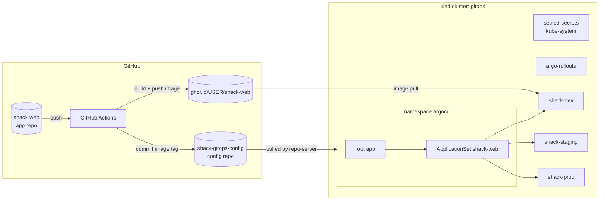

# Hands-on Lab: A GitOps Platform on kind with Argo CD

<!-- DEVOPS-SHACK:HEADER -->
<p align="center">
  <a href="https://www.youtube.com/@devopsshack"></a>
  <a href="https://www.youtube.com/@shackverse"></a>
  <a href="https://devopsshack.com"></a>
  <a href="https://www.instagram.com/devopsshack"></a>
  <a href="https://github.com/jaiswaladi246/DevOps-Cloud-Interview-Preparation-by-DevOps-Shack"></a>
</p>
<p align="center"><sub>Part of <b><a href="https://github.com/jaiswaladi246/DevOps-Cloud-Interview-Preparation-by-DevOps-Shack">DevOps &amp; Cloud Interview Preparation</a></b> — created by <b><a href="https://www.youtube.com/@devopsshack">DevOps Shack</a></b>. Free to learn from; please credit DevOps Shack when sharing.</sub></p>
<!-- /DEVOPS-SHACK:HEADER -->

> Build a complete GitOps delivery platform on your laptop: Argo CD bootstrapped with app-of-apps, an ApplicationSet that deploys a Helm chart to dev, staging and prod namespaces, a GitHub Actions pipeline that bumps the image tag in a config repo, an Argo Rollouts canary that aborts a bad release on its own, Sealed Secrets, and a drift demo with self-heal.

[⬅ Back to GitOps & ArgoCD](./README.md) · [🏠 Home](../README.md)

## Goal

By the end you will have:

- A kind cluster running Argo CD (installed with Helm), Argo Rollouts and the Sealed Secrets controller
- Two Git repos: an **app repo** (source, Dockerfile, CI) and a **config repo** (Helm chart, per-environment values, bootstrap manifests)
- A single `root` Application (app-of-apps) that installs two AppProjects, two platform apps and one ApplicationSet, ordered with sync waves
- An ApplicationSet with a git files generator that creates `shack-web-dev`, `shack-web-staging` and `shack-web-prod`, with auto-sync and self-heal for dev and staging and manual sync for prod
- A CI pipeline that builds and pushes an image to GHCR, then commits the new tag to `envs/dev/values.yaml`
- Promotion to staging and prod through pull requests, with a manual canary gate in prod
- A canary that runs a smoke-test AnalysisRun and aborts automatically on a broken build
- Sealed Secrets per environment, and a drift demo showing self-heal in dev and detection-only in prod

Time: about 3 hours. Cost: free (GitHub Actions minutes on a public repo and GHCR public packages are free).

## Architecture



The config repo layout we build:

```text
shack-gitops-config/
├── root-app.yaml                  # applied once by hand, everything else flows from Git
├── bootstrap/
│   ├── 00-projects.yaml           # wave -2: AppProjects shack + platform
│   ├── 10-sealed-secrets.yaml     # wave -1: Helm chart from bitnami-labs
│   ├── 11-argo-rollouts.yaml      # wave -1: Helm chart from argo-helm
│   └── 20-shack-web-appset.yaml   # wave 0:  ApplicationSet for all envs
├── charts/shack-web/
│   ├── Chart.yaml
│   ├── values.yaml
│   └── templates/
│       ├── rollout.yaml
│       ├── services.yaml
│       ├── analysistemplate.yaml
│       └── sealedsecret.yaml
└── envs/
    ├── dev/      config.json  values.yaml
    ├── staging/  config.json  values.yaml
    └── prod/     config.json  values.yaml
```

## Prerequisites

- Docker (Engine 26+ or Desktop), `kind` 0.24+, `kubectl` 1.30+, `helm` 3.15+
- `argocd` CLI, `kubeseal`, `kubectl-argo-rollouts`, `yq` (mikefarah v4), `git`, and the GitHub CLI `gh` (logged in with `gh auth login`)
- A GitHub account
- About 4 GB of free RAM for the kind node

Install the CLIs (macOS with Homebrew, or Linux binaries):

```bash
# macOS
brew install kind kubectl helm argocd kubeseal yq gh argoproj/tap/kubectl-argo-rollouts

# Linux (amd64) - the ones not in your package manager
curl -sSL -o argocd https://github.com/argoproj/argo-cd/releases/latest/download/argocd-linux-amd64
sudo install -m 555 argocd /usr/local/bin/argocd
curl -sSL -o kubectl-argo-rollouts https://github.com/argoproj/argo-rollouts/releases/latest/download/kubectl-argo-rollouts-linux-amd64
sudo install -m 555 kubectl-argo-rollouts /usr/local/bin/kubectl-argo-rollouts
# kubeseal: download the kubeseal-<version>-linux-amd64.tar.gz asset from
# https://github.com/bitnami-labs/sealed-secrets/releases and install the binary the same way
```

Check them:

```bash
kind version && kubectl version --client && helm version --short
argocd version --client --short
kubeseal --version
kubectl argo rollouts version
yq --version && gh auth status
```

Set your variables once. `GH_USER` must be your GitHub username in **lowercase** (GHCR image names must be lowercase).

```bash
export GH_USER=your-github-user
export CONFIG_REPO=https://github.com/$GH_USER/shack-gitops-config.git
mkdir -p ~/gitops-lab && cd ~/gitops-lab
```

---

## Step 1. Create the kind cluster

```bash
kind create cluster --name gitops
kubectl cluster-info --context kind-gitops
kubectl get nodes
```

**Verify:** one node named `gitops-control-plane` in `Ready` state.

## Step 2. Install Argo CD with Helm

We install with the official Helm chart so the `argocd-cm` customizations live in a values file. Two settings matter for this lab:

- A **Lua health check for `argoproj.io/Application`**. Argo CD does not assess the health of Application resources by default, so without this the sync waves in our app-of-apps would not wait for the platform apps to be healthy.
- A shorter **reconciliation interval** (60s instead of 180s), because kind has no public URL for Git webhooks.

Create `argocd-values.yaml`:

```yaml
configs:
  params:
    # TLS is terminated nowhere in this lab; we reach the UI via port-forward
    server.insecure: true
  cm:
    timeout.reconciliation: 60s
    resource.customizations.health.argoproj.io_Application: |
      hs = {}
      hs.status = "Progressing"
      hs.message = ""
      if obj.status ~= nil then
        if obj.status.health ~= nil then
          hs.status = obj.status.health.status
          if obj.status.health.message ~= nil then
            hs.message = obj.status.health.message
          end
        end
      end
      return hs

# SSO is out of scope for a laptop lab; production installs keep Dex or use oidc.config
dex:
  enabled: false
```

Install:

```bash
helm repo add argo https://argoproj.github.io/argo-helm
helm repo update
helm upgrade --install argocd argo/argo-cd \
  --namespace argocd --create-namespace \
  -f argocd-values.yaml --wait

kubectl -n argocd get pods
```

**Verify:** these pods are `Running`: `argocd-application-controller-0`, `argocd-applicationset-controller-*`, `argocd-notifications-controller-*`, `argocd-redis-*`, `argocd-repo-server-*`, `argocd-server-*`.

```bash
kubectl -n argocd get cm argocd-cm -o yaml | grep -A2 'health.argoproj.io_Application'
```

## Step 3. Log in with the CLI and the UI

Run the port-forward in a second terminal and leave it open:

```bash
kubectl -n argocd port-forward svc/argocd-server 8080:80
```

Back in the first terminal:

```bash
export ARGO_PWD=$(argocd admin initial-password -n argocd | head -1)
argocd login localhost:8080 --username admin --password "$ARGO_PWD" --plaintext

argocd version --short
argocd cluster list
argocd app list
```

**Verify:** `argocd cluster list` shows `https://kubernetes.default.svc` named `in-cluster`. Open http://localhost:8080 and log in as `admin` with `$ARGO_PWD`. The application list is empty.

> In production you would change the password with `argocd account update-password`, delete the `argocd-initial-admin-secret`, then disable `admin` entirely once SSO works.

## Step 4. Create the app repo

The application is a tiny static site on unprivileged nginx. `/version` prints the build tag, and `/healthz` is our smoke-test endpoint. A `BROKEN=true` build omits `/healthz`, which is how we will simulate a bad release in step 16.

```bash
cd ~/gitops-lab
gh repo create shack-web --public --clone
cd shack-web
```

Create `index.html`:

```html
<!doctype html>
<html>
<head><title>Shack Web</title></head>
<body style="font-family: sans-serif; background: #0b0f1a; color: #c6ff4d; padding: 3rem">
  <h1>DevOps Shack GitOps demo</h1>
  <p>Version: __VERSION__</p>
</body>
</html>
```

Create `Dockerfile`:

```dockerfile
FROM nginxinc/nginx-unprivileged:1.27-alpine

ARG VERSION=dev
ARG BROKEN=false

USER root
COPY index.html /usr/share/nginx/html/index.html
RUN sed -i "s/__VERSION__/${VERSION}/" /usr/share/nginx/html/index.html \
 && echo "${VERSION}" > /usr/share/nginx/html/version \
 && if [ "${BROKEN}" != "true" ]; then echo ok > /usr/share/nginx/html/healthz; fi
USER 101

EXPOSE 8080
```

Test it locally:

```bash
docker build -t shack-web:local --build-arg VERSION=local .
docker run --rm -d -p 8081:8080 --name shack shack-web:local
curl -s localhost:8081/version          # local
curl -s -o /dev/null -w '%{http_code}\n' localhost:8081/healthz   # 200
docker rm -f shack

docker build -t shack-web:broken --build-arg BROKEN=true .
docker run --rm -d -p 8081:8080 --name shack shack-web:broken
curl -s -o /dev/null -w '%{http_code}\n' localhost:8081/healthz   # 404
docker rm -f shack
```

Do not push yet; the CI workflow comes in step 7.

## Step 5. Create the config repo and the Helm chart

```bash
cd ~/gitops-lab
gh repo create shack-gitops-config --public --clone
cd shack-gitops-config
mkdir -p bootstrap charts/shack-web/templates envs/{dev,staging,prod}
```

Create `charts/shack-web/Chart.yaml`:

```yaml
apiVersion: v2
name: shack-web
description: DevOps Shack demo web app, deployed by Argo CD as an Argo Rollouts canary
type: application
version: 0.1.0
appVersion: "0.1.0"
```

Create `charts/shack-web/values.yaml`:

```yaml
env: dev
replicaCount: 2

image:
  repository: ghcr.io/YOUR_GH_USER/shack-web
  tag: "0.1.0"
  pullPolicy: IfNotPresent

canary:
  # prod sets this to true: the rollout waits for `kubectl argo rollouts promote`
  manualGate: false

resources:
  requests:
    cpu: 10m
    memory: 16Mi
  limits:
    memory: 64Mi

secret:
  # filled per environment with kubeseal output in step 13
  encryptedData: {}
```

Create `charts/shack-web/templates/rollout.yaml`. The checksum annotation makes a secret change roll the pods, and the canary steps run only when a stable version already exists (the very first deploy goes straight to 100%).

```yaml
apiVersion: argoproj.io/v1alpha1
kind: Rollout
metadata:
  name: {{ .Chart.Name }}
  labels:
    app.kubernetes.io/name: {{ .Chart.Name }}
    app.kubernetes.io/version: {{ .Values.image.tag | quote }}
spec:
  replicas: {{ .Values.replicaCount }}
  revisionHistoryLimit: 3
  selector:
    matchLabels:
      app.kubernetes.io/name: {{ .Chart.Name }}
  template:
    metadata:
      labels:
        app.kubernetes.io/name: {{ .Chart.Name }}
      annotations:
        checksum/secret: {{ toYaml .Values.secret.encryptedData | sha256sum }}
    spec:
      securityContext:
        runAsNonRoot: true
      containers:
        - name: web
          image: "{{ .Values.image.repository }}:{{ .Values.image.tag }}"
          imagePullPolicy: {{ .Values.image.pullPolicy }}
          ports:
            - name: http
              containerPort: 8080
          env:
            - name: APP_ENV
              value: {{ .Values.env | quote }}
          {{- if .Values.secret.encryptedData }}
          envFrom:
            - secretRef:
                name: {{ .Chart.Name }}-secret
          {{- end }}
          readinessProbe:
            httpGet:
              path: /
              port: http
            periodSeconds: 5
          resources:
            {{- toYaml .Values.resources | nindent 12 }}
  strategy:
    canary:
      canaryService: {{ .Chart.Name }}-canary
      stableService: {{ .Chart.Name }}
      steps:
        - setWeight: 25
        - pause: {duration: 20s}
        - analysis:
            templates:
              - templateName: {{ .Chart.Name }}-smoke
            args:
              - name: host
                value: {{ .Chart.Name }}-canary.{{ .Release.Namespace }}.svc.cluster.local
        - setWeight: 50
        {{- if .Values.canary.manualGate }}
        - pause: {}
        {{- else }}
        - pause: {duration: 20s}
        {{- end }}
```

Create `charts/shack-web/templates/services.yaml`. Argo Rollouts adds a `rollouts-pod-template-hash` selector to each Service so `shack-web` targets stable pods and `shack-web-canary` targets canary pods.

```yaml
apiVersion: v1
kind: Service
metadata:
  name: {{ .Chart.Name }}
  labels:
    app.kubernetes.io/name: {{ .Chart.Name }}
spec:
  selector:
    app.kubernetes.io/name: {{ .Chart.Name }}
  ports:
    - name: http
      port: 80
      targetPort: http
---
apiVersion: v1
kind: Service
metadata:
  name: {{ .Chart.Name }}-canary
  labels:
    app.kubernetes.io/name: {{ .Chart.Name }}
spec:
  selector:
    app.kubernetes.io/name: {{ .Chart.Name }}
  ports:
    - name: http
      port: 80
      targetPort: http
```

Create `charts/shack-web/templates/analysistemplate.yaml`. The Job provider runs `curl -f` against the canary Service three times; a single failure aborts the rollout. Note the escaping: `{{args.host}}` is Argo Rollouts syntax, so we print it literally through Helm.

```yaml
apiVersion: argoproj.io/v1alpha1
kind: AnalysisTemplate
metadata:
  name: {{ .Chart.Name }}-smoke
spec:
  args:
    - name: host
  metrics:
    - name: healthz
      count: 3
      interval: 10s
      failureLimit: 0
      provider:
        job:
          spec:
            backoffLimit: 0
            template:
              spec:
                restartPolicy: Never
                containers:
                  - name: smoke
                    image: curlimages/curl:8.11.1
                    args:
                      - "-sf"
                      - "--max-time"
                      - "5"
                      - "http://{{ "{{args.host}}" }}/healthz"
```

Create `charts/shack-web/templates/sealedsecret.yaml`. Wave `-1` makes Argo CD apply it, and wait for the built-in SealedSecret health check, before the Rollout in wave 0.

```yaml
{{- if .Values.secret.encryptedData }}
apiVersion: bitnami.com/v1alpha1
kind: SealedSecret
metadata:
  name: {{ .Chart.Name }}-secret
  annotations:
    argocd.argoproj.io/sync-wave: "-1"
spec:
  encryptedData:
    {{- toYaml .Values.secret.encryptedData | nindent 4 }}
  template:
    metadata:
      name: {{ .Chart.Name }}-secret
    type: Opaque
{{- end }}
```

Render it locally (Argo CD runs the same `helm template`):

```bash
sed -i.bak "s/YOUR_GH_USER/$GH_USER/" charts/shack-web/values.yaml && rm charts/shack-web/values.yaml.bak
helm lint charts/shack-web
helm template shack-web charts/shack-web --namespace shack-dev | grep -E 'kind:|image:|http://'
```

**Verify:** `helm lint` reports `0 chart(s) failed`; the output shows `kind: Rollout`, two `kind: Service`, `kind: AnalysisTemplate`, and the literal `http://{{args.host}}/healthz`.

## Step 6. Add the environment folders

Each environment has a `config.json` (read by the ApplicationSet git files generator) and a `values.yaml` (read by Helm). CI only ever edits `envs/dev/values.yaml`; staging and prod change through pull requests.

```bash
cat > envs/dev/config.json <<'__END__'
{ "env": "dev", "namespace": "shack-dev", "autoSync": "true" }
__END__
cat > envs/staging/config.json <<'__END__'
{ "env": "staging", "namespace": "shack-staging", "autoSync": "true" }
__END__
cat > envs/prod/config.json <<'__END__'
{ "env": "prod", "namespace": "shack-prod", "autoSync": "false" }
__END__

cat > envs/dev/values.yaml <<'__END__'
env: dev
replicaCount: 4
image:
  tag: "0.1.0"
__END__
cat > envs/staging/values.yaml <<'__END__'
env: staging
replicaCount: 2
image:
  tag: "0.1.0"
__END__
cat > envs/prod/values.yaml <<'__END__'
env: prod
replicaCount: 3
image:
  tag: "0.1.0"
canary:
  manualGate: true
__END__

git add . && git commit -m "Helm chart and environment values" && git push
```

**Verify:**

```bash
helm template shack-web charts/shack-web -f envs/prod/values.yaml | grep -A1 'setWeight: 50'
```

prints `- pause: {}` for prod (the manual gate).

## Step 7. Build the CI pipeline that bumps the config repo

The pipeline never talks to the cluster. On a push to `main` it builds `sha-<7 chars>` and commits that tag to `envs/dev/values.yaml`. On a `v*` git tag it builds a release image (`v0.1.0` becomes `0.1.0`) without touching the config repo. A manual run with `broken=true` produces a deliberately bad image for step 16.

First create a **fine-grained personal access token** on GitHub (Settings, Developer settings, Fine-grained tokens) with access to **only** `shack-gitops-config` and the permission **Contents: Read and write**. Store it in the app repo:

```bash
cd ~/gitops-lab/shack-web
gh secret set CONFIG_REPO_TOKEN --repo "$GH_USER/shack-web"    # paste the token
```

Create `.github/workflows/ci.yaml`:

```yaml
name: ci

on:
  push:
    branches: [main]
    tags: ["v*"]
  workflow_dispatch:
    inputs:
      broken:
        description: "Build an image that fails the canary smoke test"
        type: boolean
        default: false

permissions:
  contents: read
  packages: write

concurrency:
  group: ci-${{ github.ref }}
  cancel-in-progress: false

jobs:
  build:
    runs-on: ubuntu-latest
    outputs:
      tag: ${{ steps.meta.outputs.tag }}
    steps:
      - uses: actions/checkout@v4

      - name: Compute image name and tag
        id: meta
        run: |
          OWNER=$(echo "${{ github.repository_owner }}" | tr '[:upper:]' '[:lower:]')
          if [[ "${GITHUB_REF}" == refs/tags/v* ]]; then
            TAG="${GITHUB_REF_NAME#v}"
          else
            TAG="sha-${GITHUB_SHA::7}"
          fi
          if [[ "${{ inputs.broken }}" == "true" ]]; then TAG="${TAG}-broken"; fi
          echo "image=ghcr.io/${OWNER}/shack-web" >> "$GITHUB_OUTPUT"
          echo "tag=${TAG}" >> "$GITHUB_OUTPUT"

      - uses: docker/setup-buildx-action@v3

      - uses: docker/login-action@v3
        with:
          registry: ghcr.io
          username: ${{ github.actor }}
          password: ${{ secrets.GITHUB_TOKEN }}

      - uses: docker/build-push-action@v6
        with:
          context: .
          push: true
          tags: ${{ steps.meta.outputs.image }}:${{ steps.meta.outputs.tag }}
          build-args: |
            VERSION=${{ steps.meta.outputs.tag }}
            BROKEN=${{ inputs.broken || 'false' }}

  bump-dev:
    needs: build
    if: github.ref == 'refs/heads/main'
    runs-on: ubuntu-latest
    steps:
      - uses: actions/checkout@v4
        with:
          repository: ${{ github.repository_owner }}/shack-gitops-config
          token: ${{ secrets.CONFIG_REPO_TOKEN }}

      - name: Bump the dev image tag
        env:
          TAG: ${{ needs.build.outputs.tag }}
        run: |
          yq -i '.image.tag = strenv(TAG)' envs/dev/values.yaml
          git config user.name "shack-ci[bot]"
          git config user.email "shack-ci@users.noreply.github.com"
          git add envs/dev/values.yaml
          git commit -m "dev: deploy shack-web ${TAG}" || { echo "Tag unchanged"; exit 0; }
          for i in 1 2 3; do git pull --rebase && git push && break; sleep 5; done
```

Push it, then cut the first release tag:

```bash
git add . && git commit -m "App, Dockerfile and CI" && git push -u origin main
gh run watch --repo "$GH_USER/shack-web"         # wait for build + bump-dev

git tag v0.1.0 && git push origin v0.1.0
gh run watch --repo "$GH_USER/shack-web"         # wait for the release build
```

Make the image public so kind can pull it without credentials: on GitHub open your profile, **Packages**, `shack-web`, **Package settings**, **Change visibility** to Public.

**Verify:**

```bash
docker pull ghcr.io/$GH_USER/shack-web:0.1.0
cd ~/gitops-lab/shack-gitops-config && git pull
git log --oneline -3          # top commit: "dev: deploy shack-web sha-xxxxxxx" by shack-ci[bot]
yq '.image.tag' envs/dev/values.yaml
```

> In a real company, prefer a GitHub App token (`actions/create-github-app-token`) or a deploy key over a personal token, and protect `envs/prod/**` with CODEOWNERS so only reviewed PRs reach production.

## Step 8. Define the AppProjects

Create `bootstrap/00-projects.yaml`. The `shack` project can only pull from the config repo, only deploy into `shack-*` namespaces on this cluster, and may create no cluster-scoped kinds except `Namespace` (needed for `CreateNamespace=true`). The `platform` project is where cluster-wide add-ons live.

```yaml
apiVersion: argoproj.io/v1alpha1
kind: AppProject
metadata:
  name: shack
  namespace: argocd
  annotations:
    argocd.argoproj.io/sync-wave: "-2"
  finalizers:
    - resources-finalizer.argocd.argoproj.io
spec:
  description: Shack web application, all environments
  sourceRepos:
    - https://github.com/YOUR_GH_USER/shack-gitops-config.git
  destinations:
    - server: https://kubernetes.default.svc
      namespace: shack-*
  clusterResourceWhitelist:
    - group: ""
      kind: Namespace
  namespaceResourceBlacklist:
    - group: ""
      kind: ResourceQuota
    - group: ""
      kind: LimitRange
  roles:
    - name: developer
      description: View all shack apps, sync dev only
      policies:
        - p, proj:shack:developer, applications, get, shack/*, allow
        - p, proj:shack:developer, applications, sync, shack/shack-web-dev, allow
---
apiVersion: argoproj.io/v1alpha1
kind: AppProject
metadata:
  name: platform
  namespace: argocd
  annotations:
    argocd.argoproj.io/sync-wave: "-2"
  finalizers:
    - resources-finalizer.argocd.argoproj.io
spec:
  description: Cluster add-ons owned by the platform team
  sourceRepos:
    - https://bitnami-labs.github.io/sealed-secrets
    - https://argoproj.github.io/argo-helm
  destinations:
    - server: https://kubernetes.default.svc
      namespace: kube-system
    - server: https://kubernetes.default.svc
      namespace: argo-rollouts
  clusterResourceWhitelist:
    - group: "*"
      kind: "*"
```

## Step 9. Define the platform Applications

Create `bootstrap/10-sealed-secrets.yaml`. `fullnameOverride` keeps the controller name that `kubeseal` expects by default (`sealed-secrets-controller` in `kube-system`).

```yaml
apiVersion: argoproj.io/v1alpha1
kind: Application
metadata:
  name: sealed-secrets
  namespace: argocd
  annotations:
    argocd.argoproj.io/sync-wave: "-1"
  finalizers:
    - resources-finalizer.argocd.argoproj.io
spec:
  project: platform
  source:
    repoURL: https://bitnami-labs.github.io/sealed-secrets
    chart: sealed-secrets
    targetRevision: "2.*"
    helm:
      releaseName: sealed-secrets
      valuesObject:
        fullnameOverride: sealed-secrets-controller
  destination:
    server: https://kubernetes.default.svc
    namespace: kube-system
  syncPolicy:
    automated:
      prune: true
      selfHeal: true
    syncOptions:
      - ServerSideApply=true
```

Create `bootstrap/11-argo-rollouts.yaml`:

```yaml
apiVersion: argoproj.io/v1alpha1
kind: Application
metadata:
  name: argo-rollouts
  namespace: argocd
  annotations:
    argocd.argoproj.io/sync-wave: "-1"
  finalizers:
    - resources-finalizer.argocd.argoproj.io
spec:
  project: platform
  source:
    repoURL: https://argoproj.github.io/argo-helm
    chart: argo-rollouts
    targetRevision: "2.*"
    helm:
      releaseName: argo-rollouts
      valuesObject:
        dashboard:
          enabled: false
  destination:
    server: https://kubernetes.default.svc
    namespace: argo-rollouts
  syncPolicy:
    automated:
      prune: true
      selfHeal: true
    syncOptions:
      - CreateNamespace=true
      - ServerSideApply=true
```

> `"2.*"` is a semver constraint Argo CD resolves against the Helm repo index, convenient for a lab. In production pin an exact chart version and let Renovate open upgrade PRs.

## Step 10. Define the ApplicationSet

Create `bootstrap/20-shack-web-appset.yaml`. The git files generator reads every `envs/*/config.json` and turns its keys into template parameters, plus `.path.path` (the folder of the file). `templatePatch` adds automated sync only where `autoSync` is `"true"`, so prod is created with a manual policy.

```yaml
apiVersion: argoproj.io/v1alpha1
kind: ApplicationSet
metadata:
  name: shack-web
  namespace: argocd
  annotations:
    argocd.argoproj.io/sync-wave: "0"
spec:
  goTemplate: true
  goTemplateOptions: ["missingkey=error"]
  generators:
    - git:
        repoURL: https://github.com/YOUR_GH_USER/shack-gitops-config.git
        revision: HEAD
        files:
          - path: envs/*/config.json
  template:
    metadata:
      name: "shack-web-{{ .env }}"
      labels:
        app.kubernetes.io/part-of: shack-web
        env: "{{ .env }}"
      finalizers:
        - resources-finalizer.argocd.argoproj.io
    spec:
      project: shack
      source:
        repoURL: https://github.com/YOUR_GH_USER/shack-gitops-config.git
        targetRevision: HEAD
        path: charts/shack-web
        helm:
          releaseName: shack-web
          valueFiles:
            - "../../{{ .path.path }}/values.yaml"
      destination:
        server: https://kubernetes.default.svc
        namespace: "{{ .namespace }}"
      syncPolicy:
        syncOptions:
          - CreateNamespace=true
          - PruneLast=true
        retry:
          limit: 5
          backoff:
            duration: 10s
            factor: 2
            maxDuration: 3m
  templatePatch: |
    {{- if eq .autoSync "true" }}
    spec:
      syncPolicy:
        automated:
          prune: true
          selfHeal: true
    {{- end }}
```

## Step 11. Bootstrap everything with the root app

Create `root-app.yaml` at the repo root. It lives outside `bootstrap/` so the root app does not manage itself.

```yaml
apiVersion: argoproj.io/v1alpha1
kind: Application
metadata:
  name: root
  namespace: argocd
  finalizers:
    - resources-finalizer.argocd.argoproj.io
spec:
  project: default
  source:
    repoURL: https://github.com/YOUR_GH_USER/shack-gitops-config.git
    targetRevision: HEAD
    path: bootstrap
  destination:
    server: https://kubernetes.default.svc
    namespace: argocd
  syncPolicy:
    automated:
      prune: true
      selfHeal: true
```

Fill in your username, commit, and apply the one and only manifest you will ever `kubectl apply` by hand:

```bash
cd ~/gitops-lab/shack-gitops-config
grep -rl YOUR_GH_USER bootstrap root-app.yaml | xargs sed -i.bak "s/YOUR_GH_USER/$GH_USER/g"
find . -name '*.bak' -delete
git add . && git commit -m "Bootstrap: projects, platform apps, ApplicationSet, root app" && git push

kubectl apply -f root-app.yaml
argocd app get root --refresh
```

Watch the waves happen:

```bash
argocd app list
kubectl -n argocd get applications -w
```

**Verify** (allow 2 to 4 minutes):

- `root`, `sealed-secrets`, `argo-rollouts`, `shack-web-dev` and `shack-web-staging` reach `Synced` and `Healthy`.
- `shack-web-prod` exists but is `OutOfSync` / `Missing`: it has no automated policy, exactly as designed.

```bash
argocd appset get shack-web
kubectl -n kube-system get deploy sealed-secrets-controller
kubectl -n argo-rollouts get deploy argo-rollouts
kubectl get crd rollouts.argoproj.io sealedsecrets.bitnami.com
```

## Step 12. Sync prod by hand and check all three environments

```bash
argocd app diff shack-web-prod          # everything shows as new
argocd app sync shack-web-prod
argocd app wait shack-web-prod --health --timeout 300

for ns in shack-dev shack-staging shack-prod; do
  echo "== $ns"; kubectl argo rollouts get rollout shack-web -n $ns | head -12
done
```

**Verify:** each Rollout is `✔ Healthy`. Dev runs 4 pods on the `sha-...` tag from CI, staging 2 and prod 3 on `0.1.0`. Hit each environment:

```bash
kubectl -n shack-dev port-forward svc/shack-web 9001:80 &
curl -s localhost:9001/version; kill %1
```

In the UI, open `shack-web-dev` and look at the resource tree: Rollout, ReplicaSet, Pods, two Services, AnalysisTemplate.

## Step 13. Seal a secret per environment

Sealed Secrets uses strict scope by default: a sealed value only decrypts into the exact name and namespace it was sealed for. That is why we seal once per environment.

```bash
cd ~/gitops-lab/shack-gitops-config
kubeseal --fetch-cert > pub-cert.pem      # public key, safe to commit

for ENV in dev staging prod; do
  kubectl create secret generic shack-web-secret \
    --namespace "shack-$ENV" \
    --from-literal=APP_GREETING="hello from $ENV" \
    --dry-run=client -o yaml \
  | kubeseal --cert pub-cert.pem --format yaml \
  | yq '.spec.encryptedData' > "/tmp/enc-$ENV.yaml"
  yq -i ".secret.encryptedData = load(\"/tmp/enc-$ENV.yaml\")" "envs/$ENV/values.yaml"
done

cat envs/dev/values.yaml          # APP_GREETING: AgB... (ciphertext only)
git add . && git commit -m "Add sealed APP_GREETING per environment" && git push
```

Dev and staging sync on their own (a pod template change, so a canary runs). Prod needs you:

```bash
argocd app get shack-web-dev --refresh
argocd app sync shack-web-prod
kubectl argo rollouts get rollout shack-web -n shack-prod --watch   # wait for "Paused" at the manual gate, then Ctrl+C
kubectl argo rollouts promote shack-web -n shack-prod
```

Only promote once the status says `Paused` at the `pause: {}` step. Promoting earlier skips whatever step is current, including the analysis.

**Verify:**

```bash
kubectl -n shack-dev get sealedsecret,secret shack-web-secret
POD=$(kubectl -n shack-dev get pod -l app.kubernetes.io/name=shack-web -o name | head -1)
kubectl -n shack-dev exec "$POD" -- printenv APP_GREETING     # hello from dev
```

Try to cheat: copy the dev ciphertext into staging's values and you will see the controller log `no key could decrypt secret`. Strict scope works.

Back up the controller's private key now; without it, every SealedSecret in Git becomes unreadable after a cluster rebuild:

```bash
kubectl -n kube-system get secret -l sealedsecrets.bitnami.com/sealed-secrets-key -o yaml > ~/sealed-secrets-master.key
```

## Step 14. Run the full CI to dev loop

Change the app and push. Nobody touches the cluster.

```bash
cd ~/gitops-lab/shack-web
sed -i.bak 's/GitOps demo/GitOps demo v2/' index.html && rm index.html.bak
git commit -am "Change heading" && git push
gh run watch --repo "$GH_USER/shack-web"
```

Then watch dev pick it up (within the 60-second reconcile interval, or force it):

```bash
argocd app get shack-web-dev --refresh
kubectl argo rollouts get rollout shack-web -n shack-dev --watch
```

**Verify:** you see the canary go to 25%, pause, run an `AnalysisRun` (three successful Job measurements), go to 50%, pause and complete. `argocd app history shack-web-dev` lists a new entry whose revision matches the bot's commit in the config repo.

## Step 15. Promote to staging and prod through pull requests

Promotion copies the exact tag that passed dev. It is a reviewed one-line diff.

```bash
cd ~/gitops-lab/shack-gitops-config && git pull
TAG=$(yq '.image.tag' envs/dev/values.yaml)

git switch -c "promote-staging-$TAG"
yq -i ".image.tag = \"$TAG\"" envs/staging/values.yaml
git commit -am "staging: promote shack-web $TAG"
git push -u origin HEAD
gh pr create --fill --base main && gh pr merge --squash --delete-branch
git switch main && git pull

kubectl argo rollouts get rollout shack-web -n shack-staging --watch
```

Once staging is healthy, do the same for prod:

```bash
git switch -c "promote-prod-$TAG"
yq -i ".image.tag = \"$TAG\"" envs/prod/values.yaml
git commit -am "prod: promote shack-web $TAG"
git push -u origin HEAD
gh pr create --fill --base main && gh pr merge --squash --delete-branch
git switch main && git pull

argocd app get shack-web-prod --refresh          # OutOfSync: the PR is merged but not applied
argocd app sync shack-web-prod
kubectl argo rollouts get rollout shack-web -n shack-prod --watch
```

**Verify:** prod stops at `Paused` after the analysis and the 50% step, and `argocd app get shack-web-prod` shows health `Suspended`. Release it:

```bash
kubectl argo rollouts promote shack-web -n shack-prod
argocd app wait shack-web-prod --health --timeout 300
```

## Step 16. Watch the canary abort a bad release

Trigger the broken build. CI pushes `sha-xxxxxxx-broken` and bumps dev to it.

```bash
gh workflow run ci.yaml --repo "$GH_USER/shack-web" -f broken=true
gh run watch --repo "$GH_USER/shack-web"
argocd app get shack-web-dev --refresh
kubectl argo rollouts get rollout shack-web -n shack-dev --watch
```

**Verify:**

- One canary pod comes up (25% of 4), the 20-second pause passes, and the `AnalysisRun` starts.
- The smoke Job fails (`curl: (22) The requested URL returned error: 404`), the metric is `Failed`, and the rollout goes to `✖ Degraded` with `RolloutAborted: ... Metric "healthz" assessed Failed due to failed (1) > failureLimit (0)`.
- The canary is scaled down; the stable Service never sent traffic to it. `curl` on `svc/shack-web` still returns the previous version.

```bash
kubectl -n shack-dev get analysisrun
kubectl -n shack-dev get jobs
argocd app get shack-web-dev          # Health: Degraded, Sync: Synced
```

Git still says "run the broken tag", so fix it the GitOps way, with a revert:

```bash
cd ~/gitops-lab/shack-gitops-config && git pull
git revert --no-edit HEAD        # HEAD is the bot commit that set the -broken tag
git push
argocd app get shack-web-dev --refresh
kubectl argo rollouts get rollout shack-web -n shack-dev
```

**Verify:** the desired pod template now matches the stable ReplicaSet, so the Rollout returns to `✔ Healthy` immediately without running steps, and the app is `Synced` and `Healthy`.

## Step 17. Drift demo: self-heal in dev, detection in prod

Make the same manual change in two environments.

```bash
kubectl -n shack-dev  scale rollout shack-web --replicas=1
kubectl -n shack-prod scale rollout shack-web --replicas=1
kubectl -n shack-dev  delete svc shack-web-canary
```

Watch dev:

```bash
kubectl -n shack-dev get rollout shack-web -w
```

**Verify:** within seconds the dev Rollout is back to 4 replicas and the canary Service is recreated. `argocd app get shack-web-dev` shows the self-heal as a new sync operation initiated by the automated policy.

Now prod:

```bash
argocd app get shack-web-prod --refresh     # Sync Status: OutOfSync
argocd app diff shack-web-prod              # replicas: 1 live vs 3 desired
kubectl -n shack-prod get rollout shack-web # still 1 replica
```

Prod has no automated policy, so Argo CD only reports the drift. Correct it with an explicit sync:

```bash
argocd app sync shack-web-prod
argocd app wait shack-web-prod --sync --health
```

Finally, show that self-heal is a policy choice: turn it off for dev, drift again, then restore it from Git.

```bash
argocd app set shack-web-dev --self-heal=false
kubectl -n shack-dev scale rollout shack-web --replicas=2
argocd app get shack-web-dev -o yaml | yq '.spec.syncPolicy'
```

Almost immediately the ApplicationSet controller overwrites your `argocd app set` change, because the Application spec is itself generated from Git (the default `applicationsSync` policy keeps generated Applications in line with the template). Self-heal comes back and the replicas return to 4. That is the lesson: in GitOps even Argo CD settings drift back to what is declared. To change a policy for real, change the ApplicationSet in Git.

## Step 18. Cleanup

```bash
# Delete the root app; finalizers cascade to child apps and their resources
argocd app delete root --yes
kubectl -n argocd get applications            # wait until empty

kind delete cluster --name gitops

# Remove the repos, the package and the token if you no longer need them
gh repo delete "$GH_USER/shack-web" --yes
gh repo delete "$GH_USER/shack-gitops-config" --yes
rm -f ~/sealed-secrets-master.key
```

Delete the `shack-web` package from your GitHub profile's Packages tab, and revoke the fine-grained token.

---

## What to say in an interview about this project

Keep it to a 90-second story, then let them dig in.

> "I built a pull-based delivery platform with Argo CD. CI has no cluster credentials: GitHub Actions builds the image, pushes it to GHCR tagged with the commit SHA, and commits that tag to a separate config repo. Argo CD is the only thing that writes to the cluster.
>
> The cluster is bootstrapped with one root Application, app-of-apps style. It installs AppProjects first, then Sealed Secrets and Argo Rollouts, then an ApplicationSet, all ordered with sync waves. I added a Lua health check for Application resources so the waves actually wait for the platform to be healthy.
>
> The ApplicationSet uses a git files generator, so adding an environment is adding a folder with a config.json and a values file. Dev and staging auto-sync with prune and self-heal; prod is manual sync, plus a manual canary gate. Promotion is a PR that copies the exact tag that passed the previous environment.
>
> Every release is an Argo Rollouts canary: 25%, pause, a smoke-test AnalysisRun, 50%, pause. I proved it by shipping a deliberately broken image: the analysis failed and the rollout aborted with the stable version still serving, and I recovered with a git revert. Secrets are Sealed Secrets in strict scope, sealed per namespace, and I back up the controller key because it is the one thing Git cannot restore."

Follow-up questions to be ready for:

- Why a separate config repo? (CI commits do not retrigger app builds, access control differs, and Argo CD does not reconcile on every source code commit.)
- Why does the first deploy of a Rollout skip the canary steps? (There is no stable ReplicaSet yet, so there is nothing to compare against.)
- What happens if someone runs `argocd app sync` on prod with a local change? (Nothing local; Argo CD always syncs from Git. Parameter overrides are blocked by RBAC `override` permission.)
- How would you go multi-cluster? (Register clusters as Secrets with labels like `env=prod`, switch to a matrix of cluster and git generators, and use `destination.name` from the generator.)
- What would you change for production? (Pin chart versions, SSO with project roles, notifications on sync failure and degraded health, External Secrets instead of Sealed Secrets, webhooks instead of polling, HA install, real metrics in the analysis via Prometheus.)

## Common errors and fixes

| Symptom | Cause | Fix |
|---------|-------|-----|
| Pods stuck in `ImagePullBackOff`, events show `403 Forbidden` or `unauthorized` from `ghcr.io` | GHCR package is private | Make the package public, or create an `imagePullSecret` and reference it in the chart |
| `bump-dev` job fails: `remote: Permission to USER/shack-gitops-config.git denied to USER` | Token missing, expired, or scoped to the wrong repo | Recreate the fine-grained token with Contents read and write on the config repo and reset `CONFIG_REPO_TOKEN` |
| `shack-web-*` apps fail: `application destination server 'https://kubernetes.default.svc' and namespace 'default' do not match any of the allowed destinations in project 'shack'` | `config.json` namespace does not start with `shack-` | Fix the namespace or the project's `destinations` |
| `application repo https://github.com/USER/shack-gitops-config is not permitted in project 'shack'` | `repoURL` differs from `sourceRepos` (missing `.git`, wrong case) | Use exactly the same URL in both places |
| ApplicationSet condition `ErrorOccurred`: `map has no entry for key "autoSync"` | A `config.json` is missing a key and `missingkey=error` is set | Add the key to every environment file |
| `ComparisonError: ... no matches for kind "Rollout" in version "argoproj.io/v1alpha1"` | Rollouts CRD not installed yet, usually because the health check for Applications is missing and waves did not wait | Confirm the Lua health check in `argocd-cm`; the retry policy will succeed once the CRD exists |
| `Manifest generation error (cached)` with a Helm parse error mentioning `args.host` | `{{args.host}}` was not escaped, so Helm tried to evaluate it | Use `{{ "{{args.host}}" }}` in the template |
| `shack-web-prod` never deploys | It has no automated policy by design | `argocd app sync shack-web-prod` |
| Prod rollout stuck at `Paused`, app health `Suspended` | The manual gate `pause: {}` | `kubectl argo rollouts promote shack-web -n shack-prod` |
| AnalysisRun fails even on a good build: `curl: (6) Could not resolve host` | Service name or namespace in the analysis arg is wrong | Check the `host` arg renders to `shack-web-canary.<ns>.svc.cluster.local` |
| Controller log: `no key could decrypt secret (APP_GREETING)` | Ciphertext sealed for another namespace or name, or with a key from a previous cluster | Re-seal for the exact name and namespace; restore the old key from backup after a rebuild |
| `kubeseal`: `cannot fetch certificate: services "sealed-secrets-controller" not found` | Controller installed with a different name or namespace | Use `--controller-name` and `--controller-namespace`, or keep `fullnameOverride` as in step 9 |
| Changes in Git take minutes to appear | No webhook in a kind lab; polling interval applies | `argocd app get <app> --refresh`; in production configure the Git webhook |
| `argocd login` fails: `transport: authentication handshake failed` | Using TLS against the insecure server through port-forward | Add `--plaintext` (or `--insecure` if the server serves TLS) |

## Extension ideas

- Add Argo CD notifications to Slack on `on-sync-failed` and `on-health-degraded`
- Replace the Job-based analysis with a Prometheus success-rate query after installing kube-prometheus-stack
- Install Argo CD Image Updater and let it bump dev instead of the CI job, with Git write-back
- Add a second kind cluster, register it with `argocd cluster add`, and convert the ApplicationSet to a matrix of cluster and git generators
- Replace Sealed Secrets with External Secrets Operator backed by a local Vault dev server

[⬅ Back to GitOps & ArgoCD](./README.md) · [🏠 Home](../README.md)

<!-- DEVOPS-SHACK:FOOTER -->
---

<div align="center">

### 🚀 Made with ❤️ by [DevOps Shack](https://www.youtube.com/@devopsshack)

**Learn DevOps, DevSecOps, Cloud and Kubernetes the practical way.**

[▶️ YouTube — DevOps Shack](https://www.youtube.com/@devopsshack) · [▶️ Hindi — @shackverse](https://www.youtube.com/@shackverse) · [🎓 devopsshack.com](https://devopsshack.com) · [📸 Instagram @devopsshack](https://www.instagram.com/devopsshack)

[🏠 Back to Home](../README.md) · [⭐ Star the original repo](https://github.com/jaiswaladi246/DevOps-Cloud-Interview-Preparation-by-DevOps-Shack)

<sub>© DevOps Shack · Licensed CC BY-NC-SA 4.0 · If you found this copy anywhere other than <a href="https://github.com/jaiswaladi246/DevOps-Cloud-Interview-Preparation-by-DevOps-Shack">github.com/jaiswaladi246</a>, the original and latest version is maintained by DevOps Shack.</sub>

</div>
<!-- /DEVOPS-SHACK:FOOTER -->
