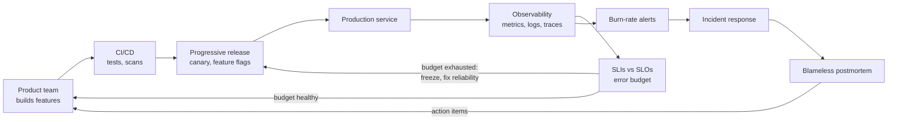
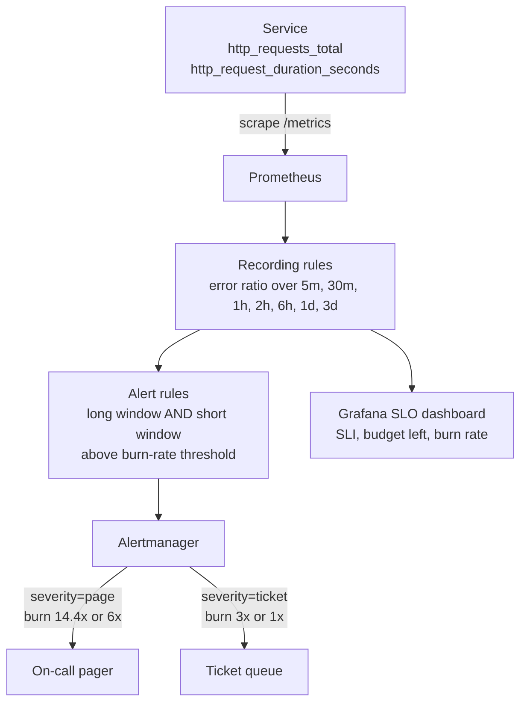
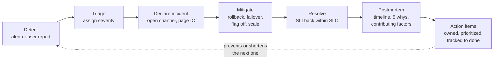
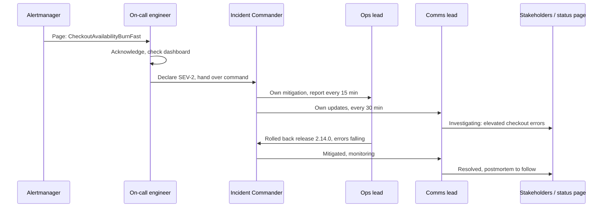
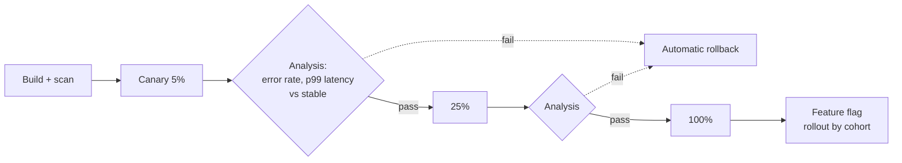

# SRE & Reliability

<!-- DEVOPS-SHACK:HEADER -->

  
  
  
  
  

Part of <b><a href="https://github.com/jaiswaladi246/DevOps-Cloud-Interview-Preparation-by-DevOps-Shack">DevOps &amp; Cloud Interview Preparation</a></b> — created by <b><a href="https://www.youtube.com/@devopsshack">DevOps Shack</a></b>. Free to learn from; please credit DevOps Shack when sharing.

<!-- /DEVOPS-SHACK:HEADER -->

> Run services the way SRE teams do: reliability defined as numbers (SLIs, SLOs, error budgets), alerts that fire on user pain instead of CPU graphs, calm incident response, blameless postmortems, and engineering work that removes toil and failure modes for good. Everything an interviewer can ask an SRE or senior DevOps engineer, from "what is an SLO" to multi-window burn-rate alerting and chaos experiments in production.

[🏠 Home](../README.md)

## What you'll master

- SRE vs DevOps: where they overlap, where they differ, and how SRE teams engage with product teams
- SLIs, SLOs and SLAs: choosing good indicators, picking targets, measuring at the right place, and writing them as Prometheus recording rules
- Error budgets and error-budget policies, and multi-window, multi-burn-rate alerting that pages only when the budget is really at risk
- Availability math: the "nines", downtime per month, serial vs parallel dependencies, and why your SLO can never beat your dependencies
- Toil: how to measure it, cap it and automate it away
- On-call design, alert fatigue, paging vs ticketing, and healthy rotations
- Incident management: severity levels, the Incident Commander / Comms / Ops roles, timelines, and blameless postmortems with the 5 whys
- Capacity planning, load and performance testing with k6, and chaos engineering with Chaos Mesh, LitmusChaos and AWS FIS
- Release engineering: canary, blue-green, feature flags and progressive delivery gated on SLOs
- Reliability patterns: timeouts, retries with exponential backoff and jitter, circuit breakers, bulkheads, load shedding, rate limiting, graceful degradation
- Backup and disaster recovery with RTO/RPO, runbooks, and the SRE and DORA metrics (MTTD, MTTR, change failure rate) interviewers expect you to know

---

## Where SRE sits in the delivery loop

SRE is not a separate phase. It wraps the whole loop with a feedback signal: the SLO. Releases spend error budget, incidents burn it, and the remaining budget decides whether the next sprint ships features or reliability work.

The key idea: reliability decisions are made with data, not opinions. "Can we ship on Friday?" becomes "how much budget do we have left?"

## From raw metrics to a page

This is the pipeline we build in the [hands-on lab](./hands-on-lab.md). The service exports counters and histograms, Prometheus turns them into SLI ratios over several windows using recording rules, alert rules compare the burn rate on a long and a short window, and Alertmanager routes fast burns to a pager and slow burns to a ticket queue.

The long window proves the problem is significant; the short window proves it is still happening, so the alert resets quickly once you fix it.

## Incident lifecycle

Every incident follows the same shape. The goal at each stage is different: detection wants speed, mitigation wants to stop the bleeding (not find root cause), and the postmortem wants learning.

MTTD is the time from start to detection, MTTA is detection to acknowledgement, and MTTR (time to restore) runs from start to resolution. Most of MTTR is usually spent before anyone starts fixing: noticing, paging and diagnosing.

## Incident roles and communication

For anything above a minor incident we split the work. One person cannot debug, coordinate, and update stakeholders at the same time without dropping one of them.

The IC does not touch the keyboard. Their job is decisions, delegation and keeping a timeline.

## Progressive delivery gated by SLOs

A release is a controlled experiment. Traffic shifts in steps, and an automated analysis compares the canary's SLIs against the stable version before every step.

Deploying code and releasing features are separate steps: the code goes out dark behind a flag, and the flag ramps independently, which gives you a sub-second kill switch.

---

## Core concepts in 10 minutes

### 1. SRE vs DevOps

DevOps is a culture and set of practices that breaks the wall between building and running software. SRE is one concrete way to implement it: "what happens when you ask software engineers to design an operations function." SRE adds specific mechanisms: SLOs, error budgets, a cap on toil (Google's guideline is at most 50% of an SRE's time), blameless postmortems, and the right to hand a pager back to a product team that ignores reliability. In interviews, the clean line is: "DevOps says *what* we want, SRE prescribes *how*, with numbers."

### 2. SLI, SLO, SLA

An **SLI** is a measurement of user experience, best expressed as a ratio: good events / valid events (for example successful requests / all requests, or requests under 300 ms / all requests). An **SLO** is the internal target for that SLI over a window: "99.9% of checkout requests succeed over a rolling 28 days." An **SLA** is a contract with customers that carries a penalty (credits, refunds). The SLA should always be looser than the SLO so you get warned internally long before you owe anyone money.

### 3. Picking good SLIs

Measure what users feel, as close to them as you can: at the load balancer or ingress, or with synthetic probes, not CPU or pod restarts. Common SLI types: availability, latency, quality (degraded responses), freshness (data pipelines), correctness and durability (storage). Exclude what is not the service's fault, such as client 4xx errors, but count 429s you returned because you were overloaded. Use a small number per user journey, typically two or three.

### 4. Error budgets

The error budget is `1 - SLO`. At 99.9% over 30 days you may fail 0.1% of requests, or about 43 minutes of full downtime. The budget is spent by incidents, risky deploys, and planned maintenance. An **error-budget policy**, agreed in advance with product leadership, says what happens when it runs out: freeze non-critical releases, move engineers to reliability work, require extra review for changes. The budget turns arguments about risk into a shared, measurable number.

### 5. Burn rate and multi-window alerting

Burn rate is how fast you consume budget relative to the SLO: `observed error ratio / (1 - SLO)`. A burn rate of 1 uses exactly the whole budget over the window; 14.4 over one hour uses 2% of a 30-day budget. The standard scheme pages on 14.4x (1h window, confirmed on 5m) and 6x (6h, confirmed on 30m), and opens tickets on 3x (1d with 2h) and 1x (3d with 6h). Both windows must exceed the threshold, which gives good precision, fast detection of big outages, and fast reset after recovery.

### 6. Availability math

Each extra nine cuts allowed downtime by ten: per 30 days, 99% allows 7.2 h, 99.9% allows 43.2 min, 99.99% allows 4.32 min. Dependencies in **series** multiply: three hard dependencies at 99.9% give about 99.7%. Redundant components in **parallel** combine as `1 - (1 - a)^n`: two independent 99% replicas give 99.99%, if failover is automatic and failures really are independent. You cannot promise more availability than your critical dependencies provide unless you design around them.

### 7. Toil

Toil is operational work that is manual, repetitive, automatable, tactical, has no lasting value, and grows linearly with service size. Restarting a stuck pod by hand every night, rotating certificates manually, and approving the same access requests are toil. On-call response itself is not toil if it produces learning. Measure it (ticket tags, time tracking), cap it, and spend the rest on engineering that removes it.

### 8. On-call and alert fatigue

Every page must be urgent, actionable, and require human judgment. If an alert can wait until morning, it is a ticket. Page on symptoms (SLO burn) rather than causes (CPU, disk on one node). A sustainable rotation has at least 6 to 8 engineers for single-site 24/7 or a follow-the-sun split, a primary and a secondary, compensated time, and a handoff review. Track pages per shift; Google's guideline is no more than two incidents per 12-hour shift.

### 9. Incident management

Severity levels (SEV-1 to SEV-4 or P1 to P4) are defined by user impact, not by how hard the bug is. For a real incident, assign an Incident Commander, an Ops lead and a Comms lead, open a dedicated channel, keep a timestamped log, and mitigate first: rollback, failover, disable the flag, shed load. Root cause comes later. Declare early; downgrading a SEV-2 costs nothing, declaring late costs hours.

### 10. Blameless postmortems

A postmortem documents impact, timeline, root cause and contributing factors, what went well, where we got lucky, and action items with owners and due dates. Blameless means we assume people acted reasonably with the information they had, and fix the system that let a reasonable action cause harm. The **5 whys** technique keeps asking "why" until you reach a fixable process or design gap; in complex systems you usually find several contributing factors rather than one root cause.

### 11. Capacity, load testing and chaos

Capacity planning forecasts demand (organic growth plus launches), measures per-instance capacity with load tests, and provisions with headroom for N+1 or N+2 failure domains. Use k6 to find the knee of the latency curve and to gate releases with thresholds. Chaos engineering verifies that failure handling works: define steady state with SLIs, form a hypothesis, inject a fault (pod kill, latency, AZ loss), limit the blast radius, and have automatic stop conditions.

### 12. Reliability patterns

Every network call needs a **timeout** shorter than the caller's. **Retries** need a budget, exponential backoff and jitter, and only for idempotent operations, or they turn a blip into a retry storm. **Circuit breakers** stop calling a failing dependency and fail fast. **Bulkheads** isolate pools so one slow dependency cannot take every thread. **Rate limiting** and **load shedding** protect you from overload, and **graceful degradation** serves a reduced experience (cached prices, no recommendations) instead of an error.

### 13. Backup, DR and runbooks

**RPO** is how much data you can lose (time since the last good copy); **RTO** is how long you can be down. Backups that have never been restored are hopes, not backups: test restores on a schedule. DR strategies on a cost/RTO scale: backup and restore, pilot light, warm standby, multi-site active-active. A **runbook** is a short, tested, linked-from-the-alert procedure: what the alert means, how to check impact, how to mitigate, and when to escalate.

### 14. Metrics that describe reliability work

**MTTD**, **MTTA** and **MTTR** describe incident response. **DORA** metrics describe delivery performance: deployment frequency, lead time for changes, change failure rate, and failed deployment recovery time. Elite teams deploy on demand with low change failure rates; speed and stability go together. Use these metrics for trends and learning, never as individual targets.

---

## Question banks

Three banks with collapsible answers: 200 concepts, 100 scenarios and 100 troubleshooting drills, tagged 🟢 Beginner, 🟡 Intermediate, 🔴 Advanced.

| Bank | Questions | What it covers |
|------|-----------|----------------|
| [Concepts](./concepts.md) | 200 | SRE vs DevOps, SLIs/SLOs/SLAs, error budgets, burn-rate math, availability math, toil, on-call, incident management, postmortems, capacity, k6, chaos engineering, release engineering, reliability patterns, DR, DORA, best practices and rapid-fire commands |
| [Scenarios](./scenarios.md) | 125 | "What would you do" situations with a step-by-step approach |
| [Troubleshooting](./troubleshooting.md) | 100 | Real error messages: likely causes, diagnosis commands, fix and prevention |

## Learning path

Work through these in order. Tick each one only when you can do it without notes.

**Beginner**
- [ ] Explain SRE vs DevOps and the difference between SLI, SLO and SLA in one sentence each
- [ ] Convert 99%, 99.9%, 99.95% and 99.99% into allowed downtime per month from memory
- [ ] Write an availability SLI as good events / valid events for an HTTP service
- [ ] Explain what an error budget is and what an error-budget policy does
- [ ] Describe what makes an alert page-worthy, and the difference between a page and a ticket
- [ ] List the incident roles (IC, Ops, Comms) and severity levels and explain why they exist
- [ ] Explain what "blameless" means and run the 5 whys on a simple outage
- [ ] Do the first 10 [assignments](./assignments.md)

**Intermediate**
- [ ] Write SLI recording rules in PromQL for availability and latency (histogram buckets)
- [ ] Calculate burn rate and the budget consumed by an incident from raw numbers
- [ ] Explain multi-window, multi-burn-rate alerting and write the four alert rules
- [ ] Compute composite availability for serial and parallel dependencies
- [ ] Write a k6 test with arrival-rate executors and thresholds, and read its summary
- [ ] Run a pod-kill and a network-latency experiment with Chaos Mesh and explain the results
- [ ] Describe canary analysis with Argo Rollouts or Flagger and when to use feature flags instead
- [ ] Explain timeouts, retries with jitter, circuit breakers and bulkheads with concrete settings
- [ ] Complete the [hands-on lab](./hands-on-lab.md) end to end

**Advanced**
- [ ] Design SLOs for a multi-service user journey, including dependencies you do not own
- [ ] Unit test alert rules with `promtool test rules` and keep SLO definitions in Git (Sloth, Pyrra or OpenSLO)
- [ ] Run a game day with AWS FIS or Litmus, with stop conditions tied to SLO alarms
- [ ] Build a capacity model from load-test results, growth forecasts and N+2 failure domains
- [ ] Design DR for a stateful service with explicit RTO/RPO and prove it with a timed restore
- [ ] Explain retry amplification across service layers and how retry budgets fix it
- [ ] Lead a mock SEV-1 as Incident Commander and write the postmortem
- [ ] Finish all 25 assignments and answer 150 of the 200 questions in each bank unaided

## Study materials

- [Hands-on lab: SLOs, burn-rate alerts, load and chaos on kind](./hands-on-lab.md) — demo service, Prometheus recording rules, multi-window burn-rate alerts, Grafana SLO dashboard, k6, Chaos Mesh, incident and postmortem
- [Assignments](./assignments.md) — 25 graded exercises (10 beginner, 10 intermediate, 5 advanced)
- [Cheatsheet](./cheatsheet.md) — nines table, burn-rate table, PromQL SLO rules, k6, Chaos Mesh, FIS, incident checklists, and the top 15 interview one-liners

[🏠 Home](../README.md)

<!-- DEVOPS-SHACK:FOOTER -->
---

### 🚀 Made with ❤️ by [DevOps Shack](https://www.youtube.com/@devopsshack)

**Learn DevOps, DevSecOps, Cloud and Kubernetes the practical way.**

[▶️ YouTube — DevOps Shack](https://www.youtube.com/@devopsshack) · [▶️ Hindi — @shackverse](https://www.youtube.com/@shackverse) · [🎓 devopsshack.com](https://devopsshack.com) · [📸 Instagram @devopsshack](https://www.instagram.com/devopsshack)

[🏠 Back to Home](../README.md) · [⭐ Star the original repo](https://github.com/jaiswaladi246/DevOps-Cloud-Interview-Preparation-by-DevOps-Shack)

© DevOps Shack · Licensed CC BY-NC-SA 4.0 · If you found this copy anywhere other than <a href="https://github.com/jaiswaladi246/DevOps-Cloud-Interview-Preparation-by-DevOps-Shack">github.com/jaiswaladi246</a>, the original and latest version is maintained by DevOps Shack.

<!-- /DEVOPS-SHACK:FOOTER -->
