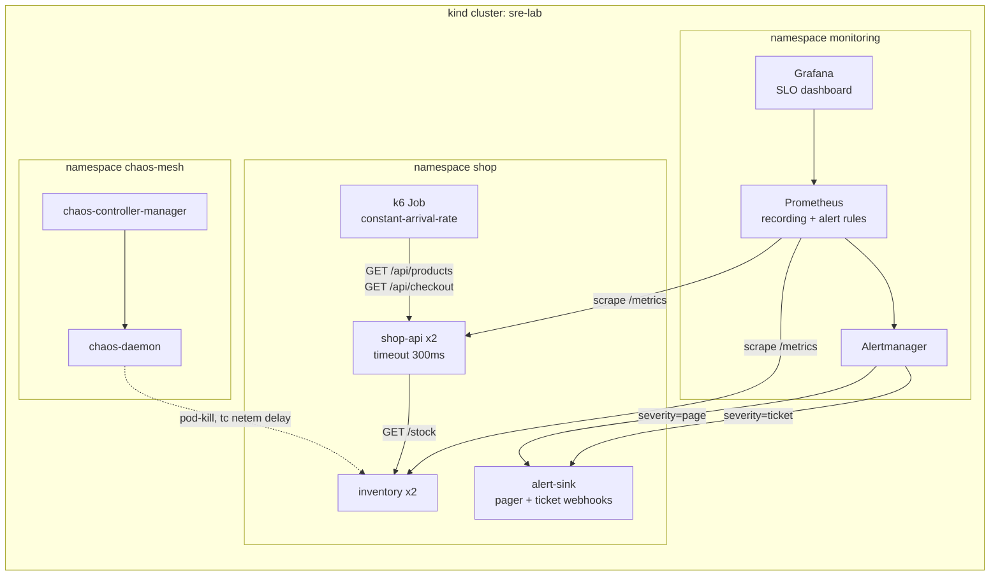

# Hands-on Lab: SLOs, Burn-Rate Alerts, Load and Chaos on kind

<!-- DEVOPS-SHACK:HEADER -->
<p align="center">
  <a href="https://www.youtube.com/@devopsshack"></a>
  <a href="https://www.youtube.com/@shackverse"></a>
  <a href="https://devopsshack.com"></a>
  <a href="https://www.instagram.com/devopsshack"></a>
  <a href="https://github.com/jaiswaladi246/DevOps-Cloud-Interview-Preparation-by-DevOps-Shack"></a>
</p>
<p align="center"><sub>Part of <b><a href="https://github.com/jaiswaladi246/DevOps-Cloud-Interview-Preparation-by-DevOps-Shack">DevOps &amp; Cloud Interview Preparation</a></b> — created by <b><a href="https://www.youtube.com/@devopsshack">DevOps Shack</a></b>. Free to learn from; please credit DevOps Shack when sharing.</sub></p>
<!-- /DEVOPS-SHACK:HEADER -->

> Run a small two-service shop on kind the way an SRE team runs production: SLOs written as Prometheus recording rules, multi-window multi-burn-rate alerts routed to a pager and a ticket queue, a Grafana SLO dashboard, a k6 load test with thresholds, a Chaos Mesh game day that turns into a real incident with an Incident Commander, and a blameless postmortem written from a template.

[⬅ Back to SRE & Reliability](./README.md) · [🏠 Home](../README.md)

## Goal

By the end you will have:

- A kind cluster running **kube-prometheus-stack** (Prometheus, Alertmanager, Grafana) and **Chaos Mesh**
- A demo service, `shop-api`, that calls a dependency, `inventory`, with a client timeout, both exporting `http_requests_total` and `http_request_duration_seconds`
- Two written SLOs for `shop-api`: **availability 99.9%** and **latency 99% under 250 ms**, over a rolling 30 days, plus an error-budget policy
- Recording rules that compute each SLI over 5m, 30m, 1h, 2h, 6h, 1d, 3d and 30d
- The four standard burn-rate alerts (14.4x and 6x page, 3x and 1x ticket), unit tested with `promtool test rules`
- Alertmanager routing `severity=page` and `severity=ticket` to two different receivers
- A Grafana dashboard (JSON in Git) showing SLI, budget remaining, burn rate per window, latency and dependency health
- A k6 baseline load test that passes its thresholds, and the same test failing them during chaos
- A Chaos Mesh pod-kill experiment that proves a hypothesis, and a network-latency experiment that causes a real SLO burn
- An incident run with explicit roles (IC, Ops, Comms, Scribe), mitigated with graceful degradation instead of a code fix
- A postmortem written from a template, with budget impact computed from Prometheus

Time: about 3 hours. Cost: free, everything runs locally.

## Architecture



The lab folder we build:

```text
sre-lab/
├── kind.yaml
├── kps-values.yaml                 # kube-prometheus-stack values, incl. Alertmanager routing
├── app/
│   ├── app.py                      # one image, three roles: api, inventory, sink
│   ├── requirements.txt
│   └── Dockerfile
├── k8s/
│   ├── namespace.yaml
│   ├── inventory.yaml
│   ├── shop-api.yaml
│   ├── alert-sink.yaml
│   └── servicemonitor.yaml
├── slo/
│   ├── SLO.md                      # the human-readable SLO document and budget policy
│   ├── recording-rules.yaml        # PrometheusRule: SLIs per window
│   ├── alert-rules.yaml            # PrometheusRule: multi-window multi-burn-rate alerts
│   └── slo-rules.test.yaml         # promtool unit tests
├── grafana/
│   └── shop-api-slo.json           # dashboard as code
├── k6/
│   ├── load.js
│   ├── job-baseline.yaml
│   └── job-background.yaml
├── chaos/
│   ├── pod-kill.yaml
│   └── inventory-latency.yaml
├── runbooks/
│   └── shop-api-slo.md
├── incidents/
│   └── 2026-11-09-checkout-errors.md   # live incident log
└── postmortems/
    ├── TEMPLATE.md
    └── 2026-11-09-checkout-errors.md
```

## Prerequisites

- Docker (Engine 26+ or Desktop) with at least **4 CPUs and 8 GB RAM** allocated
- `kind` 0.24+, `kubectl` 1.30+, `helm` 3.15+
- `jq`, `yq` (mikefarah v4), `curl`
- Basic PromQL and Kubernetes. No cloud account needed.

```bash
docker version --format '{{.Server.Version}}'
kind version
kubectl version --client
helm version --short
yq --version          # must say mikefarah ... v4.x
```

Create the folder and stay in it for the whole lab:

```bash
mkdir -p sre-lab/{app,k8s,slo,grafana,k6,chaos,runbooks,incidents,postmortems}
cd sre-lab
```

---

## Step 1. Create the kind cluster

One control-plane and one worker is enough. Chaos Mesh runs a daemon on every node, so two nodes also shows that it targets the right node automatically.

`kind.yaml`:

```yaml
kind: Cluster
apiVersion: kind.x-k8s.io/v1alpha4
name: sre-lab
nodes:
  - role: control-plane
  - role: worker
```

```bash
kind create cluster --config kind.yaml
kubectl cluster-info --context kind-sre-lab
```

**Verify**

```bash
kubectl get nodes
# NAME                    STATUS   ROLES           AGE   VERSION
# sre-lab-control-plane   Ready    control-plane   60s   v1.3x.x
# sre-lab-worker          Ready    <none>          40s   v1.3x.x
```

## Step 2. Install kube-prometheus-stack with SLO-aware alert routing

Three things in the values matter for this lab:

1. `*SelectorNilUsesHelmValues: false` makes Prometheus pick up **every** ServiceMonitor and PrometheusRule in the cluster, not only those labelled with the Helm release.
2. Alertmanager routes on our `severity` label: `page` goes to the pager receiver, `ticket` to the ticket receiver. Everything else (the chart's default rules) goes to a `null` receiver so it does not drown the lab.
3. Control-plane scrapers that kind does not expose are disabled to avoid permanent `TargetDown` noise.

`kps-values.yaml`:

```yaml
fullnameOverride: kps

grafana:
  adminPassword: admin
  sidecar:
    dashboards:
      enabled: true
      label: grafana_dashboard
      labelValue: "1"

prometheus:
  prometheusSpec:
    serviceMonitorSelectorNilUsesHelmValues: false
    podMonitorSelectorNilUsesHelmValues: false
    ruleSelectorNilUsesHelmValues: false
    scrapeInterval: 15s
    evaluationInterval: 30s
    retention: 10d

alertmanager:
  config:
    global:
      resolve_timeout: 5m
    route:
      receiver: "null"
      group_by: ["alertname", "slo"]
      group_wait: 30s
      group_interval: 2m
      repeat_interval: 4h
      routes:
        - receiver: "null"
          matchers:
            - alertname =~ "Watchdog|InfoInhibitor"
        - receiver: pager
          group_wait: 10s
          matchers:
            - severity = "page"
        - receiver: ticket
          matchers:
            - severity = "ticket"
    receivers:
      - name: "null"
      - name: pager
        webhook_configs:
          - url: http://alert-sink.shop.svc.cluster.local:8080/webhook/pager
            send_resolved: true
      - name: ticket
        webhook_configs:
          - url: http://alert-sink.shop.svc.cluster.local:8080/webhook/ticket
            send_resolved: true

kubeEtcd:
  enabled: false
kubeControllerManager:
  enabled: false
kubeScheduler:
  enabled: false
kubeProxy:
  enabled: false

prometheus-node-exporter:
  hostRootFsMount:
    enabled: false
```

```bash
helm repo add prometheus-community https://prometheus-community.github.io/helm-charts
helm repo update
helm upgrade --install kps prometheus-community/kube-prometheus-stack \
  -n monitoring --create-namespace -f kps-values.yaml --wait --timeout 10m
```

**Verify**

```bash
kubectl -n monitoring get pods
# alertmanager-kps-alertmanager-0     2/2   Running
# kps-grafana-xxxxx                   3/3   Running
# kps-operator-xxxxx                  1/1   Running
# kps-kube-state-metrics-xxxxx        1/1   Running
# kps-prometheus-node-exporter-xxxxx  1/1   Running   (one per node)
# prometheus-kps-prometheus-0         2/2   Running
```

Open three port-forwards in a separate terminal and leave them running for the rest of the lab:

```bash
kubectl -n monitoring port-forward svc/prometheus-operated 9090:9090 &
kubectl -n monitoring port-forward svc/alertmanager-operated 9093:9093 &
kubectl -n monitoring port-forward svc/kps-grafana 3000:80 &
```

```bash
curl -s localhost:9090/-/ready                     # Prometheus Server is Ready.
curl -s localhost:9093/api/v2/status | jq '.cluster.status'   # "ready"
curl -s -u admin:admin localhost:3000/api/health | jq '.database'   # "ok"
```

Check that Alertmanager loaded our routing tree (not the chart default):

```bash
curl -s localhost:9093/api/v2/status | jq -r '.config.original' | grep -A3 'receiver: pager'
```

## Step 3. Build the demo service

One small Python image plays three roles, selected by the `ROLE` environment variable:

- `api`: `shop-api`. `/api/products` is served locally; `/api/checkout` calls `inventory` with a client timeout (`DEP_TIMEOUT_SECONDS`, default 300 ms). On failure it returns **503**, or, if `DEGRADE_ON_DEP_FAILURE=true`, a **200 with `"degraded": true`** (graceful degradation, our mitigation later).
- `inventory`: the dependency. Fast (5 to 30 ms) unless `ERROR_RATE` is set.
- `sink`: receives Alertmanager webhooks and logs one line per alert, so "the pager" is just `kubectl logs`.

Metrics, deliberately named like any real HTTP service:

| Metric | Type | Labels | Used for |
|--------|------|--------|----------|
| `http_requests_total` | counter | `route`, `method`, `code` | Availability SLI |
| `http_request_duration_seconds` | histogram, buckets incl. `0.25` | `route`, `method` | Latency SLI |
| `dependency_request_duration_seconds` | histogram | `dependency`, `outcome` | Client-side view of inventory |
| `checkout_degraded_total` | counter | none | Quality SLI while degraded |

We do not add `service`, `pod` or `namespace` labels in code: Prometheus adds them from the scrape target, and the Service name becomes the `job` label (`job="shop-api"`).

`app/app.py`:

```python
import logging
import os
import random
import sys
import time

import requests
from flask import Flask, Response, g, request
from prometheus_client import CONTENT_TYPE_LATEST, Counter, Histogram, generate_latest

ROLE = os.getenv("ROLE", "api")  # api | inventory | sink
INVENTORY_URL = os.getenv("INVENTORY_URL", "http://inventory:8080/stock")
DEP_TIMEOUT = float(os.getenv("DEP_TIMEOUT_SECONDS", "0.3"))
DEGRADE = os.getenv("DEGRADE_ON_DEP_FAILURE", "false").lower() == "true"
ERROR_RATE = float(os.getenv("ERROR_RATE", "0"))

logging.basicConfig(stream=sys.stdout, level=logging.INFO,
                    format="%(asctime)s %(levelname)s %(name)s %(message)s")
log = logging.getLogger(ROLE)
app = Flask(__name__)

BUCKETS = (0.01, 0.025, 0.05, 0.1, 0.25, 0.5, 1.0, 2.5, 5.0)
REQUESTS = Counter("http_requests_total", "HTTP requests served",
                   ["route", "method", "code"])
LATENCY = Histogram("http_request_duration_seconds", "HTTP request latency in seconds",
                    ["route", "method"], buckets=BUCKETS)
DEP_LATENCY = Histogram("dependency_request_duration_seconds",
                        "Client-side latency of calls to dependencies",
                        ["dependency", "outcome"], buckets=BUCKETS)
DEGRADED = Counter("checkout_degraded_total",
                   "Checkout responses served without live inventory data")
NOT_MEASURED = {"/metrics", "/healthz"}


@app.before_request
def _start_timer():
    g.start = time.perf_counter()


@app.after_request
def _record(resp):
    if ROLE != "sink" and request.path not in NOT_MEASURED:
        route = request.url_rule.rule if request.url_rule else "unmatched"
        LATENCY.labels(route, request.method).observe(time.perf_counter() - g.start)
        REQUESTS.labels(route, request.method, str(resp.status_code)).inc()
    return resp


@app.get("/healthz")
def healthz():
    return {"status": "ok", "role": ROLE}


@app.get("/metrics")
def metrics():
    return Response(generate_latest(), content_type=CONTENT_TYPE_LATEST)


if ROLE == "inventory":
    @app.get("/stock")
    def stock():
        time.sleep(random.uniform(0.005, 0.03))
        if random.random() < ERROR_RATE:
            return {"error": "inventory backend error"}, 500
        return {"sku": "shack-tee", "stock": random.randint(0, 50)}


if ROLE == "api":
    @app.get("/api/products")
    def products():
        time.sleep(random.uniform(0.005, 0.02))
        if random.random() < ERROR_RATE:
            return {"error": "internal error"}, 500
        return {"products": [{"sku": "shack-tee", "price": 799},
                             {"sku": "shack-mug", "price": 349}]}

    @app.get("/api/checkout")
    def checkout():
        t0 = time.perf_counter()
        try:
            r = requests.get(INVENTORY_URL, timeout=DEP_TIMEOUT)
            r.raise_for_status()
            DEP_LATENCY.labels("inventory", "ok").observe(time.perf_counter() - t0)
            return {"order": "accepted", "stock": r.json()["stock"]}
        except requests.RequestException as exc:
            outcome = "timeout" if isinstance(exc, requests.Timeout) else "error"
            DEP_LATENCY.labels("inventory", outcome).observe(time.perf_counter() - t0)
            log.warning("inventory call failed: %s", exc.__class__.__name__)
            if DEGRADE:
                DEGRADED.inc()
                return {"order": "accepted", "stock": "unknown", "degraded": True}
            return {"error": "inventory unavailable"}, 503


if ROLE == "sink":
    @app.post("/webhook/<receiver>")
    def webhook(receiver):
        body = request.get_json(force=True, silent=True) or {}
        alerts = body.get("alerts", [])
        for a in alerts:
            labels = a.get("labels", {})
            log.info("[%s] %s %s severity=%s slo=%s",
                     receiver.upper(), a.get("status", "").upper(),
                     labels.get("alertname"), labels.get("severity"), labels.get("slo"))
        return {"received": len(alerts)}
```

`app/requirements.txt`:

```text
flask==3.0.3
gunicorn==23.0.0
prometheus-client==0.21.0
requests==2.32.3
```

`app/Dockerfile`:

```dockerfile
FROM python:3.12-slim
WORKDIR /app
COPY requirements.txt .
RUN pip install --no-cache-dir -r requirements.txt
COPY app.py .
USER 10001
EXPOSE 8080
# One worker process so prometheus_client keeps one registry; threads give concurrency.
CMD ["gunicorn", "-b", "0.0.0.0:8080", "-w", "1", "--threads", "32", "--timeout", "30", "app:app"]
```

Build and load it into the kind nodes (no registry needed):

```bash
docker build -t shop-app:1.0.0 app/
kind load docker-image shop-app:1.0.0 --name sre-lab
```

**Verify**

```bash
docker exec sre-lab-worker crictl images | grep shop-app
# docker.io/library/shop-app   1.0.0   ...
```

Why one gunicorn worker: the default `prometheus_client` registry lives in process memory. With several worker processes, each scrape hits a random worker and the counters appear to jump backwards, which Prometheus reads as counter resets. In production you either use multiprocess mode or one process per container.

## Step 4. Deploy the service, the dependency and the alert sink

`k8s/namespace.yaml`:

```yaml
apiVersion: v1
kind: Namespace
metadata:
  name: shop
```

`k8s/inventory.yaml`:

```yaml
apiVersion: apps/v1
kind: Deployment
metadata:
  name: inventory
  namespace: shop
  labels:
    app: inventory
spec:
  replicas: 2
  selector:
    matchLabels:
      app: inventory
  template:
    metadata:
      labels:
        app: inventory
    spec:
      containers:
        - name: app
          image: shop-app:1.0.0
          imagePullPolicy: IfNotPresent
          env:
            - name: ROLE
              value: inventory
          ports:
            - name: http
              containerPort: 8080
          readinessProbe:
            httpGet:
              path: /healthz
              port: http
            periodSeconds: 5
          resources:
            requests:
              cpu: 50m
              memory: 64Mi
            limits:
              memory: 256Mi
---
apiVersion: v1
kind: Service
metadata:
  name: inventory
  namespace: shop
  labels:
    app: inventory
spec:
  selector:
    app: inventory
  ports:
    - name: http
      port: 8080
      targetPort: http
```

`k8s/shop-api.yaml`:

```yaml
apiVersion: apps/v1
kind: Deployment
metadata:
  name: shop-api
  namespace: shop
  labels:
    app: shop-api
spec:
  replicas: 2
  selector:
    matchLabels:
      app: shop-api
  strategy:
    rollingUpdate:
      maxUnavailable: 0
      maxSurge: 1
  template:
    metadata:
      labels:
        app: shop-api
    spec:
      containers:
        - name: app
          image: shop-app:1.0.0
          imagePullPolicy: IfNotPresent
          env:
            - name: ROLE
              value: api
            - name: INVENTORY_URL
              value: http://inventory.shop.svc.cluster.local:8080/stock
            - name: DEP_TIMEOUT_SECONDS
              value: "0.3"
            - name: DEGRADE_ON_DEP_FAILURE
              value: "false"
          ports:
            - name: http
              containerPort: 8080
          readinessProbe:
            httpGet:
              path: /healthz
              port: http
            periodSeconds: 5
          resources:
            requests:
              cpu: 100m
              memory: 96Mi
            limits:
              memory: 256Mi
---
apiVersion: v1
kind: Service
metadata:
  name: shop-api
  namespace: shop
  labels:
    app: shop-api
spec:
  selector:
    app: shop-api
  ports:
    - name: http
      port: 8080
      targetPort: http
```

`k8s/alert-sink.yaml`:

```yaml
apiVersion: apps/v1
kind: Deployment
metadata:
  name: alert-sink
  namespace: shop
  labels:
    app: alert-sink
spec:
  replicas: 1
  selector:
    matchLabels:
      app: alert-sink
  template:
    metadata:
      labels:
        app: alert-sink
    spec:
      containers:
        - name: app
          image: shop-app:1.0.0
          imagePullPolicy: IfNotPresent
          env:
            - name: ROLE
              value: sink
          ports:
            - name: http
              containerPort: 8080
---
apiVersion: v1
kind: Service
metadata:
  name: alert-sink
  namespace: shop
spec:
  selector:
    app: alert-sink
  ports:
    - name: http
      port: 8080
      targetPort: http
```

`k8s/servicemonitor.yaml` (one ServiceMonitor for both services; the `port` must match the Service port **name**):

```yaml
apiVersion: monitoring.coreos.com/v1
kind: ServiceMonitor
metadata:
  name: shop
  namespace: shop
spec:
  selector:
    matchExpressions:
      - key: app
        operator: In
        values: ["shop-api", "inventory"]
  endpoints:
    - port: http
      path: /metrics
      interval: 15s
```

```bash
kubectl apply -f k8s/namespace.yaml
kubectl apply -f k8s/
kubectl -n shop rollout status deploy/inventory
kubectl -n shop rollout status deploy/shop-api
kubectl -n shop rollout status deploy/alert-sink
```

**Verify the service works and exports metrics**

```bash
kubectl -n shop run curl --rm -it --restart=Never --image=curlimages/curl:8.10.1 -- sh -c '
  curl -s shop-api:8080/api/products; echo
  curl -s shop-api:8080/api/checkout; echo
  curl -s shop-api:8080/metrics | grep -E "^http_requests_total|^dependency_request_duration_seconds_count"'
# {"products":[...]}
# {"order":"accepted","stock":17}
# http_requests_total{code="200",method="GET",route="/api/products"} 1.0
# http_requests_total{code="200",method="GET",route="/api/checkout"} 1.0
# dependency_request_duration_seconds_count{dependency="inventory",outcome="ok"} 1.0
```

**Verify Prometheus scrapes both jobs** (allow 30 to 60 seconds for discovery):

```bash
curl -s localhost:9090/api/v1/targets?state=active \
  | jq -r '.data.activeTargets[] | select(.labels.namespace=="shop") | "\(.labels.job) \(.labels.pod) \(.health)"'
# inventory inventory-xxxxx up
# inventory inventory-yyyyy up
# shop-api  shop-api-xxxxx  up
# shop-api  shop-api-yyyyy  up

curl -s localhost:9090/api/v1/query --data-urlencode 'query=sum by (job, code) (http_requests_total{namespace="shop"})' | jq '.data.result'
```

## Step 5. Write the SLOs down before writing any PromQL

An SLO starts as a document that product, engineering and SRE agree on. The rules come second. `slo/SLO.md`:

```markdown
# shop-api SLOs

Owner: Shop team (service), SRE (on-call and tooling). Reviewed: quarterly.

## User journeys covered
- Browse products: GET /api/products
- Check out: GET /api/checkout (depends on inventory)

## SLIs (measured at shop-api, server side; ingress-level SLIs are a follow-up)
| SLI | Good event | Valid event |
|-----|------------|-------------|
| Availability | response code is not 5xx | every request except /metrics and /healthz |
| Latency | served in 250 ms or less (histogram bucket le="0.25") | every request except /metrics and /healthz |

## SLOs (rolling 30 days)
| SLO | Target | Error budget | Budget in requests at 40 rps |
|-----|--------|--------------|------------------------------|
| shop-api-availability | 99.9% | 0.1% (43.2 min full outage) | 103,680 failed requests |
| shop-api-latency | 99% | 1% | 1,036,800 slow requests |

## Alerting
Multi-window, multi-burn-rate: page at 14.4x (1h/5m) and 6x (6h/30m), ticket at 3x (1d/2h) and 1x (3d/6h).

## Error-budget policy
- Budget above 50%: ship normally.
- Budget below 50%: every release needs a canary and a rollback plan in the PR.
- Budget exhausted: freeze feature releases for shop-api until the 30-day SLI is back above target;
  only reliability fixes and security patches ship. The team's next sprint prioritises postmortem action items.
- A single incident consuming more than 20% of the budget requires a postmortem.
- Disagreements are escalated to the head of engineering, not settled per incident.
```

Do the arithmetic once so the numbers in alerts make sense:

```text
Budget fraction      = 1 - 0.999 = 0.001
Burn rate            = observed error ratio / 0.001
14.4x on a 1h window = error ratio > 1.44%  -> burns 2% of the 30-day budget in 1 hour
6x on a 6h window    = error ratio > 0.6%   -> burns 5% in 6 hours
3x on a 1d window    = error ratio > 0.3%   -> burns 10% in 1 day
1x on a 3d window    = error ratio > 0.1%   -> burns 10% in 3 days
Latency SLO (99%) uses the same multipliers on a 1% budget: 14.4%, 6%, 3%, 1%.
```

**Verify:** you can answer "how many minutes of full outage can checkout take this month?" (43.2) and "what error ratio pages us within the hour?" (1.44%) without looking.

## Step 6. Encode the SLIs as recording rules

Recording rules precompute each SLI's **error ratio** per window, so alerts and dashboards read cheap, consistent series instead of re-running heavy `rate()` queries over days of data. We follow the `level:metric:operation` naming convention: `slo:sli_error:ratio_rate<window>`, and an `slo` label identifies which SLO the series belongs to.

Two details that bite people:

- If no 5xx has happened yet, the numerator has no series and the whole ratio is empty instead of 0. `or vector(0)` fixes it.
- When there is no traffic at all, the ratio is `0/0 = NaN`. That is correct: no traffic means no evidence either way, and NaN never satisfies `> threshold`.

`slo/recording-rules.yaml`:

```yaml
apiVersion: monitoring.coreos.com/v1
kind: PrometheusRule
metadata:
  name: shop-api-slo-recording
  namespace: shop
spec:
  groups:
    - name: slo-shop-api-availability
      rules:
        - record: slo:objective:ratio
          expr: vector(0.999)
          labels:
            slo: shop-api-availability
        - record: slo:sli_error:ratio_rate5m
          expr: |
            (sum(rate(http_requests_total{job="shop-api",code=~"5.."}[5m])) or vector(0))
            /
            sum(rate(http_requests_total{job="shop-api"}[5m]))
          labels:
            slo: shop-api-availability
        - record: slo:sli_error:ratio_rate30m
          expr: |
            (sum(rate(http_requests_total{job="shop-api",code=~"5.."}[30m])) or vector(0))
            /
            sum(rate(http_requests_total{job="shop-api"}[30m]))
          labels:
            slo: shop-api-availability
        - record: slo:sli_error:ratio_rate1h
          expr: |
            (sum(rate(http_requests_total{job="shop-api",code=~"5.."}[1h])) or vector(0))
            /
            sum(rate(http_requests_total{job="shop-api"}[1h]))
          labels:
            slo: shop-api-availability
        - record: slo:sli_error:ratio_rate2h
          expr: |
            (sum(rate(http_requests_total{job="shop-api",code=~"5.."}[2h])) or vector(0))
            /
            sum(rate(http_requests_total{job="shop-api"}[2h]))
          labels:
            slo: shop-api-availability
        - record: slo:sli_error:ratio_rate6h
          expr: |
            (sum(rate(http_requests_total{job="shop-api",code=~"5.."}[6h])) or vector(0))
            /
            sum(rate(http_requests_total{job="shop-api"}[6h]))
          labels:
            slo: shop-api-availability
        - record: slo:sli_error:ratio_rate1d
          expr: |
            (sum(rate(http_requests_total{job="shop-api",code=~"5.."}[1d])) or vector(0))
            /
            sum(rate(http_requests_total{job="shop-api"}[1d]))
          labels:
            slo: shop-api-availability
        - record: slo:sli_error:ratio_rate3d
          expr: |
            (sum(rate(http_requests_total{job="shop-api",code=~"5.."}[3d])) or vector(0))
            /
            sum(rate(http_requests_total{job="shop-api"}[3d]))
          labels:
            slo: shop-api-availability
        - record: slo:sli_error:ratio_rate30d
          expr: |
            (sum(rate(http_requests_total{job="shop-api",code=~"5.."}[30d])) or vector(0))
            /
            sum(rate(http_requests_total{job="shop-api"}[30d]))
          labels:
            slo: shop-api-availability

    - name: slo-shop-api-latency
      rules:
        - record: slo:objective:ratio
          expr: vector(0.99)
          labels:
            slo: shop-api-latency
        - record: slo:sli_error:ratio_rate5m
          expr: |
            1 - (
              sum(rate(http_request_duration_seconds_bucket{job="shop-api",le="0.25"}[5m]))
              /
              sum(rate(http_request_duration_seconds_count{job="shop-api"}[5m]))
            )
          labels:
            slo: shop-api-latency
        - record: slo:sli_error:ratio_rate30m
          expr: |
            1 - (
              sum(rate(http_request_duration_seconds_bucket{job="shop-api",le="0.25"}[30m]))
              /
              sum(rate(http_request_duration_seconds_count{job="shop-api"}[30m]))
            )
          labels:
            slo: shop-api-latency
        - record: slo:sli_error:ratio_rate1h
          expr: |
            1 - (
              sum(rate(http_request_duration_seconds_bucket{job="shop-api",le="0.25"}[1h]))
              /
              sum(rate(http_request_duration_seconds_count{job="shop-api"}[1h]))
            )
          labels:
            slo: shop-api-latency
        - record: slo:sli_error:ratio_rate2h
          expr: |
            1 - (
              sum(rate(http_request_duration_seconds_bucket{job="shop-api",le="0.25"}[2h]))
              /
              sum(rate(http_request_duration_seconds_count{job="shop-api"}[2h]))
            )
          labels:
            slo: shop-api-latency
        - record: slo:sli_error:ratio_rate6h
          expr: |
            1 - (
              sum(rate(http_request_duration_seconds_bucket{job="shop-api",le="0.25"}[6h]))
              /
              sum(rate(http_request_duration_seconds_count{job="shop-api"}[6h]))
            )
          labels:
            slo: shop-api-latency
        - record: slo:sli_error:ratio_rate1d
          expr: |
            1 - (
              sum(rate(http_request_duration_seconds_bucket{job="shop-api",le="0.25"}[1d]))
              /
              sum(rate(http_request_duration_seconds_count{job="shop-api"}[1d]))
            )
          labels:
            slo: shop-api-latency
        - record: slo:sli_error:ratio_rate3d
          expr: |
            1 - (
              sum(rate(http_request_duration_seconds_bucket{job="shop-api",le="0.25"}[3d]))
              /
              sum(rate(http_request_duration_seconds_count{job="shop-api"}[3d]))
            )
          labels:
            slo: shop-api-latency
        - record: slo:sli_error:ratio_rate30d
          expr: |
            1 - (
              sum(rate(http_request_duration_seconds_bucket{job="shop-api",le="0.25"}[30d]))
              /
              sum(rate(http_request_duration_seconds_count{job="shop-api"}[30d]))
            )
          labels:
            slo: shop-api-latency

    - name: slo-shop-api-budget
      rules:
        - record: slo:error_budget_remaining:ratio30d
          expr: |
            1 - (slo:sli_error:ratio_rate30d / on (slo) (1 - slo:objective:ratio))
        - record: slo:burn_rate:ratio1h
          expr: |
            slo:sli_error:ratio_rate1h / on (slo) (1 - slo:objective:ratio)
```

```bash
kubectl apply -f slo/recording-rules.yaml
```

The `le="0.25"` matcher only works because `0.25` is a real bucket boundary in the app. A latency SLO threshold must always sit on a bucket boundary (or use native histograms with `histogram_fraction`).

In production you would not compute `rate(...[30d])` from raw samples on a busy service; tools like Sloth and Pyrra derive long windows from shorter recorded ones. Here the data is tiny, so the direct form is clearer.

**Verify** (rules reload within a minute; the operator validates them through an admission webhook on apply):

```bash
curl -s localhost:9090/api/v1/rules | jq -r '.data.groups[] | select(.name|startswith("slo-")) | "\(.name): \(.rules|length) rules, health=\([.rules[].health]|unique|join(","))"'
# slo-shop-api-availability: 9 rules, health=ok
# slo-shop-api-latency: 9 rules, health=ok
# slo-shop-api-budget: 2 rules, health=ok

curl -s localhost:9090/api/v1/query --data-urlencode 'query=slo:objective:ratio' \
  | jq -r '.data.result[] | "\(.metric.slo) \(.value[1])"'
# shop-api-availability 0.999
# shop-api-latency 0.99
```

The `sli_error` series are NaN until traffic arrives in step 9. That is expected.

## Step 7. Write the multi-window, multi-burn-rate alerts

Each alert compares a **long window** (is this significant?) and a **short window** (is it still happening?) against the same burn-rate threshold. Both must be true. The long window gives precision, the short window makes the alert resolve within minutes of the fix instead of an hour later.

| Alert | Severity | Long window | Short window | Burn rate | Budget spent when it fires | Error ratio at 99.9% |
|-------|----------|-------------|--------------|-----------|----------------------------|----------------------|
| `ShopApiAvailabilityBurnFast` | page | 1h | 5m | 14.4x | 2% | 1.44% |
| `ShopApiAvailabilityBurnSlow` | page | 6h | 30m | 6x | 5% | 0.6% |
| `ShopApiAvailabilityBudgetBurn` | ticket | 1d | 2h | 3x | 10% | 0.3% |
| `ShopApiAvailabilityBudgetBurnLow` | ticket | 3d | 6h | 1x | 10% | 0.1% |

For latency we combine the two page conditions into one alert with `or`, and the two ticket conditions into another, which is the other common style. Annotations are static text (no `$value` templating) so the unit tests in step 8 can match them exactly; the dashboard is where you read the live number.

`slo/alert-rules.yaml`:

```yaml
apiVersion: monitoring.coreos.com/v1
kind: PrometheusRule
metadata:
  name: shop-api-slo-alerts
  namespace: shop
spec:
  groups:
    - name: slo-shop-api-alerts
      rules:
        - alert: ShopApiAvailabilityBurnFast
          expr: |
            slo:sli_error:ratio_rate1h{slo="shop-api-availability"} > (14.4 * 0.001)
            and
            slo:sli_error:ratio_rate5m{slo="shop-api-availability"} > (14.4 * 0.001)
          for: 2m
          labels:
            severity: page
            slo: shop-api-availability
          annotations:
            summary: shop-api is burning its availability error budget at 14x or more
            description: More than 1.44% of shop-api requests failed over both the last 1h and the last 5m. At this rate the 30-day budget is gone in about 2 days.
            runbook_url: https://github.com/YOUR_USER/sre-lab/blob/main/runbooks/shop-api-slo.md

        - alert: ShopApiAvailabilityBurnSlow
          expr: |
            slo:sli_error:ratio_rate6h{slo="shop-api-availability"} > (6 * 0.001)
            and
            slo:sli_error:ratio_rate30m{slo="shop-api-availability"} > (6 * 0.001)
          for: 5m
          labels:
            severity: page
            slo: shop-api-availability
          annotations:
            summary: shop-api is burning its availability error budget at 6x or more
            description: More than 0.6% of shop-api requests failed over both the last 6h and the last 30m. At this rate the 30-day budget is gone in about 5 days.
            runbook_url: https://github.com/YOUR_USER/sre-lab/blob/main/runbooks/shop-api-slo.md

        - alert: ShopApiAvailabilityBudgetBurn
          expr: |
            slo:sli_error:ratio_rate1d{slo="shop-api-availability"} > (3 * 0.001)
            and
            slo:sli_error:ratio_rate2h{slo="shop-api-availability"} > (3 * 0.001)
          for: 15m
          labels:
            severity: ticket
            slo: shop-api-availability
          annotations:
            summary: shop-api availability budget is burning at 3x or more
            description: More than 0.3% of shop-api requests failed over both the last 1d and the last 2h. Investigate during working hours.
            runbook_url: https://github.com/YOUR_USER/sre-lab/blob/main/runbooks/shop-api-slo.md

        - alert: ShopApiAvailabilityBudgetBurnLow
          expr: |
            slo:sli_error:ratio_rate3d{slo="shop-api-availability"} > (1 * 0.001)
            and
            slo:sli_error:ratio_rate6h{slo="shop-api-availability"} > (1 * 0.001)
          for: 1h
          labels:
            severity: ticket
            slo: shop-api-availability
          annotations:
            summary: shop-api availability budget is burning faster than it refills
            description: More than 0.1% of shop-api requests failed over both the last 3d and the last 6h. The SLO will be missed this window if nothing changes.
            runbook_url: https://github.com/YOUR_USER/sre-lab/blob/main/runbooks/shop-api-slo.md

        - alert: ShopApiLatencyBurnFast
          expr: |
            (
              slo:sli_error:ratio_rate1h{slo="shop-api-latency"} > (14.4 * 0.01)
              and
              slo:sli_error:ratio_rate5m{slo="shop-api-latency"} > (14.4 * 0.01)
            )
            or
            (
              slo:sli_error:ratio_rate6h{slo="shop-api-latency"} > (6 * 0.01)
              and
              slo:sli_error:ratio_rate30m{slo="shop-api-latency"} > (6 * 0.01)
            )
          for: 2m
          labels:
            severity: page
            slo: shop-api-latency
          annotations:
            summary: shop-api latency SLO is burning fast
            description: Too many shop-api requests are slower than 250 ms (burn rate 6x or more). Check dependency latency and saturation.
            runbook_url: https://github.com/YOUR_USER/sre-lab/blob/main/runbooks/shop-api-slo.md

        - alert: ShopApiLatencyBudgetBurn
          expr: |
            (
              slo:sli_error:ratio_rate1d{slo="shop-api-latency"} > (3 * 0.01)
              and
              slo:sli_error:ratio_rate2h{slo="shop-api-latency"} > (3 * 0.01)
            )
            or
            (
              slo:sli_error:ratio_rate3d{slo="shop-api-latency"} > (1 * 0.01)
              and
              slo:sli_error:ratio_rate6h{slo="shop-api-latency"} > (1 * 0.01)
            )
          for: 15m
          labels:
            severity: ticket
            slo: shop-api-latency
          annotations:
            summary: shop-api latency budget is burning faster than planned
            description: The share of shop-api requests slower than 250 ms is above the sustainable rate over 1d or 3d windows.
            runbook_url: https://github.com/YOUR_USER/sre-lab/blob/main/runbooks/shop-api-slo.md
```

The `and` works because both sides carry exactly the same label set, `{slo="shop-api-availability"}`; the metric name is ignored when matching. The `for:` clauses are short debounce periods, not the main precision mechanism; the windows do that work.

Every page links to a runbook. `runbooks/shop-api-slo.md`:

```markdown
# Runbook: shop-api SLO alerts

## What the alert means
shop-api is failing (5xx) or slow (> 250 ms) for enough requests to threaten the 30-day SLO.
Page alerts: act now. Ticket alerts: investigate in working hours.

## Check impact (2 minutes)
1. Grafana > "Shop API - SLOs": which SLO, which route, burn rate per window.
2. Is it one route? `sum by (route, code) (rate(http_requests_total{job="shop-api"}[5m]))`
3. Is it the dependency? Panel "inventory latency seen by shop-api" and
   `sum by (outcome) (rate(dependency_request_duration_seconds_count{job="shop-api"}[5m]))`

## Mitigate (stop the bleeding, root cause later)
- Bad release in the last hour: `kubectl -n shop rollout undo deploy/shop-api`
- inventory slow or failing: enable degraded checkout and cut the timeout
  `kubectl -n shop set env deploy/shop-api DEGRADE_ON_DEP_FAILURE=true DEP_TIMEOUT_SECONDS=0.15`
- Saturation: `kubectl -n shop scale deploy/shop-api --replicas=4`

## Escalate
- Declare an incident if a page alert has been firing for 10 minutes or checkout is affected.
- inventory owner: #team-inventory, pager rotation "inventory-primary".
```

```bash
kubectl apply -f slo/alert-rules.yaml
```

**Verify**

```bash
curl -s localhost:9090/api/v1/rules?type=alert \
  | jq -r '.data.groups[] | select(.name=="slo-shop-api-alerts") | .rules[] | "\(.name) \(.labels.severity) \(.state)"'
# ShopApiAvailabilityBurnFast page inactive
# ShopApiAvailabilityBurnSlow page inactive
# ShopApiAvailabilityBudgetBurn ticket inactive
# ShopApiAvailabilityBudgetBurnLow ticket inactive
# ShopApiLatencyBurnFast page inactive
# ShopApiLatencyBudgetBurn ticket inactive
```

Test the Alertmanager routing tree without firing anything:

```bash
kubectl -n monitoring exec alertmanager-kps-alertmanager-0 -c alertmanager -- \
  amtool config routes test --config.file=/etc/alertmanager/config_out/alertmanager.env.yaml severity=page slo=shop-api-availability
# pager
kubectl -n monitoring exec alertmanager-kps-alertmanager-0 -c alertmanager -- \
  amtool config routes test --config.file=/etc/alertmanager/config_out/alertmanager.env.yaml severity=critical alertname=KubePodCrashLooping
# null
```

## Step 8. Unit test the rules with promtool

Alert rules are code. A typo in a label or a wrong threshold means silence during a real outage, so we test them like code. `promtool` needs plain rule files, so we extract `.spec` from each PrometheusRule.

```bash
yq '.spec' slo/recording-rules.yaml > slo/rules.generated.yaml
yq '.spec' slo/alert-rules.yaml     > slo/alerts.generated.yaml
```

`slo/slo-rules.test.yaml` covers three behaviours: a fast burn pages, a slow 1% burn pages through the 6x rule but **not** the 14.4x rule, and a service running exactly at its SLO pages nobody.

```yaml
rule_files:
  - rules.generated.yaml
  - alerts.generated.yaml

evaluation_interval: 1m

tests:
  - name: 10% errors trigger the fast-burn page
    interval: 1m
    input_series:
      - series: 'http_requests_total{job="shop-api",route="/api/checkout",method="GET",code="200"}'
        values: '0+540x90'
      - series: 'http_requests_total{job="shop-api",route="/api/checkout",method="GET",code="503"}'
        values: '0+60x90'
    promql_expr_test:
      - expr: slo:sli_error:ratio_rate5m{slo="shop-api-availability"}
        eval_time: 30m
        exp_samples:
          - labels: 'slo:sli_error:ratio_rate5m{slo="shop-api-availability"}'
            value: 0.1
    alert_rule_test:
      - eval_time: 70m
        alertname: ShopApiAvailabilityBurnFast
        exp_alerts:
          - exp_labels:
              severity: page
              slo: shop-api-availability
            exp_annotations:
              summary: shop-api is burning its availability error budget at 14x or more
              description: More than 1.44% of shop-api requests failed over both the last 1h and the last 5m. At this rate the 30-day budget is gone in about 2 days.
              runbook_url: https://github.com/YOUR_USER/sre-lab/blob/main/runbooks/shop-api-slo.md

  - name: 1% errors page through the 6x rule only
    interval: 1m
    input_series:
      - series: 'http_requests_total{job="shop-api",route="/api/products",method="GET",code="200"}'
        values: '0+990x120'
      - series: 'http_requests_total{job="shop-api",route="/api/products",method="GET",code="500"}'
        values: '0+10x120'
    alert_rule_test:
      - eval_time: 60m
        alertname: ShopApiAvailabilityBurnFast
        exp_alerts: []
      - eval_time: 60m
        alertname: ShopApiAvailabilityBurnSlow
        exp_alerts:
          - exp_labels:
              severity: page
              slo: shop-api-availability
            exp_annotations:
              summary: shop-api is burning its availability error budget at 6x or more
              description: More than 0.6% of shop-api requests failed over both the last 6h and the last 30m. At this rate the 30-day budget is gone in about 5 days.
              runbook_url: https://github.com/YOUR_USER/sre-lab/blob/main/runbooks/shop-api-slo.md

  - name: running exactly at the SLO pages nobody
    interval: 1m
    input_series:
      - series: 'http_requests_total{job="shop-api",route="/api/products",method="GET",code="200"}'
        values: '0+999x90'
      - series: 'http_requests_total{job="shop-api",route="/api/products",method="GET",code="500"}'
        values: '0+1x90'
    alert_rule_test:
      - eval_time: 70m
        alertname: ShopApiAvailabilityBurnFast
        exp_alerts: []
      - eval_time: 70m
        alertname: ShopApiAvailabilityBurnSlow
        exp_alerts: []
```

Run the checks with the Prometheus image, so you do not need a local install:

```bash
docker run --rm -v "$PWD/slo:/slo" -w /slo --entrypoint promtool prom/prometheus:v3.5.0 \
  check rules rules.generated.yaml alerts.generated.yaml
docker run --rm -v "$PWD/slo:/slo" -w /slo --entrypoint promtool prom/prometheus:v3.5.0 \
  test rules slo-rules.test.yaml
```

**Verify**

```text
Checking rules.generated.yaml
  SUCCESS: 20 rules found

Checking alerts.generated.yaml
  SUCCESS: 6 rules found

  SUCCESS
```

Now break it on purpose: change `14.4 * 0.001` to `14.4 * 0.01` in `alert-rules.yaml`, regenerate, and rerun. The first test fails with `FAILED:` and shows `exp:` with one alert and `got: []`. That is exactly the bug (a 10x too-high threshold) that would otherwise only be discovered in a real outage. Revert the change before moving on. In CI, run both commands on every pull request that touches `slo/`.

## Step 9. Build the Grafana SLO dashboard as code

The dashboard answers four questions in order: are we meeting the SLO, how much budget is left, how fast are we burning it right now, and where is the pain (route, latency, dependency). It uses a `datasource` variable so it imports cleanly into any Grafana.

`grafana/shop-api-slo.json`:

```json
{
  "uid": "shop-api-slo",
  "title": "Shop API - SLOs",
  "tags": ["slo", "shop"],
  "timezone": "browser",
  "schemaVersion": 39,
  "version": 1,
  "editable": true,
  "refresh": "30s",
  "time": { "from": "now-1h", "to": "now" },
  "templating": {
    "list": [
      {
        "name": "datasource",
        "label": "Data source",
        "type": "datasource",
        "query": "prometheus",
        "current": {},
        "hide": 0,
        "refresh": 1
      }
    ]
  },
  "annotations": { "list": [] },
  "panels": [
    {
      "id": 1,
      "type": "stat",
      "title": "Availability SLI (30d)  target 99.9%",
      "datasource": { "type": "prometheus", "uid": "${datasource}" },
      "gridPos": { "h": 5, "w": 6, "x": 0, "y": 0 },
      "targets": [
        { "refId": "A", "expr": "1 - slo:sli_error:ratio_rate30d{slo=\"shop-api-availability\"}" }
      ],
      "fieldConfig": {
        "defaults": {
          "unit": "percentunit",
          "decimals": 3,
          "thresholds": {
            "mode": "absolute",
            "steps": [
              { "color": "red", "value": null },
              { "color": "green", "value": 0.999 }
            ]
          }
        },
        "overrides": []
      },
      "options": {
        "reduceOptions": { "calcs": ["lastNotNull"], "fields": "", "values": false },
        "colorMode": "background",
        "graphMode": "none",
        "textMode": "auto",
        "justifyMode": "auto",
        "orientation": "auto"
      }
    },
    {
      "id": 2,
      "type": "stat",
      "title": "Availability error budget remaining (30d)",
      "datasource": { "type": "prometheus", "uid": "${datasource}" },
      "gridPos": { "h": 5, "w": 6, "x": 6, "y": 0 },
      "targets": [
        { "refId": "A", "expr": "slo:error_budget_remaining:ratio30d{slo=\"shop-api-availability\"}" }
      ],
      "fieldConfig": {
        "defaults": {
          "unit": "percentunit",
          "decimals": 1,
          "thresholds": {
            "mode": "absolute",
            "steps": [
              { "color": "red", "value": null },
              { "color": "orange", "value": 0.25 },
              { "color": "green", "value": 0.5 }
            ]
          }
        },
        "overrides": []
      },
      "options": {
        "reduceOptions": { "calcs": ["lastNotNull"], "fields": "", "values": false },
        "colorMode": "background",
        "graphMode": "area",
        "textMode": "auto",
        "justifyMode": "auto",
        "orientation": "auto"
      }
    },
    {
      "id": 3,
      "type": "stat",
      "title": "Latency SLI (30d)  target 99% under 250 ms",
      "datasource": { "type": "prometheus", "uid": "${datasource}" },
      "gridPos": { "h": 5, "w": 6, "x": 12, "y": 0 },
      "targets": [
        { "refId": "A", "expr": "1 - slo:sli_error:ratio_rate30d{slo=\"shop-api-latency\"}" }
      ],
      "fieldConfig": {
        "defaults": {
          "unit": "percentunit",
          "decimals": 2,
          "thresholds": {
            "mode": "absolute",
            "steps": [
              { "color": "red", "value": null },
              { "color": "green", "value": 0.99 }
            ]
          }
        },
        "overrides": []
      },
      "options": {
        "reduceOptions": { "calcs": ["lastNotNull"], "fields": "", "values": false },
        "colorMode": "background",
        "graphMode": "none",
        "textMode": "auto",
        "justifyMode": "auto",
        "orientation": "auto"
      }
    },
    {
      "id": 4,
      "type": "stat",
      "title": "Latency error budget remaining (30d)",
      "datasource": { "type": "prometheus", "uid": "${datasource}" },
      "gridPos": { "h": 5, "w": 6, "x": 18, "y": 0 },
      "targets": [
        { "refId": "A", "expr": "slo:error_budget_remaining:ratio30d{slo=\"shop-api-latency\"}" }
      ],
      "fieldConfig": {
        "defaults": {
          "unit": "percentunit",
          "decimals": 1,
          "thresholds": {
            "mode": "absolute",
            "steps": [
              { "color": "red", "value": null },
              { "color": "orange", "value": 0.25 },
              { "color": "green", "value": 0.5 }
            ]
          }
        },
        "overrides": []
      },
      "options": {
        "reduceOptions": { "calcs": ["lastNotNull"], "fields": "", "values": false },
        "colorMode": "background",
        "graphMode": "area",
        "textMode": "auto",
        "justifyMode": "auto",
        "orientation": "auto"
      }
    },
    {
      "id": 5,
      "type": "timeseries",
      "title": "Availability burn rate by window (page at 14.4x and 6x)",
      "datasource": { "type": "prometheus", "uid": "${datasource}" },
      "gridPos": { "h": 8, "w": 12, "x": 0, "y": 5 },
      "targets": [
        { "refId": "A", "expr": "slo:sli_error:ratio_rate5m{slo=\"shop-api-availability\"} / 0.001", "legendFormat": "5m" },
        { "refId": "B", "expr": "slo:sli_error:ratio_rate1h{slo=\"shop-api-availability\"} / 0.001", "legendFormat": "1h" },
        { "refId": "C", "expr": "slo:sli_error:ratio_rate6h{slo=\"shop-api-availability\"} / 0.001", "legendFormat": "6h" },
        { "refId": "D", "expr": "slo:sli_error:ratio_rate1d{slo=\"shop-api-availability\"} / 0.001", "legendFormat": "1d" }
      ],
      "fieldConfig": {
        "defaults": {
          "unit": "x",
          "min": 0,
          "custom": { "drawStyle": "line", "lineWidth": 2, "fillOpacity": 0, "thresholdsStyle": { "mode": "dashed" } },
          "thresholds": {
            "mode": "absolute",
            "steps": [
              { "color": "transparent", "value": null },
              { "color": "orange", "value": 6 },
              { "color": "red", "value": 14.4 }
            ]
          }
        },
        "overrides": []
      },
      "options": {
        "legend": { "displayMode": "table", "placement": "right", "calcs": ["lastNotNull", "max"] },
        "tooltip": { "mode": "multi", "sort": "desc" }
      }
    },
    {
      "id": 6,
      "type": "timeseries",
      "title": "Latency burn rate by window (page at 14.4x and 6x)",
      "datasource": { "type": "prometheus", "uid": "${datasource}" },
      "gridPos": { "h": 8, "w": 12, "x": 12, "y": 5 },
      "targets": [
        { "refId": "A", "expr": "slo:sli_error:ratio_rate5m{slo=\"shop-api-latency\"} / 0.01", "legendFormat": "5m" },
        { "refId": "B", "expr": "slo:sli_error:ratio_rate1h{slo=\"shop-api-latency\"} / 0.01", "legendFormat": "1h" },
        { "refId": "C", "expr": "slo:sli_error:ratio_rate6h{slo=\"shop-api-latency\"} / 0.01", "legendFormat": "6h" }
      ],
      "fieldConfig": {
        "defaults": {
          "unit": "x",
          "min": 0,
          "custom": { "drawStyle": "line", "lineWidth": 2, "fillOpacity": 0, "thresholdsStyle": { "mode": "dashed" } },
          "thresholds": {
            "mode": "absolute",
            "steps": [
              { "color": "transparent", "value": null },
              { "color": "orange", "value": 6 },
              { "color": "red", "value": 14.4 }
            ]
          }
        },
        "overrides": []
      },
      "options": {
        "legend": { "displayMode": "table", "placement": "right", "calcs": ["lastNotNull", "max"] },
        "tooltip": { "mode": "multi", "sort": "desc" }
      }
    },
    {
      "id": 7,
      "type": "timeseries",
      "title": "Requests per second by route and code",
      "datasource": { "type": "prometheus", "uid": "${datasource}" },
      "gridPos": { "h": 8, "w": 12, "x": 0, "y": 13 },
      "targets": [
        { "refId": "A", "expr": "sum by (route, code) (rate(http_requests_total{job=\"shop-api\"}[1m]))", "legendFormat": "{{route}} {{code}}" }
      ],
      "fieldConfig": {
        "defaults": { "unit": "reqps", "min": 0, "custom": { "drawStyle": "line", "lineWidth": 1, "fillOpacity": 10 } },
        "overrides": []
      },
      "options": {
        "legend": { "displayMode": "list", "placement": "bottom" },
        "tooltip": { "mode": "multi", "sort": "desc" }
      }
    },
    {
      "id": 8,
      "type": "timeseries",
      "title": "shop-api latency p50 / p99 by route (SLO threshold 250 ms)",
      "datasource": { "type": "prometheus", "uid": "${datasource}" },
      "gridPos": { "h": 8, "w": 12, "x": 12, "y": 13 },
      "targets": [
        { "refId": "A", "expr": "histogram_quantile(0.50, sum by (le, route) (rate(http_request_duration_seconds_bucket{job=\"shop-api\"}[1m])))", "legendFormat": "p50 {{route}}" },
        { "refId": "B", "expr": "histogram_quantile(0.99, sum by (le, route) (rate(http_request_duration_seconds_bucket{job=\"shop-api\"}[1m])))", "legendFormat": "p99 {{route}}" }
      ],
      "fieldConfig": {
        "defaults": {
          "unit": "s",
          "min": 0,
          "custom": { "drawStyle": "line", "lineWidth": 2, "fillOpacity": 0, "thresholdsStyle": { "mode": "dashed" } },
          "thresholds": {
            "mode": "absolute",
            "steps": [
              { "color": "transparent", "value": null },
              { "color": "red", "value": 0.25 }
            ]
          }
        },
        "overrides": []
      },
      "options": {
        "legend": { "displayMode": "list", "placement": "bottom" },
        "tooltip": { "mode": "multi", "sort": "desc" }
      }
    },
    {
      "id": 9,
      "type": "timeseries",
      "title": "inventory latency seen by shop-api (client side) and outcomes",
      "datasource": { "type": "prometheus", "uid": "${datasource}" },
      "gridPos": { "h": 8, "w": 12, "x": 0, "y": 21 },
      "targets": [
        { "refId": "A", "expr": "histogram_quantile(0.99, sum by (le) (rate(dependency_request_duration_seconds_bucket{job=\"shop-api\",dependency=\"inventory\"}[1m])))", "legendFormat": "client p99" },
        { "refId": "B", "expr": "histogram_quantile(0.99, sum by (le) (rate(http_request_duration_seconds_bucket{job=\"inventory\"}[1m])))", "legendFormat": "inventory server p99" },
        { "refId": "C", "expr": "sum by (outcome) (rate(dependency_request_duration_seconds_count{job=\"shop-api\",dependency=\"inventory\"}[1m]))", "legendFormat": "calls {{outcome}}" }
      ],
      "fieldConfig": {
        "defaults": { "unit": "s", "min": 0, "custom": { "drawStyle": "line", "lineWidth": 2, "fillOpacity": 0 } },
        "overrides": [
          {
            "matcher": { "id": "byRegexp", "options": "calls.*" },
            "properties": [
              { "id": "unit", "value": "reqps" },
              { "id": "custom.axisPlacement", "value": "right" }
            ]
          }
        ]
      },
      "options": {
        "legend": { "displayMode": "list", "placement": "bottom" },
        "tooltip": { "mode": "multi", "sort": "desc" }
      }
    },
    {
      "id": 10,
      "type": "timeseries",
      "title": "Degraded checkouts per second (quality SLI)",
      "datasource": { "type": "prometheus", "uid": "${datasource}" },
      "gridPos": { "h": 8, "w": 6, "x": 12, "y": 21 },
      "targets": [
        { "refId": "A", "expr": "sum(rate(checkout_degraded_total{job=\"shop-api\"}[1m])) or vector(0)", "legendFormat": "degraded" }
      ],
      "fieldConfig": {
        "defaults": { "unit": "reqps", "min": 0, "custom": { "drawStyle": "bars", "fillOpacity": 60 } },
        "overrides": []
      },
      "options": {
        "legend": { "displayMode": "list", "placement": "bottom" },
        "tooltip": { "mode": "single", "sort": "none" }
      }
    },
    {
      "id": 11,
      "type": "table",
      "title": "Firing SLO alerts",
      "datasource": { "type": "prometheus", "uid": "${datasource}" },
      "gridPos": { "h": 8, "w": 6, "x": 18, "y": 21 },
      "targets": [
        { "refId": "A", "expr": "ALERTS{alertstate=\"firing\", slo=~\"shop-api-.*\"}", "instant": true, "format": "table" }
      ],
      "transformations": [
        {
          "id": "organize",
          "options": {
            "excludeByName": { "Time": true, "Value": true, "__name__": true, "alertstate": true },
            "indexByName": { "alertname": 0, "severity": 1, "slo": 2 }
          }
        }
      ],
      "fieldConfig": { "defaults": {}, "overrides": [] },
      "options": { "showHeader": true }
    }
  ]
}
```

Load it with the Grafana sidecar, which watches ConfigMaps labelled `grafana_dashboard=1` in the `monitoring` namespace:

```bash
kubectl -n monitoring create configmap shop-api-slo-dashboard \
  --from-file=shop-api-slo.json=grafana/shop-api-slo.json \
  --dry-run=client -o yaml | kubectl apply -f -
kubectl -n monitoring label configmap shop-api-slo-dashboard grafana_dashboard=1 --overwrite
```

**Verify**

```bash
sleep 30
curl -s -u admin:admin 'localhost:3000/api/search?query=Shop%20API' | jq -r '.[] | "\(.uid) \(.title)"'
# shop-api-slo Shop API - SLOs
```

Open <http://localhost:3000/d/shop-api-slo> (admin / admin). The stat panels show "No data" or NaN until there is traffic. That changes in the next step.

Design notes worth saying in an interview: the top row is for the business (SLI and budget), the burn-rate row is for the on-call (the dashed lines are the page thresholds), and the bottom row is for diagnosis. The "inventory server p99" next to "client p99" exists on purpose; you will see why in step 13.

## Step 10. Run a k6 baseline load test with SLO-shaped thresholds

We run k6 **inside the cluster** as a Job, so the load does not go through a fragile `kubectl port-forward`. The test uses `constant-arrival-rate` executors: k6 starts a fixed number of iterations per second regardless of how slow responses get. That is an **open model**, like real users; with a fixed VU count (closed model) a slow service would quietly receive less load and hide its own problem.

The thresholds mirror the SLOs, so a failing threshold means "this build would burn budget":

`k6/load.js`:

```javascript
import http from 'k6/http';
import { check } from 'k6';

const BASE = __ENV.BASE_URL || 'http://shop-api.shop.svc.cluster.local:8080';
const DURATION = __ENV.DURATION || '5m';

export const options = {
  scenarios: {
    browse: {
      executor: 'constant-arrival-rate',
      exec: 'browse',
      rate: 30,
      timeUnit: '1s',
      duration: DURATION,
      preAllocatedVUs: 20,
      maxVUs: 100,
    },
    checkout: {
      executor: 'constant-arrival-rate',
      exec: 'checkout',
      rate: 10,
      timeUnit: '1s',
      duration: DURATION,
      preAllocatedVUs: 10,
      maxVUs: 100,
    },
  },
  thresholds: {
    // availability SLO 99.9%
    http_req_failed: ['rate<0.001'],
    // latency SLO: 99% under 250 ms, overall and for the dependency-backed route
    http_req_duration: ['p(99)<250'],
    'http_req_duration{scenario:checkout}': ['p(99)<250'],
    checks: ['rate>0.999'],
  },
  summaryTrendStats: ['avg', 'med', 'p(95)', 'p(99)', 'max'],
};

export function browse() {
  const res = http.get(`${BASE}/api/products`, { tags: { name: 'products' } });
  check(res, { 'products 200': (r) => r.status === 200 });
}

export function checkout() {
  const res = http.get(`${BASE}/api/checkout`, { tags: { name: 'checkout' } });
  check(res, {
    'checkout 200': (r) => r.status === 200,
    'checkout not degraded': (r) => r.status === 200 && !r.json('degraded'),
  });
}
```

`k6/job-baseline.yaml`:

```yaml
apiVersion: batch/v1
kind: Job
metadata:
  name: k6-baseline
  namespace: shop
spec:
  backoffLimit: 0
  ttlSecondsAfterFinished: 3600
  template:
    spec:
      restartPolicy: Never
      containers:
        - name: k6
          image: grafana/k6:1.0.0
          args: ["run", "/scripts/load.js"]
          env:
            - name: DURATION
              value: "5m"
          volumeMounts:
            - name: scripts
              mountPath: /scripts
          resources:
            requests:
              cpu: 200m
              memory: 128Mi
      volumes:
        - name: scripts
          configMap:
            name: k6-scripts
```

`k6/job-background.yaml` is the same Job with a different name and a 40-minute duration; it is the "real traffic" during the game day:

```yaml
apiVersion: batch/v1
kind: Job
metadata:
  name: k6-background
  namespace: shop
spec:
  backoffLimit: 0
  ttlSecondsAfterFinished: 3600
  template:
    spec:
      restartPolicy: Never
      containers:
        - name: k6
          image: grafana/k6:1.0.0
          args: ["run", "/scripts/load.js"]
          env:
            - name: DURATION
              value: "40m"
          volumeMounts:
            - name: scripts
              mountPath: /scripts
      volumes:
        - name: scripts
          configMap:
            name: k6-scripts
```

```bash
kubectl -n shop create configmap k6-scripts --from-file=load.js=k6/load.js \
  --dry-run=client -o yaml | kubectl apply -f -
kubectl apply -f k6/job-baseline.yaml
kubectl -n shop wait --for=condition=complete job/k6-baseline --timeout=8m
kubectl -n shop logs job/k6-baseline | tail -35
```

**Verify:** the Job completes (k6 exits 0 only when every threshold passes) and the summary shows green thresholds:

```text
  █ THRESHOLDS

    checks
    ✓ 'rate>0.999' rate=100.00%

    http_req_duration
    ✓ 'p(99)<250' p(99)=31.2ms

      {scenario:checkout}
      ✓ 'p(99)<250' p(99)=48.9ms

    http_req_failed
    ✓ 'rate<0.001' rate=0.00%
  ...
    http_reqs......................: 12000  40/s
```

While it runs, the dashboard fills in: about 40 req/s, burn rate 0 on every window, SLI 100%, budget 100%. Confirm the recording rules from the CLI too:

```bash
curl -s localhost:9090/api/v1/query --data-urlencode 'query=slo:sli_error:ratio_rate5m' \
  | jq -r '.data.result[] | "\(.metric.slo) \(.value[1])"'
# shop-api-availability 0
# shop-api-latency 0.0004   (a handful of slow outliers is normal)
```

If the job fails instead (`kubectl -n shop get job k6-baseline` shows `Failed`), read the log: k6 exits with code **99** when a threshold is crossed. On a slow laptop the latency threshold is the usual suspect; that is a real finding about capacity, not a k6 bug.

A load test also tells you where the **knee** is. Optional: rerun with `rate: 150` for checkout and watch p99 and CPU; the rate at which p99 jumps is your per-replica capacity, the number you need for capacity planning.

## Step 11. Install Chaos Mesh

kind nodes run containerd, so the chaos daemon must be told where the containerd socket is. We skip the dashboard; everything is CRDs and `kubectl`.

```bash
helm repo add chaos-mesh https://charts.chaos-mesh.org
helm repo update
helm upgrade --install chaos-mesh chaos-mesh/chaos-mesh \
  -n chaos-mesh --create-namespace --version 2.7.2 \
  --set chaosDaemon.runtime=containerd \
  --set chaosDaemon.socketPath=/run/containerd/containerd.sock \
  --set dashboard.create=false \
  --wait --timeout 5m
```

**Verify**

```bash
kubectl -n chaos-mesh get pods
# chaos-controller-manager-xxxxx   1/1   Running   (3 replicas)
# chaos-daemon-xxxxx               1/1   Running   (one per node)
kubectl api-resources --api-group=chaos-mesh.org | grep -E 'podchaos|networkchaos'
```

## Step 12. Chaos experiment 1: prove a hypothesis with pod-kill

Chaos engineering is an experiment, not random breakage. Write it down first:

| Field | Value |
|-------|-------|
| Steady state | Availability burn rate (5m) below 1, checkout p99 below 250 ms |
| Hypothesis | Killing one of two inventory pods causes at most a few failed checkouts; no page alert fires |
| Blast radius | One pod, namespace `shop`, label `app=inventory` |
| Abort condition | Any page alert firing, or burn rate (5m) above 14.4 |
| Rollback | Nothing to roll back; the Deployment replaces the pod |

Start background traffic first (it runs for the rest of the game day, steps 12 to 14):

```bash
kubectl apply -f k6/job-background.yaml
sleep 120     # let a steady state establish on the dashboard
```

`chaos/pod-kill.yaml`:

```yaml
apiVersion: chaos-mesh.org/v1alpha1
kind: PodChaos
metadata:
  name: inventory-pod-kill
  namespace: shop
spec:
  action: pod-kill
  mode: one
  gracePeriod: 0
  selector:
    namespaces: ["shop"]
    labelSelectors:
      app: inventory
```

```bash
kubectl apply -f chaos/pod-kill.yaml
kubectl -n shop get pods -l app=inventory -w     # one pod disappears, a new one starts; Ctrl+C
```

**Verify the hypothesis**

```bash
curl -s localhost:9090/api/v1/query \
  --data-urlencode 'query=sum(increase(http_requests_total{job="shop-api",code=~"5.."}[5m]))' \
  | jq -r '.data.result[0].value[1]'
# a small number, typically 0 to 20
curl -s localhost:9090/api/v1/alerts | jq -r '.data.alerts[] | select(.labels.severity=="page") | .labels.alertname'
# (empty)
```

Result: a few checkouts failed in the second before the Service endpoints updated, burn rate (5m) spiked briefly, and no page fired. The hypothesis held. Write that down as a finding, along with the weakness it exposed: `shop-api` does not retry a failed connection to a *different* inventory pod, so even a clean pod replacement costs a few user-visible errors. That is a backlog item (one retry on connection errors, with a budget), not an incident.

```bash
kubectl -n shop delete podchaos inventory-pod-kill
```

## Step 13. Chaos experiment 2: the game day turns into an incident

Now the real test. We inject **500 ms of network latency on every packet leaving the inventory pods**, using `tc netem` through Chaos Mesh. inventory itself stays healthy and its own metrics look perfect; only its callers suffer. This is the most common shape of real dependency incidents.

`chaos/inventory-latency.yaml`:

```yaml
apiVersion: chaos-mesh.org/v1alpha1
kind: NetworkChaos
metadata:
  name: inventory-latency
  namespace: shop
spec:
  action: delay
  mode: all
  selector:
    namespaces: ["shop"]
    labelSelectors:
      app: inventory
  delay:
    latency: "500ms"
    jitter: "50ms"
    correlation: "0"
  direction: to
  duration: "30m"
```

Before you apply it, assign the incident roles. If you are doing this alone, play all of them but write each action under the right role; if you have study partners, give each person one role.

| Role | Owns | Does not |
|------|------|----------|
| **Incident Commander (IC)** | Severity, decisions, delegation, timeline, declaring resolved | Touch the keyboard to debug |
| **Ops lead** | Diagnosis and mitigation commands, reports to IC every 10 to 15 min | Talk to stakeholders |
| **Comms lead** | Status updates every 30 min (internal channel and status page) | Speculate on root cause |
| **Scribe** | Timestamped log of facts, decisions and commands | Filter what "matters" |

Severity matrix we use for this lab:

| Severity | User impact | Example | Response |
|----------|-------------|---------|----------|
| SEV-1 | Core journey down for most users, data loss, or security breach | Checkout fails for everyone | Page IC + team now, exec updates every 30 min, status page |
| SEV-2 | Core journey degraded for a significant share of users, or fast budget burn | 20% of checkouts fail | Page on-call, IC assigned, updates every 30 min |
| SEV-3 | Minor feature degraded, workaround exists, slow budget burn | Product images slow | Ticket, fix in working hours |
| SEV-4 | No user impact yet | One replica crash-looping, redundancy reduced | Ticket |

Create the live incident log from this skeleton, `incidents/2026-11-09-checkout-errors.md`:

```markdown
# INCIDENT: checkout errors (live log)

Severity: TBD   Status: Investigating
IC: ___   Ops: ___   Comms: ___   Scribe: ___
Channel: #inc-2026-11-09-checkout

## Timeline (UTC, facts only)
| Time | Who | Event |
|------|-----|-------|

## Current hypothesis

## Decisions
```

Now inject the fault and start the clock:

```bash
date -u +%H:%M:%S          # write this down: impact start
kubectl apply -f chaos/inventory-latency.yaml
kubectl -n shop describe networkchaos inventory-latency | grep -A2 'Type:.*AllInjected'
# Type:   AllInjected
# Status: True
```

**Verify the fault is real** from a shop-api pod's point of view (expect about 1 second for a call that normally takes 20 ms: the TCP handshake reply and the response are both delayed):

```bash
kubectl -n shop exec deploy/shop-api -- python -c "
import time, requests
t = time.time(); requests.get('http://inventory:8080/stock', timeout=5); print(round(time.time() - t, 3), 's')"
# 1.04 s
```

Because shop-api uses a 300 ms timeout, every checkout now fails with a 503 after about 300 ms. Checkout is 10 of 40 requests per second, so the error ratio jumps to about 25%: a burn rate near **250x**. At that rate a 30-day budget lasts about 3 hours.

## Step 14. Run the incident

Follow the incident lifecycle from the README: detect, triage, declare, mitigate, resolve. Work through it in real time and fill in the log as you go.

**Detect (expect the page 2 to 4 minutes after injection).** The 5m window crosses 1.44% within a minute, the 1h window within two (it only holds a few minutes of bad data, but 25% errors is a lot), then `for: 2m` elapses.

```bash
kubectl -n shop logs deploy/alert-sink -f | grep -E 'PAGER|TICKET'
# ... INFO sink [PAGER] FIRING ShopApiAvailabilityBurnFast severity=page slo=shop-api-availability
# ... INFO sink [PAGER] FIRING ShopApiLatencyBurnFast severity=page slo=shop-api-latency
```

Also check Alertmanager directly, the way you would confirm a page is not a ghost:

```bash
kubectl -n monitoring exec alertmanager-kps-alertmanager-0 -c alertmanager -- \
  amtool alert query --alertmanager.url=http://localhost:9093 severity=page
```

**Triage and declare (on-call, then IC).** Open the dashboard. Availability burn rate (5m) is far above the red dashed line, errors are all `route="/api/checkout"`, `code="503"`. Products are fine. That is a core journey degraded for a quarter of requests: **SEV-2**. Declare it now, not after you understand it. Log it:

```text
| 10:04:12 | on-call | Page ShopApiAvailabilityBurnFast received, acked |
| 10:05:30 | on-call | Checkout 503s ~25% of all traffic, products OK. Declared SEV-2, IC = <name> |
```

**Comms lead, first update (within 10 minutes of declaring):**

```text
[Investigating] SEV-2 checkout errors. Since ~10:02 UTC about 1 in 4 shop requests
(all checkout attempts) fail with an error. Browsing is unaffected. Next update 10:35 UTC.
```

**Ops lead, diagnose.** The dashboard's dependency panel shows the story: client-side p99 to inventory pinned at the 300 ms timeout, calls `outcome="timeout"`, while **inventory's own server-side p99 is still about 30 ms**. inventory is "healthy" by its own metrics; the network path is not. Confirm from the CLI:

```bash
curl -s localhost:9090/api/v1/query \
  --data-urlencode 'query=sum by (outcome) (rate(dependency_request_duration_seconds_count{job="shop-api"}[2m]))' \
  | jq -r '.data.result[] | "\(.metric.outcome) \(.value[1])"'
# timeout 10.0
kubectl -n shop logs deploy/shop-api --since=2m | grep -c 'inventory call failed: ConnectTimeout'
```

**IC decides on mitigation.** Options on the table, judged by speed and risk, not elegance:

| Option | Effect | Risk | Decision |
|--------|--------|------|----------|
| Wait for the inventory team to find the network problem | Unknown time | Budget gone in hours | No |
| Raise the timeout to 2 s | Errors become 1 s responses, latency SLO burns, threads pile up | High | No |
| Enable degraded checkout and cut the timeout to 150 ms | Orders accepted with stock "unknown" in about 150 ms | Low, flag exists and is tested | **Yes** |

```bash
kubectl -n shop set env deploy/shop-api DEGRADE_ON_DEP_FAILURE=true DEP_TIMEOUT_SECONDS=0.15
kubectl -n shop rollout status deploy/shop-api
```

**Verify mitigation.** Within 1 to 2 minutes the 5m burn rate drops to 0, p99 drops below 250 ms, and "Degraded checkouts per second" shows about 10/s. A few minutes later the sink logs the resolutions:

```text
... [PAGER] RESOLVED ShopApiAvailabilityBurnFast severity=page slo=shop-api-availability
... [PAGER] RESOLVED ShopApiLatencyBurnFast severity=page slo=shop-api-latency
```

Notice how fast it resolved: the 1h window is still far above 1.44%, but the 5m window is not, and the alert needs both. That is the short window doing its job. The ticket alerts (1d/2h and 3d/6h) may fire or keep firing for hours; they track the budget, which really was spent, and they belong in the ticket queue.

**Comms update:**

```text
[Mitigated] SEV-2 checkout errors. Since 10:16 UTC checkouts succeed again. Orders placed
until the full fix show stock as "confirming" for a few minutes. Next update 10:45 UTC or at resolution.
```

**Resolve.** In real life the inventory team finds the faulty network policy or node; here the game-day facilitator ends the fault. Check that degraded responses stop:

```bash
kubectl -n shop delete networkchaos inventory-latency
sleep 60
curl -s localhost:9090/api/v1/query --data-urlencode 'query=sum(rate(checkout_degraded_total[1m]))' \
  | jq -r '.data.result[0].value[1]'
# 0
```

The IC declares the incident resolved when the SLIs are back within SLO and the system is in a known state. We decide to **keep** `DEGRADE_ON_DEP_FAILURE=true` and the 150 ms timeout as the new default (an action item to make it permanent in Git), and close the log:

```text
| 10:24:40 | Ops | NetworkChaos removed (cause cleared), degraded rate back to 0 |
| 10:26:00 | IC  | Resolved. Postmortem owner: <name>, due in 5 working days |
```

Let the background k6 Job finish (or delete it with `kubectl -n shop delete job k6-background`). Its summary is a useful artefact: the thresholds failed during the incident window, and its log is a client-side record of user impact independent of Prometheus.

```bash
kubectl -n shop logs job/k6-background | grep -E '✗|✓' | head -20
```

## Step 15. Measure the impact in budget terms

A postmortem without numbers is a story. Pull the facts from Prometheus while they are fresh. Adjust `[1h]` so the range covers the whole incident.

```bash
# Failed requests during the incident
curl -s localhost:9090/api/v1/query \
  --data-urlencode 'query=sum(increase(http_requests_total{job="shop-api",code=~"5.."}[1h]))' \
  | jq -r '.data.result[0].value[1]'

# Share of the 30-day availability budget consumed, assuming today's traffic rate
curl -s localhost:9090/api/v1/query --data-urlencode 'query=
  sum(increase(http_requests_total{job="shop-api",code=~"5.."}[1h]))
  /
  (sum(rate(http_requests_total{job="shop-api"}[1h])) * 30 * 86400 * 0.001)' \
  | jq -r '.data.result[0].value[1]'

# Degraded (but successful) checkouts served during mitigation
curl -s localhost:9090/api/v1/query \
  --data-urlencode 'query=sum(increase(checkout_degraded_total[1h]))' | jq -r '.data.result[0].value[1]'

# Detection time: first evaluation where the page alert was pending or firing
curl -s localhost:9090/api/v1/query_range \
  --data-urlencode 'query=ALERTS{alertname="ShopApiAvailabilityBurnFast"}' \
  --data-urlencode "start=$(date -u -d '-1 hour' +%s)" --data-urlencode "end=$(date -u +%s)" \
  --data-urlencode 'step=15s' | jq -r '.data.result[] | "\(.metric.alertstate) first at \(.values[0][0] | todate)"'
```

(On macOS use `date -u -v-1H +%s` instead of `date -u -d '-1 hour' +%s`.)

Worked example with round numbers: about 14 minutes of 10 failing checkouts per second is 8,400 failed requests. At 40 req/s, a 30-day window holds 103.68 million requests and a 0.1% budget of 103,680 failures, so this incident consumed **about 8% of the monthly budget** (8,400 / 103,680). Under our policy that is below the 20% mandatory-postmortem bar, but we write one anyway because the alert-to-mitigation path is worth learning from.

## Step 16. Write the blameless postmortem from a template

Keep the template in the repo so every postmortem has the same shape and reviewers know where to look. `postmortems/TEMPLATE.md`:

```markdown
# Postmortem: <short title>

| Field | Value |
|-------|-------|
| Date | YYYY-MM-DD |
| Authors | |
| Status | Draft / In review / Final |
| Severity | SEV-1 / SEV-2 / SEV-3 |
| Incident Commander | |
| Duration of impact | start - end (UTC), total minutes |
| Detection | alert name / customer report / other, time to detect |
| SLOs affected and budget consumed | e.g. availability: X% of 30-day budget |

## Summary
Two or three sentences: what users experienced, for how long, and how it was mitigated.

## Impact
Who was affected, how many requests/users/orders, revenue or SLA implications, support tickets.

## Timeline (UTC)
| Time | Event |
|------|-------|
| | Trigger (what changed) |
| | Impact starts |
| | Detected (alert fired / first report) |
| | Incident declared, IC assigned |
| | Mitigation applied |
| | Impact ends |
| | Resolved |

## Root cause and trigger
The technical chain of events. Distinguish the trigger (what started it) from the
underlying cause (why the system could not absorb it).

## Contributing factors
Use the 5 whys or a causal tree. Systems and processes, never people.

## What went well

## What went wrong

## Where we got lucky

## Action items
| # | Action | Type (prevent / detect / mitigate / process) | Owner | Priority | Due | Ticket |
|---|--------|---------------------------------------------|-------|----------|-----|--------|

## Lessons learned

## Supporting data
Links to dashboards (with time range), alert history, incident channel log, load-test output.
```

Now fill it in. This is an example; replace the times and numbers with yours from step 15. `postmortems/2026-11-09-checkout-errors.md`:

```markdown
# Postmortem: checkout failures caused by inventory network latency

| Field | Value |
|-------|-------|
| Date | 2026-11-09 |
| Authors | Shop on-call, SRE |
| Status | In review |
| Severity | SEV-2 |
| Incident Commander | (name) |
| Duration of impact | 10:02 - 10:16 UTC failures (14 min), 10:16 - 10:24 degraded |
| Detection | ShopApiAvailabilityBurnFast page at 10:04 UTC, time to detect 2 min |
| SLOs affected and budget consumed | availability: ~8% of 30-day budget; latency: under 1% |

## Summary
For 14 minutes about 25% of shop requests, every checkout attempt, failed with HTTP 503.
inventory responses were delayed by ~500 ms on the network path, beyond shop-api's 300 ms
timeout. We mitigated by enabling degraded checkout (orders accepted without live stock)
and lowering the timeout to 150 ms; the network fault was then removed.

## Impact
- ~8,400 checkout requests failed (503); browsing was unaffected.
- ~4,800 checkouts were accepted in degraded mode with stock shown as unknown.
- No SLA breach; ~8% of the monthly availability budget consumed in one event.

## Timeline (UTC)
| Time | Event |
|------|-------|
| 10:02:00 | Trigger: 500 ms egress latency on inventory pods (game-day NetworkChaos) |
| 10:02:15 | Impact starts: checkout calls time out at 300 ms, shop-api returns 503 |
| 10:04:12 | ShopApiAvailabilityBurnFast and ShopApiLatencyBurnFast page on-call |
| 10:05:30 | On-call declares SEV-2, hands command to IC; Ops and Comms assigned |
| 10:08:00 | First status update |
| 10:11:40 | Ops identifies client-side timeouts to inventory; inventory server metrics normal |
| 10:14:30 | IC approves degraded mode + 150 ms timeout |
| 10:16:05 | Rollout complete, 503s stop. Impact (failures) ends |
| 10:21:00 | Page alerts resolve |
| 10:24:40 | Cause removed, degraded responses stop |
| 10:26:00 | Incident resolved |

## Root cause and trigger
Trigger: added network latency on the path from inventory to its callers.
Underlying cause: checkout had a hard dependency on inventory with no fallback enabled by
default. Any inventory slowdown beyond 300 ms became a user-facing error, even though stock
data is not required to accept an order.

## Contributing factors (5 whys)
1. Why did checkout fail? shop-api returned 503 when the inventory call timed out.
2. Why did the call time out? Responses took ~1 s; the timeout is 300 ms.
3. Why did a slow dependency become an error? Degraded mode existed but was off by default.
4. Why was it off? It was built for a past incident and never made the default; no SLO
   decision was recorded about whether stock accuracy or checkout availability matters more.
5. Why did diagnosis take 6 minutes? inventory's own dashboards showed healthy latency;
   only shop-api's client-side histogram showed the problem, and it was not on inventory's dashboard.

## What went well
- Burn-rate alerts paged within 2 minutes; no noisy cause-based alerts fired.
- The runbook linked from the alert listed the exact mitigation.
- The short alert window resolved the page within 5 minutes of mitigation.

## What went wrong
- The safer behaviour (degraded mode) was not the default.
- Server-side metrics of the dependency hid the problem from its owners.
- No retry to another inventory pod on connection errors (also seen in the pod-kill experiment).

## Where we got lucky
- The fault hit inventory only; a similar delay on the database would have no fallback at all.
- Traffic was low; at peak, thread pools in shop-api would have filled while waiting on timeouts.

## Action items
| # | Action | Type | Owner | Priority | Due | Ticket |
|---|--------|------|-------|----------|-----|--------|
| 1 | Make DEGRADE_ON_DEP_FAILURE=true and DEP_TIMEOUT_SECONDS=0.15 the default in Git | mitigate | shop | P1 | +2d | SHOP-101 |
| 2 | Add a quality SLO: degraded checkouts < 1% over 30 days, with ticket alert | detect | SRE | P2 | +2w | SRE-55 |
| 3 | Add client-side dependency latency panel to inventory's dashboard | detect | inventory | P2 | +1w | INV-77 |
| 4 | One retry on connection errors to a different pod, with a 10% retry budget | prevent | shop | P2 | +2w | SHOP-102 |
| 5 | Derive dependency timeouts from the latency SLO and document the timeout budget | process | SRE | P3 | +1m | SRE-56 |
| 6 | Add this scenario to the quarterly game day and to the wheel of misfortune | process | SRE | P3 | next GD | SRE-57 |

## Lessons learned
A dependency's own SLO tells you nothing about what its callers experience. Measure SLIs
where users feel them and give every hard dependency a timeout derived from your latency SLO
and a fallback that is on by default.

## Supporting data
- Grafana: Shop API - SLOs, 09:55 - 10:35 UTC
- Alert history: ShopApiAvailabilityBurnFast, ShopApiLatencyBurnFast
- Incident log: incidents/2026-11-09-checkout-errors.md
- k6 background job summary (client-side view)
```

**Verify the postmortem is a good one** with this checklist before you share it:

- [ ] Impact is in numbers (requests, minutes, budget percent), not adjectives
- [ ] The timeline has detection, declaration and mitigation times, so MTTD and time to mitigate can be computed
- [ ] No sentence names a person as the cause; "the on-call did X" only appears as a neutral fact
- [ ] Contributing factors go past the trigger to the design or process gap
- [ ] Every action item has an owner, a priority, a due date and a ticket, and at least one is a *detect* item
- [ ] "Where we got lucky" is filled in (it is where the next incident hides)

Hold a 30-minute review with the people involved, then mark it Final.

## Step 17. Cleanup

```bash
# Stop port-forwards started in step 2
kill %1 %2 %3 2>/dev/null || pkill -f 'kubectl -n monitoring port-forward'

# Remove any leftover chaos first so chaos-daemon can undo tc rules cleanly
kubectl -n shop delete networkchaos,podchaos --all
kubectl -n shop delete job k6-baseline k6-background --ignore-not-found

# Delete the whole cluster
kind delete cluster --name sre-lab
docker image rm shop-app:1.0.0
```

Keep the `sre-lab/` folder: the SLO document, rules, tests, dashboard JSON, runbook and postmortem are a portfolio piece. Push it to GitHub with a short README and the architecture diagram.

---

## What to say in an interview about this project

Keep it to about 90 seconds, then let them dig in.

> "I built an SLO-based alerting setup for a small two-service shop on kind. I started with an SLO document agreed like we would with product: 99.9% availability and 99% of requests under 250 ms over 30 days, with an error-budget policy that freezes releases when the budget runs out.
>
> The SLIs are good-over-valid ratios from the service's request counter and latency histogram, precomputed as Prometheus recording rules for every window from 5 minutes to 30 days. On top of that I wrote the four multi-window, multi-burn-rate alerts: 14.4x over 1 hour confirmed on 5 minutes and 6x over 6 hours confirmed on 30 minutes page; 3x and 1x open tickets. Alertmanager routes by severity, and the rules are unit tested with promtool in CI, including a test that a service running exactly at its SLO pages nobody.
>
> Then I validated it: a k6 load test with an open-model arrival rate and thresholds that mirror the SLOs, and two Chaos Mesh experiments. Pod-kill confirmed the hypothesis that losing one replica does not page. A 500 ms network delay on the dependency turned into a real SEV-2: 25% of requests failed, the fast-burn page arrived in about two minutes, and I ran it with an IC, Ops and Comms split. Interesting part: the dependency's own metrics looked healthy, only our client-side histogram showed the timeouts. We mitigated with graceful degradation and a tighter timeout rather than waiting for a fix, the page cleared within five minutes thanks to the short window, and I wrote a blameless postmortem with the budget impact, about 8% of the month, and owned action items."

Follow-up questions to be ready for:

- **Why multi-window instead of "error rate > 1% for 5 minutes"?** A static threshold either pages on blips (low precision) or misses slow burns; it also ignores the SLO. Long window = significance, short window = still happening, fast reset.
- **Where does 14.4 come from?** Spending 2% of a 30-day budget in 1 hour: 0.02 × 720 h / 1 h = 14.4.
- **Why measure at shop-api and not at the ingress?** Simplicity in a lab. In production I would measure at the load balancer or ingress (catches crashes and connection errors the app never sees) and add synthetic probes for low-traffic periods.
- **What happens with very low traffic?** One failed request out of ten is a 10% error ratio and pages. Fixes: minimum request-count conditions in the alert, synthetic traffic, or longer windows for low-volume services.
- **Why not raise the timeout during the incident?** It converts errors into slow responses, burns the latency SLO instead, and ties up worker threads; at peak that cascades into a full outage.
- **How would you manage many SLOs?** Generate rules from a spec with Sloth or Pyrra (OpenSLO as the format), keep them in Git, and review SLO changes like code.
- **What did the pod-kill experiment find?** A small, real weakness: no retry to another pod on connection errors. It became a backlog item with a retry budget, not an incident.

## Common errors and fixes

| Symptom | Cause | Fix |
|---------|-------|-----|
| node-exporter pods `CrashLoopBackOff` with `path / is mounted on / but it is not a shared or slave mount` | Docker Desktop / kind root mount propagation | Keep `prometheus-node-exporter.hostRootFsMount.enabled: false` in the values |
| shop-api pods `ErrImagePull` / `ImagePullBackOff` for `shop-app:1.0.0` | Image not loaded into the kind nodes, or loaded into another cluster | `kind load docker-image shop-app:1.0.0 --name sre-lab`; keep `imagePullPolicy: IfNotPresent` and never use `:latest` for local images |
| No `shop-api` targets in Prometheus | ServiceMonitor ignored or not matching | Check `serviceMonitorSelectorNilUsesHelmValues: false`, the Service has label `app: shop-api`, and the endpoint `port: http` matches the Service port **name** |
| Counters jump up and down, `rate()` shows huge spikes | Several gunicorn worker processes, each with its own registry | One worker with threads (as in the Dockerfile), or prometheus_client multiprocess mode |
| `slo:sli_error:ratio_rate5m` returns no data while traffic flows | No 5xx series exists yet, so the numerator is empty | Keep `or vector(0)` around the numerator |
| Latency SLI always 0 or always 1 | `le` value does not match a real bucket (e.g. `le="0.3"` or `le="0.250"`) | Use a boundary from the app's bucket list, written exactly as exported: `le="0.25"` |
| `kubectl apply` of a rule fails: `admission webhook "prometheusrulevalidate.monitoring.coreos.com" denied the request: Rules are not valid` | PromQL syntax error or bad YAML indentation in the PrometheusRule | Run `promtool check rules` on the extracted spec to see the exact line |
| `promtool`: `field apiVersion not found in type rulefmt.RuleGroups` | Passing the PrometheusRule CRD instead of a plain rule file | Extract with `yq '.spec' file.yaml > rules.generated.yaml` |
| `promtool test rules` fails with `got: [...]` showing the alert but different annotations | Annotations in the test must match the rule exactly | Copy annotations verbatim, or move dynamic text out of annotations |
| Alert firing in Prometheus but nothing in `alert-sink` logs | Route does not match, or the webhook URL is wrong | `amtool config routes test ... severity=page`, check Alertmanager logs for `dial tcp: lookup alert-sink.shop.svc.cluster.local: no such host` |
| Dashboard missing in Grafana | ConfigMap not labelled `grafana_dashboard=1`, or created outside `monitoring` | Label it, check `kubectl -n monitoring logs deploy/kps-grafana -c grafana-sc-dashboard` |
| Panels show `Datasource ${datasource} was not found` | Dashboard imported without selecting a data source | Pick the Prometheus data source in the variable dropdown and save |
| k6 Job `Failed`, log ends with `thresholds on metrics 'http_req_duration' have been crossed` | Laptop too slow for 40 req/s at p99 < 250 ms, or a real regression | Lower the rates, give Docker more CPU, or treat it as a capacity finding |
| k6 warning `Insufficient VUs, reached 100 active VUs and cannot initialize more` | Responses so slow that arrival rate needs more concurrent VUs | Expected during the incident; raise `maxVUs` if it happens in the baseline |
| NetworkChaos stuck, `AllInjected` False, chaos-daemon logs mention `docker.sock` | Chaos Mesh installed for the Docker runtime | Reinstall with `chaosDaemon.runtime=containerd` and `socketPath=/run/containerd/containerd.sock` |
| NetworkChaos fails with `RTNETLINK answers: No such file or directory` | Host kernel lacks the `sch_netem` module (some WSL2 and minimal kernels) | Load it on the host (`sudo modprobe sch_netem`) or run the lab on a Linux VM |
| Ticket alerts keep firing hours after the fix | 1d and 3d windows still contain the incident | Expected: the budget really was spent. Do not "fix" it by shortening windows |
| Page alert fires right after the cluster starts with almost no traffic | A few errors over very few requests produce a high ratio | Add a minimum-traffic condition, e.g. `and sum(rate(http_requests_total{job="shop-api"}[1h])) > 1` |

## Extension ideas

- Measure the SLI at the edge: install ingress-nginx, route k6 through it, and write the same rules on `nginx_ingress_controller_requests`
- Replace the hand-written rules with a **Sloth** spec or a **Pyrra** `ServiceLevelObjective` and diff the generated rules against yours
- Gate a canary on the SLO: install Argo Rollouts and add an `AnalysisTemplate` that queries `slo:sli_error:ratio_rate5m`
- Add a blackbox-exporter probe as a second availability SLI that keeps working when traffic is zero
- Run the same game day with **LitmusChaos** `pod-network-latency`, or on EKS with an **AWS FIS** experiment whose stop condition is a CloudWatch alarm on the burn rate
- Implement action item 4 (retry with a budget) and rerun the pod-kill experiment to prove zero errors

[⬅ Back to SRE & Reliability](./README.md) · [🏠 Home](../README.md)

<!-- DEVOPS-SHACK:FOOTER -->
---

<div align="center">

### 🚀 Made with ❤️ by [DevOps Shack](https://www.youtube.com/@devopsshack)

**Learn DevOps, DevSecOps, Cloud and Kubernetes the practical way.**

[▶️ YouTube — DevOps Shack](https://www.youtube.com/@devopsshack) · [▶️ Hindi — @shackverse](https://www.youtube.com/@shackverse) · [🎓 devopsshack.com](https://devopsshack.com) · [📸 Instagram @devopsshack](https://www.instagram.com/devopsshack)

[🏠 Back to Home](../README.md) · [⭐ Star the original repo](https://github.com/jaiswaladi246/DevOps-Cloud-Interview-Preparation-by-DevOps-Shack)

<sub>© DevOps Shack · Licensed CC BY-NC-SA 4.0 · If you found this copy anywhere other than <a href="https://github.com/jaiswaladi246/DevOps-Cloud-Interview-Preparation-by-DevOps-Shack">github.com/jaiswaladi246</a>, the original and latest version is maintained by DevOps Shack.</sub>

</div>
<!-- /DEVOPS-SHACK:FOOTER -->
