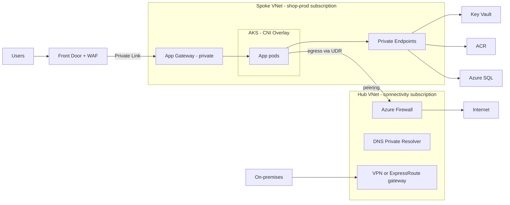
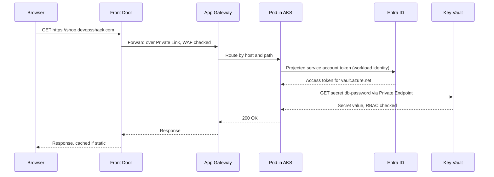
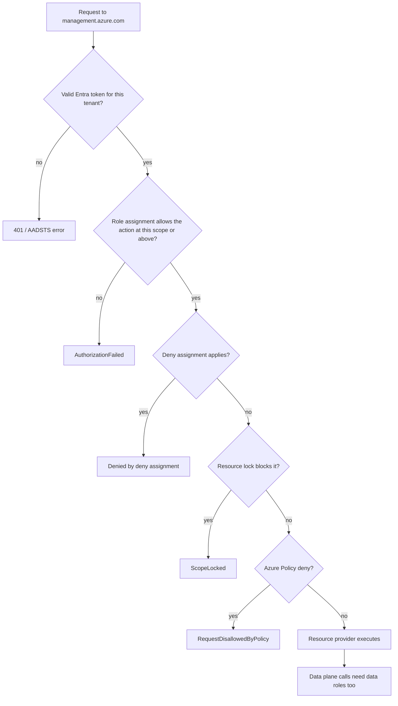
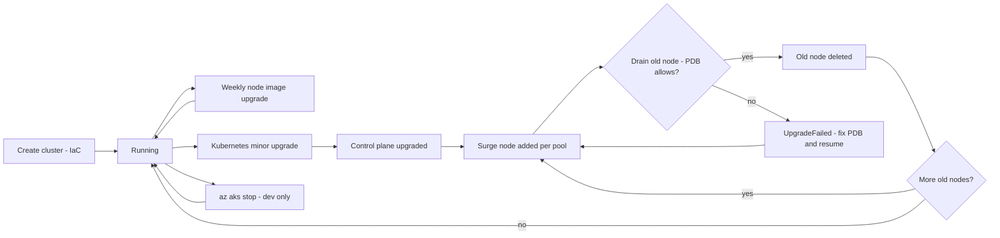
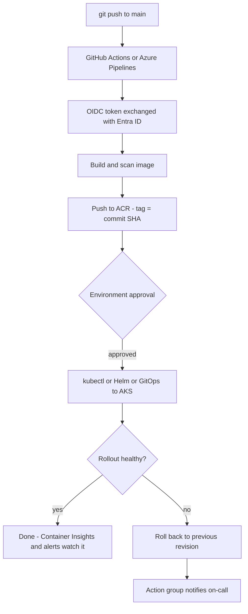

# Azure for DevOps

<!-- DEVOPS-SHACK:HEADER -->

  
  
  
  
  

Part of <b><a href="https://github.com/jaiswaladi246/DevOps-Cloud-Interview-Preparation-by-DevOps-Shack">DevOps &amp; Cloud Interview Preparation</a></b> — created by <b><a href="https://www.youtube.com/@devopsshack">DevOps Shack</a></b>. Free to learn from; please credit DevOps Shack when sharing.

<!-- /DEVOPS-SHACK:HEADER -->

> The Azure you actually use as a DevOps/SRE engineer: identity, governance, networking, AKS and containers, Key Vault, monitoring, Azure DevOps and IaC. Explained the way we run it in production, and the way interviewers ask about it.

[🏠 Home](../README.md)

## What you'll master

- Explain the tenant → management group → subscription → resource group hierarchy, and design a landing zone around it
- Use Entra ID, Azure RBAC, managed identities, service principals and workload identity federation so that no pipeline or pod holds a secret
- Design hub-and-spoke networks with NSGs, ASGs, UDRs, peering, Private Endpoints with private DNS, Azure Firewall, Application Gateway/WAF, Front Door and Load Balancer
- Run AKS in production: node pools, CNI choices (Overlay + Cilium), Entra integration, autoscaler, upgrades, ACR integration and Key Vault CSI secrets
- Pick the right compute: VMs/VMSS, App Service, Functions, Container Apps or AKS, and know the trade-offs
- Secure Blob Storage (tiers, SAS, shared key off) and Key Vault (RBAC, soft delete, rotation)
- Observe everything with Azure Monitor, Log Analytics (KQL), Container Insights and Application Insights
- Ship with Azure DevOps (Repos, YAML pipelines, environments, service connections) or GitHub Actions with OIDC, and manage infrastructure with Bicep/ARM and Terraform azurerm
- Govern with Azure Policy, control cost, and translate any AWS design into Azure terms
- Debug the classics: `AuthorizationFailed`, `QuotaExceeded`, AKS `ImagePullBackOff` from ACR, NSG blocks, and Private Endpoint DNS

## Architecture at a glance

This is the reference design we use for an internet-facing app on AKS. It is also what the [hands-on lab](./hands-on-lab.md) builds a smaller version of. Users come in through Front Door, the hub firewall controls egress, and every PaaS dependency is reached over a Private Endpoint.

Read it from left to right. Only Front Door is public. The spoke has no route to the internet except through the hub firewall. Key Vault, ACR and SQL have public access disabled, and they resolve to private IPs through privatelink DNS zones linked from the hub. Spokes are peered to the hub, not to each other.

## Request and identity flow

Here is how a request travels, and how the pod gets an Entra token to read its secret without holding a password. If you know this sequence, you can debug both "the site is slow" and "the pod gets 403 from Key Vault".

These are two separate failure domains. A 502 or 503 points at the edge or the backend health probes. A pod stuck in `ContainerCreating` with a 403 points at identity, RBAC or Private Endpoint DNS.

## How Azure decides if a call is allowed

Every ARM call passes the same checks. Most real-world access tickets fail at one of these boxes, and the error message tells you which one.

Remember the last box. Being Owner of a storage account or Key Vault gives you no blob or secret access. Data-plane calls need roles like `Storage Blob Data Reader` or `Key Vault Secrets User`.

## AKS cluster and upgrade lifecycle

An AKS cluster goes through a predictable lifecycle. Version support, surge nodes, PodDisruptionBudgets and maintenance windows all attach to specific points in it.

AKS supports N-2 minor versions. We let the `patch` and `NodeImage` auto-upgrade channels run inside maintenance windows. We do minor upgrades deliberately: staging first, then one minor version at a time. Before we start, we check that there is quota for the surge nodes and that every PDB allows at least one disruption.

## Delivery workflow on Azure

This is the secretless delivery path we use. The pipeline proves its identity with an OIDC token, pushes an image tagged with the commit SHA, and deploys behind an environment approval. Azure Monitor tells us whether the rollout is healthy.

## Core concepts in 10 minutes

**Hierarchy.** The tenant is your Entra ID directory, which is the identity boundary. Management groups hold policy and RBAC that every subscription below them inherits. A subscription is the unit of billing, quota and isolation. A resource group holds resources that share a lifecycle. In production we use one subscription per application per environment, and the landing zone management groups apply the guardrails automatically.

**Regions and zones.** Large regions like `centralindia` have three availability zones. Unlike AWS, an Azure subnet spans all zones, so you spread workloads with zonal or zone-redundant SKUs, not with subnets. Region pairs give sequenced updates and a default geo-replication target for GRS storage.

**Identity.** Humans sign in through Entra ID with MFA and Conditional Access, and use PIM for elevated roles. Workloads use managed identities. Use user-assigned identities when IaC needs to grant roles before the workload exists. External systems (GitHub, Azure DevOps, AKS pods) use workload identity federation, which trusts an OIDC token for an exact subject. A client secret is the last resort.

**RBAC.** A role assignment is principal + role + scope, and it inherits downward. RBAC is additive. `Actions` are control-plane, `DataActions` are data-plane. To assign roles, Contributor isn't enough: use the Role Based Access Control Administrator role, constrained with a condition. Assign roles to groups, never to individual users.

**Networking.** Use NSGs (stateful, with priorities and explicit deny) on subnets, ASGs to label NICs, and UDRs to force traffic through a firewall. Peering is not transitive, so hub-and-spoke uses a firewall in the hub or Virtual WAN. Private Endpoints give PaaS services private IPs, but they only work if privatelink DNS zones resolve correctly everywhere. NAT Gateway gives you predictable egress IPs and avoids SNAT exhaustion.

**Edge and load balancing.** Load Balancer works at L4 and is regional. Application Gateway works at L7 with WAF and is regional. Front Door is a global L7 service with CDN, WAF and multi-region failover. Traffic Manager routes at the DNS level for any protocol.

**Compute.** VMSS Flexible is the default for VM fleets. App Service hosts web apps with deployment slots. Functions is event-driven, and Flex Consumption is the modern plan. Container Apps is serverless containers with KEDA and revisions. AKS is for when you need the Kubernetes API.

**AKS.** Use Azure CNI Overlay with the Cilium dataplane, Entra ID with Azure RBAC and local accounts disabled, and workload identity. Run tainted system pools and autoscaling user pools across zones, with auto-upgrade channels in maintenance windows, and use Standard tier in prod. The kubelet identity pulls from ACR with `AcrPull`. The cluster identity manages LBs and subnets.

**Storage and secrets.** Blob tiers are Hot, Cool, Cold and Archive, managed with lifecycle rules. Prefer user delegation SAS, and disable shared keys and public access. Key Vault in RBAC mode keeps soft delete always on; add purge protection for anything holding encryption keys. Pods read secrets through the Secrets Store CSI driver, and App Service uses Key Vault references.

**Monitoring.** Platform metrics are free and near real time. Logs land in Log Analytics and are queried with KQL. Resource logs need diagnostic settings. The Azure Monitor Agent is configured by Data Collection Rules. Container Insights and Managed Prometheus cover AKS, and Application Insights (OpenTelemetry) covers apps. Alerts route through action groups. Watch ingestion volume, because it is the usual surprise on the bill.

**Delivery and IaC.** Azure DevOps uses YAML pipelines, environments with approvals and checks, and service connections with workload identity federation. GitHub Actions uses `azure/login@v2` with OIDC. Bicep compiles to ARM, so ARM is the state, and it gives you what-if and deployment stacks. Terraform azurerm v4 needs `subscription_id`, and its state should live in a storage account with Entra auth and versioning.

**Governance and cost.** Azure Policy offers Deny, Audit, Modify and DeployIfNotExists, assigned at management groups, with exemptions that expire. Defender for Cloud gives you posture and workload protection. For cost, use budgets and anomaly alerts, right-size before you buy reservations or savings plans, use Spot for interruptible work, deallocate idle resources, and tag through policy-driven inheritance.

## Question banks

| Bank | What it covers | Questions |
|------|----------------|-----------|
| [Concepts](./concepts.md) | Hierarchy, identity, networking, compute, AKS/ACR, storage, Key Vault, monitoring, Azure DevOps, Bicep, Terraform, Policy, cost, AWS mapping, best practices and rapid-fire commands | 200 |
| [Scenarios](./scenarios.md) | "What would you do" situations with a step-by-step approach | 100 |
| [Troubleshooting](./troubleshooting.md) | Real error messages: likely causes, diagnosis commands, fix and prevention | 100 |

## Learning path

**Beginner**
- [ ] Explain tenant, management group, subscription, resource group, region and zone with your own examples
- [ ] Log in with the CLI, set the subscription, set a budget, and tag a resource group
- [ ] Build a VNet with two subnets and NSGs, and verify with IP flow verify
- [ ] Run a VM with no public IP and a managed identity that reads a Key Vault secret
- [ ] Create a storage account with shared keys off and access it with `--auth-mode login`
- [ ] Push an image to ACR and run it on a small AKS cluster
- [ ] Finish assignments 1 to 10

**Intermediate**
- [ ] Build the full [hands-on lab](./hands-on-lab.md): Terraform, AKS, ACR, Key Vault CSI, OIDC pipeline, Azure Monitor
- [ ] Build hub-and-spoke with forced egress through a firewall and explain every route
- [ ] Put Key Vault behind a Private Endpoint and fix DNS so it resolves privately everywhere
- [ ] Write a custom RBAC role and a custom deny policy, and test both
- [ ] Run the same stack in Bicep with what-if, and compare it with Terraform
- [ ] Run an Azure DevOps YAML pipeline with a WIF service connection and environment approvals
- [ ] Finish assignments 11 to 20

**Advanced**
- [ ] Run a private AKS cluster with UDR egress through Azure Firewall and private ACR/Key Vault
- [ ] Do a zero-downtime AKS minor upgrade under load, and recover from a PDB-blocked upgrade
- [ ] Design and test multi-region failover behind Front Door with a measured RTO and RPO
- [ ] Do a FinOps and governance clean-up of a subscription and report before/after numbers
- [ ] Explain your design along the Well-Architected pillars, with composite SLA math
- [ ] Finish assignments 21 to 25 and work through both question banks

## Continue

- 🛠 [Hands-on lab: Terraform + AKS + ACR + Key Vault + OIDC pipeline](./hands-on-lab.md)
- 📝 [25 assignments](./assignments.md)
- 📋 [Cheatsheet](./cheatsheet.md)
- 🏠 [Home](../README.md)

<!-- DEVOPS-SHACK:FOOTER -->
---

### 🚀 Made with ❤️ by [DevOps Shack](https://www.youtube.com/@devopsshack)

**Learn DevOps, DevSecOps, Cloud and Kubernetes the practical way.**

[▶️ YouTube — DevOps Shack](https://www.youtube.com/@devopsshack) · [▶️ Hindi — @shackverse](https://www.youtube.com/@shackverse) · [🎓 devopsshack.com](https://devopsshack.com) · [📸 Instagram @devopsshack](https://www.instagram.com/devopsshack)

[🏠 Back to Home](../README.md) · [⭐ Star the original repo](https://github.com/jaiswaladi246/DevOps-Cloud-Interview-Preparation-by-DevOps-Shack)

© DevOps Shack · Licensed CC BY-NC-SA 4.0 · If you found this copy anywhere other than <a href="https://github.com/jaiswaladi246/DevOps-Cloud-Interview-Preparation-by-DevOps-Shack">github.com/jaiswaladi246</a>, the original and latest version is maintained by DevOps Shack.

<!-- /DEVOPS-SHACK:FOOTER -->
