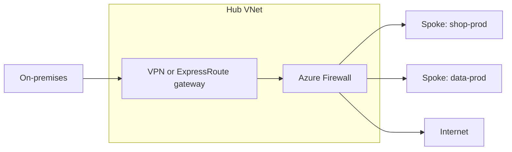

# Azure for DevOps — Core Concepts

<!-- DEVOPS-SHACK:HEADER -->
<p align="center">
  <a href="https://www.youtube.com/@devopsshack"></a>
  <a href="https://www.youtube.com/@shackverse"></a>
  <a href="https://devopsshack.com"></a>
  <a href="https://www.instagram.com/devopsshack"></a>
  <a href="https://github.com/jaiswaladi246/DevOps-Cloud-Interview-Preparation-by-DevOps-Shack"></a>
</p>
<p align="center"><sub>Part of <b><a href="https://github.com/jaiswaladi246/DevOps-Cloud-Interview-Preparation-by-DevOps-Shack">DevOps &amp; Cloud Interview Preparation</a></b> — created by <b><a href="https://www.youtube.com/@devopsshack">DevOps Shack</a></b>. Free to learn from; please credit DevOps Shack when sharing.</sub></p>
<!-- /DEVOPS-SHACK:HEADER -->

> Core concepts, internals, comparisons, best practices and rapid-fire commands for Azure in DevOps interviews · 200 questions · 🟢 Beginner 🟡 Intermediate 🔴 Advanced

[⬅ Back to Azure for DevOps](./README.md) · [🏠 Home](../README.md)

## Table of contents
- [Fundamentals and Resource Hierarchy](#fundamentals-and-resource-hierarchy) — Q1–Q22
- [Entra ID, RBAC and Identities](#entra-id-rbac-and-identities) — Q23–Q48
- [Networking](#networking) — Q49–Q78
- [Compute and App Platforms](#compute-and-app-platforms) — Q79–Q96
- [AKS and ACR](#aks-and-acr) — Q97–Q130
- [Storage, Key Vault and Monitoring](#storage-key-vault-and-monitoring) — Q131–Q155
- [Azure DevOps, Bicep and Terraform](#azure-devops-bicep-and-terraform) — Q156–Q180
- [Policy, Cost, AWS Mapping and Rapid-fire](#policy-cost-aws-mapping-and-rapid-fire) — Q181–Q200

---

## Fundamentals and Resource Hierarchy

<!-- DEVOPS-SHACK:SECTION -->
> 🎥 **Learn this hands-on with DevOps Shack** → [YouTube @devopsshack](https://www.youtube.com/@devopsshack) · [Hindi @shackverse](https://www.youtube.com/@shackverse) · [Courses at devopsshack.com](https://devopsshack.com)

### Q1. Explain the Azure resource hierarchy from top to bottom. 🟢

<details>
<summary><b>Answer</b></summary>

**Entra tenant → root management group → management groups (up to six levels deep, excluding root) → subscriptions → resource groups → resources.**

- The **tenant** is the identity boundary (one Entra ID directory).
- **Management groups** organise subscriptions so Policy and RBAC can be applied once and inherited.
- A **subscription** is the billing, quota and scale boundary.
- A **resource group** is a lifecycle container: things that are deployed, secured and deleted together.

RBAC role assignments and Policy assignments inherit downward at every level, which is why we assign at the highest sensible scope and keep exceptions rare.

</details>

### Q2. What is the difference between an Entra tenant and a subscription? 🟢

<details>
<summary><b>Answer</b></summary>

A **tenant** is a dedicated Entra ID instance: users, groups, app registrations, service principals and managed identities live there. A **subscription** is a container for resources and the unit of billing and quotas.

A subscription trusts exactly one tenant at a time for authentication, but one tenant can own hundreds of subscriptions. Moving a subscription to another tenant wipes its RBAC assignments and breaks managed identities, which is why tenant moves are planned events, not casual clicks.

```bash
az account show --query "{sub:name, subId:id, tenant:tenantId}" -o table
az account tenant list -o table
```

</details>

### Q3. What should go into a resource group and what should not? 🟢

<details>
<summary><b>Answer</b></summary>

Group by **shared lifecycle and ownership**: an application's AKS cluster, ACR and Key Vault for one environment can live together; a hub VNet that serves twenty apps belongs in its own networking RG owned by the platform team.

Rules we follow:
- One environment per RG (`rg-shop-prod-cin`, `rg-shop-dev-cin`), never mix prod and dev.
- Shared services (hub network, DNS zones, Log Analytics) in separate RGs.
- Resources in an RG can be in other regions; the RG location only stores metadata.

Deleting an RG deletes everything inside it, so the grouping is also your blast radius.

</details>

### Q4. What are regions, region pairs and availability zones in Azure? 🟢

<details>
<summary><b>Answer</b></summary>

A **region** is a set of data centres within a latency-defined perimeter, for example `centralindia` (Pune). Most large regions have **three availability zones**, physically separate data centres with independent power, cooling and network.

**Region pairs** (for example Central India and South India) give sequential platform updates and prioritised recovery, and some services (GRS storage, Azure Backup cross-region restore) replicate to the pair by default. Newer regions may be "non-paired" and rely on zones instead.

Zonal services pin to a zone (`--zone 1`), zone-redundant services spread automatically (ZRS storage, zone-redundant Standard Load Balancer).

</details>

### Q5. Why do logical zone numbers differ between subscriptions? 🟡

<details>
<summary><b>Answer</b></summary>

Zone `1` in your subscription is not necessarily physical zone `1` in another subscription. Azure maps logical zones to physical zones per subscription to spread load.

It matters when two subscriptions must co-locate, for example a hub firewall and a spoke workload aiming for same-zone latency. Check the mapping with:

```bash
az rest --method get \
  --url "https://management.azure.com/subscriptions/<sub>/locations?api-version=2022-12-01" \
  --query "value[?name=='centralindia'].availabilityZoneMappings"
```

</details>

### Q6. What is Azure Resource Manager (ARM)? 🟢

<details>
<summary><b>Answer</b></summary>

ARM is the control plane every Azure tool talks to: portal, CLI, PowerShell, Bicep, Terraform and SDKs all send REST calls to `https://management.azure.com`. ARM authenticates the caller with Entra ID, checks RBAC, evaluates Azure Policy, then forwards the request to the **resource provider** (`Microsoft.Compute`, `Microsoft.ContainerService`, ...).

Because everything goes through ARM, you get consistent RBAC, locks, tags, policy and the Activity Log regardless of which tool made the change.

</details>

### Q7. What is a resource provider and why do you sometimes need to register one? 🟢

<details>
<summary><b>Answer</b></summary>

A resource provider is the service that implements a resource type, named like `Microsoft.ContainerService` or `Microsoft.KeyVault`. A subscription must be **registered** for a provider before you create its resources. Many register automatically on first use from the portal, but automation with a least-privilege identity often hits `MissingSubscriptionRegistration`.

```bash
az provider show -n Microsoft.ContainerService --query registrationState -o tsv
az provider register -n Microsoft.ContainerService --wait
```

Registration needs `*/register/action` at subscription scope, which Contributor has.

</details>

### Q8. What is the difference between the control plane and the data plane in Azure? 🟡

<details>
<summary><b>Answer</b></summary>

The **control plane** manages resources through ARM (`management.azure.com`): create a storage account, change an AKS node pool. The **data plane** uses the resource itself: read a blob at `<acct>.blob.core.windows.net`, get a secret from `<vault>.vault.azure.net`, call the Kubernetes API server.

RBAC splits the same way: `Actions` are control-plane, `DataActions` are data-plane. Being **Owner** of a storage account does not let you read blobs with Entra auth; you still need `Storage Blob Data Reader`. Same for Key Vault with RBAC: Owner cannot read secrets without `Key Vault Secrets User`.

</details>

### Q9. What are management groups used for in practice? 🟡

<details>
<summary><b>Answer</b></summary>

They let us apply governance once and inherit it to many subscriptions. A typical landing-zone layout:

```
Tenant Root Group
└── contoso
    ├── platform  (identity, management, connectivity subscriptions)
    ├── landingzones
    │   ├── corp    (private, connected to hub)
    │   └── online  (internet-facing)
    ├── sandbox
    └── decommissioned
```

Policies like "allowed regions", "deny public IPs on corp", and "deploy diagnostic settings" are assigned on the management group. New subscriptions placed under `corp` instantly get every guardrail.

</details>

### Q10. What are resource locks and what are their gotchas? 🟡

<details>
<summary><b>Answer</b></summary>

Locks protect against deletion or modification regardless of RBAC. Two levels: **CanNotDelete** and **ReadOnly**. They inherit downward.

Gotchas:
- ReadOnly on a storage account blocks `listKeys`, which breaks anything using account keys.
- ReadOnly on an AKS RG or the node RG breaks scaling and upgrades.
- A lock on an RG blocks `terraform destroy` with `ScopeLocked`.

```bash
az lock create -n no-delete -g rg-shop-prod --lock-type CanNotDelete
az lock list -g rg-shop-prod -o table
```

We use CanNotDelete on prod data stores and shared networking, and almost never ReadOnly.

</details>

### Q11. How do tags work and do they inherit? 🟢

<details>
<summary><b>Answer</b></summary>

Tags are name-value pairs on resources, RGs and subscriptions (up to 50 per resource). They **do not inherit** automatically from the RG to its resources. To get inheritance we assign the built-in policy "Inherit a tag from the resource group if missing" (Modify effect) and run a remediation task for existing resources.

Cost Management can group by tags, and tag inheritance for cost reporting can be enabled in Cost Management settings so usage records pick up RG and subscription tags.

```bash
az tag update --resource-id $(az group show -n rg-shop-prod --query id -o tsv) \
  --operation merge --tags env=prod owner=platform costcenter=cc-104
```

</details>

### Q12. What is the Activity Log and how is it different from resource logs? 🟢

<details>
<summary><b>Answer</b></summary>

The **Activity Log** is the subscription-level record of control-plane operations: who created, changed or deleted what, plus service health and policy events. It is kept for 90 days by default.

**Resource logs** (formerly diagnostic logs) are data-plane logs emitted by a resource: Key Vault `AuditEvent`, AKS `kube-audit`, Application Gateway access logs. They are not collected unless you create a **diagnostic setting** that sends them to Log Analytics, a storage account or Event Hubs.

```bash
az monitor activity-log list -g rg-shop-prod --offset 24h \
  --query "[].{op:operationName.localizedValue, who:caller, status:status.value}" -o table
```

</details>

### Q13. How do you authenticate the Azure CLI on a laptop, in CI and on a VM? 🟢

<details>
<summary><b>Answer</b></summary>

| Where | How |
|---|---|
| Laptop | `az login` (browser), or `az login --use-device-code` on a headless box |
| CI | Workload identity federation: `azure/login@v2` in GitHub, a WIF service connection in Azure DevOps; never a stored secret if you can avoid it |
| VM, App Service, AKS pod | Managed identity: `az login --identity` (add `--username <clientId>` or `--client-id` for a user-assigned identity on newer CLI) |

Then pin the subscription: `az account set --subscription <id>`. Most "wrong resources changed" incidents start with a default subscription nobody checked.

</details>

### Q14. What is the difference between ARM templates, Bicep and Terraform at a high level? 🟢

<details>
<summary><b>Answer</b></summary>

- **ARM templates**: JSON, native, the format ARM actually executes. Verbose.
- **Bicep**: a DSL that compiles to ARM JSON. Native, day-zero support for new API versions, no state file (ARM is the state), `what-if` for previews.
- **Terraform azurerm**: HCL, multi-cloud, explicit state file, rich plan output, huge module ecosystem. New Azure features sometimes lag until the provider adds them; the `azapi` provider fills that gap.

Teams that are Azure-only and want no state management lean Bicep; teams with multi-cloud or existing Terraform estates stay with Terraform.

</details>

### Q15. What is the Azure Well-Architected Framework? 🟢

<details>
<summary><b>Answer</b></summary>

Five pillars: **Reliability, Security, Cost Optimization, Operational Excellence, Performance Efficiency**. Azure Advisor maps its recommendations to these pillars, and the Well-Architected Review assessment scores a workload against them.

In interviews, structure any "design X on Azure" answer along the pillars: zones and failover, identity and private networking, right-sizing and reservations, IaC and monitoring, scaling.

</details>

### Q16. What are SLAs and composite SLAs? 🟡

<details>
<summary><b>Answer</b></summary>

Each service publishes an SLA, for example a VM across availability zones at 99.99%, AKS Standard tier API server with zones at 99.95%. A request path that depends on several services in series has a **composite SLA** equal to the product: App Gateway 99.95% × AKS 99.95% × Azure SQL 99.99% ≈ 99.89%.

To raise it you add redundancy (parallel paths): two regions behind Front Door, so the path fails only if both fail. Also note the AKS **Free tier has no financially backed API server SLA**; production clusters use Standard.

</details>

### Q17. How do quotas work in Azure? 🟡

<details>
<summary><b>Answer</b></summary>

Quotas are per subscription, per region, and for compute per **VM family** plus a **total regional vCPU** limit. A deployment needs headroom in both. Other services have their own limits (public IPs per region, storage accounts per region, AKS clusters per subscription).

```bash
az vm list-usage -l centralindia -o table | grep -Ei "total regional|DSv5"
az quota list --scope /subscriptions/<sub>/providers/Microsoft.Compute/locations/centralindia
```

Increases go through Service Quotas in the portal (often auto-approved for small bumps) or `az quota update`. We pre-raise quotas before load events, because an autoscaler that cannot get cores is not an autoscaler.

</details>

### Q18. What is the difference between `az` CLI and Azure PowerShell, and when do you use `az rest`? 🟢

<details>
<summary><b>Answer</b></summary>

Both call ARM. `az` is cross-platform, outputs JSON and fits bash pipelines; Azure PowerShell (`Az` module) returns objects and fits Windows-heavy teams. Pick one per team.

`az rest` calls any ARM or Microsoft Graph endpoint directly with your CLI token, which helps when a feature has no CLI command yet:

```bash
az rest --method get \
  --url "https://graph.microsoft.com/v1.0/me" --query userPrincipalName -o tsv
```

</details>

### Q19. What happens when you run `az group create` end to end? 🟡

<details>
<summary><b>Answer</b></summary>

1. CLI gets an access token for `https://management.azure.com` from its MSAL cache (refreshing it if needed).
2. It sends `PUT /subscriptions/<sub>/resourcegroups/<name>?api-version=...`.
3. ARM validates the token and tenant, checks RBAC for `Microsoft.Resources/subscriptions/resourcegroups/write`.
4. Azure Policy evaluates the request (deny effects block it here, modify effects alter it).
5. ARM writes the RG metadata in the chosen region and emits an Activity Log event.
6. The CLI prints the resource with `provisioningState: Succeeded`.

The same sequence, with step 6 replaced by a call to the resource provider, applies to every create.

</details>

### Q20. What are Azure Landing Zones? 🔴

<details>
<summary><b>Answer</b></summary>

A landing zone is a pre-configured subscription environment with identity, networking, policy, logging and security already in place, so application teams land workloads into something governed. The **Azure Landing Zone (ALZ) reference architecture** defines the management group hierarchy, platform subscriptions (identity, management, connectivity), hub-spoke or Virtual WAN networking and a set of policy initiatives.

Implementations: the ALZ Bicep/Terraform accelerators, Azure Verified Modules, or a home-grown subscription vending pipeline. In interviews, the key idea is **subscription as the unit of application isolation**, with platform controls inherited from management groups.

</details>

### Q21. What is subscription vending? 🔴

<details>
<summary><b>Answer</b></summary>

An automated, self-service process that creates a new subscription for a team with everything it needs on day one: placed under the right management group, budget, RBAC for the team's Entra group, a spoke VNet peered to the hub with non-overlapping CIDR from IPAM, diagnostic settings and tags.

Typically a pull request to a "vending" repo triggers a pipeline that uses the subscription alias API (`Microsoft.Subscription/aliases`) under an EA or MCA billing scope, then Terraform/Bicep for the rest. It removes ticket queues and guarantees every subscription starts compliant.

</details>

### Q22. Compare Azure Lighthouse with guest users for cross-tenant management. 🔴

<details>
<summary><b>Answer</b></summary>

**Guest users (B2B)** are invited into the customer tenant and assigned roles there: they must switch tenants, and the customer manages their lifecycle.

**Azure Lighthouse** projects delegated subscriptions or RGs from a customer tenant into the managing tenant. Engineers stay in their home tenant, see all delegated customers in one place, and permissions are defined by an ARM offer (eligible or permanent role assignments, no Owner allowed). Every action is logged in the customer's Activity Log.

MSPs and central platform teams with many tenants use Lighthouse; occasional vendor access uses B2B with PIM.

</details>

---

## Entra ID, RBAC and Identities

<!-- DEVOPS-SHACK:SECTION -->
> 🎥 **Learn this hands-on with DevOps Shack** → [YouTube @devopsshack](https://www.youtube.com/@devopsshack) · [Hindi @shackverse](https://www.youtube.com/@shackverse) · [Courses at devopsshack.com](https://devopsshack.com)

### Q23. What is Microsoft Entra ID and how is it different from on-prem Active Directory? 🟢

<details>
<summary><b>Answer</b></summary>

Entra ID (formerly Azure AD) is a cloud identity provider speaking **OAuth 2.0, OpenID Connect and SAML** over HTTPS. On-prem AD DS speaks **Kerberos, NTLM and LDAP**, has OUs and Group Policy, and joins machines to a domain.

They are not the same product: Entra ID has no OUs or GPOs. Hybrid companies sync users from AD to Entra with **Entra Connect** (or Cloud Sync). If workloads in Azure need real Kerberos/LDAP, you deploy **Entra Domain Services** or domain controllers on VMs.

</details>

### Q24. What is the difference between an app registration and a service principal? 🟢

<details>
<summary><b>Answer</b></summary>

An **app registration** (application object) is the global definition of an app, living in its home tenant: client ID, redirect URIs, credentials, federated credentials, API permissions.

A **service principal** (enterprise application) is the local instance of that app in a specific tenant, and it is what RBAC roles are assigned to. One app registration can have service principals in many tenants (multi-tenant apps).

`az ad sp create-for-rbac` creates both in one shot plus a client secret, which is convenient and also the reason so many secrets leak.

</details>

### Q25. What is a managed identity and what problem does it solve? 🟢

<details>
<summary><b>Answer</b></summary>

A managed identity is a service principal whose credentials Azure creates, stores and rotates for you. Code running on a supported resource asks the local endpoint (IMDS at `169.254.169.254` on VMs, a platform endpoint on App Service/Functions) for a token and never sees a secret.

```bash
# Inside a VM with a managed identity
curl -s -H Metadata:true \
  "http://169.254.169.254/metadata/identity/oauth2/token?api-version=2018-02-01&resource=https://vault.azure.net"
```

It removes the whole class of "secret expired" and "secret leaked in git" incidents.

</details>

### Q26. System-assigned vs user-assigned managed identity: when do you use each? 🟡

<details>
<summary><b>Answer</b></summary>

| | System-assigned | User-assigned |
|---|---|---|
| Lifecycle | Tied to the resource, deleted with it | Standalone Azure resource |
| Sharing | One resource only | Many resources can use it |
| Pre-provisioning | Exists only after the resource is created | Create first, grant RBAC, then attach |

We prefer **user-assigned** for anything deployed by IaC: grant roles before the workload exists (no chicken-and-egg), survive resource re-creation without re-granting, and share one identity across VMSS instances or app slots. System-assigned is fine for simple single resources.

</details>

### Q27. How does Azure RBAC evaluate access? 🟡

<details>
<summary><b>Answer</b></summary>

A role assignment = **security principal + role definition + scope**. ARM collects all assignments for the principal (including via groups) at the target scope and above, unions their `Actions`/`DataActions`, subtracts each role's `NotActions`, and allows the call if the action is in the result.

Then **deny assignments** are checked; they override allows. Customers cannot create deny assignments directly; they come from managed applications and deployment stacks (deny settings). RBAC is additive: there is no "deny" role you can assign yourself.

</details>

### Q28. Name the core built-in roles and the difference between Owner, Contributor and User Access Administrator. 🟢

<details>
<summary><b>Answer</b></summary>

- **Owner**: full control including assigning roles.
- **Contributor**: create and manage all resources, but cannot assign roles or manage Blueprints/Policy assignments.
- **Reader**: view everything, change nothing.
- **User Access Administrator**: manage role assignments only.
- **Role Based Access Control Administrator**: manage role assignments, and can be constrained with conditions to specific roles and principal types.

The classic CI mistake is granting a pipeline Contributor and then wondering why its Terraform fails creating `azurerm_role_assignment`. It needs a role with `Microsoft.Authorization/roleAssignments/write`, ideally the RBAC Administrator role with a condition limiting which roles it can grant.

</details>

### Q29. What are `NotActions` and why are they not a deny? 🟡

<details>
<summary><b>Answer</b></summary>

`NotActions` subtract operations from a role's own `Actions`. They do not block access granted by another role. If someone has Contributor (whose `NotActions` exclude `Microsoft.Authorization/*/Write`) and also User Access Administrator, they can assign roles.

So "Contributor minus delete" built with NotActions only works if that is the person's only role. For real denies use Azure Policy (deny effect), resource locks, or deny assignments from deployment stacks.

</details>

### Q30. How do you write a custom RBAC role? 🟡

<details>
<summary><b>Answer</b></summary>

Define actions, data actions and assignable scopes in JSON, then create it:

```json
{
  "Name": "AKS Node Pool Scaler",
  "Description": "Scale AKS node pools only",
  "Actions": [
    "Microsoft.ContainerService/managedClusters/read",
    "Microsoft.ContainerService/managedClusters/agentPools/read",
    "Microsoft.ContainerService/managedClusters/agentPools/write"
  ],
  "NotActions": [],
  "DataActions": [],
  "AssignableScopes": ["/subscriptions/00000000-0000-0000-0000-000000000000"]
}
```

```bash
az role definition create --role-definition @aks-scaler.json
az provider operation show -n Microsoft.ContainerService -o table   # find action names
```

Custom roles are limited per tenant (5,000), so we create a few reusable ones rather than one per team.

</details>

### Q31. What are ABAC conditions on role assignments? 🔴

<details>
<summary><b>Answer</b></summary>

Attribute-based access control adds a condition to a role assignment, evaluated at request time. Two common uses:

- **Storage**: allow `Storage Blob Data Reader` only for blobs with index tag `project=shop` or in a specific container.
- **Delegated role assignment**: give a team `Role Based Access Control Administrator` with a condition that they may only assign `AcrPull` and `Key Vault Secrets User` to service principals. This is how platform teams let app teams self-serve RBAC without handing out Owner.

Conditions are written in a small expression language (`@Resource[...]`, `@Request[...]`) and versioned with `--condition-version 2.0`.

</details>

### Q32. What is Privileged Identity Management (PIM)? 🟡

<details>
<summary><b>Answer</b></summary>

PIM makes role assignments **eligible** instead of permanent. An engineer activates Owner on the prod subscription for, say, 2 hours, giving a justification, optionally needing MFA and approval. When the time is up, the role disappears.

It applies to Entra roles (Global Administrator), Azure resource roles, and group membership (PIM for Groups). Combined with access reviews, it is the standard answer to "how do you avoid standing admin access in production". PIM requires Entra ID P2 or Entra ID Governance licensing.

</details>

### Q33. What is the difference between Entra roles and Azure RBAC roles? 🟢

<details>
<summary><b>Answer</b></summary>

**Entra roles** control the directory: create users, register apps, grant admin consent. Examples: Global Administrator, Application Administrator, Groups Administrator.

**Azure RBAC roles** control Azure resources under management groups and subscriptions: Owner, Contributor, AcrPull.

They are separate systems. A Global Administrator has no Azure resource access by default but can "elevate access" to become User Access Administrator at root scope, which is a break-glass action that should alert.

</details>

### Q34. How does workload identity federation work? 🟡

<details>
<summary><b>Answer</b></summary>

Instead of a client secret, an app registration or user-assigned managed identity gets a **federated identity credential** that trusts tokens from an external OIDC issuer for a specific subject.

1. The external system (GitHub Actions, Azure DevOps, a Kubernetes cluster) issues a short-lived OIDC JWT.
2. The workload presents it to Entra's token endpoint as a client assertion.
3. Entra checks issuer, subject and audience (`api://AzureADTokenExchange`) against the federated credential.
4. If they match, Entra returns an Azure access token.

No secret exists to leak or expire. It is the default for CI and for AKS workload identity.

</details>

### Q35. What does a federated credential for GitHub Actions look like and what is the subject format? 🔴

<details>
<summary><b>Answer</b></summary>

```bash
az identity federated-credential create \
  --name gh-prod --identity-name id-shop-ci --resource-group rg-shop-ci \
  --issuer https://token.actions.githubusercontent.com \
  --subject repo:devopsshack/shop:environment:prod \
  --audiences api://AzureADTokenExchange
```

Subject formats GitHub emits:
- `repo:ORG/REPO:ref:refs/heads/main` for a branch
- `repo:ORG/REPO:environment:prod` when the job uses an environment
- `repo:ORG/REPO:pull_request` for PR workflows
- `repo:ORG/REPO:ref:refs/tags/v1.2.3` for tags

Subjects must match exactly (newer flexible federated credentials allow wildcard-style claim matching, but exact match is the safe default). Binding to an **environment** lets GitHub's environment protection rules gate who can get a prod token.

</details>

### Q36. What is Conditional Access and how does it affect automation? 🟡

<details>
<summary><b>Answer</b></summary>

Conditional Access policies evaluate sign-ins (user, app, location, device state, risk) and require MFA, a compliant device, or block access. They apply to **users** and, with Workload Identities Premium, can target service principals.

The automation trap: someone runs Terraform in a pipeline with a real user account; a new MFA policy lands and CI fails with `AADSTS50076`. Automation must use service principals or managed identities, never human accounts.

</details>

### Q37. Why are group-based role assignments preferred over user-based? 🟢

<details>
<summary><b>Answer</b></summary>

People join and leave teams constantly; role assignments should not change each time. Assign roles to Entra groups (`grp-shop-prod-readers`), manage membership through HR-driven processes or access packages, and review with access reviews.

It also keeps you under the limit of **4,000 role assignments per subscription** and makes audits readable: "who can touch prod" becomes "who is in these three groups".

</details>

### Q38. How do you list everything a principal can do in a subscription? 🟡

<details>
<summary><b>Answer</b></summary>

```bash
# Direct and group-inherited assignments for a user at all scopes in the subscription
az role assignment list --assignee alice@contoso.com --all --include-groups \
  --include-inherited -o table

# For a service principal or managed identity
az role assignment list --assignee <appId-or-objectId> --all -o table
```

`--include-inherited` pulls assignments from management groups above. For effective permissions on one resource, the portal's "Check access" blade shows the combined view, including deny assignments.

</details>

### Q39. Why do new role assignments sometimes not work immediately? 🔴

<details>
<summary><b>Answer</b></summary>

Two effects:
1. **Propagation**: role assignments can take up to around 10 minutes to be enforced everywhere (longer for some data planes, and up to 30 minutes for management group scopes).
2. **Token caching**: group membership is baked into tokens. A user added to a group needs a fresh token (`az logout` + `az login`, or `az account get-access-token` after cache clear).

In IaC, a newly created identity may not be found yet (`PrincipalNotFound`). Setting `principal_type = "ServicePrincipal"` (Terraform `skip_service_principal_aad_check = true`) avoids the directory lookup that fails on replication lag.

</details>

### Q40. What is the difference between delegated and application permissions in Microsoft Graph? 🟡

<details>
<summary><b>Answer</b></summary>

**Delegated** permissions act on behalf of a signed-in user; the effective rights are the intersection of the app's permissions and the user's. **Application** permissions are used by a daemon with no user, and grant tenant-wide rights (for example `User.Read.All`). Application permissions always need admin consent.

These are directory/Graph permissions, separate from Azure RBAC. A pipeline that creates app registrations needs Graph `Application.ReadWrite.OwnedBy` (or an Entra role), not Contributor.

</details>

### Q41. How do client secrets, certificates and federated credentials compare for service principals? 🟡

<details>
<summary><b>Answer</b></summary>

| Credential | Risk | Rotation |
|---|---|---|
| Client secret | A string that leaks into logs, env vars, git | Manual, max 2 years (policy often 6–12 months) |
| Certificate | Private key can be kept in Key Vault or HSM | Manual or Key Vault auto-renew |
| Federated credential | No secret at all | Nothing to rotate |

Order of preference: managed identity, then federated credential, then certificate, and a client secret only when the platform supports nothing else. We use app management policies to block new secrets tenant-wide where possible.

</details>

### Q42. How do you find who created or deleted a resource? 🟢

<details>
<summary><b>Answer</b></summary>

The Activity Log records `caller` for every control-plane write:

```bash
az monitor activity-log list --resource-group rg-shop-prod --offset 7d \
  --query "[?contains(operationName.value,'delete')].{when:eventTimestamp, who:caller, op:operationName.value}" -o table
```

For longer than 90 days, export the Activity Log to a Log Analytics workspace via a subscription diagnostic setting and query the `AzureActivity` table.

</details>

### Q43. What are the scopes you can assign a role at, and what scope do you use for a CI identity? 🟡

<details>
<summary><b>Answer</b></summary>

Management group, subscription, resource group, or an individual resource (and for some services, sub-resources such as a Key Vault secret, a storage container, or an AKS namespace with Azure RBAC).

For CI we assign at the **smallest scope that works**: `AcrPush` on the registry, `Azure Kubernetes Service RBAC Writer` on the namespace, Contributor on the app's resource group for infra deploys. Subscription-wide Owner for a pipeline is a finding in every audit.

</details>

### Q44. How does a pod in AKS get an Entra token with workload identity? 🔴

<details>
<summary><b>Answer</b></summary>

1. The cluster has the **OIDC issuer** and **workload identity** features enabled.
2. A user-assigned identity has a federated credential with `issuer = <cluster OIDC URL>` and `subject = system:serviceaccount:<ns>:<sa>`.
3. The ServiceAccount is annotated `azure.workload.identity/client-id: <clientId>` and the pod has label `azure.workload.identity/use: "true"`.
4. The mutating webhook injects `AZURE_CLIENT_ID`, `AZURE_TENANT_ID`, `AZURE_FEDERATED_TOKEN_FILE` and a projected SA token volume.
5. The Azure SDK (`DefaultAzureCredential` / `WorkloadIdentityCredential`) exchanges the projected token for an Entra token.

No node-level identity is shared between pods, which is why it replaced the deprecated AAD Pod Identity.

</details>

### Q45. What is the managed identity of an AKS cluster vs the kubelet identity? 🔴

<details>
<summary><b>Answer</b></summary>

- **Cluster (control plane) identity**: used by AKS itself to manage Azure resources: create load balancers and public IPs, attach disks, read subnets. In a custom VNet it needs `Network Contributor` on the subnet (or VNet).
- **Kubelet identity**: a user-assigned identity attached to the node VMSS, used by kubelet to **pull images from ACR**. `az aks update --attach-acr` grants `AcrPull` to this identity.

Mixing them up is a common bug: granting AcrPull to the cluster identity does nothing for image pulls.

```bash
az aks show -g rg -n aks --query "{cluster:identity.principalId, kubelet:identityProfile.kubeletidentity.objectId}"
```

</details>

### Q46. What is Entra ID integration for AKS, and Azure RBAC vs Kubernetes RBAC? 🟡

<details>
<summary><b>Answer</b></summary>

With **AKS-managed Entra integration**, users authenticate to the API server with Entra tokens via `kubelogin`. Authorization can then be:

- **Kubernetes RBAC**: Roles/RoleBindings that reference Entra group object IDs as subjects.
- **Azure RBAC for Kubernetes**: built-in roles (`Azure Kubernetes Service RBAC Reader/Writer/Admin/Cluster Admin`) assigned in Azure at cluster or namespace scope, evaluated by an authorization webhook.

```bash
az aks update -g rg -n aks --enable-aad --enable-azure-rbac --aad-admin-group-object-ids <groupId>
az aks update -g rg -n aks --disable-local-accounts
```

Disabling local accounts removes the static admin kubeconfig, so all access is auditable and revocable.

</details>

### Q47. What are break-glass accounts and why do you need them? 🟡

<details>
<summary><b>Answer</b></summary>

Two cloud-only Global Administrator accounts excluded from most Conditional Access policies (but protected with phishing-resistant FIDO2 keys), stored offline, used only when federation, MFA service or a bad CA policy locks everyone out.

Every sign-in by them triggers an alert from Log Analytics (`SigninLogs | where UserPrincipalName in (...)`). Test them every quarter. Without them, one broken Conditional Access policy can lock an organisation out of its own tenant.

</details>

### Q48. How do you avoid leaking credentials when using `az ad sp create-for-rbac`? 🟡

<details>
<summary><b>Answer</b></summary>

- Don't use it for CI at all when OIDC is available; create the app (or a user-assigned identity) and add a federated credential.
- If you must, scope it: `--role AcrPush --scopes <acrId>`, never the default subscription Contributor.
- Set a short lifetime: `--years 1` is the coarse option; better, reset with `az ad app credential reset --id <appId> --end-date 2026-06-30`.
- Store the output in Key Vault or the CI secret store immediately; never paste it into chat or tickets.
- Turn on GitHub secret scanning with push protection, which recognises Entra client secrets.

</details>

---

## Networking

<!-- DEVOPS-SHACK:SECTION -->
> 🎥 **Learn this hands-on with DevOps Shack** → [YouTube @devopsshack](https://www.youtube.com/@devopsshack) · [Hindi @shackverse](https://www.youtube.com/@shackverse) · [Courses at devopsshack.com](https://devopsshack.com)

### Q49. What is a VNet and how does it compare to an AWS VPC? 🟢

<details>
<summary><b>Answer</b></summary>

A VNet is a private, regional network with one or more address spaces (for example `10.20.0.0/16`). Subnets are carved from it. Unlike AWS, **Azure subnets span all availability zones in the region**; you do not create one subnet per AZ.

There is no internet gateway object: VMs reach the internet through default outbound access (being retired for new VNets), a NAT Gateway, a load balancer outbound rule, or a public IP. Routing between subnets in a VNet works by default through system routes.

</details>

### Q50. How many IP addresses does Azure reserve in each subnet? 🟢

<details>
<summary><b>Answer</b></summary>

Five: the network address, `.1` (default gateway), `.2` and `.3` (Azure DNS mapping), and the broadcast address. A `/24` gives 251 usable addresses, a `/29` (the smallest allowed) gives 3.

This matters for AKS with Azure CNI (node subnet), App Service VNet integration, Application Gateway v2 (Microsoft recommends a `/24`) and Azure Firewall (requires a `/26` named `AzureFirewallSubnet`).

</details>

### Q51. What is a Network Security Group and how are its rules evaluated? 🟢

<details>
<summary><b>Answer</b></summary>

An NSG is a **stateful** packet filter with priority-ordered rules (100–4096, lower first; first match wins). It attaches to a **subnet**, a **NIC**, or both. Each rule matches source, source port, destination, destination port, protocol, and allows or denies.

Default rules (priority 65000+) allow traffic within the VNet and from Azure Load Balancer inbound, deny all other inbound, and allow all outbound. Return traffic of an allowed flow is permitted automatically.

```bash
az network nsg rule create -g rg -n allow-https --nsg-name nsg-web --priority 100 \
  --direction Inbound --access Allow --protocol Tcp \
  --source-address-prefixes Internet --destination-port-ranges 443
```

</details>

### Q52. If an NSG is on both the subnet and the NIC, how is traffic evaluated? 🔴

<details>
<summary><b>Answer</b></summary>

**Inbound**: subnet NSG first, then NIC NSG. **Outbound**: NIC NSG first, then subnet NSG. Traffic must be allowed by **both**. A deny at either layer drops it.

That is why "I opened port 443 on the NSG and it still times out" usually means there is a second NSG. Check the effective rules:

```bash
az network nic list-effective-nsg -g rg -n vm-web-nic -o table
```

We prefer subnet-level NSGs only, to keep a single place to look.

</details>

### Q53. What are service tags and why use them in NSG rules? 🟢

<details>
<summary><b>Answer</b></summary>

Service tags are Microsoft-maintained groups of IP prefixes for a service: `Internet`, `VirtualNetwork`, `AzureLoadBalancer`, `AzureCloud.centralindia`, `Storage.CentralIndia`, `AzureMonitor`, `AzureContainerRegistry`, `GatewayManager`. Microsoft updates the prefixes; your rule stays the same.

Example: allow outbound to Azure Monitor and deny other internet egress from a locked-down subnet, without maintaining IP lists.

</details>

### Q54. What is an Application Security Group (ASG)? 🟡

<details>
<summary><b>Answer</b></summary>

An ASG is a label you attach to NICs (`asg-web`, `asg-db`), then reference in NSG rules instead of IP addresses: "allow `asg-web` → `asg-db` on 5432". When you scale out, new NICs join the ASG and get the rule automatically.

Constraints: all NICs in an ASG and the ASGs referenced in one rule must be in the same VNet. It is the closest Azure equivalent to referencing a security group ID inside another AWS security group rule.

</details>

### Q55. What are system routes and user-defined routes (UDRs)? 🟡

<details>
<summary><b>Answer</b></summary>

**System routes** exist by default: VNet address space → `VnetLocal`, `0.0.0.0/0` → `Internet`, peered VNets → `VNetPeering`, plus gateway-learned routes.

A **UDR** in a route table overrides them for the subnets it is associated with. The classic use: force all egress through a firewall:

```bash
az network route-table route create -g rg --route-table-name rt-spoke -n default \
  --address-prefix 0.0.0.0/0 --next-hop-type VirtualAppliance --next-hop-ip-address 10.0.1.4
```

Route selection is **longest prefix match**; on a tie, UDR beats BGP beats system route.

</details>

### Q56. How do you see the routes a VM actually uses? 🟢

<details>
<summary><b>Answer</b></summary>

```bash
az network nic show-effective-route-table -g rg -n vm-app-nic -o table
az network watcher show-next-hop -g rg --vm vm-app \
  --source-ip 10.20.1.4 --dest-ip 8.8.8.8
```

Effective routes combine system routes, UDRs and BGP routes. `show-next-hop` tells you which next hop type (Internet, VirtualAppliance, VnetLocal, None) and which route table won.

</details>

### Q57. What is VNet peering and what are its key properties? 🟢

<details>
<summary><b>Answer</b></summary>

Peering connects two VNets over the Microsoft backbone with private IPs, low latency and no gateway. Works across regions (global peering) and across subscriptions/tenants.

Key properties:
- **Not transitive**: A↔B and B↔C does not give A↔C.
- Address spaces must **not overlap**.
- It must be created **on both sides**.
- Options: `allowForwardedTraffic` (accept traffic forwarded by an NVA), `allowGatewayTransit` / `useRemoteGateways` (share a VPN/ExpressRoute gateway).
- Data transfer across peering is billed per GB both ways.

</details>

### Q58. Explain hub-and-spoke topology. 🟡

<details>
<summary><b>Answer</b></summary>

A **hub VNet** holds shared services: Azure Firewall, VPN/ExpressRoute gateway, Bastion, DNS Private Resolver. Each workload gets a **spoke VNet** peered to the hub. Spokes send `0.0.0.0/0` (and other spokes' ranges) to the firewall via UDR, so spoke-to-spoke and egress traffic is inspected centrally.



Peering is not transitive, so the firewall is what makes spoke-to-spoke work.

</details>

### Q59. What is Virtual WAN and when would you choose it over a self-managed hub? 🔴

<details>
<summary><b>Answer</b></summary>

Virtual WAN is a Microsoft-managed hub (or hubs across regions) with built-in transitive routing between spokes, branches (S2S VPN, SD-WAN), users (P2S) and ExpressRoute. A **secured virtual hub** adds Azure Firewall managed by Firewall Manager, and routing intent sends private and internet traffic through it.

Choose it for many regions, many branches, or when you want transitive routing without maintaining UDRs. Choose self-managed hub-spoke when you need full control (third-party NVAs with custom routing, specific features not yet supported in vWAN hubs) or have a simple one-region estate.

</details>

### Q60. What is the difference between a Service Endpoint and a Private Endpoint? 🟡

<details>
<summary><b>Answer</b></summary>

| | Service Endpoint | Private Endpoint |
|---|---|---|
| What it does | Extends the subnet identity to the PaaS service; traffic stays on the backbone | Puts a NIC with a private IP from your subnet in front of one specific resource |
| Service IP | Still the public IP | Private IP in your VNet |
| On-prem access | No | Yes, over VPN/ExpressRoute |
| Data exfiltration | Any account of that service is reachable (unless SE policies) | Only that one resource |
| Cost | Free | Hourly + per GB |
| DNS | No change | Needs Private DNS zone |

Production default for data services is Private Endpoint plus `publicNetworkAccess: Disabled`.

</details>

### Q61. How does DNS work with Private Endpoints? 🔴

<details>
<summary><b>Answer</b></summary>

When a Private Endpoint is created, the public name gets a CNAME into a `privatelink` zone: `kvshop.vault.azure.net` → `kvshop.privatelink.vaultcore.azure.net`. Clients must resolve the privatelink name to the private IP, which needs a **Private DNS zone** (`privatelink.vaultcore.azure.net`) linked to the VNet with an A record (created automatically by a **DNS zone group** on the endpoint).

Clients outside the VNet (on-prem, other VNets) need to use Azure DNS through the **DNS Private Resolver** inbound endpoint or a forwarder to `168.63.129.16`. Symptom of getting it wrong: `nslookup` returns the public IP and the request is blocked by the firewall.

```bash
nslookup kvshop.vault.azure.net    # must return 10.x.x.x from inside the VNet
```

</details>

### Q62. What is `168.63.129.16`? 🟡

<details>
<summary><b>Answer</b></summary>

A virtual public IP present in every VNet that provides Azure-provided DNS, DHCP, the VM agent heartbeat, and the source of Azure Load Balancer health probes. It is not routable outside the host.

Two practical points: never block it in a guest OS firewall or NSG (probes fail, VMs look unhealthy), and custom DNS servers in Azure should forward to it so Private DNS zones keep working.

</details>

### Q63. Azure Load Balancer: what layer, what SKUs, what are the key concepts? 🟢

<details>
<summary><b>Answer</b></summary>

Layer 4 (TCP/UDP), pass-through, preserves client IP. **Standard SKU** is the only one to use (Basic was retired in September 2025): zone-redundant, secure by default (closed until an NSG allows traffic), supports HA ports and outbound rules.

Concepts: **frontend IP** (public or internal), **backend pool** (NICs or IPs), **health probe** (TCP/HTTP/HTTPS), **load-balancing rule** (frontend port → backend port), **inbound NAT rule**, **outbound rule** (SNAT for egress). AKS Services of type `LoadBalancer` create rules on a Standard LB automatically.

</details>

### Q64. Application Gateway vs Azure Load Balancer vs Front Door vs Traffic Manager. 🟡

<details>
<summary><b>Answer</b></summary>

| Service | Layer | Scope | Use |
|---|---|---|---|
| Load Balancer | L4 | Regional | TCP/UDP, internal tiers, AKS services |
| Application Gateway v2 | L7 | Regional | HTTP routing by host/path, TLS termination, WAF, private apps |
| Front Door (Standard/Premium) | L7 | Global, anycast at edge | Global HTTP entry, CDN caching, WAF, multi-region failover, Private Link to origins (Premium) |
| Traffic Manager | DNS | Global | DNS-based routing for any protocol (priority, weighted, performance, geographic) |

A common internet-facing pattern: Front Door Premium (WAF, global) → Private Link → internal Application Gateway or AKS ingress.

</details>

### Q65. How does the Application Gateway WAF work? 🟡

<details>
<summary><b>Answer</b></summary>

WAF on Application Gateway v2 inspects HTTP requests against **managed rule sets** (OWASP CRS 3.2 or the Microsoft Default Rule Set 2.x) plus your **custom rules** (IP allow/deny, geo-match, rate limiting). Modes: **Detection** logs only, **Prevention** blocks with 403.

Rollout pattern: start in Detection, query `AzureDiagnostics | where Category == "ApplicationGatewayFirewallLog"` (or the resource-specific `AGWFirewallLogs` table) for false positives, add exclusions for specific rules/fields, then switch to Prevention. WAF policies are separate resources attachable at gateway, listener or path level.

</details>

### Q66. What is Azure Firewall and how do its SKUs differ? 🟡

<details>
<summary><b>Answer</b></summary>

A managed, stateful, highly available firewall deployed in `AzureFirewallSubnet`. Rule types: **DNAT** rules (inbound port forwarding), **network** rules (L3/L4) and **application** rules (FQDN-based for HTTP/S and MSSQL, with FQDN tags like `AzureKubernetesService`).

| SKU | Adds |
|---|---|
| Basic | Small environments, limited throughput |
| Standard | Threat intelligence, DNS proxy, web categories |
| Premium | TLS inspection, IDPS, URL filtering |

Managed through **Firewall Policy** (hierarchical: a parent base policy with child policies per environment).

</details>

### Q67. Why does Azure Firewall need DNS proxy for FQDN network rules? 🔴

<details>
<summary><b>Answer</b></summary>

Network rules with FQDNs work by resolving the FQDN on the firewall. If the client resolves the same name with a different DNS server it may get a different IP (CDNs rotate), and the firewall drops the flow because its resolved IP set does not match.

Enabling **DNS proxy** on the firewall and pointing the VNet's DNS servers at the firewall's private IP makes client and firewall resolution identical. Application rules (HTTP/S) don't have this problem because they inspect the SNI/Host header.

</details>

### Q68. What is a NAT Gateway and why do AKS and VM workloads use it? 🟡

<details>
<summary><b>Answer</b></summary>

NAT Gateway gives a subnet outbound internet connectivity through one or more static public IPs or prefixes, with **64,512 SNAT ports per public IP** allocated on demand. It takes precedence over load balancer outbound rules and instance public IPs for egress.

Two reasons to use it: predictable egress IPs to whitelist at partners, and avoiding **SNAT port exhaustion**, which happens with load balancer outbound rules under heavy connection churn. AKS supports `--outbound-type managedNATGateway` or `userAssignedNATGateway`. Since default outbound access is being retired for new VNets, explicit egress like this is the norm.

</details>

### Q69. What are the AKS outbound types? 🔴

<details>
<summary><b>Answer</b></summary>

- `loadBalancer` (default): egress SNAT through the Standard LB's outbound rule and public IP.
- `managedNATGateway`: AKS creates a NAT Gateway on the node subnet.
- `userAssignedNATGateway`: you bring a NAT Gateway already associated with your subnet.
- `userDefinedRouting`: you supply a route table sending `0.0.0.0/0` to a firewall or NVA; AKS creates no public egress. Needed for locked-down egress; the firewall must allow the AKS required FQDNs (the `AzureKubernetesService` FQDN tag covers most).
- `none` (preview at times): no outbound configured, for fully isolated clusters with private ACR and network isolated cluster mode.

Changing outbound type after creation is supported for some transitions with `az aks update --outbound-type`.

</details>

### Q70. What is Azure Bastion? 🟢

<details>
<summary><b>Answer</b></summary>

A managed jump host that gives RDP/SSH to VMs through the portal or native client (`az network bastion ssh`), over TLS on 443, with no public IP on the VM. Lives in a subnet named exactly `AzureBastionSubnet` (`/26` or larger).

```bash
az network bastion ssh -n bas-hub -g rg-hub --target-resource-id <vmId> \
  --auth-type AAD
```

Combined with Entra login for Linux VMs, there are no SSH keys to manage and access is controlled by the `Virtual Machine User Login` role.

</details>

### Q71. How does Azure DNS work for public and private zones? 🟢

<details>
<summary><b>Answer</b></summary>

**Azure DNS public zones** host your internet domain records on Microsoft's anycast name servers; you delegate the domain at your registrar to the four NS records Azure gives you. Alias records can point at a public IP, Front Door, or Traffic Manager profile and stay correct when the target changes.

**Private DNS zones** resolve names only inside VNets that are linked to the zone, optionally with **auto-registration** of VM records. They are the backbone of Private Endpoint name resolution.

```bash
az network dns record-set a add-record -g rg-dns -z devopsshack.com -n app -a 20.1.2.3
az network private-dns link vnet create -g rg-dns -z privatelink.azurecr.io \
  -n link-spoke -v <vnetId> -e false
```

</details>

### Q72. What is Azure DNS Private Resolver? 🔴

<details>
<summary><b>Answer</b></summary>

A managed DNS service inside a VNet with:
- **Inbound endpoints**: a private IP on-prem DNS servers can forward to, to resolve Azure Private DNS zones (privatelink names).
- **Outbound endpoints** + **forwarding rulesets**: send queries for `corp.contoso.local` from Azure to on-prem DNS servers.

It replaces the old pattern of running DNS forwarder VMs in the hub. Rulesets can be linked to many spoke VNets.

</details>

### Q73. VPN Gateway vs ExpressRoute. 🟡

<details>
<summary><b>Answer</b></summary>

**VPN Gateway**: IPsec over the internet, site-to-site or point-to-site, up to a few Gbps depending on SKU (VpnGw1–5, AZ variants), quick to set up, cheap.

**ExpressRoute**: a private circuit through a connectivity provider into Microsoft's network, 50 Mbps to 100 Gbps (ExpressRoute Direct), predictable latency, SLA-backed, not encrypted by default (add MACsec or IPsec over it). Takes weeks to provision.

Production pattern: ExpressRoute primary with S2S VPN as backup, both on the hub gateway subnet (`GatewaySubnet`).

</details>

### Q74. What does "secure by default" mean for Standard public IPs and Standard LB? 🟡

<details>
<summary><b>Answer</b></summary>

A Standard SKU public IP or Standard Load Balancer **blocks inbound traffic unless an NSG explicitly allows it**. With the old Basic SKU, traffic was open by default.

So a VM with a Standard public IP and no NSG is unreachable inbound. Teams migrating from Basic often think the new IP is "broken" when it is just closed. Add an NSG on the subnet or NIC that allows the required ports.

</details>

### Q75. What is Network Watcher and which tools do you use most? 🟢

<details>
<summary><b>Answer</b></summary>

A regional service (auto-enabled per region) with diagnostics:

- **IP flow verify**: would this 5-tuple be allowed or denied, and by which NSG rule?
- **Next hop**: which route wins for a destination.
- **Connection troubleshoot**: end-to-end test from a VM to a host/port with hop details.
- **Packet capture**: on a VM or VMSS instance via extension.
- **Flow logs**: VNet flow logs (replacing NSG flow logs, which stop accepting new configurations) written to storage, analysable with Traffic Analytics.

```bash
az network watcher test-ip-flow -g rg --vm vm-app --direction Inbound \
  --protocol TCP --local 10.20.1.4:443 --remote 203.0.113.10:50000
```

</details>

### Q76. What is a subnet delegation? 🟡

<details>
<summary><b>Answer</b></summary>

Delegation hands a subnet to a specific PaaS service so it can inject resources and set policies there: `Microsoft.Web/serverFarms` (App Service VNet integration), `Microsoft.App/environments` (Container Apps), `Microsoft.DBforPostgreSQL/flexibleServers`, `Microsoft.ContainerInstance/containerGroups`.

A delegated subnet can usually only host that service. Plan dedicated subnets early, because changing them later often means redeploying the service.

</details>

### Q77. How do you plan IP address space for Azure at scale? 🔴

<details>
<summary><b>Answer</b></summary>

- Reserve a large private block per region (for example `10.16.0.0/12` for Central India) and allocate spokes from it with an IPAM (Azure Virtual Network Manager IPAM, or a spreadsheet you actually maintain) so peering never hits overlapping ranges.
- Size AKS subnets for the CNI: Azure CNI Overlay needs IPs only for nodes; flat Azure CNI needs one per pod.
- Leave room for fixed-size subnets: `GatewaySubnet` (/27+), `AzureFirewallSubnet` (/26), `AzureBastionSubnet` (/26), App Gateway (/24 recommended), private endpoints (/24).
- Never use ranges that overlap on-prem or partner networks.

</details>

### Q78. What is Azure Virtual Network Manager (AVNM)? 🔴

<details>
<summary><b>Answer</b></summary>

A central service to manage VNets at scale across subscriptions:
- **Network groups** (static or Policy-driven dynamic membership, for example all VNets tagged `env=prod`).
- **Connectivity configurations**: hub-and-spoke or mesh, applied automatically to group members (mesh creates connected groups without individual peerings).
- **Security admin rules**: rules evaluated **before NSGs** that app teams cannot override, such as "always deny inbound 3389 from the internet".
- **Routing configurations** and **IPAM** pools.

It is the platform team's tool to enforce non-negotiable network rules without owning every NSG.

</details>

---

## Compute and App Platforms

<!-- DEVOPS-SHACK:SECTION -->
> 🎥 **Learn this hands-on with DevOps Shack** → [YouTube @devopsshack](https://www.youtube.com/@devopsshack) · [Hindi @shackverse](https://www.youtube.com/@shackverse) · [Courses at devopsshack.com](https://devopsshack.com)

### Q79. What are the main VM families and how do you pick one? 🟢

<details>
<summary><b>Answer</b></summary>

- **B**: burstable, cheap, for dev and light workloads (credits run out under sustained load).
- **D**: general purpose (`Standard_D4s_v5`, `D4as_v5` AMD, `D4ps_v5` Arm).
- **E**: memory optimised. **F**: compute optimised. **L**: storage optimised with local NVMe. **N**: GPU.

Naming: `s` = premium storage capable, `a` = AMD, `p` = Arm, `d` = local temp disk, `v5`/`v6` = generation. Pick by workload profile, then check regional availability and quota:

```bash
az vm list-skus -l centralindia --size Standard_D4 --resource-type virtualMachines -o table
```

</details>

### Q80. Availability sets vs availability zones vs VMSS flexible orchestration. 🟡

<details>
<summary><b>Answer</b></summary>

- **Availability set**: spreads VMs across fault domains (racks) and update domains in one data centre. 99.95% SLA. Legacy pattern.
- **Availability zones**: VMs in separate data centres. 99.99% SLA for two or more VMs across zones.
- **VMSS Flexible**: a scale set that spreads VMs across zones and fault domains, supports mixing sizes and Spot, autoscale, and individual VM operations. It is Microsoft's recommended default for new VM-based workloads.

</details>

### Q81. What is a Virtual Machine Scale Set and how does autoscale work? 🟢

<details>
<summary><b>Answer</b></summary>

A VMSS manages a group of identical (or flexible) VMs that can scale in and out. Autoscale rules come from Azure Monitor autoscale settings: metric-based (CPU > 70% for 10 minutes → +2), schedule-based (scale up at 08:00 IST), with min/max/default counts and cool-downs.

```bash
az monitor autoscale create -g rg --resource vmss-web --resource-type Microsoft.Compute/virtualMachineScaleSets \
  -n as-web --min-count 2 --max-count 10 --count 2
az monitor autoscale rule create -g rg --autoscale-name as-web \
  --condition "Percentage CPU > 70 avg 10m" --scale out 2
```

Also configure **automatic instance repairs** with an application health probe or extension so unhealthy instances are replaced.

</details>

### Q82. What are VMSS upgrade policies? 🟡

<details>
<summary><b>Answer</b></summary>

When the scale set model changes (new image, new extension config):
- **Manual**: existing instances keep the old model until you run `az vmss update-instances`.
- **Automatic**: all instances are updated at once (no batching control). Risky.
- **Rolling**: update in batches (`maxBatchInstancePercent`), wait for health (`pauseTimeBetweenBatches`), stop if too many unhealthy. Needs a health probe or Application Health extension.

Separately, **automatic OS image upgrade** rolls new platform image versions in safe batches. Production VMSS use Rolling with health signals.

</details>

### Q83. What are Spot VMs and where do they fit? 🟡

<details>
<summary><b>Answer</b></summary>

Spot VMs use spare capacity at up to around 90% discount and can be evicted with **30 seconds notice** when Azure needs capacity back or the price exceeds your max. Eviction policy: **Deallocate** (keep disks, you pay storage) or **Delete**.

Good for: CI build agents, batch, stateless AKS user node pools with workloads that tolerate interruption (`kubernetes.azure.com/scalesetpriority=spot:NoSchedule` taint is added automatically). Never for system node pools, databases or anything without retry. Watch for eviction via Scheduled Events at `http://169.254.169.254/metadata/scheduledevents`.

</details>

### Q84. What is the temporary disk on a VM and why does it matter? 🟢

<details>
<summary><b>Answer</b></summary>

Many VM sizes (the `d` variants) have a local temporary disk (`/dev/sdb1` mounted at `/mnt` on Linux, `D:` on Windows). It is fast and free but **data is lost on deallocation, redeploy or host maintenance**. Use it for swap, scratch and caches only.

For AKS, **ephemeral OS disks** place the node OS disk on this local storage (or cache), giving faster boot and reimage, no OS disk cost, and nodes that are truly cattle.

</details>

### Q85. Managed disk types and when you pick each. 🟡

<details>
<summary><b>Answer</b></summary>

| Type | Use |
|---|---|
| Standard HDD | Backups, rarely accessed |
| Standard SSD | Dev/test, light web servers |
| Premium SSD | Production databases and most prod VMs; performance by size tier (P10, P30...) |
| Premium SSD v2 | Independently configurable IOPS/throughput, sub-ms latency, no host caching |
| Ultra Disk | Highest IOPS/throughput, tunable live (SAP HANA, top-tier databases) |

Disks are zonal (LRS) or ZRS for Premium/Standard SSD. On AKS, `managed-csi` and `managed-csi-premium` storage classes map to these, and an LRS disk ties the pod to the zone where the disk lives.

</details>

### Q86. What is the VM agent and the Custom Script Extension vs cloud-init? 🟡

<details>
<summary><b>Answer</b></summary>

The Azure VM agent (`waagent` on Linux) talks to the platform and runs **extensions** (Custom Script, Azure Monitor Agent, Entra login, Key Vault).

- **cloud-init** runs at first boot from custom data (`--custom-data cloud-init.yaml`), handles packages, users, files. Preferred for Linux bootstrapping.
- **Custom Script Extension** downloads and runs a script, can be re-run with a new timestamp, reports status to ARM. Useful post-deployment or for Windows.

Both run as root, so never put secrets in them; pull secrets from Key Vault with the VM's managed identity.

</details>

### Q87. What is Azure App Service and what are its key concepts? 🟢

<details>
<summary><b>Answer</b></summary>

A managed PaaS for web apps and APIs (code or containers) on Linux or Windows.

- **App Service plan**: the compute you pay for (SKU, instance count). Many apps can share a plan.
- **Web app**: your app, with app settings (env vars), connection strings, custom domains, managed TLS certs.
- **Deployment slots**: staging environments with their own hostname; **swap** warms up and switches traffic with no downtime.
- **VNet integration** for outbound to private resources, **Private Endpoint** for private inbound.
- Built-in autoscale on Standard tier and above.

</details>

### Q88. How do deployment slots and swap work? 🟡

<details>
<summary><b>Answer</b></summary>

A slot (`staging`) is a live app on the same plan. You deploy to staging, test it, then swap:

```bash
az webapp deployment slot swap -g rg -n app-shop --slot staging --target-slot production
```

During a swap, App Service applies production settings to the staging instances, warms them up (hits the root path or `applicationInitialization` paths), then switches routing. Settings marked **slot setting** (sticky) stay with the slot, which is how prod keeps its prod database connection string. Swap back to roll back. Auto-swap can chain this into CI.

</details>

### Q89. What are Azure Functions hosting plans? 🟡

<details>
<summary><b>Answer</b></summary>

| Plan | Notes |
|---|---|
| Flex Consumption | Current recommended serverless plan: scale to zero, fast scale, VNet integration, always-ready instances option |
| Consumption (legacy) | Scale to zero, 5–10 min timeout, no VNet integration; Linux Consumption is being retired |
| Premium (Elastic Premium) | Pre-warmed instances, no cold start, VNet, unlimited duration |
| Dedicated (App Service plan) | Runs on a plan you already pay for |
| Container Apps | Functions in a Container Apps environment |

Triggers and bindings (HTTP, Timer, Service Bus, Event Hubs, Blob, Cosmos DB) let functions react to events with little glue code. Use managed identity based connections (`AzureWebJobsStorage__accountName`) instead of storage connection strings.

</details>

### Q90. What is Azure Container Apps and when do you pick it over AKS? 🟡

<details>
<summary><b>Answer</b></summary>

Container Apps is serverless containers built on Kubernetes, KEDA, Envoy and Dapr, without exposing the Kubernetes API. You get revisions, traffic splitting, scale to zero, KEDA-based scaling on HTTP, queues or custom metrics, managed ingress with TLS, and jobs.

Pick Container Apps for a small number of microservices, event-driven workers, and teams without Kubernetes expertise. Pick AKS when you need the Kubernetes API, CRDs/operators, service mesh choices, daemonsets, GPU node pools, or tight control over networking and upgrades.

</details>

### Q91. What are Container Apps revisions and how do you do a canary? 🔴

<details>
<summary><b>Answer</b></summary>

A revision is an immutable snapshot of a container app's template. Changing the image or template creates a new revision. In **multiple revision mode** you split traffic by weight:

```bash
az containerapp revision list -n api -g rg -o table
az containerapp ingress traffic set -n api -g rg \
  --revision-weight api--v1=90 api--v2=10
```

Label revisions (`--label canary`) to get a stable URL for testing before shifting weight. Rollback is setting the old revision back to 100.

</details>

### Q92. What is Azure Container Instances (ACI) used for? 🟢

<details>
<summary><b>Answer</b></summary>

ACI runs a single container group (like a pod) on demand, billed per second, with no cluster to manage. Good for short jobs, build agents, test environments, and as **AKS virtual nodes** for burst capacity. No autoscaling or rolling deployments of its own, so it is not a platform for long-running microservices.

```bash
az container create -g rg -n smoke --image mcr.microsoft.com/azuredocs/aci-helloworld \
  --cpu 1 --memory 1.5 --os-type Linux --restart-policy Never
```

</details>

### Q93. How should App Service or Functions read secrets? 🟡

<details>
<summary><b>Answer</b></summary>

Use **Key Vault references** in app settings, resolved by the platform with the app's managed identity:

```
DB_PASSWORD=@Microsoft.KeyVault(SecretUri=https://kv-shop.vault.azure.net/secrets/db-password/)
```

Grant the identity `Key Vault Secrets User`. Omit the version to pick up rotations (refreshed within 24 hours, or on restart). Even better, use Entra auth to the database directly (Azure SQL, PostgreSQL Flexible Server support it) so there is no password at all.

</details>

### Q94. What is the difference between VNet integration and Private Endpoint for App Service? 🟡

<details>
<summary><b>Answer</b></summary>

- **VNet integration** is for **outbound**: the app can reach private resources in or peered to the VNet (databases behind Private Endpoints, internal APIs). Uses a delegated subnet.
- **Private Endpoint** is for **inbound**: clients reach the app on a private IP; public access can be disabled.

An internal-only app typically needs both. Add `vnetRouteAllEnabled` (now the default "outbound internet traffic" setting) to send all egress through the VNet and its UDRs/firewall.

</details>

### Q95. What is Azure Virtual Desktop or Dev Box doing in a DevOps interview? 🔴

<details>
<summary><b>Answer</b></summary>

They rarely come up directly, but **Microsoft Dev Box** and **Azure Deployment Environments** are DevOps platform tools: Dev Box gives developers pre-configured cloud workstations from images defined by the platform team; Deployment Environments lets developers self-serve environments from IaC templates (Bicep, Terraform) in a catalog, governed by project-level policies and auto-expiry.

They are part of the "platform engineering on Azure" story: golden paths, self-service, guardrails. Mention them when asked how you would give developers fast, compliant environments.

</details>

### Q96. How do you patch VMs at scale in Azure? 🟡

<details>
<summary><b>Answer</b></summary>

**Azure Update Manager** assesses and installs OS updates for Azure VMs and Arc-enabled servers, with maintenance configurations (schedules, classifications, pre/post scripts) assigned by dynamic scope (subscription, tags). It replaced Automation Update Management.

For scale sets, prefer immutable updates: bake a new image with **Azure Image Builder** or Packer into an **Azure Compute Gallery**, then roll it out with a rolling upgrade. For VMSS on platform images, enable automatic OS image upgrades. Guest patching via `patchMode: AutomaticByPlatform` gives health-aware, zone-by-zone patching.

</details>

---

## AKS and ACR

<!-- DEVOPS-SHACK:SECTION -->
> 🎥 **Learn this hands-on with DevOps Shack** → [YouTube @devopsshack](https://www.youtube.com/@devopsshack) · [Hindi @shackverse](https://www.youtube.com/@shackverse) · [Courses at devopsshack.com](https://devopsshack.com)

### Q97. What does Microsoft manage in AKS and what do you manage? 🟢

<details>
<summary><b>Answer</b></summary>

**Microsoft**: the control plane (API server, etcd, scheduler, controller manager), its patching, scaling and availability. You don't see or pay for control-plane VMs (Free tier) or pay a per-cluster fee for the uptime SLA (Standard tier) or long-term support (Premium tier).

**You**: node pools (VMSS in the node resource group `MC_<rg>_<cluster>_<region>`), node OS image and Kubernetes version upgrades (automatable), networking choices, workloads, RBAC, add-ons configuration, and capacity. Do not change resources in the `MC_` group by hand; AKS reconciles them and your changes get lost or break the cluster.

</details>

### Q98. What is the difference between system and user node pools? 🟢

<details>
<summary><b>Answer</b></summary>

- **System pools** run critical add-ons: CoreDNS, metrics-server, konnectivity, CSI drivers. Every cluster needs at least one, Linux only, minimum 2 vCPU / 4 GB recommended, at least 3 nodes in prod.
- **User pools** run application workloads; they can be Linux or Windows, scale to zero, use Spot, GPUs or different sizes.

Isolate system pools with the `CriticalAddonsOnly=true:NoSchedule` taint so app pods cannot starve add-ons:

```bash
az aks nodepool add -g rg --cluster-name aks -n sys2 --mode System \
  --node-count 3 --node-taints CriticalAddonsOnly=true:NoSchedule --zones 1 2 3
az aks nodepool add -g rg --cluster-name aks -n apps --mode User \
  --enable-cluster-autoscaler --min-count 2 --max-count 10 --zones 1 2 3
```

</details>

### Q99. Compare the AKS networking options: kubenet, Azure CNI, Azure CNI Overlay, Azure CNI Powered by Cilium. 🔴

<details>
<summary><b>Answer</b></summary>

| Option | Pod IPs | Notes |
|---|---|---|
| kubenet | Private range, NAT to node IP, UDR per node | Being retired (March 2028); 400-node limit; avoid for new clusters |
| Azure CNI (flat, node subnet) | Real VNet IPs per pod | Pods directly routable; burns VNet IPs fast |
| Azure CNI with dynamic pod IP allocation | VNet IPs from a separate pod subnet | Better IP use, per-pool subnets |
| Azure CNI Overlay | Private overlay CIDR, only nodes use VNet IPs | Default choice for most new clusters; scales to 5,000 nodes |
| Azure CNI Powered by Cilium | Overlay or pod subnet, eBPF dataplane | Cilium network policy, better performance; `--network-dataplane cilium` |

Our default: **Azure CNI Overlay with Cilium dataplane**, unless something outside the cluster must reach pod IPs directly.

</details>

### Q100. How many IPs does an AKS subnet need with flat Azure CNI vs Overlay? 🔴

<details>
<summary><b>Answer</b></summary>

Flat Azure CNI pre-allocates **max pods per node + 1** IPs per node (default max pods 30 → 31 IPs/node), plus headroom for **surge nodes during upgrades**. Formula: `(nodes + max surge) × (maxPods + 1)`. 50 nodes, surge 1 (or 10%), 30 pods → roughly 51 × 31 = 1,581 IPs, so a `/21`.

With **Overlay**, only nodes take VNet IPs: 50 nodes + surge fits in a `/26`. Pods come from `--pod-cidr` (default `10.244.0.0/16`), which only needs to not overlap the cluster's service CIDR and anything pods must route to. That difference is why Overlay is the default answer for IP-constrained enterprises.

</details>

### Q101. What are the AKS tiers (Free, Standard, Premium)? 🟡

<details>
<summary><b>Answer</b></summary>

- **Free**: no financially backed SLA, recommended for dev/test and small clusters.
- **Standard**: uptime SLA (99.95% with zones, 99.9% without), a control plane scaled for larger clusters (up to 5,000 nodes). Per-cluster hourly fee.
- **Premium**: Standard plus **Long-Term Support** (two years of support for a Kubernetes version).

```bash
az aks update -g rg -n aks --tier standard
```

Every production cluster we run is Standard.

</details>

### Q102. How do AKS Kubernetes version upgrades work? 🟡

<details>
<summary><b>Answer</b></summary>

AKS supports **N-2 minor versions** (GA). Upgrades go one minor at a time: control plane first, then each node pool. For node pools, AKS adds **surge** nodes with the new version, cordons and drains an old node (respecting PodDisruptionBudgets), deletes it, and repeats.

```bash
az aks get-upgrades -g rg -n aks -o table
az aks upgrade -g rg -n aks --kubernetes-version 1.33.2 --control-plane-only
az aks nodepool upgrade -g rg --cluster-name aks -n apps --kubernetes-version 1.33.2 --max-surge 33%
```

Read the Kubernetes deprecation list before each minor upgrade; removed APIs are the most common breakage.

</details>

### Q103. What is the difference between a Kubernetes version upgrade and a node image upgrade? 🟡

<details>
<summary><b>Answer</b></summary>

A **node image upgrade** replaces nodes with a new OS image (Ubuntu or Azure Linux security patches, containerd updates) without changing the Kubernetes version. AKS releases images weekly.

```bash
az aks nodepool upgrade -g rg --cluster-name aks -n apps --node-image-only
```

Automate both with **auto-upgrade channels**: `--auto-upgrade-channel patch|stable|rapid|node-image` for Kubernetes and `--node-os-upgrade-channel NodeImage|SecurityPatch|Unmanaged`, scheduled inside **planned maintenance windows** (`aksManagedAutoUpgradeSchedule`, `aksManagedNodeOSUpgradeSchedule`).

</details>

### Q104. What do `max-surge`, `max-unavailable` and drain timeout control during upgrades? 🔴

<details>
<summary><b>Answer</b></summary>

- `--max-surge` (default 10% on newer API versions, or 1 node): how many extra nodes AKS adds during the upgrade. Higher means faster upgrades, more temporary cost and quota.
- `--max-unavailable`: alternatively, upgrade nodes in place without surge (useful when quota or IPs are tight), at the cost of capacity during upgrade.
- `--drain-timeout` (minutes): how long AKS waits for pod eviction per node before failing; blocked by strict PDBs.
- `--node-soak-duration`: wait time between draining a node and moving to the next, to let workloads settle.

```bash
az aks nodepool update -g rg --cluster-name aks -n apps \
  --max-surge 33% --drain-timeout 45 --node-soak-duration 5
```

</details>

### Q105. How does the cluster autoscaler work on AKS? 🔴

<details>
<summary><b>Answer</b></summary>

Per node pool, between `--min-count` and `--max-count`. It scales **out** when pods are Pending because no node has room (based on requests, not usage), and scales **in** nodes whose pods can fit elsewhere after `scale-down-unneeded-time` (default 10 minutes).

Tune cluster-wide via the autoscaler profile:

```bash
az aks update -g rg -n aks --cluster-autoscaler-profile \
  scan-interval=10s scale-down-unneeded-time=5m expander=least-waste \
  balance-similar-node-groups=true
```

It works with HPA: HPA adds pods, pods go Pending, autoscaler adds nodes. Pods without requests break the whole chain.

</details>

### Q106. What is Node Autoprovisioning (Karpenter on AKS)? 🔴

<details>
<summary><b>Answer</b></summary>

Node Autoprovisioning (NAP) is AKS's managed **Karpenter**. Instead of fixed node pools with pre-chosen VM sizes, Karpenter looks at pending pods' requirements and provisions the best-fitting VM size (including Spot), then consolidates under-utilised nodes.

Configured with `NodePool` and `AKSNodeClass` CRDs (allowed SKU families, capacity type, zones, limits). It requires Azure CNI Overlay with Cilium. It suits clusters with very diverse workloads where managing dozens of node pools is painful.

</details>

### Q107. What is ACR and what do its SKUs offer? 🟢

<details>
<summary><b>Answer</b></summary>

Azure Container Registry stores OCI images, Helm charts and other artifacts at `<name>.azurecr.io`.

| SKU | Adds |
|---|---|
| Basic | Low storage and throughput, dev |
| Standard | More storage and throughput, most production |
| Premium | Geo-replication, Private Link, zone redundancy, content trust, customer-managed keys, connected registries, token scope maps at scale |

Private Endpoints and geo-replication are the usual reasons to pay for Premium.

</details>

### Q108. How do you authenticate to ACR? 🟢

<details>
<summary><b>Answer</b></summary>

- **Humans**: `az acr login -n acrshop` (uses Entra token, writes a Docker credential).
- **AKS**: kubelet identity with `AcrPull` (`az aks update --attach-acr acrshop`).
- **CI**: OIDC identity with `AcrPush`, then `az acr login`.
- **Repository-scoped tokens**: scope maps for external systems that cannot use Entra.
- **Admin user**: a single shared username/password. Disable it (`--admin-enabled false`).

If Docker is not available (some CI agents), `az acr login -n acrshop --expose-token` returns a token to pass to `docker login` or other tools as the password with username `00000000-0000-0000-0000-000000000000`.

</details>

### Q109. What does `az acr build` do and why use ACR Tasks? 🟡

<details>
<summary><b>Answer</b></summary>

`az acr build` uploads your build context and builds the image **in Azure**, pushing it to the registry. No local Docker daemon, no privileged CI agents.

```bash
az acr build -r acrshop -t shop/web:{{.Run.ID}} -t shop/web:latest .
```

ACR Tasks extend this: triggered builds on git commit or **base image update** (rebuild when the `python:3.12-slim` base you depend on is patched), timers, multi-step YAML tasks. Base-image triggers are a cheap way to keep images patched.

</details>

### Q110. What is `az aks check-acr`? 🟢

<details>
<summary><b>Answer</b></summary>

A diagnostic that runs a pod in the cluster to verify the nodes can resolve, reach and authenticate to a registry:

```bash
az aks check-acr -g rg -n aks --acr acrshop.azurecr.io
```

It reports DNS resolution, whether the kubelet identity has the right role, and whether the pull works. First command we run on any `ImagePullBackOff` involving ACR.

</details>

### Q111. How do you keep ACR images clean and secure? 🟡

<details>
<summary><b>Answer</b></summary>

- **Retention/purge**: `az acr run --cmd "acr purge --filter 'shop/web:.*' --ago 30d --keep 10 --untagged" /dev/null` on a schedule via an ACR task.
- **Retention policy for untagged manifests** (Premium).
- **Vulnerability scanning** with Microsoft Defender for Containers (scans pushed and pulled images, surfaces findings in Defender for Cloud).
- **Immutable tags**: lock production tags with `az acr repository update --image shop/web:1.4.2 --write-enabled false`.
- **Private Endpoint** and `--public-network-enabled false` for prod registries.
- Sign images (Notation with Key Vault certs) and enforce signature verification with Ratify + Azure Policy.

</details>

### Q112. How does ACR geo-replication work? 🔴

<details>
<summary><b>Answer</b></summary>

A Premium registry can replicate to several regions under one login server. Pushes go to the nearest replica and replicate asynchronously; pulls are served by the closest healthy replica via Traffic Manager-style routing. Each replica is billed as a Premium registry.

Benefits: regional AKS clusters pull locally (faster, no cross-region egress), and pulls survive a regional outage. Caveat: a just-pushed image may not have replicated yet, so deployment pipelines in other regions can race; listen to replication webhooks or retry.

</details>

### Q113. What add-ons and extensions are common on AKS? 🟡

<details>
<summary><b>Answer</b></summary>

- `azure-keyvault-secrets-provider`: Secrets Store CSI driver with the Azure provider.
- `monitoring`: Container Insights with Azure Monitor Agent.
- Managed Prometheus (`--enable-azure-monitor-metrics`) and Managed Grafana integration.
- `azure-policy`: Gatekeeper-based policy enforcement.
- Application routing (`--enable-app-routing`): managed NGINX ingress with DNS and Key Vault cert integration.
- Application Gateway for Containers (ALB controller) or AGIC.
- Istio-based service mesh add-on.
- KEDA (`--enable-keda`), Vertical Pod Autoscaler, Workload Identity, Image Cleaner.
- Extensions (via `az k8s-extension`): Flux (GitOps), Dapr, Backup.

Managed add-ons are upgraded and supported by Microsoft, which is the main reason to prefer them over self-installed Helm charts for platform components.

</details>

### Q114. How does the Key Vault Secrets Store CSI driver work on AKS? 🔴

<details>
<summary><b>Answer</b></summary>

The driver mounts Key Vault secrets, keys and certificates as files into pods through a `SecretProviderClass`. An identity (workload identity is preferred) authenticates to Key Vault.

```yaml
apiVersion: secrets-store.csi.x-k8s.io/v1
kind: SecretProviderClass
metadata:
  name: kv-shop
spec:
  provider: azure
  parameters:
    clientID: "<uami-client-id>"
    keyvaultName: kv-shop-prod
    tenantId: "<tenant-id>"
    objects: |
      array:
        - |
          objectName: db-password
          objectType: secret
```

Secrets are fetched **when the pod starts** (the volume mount fails if the fetch fails). Enable rotation (`--enable-secret-rotation`, default poll 2 minutes) to refresh files. Use `secretObjects` to also sync into a Kubernetes Secret if you need env vars, which then also needs rotation-aware restarts.

</details>

### Q115. What ingress options exist on AKS? 🟡

<details>
<summary><b>Answer</b></summary>

- **Application routing add-on**: managed NGINX ingress controller, Azure DNS and Key Vault certificate integration. Simple default.
- **Application Gateway for Containers**: Azure's newer L7 load balancer for AKS, configured with Gateway API or Ingress via the ALB controller, fast config propagation, traffic splitting.
- **AGIC**: older Application Gateway Ingress Controller; slower to reconcile.
- **Self-managed** ingress-nginx (community project in maintenance mode, retirement announced), Traefik, Contour, Istio gateway.

For new builds we pick Application Gateway for Containers when we want an Azure-managed L7 with WAF, otherwise the app routing add-on, and we lean on Gateway API rather than legacy Ingress.

</details>

### Q116. What is a private AKS cluster? 🔴

<details>
<summary><b>Answer</b></summary>

The API server gets a **private IP** via a Private Endpoint in your VNet; there is no public API endpoint. Its FQDN resolves via a private DNS zone (`privatelink.<region>.azmk8s.io`, system-managed, or your own zone for hub-and-spoke DNS).

Consequences: CI agents and engineers need network line-of-sight (self-hosted agents in the VNet, VPN, Bastion jump box), or use `az aks command invoke` which runs kubectl through the AKS control plane. Alternative: **API Server VNet Integration**, which projects the API server into a delegated subnet and can be toggled public/private without rebuild.

```bash
az aks command invoke -g rg -n aks-private --command "kubectl get nodes"
```

</details>

### Q117. How do you restrict access to a public AKS API server? 🟡

<details>
<summary><b>Answer</b></summary>

Authorized IP ranges limit which source IPs can reach the API server:

```bash
az aks update -g rg -n aks --api-server-authorized-ip-ranges 203.0.113.0/24,198.51.100.10/32
```

Combine with Entra-only auth (`--disable-local-accounts`) and Azure RBAC. Remember the cluster's egress IP if workloads call the API server via its public FQDN, and that GitHub-hosted runners have changing IPs (use self-hosted or private agents, or `command invoke`).

</details>

### Q118. What is the node resource group and what can you do in it? 🔴

<details>
<summary><b>Answer</b></summary>

`MC_<rg>_<cluster>_<region>` (or a custom name via `--node-resource-group`) holds the VMSS, NICs, load balancer, public IPs, managed disks and route tables AKS creates. AKS owns it.

You should not modify or delete resources there. Enable **node resource group lockdown** (`--nrg-lockdown-restriction-level ReadOnly`) to enforce it with a deny assignment. Tag it via the cluster (tags propagate), and when you need static public IPs for a Service, either create them in the node RG or grant the cluster identity rights on another RG and use the `service.beta.kubernetes.io/azure-load-balancer-resource-group` annotation.

</details>

### Q119. How do Kubernetes Services of type LoadBalancer map to Azure? 🟡

<details>
<summary><b>Answer</b></summary>

The Azure cloud provider adds a frontend IP and load-balancing rule to the cluster's Standard LB (`kubernetes` for public, `kubernetes-internal` for internal). Health probes target the NodePort (or the pod with `externalTrafficPolicy: Local`, which preserves client IP).

Useful annotations:

```yaml
metadata:
  annotations:
    service.beta.kubernetes.io/azure-load-balancer-internal: "true"
    service.beta.kubernetes.io/azure-load-balancer-internal-subnet: "snet-ilb"
    service.beta.kubernetes.io/azure-pip-name: "pip-shop-web"
    service.beta.kubernetes.io/azure-load-balancer-health-probe-request-path: "/healthz"
```

</details>

### Q120. What storage options do AKS workloads have? 🟡

<details>
<summary><b>Answer</b></summary>

- **Azure Disks** (`managed-csi`, `managed-csi-premium`): ReadWriteOnce block storage, zonal unless ZRS; good for databases running in-cluster.
- **Azure Files** (`azurefile-csi`, `azurefile-csi-premium`): SMB or NFS, ReadWriteMany, shared content.
- **Azure Blob CSI** (BlobFuse2 or NFS): mount blob containers for large read-heavy data.
- **Azure Container Storage**: managed volumes on local NVMe or disks for high-performance stateful workloads.

Use `volumeBindingMode: WaitForFirstConsumer` (the default for the built-in classes) so disks are created in the same zone as the pod.

</details>

### Q121. How do you spread AKS workloads across availability zones? 🟡

<details>
<summary><b>Answer</b></summary>

1. Create node pools across zones: `--zones 1 2 3`. Zones can only be set at node pool creation.
2. Use `topologySpreadConstraints` on `topology.kubernetes.io/zone` with `maxSkew: 1`.
3. Use zone-redundant storage (ZRS disks via a custom storage class with `skuName: Premium_ZRS`) or replicate at app level.
4. Use Standard tier for the zone-redundant control plane SLA.

The autoscaler balances zones when `balance-similar-node-groups=true` or when you have one pool per zone.

</details>

### Q122. What is the difference between `az aks stop` and scaling node pools to zero? 🟢

<details>
<summary><b>Answer</b></summary>

`az aks stop` deallocates the control plane and all node pools; you stop paying for nodes (and the Standard tier fee). State is kept; `az aks start` brings it back. A stopped cluster can be kept for up to 12 months.

Scaling a **user** pool to 0 (`az aks nodepool scale --node-count 0`) keeps the control plane running, which is how we park dev workloads overnight while still letting CI hit the API. System pools cannot go to zero.

</details>

### Q123. What does `az aks get-credentials` actually write and what is kubelogin? 🟡

<details>
<summary><b>Answer</b></summary>

It merges a context into `~/.kube/config`. For an Entra-integrated cluster, the user entry uses an `exec` plugin calling **kubelogin** to fetch Entra tokens. `--admin` gives the local cluster-admin certificate (only if local accounts are enabled).

Convert to non-interactive modes for automation:

```bash
az aks get-credentials -g rg -n aks --overwrite-existing
kubelogin convert-kubeconfig -l azurecli        # reuse the az login session (CI)
kubelogin convert-kubeconfig -l workloadidentity # inside a pod with workload identity
```

</details>

### Q124. How is AKS cluster cost structured? 🟡

<details>
<summary><b>Answer</b></summary>

- **Nodes**: VMSS VM costs (the biggest line), OS disks (zero with ephemeral OS disks), plus any Windows licensing.
- **Control plane**: free on Free tier; hourly fee on Standard/Premium.
- **Networking**: Standard LB rules and data processing, public IPs, NAT Gateway hourly plus per GB, cross-zone and cross-region transfer.
- **Add-ons**: Log Analytics ingestion for Container Insights (often the surprise), Managed Prometheus samples, Defender for Containers per vCore.

AKS Cost Analysis add-on (`--enable-cost-analysis`, Standard tier) breaks node costs down by namespace in Cost Management.

</details>

### Q125. What is Azure Linux (Mariner) and why choose it for nodes? 🟡

<details>
<summary><b>Answer</b></summary>

Azure Linux is Microsoft's own minimal Linux distribution, available as an AKS node OS SKU (`--os-sku AzureLinux`). Smaller image, fewer packages, faster boot, a smaller CVE surface, and patched by Microsoft on the same cadence as the node image.

Ubuntu remains the default. We choose Azure Linux for new clusters when we don't rely on Ubuntu-specific host tooling. Changing OS SKU on an existing pool is supported via `az aks nodepool update --os-sku` in newer versions, or by adding a new pool and migrating workloads.

</details>

### Q126. What is AKS Automatic? 🔴

<details>
<summary><b>Answer</b></summary>

An opinionated AKS mode where Microsoft pre-configures and manages most choices: Node Autoprovisioning for nodes, Azure CNI Overlay with Cilium, Entra + Azure RBAC with local accounts disabled, workload identity, managed NGINX ingress, Managed Prometheus/Grafana and Container Insights, auto-upgrades, Deployment Safeguards enforcing best practices, and image cleaner.

Compare with **AKS Standard**, where you choose every setting. Automatic suits teams that want production-grade defaults quickly; Standard suits teams with specific networking or compliance needs.

</details>

### Q127. How do you back up AKS? 🔴

<details>
<summary><b>Answer</b></summary>

GitOps gives you the manifests; backups protect **state** (PVs) and objects you didn't put in git.

- **Azure Backup for AKS**: an extension plus Backup vault, backs up cluster resources and Azure Disk PV snapshots, supports restore to another cluster (cross-region restore with vault-tier backups).
- **Velero** with the Azure plugin, backing up to blob storage with disk snapshots.

Test restores. A backup nobody restored is a theory.

</details>

### Q128. What are Deployment Safeguards and Azure Policy for AKS? 🔴

<details>
<summary><b>Answer</b></summary>

The **azure-policy** add-on installs Gatekeeper and syncs Azure Policy definitions as constraint templates, so policies like "containers must have resource limits", "no privileged containers", "images only from `acrshop.azurecr.io`" are enforced at admission and reported in Azure Policy compliance.

**Deployment Safeguards** is a curated set of these best practices with **Warning** or **Enforcement** levels, enabled per cluster (`--safeguards-level Warning`), and automatically on in AKS Automatic.

</details>

### Q129. How does GitOps work on AKS with the Flux extension? 🟡

<details>
<summary><b>Answer</b></summary>

The `microsoft.flux` cluster extension installs Flux v2, and a `fluxConfiguration` resource points the cluster at a git repo, branch and kustomization paths:

```bash
az k8s-configuration flux create -g rg -c aks -t managedClusters \
  -n shop --namespace flux-system --scope cluster \
  -u https://github.com/devopsshack/shop-gitops --branch main \
  --kustomization name=apps path=./clusters/prod prune=true
```

The configuration is an Azure resource, so it can be deployed by Bicep/Terraform and assigned at scale via Azure Policy across many clusters. Argo CD is the alternative many teams self-install (and an AKS extension for Argo CD has been in preview).

</details>

### Q130. How do you troubleshoot AKS from the Azure side when kubectl is not enough? 🟡

<details>
<summary><b>Answer</b></summary>

- **Diagnose and solve problems** blade (AKS Diagnostics): node health, upgrade failures, SNAT, identity checks.
- Control-plane logs via diagnostic settings: `kube-apiserver`, `kube-audit-admin`, `cluster-autoscaler`, `guard` (Entra auth) to Log Analytics.
- `az aks show -g rg -n aks --query "{state:provisioningState, power:powerState.code}"` and `az aks nodepool list`.
- Activity Log for failed operations and their error codes.
- `az aks command invoke` when the API is private or you have no network path.
- `kubectl debug node/<node> -it --image=mcr.microsoft.com/cbl-mariner/busybox:2.0` for a node shell.

</details>

---

## Storage, Key Vault and Monitoring

<!-- DEVOPS-SHACK:SECTION -->
> 🎥 **Learn this hands-on with DevOps Shack** → [YouTube @devopsshack](https://www.youtube.com/@devopsshack) · [Hindi @shackverse](https://www.youtube.com/@shackverse) · [Courses at devopsshack.com](https://devopsshack.com)

### Q131. What types of storage accounts and services exist? 🟢

<details>
<summary><b>Answer</b></summary>

A **general-purpose v2** (StorageV2) account gives Blob, Files, Queues and Tables under one name with endpoints like `<acct>.blob.core.windows.net`. Premium accounts exist for block blobs (`BlockBlobStorage`) and file shares (`FileStorage`) needing low latency.

Enable the **hierarchical namespace** for Azure Data Lake Storage Gen2 (directories, POSIX ACLs) when the account backs analytics. Account names are globally unique, 3–24 lowercase letters and numbers.

</details>

### Q132. What are the storage redundancy options? 🟢

<details>
<summary><b>Answer</b></summary>

| Option | Copies |
|---|---|
| LRS | 3 copies in one data centre |
| ZRS | 3 copies across 3 zones in the region |
| GRS | LRS + async copy to the paired region (LRS there) |
| GZRS | ZRS + async copy to the paired region |
| RA-GRS / RA-GZRS | Same, plus read access to the secondary endpoint |

Production default is ZRS, or GZRS when you need a regional DR copy. Failover to the secondary is customer-initiated (`az storage account failover`) and can lose recent writes (RPO typically under 15 minutes, not guaranteed).

</details>

### Q133. Explain blob access tiers and lifecycle management. 🟡

<details>
<summary><b>Answer</b></summary>

Tiers: **Hot** (frequent access), **Cool** (30-day minimum), **Cold** (90-day minimum), **Archive** (180-day minimum, offline; rehydration takes hours). Lower tiers: cheaper storage, more expensive reads and early-deletion charges.

Lifecycle policies move or delete blobs automatically:

```json
{"rules":[{"name":"logs","enabled":true,"type":"Lifecycle","definition":{
  "filters":{"blobTypes":["blockBlob"],"prefixMatch":["logs/"]},
  "actions":{"baseBlob":{"tierToCool":{"daysAfterModificationGreaterThan":30},
    "tierToArchive":{"daysAfterModificationGreaterThan":90},
    "delete":{"daysAfterModificationGreaterThan":365}}}}}]}
```

```bash
az storage account management-policy create --account-name stshoplogs -g rg --policy @policy.json
```

</details>

### Q134. What is a SAS token and what are the types? 🟡

<details>
<summary><b>Answer</b></summary>

A Shared Access Signature is a signed URL query string granting scoped, time-limited access.

- **User delegation SAS**: signed with an Entra-issued user delegation key. Preferred: auditable, revocable by revoking the key, no account key involved.
- **Service SAS**: signed with the account key, scoped to one service resource; can reference a **stored access policy** to allow revocation.
- **Account SAS**: account key, multiple services. Broadest; avoid.

```bash
az storage blob generate-sas --account-name stshop -c reports -n q3.pdf \
  --permissions r --expiry 2026-11-10T12:00Z --auth-mode login --as-user --https-only --full-uri
```

</details>

### Q135. How do you lock down a storage account? 🟡

<details>
<summary><b>Answer</b></summary>

- `--allow-blob-public-access false` (no anonymous containers).
- `--allow-shared-key-access false` (forces Entra auth; breaks account-key and service SAS usage, so check first).
- `--min-tls-version TLS1_2`, `--https-only true`.
- Private Endpoint plus `--public-network-access Disabled`, or network rules with `--default-action Deny` and trusted services bypass.
- Data-plane RBAC (`Storage Blob Data Contributor`) instead of keys.
- Soft delete for blobs and containers, versioning, and immutability for audit data.
- Defender for Storage for malware scanning and anomaly detection.

</details>

### Q136. What protects blobs from accidental deletion? 🟡

<details>
<summary><b>Answer</b></summary>

- **Blob soft delete** (retention 1–365 days) and **container soft delete**.
- **Versioning**: every overwrite keeps the previous version.
- **Point-in-time restore** for block blobs (needs versioning, change feed, soft delete).
- **Immutable storage**: time-based retention or legal hold (WORM), lockable for compliance.
- **Resource lock** on the account against account deletion.

Soft delete does not protect against **account** deletion; a deleted account can sometimes be recovered within 14 days via support or the portal if the name has not been reused, so the lock matters.

</details>

### Q137. What is Azure Key Vault and what does it store? 🟢

<details>
<summary><b>Answer</b></summary>

A managed service for **secrets** (strings), **keys** (RSA/EC for encrypt/sign/wrap, software or HSM-protected on Premium) and **certificates** (with auto-renewal from integrated CAs). Endpoint: `https://<name>.vault.azure.net`.

**Managed HSM** is a separate single-tenant FIPS 140-3 Level 3 offering for keys only. Key Vault is regional; keep one vault per app per environment, since access is granted at vault level (RBAC can also go to individual secrets).

</details>

### Q138. Key Vault RBAC vs access policies. 🟡

<details>
<summary><b>Answer</b></summary>

**Access policies** (legacy): per-vault list of principals and permissions (get, list, set...), managed by anyone with Contributor on the vault, which is a privilege escalation path.

**Azure RBAC** (recommended, and the default for new vaults on recent API versions): data-plane roles like `Key Vault Secrets User` (read), `Key Vault Secrets Officer` (manage), `Key Vault Crypto User`, `Key Vault Administrator`, assignable at vault or individual secret scope, governed by PIM and the same audit as the rest of Azure.

```bash
az keyvault create -n kv-shop-prod -g rg -l centralindia --enable-rbac-authorization true
az role assignment create --role "Key Vault Secrets User" \
  --assignee <principalId> --scope $(az keyvault show -n kv-shop-prod --query id -o tsv)
```

</details>

### Q139. What are soft delete and purge protection in Key Vault? 🟡

<details>
<summary><b>Answer</b></summary>

**Soft delete** is always on: deleted vaults and objects are recoverable for 7–90 days (default 90). The vault name stays reserved during that time, which is why recreating a vault with the same name fails until you recover or purge.

**Purge protection** blocks purging until the retention period ends, even for admins. Mandatory for vaults holding customer-managed keys for storage, disks or SQL. Once enabled it cannot be disabled.

```bash
az keyvault list-deleted -o table
az keyvault recover -n kv-shop-prod
az keyvault purge -n kv-shop-dev   # only if purge protection is off
```

</details>

### Q140. How does secret rotation work with Key Vault? 🔴

<details>
<summary><b>Answer</b></summary>

- **Keys**: native rotation policy (`az keyvault key rotation-policy update`) creates new versions on a schedule.
- **Certificates**: auto-renew with an integrated CA (DigiCert, GlobalSign) or self-signed, at a lifetime percentage.
- **Secrets**: no generic native rotation. Pattern: Event Grid `SecretNearExpiry` event → Function that generates a new credential in the target system, writes a new version. Consumers that reference the secret **without a version** (App Service references, CSI driver with rotation) pick it up.

Best rotation is no rotation: replace secrets with managed identities wherever the target supports Entra auth.

</details>

### Q141. What are the pieces of Azure Monitor? 🟢

<details>
<summary><b>Answer</b></summary>

- **Metrics**: numeric time series, platform metrics free for 93 days, near real time.
- **Logs**: Log Analytics workspaces queried with KQL.
- **Application Insights**: APM for apps (requests, dependencies, exceptions, traces), now workspace-based and OpenTelemetry-first.
- **Alerts**: metric, log search, activity log and Prometheus alerts, firing **action groups** (email, SMS, webhook, Logic App, ITSM).
- **Insights**: curated experiences (Container Insights, VM Insights, Network Insights).
- **Managed Prometheus** and **Managed Grafana** for Kubernetes metrics.
- Data collection through the **Azure Monitor Agent** with **Data Collection Rules (DCRs)**.

</details>

### Q142. What is a Log Analytics workspace and how should you design them? 🟡

<details>
<summary><b>Answer</b></summary>

A workspace is the store for logs, with tables (`ContainerLogV2`, `KubePodInventory`, `AzureActivity`, `AppRequests`), retention settings and access control.

Design guidance: as **few workspaces as possible** (one per region per environment tier is common), because cross-workspace queries are harder and commitment tiers discount large volume. Separate when data residency, billing separation or strict access boundaries demand it. Use **resource-context access** so teams see only logs from resources they have RBAC on.

</details>

### Q143. What are Log Analytics table plans and retention? 🔴

<details>
<summary><b>Answer</b></summary>

- **Analytics** plan: full KQL, alerts, interactive retention (default 31 days, 90 for some tables, configurable up to 2 years), most expensive ingestion.
- **Basic** plan: cheaper ingestion, limited KQL on a single table, per-query charge, 30-day interactive retention.
- **Auxiliary** plan: lowest cost for verbose/audit logs, slower queries.
- **Long-term retention** (archive) up to 12 years, accessed via search jobs or restore.

Put high-volume, rarely queried tables (for example verbose container logs) on Basic, and keep alerting tables on Analytics. Set a **daily cap** in dev workspaces to stop bill surprises.

</details>

### Q144. Write a KQL query to find the top erroring pods in the last hour. 🟡

<details>
<summary><b>Answer</b></summary>

```kusto
ContainerLogV2
| where TimeGenerated > ago(1h)
| where LogLevel in ("error", "critical") or LogMessage has "Exception"
| summarize errors = count() by PodNamespace, PodName
| top 10 by errors desc
```

And restarts:

```kusto
KubePodInventory
| where TimeGenerated > ago(1h)
| summarize restarts = max(PodRestartCount) by Namespace, Name
| where restarts > 3
| order by restarts desc
```

Operators to know: `where`, `project`, `extend`, `summarize ... by bin(TimeGenerated, 5m)`, `join`, `render timechart`.

</details>

### Q145. What is a Data Collection Rule? 🔴

<details>
<summary><b>Answer</b></summary>

A DCR defines **what** to collect (Windows events, syslog facilities, performance counters, text logs, Container Insights streams), optional **transformations** in KQL (filter or mask before ingestion), and **where** to send it (Log Analytics tables, Azure Monitor metrics). DCRs are associated with VMs, VMSS, Arc servers or AKS clusters through DCR associations.

Ingestion-time transformations are a major cost lever: drop debug lines or noisy namespaces before you pay for them.

</details>

### Q146. What is Application Insights and how do you instrument an app today? 🟡

<details>
<summary><b>Answer</b></summary>

App Insights collects requests, dependencies, exceptions, traces, custom metrics and availability tests, stored in a Log Analytics workspace (`AppRequests`, `AppDependencies`, `AppExceptions`). Features: Application Map, Live Metrics, transaction search, failures and performance blades, smart detection.

Instrumentation: the **Azure Monitor OpenTelemetry Distro** (`azure-monitor-opentelemetry` for Python, `@azure/monitor-opentelemetry` for Node.js, `Azure.Monitor.OpenTelemetry.AspNetCore` for .NET) configured with the `APPLICATIONINSIGHTS_CONNECTION_STRING` setting, or auto-instrumentation on App Service. Instrumentation keys alone are deprecated in favour of connection strings.

</details>

### Q147. Metric alert vs log search alert: when do you use each? 🟡

<details>
<summary><b>Answer</b></summary>

- **Metric alerts**: evaluate every minute on platform or custom metrics, low latency, cheap, support dynamic thresholds and multi-resource scope. Use for CPU, 5xx count, queue length, node readiness.
- **Log search alerts**: run a KQL query on a schedule (1–15 minutes typical), flexible but delayed by ingestion latency (minutes) and billed per rule frequency.

Prefer metric alerts for paging signals; use log alerts for patterns metrics cannot express (specific exception text, correlated events). Route both through **action groups**, and use **alert processing rules** to suppress during maintenance.

</details>

### Q148. What are diagnostic settings and how do you enforce them at scale? 🟡

<details>
<summary><b>Answer</b></summary>

A diagnostic setting on a resource routes its resource logs and metrics to Log Analytics, storage, Event Hubs or a partner solution. Without one, most resource logs are simply not kept.

```bash
az monitor diagnostic-settings create -n to-law --resource <kvId> \
  --workspace <lawId> --logs '[{"categoryGroup":"audit","enabled":true}]' \
  --metrics '[{"category":"AllMetrics","enabled":true}]'
```

At scale, assign the built-in **"Enable allLogs/audit category group resource logging to Log Analytics"** policy initiatives (DeployIfNotExists) at management group scope.

</details>

### Q149. What is Container Insights and what does it collect? 🟡

<details>
<summary><b>Answer</b></summary>

The AKS monitoring add-on deploys the Azure Monitor Agent (`ama-logs` daemonset) that collects container stdout/stderr (`ContainerLogV2`), Kubernetes inventory (`KubePodInventory`, `KubeNodeInventory`, `KubeEvents`) and performance data to Log Analytics, configured by a DCR.

Pair it with **Managed Prometheus** (metrics into an Azure Monitor workspace) and **Managed Grafana** for dashboards. Cost control: filter namespaces like `kube-system` in the DCR, move `ContainerLogV2` to the Basic plan, and lower collection frequency.

</details>

### Q150. What are Azure Monitor workspaces and Managed Prometheus? 🔴

<details>
<summary><b>Answer</b></summary>

An **Azure Monitor workspace** (different from a Log Analytics workspace) stores Prometheus metrics. **Managed Prometheus** runs a metrics addon (`ama-metrics`) in AKS that scrapes kubelet, cAdvisor, kube-state-metrics, node-exporter and your pods (via `ama-metrics-settings-configmap` or PodMonitor/ServiceMonitor CRDs), with 18 months retention, PromQL querying and Prometheus recording and alert rule groups.

```bash
az aks update -g rg -n aks --enable-azure-monitor-metrics \
  --azure-monitor-workspace-resource-id <amwId> --grafana-resource-id <grafanaId>
```

</details>

### Q151. How do you monitor Azure service health and planned maintenance? 🟢

<details>
<summary><b>Answer</b></summary>

**Service Health** shows Azure incidents, planned maintenance, health advisories and security advisories for the services and regions you use. **Resource Health** shows the health of individual resources (VM unavailable due to host failure, for example).

Create **Service Health alerts** (activity log alerts with category `ServiceHealth`) scoped to your subscriptions and regions, routed to the on-call action group, so you learn about a regional AKS incident from Azure before your customers tell you.

</details>

### Q152. What are Azure Files and when do you use them? 🟢

<details>
<summary><b>Answer</b></summary>

Managed file shares over SMB (3.x, with Entra Kerberos or AD DS identity-based auth) or NFS 4.1 (Premium). Use cases: lift-and-shift apps that need shared file systems, ReadWriteMany volumes for AKS, user profile shares, configuration shared by many VMs.

**Azure File Sync** caches shares on on-prem Windows servers. Watch for performance limits per share on Standard; use Premium (provisioned) for production latency-sensitive workloads.

</details>

### Q153. What is customer-managed key (CMK) encryption and what are its operational risks? 🔴

<details>
<summary><b>Answer</b></summary>

All Azure storage is encrypted at rest with Microsoft-managed keys by default. CMK lets the service wrap its data encryption key with **your** key in Key Vault or Managed HSM, giving you control over rotation and revocation.

Risks: if the key is deleted, disabled or the identity loses `Key Vault Crypto Service Encryption User`, the data becomes **inaccessible**. Hence purge protection, key-access monitoring, and auto-rotation with versionless key URIs. Use CMK when compliance requires it, not by default.

</details>

### Q154. What is the Azure Monitor Agent and what did it replace? 🟢

<details>
<summary><b>Answer</b></summary>

AMA is the single agent for VMs, VMSS and Arc servers, configured through DCRs, authenticating with managed identity. It replaced the **Log Analytics agent (MMA/OMS)**, which was retired in August 2024, and the diagnostics extensions for most scenarios.

```bash
az vm extension set -g rg --vm-name vm-app -n AzureMonitorLinuxAgent \
  --publisher Microsoft.Azure.Monitor --enable-auto-upgrade true
```

Then associate the VM with a DCR to define what it sends.

</details>

### Q155. How do you get logs from Azure into Splunk, Datadog or another SIEM? 🔴

<details>
<summary><b>Answer</b></summary>

Diagnostic settings and Activity Log export to **Event Hubs**, and the vendor's integration consumes from the hub. Alternatives: native partner integrations (Datadog and Elastic have Azure Native ISV services that configure diagnostic settings for you), or Log Analytics data export rules to Event Hubs or storage for tables already ingested.

Size Event Hubs throughput units for the log volume and keep a consumer group per destination. Microsoft Sentinel is the native SIEM on top of Log Analytics if the company wants to stay in Azure.

</details>

---

## Azure DevOps, Bicep and Terraform

<!-- DEVOPS-SHACK:SECTION -->
> 🎥 **Learn this hands-on with DevOps Shack** → [YouTube @devopsshack](https://www.youtube.com/@devopsshack) · [Hindi @shackverse](https://www.youtube.com/@shackverse) · [Courses at devopsshack.com](https://devopsshack.com)

### Q156. What services make up Azure DevOps? 🟢

<details>
<summary><b>Answer</b></summary>

- **Boards**: work items, backlogs, sprints.
- **Repos**: Git repositories with branch policies and pull requests.
- **Pipelines**: CI/CD with YAML (or legacy classic), hosted or self-hosted agents.
- **Test Plans**: manual and exploratory testing.
- **Artifacts**: package feeds (npm, NuGet, Maven, Python, Universal) with upstream sources.

Hierarchy: **organization → projects → repos/pipelines**. Azure DevOps Server is the self-hosted version.

</details>

### Q157. What are branch policies in Azure Repos? 🟢

<details>
<summary><b>Answer</b></summary>

Rules on a protected branch (usually `main`) enforced at PR completion:
- Minimum number of reviewers, reset votes on new pushes, no self-approval.
- Linked work items, resolved comments.
- **Build validation**: a pipeline must pass on the PR's merge commit.
- Status checks from external services, required reviewers by path (`/infra/*` needs platform team).
- Allowed merge types (squash only, for example).

Branch policies also block direct pushes to the branch, which is the point.

</details>

### Q158. Explain the YAML pipeline structure in Azure Pipelines. 🟢

<details>
<summary><b>Answer</b></summary>

`pipeline → stages → jobs → steps`. Steps are **tasks** (`AzureCLI@2`, `Docker@2`) or scripts (`script`, `bash`, `pwsh`).

```yaml
trigger:
  branches: { include: [main] }
pool:
  vmImage: ubuntu-latest
variables:
  acrName: acrshop
stages:
- stage: Build
  jobs:
  - job: build
    steps:
    - script: echo "build $(Build.BuildId)"
- stage: Deploy
  dependsOn: Build
  condition: succeeded()
  jobs:
  - deployment: deploy
    environment: shop-prod
    strategy:
      runOnce:
        deploy:
          steps:
          - script: echo deploying
```

Jobs run on separate agents (possibly in parallel); stages run sequentially by default via `dependsOn`.

</details>

### Q159. What are service connections and how should they authenticate? 🟡

<details>
<summary><b>Answer</b></summary>

A service connection stores how a pipeline authenticates to an external system: Azure Resource Manager, a Docker registry, Kubernetes, GitHub. For Azure, choose **Azure Resource Manager → Workload identity federation**: Azure DevOps acts as OIDC issuer (`https://vstoken.dev.azure.com/<org-id>`) with subject `sc://<org>/<project>/<connection-name>`, trusted by an app registration or user-assigned managed identity.

Lock it down: **scope** the identity's RBAC narrowly, don't "grant access to all pipelines", and add **approvals and checks** on the connection (and on environments), so only approved pipelines from protected branches can use the prod connection.

</details>

### Q160. What are environments in Azure Pipelines? 🟡

<details>
<summary><b>Answer</b></summary>

An environment (`shop-prod`) is a deployment target with history and **approvals and checks**: manual approvals, business hours, branch control (only `refs/heads/main`), required template, invoke Azure Function/REST checks, exclusive lock. A `deployment` job targeting it waits until all checks pass.

Environments can contain Kubernetes namespace resources (for traceability of what was deployed where) or VM resources (agents on the target VMs). Deployment history per environment shows which run and commit is in production.

</details>

### Q161. What deployment strategies do deployment jobs support? 🟡

<details>
<summary><b>Answer</b></summary>

- `runOnce`: run the deploy lifecycle hooks once.
- `rolling`: for VM environments, update a number or percentage of targets at a time (`maxParallel`).
- `canary`: deploy in increments (`increments: [10, 20]`), with hooks `preDeploy`, `deploy`, `routeTraffic`, `postRouteTraffic`, `on: failure/success`.

With the `KubernetesManifest@1` task, canary uses `trafficSplitMethod: pod` or `smi`, deploying a `-canary` variant and a `-baseline`, then `promote` or `reject`. Many teams instead run canary logic in Argo Rollouts or Flagger and keep pipelines simple.

</details>

### Q162. How do templates work in Azure Pipelines? 🟡

<details>
<summary><b>Answer</b></summary>

Templates reuse YAML: **step, job, stage and variable templates** included with `template:` and typed `parameters`. **Extends templates** wrap an entire pipeline, so the platform team controls the skeleton (security scans, approval stages) and app teams supply only parameters:

```yaml
resources:
  repositories:
  - repository: templates
    type: git
    name: platform/pipeline-templates
    ref: refs/tags/v3
extends:
  template: aks-service.yml@templates
  parameters:
    serviceName: shop-web
```

Pair it with the environment check **"Require template"** so prod deployments only happen through the approved template.

</details>

### Q163. Compare variables, variable groups, runtime parameters and secrets in Azure Pipelines. 🔴

<details>
<summary><b>Answer</b></summary>

- **Variables**: `$(name)` macro, `${{ variables.name }}` compile-time, `$[ variables.name ]` runtime expression. Can be set from a script: `echo "##vso[task.setvariable variable=tag;isOutput=true]v1"`.
- **Variable groups**: shared across pipelines in Library; can be **linked to Key Vault** so secrets are fetched at runtime.
- **Parameters**: typed, evaluated at compile time, show up as inputs at queue time; they can't change during the run.
- **Secrets**: masked in logs, not exposed to scripts as env vars unless mapped explicitly (`env: { DB_PASS: $(dbPass) }`), and not available to fork PR builds.

</details>

### Q164. Microsoft-hosted vs self-hosted agents vs Managed DevOps Pools. 🟡

<details>
<summary><b>Answer</b></summary>

| | Microsoft-hosted | Self-hosted | Managed DevOps Pools |
|---|---|---|---|
| Maintenance | None, fresh VM per job | You patch and scale | Azure manages VMs from your images |
| Network | Public internet only | Inside your VNet | Can inject into your VNet |
| Caching | None between jobs | Persistent | Configurable |
| Cost | Parallel jobs | Your VMs | Your Azure VMs, scale to zero |

Private AKS clusters and private endpoints force you off Microsoft-hosted agents. Managed DevOps Pools replaced the VMSS agent pool pattern as the low-maintenance private option.

</details>

### Q165. How do Azure Pipelines and GitHub Actions compare for Azure deployments? 🟡

<details>
<summary><b>Answer</b></summary>

Both support OIDC to Azure, YAML, environments with approvals, and reusable templates/workflows. Differences:

- **Azure Pipelines**: strong enterprise controls (service connection checks, extends templates with required-template enforcement), first-class Azure tasks, Boards/Test Plans integration, works with any git host.
- **GitHub Actions**: lives where the code is, huge marketplace, reusable workflows, environment protection rules, GitHub Advanced Security integration.

Microsoft's own investment is visibly in GitHub; many teams use GitHub for code and Actions while keeping Boards. Interview answer: pick by where the code lives and the governance you need.

</details>

### Q166. What is Bicep and what does a basic module look like? 🟢

<details>
<summary><b>Answer</b></summary>

Bicep is a declarative DSL compiled to ARM JSON. Type-safe, IntelliSense in VS Code, modules, loops, conditions.

```bicep
param location string = resourceGroup().location
param name string

resource acr 'Microsoft.ContainerRegistry/registries@2023-07-01' = {
  name: name
  location: location
  sku: { name: 'Standard' }
  properties: { adminUserEnabled: false }
}

output loginServer string = acr.properties.loginServer
```

```bash
az deployment group create -g rg-shop -f acr.bicep -p name=acrshop
```

</details>

### Q167. What are ARM deployment scopes and modes? 🟡

<details>
<summary><b>Answer</b></summary>

**Scopes**: `az deployment group` (resource group), `sub` (subscription: create RGs, policies), `mg` (management group), `tenant`. In Bicep, `targetScope = 'subscription'`.

**Modes** (RG scope): **Incremental** (default) adds or updates resources in the template and leaves others alone. **Complete** deletes RG resources not in the template. Complete mode is dangerous and largely superseded by **deployment stacks**, which track managed resources and can delete or detach those removed from the template.

</details>

### Q168. What does `what-if` do and how reliable is it? 🔴

<details>
<summary><b>Answer</b></summary>

`what-if` previews changes of a deployment against current state: create, delete (Complete mode/stacks), modify (property-level diff), no change, ignore.

```bash
az deployment group what-if -g rg-shop -f main.bicep -p @prod.bicepparam
```

It can show **noise**: properties the RP normalises or sets server-side appear as changes. It improved a lot but is not as precise as a Terraform plan. We run it in PR pipelines as a review aid, not as a hard gate.

</details>

### Q169. What are deployment stacks? 🔴

<details>
<summary><b>Answer</b></summary>

A deployment stack is an Azure resource that tracks the set of resources a Bicep/ARM deployment manages:

```bash
az stack group create -n shop-stack -g rg-shop -f main.bicep \
  --action-on-unmanage deleteResources --deny-settings-mode denyWriteAndDelete
```

- `--action-on-unmanage`: what happens to resources removed from the template (`detachAll`, `deleteResources`, `deleteAll`).
- `--deny-settings-mode`: applies **deny assignments** so nobody changes or deletes stack resources outside the stack (with excluded principals for break-glass).

It gives Bicep lifecycle management similar to Terraform state, plus drift prevention.

</details>

### Q170. What is the `.bicepparam` file and the Bicep registry? 🟡

<details>
<summary><b>Answer</b></summary>

`.bicepparam` is a typed parameter file linked to a template:

```bicep
using './main.bicep'
param env = 'prod'
param aksNodeCount = 3
param sqlAdminPassword = az.getSecret('<subId>', 'rg-sec', 'kv-shop', 'sql-admin')
```

Modules can be published to a **private Bicep registry** (an ACR) and referenced as `br:acrplatform.azurecr.io/bicep/modules/aks:1.4.0`, or consumed from the public registry: **Azure Verified Modules** under `br/public:avm/res/...`.

</details>

### Q171. How do you configure the Terraform azurerm provider and backend? 🟢

<details>
<summary><b>Answer</b></summary>

```hcl
terraform {
  required_providers {
    azurerm = { source = "hashicorp/azurerm", version = "~> 4.0" }
  }
  backend "azurerm" {
    resource_group_name  = "rg-tfstate"
    storage_account_name = "sttfstateshop"
    container_name       = "tfstate"
    key                  = "shop/prod.tfstate"
    use_azuread_auth     = true
  }
}

provider "azurerm" {
  features {}
  subscription_id = var.subscription_id   # required in azurerm v4 (or ARM_SUBSCRIPTION_ID)
}
```

The `features {}` block is mandatory. `use_azuread_auth = true` uses Entra RBAC (`Storage Blob Data Contributor`) instead of storage keys. State locking uses blob leases.

</details>

### Q172. How does Terraform authenticate to Azure in CI? 🟡

<details>
<summary><b>Answer</b></summary>

With OIDC, set environment variables (the azurerm provider and backend both read them):

```bash
ARM_CLIENT_ID=<app or UAMI client id>
ARM_TENANT_ID=<tenant id>
ARM_SUBSCRIPTION_ID=<subscription id>
ARM_USE_OIDC=true
```

In GitHub Actions the provider requests the OIDC token itself (needs `permissions: id-token: write`); in Azure DevOps, use `ARM_OIDC_AZURE_SERVICE_CONNECTION_ID` with `SYSTEM_ACCESSTOKEN`, or run inside `AzureCLI@2` with `ARM_USE_CLI=true`. On a VM or agent with managed identity: `ARM_USE_MSI=true`. Never commit `client_secret`.

</details>

### Q173. What major changes came with azurerm provider v4? 🔴

<details>
<summary><b>Answer</b></summary>

- `subscription_id` is **required** in the provider block (or `ARM_SUBSCRIPTION_ID`).
- Many `enable_*` booleans were renamed to `*_enabled` (for example `enable_auto_scaling` → `auto_scaling_enabled` in AKS node pools, `enable_https_traffic_only` → `https_traffic_only_enabled` on storage).
- Resource providers are no longer auto-registered wholesale; `resource_provider_registrations` controls it (`core`, `extended`, `all`, `none`).
- Provider-defined functions (`provider::azurerm::parse_resource_id`).
- Deprecated resources and fields removed (for example AKS `azure_active_directory_role_based_access_control.managed`).

Upgrade by pinning, reading the upgrade guide, and running `terraform plan` until it shows no unexpected replacements.

</details>

### Q174. What is the `azapi` provider and when do you use it? 🟡

<details>
<summary><b>Answer</b></summary>

`azapi` is a thin Terraform provider over the ARM REST API. `azapi_resource` takes the resource type with API version and a body that mirrors the ARM schema:

```hcl
resource "azapi_resource" "example" {
  type      = "Microsoft.ContainerService/managedClusters/maintenanceConfigurations@2024-09-01"
  name      = "aksManagedAutoUpgradeSchedule"
  parent_id = azurerm_kubernetes_cluster.aks.id
  body = { properties = { maintenanceWindow = { schedule = { weekly = { dayOfWeek = "Sunday", intervalWeeks = 1 } }, durationHours = 4, startTime = "01:00", utcOffset = "+05:30" } } }
}
```

Use it for features or API versions azurerm doesn't support yet, or `azapi_update_resource` to patch a property. It coexists with azurerm in the same configuration.

</details>

### Q175. How do you import existing Azure resources into Terraform? 🟡

<details>
<summary><b>Answer</b></summary>

Use `import` blocks (Terraform 1.5+) and let Terraform generate config:

```hcl
import {
  to = azurerm_resource_group.shop
  id = "/subscriptions/<sub>/resourceGroups/rg-shop-prod"
}
```

```bash
terraform plan -generate-config-out=generated.tf
```

The import ID is the full ARM resource ID; get it with `az resource show ... --query id -o tsv`. Note Azure IDs are case-sensitive in Terraform state comparisons, so copy them exactly. **aztfexport** can bulk-export an RG into HCL plus state.

</details>

### Q176. How do you detect and handle drift between Azure and IaC? 🔴

<details>
<summary><b>Answer</b></summary>

- **Terraform**: scheduled `terraform plan -detailed-exitcode` (exit 2 = changes) in CI that alerts on drift.
- **Bicep**: scheduled `what-if`, or deployment stacks with deny settings to prevent drift outright.
- **Policy**: `Deny`/`Modify` to stop portal changes that violate standards.
- **RBAC**: remove write access for humans in prod; changes go through PRs, with PIM for emergencies.

When drift is found, decide whether to revert (re-apply) or codify (update code, then apply). Use `lifecycle { ignore_changes = [...] }` only for fields legitimately managed elsewhere, like AKS `default_node_pool[0].node_count` under the autoscaler.

</details>

### Q177. Why does Terraform sometimes want to replace an AKS cluster? 🔴

<details>
<summary><b>Answer</b></summary>

Some fields are `ForceNew`: changing `dns_prefix`, `network_profile` attributes like `network_plugin` (some transitions), `node_resource_group`, private cluster settings, or the default node pool's `vm_size`, zones or subnet (unless `temporary_name_for_rotation` is set, which lets azurerm rotate the default pool instead).

Always read the plan for `-/+ destroy and then create replacement` on the cluster. Protect with `lifecycle { prevent_destroy = true }` in prod, and change immutable node pool properties by adding a new pool and migrating workloads.

</details>

### Q178. How do you structure Terraform for multiple Azure environments and subscriptions? 🔴

<details>
<summary><b>Answer</b></summary>

- Reusable **modules** (network, aks, acr, keyvault), versioned via git tags or a private registry.
- One **root configuration per environment** (or per environment and region) with its own state key and subscription, for example `envs/dev`, `envs/prod`.
- Provider aliases when one configuration must touch two subscriptions (spoke and hub for peering, DNS zone in a connectivity subscription).
- Separate state for long-lived foundations (network, identity) and fast-moving app infrastructure, linked with `terraform_remote_state` or data sources.

Workspaces are fine for identical, ephemeral copies; for prod vs dev with different sizes and approvals, separate roots are clearer.

</details>

### Q179. How do Azure DevOps pipelines run Terraform safely? 🔴

<details>
<summary><b>Answer</b></summary>

1. PR pipeline: `terraform fmt -check`, `validate`, `tflint`, Checkov/Trivy, then `plan -out=tfplan` posted to the PR.
2. Publish the plan as a pipeline artifact.
3. Apply stage on `main` targeting an environment with approval, applying **the same saved plan** (`terraform apply tfplan`), so what was approved is what runs.
4. Authenticate with a WIF service connection; separate identities for plan (Reader + state access) and apply (Contributor on scope).
5. State in a storage account with RBAC, versioning and soft delete, private endpoint if agents are private.

</details>

### Q180. What are Azure Verified Modules (AVM)? 🔴

<details>
<summary><b>Answer</b></summary>

AVM is Microsoft's official, supported set of IaC modules for **both Bicep and Terraform**, with consistent interfaces: resource modules (`avm/res/container-service/managed-cluster`) for a single resource with its secure defaults, diagnostics, locks, RBAC and private endpoints, and pattern modules (`avm/ptn/...`) for multi-resource architectures.

They are published to the Bicep public registry and the Terraform registry (`Azure/avm-res-containerservice-managedcluster/azurerm`). Using AVM saves writing boilerplate and gets well-architected defaults; we still wrap them in thin internal modules to pin versions and enforce our naming.

</details>

---

## Policy, Cost, AWS Mapping and Rapid-fire

<!-- DEVOPS-SHACK:SECTION -->
> 🎥 **Learn this hands-on with DevOps Shack** → [YouTube @devopsshack](https://www.youtube.com/@devopsshack) · [Hindi @shackverse](https://www.youtube.com/@shackverse) · [Courses at devopsshack.com](https://devopsshack.com)

### Q181. What is Azure Policy and what effects can a policy have? 🟢

<details>
<summary><b>Answer</b></summary>

Azure Policy evaluates resource properties against rules at create/update time and continuously for compliance. Effects:

- **Deny**: block the request.
- **Audit** / **AuditIfNotExists**: mark non-compliant.
- **Append** / **Modify**: add or change properties (tags, settings) during the request; Modify also supports remediation.
- **DeployIfNotExists**: deploy a related resource (diagnostic setting, Defender, private DNS record) through a managed identity.
- **DenyAction**: block specific actions like delete.
- **Disabled**, and **Manual** for attestation.

Policies are grouped into **initiatives** and assigned at management group, subscription or RG scope with parameters and exclusions.

</details>

### Q182. Azure Policy vs RBAC: what is the difference? 🟢

<details>
<summary><b>Answer</b></summary>

**RBAC** decides **who** can perform an action. **Policy** decides **what** resources may look like, regardless of who asks. An Owner can create a VM, but Policy can still deny it if it is in a disallowed region, lacks required tags or uses a forbidden SKU.

Interview line: RBAC is identity-centric authorization; Policy is resource-centric governance. You need both.

</details>

### Q183. Show an Azure Policy definition that denies public IPs on NICs. 🔴

<details>
<summary><b>Answer</b></summary>

```json
{
  "mode": "All",
  "policyRule": {
    "if": {
      "allOf": [
        { "field": "type", "equals": "Microsoft.Network/networkInterfaces" },
        { "count": { "field": "Microsoft.Network/networkInterfaces/ipconfigurations[*]",
            "where": { "field": "Microsoft.Network/networkInterfaces/ipconfigurations[*].publicIpAddress.id", "notEquals": "" } },
          "greater": 0 }
      ]
    },
    "then": { "effect": "deny" }
  }
}
```

```bash
az policy definition create -n deny-nic-pip --rules @rule.json --mode All
az policy assignment create -n deny-nic-pip --policy deny-nic-pip \
  --scope /providers/Microsoft.Management/managementGroups/corp
```

A built-in "Network interfaces should not have public IPs" exists; prefer built-ins where they fit.

</details>

### Q184. How do remediation tasks and policy exemptions work? 🔴

<details>
<summary><b>Answer</b></summary>

`DeployIfNotExists` and `Modify` only act on new or updated resources. For existing ones, create a **remediation task**, which runs as the assignment's managed identity (it needs the roles listed in the policy's `roleDefinitionIds`):

```bash
az policy remediation create -n fix-diag --policy-assignment diag-to-law \
  --resource-discovery-mode ReEvaluateCompliance
```

**Exemptions** (`Waiver` or `Mitigated` categories, optional expiry) exclude a specific scope from an assignment with a documented reason, which beats creating one-off assignments with exclusions. Trigger a compliance scan with `az policy state trigger-scan -g rg`.

</details>

### Q185. What is Microsoft Defender for Cloud? 🟡

<details>
<summary><b>Answer</b></summary>

Two halves:
- **CSPM**: secure score and recommendations based on the Microsoft Cloud Security Benchmark (implemented largely as Azure Policy), attack path analysis and cloud security explorer in Defender CSPM, multi-cloud connectors for AWS and GCP.
- **CWP (workload protection) plans**: Defender for Servers, Containers (AKS runtime threat detection, image vulnerability assessment), Storage (malware scanning), Key Vault, SQL, App Service, Resource Manager, DNS.

Enable plans per subscription, ideally via policy at management group scope, and route alerts to Sentinel or your SIEM.

</details>

### Q186. What tools does Azure offer for cost management? 🟢

<details>
<summary><b>Answer</b></summary>

- **Cost Management + Billing**: cost analysis by subscription, RG, service, tag; forecasts; exports to storage for FinOps tooling (FOCUS format supported).
- **Budgets** with alerts at thresholds (actual or forecasted) and action groups.
- **Cost anomaly alerts** on subscriptions.
- **Azure Advisor** cost recommendations: right-size or shut down underused VMs, buy reservations.
- **Pricing calculator** and **TCO calculator** for planning.

```bash
az consumption budget create --budget-name shop-dev --amount 200 --time-grain Monthly \
  --start-date 2026-11-01 --end-date 2027-10-31 --category cost -g rg-shop-dev
```

</details>

### Q187. Reservations vs Savings Plans vs Spot vs Azure Hybrid Benefit. 🟡

<details>
<summary><b>Answer</b></summary>

| Option | Discount | Commitment |
|---|---|---|
| Reserved Instances | Up to ~72% | 1 or 3 years for a specific VM family/region (instance size flexibility within a family) |
| Savings Plan for compute | Up to ~65% | 1 or 3 years of hourly spend, any region/VM family, also App Service and Functions Premium |
| Spot | Up to ~90% | None, but evictable |
| Azure Hybrid Benefit | Removes Windows Server / SQL licence cost | Bring existing licences with Software Assurance |

Strategy: reservations for the stable baseline (databases, system node pools), savings plans for the flexible compute baseline, Spot for interruptible capacity, pay-as-you-go for the rest.

</details>

### Q188. What are the usual surprise items on an Azure bill? 🟡

<details>
<summary><b>Answer</b></summary>

- **Log Analytics ingestion**, especially Container Insights and verbose diagnostic logs.
- **Egress and cross-region/zone transfer**, VNet peering per-GB charges both ways.
- **NAT Gateway, Azure Firewall and Application Gateway** hourly costs in every environment.
- **Unattached managed disks** and old snapshots after VM or AKS deletions.
- **Public IPs** (all Standard public IPs are billed, even idle).
- **Premium SKUs** chosen in dev (Premium ACR, Premium Key Vault, P-series disks).
- Private Endpoints per hour times many environments.
- Forgotten AKS clusters and VMs that were stopped but **not deallocated** (OS-level shutdown still bills compute).

</details>

### Q189. Map the common AWS services to Azure equivalents. 🟢

<details>
<summary><b>Answer</b></summary>

| AWS | Azure |
|---|---|
| Account / Organizations / OU / SCP | Subscription / Management groups / Azure Policy (deny) |
| IAM roles / IAM Identity Center | Managed identities, service principals / Entra ID |
| VPC / Security group / NACL | VNet / NSG (+ ASG) / NSG on subnet |
| Route table / Transit Gateway | Route table (UDR) / Virtual WAN or hub-spoke |
| PrivateLink / Gateway endpoint | Private Endpoint / Service Endpoint |
| ALB / NLB / CloudFront / Route 53 | Application Gateway / Load Balancer / Front Door / Azure DNS + Traffic Manager |
| EC2 / ASG | Virtual Machines / VMSS |
| EKS / ECR / ECS-Fargate / Lambda | AKS / ACR / Container Apps / Functions |
| Elastic Beanstalk | App Service |
| S3 / EBS / EFS | Blob Storage / Managed Disks / Azure Files |
| Secrets Manager + KMS | Key Vault (Managed HSM for dedicated HSM) |
| CloudWatch / X-Ray / CloudTrail | Azure Monitor / Application Insights / Activity Log |
| CloudFormation / CDK | ARM templates / Bicep |
| CodePipeline / CodeBuild | Azure Pipelines (or GitHub Actions) |
| Config / Security Hub / GuardDuty | Azure Policy / Defender for Cloud |

</details>

### Q190. What are the conceptual differences that trip up AWS engineers on Azure? 🟡

<details>
<summary><b>Answer</b></summary>

- **Subnets span zones** in Azure; in AWS each subnet is in one AZ.
- **Resource groups** are a mandatory container with no AWS equivalent (tags/stacks are the closest).
- Identity is in **Entra ID**, a separate directory, not in the subscription; IAM "roles" map to RBAC assignments plus managed identities.
- RBAC **data actions** separate control and data planes (Owner cannot read blobs by default).
- NSGs have **priorities and explicit deny**, unlike allow-only security groups.
- **No internet gateway** object; egress is via NAT Gateway, LB outbound rules or public IPs.
- **Private Endpoint DNS** is a separate thing you must design.

</details>

### Q191. What best practices would you apply to a new production subscription on day one? 🟡

<details>
<summary><b>Answer</b></summary>

1. Place it under the right management group so policies apply (allowed regions, required tags, diagnostics, Defender).
2. RBAC only to Entra groups; PIM-eligible Owner; no standing human write access in prod.
3. Budget and anomaly alerts to the owning team.
4. Activity Log diagnostic setting to the central workspace.
5. Spoke VNet from IPAM, peered to the hub, egress through the firewall, no public IPs by policy.
6. Service Health alerts for the regions used.
7. CI identities via federated credentials, scoped to RGs.
8. Resource locks on shared and stateful resources.

</details>

### Q192. How would you secure an AKS cluster in production? 🔴

<details>
<summary><b>Answer</b></summary>

- **Identity**: Entra integration, Azure RBAC, local accounts disabled, workload identity for pods.
- **Network**: private cluster or authorized IPs, CNI Overlay with Cilium network policies (default-deny per namespace), egress through Azure Firewall with UDR outbound.
- **Supply chain**: images only from private ACR via policy, Defender for Containers scanning, signed images verified by Ratify.
- **Runtime**: Pod Security Admission `restricted` (or Deployment Safeguards/Azure Policy), non-root, read-only root FS, no privileged pods.
- **Secrets**: Key Vault CSI with workload identity; etcd encryption with KMS (CMK) where required.
- **Ops**: auto-upgrade channels in maintenance windows, Standard tier, diagnostic logs (`kube-audit-admin`) to Log Analytics, Defender alerts to SIEM.

</details>

### Q193. How do you design a multi-region active-passive web app on Azure? 🔴

<details>
<summary><b>Answer</b></summary>

- **Front Door Premium** with origins in two regions, priority routing, health probes on a deep `/health` endpoint.
- Each region: zone-redundant AKS or App Service, zone-redundant ACR replicas (Premium geo-replication), Key Vault per region.
- **Data**: Azure SQL failover groups or Cosmos DB multi-region writes; storage on GZRS or object replication.
- **IaC** deploys both regions identically; the passive region runs scaled down (warm standby).
- Runbooks and regular **failover drills** with measured RTO/RPO.

Composite SLA math and data replication lag (RPO) are what the interviewer wants to hear about.

</details>

### Q194. Rapid-fire: core identity and context commands. 🟢

<details>
<summary><b>Answer</b></summary>

```bash
az login --use-device-code
az account list -o table
az account set --subscription "<name-or-id>"
az account show --query "{name:name, id:id, user:user.name}" -o table
az ad signed-in-user show --query id -o tsv          # your object id
az account get-access-token --resource https://management.azure.com --query expiresOn
az role assignment list --assignee <objectId> --all -o table
az identity create -g rg -n id-shop-web
az identity show -g rg -n id-shop-web --query "{clientId:clientId, principalId:principalId}"
```

</details>

### Q195. Rapid-fire: network diagnostics commands. 🟡

<details>
<summary><b>Answer</b></summary>

```bash
az network vnet list -o table
az network vnet subnet list -g rg --vnet-name vnet-shop -o table
az network nsg rule list -g rg --nsg-name nsg-app --include-default -o table
az network nic list-effective-nsg -g rg -n <nic>
az network nic show-effective-route-table -g rg -n <nic> -o table
az network watcher test-ip-flow -g rg --vm <vm> --direction Outbound --protocol TCP --local 10.20.1.4:50000 --remote 10.30.0.5:5432
az network watcher test-connectivity -g rg --source-resource <vm> --dest-address kv-shop.vault.azure.net --dest-port 443
az network vnet peering list -g rg --vnet-name vnet-shop -o table
az network private-endpoint list -g rg -o table
```

</details>

### Q196. Rapid-fire: AKS day-2 commands. 🟡

<details>
<summary><b>Answer</b></summary>

```bash
az aks get-credentials -g rg -n aks --overwrite-existing
az aks show -g rg -n aks --query "{k8s:kubernetesVersion, state:provisioningState, power:powerState.code}"
az aks nodepool list -g rg --cluster-name aks -o table
az aks nodepool scale -g rg --cluster-name aks -n apps --node-count 5
az aks get-upgrades -g rg -n aks -o table
az aks nodepool upgrade -g rg --cluster-name aks -n apps --node-image-only
az aks update -g rg -n aks --attach-acr acrshop
az aks check-acr -g rg -n aks --acr acrshop.azurecr.io
az aks stop -g rg -n aks && az aks start -g rg -n aks
az aks command invoke -g rg -n aks --command "kubectl get pods -A"
```

</details>

### Q197. Rapid-fire: ACR and Key Vault commands. 🟢

<details>
<summary><b>Answer</b></summary>

```bash
az acr create -g rg -n acrshop --sku Standard --admin-enabled false
az acr login -n acrshop
az acr build -r acrshop -t shop/web:v1 .
az acr repository list -n acrshop -o table
az acr repository show-tags -n acrshop --repository shop/web --orderby time_desc -o table
az acr import -n acrshop --source docker.io/library/nginx:1.27 --image base/nginx:1.27
az keyvault create -n kv-shop -g rg --enable-rbac-authorization true
az keyvault secret set --vault-name kv-shop -n db-password --value "$(openssl rand -base64 24)"
az keyvault secret show --vault-name kv-shop -n db-password --query value -o tsv
az keyvault secret list-versions --vault-name kv-shop -n db-password -o table
```

`az acr import` is how we pull Docker Hub base images into ACR to avoid rate limits.

</details>

### Q198. Rapid-fire: deployment and IaC commands. 🟡

<details>
<summary><b>Answer</b></summary>

```bash
az bicep build -f main.bicep                      # compile to ARM JSON
az bicep decompile -f template.json               # ARM JSON to Bicep
az deployment group validate -g rg -f main.bicep -p @prod.bicepparam
az deployment group what-if -g rg -f main.bicep -p @prod.bicepparam
az deployment group create -g rg -f main.bicep -p @prod.bicepparam --name shop-$(date +%s)
az deployment operation group list -g rg -n <deployment> --query "[?properties.provisioningState=='Failed']"
az deployment sub create -l centralindia -f sub.bicep
terraform init -backend-config=prod.backend.hcl
terraform plan -out tfplan && terraform apply tfplan
```

</details>

### Q199. Rapid-fire: monitoring and governance commands. 🟡

<details>
<summary><b>Answer</b></summary>

```bash
az monitor metrics list --resource <aksId> --metric node_cpu_usage_percentage --interval PT5M -o table
az monitor log-analytics query -w <workspaceCustomerId> --analytics-query "KubeEvents | where Reason == 'BackOff' | take 20" -o table
az monitor action-group create -g rg -n ag-oncall --short-name oncall --action email ops ops@devopsshack.com
az monitor metrics alert create -g rg -n aks-cpu --scopes <aksId> \
  --condition "avg node_cpu_usage_percentage > 80" --window-size 5m --action ag-oncall
az policy state summarize --subscription <subId>
az policy assignment list --disable-scope-strict-match -o table
az lock list -o table
az resource list --tag env=dev --query "[].{name:name, type:type}" -o table
```

</details>

### Q200. Rapid-fire: one-line answers. 🔴

<details>
<summary><b>Answer</b></summary>

- Smallest scope for RBAC? A single resource (or a sub-resource like an AKS namespace or Key Vault secret).
- What identity pulls images on AKS? The kubelet identity, with `AcrPull`.
- Why is my Owner unable to read blobs? Owner has no `DataActions`; add `Storage Blob Data Reader`.
- Is VNet peering transitive? No.
- Which NSG is checked first inbound? Subnet, then NIC.
- What breaks if you put a ReadOnly lock on an AKS node RG? Scaling, upgrades and LB changes.
- Default Key Vault soft delete retention? 90 days.
- Which AKS network plugin should a new cluster use by default? Azure CNI Overlay, ideally with the Cilium dataplane.
- How does a GitHub workflow log in without a secret? `azure/login@v2` with a federated credential, `id-token: write`.
- What does Policy `DeployIfNotExists` need to work? A managed identity on the assignment with the right roles, and remediation for existing resources.

</details>

[⬅ Back to Azure for DevOps](./README.md) · [🏠 Home](../README.md)

<!-- DEVOPS-SHACK:FOOTER -->
---

<div align="center">

### 🚀 Made with ❤️ by [DevOps Shack](https://www.youtube.com/@devopsshack)

**Learn DevOps, DevSecOps, Cloud and Kubernetes the practical way.**

[▶️ YouTube — DevOps Shack](https://www.youtube.com/@devopsshack) · [▶️ Hindi — @shackverse](https://www.youtube.com/@shackverse) · [🎓 devopsshack.com](https://devopsshack.com) · [📸 Instagram @devopsshack](https://www.instagram.com/devopsshack)

[🏠 Back to Home](../README.md) · [⭐ Star the original repo](https://github.com/jaiswaladi246/DevOps-Cloud-Interview-Preparation-by-DevOps-Shack)

<sub>© DevOps Shack · Licensed CC BY-NC-SA 4.0 · If you found this copy anywhere other than <a href="https://github.com/jaiswaladi246/DevOps-Cloud-Interview-Preparation-by-DevOps-Shack">github.com/jaiswaladi246</a>, the original and latest version is maintained by DevOps Shack.</sub>

</div>
<!-- /DEVOPS-SHACK:FOOTER -->
